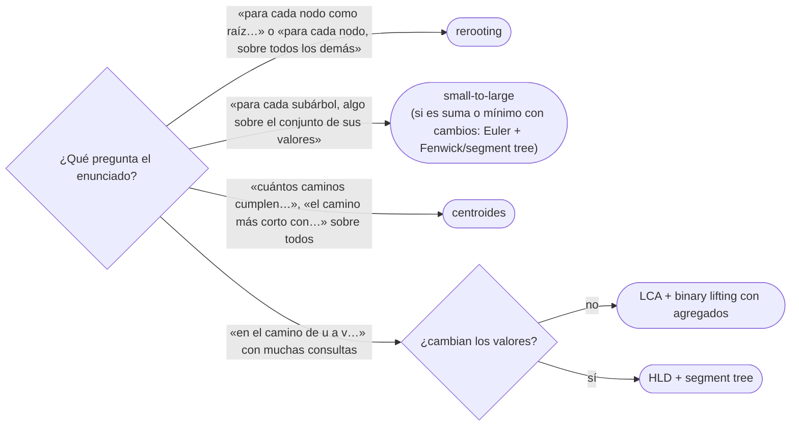

# 06 — Técnicas sobre árboles

> Cuatro técnicas que convierten problemas de árboles de `O(n²)` en `O(n log n)` o `O(n)`: el *rerooting*,
> que calcula una respuesta para cada raíz posible en dos recorridos; el *small-to-large*, que fusiona
> conjuntos de subárboles moviendo siempre el pequeño; la descomposición en centroides, para contar
> caminos; y la descomposición *heavy-light*, para consultas sobre caminos con un segment tree.
>
> **Niveles:** *rerooting* [B] · *small-to-large* [B] · descomposición en centroides [B] · HLD [C].
>
> **📚 Lectura troncal:** Laaksonen, *Guide to Competitive Programming*, 3.ª ed. (Springer, 2024), cap. 10;
> cp-algorithms, [*Heavy-light decomposition*](https://cp-algorithms.com/graph/hld.html).
>
> **Vigencia:** 2026-10-04.

**Salto rápido:** [1](#1--el-problema) · [2](#2--la-teoría) · [3](#3--rerooting) · [4](#4--small-to-large) · [5](#5--descomposición-en-centroides) · [6](#6--heavy-light-decomposition) · [7](#7--cómo-se-elige) · [8](#8--señales-del-enunciado) · [🧠](#-preguntas) · [🧩](#-problemas-propios)

---

## 1. 🎯 El problema

Muchas preguntas sobre árboles tienen una solución evidente que recorre el árbol entero varias veces:

- **«Para cada nodo, la suma de distancias a todos los demás»**: un BFS desde cada nodo, `O(n²)`.
- **«Para cada nodo, cuántos colores distintos hay en su subárbol»**: recolectar el subárbol de cada nodo,
  `O(n²)` en una cadena.
- **«¿Cuántos caminos tienen longitud exactamente `k`?»**: todos los pares, `O(n²)`.
- **«El máximo en el camino de `u` a `v`», con actualizaciones**: recorrer el camino, `O(n)` por
  consulta.

Cada una tiene su técnica, y el trabajo de este capítulo es **reconocer cuál pide el enunciado**. Todas
reutilizan lo de [`07/01`](01-arboles-y-recorridos.md) (recorridos iterativos, tamaños de subárbol, tiempos de Euler) y `07/05` (LCA).
El árbol de juguete T sirve de ejemplo para las tres primeras.

---

## 2. 📐 La teoría

**El *rerooting*.** Si la respuesta para una raíz se calcula con una DP de abajo arriba, la respuesta para
un hijo `c` de la raíz se obtiene de la del padre con una corrección local: lo que cambia al mover la raíz
de `p` a `c` es solo la arista `p–c`. Dos recorridos: uno de abajo arriba para la raíz original y otro de
arriba abajo que propaga la corrección. Con la suma de distancias:

```text
ans[c] = ans[p] − size[c] + (n − size[c])
los size[c] nodos del subárbol de c se acercan 1; los otros n − size[c] se alejan 1
```

**Teorema (*small-to-large*).** Si para cada nodo se fusionan los conjuntos de sus hijos insertando
siempre los elementos del conjunto **menor** en el **mayor**, cada elemento se mueve como mucho `log₂ n`
veces, y el total de inserciones es `O(n log n)`.

*Prueba.* Cuando un elemento se mueve, pasa de un conjunto de tamaño `a` a uno de tamaño `b ≥ a`, y el
conjunto resultante tiene tamaño `a + b ≥ 2a`: el conjunto que contiene al elemento al menos duplica su
tamaño. Como no puede pasar de `n`, el elemento se mueve como mucho `log₂ n` veces.

**El centroide.** Un nodo cuya eliminación deja componentes de tamaño `≤ n/2`. Todo árbol tiene al menos
uno: empezando en cualquier nodo, se baja hacia el subárbol con más de `n/2` nodos mientras exista; no se
puede volver atrás, porque «arriba» quedan menos de `n/2`.

**Teorema (profundidad de la descomposición).** Si se elige un centroide, se elimina, y se repite en cada
componente, la recursión tiene como mucho `⌊log₂ n⌋ + 1` niveles.

*Prueba.* Cada componente de un nivel tiene como mucho la mitad de nodos que la del nivel anterior que la
contenía.

**Consecuencia.** Todo camino del árbol pasa por el centroide del nivel más alto en el que sus dos
extremos aún estaban en el mismo componente. Contar caminos «a través del centroide» en cada componente, y
sumar, cuenta cada camino una vez: `O(n log n)` si cada nivel cuesta `O(n)`.

**La descomposición *heavy-light*.** Para cada nodo, la arista a su hijo de mayor subárbol es **pesada**; las
demás, **ligeras**. Bajar por una arista ligera al menos divide a la mitad el tamaño del subárbol, así que
cualquier camino a la raíz cruza `O(log n)` aristas ligeras, y por tanto `O(log n)` cadenas pesadas.

---

## 3. 🧱 *Rerooting*

**Qué es.** Calcular una respuesta para cada raíz posible con dos recorridos: una DP hacia arriba con una
raíz fija y una propagación hacia abajo que corrige la respuesta al mover la raíz.

**Por qué es correcto** (el enunciado y una frase): si al mover la raíz de `p` a su hijo `c` solo cambia
la contribución de la arista `p–c`, la respuesta de `c` es la de `p` más esa corrección; la propagación en
preorden calcula a cada nodo después de su padre.

**Cómo va**, la suma de distancias en T (`n = 7`):

```text
abajo arriba, raíz 1:   size  1:7 2:4 3:2 4:1 5:2 6:1 7:1
                        down  1:11 2:4 3:1 4:0 5:1 6:0 7:0      (down = suma de distancias al subárbol)
ans[1] = down[1] = 11
arriba abajo:           ans[2] = 11 − 4 + 3 = 10        ans[3] = 11 − 2 + 5 = 14
                        ans[4] = 10 − 1 + 6 = 15        ans[5] = 10 − 2 + 5 = 13
                        ans[6] = 14 − 1 + 6 = 19        ans[7] = 13 − 1 + 6 = 18
```

**Cuánto.** `Θ(n)`: dos recorridos.

**La plantilla**, con el preorden y los padres del recorrido iterativo de `07/01`:

```cpp
#include <vector>

// Suma de distancias desde cada nodo. order = preorden desde la raíz; parent[raíz] = 0. Θ(n).
std::vector<long long> sumOfDistances(int n, const std::vector<int>& order, const std::vector<int>& parent) {
    std::vector<long long> size(n + 1, 1), down(n + 1, 0), ans(n + 1, 0);
    for (int i = n - 1; i > 0; i--) {                 // abajo arriba: preorden al revés
        int v = order[i], p = parent[v];
        size[p] += size[v];
        down[p] += down[v] + size[v];
    }
    ans[order[0]] = down[order[0]];
    for (int i = 1; i < n; i++) {                     // arriba abajo: cada nodo tras su padre
        int v = order[i];
        ans[v] = ans[parent[v]] - size[v] + (n - size[v]);
    }
    return ans;
}
```

```java
// Suma de distancias desde cada nodo. order = preorden desde la raíz; parent[raíz] = 0. Θ(n).
static long[] sumOfDistances(int n, int[] order, int[] parent) {
    long[] size = new long[n + 1], down = new long[n + 1], ans = new long[n + 1];
    java.util.Arrays.fill(size, 1);
    for (int i = n - 1; i > 0; i--) {
        int v = order[i], p = parent[v];
        size[p] += size[v];
        down[p] += down[v] + size[v];
    }
    ans[order[0]] = down[order[0]];
    for (int i = 1; i < n; i++) {
        int v = order[i];
        ans[v] = ans[parent[v]] - size[v] + (n - size[v]);
    }
    return ans;
}
```

- **`long long` / `long`**: la suma de distancias llega a `n²/2 ≈ 2·10¹⁰` con `n = 2·10⁵`.
- **El caso general**: si la corrección no es tan simple (por ejemplo, «la mayor distancia»), hace falta
  guardar para cada nodo las **dos** mejores contribuciones de sus hijos, para saber qué queda al quitar
  uno; o prefijos y sufijos de las contribuciones de los hijos.
- **Con pesos**, la corrección usa el peso de la arista en lugar de 1.

**Cuándo sí**: «para cada nodo como raíz», «para cada nodo, la suma / el máximo sobre todos los demás».
**Cuándo no**: si la respuesta de una raíz no se puede corregir localmente.

> **Veredicto:** el *rerooting* da la respuesta de todas las raíces con dos recorridos, si mover la raíz
> por una arista solo cambia lo que pasa por esa arista.

---

## 4. 🧱 *Small-to-large*

**Qué es.** Para responder algo sobre el conjunto de valores de cada subárbol, cada nodo **hereda** el
conjunto de su hijo más grande y le añade los elementos de los demás hijos y el suyo.

**Por qué es correcto** (el enunciado y una frase): el conjunto final de un nodo es la unión de los de sus
hijos más su valor, sea cual sea el orden de fusión; insertar el menor en el mayor solo cambia el coste,
que el teorema de §2 deja en `O(n log n)` inserciones.

**Cómo va**, colores distintos por subárbol en T, con colores `1:a 2:b 3:a 4:c 5:b 6:c 7:a`:

```text
7: {a}            4: {c}            6: {c}
5: hereda {a} (de 7), añade b → {a, b}                 2 colores
2: hereda {a, b} (de 5, el mayor), añade c (de 4) y b → {a, b, c}       3
3: hereda {c} (de 6), añade a → {a, c}                 2
1: hereda {a, b, c} (de 2), añade {a, c} (de 3) y a → {a, b, c}         3
```

**Cuánto.** `O(n log n)` inserciones; con un conjunto de *hash*, `O(n log n)` esperado; con uno ordenado,
`O(n log² n)`.

**La plantilla**, con conjuntos que se **mueven** (no se copian) del hijo grande al padre:

```cpp
#include <set>
#include <utility>
#include <vector>

// Colores distintos de cada subárbol. order = preorden; parent[raíz] = 0. O(n log² n).
std::vector<int> distinctInSubtree(int n, const std::vector<int>& order, const std::vector<int>& parent,
                                   const std::vector<int>& color) {
    std::vector<std::set<int>> s(n + 1);
    std::vector<int> ans(n + 1);
    for (int i = n - 1; i >= 0; i--) {                // preorden al revés: hijos antes que el padre
        int v = order[i];
        s[v].insert(color[v]);
        ans[v] = s[v].size();
        int p = parent[v];
        if (p == 0) continue;
        if (s[p].size() < s[v].size()) std::swap(s[p], s[v]);   // O(1): intercambia punteros internos
        for (int x : s[v]) s[p].insert(x);
        s[v].clear();
    }
    return ans;
}
```

```java
// Colores distintos de cada subárbol. order = preorden; parent[raíz] = 0. O(n log n) esperado.
@SuppressWarnings("unchecked")
static int[] distinctInSubtree(int n, int[] order, int[] parent, int[] color) {
    java.util.HashSet<Integer>[] s = new java.util.HashSet[n + 1];
    int[] ans = new int[n + 1];
    for (int i = n - 1; i >= 0; i--) {
        int v = order[i];
        if (s[v] == null) s[v] = new java.util.HashSet<>();
        s[v].add(color[v]);
        ans[v] = s[v].size();
        int p = parent[v];
        if (p == 0) continue;
        if (s[p] == null) { s[p] = s[v]; s[v] = null; continue; }
        if (s[p].size() < s[v].size()) { var t = s[p]; s[p] = s[v]; s[v] = t; }   // mueve referencias
        s[p].addAll(s[v]);
        s[v] = null;
    }
    return ans;
}
```

- **El intercambio es `O(1)`**: en C++, `std::swap` de dos `std::set` intercambia sus estructuras internas;
  en Java, se intercambian referencias. Copiar el conjunto grande lo estropearía todo.
- **La respuesta de `v` se anota** en el momento en que su conjunto está completo (al procesarlo), antes
  de fusionarlo con el padre.
- **El procesamiento de cada nodo ocurre después de todos sus hijos** porque se recorre el preorden al
  revés; los hijos van fusionando su conjunto en el del padre a medida que se procesan.
- **En Python**, el mismo esquema con `set`: el intercambio son dos referencias.

**Cuándo sí**: consultas sobre los valores de cada subárbol (distintos, el más frecuente, el `k`-ésimo);
fusiones de componentes en Union-Find con listas. **Cuándo no**: si la consulta es una suma o un mínimo, el
tramo de Euler y un Fenwick bastan (`07/01`).

> **Veredicto:** fusionar siempre el pequeño en el grande hace que cada elemento se mueva `log n` veces.
> Es la forma de llevar un conjunto por cada subárbol sin pagar `n²`.

---

## 5. 🧱 Descomposición en centroides

**Qué es.** Elegir el centroide, eliminarlo, y repetir en cada componente que queda. El resultado es un
**árbol de centroides** de profundidad `O(log n)`.

**Por qué es correcto** (el enunciado y una frase): todo camino del árbol tiene un nodo que es el primer
centroide elegido entre los suyos, y el camino está entero en el componente de ese centroide; contar en
cada componente los caminos que pasan por su centroide cuenta cada camino exactamente una vez.

**Cómo va**, en T (`n = 7`): quitar 2 deja componentes de tamaños 1, 2 y 3, todos `≤ 3`: el centroide es 2.

```text
nivel 0:  2              → componentes {4}, {5, 7}, {1, 3, 6}
nivel 1:  4, 5, 3        → componentes {7}, {1}, {6}
nivel 2:  7, 1, 6
profundidad 3 = ⌊log₂ 7⌋ + 1
```

**Cuánto.** `O(n log n)` para construir; cada nodo está en `O(log n)` componentes.

**La plantilla**, la búsqueda del centroide de un componente y la construcción del árbol de centroides:

```cpp
#include <vector>

// Árbol de centroides: cpar[v] = centroide padre de v (−1 en la raíz). O(n log n).
struct CentroidDecomposition {
    const std::vector<std::vector<int>>& adj;
    std::vector<int> sz, par, removed, cpar;
    explicit CentroidDecomposition(const std::vector<std::vector<int>>& g)
        : adj(g), sz(g.size()), par(g.size()), removed(g.size(), 0), cpar(g.size(), -1) {}
    int findCentroid(int root) {
        std::vector<int> order{root}; par[root] = -1;
        for (size_t i = 0; i < order.size(); i++)               // preorden del componente
            for (int w : adj[order[i]])
                if (w != par[order[i]] && !removed[w]) { par[w] = order[i]; order.push_back(w); }
        for (int i = (int)order.size() - 1; i >= 0; i--) {      // tamaños
            int v = order[i]; sz[v] = 1;
            for (int w : adj[v]) if (w != par[v] && !removed[w]) sz[v] += sz[w];
        }
        int total = order.size(), c = root;
        while (true) {                                          // baja hacia el hijo con más de la mitad
            int heavy = -1;
            for (int w : adj[c]) if (w != par[c] && !removed[w] && 2 * sz[w] > total) heavy = w;
            if (heavy < 0) return c;
            c = heavy;
        }
    }
    void build(int root, int parentCentroid) {                   // profundidad de recursión O(log n)
        int c = findCentroid(root);
        cpar[c] = parentCentroid; removed[c] = 1;
        for (int w : adj[c]) if (!removed[w]) build(w, c);
    }
};
```

```java
// Árbol de centroides: cpar[v] = centroide padre de v (−1 en la raíz). O(n log n).
static final class CentroidDecomposition {
    final java.util.List<Integer>[] adj; final int[] sz, par, cpar; final boolean[] removed;
    CentroidDecomposition(java.util.List<Integer>[] g) {
        adj = g; int n = g.length;
        sz = new int[n]; par = new int[n]; cpar = new int[n]; removed = new boolean[n];
        java.util.Arrays.fill(cpar, -1);
    }
    int findCentroid(int root) {
        int[] order = new int[adj.length]; int cnt = 0;
        order[cnt++] = root; par[root] = -1;
        for (int i = 0; i < cnt; i++)
            for (int w : adj[order[i]])
                if (w != par[order[i]] && !removed[w]) { par[w] = order[i]; order[cnt++] = w; }
        for (int i = cnt - 1; i >= 0; i--) {
            int v = order[i]; sz[v] = 1;
            for (int w : adj[v]) if (w != par[v] && !removed[w]) sz[v] += sz[w];
        }
        int c = root;
        while (true) {
            int heavy = -1;
            for (int w : adj[c]) if (w != par[c] && !removed[w] && 2 * sz[w] > cnt) heavy = w;
            if (heavy < 0) return c;
            c = heavy;
        }
    }
    void build(int root, int parentCentroid) {
        int c = findCentroid(root);
        cpar[c] = parentCentroid; removed[c] = true;
        for (int w : adj[c]) if (!removed[w]) build(w, c);
    }
}
```

- **La búsqueda baja** desde la raíz del componente hacia el hijo con más de la mitad: hacia «arriba»
  siempre queda menos de la mitad, así que nunca hace falta volver.
- **La recursión de `build`** tiene profundidad `O(log n)` por el teorema de §2: no desborda.
- **Java**: el arreglo `order` de tamaño `n` por llamada cuesta `O(n)` cada vez; para `n` grande, se
  reutiliza un arreglo global.
- **Para contar caminos**, en cada centroide se recorren sus subárboles (sin los nodos eliminados),
  combinando las distancias de cada subárbol con las de los anteriores.

**Cuándo sí**: contar o buscar caminos con una propiedad (longitud `k`, suma `≤ K`); consultas «el nodo
marcado más cercano» con actualizaciones (subir por el árbol de centroides). **Cuándo no**: consultas sobre
un camino concreto entre `u` y `v`, que son de LCA o HLD.

> **Veredicto:** la descomposición en centroides parte el árbol en `log n` niveles de componentes
> cada vez más pequeños; cada camino se cuenta en el nivel de su primer centroide.

---

## 6. 🧱 *Heavy-light decomposition*

- **Qué resuelve.** Consultas y actualizaciones sobre **caminos** (`max`, suma, asignación) con un segment
  tree ([`09/03`](../09-consultas-sobre-rangos/03-segment-tree.md)), cuando el árbol cambia sus valores.
- **Qué garantiza.** Todo camino se parte en `O(log n)` tramos contiguos de un arreglo: se numeran los
  nodos con un DFS que visita primero el hijo pesado, y cada cadena pesada queda contigua. Una consulta
  sobre un camino son `O(log n)` consultas al segment tree: `O(log² n)`.
- **Cuánto.** `O(n)` de preproceso; `O(log² n)` por consulta de camino; los subárboles siguen siendo
  tramos contiguos, `O(log n)`.
- **Cómo reconocerlo.** «Cambia el valor del nodo `v`; da el máximo en el camino de `u` a `v`», con muchas
  operaciones mezcladas.
- **Si no te la sabes.** Si no hay actualizaciones, *binary lifting* con agregados (`07/05`); si solo hay
  actualizaciones de nodo y consultas de camino con suma, el recorrido de Euler con un Fenwick (sumas de
  la raíz a cada nodo) y el LCA.
- **Dónde está entera.** cp-algorithms, [*Heavy-light decomposition*](https://cp-algorithms.com/graph/hld.html);
  Laaksonen, cap. 10.

---

## 7. 🧭 Cómo se elige



---

## 8. 🔎 Señales del enunciado

| Señal | Técnica | Por qué |
|---|---|---|
| «Para cada nodo, la suma de distancias a todos» | *Rerooting* | Corrección local al mover la raíz |
| «Elige la raíz que maximiza…» | *Rerooting* | Hay que evaluar todas las raíces |
| «Colores distintos en el subárbol», «el valor dominante» | *Small-to-large* | Conjuntos por subárbol |
| «Número de caminos de longitud `k`» | Centroides | Cada camino, en un nivel |
| «Actualiza un nodo; máximo en el camino `u–v`» | HLD + segment tree | El camino en `O(log n)` tramos |

---

## ⚠️ Errores frecuentes

| Se dice | Lo preciso |
|---|---|
| «Para cada raíz recorro el árbol» | `O(n²)`; con *rerooting*, dos recorridos |
| «*Small-to-large* es mover cada conjunto al padre» | Hay que mover el **pequeño** al grande; mover siempre el del hijo es `O(n²)` en una cadena |
| «El centroide es el centro del árbol» | El centro minimiza la distancia máxima (`07/01`); el centroide, el mayor componente al quitarlo |
| «La descomposición en centroides es `O(n²)` porque recorre cada componente» | Cada nodo está en `O(log n)` componentes: `O(n log n)` |
| «HLD sirve para subárboles» | Para subárboles basta el tramo de Euler; HLD es para caminos |

---

## 📚 Para profundizar

- **Libro** — Laaksonen, *Guide to Competitive Programming*, 3.ª ed. (Springer, 2024), cap. 10: técnicas
  sobre árboles con sus problemas. *Lectura troncal.*
- **Referencia** — cp-algorithms, [*Heavy-light decomposition*](https://cp-algorithms.com/graph/hld.html).
  *Lectura troncal.*
- **Referencia** — USACO Guide, [*DP on Trees — Solving For All Roots*](https://usaco.guide/gold/all-roots),
  [*Small-To-Large Merging*](https://usaco.guide/plat/merging) y [*Centroid Decomposition*](https://usaco.guide/plat/centroid).

---

## 🧠 Preguntas

1. ¿Qué es un centroide, y por qué todo árbol tiene al menos uno? 🟢
2. ¿Qué cambia en la suma de distancias al mover la raíz de `p` a su hijo `c`? 🟢
3. ¿Qué es una arista pesada en HLD? 🟢
4. Calcula con *rerooting* la suma de distancias desde 5 en T a partir de la de 2. 🟡
5. ¿Por qué en *small-to-large* hay que intercambiar los conjuntos en `O(1)` y no copiarlos? 🟡
6. ¿Qué diferencia hay entre el centro de un árbol y su centroide? Da un árbol donde no coincidan. 🟡
7. ¿Por qué un camino a la raíz cruza como mucho `log₂ n` aristas ligeras? 🟡
8. Demuestra que en *small-to-large* cada elemento se mueve como mucho `log₂ n` veces. 🟠
9. Demuestra que la descomposición en centroides tiene profundidad `O(log n)`. 🟠
10. Compara cómo harías *small-to-large* en C++, Java y Python, y qué coste tiene el conjunto en cada uno. 🟠
11. ¿Cómo cuentas los caminos de longitud exactamente `k` que pasan por un centroide sin contar dos veces los que bajan por el mismo hijo? 🟠
12. ¿Cómo haces *rerooting* para «la distancia al nodo más lejano», donde la corrección no es una suma? 🔴
13. ¿Por qué una consulta de camino con HLD cuesta `O(log² n)` y no `O(log n)`, y cuándo se puede bajar? 🔴

---

## 🧩 Problemas propios

### La mejor sede

**Nivel:** 🟡 · **Formato:** programa completo.

`n` ciudades conectadas sin ciclos; cada carretera mide 1. Hay que elegir la ciudad sede que minimiza la
suma de distancias a todas las demás. Imprime esa suma mínima y la ciudad (a igualdad, la de menor número).

- **Entrada.** Una línea con `n`. Después, `n − 1` aristas.
- **Salida.** Dos enteros: la suma mínima y la ciudad.
- **Restricciones.** `1 ≤ n ≤ 2·10⁵`.

```text
Entrada            Salida
7                  10 2
1 2
1 3
2 4
2 5
3 6
5 7

Entrada            Salida
1                  0 1
```

**Pista 1:** si conoces la suma desde una ciudad, ¿cuánto cambia al pasar a una vecina?

### Colores de cada rama

**Nivel:** 🟠 · **Formato:** programa completo.

Un árbol enraizado en 1 tiene un color en cada nodo. Imprime, para cada nodo, cuántos colores distintos
hay en su subárbol.

- **Entrada.** Una línea con `n`. Una línea con los `n` colores. Después, `n − 1` aristas.
- **Salida.** `n` enteros.
- **Restricciones.** `1 ≤ n ≤ 2·10⁵`; colores entre 1 y `10⁹`; el árbol puede ser una cadena.

```text
Entrada                  Salida
7                        3 3 2 1 2 1 1
1 2 1 3 2 3 1
1 2
1 3
2 4
2 5
3 6
5 7

Entrada                  Salida
3                        2 2 1
1000000000 1 1000000000
1 2
2 3
```

**Pista 1:** en una cadena de `2·10⁵` nodos, ¿cuántos elementos copia en total una fusión que siempre
mueve el conjunto del hijo al padre?

---

## 🧩 Práctica externa

> 💡 **Truco.** Las cuatro técnicas se parecen poco, pero se confunden al leer el enunciado. Antes de
> programar, di cuál es y por qué no las otras tres; si dudas, pide a una IA que te pregunte por la forma
> de la consulta, no que elija por ti ([`01/06`](../01-oficio-del-competidor/06-protocolo-de-resolucion.md)).

### Núcleo

| ✔ | Problema | Plataforma | Nivel | Patrón | Pista 1 |
|---|---|---|---|---|---|
| [ ] | [Minimum Height Trees](https://leetcode.com/problems/minimum-height-trees/) | LeetCode | 🟡 | Centro del árbol | ¿Qué nodos quedan si quitas las hojas por capas? |
| [ ] | [Finding a Centroid](https://cses.fi/problemset/task/2079) | CSES | 🟡 | Centroide | Desde la raíz, ¿hacia dónde bajas mientras haya un subárbol demasiado grande? |
| [ ] | [Path Queries](https://cses.fi/problemset/task/1138) | CSES | 🟠 | Euler + Fenwick para sumas a la raíz | Cambiar el valor de `v`, ¿a qué sumas raíz-nodo afecta? |
| [ ] | [Tree with Maximum Cost](https://codeforces.com/problemset/problem/1092/F) | Codeforces | 🟠 | *Rerooting* con pesos | Al mover la raíz a un hijo, ¿qué parte del coste cambia? |
| [ ] | [Ciel the Commander](https://codeforces.com/problemset/problem/321/C) | Codeforces | 🟠 | Profundidad en el árbol de centroides | ¿Qué letra le das a cada centroide según su nivel? |

### Ampliación

| ✔ | Problema | Plataforma | Nivel | Patrón | Pista 1 |
|---|---|---|---|---|---|
| [ ] | [Lomsat gelral](https://codeforces.com/problemset/problem/600/E) | Codeforces | 🔴 | *Small-to-large* con frecuencias | Además del conjunto, ¿qué tienes que llevar para saber la frecuencia máxima? |
| [ ] | [Fixed-Length Paths I](https://cses.fi/problemset/task/2080) | CSES | 🔴 | Centroides | En cada centroide, ¿qué cuentas por profundidad? |
| [ ] | [Path Queries II](https://cses.fi/problemset/task/2134) | CSES | 🔴 | HLD + segment tree | ¿En cuántos tramos contiguos parte HLD un camino? |

### Por curiosidad

| ✔ | Problema | Plataforma | Nivel | Patrón | Pista 1 |
|---|---|---|---|---|---|
| [ ] | 💀 [Fixed-Length Paths II](https://cses.fi/problemset/task/2081) | CSES | 🔴 | Centroides con rango de longitudes | Con un intervalo de longitudes, ¿qué estructura cuenta por rango de profundidad? |
| [ ] | 💀 [Xenia and Tree](https://codeforces.com/problemset/problem/342/E) | Codeforces | 🔴 | Árbol de centroides con actualizaciones | Al pintar un nodo, ¿qué centroides tienen que enterarse? |

---

## ✅ Criterio de dominio

- Escribir el *rerooting* de la suma de distancias y el *small-to-large* con intercambio en `O(1)`.
- Encontrar el centroide y construir la descomposición, con su prueba de profundidad.
- Elegir entre las cuatro técnicas a partir de la forma de la consulta.
- Resolver Tree with Maximum Cost y Fixed-Length Paths I sin pista 2.

---

**Anterior:** [`07/05` — LCA](05-lca.md) · **Siguiente:** [`07/07` — Árboles dinámicos](07-arboles-dinamicos.md) · **Relacionado:**
[`13/03` — DP en árboles y en DAG](../13-dp-avanzada/03-dp-en-arboles-y-dag.md); [`09/03` — Segment tree](../09-consultas-sobre-rangos/03-segment-tree.md).
