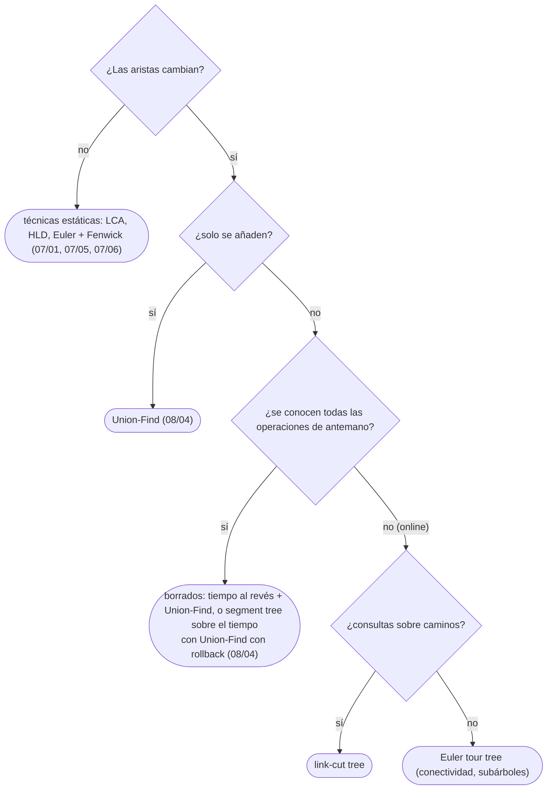

# 07 — Árboles dinámicos

> Qué resuelven el *link-cut tree* y el *Euler tour tree* —un bosque que cambia con enlaces y cortes, con
> consultas sobre caminos o sobre componentes en `O(log n)` amortizado—, cuándo aparecen, y las
> alternativas *offline* que bastan casi siempre.
>
> **Niveles:** *link-cut tree* [C] · *Euler tour tree* [C].
>
> **📚 Lectura troncal:** Tarjan, *Data Structures and Network Algorithms* (SIAM, 1983), cap. 5; Sleator y
> Tarjan, «A Data Structure for Dynamic Trees», *Journal of Computer and System Sciences* 26(3), 1983.
>
> **Vigencia:** 2026-10-04.

**Salto rápido:** [1](#1--el-problema) · [2](#2--la-teoría) · [3](#3--link-cut-tree) · [4](#4--euler-tour-tree) · [5](#5--cómo-se-elige) · [6](#6--señales-del-enunciado) · [🧠](#-preguntas) · [🧩](#-problemas-propios)

---

## 1. 🎯 El problema

Todo lo del bloque supone que el árbol es fijo: se precalcula (`up`, tiempos de Euler, cadenas pesadas) y
se consulta. Si las aristas cambian —se enlazan dos árboles, se corta una arista—, el preproceso deja de
valer, y rehacerlo cuesta `O(n)` por cambio: con `10⁵` cambios, `10¹⁰`.

Un **árbol dinámico** mantiene un bosque bajo `link(u, v)` y `cut(u, v)` y responde consultas como
«¿están `u` y `v` en el mismo árbol?» o «el máximo en el camino de `u` a `v`» en `O(log n)` amortizado por
operación. Existen dos clásicos, y los dos son largos y delicados de escribir. Por eso este capítulo es
solo de fichas: lo que se necesita es **reconocerlos** y, sobre todo, saber cuándo **no** hacen falta,
porque casi siempre hay una alternativa *offline* con Union-Find ([`08/04`](../08-heaps-y-union-find/04-union-find.md)).

---

## 2. 📐 La teoría

**El problema de los árboles dinámicos.** Un bosque con `n` nodos y operaciones:

```text
link(u, v)     une los árboles de u y v con la arista u–v (deben estar en árboles distintos)
cut(u, v)      quita la arista u–v
connected(u, v), path_aggregate(u, v), subtree_aggregate(v), reroot(v) …
```

**Las garantías.** El *link-cut tree* (Sleator y Tarjan, 1983) hace cada operación en `O(log n)`
amortizado (con árboles *splay*, `07/03`) o en el peor caso (con árboles sesgados, más complejos). El
*Euler tour tree* (Henzinger y King, 1999) guarda el recorrido de Euler de cada árbol en un árbol
balanceado y hace `link`, `cut` y `connected` en `O(log n)`.

**Conectividad dinámica en grafos generales.** Si el grafo tiene ciclos y se borran aristas, mantener la
conectividad *online* es mucho más difícil: el algoritmo de Holm, de Lichtenberg y Thorup (2001) lo hace
en `O(log² n)` amortizado, apoyado en *Euler tour trees*. *Offline* (con todas las operaciones
conocidas), basta un *segment tree* sobre el tiempo con Union-Find con *rollback*: `O(m log m log n)`.

**La idea que lo hace posible *offline*.** Si se conocen todas las operaciones, los borrados pueden
convertirse en inserciones **recorriendo el tiempo al revés**: se empieza con el grafo final y se van
añadiendo las aristas en el orden inverso a como se borraron. Union-Find solo sabe unir, y eso basta.

---

## 3. 🧱 *Link-cut tree*

- **Qué resuelve.** Un bosque con `link`, `cut`, cambio de raíz y consultas o actualizaciones sobre
  **caminos** (máximo, suma, asignación), todo *online*.
- **Qué garantiza.** `O(log n)` amortizado por operación. Descompone el bosque en caminos «preferidos»,
  cada uno guardado en un *splay* ordenado por profundidad; la operación central, `access(v)`, hace que el
  camino de la raíz a `v` sea preferido y lo deja en un solo *splay*.
- **Cuánto.** Unos pocos punteros y agregados por nodo; código de unas 80–120 líneas, fácil de equivocar.
- **Cómo reconocerlo.** «Añade y quita aristas de un bosque y responde sobre el camino entre `u` y `v`»,
  *online* (con respuestas que dependen de las anteriores, o con «cifrado» de la entrada). También es la
  pieza de los algoritmos de flujo de Dinic con árboles dinámicos y de árboles de expansión dinámicos.
- **Si no te la sabes.** Si las operaciones son conocidas de antemano: invertir el tiempo y Union-Find,
  o *segment tree* sobre el tiempo con Union-Find con *rollback* (`08/04`). Si el árbol no cambia: HLD
  (`07/06`).
- **Dónde está entera.** Sleator y Tarjan, 1983; Tarjan, *Data Structures and Network Algorithms*,
  cap. 5.

---

## 4. 🧱 *Euler tour tree*

- **Qué resuelve.** Un bosque con `link`, `cut` y consultas sobre **componentes** o **subárboles**
  (¿conectados?, tamaño, suma de un subárbol), *online*.
- **Qué garantiza.** `O(log n)` por operación (esperado con *treaps*, `07/03`; peor caso con un árbol
  balanceado). Guarda el recorrido de Euler de cada árbol, como sucesión de aristas dirigidas, en un *treap*
  implícito: `link` y `cut` son cortes y uniones de esas secuencias, y cambiar la raíz es rotar la
  secuencia.
- **Cuánto.** Un nodo por arista dirigida y por vértice; `O(n)` de memoria.
- **Cómo reconocerlo.** Conectividad dinámica en bosques; es el componente básico de la conectividad
  dinámica en grafos generales.
- **Si no te la sabes.** *Offline*, lo mismo que en el *link-cut tree*. Si solo hay `link` (nunca `cut`),
  Union-Find a secas.
- **Dónde está entera.** Henzinger y King, «Randomized Fully Dynamic Graph Algorithms with
  Polylogarithmic Time per Operation», *Journal of the ACM* 46(4), 1999.

---

## 5. 🧭 Cómo se elige



| Situación | Técnica | Coste |
|---|---|---|
| Solo uniones | Union-Find | `O(α(n))` amortizado |
| Uniones y borrados, *offline* | Segment tree sobre el tiempo + Union-Find con *rollback* | `O(m log m log n)` |
| Bosque dinámico, caminos, *online* | *Link-cut tree* | `O(log n)` amortizado |
| Bosque dinámico, componentes, *online* | *Euler tour tree* | `O(log n)` esperado |

---

## 6. 🔎 Señales del enunciado

| Señal | Técnica | Por qué |
|---|---|---|
| «Se añaden aristas», nunca se quitan | Union-Find | Solo fusiones |
| Borrados conocidos de antemano | Tiempo al revés + Union-Find | Los borrados al revés son uniones |
| Aristas que aparecen y desaparecen, *offline* | Segment tree sobre el tiempo + *rollback* | Cada arista vive en un intervalo |
| Consultas cifradas con la respuesta anterior | *Online*: árbol dinámico | No se puede reordenar |
| `n` y `q` de unos pocos miles | Un recorrido por consulta | Las restricciones lo permiten |

---

## ⚠️ Errores frecuentes

| Se dice | Lo preciso |
|---|---|
| «Si el árbol cambia, hay que reconstruirlo» | Con un árbol dinámico, cada cambio es `O(log n)` amortizado; y *offline*, casi siempre basta Union-Find |
| «Union-Find no sirve si se borran aristas» | *Online*, no; *offline*, recorriendo el tiempo al revés los borrados son uniones |
| «El *link-cut tree* sirve para grafos con ciclos» | Mantiene un **bosque**; la conectividad dinámica general necesita más (Holm, de Lichtenberg y Thorup) |
| «HLD sirve con aristas que cambian» | HLD fija las cadenas al principio; si el árbol cambia, hay que rehacerlo |

---

## 📚 Para profundizar

- **Libro** — Tarjan, *Data Structures and Network Algorithms* (SIAM, 1983), cap. 5: árboles dinámicos y
  su análisis. *Lectura troncal.*
- **Artículo** — Sleator y Tarjan, «A Data Structure for Dynamic Trees», *Journal of Computer and System
  Sciences* 26(3), 1983. *Lectura troncal.*
- **Artículo** — Henzinger y King, *Journal of the ACM* 46(4), 1999: los *Euler tour trees*.
- **Artículo** — Holm, de Lichtenberg y Thorup, «Poly-logarithmic Deterministic Fully-Dynamic Algorithms
  for Connectivity, Minimum Spanning Tree, 2-Edge, and Biconnectivity», *Journal of the ACM* 48(4), 2001.

---

## 🧠 Preguntas

1. ¿Qué operaciones soporta un árbol dinámico? 🟢
2. ¿Por qué rehacer el preproceso tras cada cambio no escala? 🟢
3. Si solo se añaden aristas, ¿qué estructura basta? 🟢
4. ¿Cómo convierte el tiempo al revés los borrados en inserciones? 🟡
5. ¿Qué diferencia hay entre lo que resuelve un *link-cut tree* y un *Euler tour tree*? 🟡
6. ¿Qué es «*offline*» y por qué cambia tanto la dificultad? 🟡
7. ¿Por qué Union-Find con *rollback* no puede usar compresión de caminos? 🟠
8. ¿Cómo sirve un *segment tree* sobre el tiempo para la conectividad con borrados *offline*? 🟠
9. ¿Qué garantiza el `O(log n)` del *link-cut tree*: peor caso o amortizado? ¿De qué estructura lo hereda? 🟠
10. Compara qué ofrecen C++, Java y Python para estos problemas: ¿alguno trae algo en su biblioteca? 🟠
11. ¿Cómo cambia la raíz un *Euler tour tree* sin recorrer el árbol? 🔴
12. ¿Por qué la conectividad dinámica en grafos con ciclos es más difícil que en bosques? 🔴

---

## 🧩 Problemas propios

### Bosque pequeño

**Nivel:** 🟡 · **Formato:** programa completo.

Un bosque de `n` nodos empieza sin aristas. Llegan `q` órdenes: `link u v` (se garantiza que están en
árboles distintos), `cut u v` (la arista existe) y `ask u v` (imprime `SI` si están conectados, `NO` si
no).

- **Entrada.** Una línea con `n` y `q`. Después, `q` órdenes.
- **Salida.** Una línea por cada `ask`.
- **Restricciones.** `1 ≤ n, q ≤ 2000`.

```text
Entrada            Salida
4 6                SI
link 1 2           NO
link 2 3           SI
ask 1 3
cut 1 2
ask 1 3
ask 2 3

Entrada            Salida
1 1                SI
ask 1 1
```

**Pista 1:** con `n` y `q` de 2000, ¿cuánto cuesta un recorrido completo por cada consulta?

### Red que se rompe

**Nivel:** 🟠 · **Formato:** programa completo.

Una red de `n` nodos y `m` cables pierde cables en un orden conocido. Tras cada pérdida, imprime el número
de componentes conexas.

- **Entrada.** Una línea con `n`, `m` y `k`. Después, `m` líneas con los cables. Una línea con los `k`
  índices (1-indexados, distintos) de los cables que se rompen, en orden.
- **Salida.** `k` enteros separados por espacios.
- **Restricciones.** `1 ≤ n, m ≤ 2·10⁵`; `1 ≤ k ≤ m`.

```text
Entrada            Salida
5 5 3              1 2 3
1 2
2 3
3 4
4 5
1 5
2 4 1

Entrada            Salida
2 1 1              2
1 2
1
```

**Pista 1:** si miraras la película al revés, ¿qué les pasaría a los cables?

---

## 🧩 Práctica externa

> 💡 **Truco.** Antes de escribir un *link-cut tree*, pregúntate si conoces todas las operaciones de
> antemano. Una IA puede ayudarte a ver si el problema admite procesarlo *offline*; pídele eso, no la
> estructura ([`01/06`](../01-oficio-del-competidor/06-protocolo-de-resolucion.md)).

Las bases no tienen problemas de árboles dinámicos *online*; el núcleo practica las alternativas *offline*
que sí aparecen.

### Núcleo

| ✔ | Problema | Plataforma | Nivel | Patrón | Pista 1 |
|---|---|---|---|---|---|
| [ ] | [Bricks Falling When Hit](https://leetcode.com/problems/bricks-falling-when-hit/) | LeetCode | 🔴 | Tiempo al revés con Union-Find | Si quitas todos los ladrillos golpeados y los repones al revés, ¿qué cuentas? |
| [ ] | [Checking Existence of Edge Length Limited Paths](https://leetcode.com/problems/checking-existence-of-edge-length-limited-paths/) | LeetCode | 🔴 | Consultas *offline* ordenadas | Si ordenas las consultas por el límite, ¿qué aristas tienes disponibles en cada una? |
| [ ] | [Number of Good Paths](https://leetcode.com/problems/number-of-good-paths/) | LeetCode | 🔴 | Uniones por orden de valor | Si añades los nodos de menor a mayor valor, ¿qué componentes puede cerrar cada uno? |

### Ampliación

| ✔ | Problema | Plataforma | Nivel | Patrón | Pista 1 |
|---|---|---|---|---|---|
| [ ] | [Dynamic Connectivity](https://cses.fi/problemset/task/2133) | CSES | 🔴 | Segment tree sobre el tiempo + *rollback* | ¿Durante qué intervalo de tiempo existe cada arista? |
| [ ] | [Forced Online Queries Problem](https://codeforces.com/problemset/problem/1217/F) | Codeforces | 🔴 | Conectividad «casi *offline*» | Aunque las consultas dependan de la anterior, ¿cuántas aristas posibles puede tocar cada una? |

### Por curiosidad

| ✔ | Problema | Plataforma | Nivel | Patrón | Pista 1 |
|---|---|---|---|---|---|
| [ ] | 💀 [Matches Are Not a Child's Play](https://codeforces.com/problemset/problem/1137/F) | Codeforces | 🔴 | *Link-cut tree* | Cuando el máximo pasa a ser la raíz, ¿qué camino cambia de orden? |
| [ ] | 💀 [Pastoral Oddities](https://codeforces.com/problemset/problem/603/E) | Codeforces | 🔴 | Divide y vencerás *offline* o *link-cut tree* | ¿Qué propiedad de las componentes decide si existe la solución? |

---

## ✅ Criterio de dominio

- Explicar qué resuelve cada estructura y su garantía, sin escribirla.
- Reconocer cuándo un problema con borrados admite procesarse *offline*.
- Resolver Bricks Falling When Hit y Dynamic Connectivity sin pista 2.

---

**Anterior:** [`07/06` — Técnicas sobre árboles](06-tecnicas-sobre-arboles.md) · **Siguiente:**
[`07/08` — Simulación](08-simulacion.md) · **Relacionado:** [`08/04` — Union-Find](../08-heaps-y-union-find/04-union-find.md); [`07/03` — Árboles aleatorizados y autoajustables](03-arboles-aleatorizados.md).
