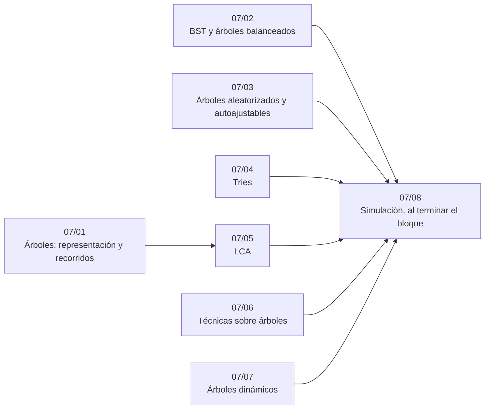

# Bloque 07 — Árboles

> Los árboles, de la representación a los dinámicos: recorridos y diámetro, BST y balanceados (AVL,
> rojo-negro, árbol B), *treaps* y *skip lists*, *tries*, LCA, las técnicas sobre árboles (*rerooting*,
> *small-to-large*, centroides) y, como fichas, los árboles dinámicos. Las dos primeras son de entrevista; el resto,
> de concurso.
>
> Las respuestas de las preguntas y las pistas 2 y 3 de los problemas, en [`09` — Respuestas](09-respuestas.md).
>
> **Vigencia:** 2026-10-04.

---

## 🧭 Índice

| Capítulo | Niveles | Ruta corta |
|---|---|---|
| [`07/01` — Árboles: representación y recorridos](01-arboles-y-recorridos.md) | representación [A] · preorden, inorden, postorden, por niveles [A] · diámetro [A] · recorrido de Euler [B] | sí |
| [`07/02` — BST y árboles balanceados](02-bst-y-balanceados.md) | BST [A] · AVL [B] · rojo-negro [B] · (2,4) [C] · árbol B [B] |  |
| [`07/03` — Árboles aleatorizados y autoajustables](03-arboles-aleatorizados.md) | *treap* [B] · *treap* implícito [B] · *skip list* [B] · *splay* [C] |  |
| [`07/04` — *Tries*](04-tries.md) | *trie* de palabras [A] · *trie* binario [A] · *trie* comprimido [C] | sí |
| [`07/05` — LCA](05-lca.md) | *binary lifting* [A] · Euler + RMQ [B] |  |
| [`07/06` — Técnicas sobre árboles](06-tecnicas-sobre-arboles.md) | *rerooting* [B] · *small-to-large* [B] · descomposición en centroides [B] · HLD [C] |  |
| [`07/07` — Árboles dinámicos](07-arboles-dinamicos.md) | *link-cut tree* [C] · *Euler tour tree* [C] |  |
| [`07/08` — Simulación](08-simulacion.md) | El examen del bloque: preguntas transversales y problemas cronometrados | |
| [`07/09` — Respuestas](09-respuestas.md) | Las preguntas en tres capas y las pistas 2 y 3 | |

---

## 🧭 Orden de lectura

- `07/01` primero siempre. Para entrevista bastan `07/01`, `07/02` y `07/04`; `07/05`–`07/07` son de concurso y se apoyan en `07/01`.

---

## 🔎 Mapa de señales del bloque

| Señal | Técnica | Capítulo |
|---|---|---|
| «`n` nodos y `n − 1` aristas», «conexo» | Es un árbol: camino único | [`07/01`](01-arboles-y-recorridos.md) |
| «El padre de `i` es `p[i]`» | Arreglo de padres; invertir para bajar | [`07/01`](01-arboles-y-recorridos.md) |
| «El menor mayor que `x`», «el anterior», con inserciones | Mapa ordenado de biblioteca | [`07/02`](02-bst-y-balanceados.md) |
| «Valida que es un BST» | Intervalo permitido hacia abajo, o inorden creciente | [`07/02`](02-bst-y-balanceados.md) |
| Mapa ordenado en Go, JavaScript o Python | *Treap* | [`07/03`](03-arboles-aleatorizados.md) |
| «Inserta en la posición `p`», «corta el tramo y pégalo al final» | *Treap* implícito | [`07/03`](03-arboles-aleatorizados.md) |
| «Cuántas empiezan por», «autocompletar», «el prefijo más largo» | *Trie* de palabras | [`07/04`](04-tries.md) |
| «Ninguna palabra es prefijo de otra» | *Trie*: al insertar, comprobar `end` y `pass` | [`07/04`](04-tries.md) |
| «Distancia entre `u` y `v`» en un árbol, muchas consultas | LCA | [`07/05`](05-lca.md) |
| «El jefe del jefe del jefe…», «el `k`-ésimo ancestro» | *Binary lifting* | [`07/05`](05-lca.md) |
| «Para cada nodo, la suma de distancias a todos» | *Rerooting* | [`07/06`](06-tecnicas-sobre-arboles.md) |
| «Elige la raíz que maximiza…» | *Rerooting* | [`07/06`](06-tecnicas-sobre-arboles.md) |
| «Se añaden aristas», nunca se quitan | Union-Find | [`07/07`](07-arboles-dinamicos.md) |
| Borrados conocidos de antemano | Tiempo al revés + Union-Find | [`07/07`](07-arboles-dinamicos.md) |

---

## 📚 Lectura troncal del bloque

La de cada capítulo, que es también la primera entrada de su «Para profundizar»:

- **`07/01`** — Goodrich, Tamassia y Goldwasser, *Data Structures and Algorithms in Java*, 6.ª ed. (Wiley, 2014), cap. 8; Brassard y Bratley, *Fundamentos de algoritmia* (Prentice Hall, 1997), cap. 5.
- **`07/02`** — Goodrich, Tamassia y Goldwasser, *Data Structures and Algorithms in Java*, 6.ª ed. (Wiley, 2014), caps. 11 y 15; Cormen, Leiserson, Rivest y Stein, *Introduction to Algorithms*, 3.ª ed. (MIT Press, 2009), caps. 12, 13 y 18.
- **`07/03`** — Goodrich, Tamassia y Goldwasser, *Data Structures and Algorithms in Java*, 6.ª ed. (Wiley, 2014), cap. 11 (*splay*) y cap. 10 (*skip list*); Kubica, *Data Structures the Fun Way* (No Starch Press, 2022), cap. 14.
- **`07/04`** — Sedgewick y Wayne, *Algorithms*, 4.ª ed. (Addison-Wesley, 2011), §5.2.
- **`07/05`** — Laaksonen, *Guide to Competitive Programming*, 3.ª ed. (Springer, 2024), cap. 10; cp-algorithms, [*Lowest Common Ancestor*](https://cp-algorithms.com/graph/lca.html).
- **`07/06`** — Laaksonen, *Guide to Competitive Programming*, 3.ª ed. (Springer, 2024), cap. 10; cp-algorithms, [*Heavy-light decomposition*](https://cp-algorithms.com/graph/hld.html).
- **`07/07`** — Tarjan, *Data Structures and Network Algorithms* (SIAM, 1983), cap. 5; Sleator y Tarjan, «A Data Structure for Dynamic Trees», *Journal of Computer and System Sciences* 26(3), 1983.

---

## 🧭 Qué NO está aquí

- **Los montículos**, que son árboles pero tienen bloque propio: en el [bloque `08`](../08-heaps-y-union-find/README.md).
- **Las consultas sobre tramos** con árboles de segmentos: en el [bloque `09`](../09-consultas-sobre-rangos/README.md).
- **La DP en árboles**: en [`13/03` — DP en árboles y en DAG](../13-dp-avanzada/03-dp-en-arboles-y-dag.md).
- **Los árboles como grafos** (recorridos generales): en el [bloque `14`](../14-grafos-recorridos/README.md).

---

**Anterior:** [Bloque 06 — Lineales y hashing](../06-lineales-y-hashing/README.md) ·
**Siguiente:** [Bloque 08 — Heaps y Union-Find](../08-heaps-y-union-find/README.md) ·
**Inicio:** [README del corpus](../README.md)
