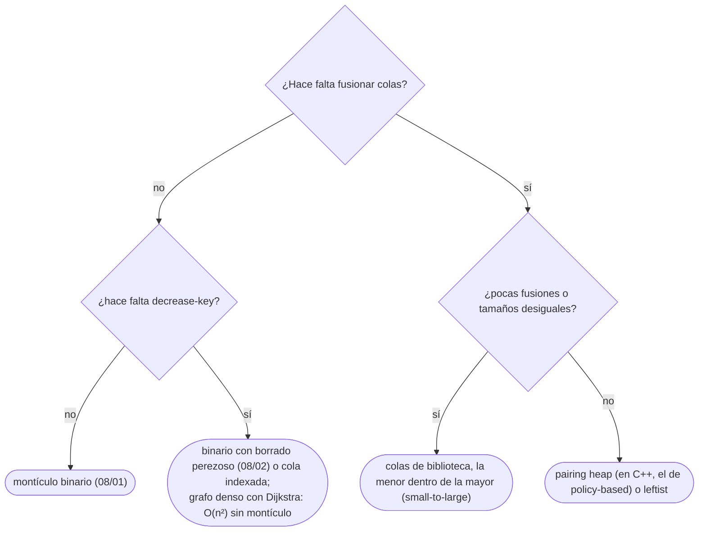

# 03 — Montículos fusionables

> Qué ganan los montículos que se pueden **fusionar** —*leftist*, binomial, Fibonacci, *pairing*—, qué
> costes amortizados prometen, y por qué el de Fibonacci mejora Dijkstra en teoría y casi nunca en la
> práctica. Con la alternativa que se usa de verdad: fusionar colas de biblioteca de la menor a la mayor.
>
> **Niveles:** *leftist* [C] · binomial [C] · Fibonacci [C] · *pairing* [C].
>
> **📚 Lectura troncal:** Cormen, Leiserson, Rivest y Stein, *Introduction to Algorithms*, 3.ª ed.
> (MIT Press, 2009), cap. 19; Brassard y Bratley, *Fundamentos de algoritmia* (Prentice Hall, 1997),
> cap. 5 (binomiales).
>
> **Vigencia:** 2026-10-04.

**Salto rápido:** [1](#1--el-problema) · [2](#2--la-teoría) · [3](#3--leftist-y-binomial) · [4](#4--fibonacci) · [5](#5--pairing) · [6](#6--cómo-se-elige) · [7](#7--señales-del-enunciado) · [🧠](#-preguntas) · [🧩](#-problemas-propios)

---

## 1. 🎯 El problema

El montículo binario de [`08/01`](01-monticulo-binario.md) vive en un arreglo, y eso lo hace rápido, pero tiene dos operaciones
caras:

- **Fusionar** dos montículos de tamaños `n` y `m` cuesta `O(n + m)`: no hay forma de unir dos arreglos
  con forma de montículo sin reconstruir.
- **`decrease-key`** necesita saber dónde está el elemento (`08/01`, §5) y cuesta `O(log n)`.

Hay problemas donde fusionar es la operación central (unir grupos con su cola de prioridad, algoritmos de
árboles de expansión mínima por componentes), y algoritmos donde `decrease-key` domina el coste (Dijkstra
y Prim en grafos densos). Los **montículos fusionables**, basados en árboles con punteros, hacen la fusión
en `O(log n)` o incluso en `O(1)`, y el de Fibonacci lleva `decrease-key` a `O(1)` amortizado.

Este capítulo es de fichas: lo que interesa es **qué prometen** y **cuándo importa**, porque en la práctica
casi nunca compensan frente a un montículo binario y una buena técnica de fusión.

---

## 2. 📐 La teoría

**La operación nueva.** `meld(A, B)` (o `union`): un montículo con los elementos de los dos.

**Los costes** (amortizados donde se indica):

```text
                 push        pop         decrease-key    meld
binario          O(log n)    O(log n)    O(log n)*       O(n)
leftist          O(log n)    O(log n)    —               O(log n)
binomial         O(1)†       O(log n)    O(log n)        O(log n)
Fibonacci        O(1)        O(log n)†   O(1)†           O(1)
pairing          O(1)        O(log n)†   o(log n)†‡      O(1)
* con cola indexada   † amortizado   ‡ cota exacta conocida solo en parte
```

**Dijkstra con Fibonacci.** Dijkstra hace `n` extracciones y hasta `m` `decrease-key`. Con un montículo
binario, `O((n + m) log n)`; con uno de Fibonacci, `O(m + n log n)`: cada `decrease-key` pasa a ser `O(1)`
amortizado. En un grafo denso (`m ≈ n²`), la diferencia teórica es un factor `log n`.

**Por qué casi nunca se nota.** Las constantes del de Fibonacci son grandes (varios punteros por nodo,
listas circulares, cascadas de cortes) y su localidad de caché es mala ([`02/05`](../02-analisis/05-el-coste-real.md)). Con un montículo binario
en arreglo y borrado perezoso (`08/02`), o con el Dijkstra en `O(n²)` sin montículo para grafos densos, se
gana en la práctica.

**La fusión práctica.** Para fusionar muchas colas de biblioteca, se vuelcan los elementos de la **menor**
en la **mayor** (*small-to-large*, `07/06`): cada elemento se mueve `O(log n)` veces, y el total es
`O(n log² n)` con montículos binarios.

---

## 3. 🧱 *Leftist* y binomial

- **Qué resuelve.** Fusionar montículos en `O(log n)`.
- **Qué garantiza.** El *leftist* es un árbol binario con la propiedad de montículo en el que, en cada
  nodo, el camino más corto a un hueco por la izquierda es al menos el de la derecha; la «espina derecha»
  tiene `O(log n)` nodos, y fusionar es mezclar las dos espinas derechas. El binomial es una lista de
  árboles binomiales de tamaños potencia de 2 distintos, como los bits de `n`; fusionar es sumar en
  binario.
- **Cuánto.** `O(log n)` por fusión, inserción y extracción; el binomial inserta en `O(1)` amortizado.
- **Cómo reconocerlo.** «Une los grupos `a` y `b`, y saca el mínimo de un grupo», con muchas uniones.
- **Si no te la sabes.** Colas de biblioteca fusionadas de la menor a la mayor: `O(log n)` más por
  elemento, pero sin escribir nada.
- **Dónde está entera.** Brassard y Bratley, cap. 5 (binomiales); Knuth, Vol. 3, §5.2.3 (*leftist*).

---

## 4. 🧱 Fibonacci

- **Qué resuelve.** `decrease-key` en `O(1)` amortizado, que es lo que pide Dijkstra o Prim en grafos
  densos.
- **Qué garantiza.** Inserción, fusión y `decrease-key` en `O(1)` amortizado; extracción del mínimo en
  `O(log n)` amortizado. Es una colección perezosa de árboles: la consolidación se hace solo al extraer,
  y los cortes en cascada al bajar claves mantienen los árboles con al menos `F_{k+2}` nodos para un
  grado `k`, de ahí el nombre.
- **Cuánto.** Cuatro punteros, un grado y una marca por nodo; constantes altas.
- **Cómo reconocerlo.** Sobre todo en el **análisis**: la cota `O(m + n log n)` de Dijkstra y Prim.
- **Si no te la sabes.** Montículo binario con borrado perezoso, `O(m log n)`; o Dijkstra `O(n²)` sin
  montículo si el grafo es denso.
- **Dónde está entera.** CLRS, 3.ª ed., cap. 19; Fredman y Tarjan, «Fibonacci Heaps and Their Uses in
  Improved Network Optimization Algorithms», *Journal of the ACM* 34(3), 1987.

---

## 5. 🧱 *Pairing*

- **Qué resuelve.** Lo mismo que el de Fibonacci, con un código mucho más corto.
- **Qué garantiza.** Fusión e inserción en `O(1)`; extracción en `O(log n)` amortizado; `decrease-key`
  en `o(log n)` amortizado, aunque su cota exacta sigue siendo un problema abierto en parte.
- **Cuánto.** Un árbol con hijos en lista; la extracción fusiona los hijos por parejas y después de
  derecha a izquierda.
- **Cómo reconocerlo.** Es el montículo fusionable que se escribe cuando hace falta uno: unas 30 líneas.
  GCC lo trae en *policy-based* (`__gnu_pbds::priority_queue` con `pairing_heap_tag`, [`03/02`](../03-biblioteca-estandar/02-cpp-algoritmos-ranges-y-pbds.md)).
- **Si no te la sabes.** Colas de biblioteca con *small-to-large*.
- **Dónde está entera.** Fredman, Sedgewick, Sleator y Tarjan, «The Pairing Heap: A New Form of
  Self-Adjusting Heap», *Algorithmica* 1, 1986.

---

## 6. 🧭 Cómo se elige



| Situación | Elección práctica | Coste |
|---|---|---|
| Dijkstra, grafo disperso | Binario con borrado perezoso | `O(m log n)` |
| Dijkstra, grafo denso (`m ≈ n²`) | Sin montículo, arreglo de distancias | `O(n²)` |
| Muchas fusiones de colas | *Small-to-large* con colas de biblioteca | `O(n log² n)` |
| Muchas fusiones, `O(log n)` por fusión | *Pairing* (*policy-based*) o *leftist* | `O(n log n)` |

---

## 7. 🔎 Señales del enunciado

| Señal | Técnica | Por qué |
|---|---|---|
| «Une los grupos `a` y `b`» y «el mínimo del grupo» | Colas fusionadas de la menor a la mayor | Cada elemento se mueve `O(log n)` veces |
| Dijkstra o Prim con `m ≈ n²` | Arreglo de distancias, `O(n²)` | Sin montículo es más rápido |
| «Demuestra la cota `O(m + n log n)`» | Fibonacci, en el análisis | `decrease-key` en `O(1)` amortizado |
| C++ y necesitas `meld` | `__gnu_pbds::priority_queue` (*pairing*) | Viene hecho |

---

## ⚠️ Errores frecuentes

| Se dice | Lo preciso |
|---|---|
| «El *heap* de Fibonacci hace Dijkstra más rápido» | En teoría, de `O(m log n)` a `O(m + n log n)`; en la práctica, sus constantes y su localidad lo hacen más lento que un binario |
| «Fusionar dos montículos binarios es `O(log n)`» | Es `O(n + m)`: hay que reconstruir; los fusionables existen por eso |
| «Para fusionar colas hay que escribir un *leftist*» | Volcar la menor en la mayor basta casi siempre |
| «Fibonacci es `O(1)` por operación» | Amortizado, y la extracción es `O(log n)` |

---

## 📚 Para profundizar

- **Libro** — Cormen, Leiserson, Rivest y Stein, *Introduction to Algorithms*, 3.ª ed. (MIT Press, 2009),
  cap. 19: montículos de Fibonacci y su análisis amortizado. *Lectura troncal.*
- **Libro** — Brassard y Bratley, *Fundamentos de algoritmia* (Prentice Hall, 1997), cap. 5: montículos
  binomiales. *Lectura troncal.*
- **Artículo** — Fredman y Tarjan, *Journal of the ACM* 34(3), 1987: el montículo de Fibonacci.
- **Artículo** — Fredman, Sedgewick, Sleator y Tarjan, *Algorithmica* 1, 1986: el *pairing heap*.

---

## 🧠 Preguntas

1. ¿Qué operación añaden los montículos fusionables? 🟢
2. ¿Cuánto cuesta fusionar dos montículos binarios en arreglo, y por qué? 🟢
3. ¿Cuál es la alternativa práctica para fusionar muchas colas de prioridad? 🟢
4. ¿Qué cota da Dijkstra con un montículo de Fibonacci, y de qué operación viene la mejora? 🟡
5. ¿Por qué el montículo binomial se parece a sumar en binario? 🟡
6. ¿Por qué un *leftist* fusiona en `O(log n)`? 🟡
7. ¿Por qué el montículo de Fibonacci casi nunca gana en la práctica? 🟠
8. Demuestra que fusionar colas de la menor a la mayor mueve cada elemento `O(log n)` veces. 🟠
9. Compara qué ofrecen C++, Java y Python para un montículo fusionable. 🟠
10. ¿Cuándo es mejor Dijkstra en `O(n²)` sin montículo que con uno binario? 🟠
11. ¿Qué garantiza «amortizado» en el montículo de Fibonacci, y por qué no sirve para tiempo real? 🔴
12. ¿Por qué los árboles del montículo de Fibonacci tienen al menos `F_{k+2}` nodos con grado `k`, y qué consecuencia tiene para la extracción? 🔴

---

## 🧩 Problemas propios

### Fusión de colas

**Nivel:** 🟡 · **Formato:** programa completo.

Hay `k` colas de prioridad numeradas de 1 a `k`, vacías. Llegan órdenes: `+ c x` (mete `x` en la cola `c`),
`m a b` (mueve todos los elementos de la cola `b` a la cola `a`; `b` queda vacía) y `- c` (saca e imprime el
mínimo de la cola `c`, o `-1` si está vacía).

- **Entrada.** Una línea con `k` y `q`. Después, `q` órdenes.
- **Salida.** Una línea por cada `-`.
- **Restricciones.** `1 ≤ k, q ≤ 2·10⁵`; `|x| ≤ 10⁹`; en `m a b`, `a ≠ b`.

```text
Entrada            Salida
3 10               1
+ 1 5              2
+ 1 2              5
+ 2 9
+ 2 1
m 1 2
- 1
+ 3 6
m 3 1
- 3
- 3

Entrada            Salida
2 5                -1
- 1                -1
+ 2 3              3
m 1 2
- 2
- 1
```

**Pista 1:** si al fusionar vuelcas siempre la cola grande en la pequeña, ¿cuántas veces puede moverse un
mismo elemento?

### Caminos en un grafo denso

**Nivel:** 🟠 · **Formato:** programa completo.

Un grafo no dirigido de `n` nodos viene dado por su matriz de pesos (`0` fuera de la diagonal significa que
no hay arista). Imprime la distancia mínima desde el nodo 0 a cada nodo, o `-1` si no se llega.

- **Entrada.** Una línea con `n`. Después, `n` líneas con `n` enteros.
- **Salida.** `n` enteros.
- **Restricciones.** `1 ≤ n ≤ 3000`; pesos entre 0 y `10⁶`.

```text
Entrada            Salida
4                  0 2 3 5
0 2 4 0
2 0 1 3
4 1 0 5
0 3 5 0

Entrada            Salida
3                  0 -1 -1
0 0 0
0 0 7
0 7 0
```

**Pista 1:** con `n = 3000` y casi todas las aristas, ¿cuántas operaciones hace Dijkstra con un montículo, y
cuántas sin él?

---

## 🧩 Práctica externa

Las tres bases no tienen problemas de montículos fusionables, y la plataforma específica que se previó
(SPOJ) no admite la verificación automática de enlaces que exige el corpus. La práctica de lo que sí sale
en entrevista está en [`08/02`](02-patrones-con-heap.md) (montículos con borrado perezoso) y en
[`07/06`](../07-arboles/06-tecnicas-sobre-arboles.md) (*small-to-large*); los dos problemas propios de
arriba cubren las dos alternativas prácticas de este capítulo.

---

## ✅ Criterio de dominio

- Decir qué prometen *leftist*, binomial, Fibonacci y *pairing*, y cuáles de sus costes son amortizados.
- Explicar por qué el de Fibonacci mejora Dijkstra en teoría y no en la práctica.
- Fusionar colas de biblioteca con *small-to-large* y elegir Dijkstra `O(n²)` cuando el grafo es denso.

---

**Anterior:** [`08/02` — Patrones con *heap*](02-patrones-con-heap.md) · **Siguiente:** [`08/04` — Union-Find](04-union-find.md) ·
**Relacionado:** [`15/01` — Dijkstra](../15-grafos-pesos-y-flujos/01-dijkstra.md); [`07/06` — Técnicas sobre árboles](../07-arboles/06-tecnicas-sobre-arboles.md).
