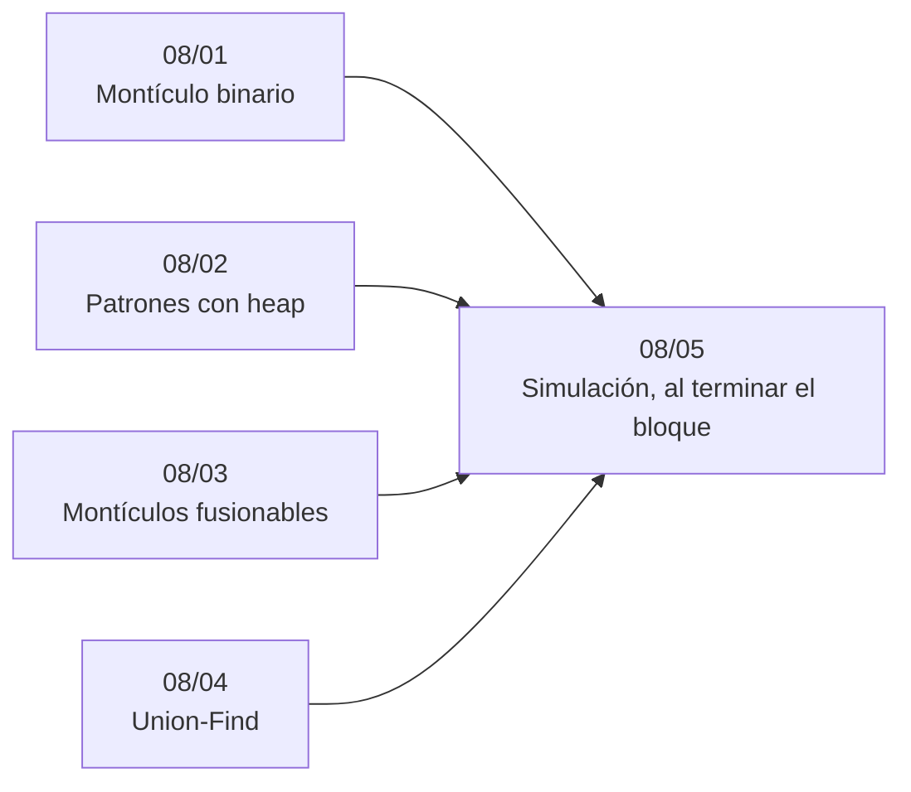

# Bloque 08 — Heaps y Union-Find

> La cola de prioridad y la estructura de conjuntos disjuntos: el montículo binario por dentro, los patrones
> que resuelve un *heap* (los `k` mayores, la mezcla de listas, la mediana en flujo), los montículos fusionables como
> fichas, y Union-Find con sus variantes. Son las dos estructuras que más aparecen dentro de otros algoritmos.
>
> Las respuestas de las preguntas y las pistas 2 y 3 de los problemas, en [`06` — Respuestas](06-respuestas.md).
>
> **Vigencia:** 2026-10-04.

---

## 🧭 Índice

| Capítulo | Niveles | Ruta corta |
|---|---|---|
| [`08/01` — Montículo binario](01-monticulo-binario.md) | montículo binario [A] · `heapify` [A] · cola indexada [B] · `d`-ario [C] |  |
| [`08/02` — Patrones con *heap*](02-patrones-con-heap.md) | `k` mayores [A] · mezcla de `k` listas [A] · mediana con dos *heaps* [A] · borrado perezoso [B] | sí |
| [`08/03` — Montículos fusionables](03-monticulos-fusionables.md) | *leftist* [C] · binomial [C] · Fibonacci [C] · *pairing* [C] |  |
| [`08/04` — Union-Find](04-union-find.md) | Union-Find [A] · con pesos o paridad [B] · con *rollback* y *offline* [B] |  |
| [`08/05` — Simulación](05-simulacion.md) | El examen del bloque: preguntas transversales y problemas cronometrados | |
| [`08/06` — Respuestas](06-respuestas.md) | Las preguntas en tres capas y las pistas 2 y 3 | |

---

## 🧭 Orden de lectura

- `08/01` y `08/04` son la base; `08/02` es el de entrevista; `08/03` es de fichas y se puede saltar.

---

## 🔎 Mapa de señales del bloque

| Señal | Técnica | Capítulo |
|---|---|---|
| «Siempre el menor/mayor de los que quedan», con llegadas | Montículo | [`08/01`](01-monticulo-binario.md) |
| Todos los datos al principio y luego extracciones | `heapify` u ordenar | [`08/01`](01-monticulo-binario.md) |
| «Los `k` mayores / más frecuentes / más cercanos», `k ≪ n` | Montículo de tamaño `k` | [`08/02`](02-patrones-con-heap.md) |
| «Mezcla», «`k` listas ordenadas», «el `m`-ésimo de varias listas» | Montículo de cabezas | [`08/02`](02-patrones-con-heap.md) |
| «Une los grupos `a` y `b`» y «el mínimo del grupo» | Colas fusionadas de la menor a la mayor | [`08/03`](03-monticulos-fusionables.md) |
| Dijkstra o Prim con `m ≈ n²` | Arreglo de distancias, `O(n²)` | [`08/03`](03-monticulos-fusionables.md) |
| «Une», «conecta», «¿están en el mismo grupo?», solo se añade | Union-Find | [`08/04`](04-union-find.md) |
| «La primera arista que cierra un ciclo» | Union-Find: `unite` devuelve `false` | [`08/04`](04-union-find.md) |

---

## 📚 Lectura troncal del bloque

La de cada capítulo, que es también la primera entrada de su «Para profundizar»:

- **`08/01`** — Cormen, Leiserson, Rivest y Stein, *Introduction to Algorithms*, 3.ª ed. (MIT Press, 2009), cap. 6; Brassard y Bratley, *Fundamentos de algoritmia* (Prentice Hall, 1997), cap. 5; Sedgewick y Wayne, *Algorithms*, 4.ª ed. (Addison-Wesley, 2011), §2.4.
- **`08/02`** — Sedgewick y Wayne, *Algorithms*, 4.ª ed. (Addison-Wesley, 2011), §2.4; Skiena, *The Algorithm Design Manual*, 3.ª ed. (Springer, 2020), cap. 3.
- **`08/03`** — Cormen, Leiserson, Rivest y Stein, *Introduction to Algorithms*, 3.ª ed. (MIT Press, 2009), cap. 19; Brassard y Bratley, *Fundamentos de algoritmia* (Prentice Hall, 1997), cap. 5 (binomiales).
- **`08/04`** — Cormen, Leiserson, Rivest y Stein, *Introduction to Algorithms*, 3.ª ed. (MIT Press, 2009), cap. 21; Sedgewick y Wayne, *Algorithms*, 4.ª ed. (Addison-Wesley, 2011), §1.5; Brassard y Bratley, *Fundamentos de algoritmia* (Prentice Hall, 1997), cap. 5.

---

## 🧭 Qué NO está aquí

- **Dijkstra y Prim**, los grandes usuarios del montículo: en [`15/01` — Dijkstra](../15-grafos-pesos-y-flujos/01-dijkstra.md) y [`15/04` — Árbol de expansión mínima](../15-grafos-pesos-y-flujos/04-arbol-de-expansion-minima.md).
- **Kruskal**, el gran usuario de Union-Find: en [`15/04` — Árbol de expansión mínima](../15-grafos-pesos-y-flujos/04-arbol-de-expansion-minima.md).
- **Ordenar con un montículo** (*heapsort*): en [`05/01` — Ordenación por comparación](../05-orden-y-busqueda/01-ordenacion-por-comparacion.md).

---

**Anterior:** [Bloque 07 — Árboles](../07-arboles/README.md) ·
**Siguiente:** [Bloque 09 — Consultas sobre rangos](../09-consultas-sobre-rangos/README.md) ·
**Inicio:** [README del corpus](../README.md)
