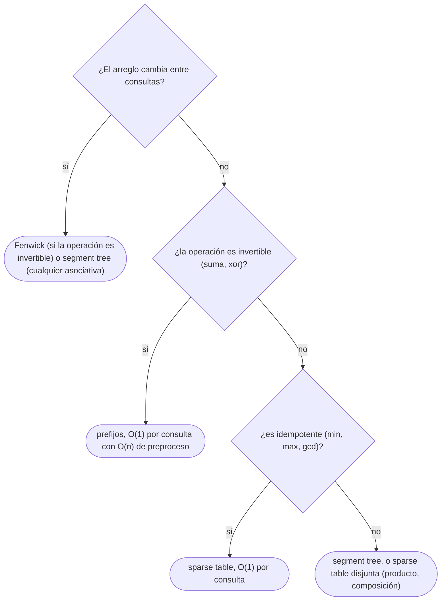

# 01 — *Sparse table* y RMQ

> El mínimo de cualquier tramo de un arreglo fijo en `O(1)`, tras `O(n log n)` de preparación: la tabla de
> mínimos de bloques de longitud potencia de 2, y por qué la consulta puede solapar dos bloques. Solo vale
> para operaciones **idempotentes** —mínimo, máximo, `gcd`, `and`, `or`—, y no para la suma.
>
> **Niveles:** *sparse table* [B].
>
> **📚 Lectura troncal:** Laaksonen, *Guide to Competitive Programming*, 3.ª ed. (Springer, 2024), cap. 9;
> cp-algorithms, [*Sparse Table*](https://cp-algorithms.com/data_structures/sparse-table.html).
>
> **Vigencia:** 2026-10-04.

**Salto rápido:** [1](#1--el-problema) · [2](#2--la-teoría) · [3](#3--la-sparse-table) · [4](#4-️-la-tabla-de-costes) · [5](#5--cómo-se-elige) · [6](#6--señales-del-enunciado) · [🧠](#-preguntas) · [🧩](#-problemas-propios)

---

## 1. 🎯 El problema

Un arreglo de `n = 2·10⁵` valores que **no cambia** y `q = 2·10⁵` consultas «¿cuál es el mínimo de
`a[l..r]`?» (RMQ, *range minimum query*). Recorrer el tramo en cada consulta es `O(n)`: `4·10¹⁰` pasos.
Los prefijos de [`04/01`](../04-secuencias/01-prefijos-y-diferencias.md) no sirven: el mínimo no se puede «restar» como la suma.

La **tabla dispersa** (*sparse table*) precalcula el mínimo de todos los tramos cuya longitud es potencia de
2: `n log n` valores. Cualquier tramo `[l, r]` se cubre con **dos** de esos bloques, que pueden solaparse;
como el mínimo de algo contado dos veces no cambia, la consulta es el mínimo de dos números: `O(1)`.

Es la estructura más rápida para consultas sobre un arreglo **estático**, y la pieza del LCA por el
recorrido de Euler (`07/05`). Su límite es claro: si el arreglo cambia, o si la operación no admite el
solapamiento (la suma), hay que ir a Fenwick o al segment tree ([`09/02`](02-fenwick.md), [`09/03`](03-segment-tree.md)).

---

## 2. 📐 La teoría

**La tabla.** `st[k][i]` es el mínimo de `a[i .. i + 2ᵏ − 1]`, el bloque de longitud `2ᵏ` que empieza en `i`.
Se llena por niveles:

```text
st[0][i] = a[i]
st[k][i] = min( st[k − 1][i], st[k − 1][i + 2ᵏ⁻¹] )        un bloque de 2ᵏ son dos de 2ᵏ⁻¹
```

**La consulta.** Para `[l, r]`, con longitud `L = r − l + 1` y `k = ⌊log₂ L⌋`, los bloques
`[l, l + 2ᵏ − 1]` y `[r − 2ᵏ + 1, r]` cubren el tramo (cada uno mide `2ᵏ > L/2`) y pueden solaparse:

```text
min(a[l..r]) = min( st[k][l], st[k][r − 2ᵏ + 1] )
```

**Teorema (por qué solo con operaciones idempotentes).** La consulta en dos bloques solapados es correcta
para una operación `⊕` asociativa y conmutativa si y solo si es **idempotente**: `x ⊕ x = x`.

*Prueba.* Los dos bloques cubren `[l, r]` y su intersección no vacía se combina dos veces. Si `⊕` es
idempotente, combinar dos veces un elemento es lo mismo que una: el resultado es `⊕` de todo el tramo. Si
no lo es (la suma: `x + x ≠ x`), los elementos de la intersección se cuentan dos veces y el resultado es
incorrecto.

**Ejemplos de operaciones idempotentes:** `min`, `max`, `gcd`, `and`, `or`. **No lo son:** la suma, el
producto, el *xor*.

---

## 3. 🧱 La *sparse table*

**Qué es.** La tabla `st` de §2 y la consulta con dos bloques solapados.

**Por qué es correcto** (el enunciado y una frase): `st[k][i]` es el mínimo de su bloque por inducción sobre
`k`, y los dos bloques de la consulta cubren exactamente `[l, r]` porque cada uno mide `2ᵏ ≥ L/2`.

**Cómo va**, sobre `[5, 2, 9, 1, 5, 6]`:

```text
k = 0 (long. 1):   5  2  9  1  5  6
k = 1 (long. 2):   2  2  1  1  5          st[1][i] = min(a[i], a[i+1])
k = 2 (long. 4):   1  1  1                st[2][i] = min(st[1][i], st[1][i+2])

min(a[1..4]):  L = 4, k = 2 → min(st[2][1], st[2][1]) = 1
min(a[3..5]):  L = 3, k = 1 → min(st[1][3], st[1][4]) = min(1, 5) = 1     (los bloques [3,4] y [4,5] se solapan en 4)
```

**Cuánto.** Preproceso `Θ(n log n)` en tiempo y memoria; consulta `O(1)`.

**La plantilla:**

```cpp
#include <algorithm>
#include <vector>

// Sparse table de mínimos sobre un arreglo estático. Preproceso O(n log n), consulta O(1).
struct SparseTable {
    std::vector<std::vector<int>> st; std::vector<int> lg;
    explicit SparseTable(const std::vector<int>& a) {
        int n = a.size();
        lg.assign(n + 1, 0);
        for (int i = 2; i <= n; i++) lg[i] = lg[i / 2] + 1;          // lg[L] = ⌊log₂ L⌋
        st.assign(lg[n] + 1, std::vector<int>(n));
        st[0] = a;
        for (int k = 1; k <= lg[n]; k++)
            for (int i = 0; i + (1 << k) <= n; i++)
                st[k][i] = std::min(st[k - 1][i], st[k - 1][i + (1 << (k - 1))]);
    }
    int query(int l, int r) const {                                    // mínimo de a[l..r], inclusivo
        int k = lg[r - l + 1];
        return std::min(st[k][l], st[k][r - (1 << k) + 1]);
    }
};
```

```java
// Sparse table de mínimos sobre un arreglo estático. Preproceso O(n log n), consulta O(1).
static final class SparseTable {
    final int[][] st; final int[] lg;
    SparseTable(int[] a) {
        int n = a.length;
        lg = new int[n + 1];
        for (int i = 2; i <= n; i++) lg[i] = lg[i / 2] + 1;
        st = new int[lg[n] + 1][];
        st[0] = a.clone();
        for (int k = 1; k <= lg[n]; k++) {
            st[k] = new int[n - (1 << k) + 1];
            for (int i = 0; i + (1 << k) <= n; i++)
                st[k][i] = Math.min(st[k - 1][i], st[k - 1][i + (1 << (k - 1))]);
        }
    }
    int query(int l, int r) {
        int k = lg[r - l + 1];
        return Math.min(st[k][l], st[k][r - (1 << k) + 1]);
    }
}
```

- **`lg` precalculado** evita llamar a un logaritmo en cada consulta; en C++ también sirve
  `std::__lg(L)` o `31 − __builtin_clz(L)`, y en Java `31 − Integer.numberOfLeadingZeros(L)`.
- **Las filas de Java** tienen la longitud justa (`n − 2ᵏ + 1`): ahorra memoria y hace que un índice mal
  calculado falle en vez de leer basura.
- **Para el máximo o el `gcd`**, se cambia `min` por la operación; para el índice del mínimo, se guardan
  índices y se compara por valor.
- **Memoria**: `n · (⌊log₂ n⌋ + 1)` enteros; con `n = 2·10⁵`, unos 3,6 millones, 14 MB.

**Cuándo sí**: arreglo estático, muchas consultas de mínimo, máximo o `gcd`; el LCA por Euler (`07/05`);
binarias que preguntan el mínimo de un tramo en cada paso. **Cuándo no**: si el arreglo cambia (segment
tree, `09/03`); para sumas (prefijos, `04/01`); con memoria justa y `n` muy grande.

> **Veredicto:** la *sparse table* responde el mínimo de un tramo estático en `O(1)` gracias al
> solapamiento, que solo es inofensivo con operaciones idempotentes.

---

## 4. ⏱️ La tabla de costes

| Estructura | Preproceso | Consulta | Actualización | Operaciones |
|---|---|---|---|---|
| Recorrer el tramo | — | `O(n)` | `O(1)` | Cualquiera |
| Prefijos (`04/01`) | `O(n)` | `O(1)` | `O(n)` | Invertibles: suma, *xor* |
| *Sparse table* | `O(n log n)` | `O(1)` | `O(n log n)` (reconstruir) | Idempotentes: `min`, `max`, `gcd` |
| Fenwick (`09/02`) | `O(n)` | `O(log n)` | `O(log n)` | Invertibles |
| Segment tree (`09/03`) | `O(n)` | `O(log n)` | `O(log n)` | Cualquiera asociativa |

---

## 5. 🧭 Cómo se elige



---

## 6. 🔎 Señales del enunciado

| Señal | Técnica | Por qué |
|---|---|---|
| «Mínimo / máximo de `a[l..r]`», arreglo fijo, muchas consultas | *Sparse table* | `O(1)` por consulta |
| «`gcd` de un tramo» | *Sparse table* de `gcd` | Idempotente |
| «El tramo más largo desde `i` con mínimo `≥ x`» | Binaria + *sparse table* | Cada paso pregunta un mínimo en `O(1)` |
| «Suma de un tramo» | Prefijos, no *sparse table* | La suma no es idempotente |
| El arreglo se actualiza | Segment tree | La tabla habría que reconstruirla |

---

## ⚠️ Errores frecuentes

| Se dice | Lo preciso |
|---|---|
| «La *sparse table* sirve para sumas» | Con dos bloques solapados, la suma cuenta dos veces la intersección; para sumas, prefijos |
| «Hay que partir el tramo en bloques disjuntos» | Para `min` no: el solapamiento es lo que da `O(1)`; partir en disjuntos daría `O(log n)` |
| «`log2` en cada consulta no cuesta nada» | Es una llamada en coma flotante con riesgo de redondeo; mejor una tabla `lg` o `__lg` |
| «Sirve con actualizaciones» | Una actualización cambia `O(n)` entradas en el peor caso; para eso, segment tree |

---

## 📚 Para profundizar

- **Libro** — Laaksonen, *Guide to Competitive Programming*, 3.ª ed. (Springer, 2024), cap. 9: consultas
  sobre rangos, con la *sparse table*. *Lectura troncal.*
- **Referencia** — cp-algorithms, [*Sparse Table*](https://cp-algorithms.com/data_structures/sparse-table.html),
  con la variante disjunta. *Lectura troncal.*
- **Artículo** — Bender y Farach-Colton, «The LCA Problem Revisited», LATIN 2000: RMQ con preproceso
  lineal.

---

## 🧠 Preguntas

1. ¿Qué guarda `st[k][i]`? 🟢
2. ¿Qué dos bloques cubren el tramo `[l, r]`, y por qué cubren todo? 🟢
3. ¿Cuánto cuestan el preproceso, la consulta y la memoria? 🟢
4. ¿Por qué la *sparse table* no sirve para sumas? Da un ejemplo. 🟡
5. ¿Qué operaciones son idempotentes, y cuáles de las habituales no? 🟡
6. ¿Cómo calculas `⌊log₂ L⌋` sin coma flotante en C++ y en Java? 🟡
7. ¿Cómo devuelves el **índice** del mínimo en lugar del valor, y qué haces con los empates? 🟠
8. Demuestra que la consulta con dos bloques solapados es correcta si y solo si la operación es idempotente. 🟠
9. Compara la memoria de la *sparse table* en C++, Java y Python para `n = 10⁶`, y qué harías si no cabe. 🟠
10. ¿Por qué el LCA por el recorrido de Euler encaja con la *sparse table*? 🟠
11. ¿Cómo encuentras, para cada `i`, el tramo más largo que empieza en `i` con `gcd > 1`, combinando la tabla con otra técnica? 🟠
12. ¿Qué es una *sparse table* disjunta y qué operaciones admite en `O(1)` por consulta? 🔴
13. ¿Cómo se consigue RMQ con preproceso `O(n)` y consulta `O(1)`? Esboza la idea por bloques. 🔴

---

## 🧩 Problemas propios

### Amplitud térmica

**Nivel:** 🟡 · **Formato:** programa completo.

Una estación guarda `n` temperaturas. Para cada consulta `l r` (0-indexada, inclusiva), imprime la
diferencia entre la máxima y la mínima del tramo.

- **Entrada.** Una línea con `n` y `q`. Una línea con las `n` temperaturas. Después, `q` líneas con `l r`.
- **Salida.** `q` enteros.
- **Restricciones.** `1 ≤ n, q ≤ 2·10⁵`; `|t| ≤ 10⁹`.

```text
Entrada                 Salida
6 3                     7
5 2 9 1 5 6             8
0 2                     1
1 4
4 5

Entrada                 Salida
2 2                     2000000000
-1000000000 1000000000  0
0 1
1 1
```

**Pista 1:** si la tabla de mínimos responde en `O(1)`, ¿cuántas tablas necesitas?

### Racha sin bajar del umbral

**Nivel:** 🟠 · **Formato:** programa completo.

Para cada consulta `i x`, imprime la longitud del tramo más largo que empieza en `i` y en el que todos los
valores son `≥ x`.

- **Entrada.** Una línea con `n` y `q`. Una línea con los `n` valores. Después, `q` líneas con `i x`.
- **Salida.** `q` enteros.
- **Restricciones.** `1 ≤ n, q ≤ 2·10⁵`; valores y `x` entre 1 y `10⁹`.

```text
Entrada            Salida
6 4                3
5 2 9 1 5 6        1
0 2                3
2 5                0
3 1
1 3

Entrada            Salida
1 2                1
7                  0
0 7
0 8
```

**Pista 1:** si el mínimo de `a[i..j]` es `≥ x`, ¿qué pasa con el de `a[i..j − 1]`?

---

## 🧩 Práctica externa

> 💡 **Truco.** Antes de escribir la tabla, comprueba que la operación es idempotente: `x ⊕ x = x`. Si una IA
> te propone una *sparse table* de sumas, pregúntale qué pasa con la intersección ([`01/06`](../01-oficio-del-competidor/06-protocolo-de-resolucion.md)).

### Núcleo

| ✔ | Problema | Plataforma | Nivel | Patrón | Pista 1 |
|---|---|---|---|---|---|
| [ ] | [Number of Subarrays With GCD Equal to K](https://leetcode.com/problems/number-of-subarrays-with-gcd-equal-to-k/) | LeetCode | 🟡 | `gcd` de tramos | Al alargar un tramo, ¿puede subir su `gcd`? |
| [ ] | [Static Range Minimum Queries](https://cses.fi/problemset/task/1647) | CSES | 🟡 | *Sparse table* | ¿Qué precalculas para responder cada consulta en `O(1)`? |
| [ ] | [Static RMQ](https://judge.yosupo.jp/problem/staticrmq) | Library Checker | 🟡 | *Sparse table* | Con `5·10⁵` consultas, ¿te vale `O(log n)` por consulta? |
| [ ] | [Integers Have Friends](https://codeforces.com/problemset/problem/1548/B) | Codeforces | 🟠 | Diferencias + `gcd` de tramos | Si todos dejan el mismo resto módulo `m`, ¿qué divide `m`? |
| [ ] | [Find Building Where Alice and Bob Can Meet](https://leetcode.com/problems/find-building-where-alice-and-bob-can-meet/) | LeetCode | 🔴 | Máximo de tramos + búsqueda | A la derecha del más lejano, ¿qué edificio buscas y cómo lo encuentras rápido? |

### Ampliación

| ✔ | Problema | Plataforma | Nivel | Patrón | Pista 1 |
|---|---|---|---|---|---|
| [ ] | [Pair of Numbers](https://codeforces.com/problemset/problem/359/D) | Codeforces | 🟠 | `gcd` y mínimo de tramos | Si `a[j]` divide a todo el tramo, ¿qué relación hay entre su `gcd` y su mínimo? |
| [ ] | [Friends and Subsequences](https://codeforces.com/problemset/problem/689/D) | Codeforces | 🔴 | Máximo y mínimo + binaria | Fijado `l`, ¿cómo varía `max(a) − min(b)` al alargar el tramo? |
| [ ] | [CGCDSSQ](https://codeforces.com/problemset/problem/475/D) | Codeforces | 🔴 | `gcd` de tramos distintos | Fijado el final, ¿cuántos valores distintos de `gcd` hay? |

---

## ✅ Criterio de dominio

- Escribir la *sparse table* con su tabla `lg` sin mirar.
- Demostrar que el solapamiento solo vale con operaciones idempotentes.
- Elegir entre prefijos, *sparse table*, Fenwick y segment tree según la operación y si hay cambios.
- Resolver Integers Have Friends sin pista 2.

---

**Anterior:** — · **Siguiente:** [`09/02` — Fenwick](02-fenwick.md) · **Relacionado:** [`07/05` — LCA](../07-arboles/05-lca.md);
[`09/03` — Segment tree](03-segment-tree.md).
