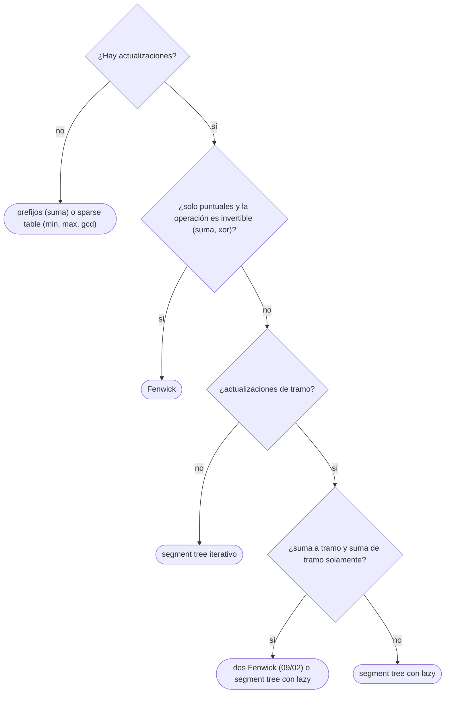

# 03 — Segment tree

> El árbol de segmentos: consultas por tramo con **cualquier** operación asociativa —suma, mínimo, máximo,
> composición—, con actualizaciones puntuales en `O(log n)`, y con actualizaciones de tramo gracias a la
> propagación perezosa (*lazy*). En sus dos formas: la iterativa, corta y rápida, y la recursiva, que
> admite todo lo demás.
>
> **Niveles:** iterativo [B] · recursivo [B] · *lazy propagation* [B].
>
> **📚 Lectura troncal:** de Berg, Cheong, van Kreveld y Overmars, *Computational Geometry*, 3.ª ed.
> (Springer, 2008), cap. 10; Laaksonen, *Guide to Competitive Programming*, 3.ª ed. (Springer, 2024),
> cap. 9; cp-algorithms, [*Segment Tree*](https://cp-algorithms.com/data_structures/segment_tree.html).
>
> **Vigencia:** 2026-10-04.

**Salto rápido:** [1](#1--el-problema) · [2](#2--la-teoría) · [3](#3--iterativo) · [4](#4--recursivo) · [5](#5--lazy-propagation) · [6](#6-️-la-tabla-de-costes) · [7](#7--cómo-se-elige) · [8](#8--señales-del-enunciado) · [🧠](#-preguntas) · [🧩](#-problemas-propios)

---

## 1. 🎯 El problema

La *sparse table* ([`09/01`](01-sparse-table.md)) responde mínimos de un arreglo **fijo**; Fenwick (`09/02`) admite cambios pero
solo con operaciones **invertibles**. ¿Y el mínimo de un tramo de un arreglo que cambia? ¿O «suma 5 a
todos los de `[l, r]` y dime el máximo de `[a, b]`»?

El **segment tree** guarda, en un árbol binario completo, el resultado de la operación sobre tramos que se
dividen a la mitad: la raíz cubre todo el arreglo, sus hijos cada mitad, y así hasta las hojas. Cualquier
tramo se descompone en `O(log n)` nodos, y cambiar un elemento solo afecta a los `O(log n)` nodos de su
camino a la raíz. Solo exige que la operación sea **asociativa** y tenga un elemento neutro (un
*monoide*).

Con la **propagación perezosa**, las actualizaciones de tramo también cuestan `O(log n)`: en lugar de
bajar a cada hoja, se deja una etiqueta pendiente en los nodos que cubren el tramo. Es la estructura más
versátil del bloque, y también la que más fácil es usar de más: este capítulo dice cuándo basta algo más
simple.

---

## 2. 📐 La teoría

**El nodo genérico.** Un segment tree necesita tres cosas: el tipo del valor, la operación de combinación
`⊕` (asociativa) y su neutro `e` (con `e ⊕ x = x ⊕ e = x`). Suma con 0, mínimo con `+∞`, máximo con `−∞`,
`gcd` con 0, composición de funciones con la identidad.

**La forma.** El nodo raíz cubre `[0, n)`; un nodo que cubre `[lo, hi)` con `hi − lo > 1` tiene hijos que
cubren `[lo, mid)` y `[mid, hi)`. La altura es `⌈log₂ n⌉`.

**Teorema (la consulta toca `O(log n)` nodos).** Para un tramo `[l, r)`, la descomposición canónica usa como
mucho 2 nodos por nivel, `O(log n)` en total, y la búsqueda recursiva visita como mucho 4 nodos por nivel.

*Prueba.* En cada nivel, los nodos que el tramo cubre parcialmente son como mucho dos: el que contiene a
`l` y el que contiene a `r − 1`, porque el tramo es contiguo y todos los nodos intermedios de ese nivel
quedan cubiertos por completo. Solo los parcialmente cubiertos se exploran hacia abajo, y cada uno tiene
dos hijos: como mucho 4 nodos visitados por nivel, y como mucho 2 se usan enteros. CLRS no lo trata;
Laaksonen, cap. 9; de Berg y otros, cap. 10.

**La propagación perezosa.** Una actualización de tramo se representa con una **etiqueta** (por ejemplo,
«sumar 5»). Para que funcione hace falta:

```text
aplicar(etiqueta, valor, longitud) → valor nuevo del nodo       (sumar 5 a un nodo de longitud L: +5L)
componer(etiqueta nueva, etiqueta vieja) → etiqueta             (sumar 3 después de sumar 5: sumar 8)
```

Las etiquetas forman un monoide con la composición, y aplicar una etiqueta tiene que **distribuir** sobre
`⊕`: aplicarla al nodo da lo mismo que aplicarla a sus hijos y combinar. Así, la etiqueta se baja a los
hijos solo cuando hace falta entrar en ellos (*push*).

---

## 3. 🧱 Iterativo

**Qué es.** El árbol en un arreglo de `2n` posiciones: las hojas en `[n, 2n)`, el padre de `i` en `i / 2`.
Actualización y consulta con dos bucles, sin recursión.

**Por qué es correcto** (el enunciado y una frase): el nodo `i` combina `2i` y `2i + 1`; la consulta sube
desde las dos hojas extremas y, cuando un extremo es hijo derecho (por la izquierda) o izquierdo (por la
derecha), su nodo entero está dentro del tramo y se toma.

**Cómo va**, sumas de `[5, 2, 9, 1, 5, 6]` con `n = 6`:

```text
índice:  1   2   3   4   5   6  7  8  9  10 11
valor:   28  21  7   10  11  5  2  9  1  5  6        hojas en 6..11; t[i] = t[2i] + t[2i+1]
suma de [1, 4):  l = 7, r = 10
  l impar → toma t[7] = 2, l = 8;   r par
  l = 4, r = 5:  r impar → r = 4, toma t[4] = 10
  l = 2, r = 2: fin.  2 + 10 = 12 = 2 + 9 + 1
```

**Cuánto.** `O(log n)` por actualización y consulta; `2n` de memoria.

**La plantilla**, con operación genérica (aquí, mínimo):

```cpp
#include <algorithm>
#include <climits>
#include <vector>

// Segment tree iterativo de mínimos. Consulta [l, r), actualización puntual. O(log n).
struct SegTree {
    int n; std::vector<int> t;
    static int op(int a, int b) { return std::min(a, b); }
    static constexpr int E = INT_MAX;                          // neutro de la operación
    explicit SegTree(const std::vector<int>& a) : n(a.size()), t(2 * a.size()) {
        for (int i = 0; i < n; i++) t[n + i] = a[i];
        for (int i = n - 1; i > 0; i--) t[i] = op(t[2 * i], t[2 * i + 1]);
    }
    void set(int p, int v) {
        for (t[p += n] = v; p > 1; p >>= 1) t[p >> 1] = op(t[p], t[p ^ 1]);
    }
    int query(int l, int r) const {                            // op de a[l..r−1]
        int resl = E, resr = E;
        for (l += n, r += n; l < r; l >>= 1, r >>= 1) {
            if (l & 1) resl = op(resl, t[l++]);
            if (r & 1) resr = op(t[--r], resr);
        }
        return op(resl, resr);
    }
};
```

```java
// Segment tree iterativo de mínimos. Consulta [l, r), actualización puntual. O(log n).
static final class SegTree {
    final int n; final int[] t;
    static int op(int a, int b) { return Math.min(a, b); }
    static final int E = Integer.MAX_VALUE;
    SegTree(int[] a) {
        n = a.length; t = new int[2 * n];
        for (int i = 0; i < n; i++) t[n + i] = a[i];
        for (int i = n - 1; i > 0; i--) t[i] = op(t[2 * i], t[2 * i + 1]);
    }
    void set(int p, int v) {
        for (t[p += n] = v; p > 1; p >>= 1) t[p >> 1] = op(t[p], t[p ^ 1]);
    }
    int query(int l, int r) {
        int resl = E, resr = E;
        for (l += n, r += n; l < r; l >>= 1, r >>= 1) {
            if ((l & 1) == 1) resl = op(resl, t[l++]);
            if ((r & 1) == 1) resr = op(t[--r], resr);
        }
        return op(resl, resr);
    }
}
```

```python
class SegTree:
    """Segment tree iterativo con operación genérica. Consulta [l, r), actualización puntual."""
    def __init__(self, a, op=min, e=float("inf")):
        self.n, self.op, self.e = len(a), op, e
        self.t = [e] * self.n + list(a)
        for i in range(self.n - 1, 0, -1):
            self.t[i] = op(self.t[2 * i], self.t[2 * i + 1])

    def set(self, p, v):
        p += self.n
        self.t[p] = v
        while p > 1:
            p >>= 1
            self.t[p] = self.op(self.t[2 * p], self.t[2 * p + 1])

    def query(self, l, r):
        resl = resr = self.e
        l += self.n; r += self.n
        while l < r:
            if l & 1:
                resl = self.op(resl, self.t[l]); l += 1
            if r & 1:
                r -= 1; resr = self.op(self.t[r], resr)
            l >>= 1; r >>= 1
        return self.op(resl, resr)
```

- **`resl` y `resr` por separado** conservan el orden: con operaciones no conmutativas (composición,
  multiplicación de matrices) el resultado es correcto.
- **Con `n` cualquiera** (no potencia de 2) funciona para consultas; algunos nodos internos combinan tramos
  no contiguos, pero nunca se usan como un todo en una consulta.
- **Tramos semiabiertos `[l, r)`**: la convención de [`05/04`](../05-orden-y-busqueda/04-busqueda-binaria.md) y de la biblioteca de C++.

> **Veredicto:** el segment tree iterativo son dos bucles sobre `2n` posiciones: la forma más rápida de
> tener mínimos (o cualquier monoide) con actualizaciones puntuales.

---

## 4. 🧱 Recursivo

**Qué es.** El mismo árbol con nodos `1, 2, 3, …` (hijos `2v` y `2v + 1`) y funciones recursivas sobre
`[lo, hi)`: más largo, pero admite propagación perezosa, búsquedas por descenso y nodos con cualquier
información.

**Por qué es correcto** (el enunciado y una frase): si el nodo está fuera del tramo devuelve el neutro; si
está dentro, su valor; si lo corta, combina lo que devuelven sus hijos, que por inducción son correctos.

**Cómo va.** `query(1, 0, 6, 1, 4)` en el árbol de sumas: el nodo `[0, 6)` corta el tramo y baja a `[0, 3)` y
`[3, 6)`; `[0, 3)` baja a `[0, 1)` (fuera, 0) y `[1, 3)` (dentro, 11); `[3, 6)` baja a `[3, 4)` (dentro, 1) y
`[4, 6)` (fuera, 0). Total 12.

**Cuánto.** `O(log n)` por operación, con una constante mayor que el iterativo; `4n` de memoria (para `n`
cualquiera).

**La plantilla**, con el descenso «primer índice `≥ i` con valor `≥ x`» sobre máximos:

```cpp
#include <algorithm>
#include <climits>
#include <vector>

// Segment tree recursivo de máximos con descenso. Nodos 1..4n; tramos [lo, hi).
struct MaxTree {
    int n; std::vector<int> t;
    explicit MaxTree(const std::vector<int>& a) : n(a.size()), t(4 * a.size(), INT_MIN) { build(1, 0, n, a); }
    void build(int v, int lo, int hi, const std::vector<int>& a) {
        if (hi - lo == 1) { t[v] = a[lo]; return; }
        int mid = (lo + hi) / 2;
        build(2 * v, lo, mid, a); build(2 * v + 1, mid, hi, a);
        t[v] = std::max(t[2 * v], t[2 * v + 1]);
    }
    void set(int v, int lo, int hi, int p, int x) {
        if (hi - lo == 1) { t[v] = x; return; }
        int mid = (lo + hi) / 2;
        if (p < mid) set(2 * v, lo, mid, p, x); else set(2 * v + 1, mid, hi, p, x);
        t[v] = std::max(t[2 * v], t[2 * v + 1]);
    }
    int query(int v, int lo, int hi, int l, int r) const {
        if (r <= lo || hi <= l) return INT_MIN;                     // fuera
        if (l <= lo && hi <= r) return t[v];                         // dentro
        int mid = (lo + hi) / 2;
        return std::max(query(2 * v, lo, mid, l, r), query(2 * v + 1, mid, hi, l, r));
    }
    // Primer índice j >= i con a[j] >= x, o −1. O(log n): solo baja por nodos que pueden tener la respuesta.
    int firstAtLeast(int v, int lo, int hi, int i, int x) const {
        if (hi <= i || t[v] < x) return -1;
        if (hi - lo == 1) return lo;
        int mid = (lo + hi) / 2;
        int res = firstAtLeast(2 * v, lo, mid, i, x);
        return res != -1 ? res : firstAtLeast(2 * v + 1, mid, hi, i, x);
    }
};
// Uso: MaxTree st(a); st.set(1, 0, st.n, p, x); st.query(1, 0, st.n, l, r); st.firstAtLeast(1, 0, st.n, i, x);
```

```java
// Segment tree recursivo de máximos con descenso. Nodos 1..4n; tramos [lo, hi).
static final class MaxTree {
    final int n; final int[] t;
    MaxTree(int[] a) { n = a.length; t = new int[4 * n]; build(1, 0, n, a); }
    void build(int v, int lo, int hi, int[] a) {
        if (hi - lo == 1) { t[v] = a[lo]; return; }
        int mid = (lo + hi) / 2;
        build(2 * v, lo, mid, a); build(2 * v + 1, mid, hi, a);
        t[v] = Math.max(t[2 * v], t[2 * v + 1]);
    }
    void set(int v, int lo, int hi, int p, int x) {
        if (hi - lo == 1) { t[v] = x; return; }
        int mid = (lo + hi) / 2;
        if (p < mid) set(2 * v, lo, mid, p, x); else set(2 * v + 1, mid, hi, p, x);
        t[v] = Math.max(t[2 * v], t[2 * v + 1]);
    }
    int query(int v, int lo, int hi, int l, int r) {
        if (r <= lo || hi <= l) return Integer.MIN_VALUE;
        if (l <= lo && hi <= r) return t[v];
        int mid = (lo + hi) / 2;
        return Math.max(query(2 * v, lo, mid, l, r), query(2 * v + 1, mid, hi, l, r));
    }
    int firstAtLeast(int v, int lo, int hi, int i, int x) {
        if (hi <= i || t[v] < x) return -1;
        if (hi - lo == 1) return lo;
        int mid = (lo + hi) / 2;
        int res = firstAtLeast(2 * v, lo, mid, i, x);
        return res != -1 ? res : firstAtLeast(2 * v + 1, mid, hi, i, x);
    }
}
```

- **`4n` de memoria** con `n` cualquiera: el árbol recursivo sobre `n` hojas puede necesitar índices hasta
  casi `4n`.
- **El descenso** poda por el máximo del nodo: si `t[v] < x`, no hay nada que buscar dentro. Visita `O(log n)`
  nodos porque, como mucho, explora un camino que falla y otro que acierta.
- **La recursión** tiene profundidad `log n`: no hay riesgo de desbordar la pila.

> **Veredicto:** el recursivo es más largo pero lo admite todo: descensos, nodos con varios campos y
> propagación perezosa.

---

## 5. 🧱 *Lazy propagation*

**Qué es.** Actualizaciones de tramo en `O(log n)`: los nodos que cubren el tramo por completo reciben una
etiqueta pendiente en lugar de actualizar sus descendientes; la etiqueta baja a los hijos (`push`) solo cuando
una operación necesita entrar en ellos.

**Por qué es correcto** (el enunciado y una frase): el valor de cada nodo ya incluye todas sus etiquetas,
y las de sus ancestros se aplican a sus hijos antes de leerlos; como aplicar distribuye sobre `⊕` y las
etiquetas se componen, el resultado es el mismo que aplicar cada actualización hoja a hoja.

**Cómo va**, sumar 10 a `[1, 4)` en el árbol de sumas de `[5, 2, 9, 1, 5, 6]`:

```text
[0,6) corta → push (sin etiqueta), baja
  [0,3) corta → baja: [0,1) fuera; [1,3) dentro: valor += 10·2 = 31, etiqueta +10
  [3,6) corta → baja: [3,4) dentro: valor += 10·1 = 11, etiqueta +10; [4,6) fuera
  recalcula: [0,3) = 5 + 31 = 36, [3,6) = 11 + 11 = 22, raíz = 58
suma de [2, 3): baja hasta [1,3), push: sus hijos [1,2) y [2,3) reciben +10 → a[2] = 19
```

**Cuánto.** `O(log n)` por actualización de tramo y por consulta; `4n` valores y `4n` etiquetas.

**La plantilla**, suma de tramo y suma a tramo:

```cpp
#include <vector>

// Lazy: suma v a a[l..r) y suma de a[l..r). Nodos 1..4n; tramos [lo, hi). O(log n).
struct LazySum {
    int n; std::vector<long long> sum, add;
    explicit LazySum(int n) : n(n), sum(4 * n, 0), add(4 * n, 0) {}
    void apply(int v, int lo, int hi, long long x) { sum[v] += x * (hi - lo); add[v] += x; }
    void push(int v, int lo, int hi) {
        if (add[v] == 0) return;
        int mid = (lo + hi) / 2;
        apply(2 * v, lo, mid, add[v]); apply(2 * v + 1, mid, hi, add[v]);
        add[v] = 0;
    }
    void update(int v, int lo, int hi, int l, int r, long long x) {
        if (r <= lo || hi <= l) return;
        if (l <= lo && hi <= r) { apply(v, lo, hi, x); return; }
        push(v, lo, hi);
        int mid = (lo + hi) / 2;
        update(2 * v, lo, mid, l, r, x); update(2 * v + 1, mid, hi, l, r, x);
        sum[v] = sum[2 * v] + sum[2 * v + 1];
    }
    long long query(int v, int lo, int hi, int l, int r) {
        if (r <= lo || hi <= l) return 0;
        if (l <= lo && hi <= r) return sum[v];
        push(v, lo, hi);
        int mid = (lo + hi) / 2;
        return query(2 * v, lo, mid, l, r) + query(2 * v + 1, mid, hi, l, r);
    }
};
// Uso: LazySum st(n); st.update(1, 0, n, l, r, x); st.query(1, 0, n, l, r);
```

```java
// Lazy: suma v a a[l..r) y suma de a[l..r). Nodos 1..4n; tramos [lo, hi). O(log n).
static final class LazySum {
    final int n; final long[] sum, add;
    LazySum(int n) { this.n = n; sum = new long[4 * n]; add = new long[4 * n]; }
    void apply(int v, int lo, int hi, long x) { sum[v] += x * (hi - lo); add[v] += x; }
    void push(int v, int lo, int hi) {
        if (add[v] == 0) return;
        int mid = (lo + hi) / 2;
        apply(2 * v, lo, mid, add[v]); apply(2 * v + 1, mid, hi, add[v]);
        add[v] = 0;
    }
    void update(int v, int lo, int hi, int l, int r, long x) {
        if (r <= lo || hi <= l) return;
        if (l <= lo && hi <= r) { apply(v, lo, hi, x); return; }
        push(v, lo, hi);
        int mid = (lo + hi) / 2;
        update(2 * v, lo, mid, l, r, x); update(2 * v + 1, mid, hi, l, r, x);
        sum[v] = sum[2 * v] + sum[2 * v + 1];
    }
    long query(int v, int lo, int hi, int l, int r) {
        if (r <= lo || hi <= l) return 0;
        if (l <= lo && hi <= r) return sum[v];
        push(v, lo, hi);
        int mid = (lo + hi) / 2;
        return query(2 * v, lo, mid, l, r) + query(2 * v + 1, mid, hi, l, r);
    }
}
```

- **`apply` necesita la longitud** del nodo: sumar `x` a cada uno de `L` elementos suma `x · L` al total.
- **Con asignación** («poner todos a `x`»), la etiqueta es «asignar `x`» y la composición es «la nueva
  manda»; con asignación **y** suma a la vez, la etiqueta es un par (asignar opcional, sumar) y componer
  «asignar `x`» después de «sumar `y`» deja «asignar `x`», mientras que «sumar `y`» después de «asignar
  `x`» deja «asignar `x + y`».
- **Con mínimo y suma a tramo**, `apply` suma `x` al mínimo (sin multiplicar por la longitud).

> **Veredicto:** la propagación perezosa deja etiquetas en los nodos que cubren el tramo y las baja solo
> cuando hace falta. Sirve para cualquier etiqueta que se componga y se distribuya sobre la operación.

---

## 6. ⏱️ La tabla de costes

| Estructura | Actualización | Consulta | Memoria | Lo que la tabla no dice |
|---|---|---|---|---|
| Segment tree iterativo | `O(log n)` puntual | `O(log n)` | `2n` | El más rápido; sin *lazy* fácil |
| Segment tree recursivo | `O(log n)` puntual | `O(log n)` | `4n` | Admite descensos y nodos ricos |
| Con *lazy* | `O(log n)` de tramo | `O(log n)` | `4n` valores + `4n` etiquetas | La etiqueta debe componerse y distribuirse |
| Fenwick (`09/02`) | `O(log n)` | `O(log n)` | `n` | Solo invertibles; más rápido y corto |
| *Sparse table* (`09/01`) | — | `O(1)` | `n log n` | Solo estático e idempotente |

---

## 7. 🧭 Cómo se elige



---

## 8. 🔎 Señales del enunciado

| Señal | Técnica | Por qué |
|---|---|---|
| «Mínimo / máximo de `a[l..r]` con cambios» | Segment tree | El mínimo no es invertible |
| «Suma `v` a `[l, r]` y dame el máximo de `[a, b]`» | Segment tree con *lazy* | Etiqueta «sumar», valor «máximo» |
| «Pon todos a `x` en `[l, r]`» | *Lazy* de asignación | La nueva etiqueta manda |
| «El primer índice desde `i` con valor `≥ x`», con cambios | Descenso en el segment tree | Poda por el máximo del nodo |
| «La subsecuencia de suma máxima de `[l, r]`» | Segment tree con nodo de cuatro campos | Combinación asociativa no trivial ([`09/04`](04-segment-tree-avanzado.md)) |

---

## ⚠️ Errores frecuentes

| Se dice | Lo preciso |
|---|---|
| «El segment tree es siempre la respuesta» | Prefijos, *sparse table* o Fenwick son más simples y rápidos cuando bastan |
| «La *lazy* es solo para sumas» | Sirve para cualquier etiqueta que se componga y distribuya: asignación, afín, `max` con suma… |
| «Con `2n` de memoria basta para el recursivo» | El recursivo con `n` cualquiera necesita `4n` |
| «En la consulta no hace falta `push`» | Si se baja a los hijos de un nodo con etiqueta, hay que propagarla antes |
| «El orden de combinación da igual» | Con operaciones no conmutativas, la izquierda y la derecha se acumulan por separado |

---

## 📚 Para profundizar

- **Libro** — de Berg, Cheong, van Kreveld y Overmars, *Computational Geometry*, 3.ª ed. (Springer, 2008),
  cap. 10: árboles de segmentos e intervalos. *Lectura troncal.*
- **Libro** — Laaksonen, *Guide to Competitive Programming*, 3.ª ed. (Springer, 2024), cap. 9. *Lectura
  troncal.*
- **Referencia** — cp-algorithms, [*Segment Tree*](https://cp-algorithms.com/data_structures/segment_tree.html):
  recursivo, *lazy* y variantes. *Lectura troncal.*
- **Visualización interactiva** — VisuAlgo, [*Segment Tree*](https://visualgo.net/en/segmenttree).

---

## 🧠 Preguntas

1. ¿Qué tres cosas definen el nodo genérico de un segment tree? 🟢
2. ¿Dónde están las hojas y el padre de `i` en el segment tree iterativo? 🟢
3. ¿Qué operaciones admite un segment tree que Fenwick no? 🟢
4. ¿Por qué la versión iterativa acumula `resl` y `resr` por separado? 🟡
5. ¿Cuánta memoria necesita el segment tree recursivo para `n` cualquiera, y por qué? 🟡
6. ¿Qué es `push` y cuándo hay que llamarlo? 🟡
7. ¿Qué tienen que cumplir las etiquetas para que la propagación perezosa funcione? 🟠
8. Demuestra que una consulta de tramo visita `O(log n)` nodos. 🟠
9. ¿Cómo se componen las etiquetas «asignar» y «sumar» cuando las dos aparecen? 🟠
10. Compara el segment tree en C++, Java y Python: qué versión escribirías en cada uno y por qué. 🟠
11. ¿Por qué el descenso «primer índice con valor `≥ x`» es `O(log n)` y no `O(log² n)` como una binaria con consultas? 🟠
12. ¿Qué información guarda cada nodo para la subsecuencia de suma máxima de un tramo, y cómo se combinan dos nodos? 🔴
13. ¿Cómo responderías «cuántos valores distintos hay en `a[l..r]`» con un segment tree y consultas *offline*? 🔴

---

## 🧩 Problemas propios

### Temperaturas corregidas

**Nivel:** 🟡 · **Formato:** programa completo.

Una estación guarda `n` temperaturas. Llegan órdenes: `= p v` (la temperatura `p`, 0-indexada, se corrige a
`v`) y `? l r` (imprime la máxima de `[l, r]`, inclusivo).

- **Entrada.** Una línea con `n` y `q`. Una línea con las temperaturas. Después, `q` órdenes.
- **Salida.** Una línea por cada `?`.
- **Restricciones.** `1 ≤ n, q ≤ 2·10⁵`; `|t| ≤ 10⁹`.

```text
Entrada            Salida
6 4                9
5 2 9 1 5 6        2
? 0 5              6
= 2 0
? 1 3
? 0 5

Entrada            Salida
1 3                -1000000000
-1000000000        1000000000
? 0 0
= 0 1000000000
? 0 0
```

**Pista 1:** ¿por qué no sirve un Fenwick para el máximo con correcciones que pueden bajar el valor?

### Subidas por tramos

**Nivel:** 🟠 · **Formato:** programa completo.

Hay `n` precios. Llegan órdenes: `+ l r v` (todos los precios de `[l, r]`, inclusivo y 0-indexado, suben `v`,
que puede ser negativo) y `? l r` (imprime la suma de los precios de `[l, r]`).

- **Entrada.** Una línea con `n` y `q`. Una línea con los precios. Después, `q` órdenes.
- **Salida.** Una línea por cada `?`.
- **Restricciones.** `1 ≤ n, q ≤ 2·10⁵`; precios y `|v|` hasta `10⁹`.

```text
Entrada                Salida
6 5                    58
5 2 9 1 5 6            19
+ 1 3 10               14
? 0 5
? 2 2
+ 0 5 -1
? 3 4

Entrada                Salida
2 2                    4000000000
1000000000 1000000000
+ 0 1 1000000000
? 0 1
```

**Pista 1:** ¿cuánto cambia la suma de un nodo que cubre `L` precios si todos suben `v`?

### El primero que llega al umbral

**Nivel:** 🟠 · **Formato:** programa completo.

Hay un arreglo y órdenes: `= p v` (fija `a[p] = v`) y `? i x` (imprime el menor `j ≥ i` con `a[j] ≥ x`, o `-1`).

- **Entrada.** Una línea con `n` y `q`. Una línea con los valores. Después, `q` órdenes.
- **Salida.** Una línea por cada `?`.
- **Restricciones.** `1 ≤ n, q ≤ 2·10⁵`; valores entre 1 y `10⁹`.

```text
Entrada            Salida
6 5                2
5 2 9 1 5 6        4
? 0 6              4
? 3 5              -1
= 4 7
? 3 6
? 0 10

Entrada            Salida
2 3                1
1 1                -1
? 1 1
? 0 2
= 0 2
```

**Pista 1:** si el máximo de un nodo es menor que `x`, ¿hace falta mirar dentro?

---

## 🧩 Práctica externa

> 💡 **Truco.** Antes de escribir un segment tree, pregúntate si un Fenwick, unos prefijos o una *sparse
> table* bastan. Si una IA te da un segment tree con *lazy*, pídele que te explique la composición de las
> etiquetas antes de usarlo ([`01/06`](../01-oficio-del-competidor/06-protocolo-de-resolucion.md)).

### Núcleo

| ✔ | Problema | Plataforma | Nivel | Patrón | Pista 1 |
|---|---|---|---|---|---|
| [ ] | [Handling Sum Queries After Update](https://leetcode.com/problems/handling-sum-queries-after-update/) | LeetCode | 🔴 | *Lazy* de inversión de bits | ¿Qué le pasa al número de unos de un tramo al invertirlo entero? |
| [ ] | [Longest Increasing Subsequence II](https://leetcode.com/problems/longest-increasing-subsequence-ii/) | LeetCode | 🔴 | Segment tree de máximos sobre valores | Para un valor `v`, ¿de qué rango de valores anteriores puede venir? |
| [ ] | [My Calendar III](https://leetcode.com/problems/my-calendar-iii/) | LeetCode | 🔴 | *Lazy* de suma con máximo | ¿Qué guardas en cada nodo para saber el mayor solapamiento? |
| [ ] | [Falling Squares](https://leetcode.com/problems/falling-squares/) | LeetCode | 🔴 | *Lazy* de asignación con máximo | Al caer un cuadrado, ¿qué tramo de alturas cambia y a qué valor? |
| [ ] | [Dynamic Range Minimum Queries](https://cses.fi/problemset/task/1649) | CSES | 🟡 | Segment tree de mínimos | ¿Por qué no te vale la *sparse table* aquí? |

### Ampliación

| ✔ | Problema | Plataforma | Nivel | Patrón | Pista 1 |
|---|---|---|---|---|---|
| [ ] | [Xenia and Bit Operations](https://codeforces.com/problemset/problem/339/D) | Codeforces | 🟡 | Nodo según la altura | ¿Qué operación hace cada nivel del árbol? |
| [ ] | [Hotel Queries](https://cses.fi/problemset/task/1143) | CSES | 🟠 | Descenso por el máximo | ¿Cómo encuentras el primer hotel con sitio sin recorrerlos? |
| [ ] | [Circular RMQ](https://codeforces.com/problemset/problem/52/C) | Codeforces | 🟠 | *Lazy* de suma con mínimo, tramos circulares | Un tramo que da la vuelta, ¿en cuántos tramos normales se parte? |
| [ ] | [Range Updates and Sums](https://cses.fi/problemset/task/1735) | CSES | 🔴 | *Lazy* de suma y asignación | ¿Cómo compones «sumar» y «asignar» en una sola etiqueta? |
| [ ] | [Range Affine Range Sum](https://judge.yosupo.jp/problem/range_affine_range_sum) | Library Checker | 🔴 | *Lazy* afín | ¿Cómo se compone `x ↦ bx + c` con otra afín? |

---

## ✅ Criterio de dominio

- Escribir el segment tree iterativo, el recursivo con descenso y el de *lazy* de suma sin mirar.
- Demostrar que una consulta visita `O(log n)` nodos.
- Componer etiquetas de asignación y suma, y decidir cuándo basta algo más simple.
- Resolver Range Updates and Sums sin pista 2.

---

**Anterior:** [`09/02` — Fenwick](02-fenwick.md) · **Siguiente:** [`09/04` — Segment tree avanzado](04-segment-tree-avanzado.md) ·
**Relacionado:** [`07/06` — Técnicas sobre árboles](../07-arboles/06-tecnicas-sobre-arboles.md).
