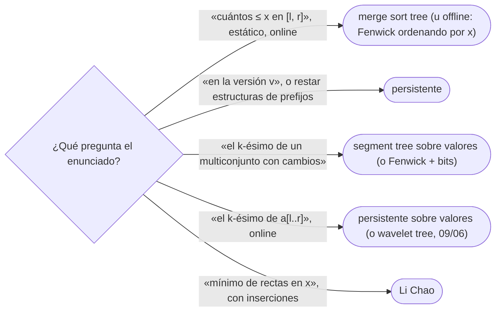

# 04 — Segment tree avanzado

> Cuatro variantes del segment tree que conviene reconocer: el *merge sort tree*, que guarda listas
> ordenadas en los nodos; el persistente, que conserva todas las versiones copiando solo un camino; el
> segment tree sobre valores, que da el `k`-ésimo; y el árbol de Li Chao, que guarda rectas y da el mínimo en
> un punto.
>
> **Niveles:** *merge sort tree* [C] · persistente [C] · sobre valores (`k`-ésimo) [C] · Li Chao [C].
>
> **📚 Lectura troncal:** cp-algorithms, [*Segment Tree*](https://cp-algorithms.com/data_structures/segment_tree.html)
> y [*Convex Hull Trick and Li Chao Tree*](https://cp-algorithms.com/geometry/convex_hull_trick.html);
> Driscoll, Sarnak, Sleator y Tarjan, «Making Data Structures Persistent», *Journal of Computer and System
> Sciences* 38, 1989.
>
> **Vigencia:** 2026-10-04.

**Salto rápido:** [1](#1--el-problema) · [2](#2--la-teoría) · [3](#3--merge-sort-tree) · [4](#4--persistente) · [5](#5--sobre-valores-el-k-ésimo) · [6](#6--li-chao) · [7](#7--cómo-se-elige) · [🧠](#-preguntas) · [🧩](#-problemas-propios)

---

## 1. 🎯 El problema

El segment tree de `09/03` guarda en cada nodo **un** valor que resume su tramo. Hay preguntas para las que
un resumen no basta:

- **«¿Cuántos de `a[l..r]` son `≤ x`?»**: el nodo necesitaría saber cuántos de sus valores son `≤ x` para
  cualquier `x`.
- **«La suma de `[l, r]` en la versión del arreglo de hace 1000 cambios»**: habría que guardar todas las
  versiones.
- **«El `k`-ésimo menor de `a[l..r]`»**: no se deduce del mínimo ni de la suma.
- **«El mínimo en `x` de un conjunto de rectas al que se añaden rectas»**: no es un arreglo.

Cada una tiene una variante del segment tree. Ninguna se escribe en una entrevista; en concurso aparecen en
problemas difíciles. Este capítulo es de fichas: qué resuelve cada una, qué cuesta y cómo reconocerla.

---

## 2. 📐 La teoría

**Persistencia por copia de camino.** Una actualización puntual cambia los `O(log n)` nodos del camino de la
hoja a la raíz. Si en lugar de modificarlos se **crean copias** que apuntan a los hijos no tocados de la
versión anterior, la versión vieja sigue intacta y la nueva comparte todo lo demás.

**Teorema (coste de la persistencia).** Tras `q` actualizaciones puntuales sobre un segment tree de `n`
hojas, el total de nodos es `O(n + q log n)`, y cada versión se consulta en `O(log n)`.

*Prueba.* La versión inicial tiene `O(n)` nodos. Cada actualización crea exactamente un nodo nuevo por nivel
en el camino de la hoja a la raíz, `⌈log₂ n⌉ + 1`, y reutiliza el resto. Una consulta sobre una versión es
una consulta normal desde su raíz.

**El `k`-ésimo con prefijos de versiones.** Si la versión `i` es un segment tree **sobre valores** (cuántos
de cada valor hay) con los elementos `a[0..i−1]`, la diferencia entre las versiones `r + 1` y `l` cuenta los
valores de `a[l..r]`, y un descenso por esa diferencia da el `k`-ésimo en `O(log V)`.

**Li Chao.** Cada nodo de un segment tree sobre las abscisas guarda **una** recta: la que gana (es menor) en
el punto medio del nodo, de las que han pasado por él. Al insertar, la perdedora en el medio solo puede
ganar en una de las dos mitades (dos rectas se cortan como mucho una vez) y baja a esa mitad. Así cada
inserción y cada consulta cuestan `O(log C)`, con `C` el rango de abscisas.

---

## 3. 🧱 *Merge sort tree*

- **Qué resuelve.** «¿Cuántos de `a[l..r]` son `≤ x`?» (u otras preguntas de orden) sobre un arreglo
  estático, *online*.
- **Qué garantiza.** Cada nodo guarda la lista **ordenada** de los valores de su tramo; la consulta
  descompone `[l, r]` en `O(log n)` nodos y hace una búsqueda binaria en cada uno: `O(log² n)`.
- **Cuánto.** Memoria y construcción `O(n log n)` (cada nivel guarda todos los elementos; se construye como
  la mezcla de [`05/01`](../05-orden-y-busqueda/01-ordenacion-por-comparacion.md)).
- **Cómo reconocerlo.** Preguntas de conteo por valor dentro de un tramo, sin actualizaciones, cuando no se
  pueden ordenar las consultas.
- **Si no te la sabes.** *Offline*: ordenar las consultas por `x` y un Fenwick sobre posiciones ([`09/02`](02-fenwick.md)).
- **Dónde está entera.** cp-algorithms, *Segment Tree*, en la parte que guarda listas ordenadas en los
  nodos.

---

## 4. 🧱 Persistente

- **Qué resuelve.** Consultar cualquier versión anterior de un arreglo que se actualiza; y, combinando
  versiones de prefijos, preguntas sobre tramos que necesitan «restar» estructuras.
- **Qué garantiza.** Cada actualización crea `O(log n)` nodos nuevos y deja una raíz nueva; todas las
  versiones siguen consultables en `O(log n)`.
- **Cuánto.** `O(n + q log n)` nodos. Se implementa con nodos en arreglos (`izq[]`, `der[]`, `valor[]`) en
  lugar de la numeración `2v`, `2v + 1`.
- **Cómo reconocerlo.** «En la versión `v`», «deshacer hasta el estado `t`» *online*, o el `k`-ésimo de un
  tramo y los valores distintos de un tramo *online*.
- **Si no te la sabes.** *Offline*, ordenar las consultas por versión y usar un solo árbol; o Mo
  ([`09/05`](05-raiz-cuadrada-y-mo.md)).
- **Dónde está entera.** Driscoll y otros, 1989; cp-algorithms, *Segment Tree*, en la parte de
  persistencia.

---

## 5. 🧱 Sobre valores (el `k`-ésimo)

- **Qué resuelve.** El `k`-ésimo menor de un multiconjunto con inserciones y borrados, y, con persistencia,
  el `k`-ésimo menor de `a[l..r]`.
- **Qué garantiza.** Las hojas son los valores posibles (comprimidos a `0..V−1`, [`04/04`](../04-secuencias/04-compresion-y-barrido.md)) y cada nodo cuenta
  cuántos elementos caen en su tramo de valores; el `k`-ésimo se encuentra bajando: si el hijo izquierdo
  tiene `≥ k`, a la izquierda; si no, se descuenta y a la derecha. `O(log V)`.
- **Cuánto.** `O(V)` nodos sin persistencia; con persistencia por prefijos, `O(n log V)`.
- **Cómo reconocerlo.** «El `k`-ésimo menor del tramo», «la mediana del tramo», con muchas consultas
  *online*.
- **Si no te la sabes.** Sin tramos, un Fenwick con búsqueda por bits (`09/02`); con tramos y *offline*,
  el *wavelet tree* ([`09/06`](06-arbol-cartesiano-y-wavelet.md)) o una búsqueda binaria paralela.
- **Dónde está entera.** cp-algorithms, *Segment Tree*, en la parte del `k`-ésimo menor de un tramo.

---

## 6. 🧱 Li Chao

- **Qué resuelve.** Mantener un conjunto de rectas `y = m·x + b` con inserciones y responder el mínimo (o
  máximo) en un punto `x`.
- **Qué garantiza.** `O(log C)` por inserción y por consulta, con `C` el rango de abscisas consultables; con
  segmentos en lugar de rectas, `O(log² C)` por inserción.
- **Cuánto.** Un nodo por tramo de abscisas visitado; con abscisas comprimidas, `O(q)` nodos.
- **Cómo reconocerlo.** DP con transiciones `dp[i] = min_j (m_j · x_i + b_j)` («*convex hull trick*») cuando
  las pendientes o los puntos no llegan en orden ([`13/05`](../13-dp-avanzada/05-optimizaciones.md)).
- **Si no te la sabes.** Con pendientes y consultas monótonas, el *convex hull trick* con una deque (`13/05`).
- **Dónde está entera.** cp-algorithms, [*Convex Hull Trick and Li Chao Tree*](https://cp-algorithms.com/geometry/convex_hull_trick.html).

---

## 7. 🧭 Cómo se elige



| Estructura | Consulta | Memoria | Alternativa *offline* o más simple |
|---|---|---|---|
| *Merge sort tree* | `O(log² n)` | `O(n log n)` | Fenwick con consultas ordenadas por `x` |
| Persistente | `O(log n)` por versión | `O(n + q log n)` | Procesar por versión con un árbol |
| Sobre valores | `O(log V)` | `O(V)` | Fenwick con búsqueda por bits |
| Li Chao | `O(log C)` | `O(q)` nodos | *Convex hull trick* con deque si hay monotonía |

---

## 8. 🔎 Señales del enunciado

| Señal | Técnica | Por qué |
|---|---|---|
| «Responde online» + «cuántos menores que `x` en `[l, r]`» | *Merge sort tree* o persistente | No se pueden reordenar las consultas |
| «Vuelve a la versión `t`» | Persistente | Copia de camino |
| «La mediana de `a[l..r]`» con muchas consultas | Persistente sobre valores o *wavelet* | Resta de versiones de prefijos |
| `dp[i] = min_j (A_j · x_i + B_j)` con `n = 2·10⁵` | Li Chao | Mínimo de rectas en un punto |

---

## ⚠️ Errores frecuentes

| Se dice | Lo preciso |
|---|---|
| «Persistente es copiar el arreglo» | Copiar es `O(n)` por versión; la copia de camino crea `O(log n)` nodos |
| «El *merge sort tree* es `O(log n)` por consulta» | Es `O(log² n)`: una búsqueda binaria en cada uno de los `O(log n)` nodos |
| «Li Chao necesita las rectas ordenadas por pendiente» | No: esa es la ventaja frente al *convex hull trick* con deque |
| «El `k`-ésimo de un tramo necesita ordenar el tramo» | Con persistencia sobre valores, `O(log V)` por consulta |

---

## 📚 Para profundizar

- **Referencia** — cp-algorithms, [*Segment Tree*](https://cp-algorithms.com/data_structures/segment_tree.html):
  *merge sort tree*, persistencia y el `k`-ésimo. *Lectura troncal.*
- **Referencia** — cp-algorithms, [*Convex Hull Trick and Li Chao Tree*](https://cp-algorithms.com/geometry/convex_hull_trick.html).
  *Lectura troncal.*
- **Artículo** — Driscoll, Sarnak, Sleator y Tarjan, «Making Data Structures Persistent», *Journal of
  Computer and System Sciences* 38, 1989. *Lectura troncal.*

---

## 🧠 Preguntas

1. ¿Qué guarda cada nodo de un *merge sort tree*? 🟢
2. ¿Qué es una estructura persistente? 🟢
3. ¿Qué guarda cada nodo de un árbol de Li Chao? 🟢
4. ¿Cómo se encuentra el `k`-ésimo menor en un segment tree sobre valores? 🟢
5. ¿Por qué una consulta en el *merge sort tree* cuesta `O(log² n)`? 🟡
6. ¿Cuántos nodos nuevos crea una actualización en un segment tree persistente, y por qué? 🟡
7. ¿Por qué, al insertar en Li Chao, la recta perdedora en el punto medio baja solo a una mitad? 🟠
8. Demuestra que `q` actualizaciones persistentes crean `O(q log n)` nodos. 🟠
9. ¿Cómo responde un segment tree persistente sobre valores «el `k`-ésimo de `a[l..r]`»? 🟠
10. Compara la memoria que necesitan el *merge sort tree* y el persistente para `n = q = 2·10⁵` en C++ y en Java. 🟠
11. ¿Cuándo prefieres un Fenwick *offline* a un *merge sort tree*? 🟠
12. ¿Cómo cuentas los valores distintos de `a[l..r]` *online* con un segment tree persistente? 🔴
13. ¿Por qué Li Chao con segmentos (no rectas) cuesta `O(log² C)` por inserción? 🔴

---

## 🧩 Problemas propios

### Cuántos no superan el límite

**Nivel:** 🟡 · **Formato:** programa completo.

Para cada consulta `l r x` (0-indexada, inclusiva), imprime cuántos de `a[l..r]` son `≤ x`. Las consultas
se pueden responder en cualquier orden.

- **Entrada.** Una línea con `n` y `q`. Una línea con los `n` valores. Después, `q` líneas con `l r x`.
- **Salida.** `q` enteros, en el orden de entrada.
- **Restricciones.** `1 ≤ n, q ≤ 2·10⁵`; valores y `x` entre 1 y `10⁹`.

```text
Entrada            Salida
6 3                4
5 2 9 1 5 6        1
0 5 5              2
1 3 1
2 4 8

Entrada            Salida
3 2                0
1000000000 1 1     3
0 0 999999999
0 2 1000000000
```

**Pista 1:** si procesas las consultas por `x` creciente, ¿qué elementos del arreglo «existen» en cada una?

### Versiones del inventario

**Nivel:** 🟠 · **Formato:** programa completo.

Un inventario de `n` productos empieza en la versión 0. Llegan órdenes: `= v p x` (crea una versión nueva,
numerada en orden, igual a la versión `v` pero con `a[p] = x`) y `? v l r` (imprime la suma de `a[l..r]` en
la versión `v`). Hay que responder en orden.

- **Entrada.** Una línea con `n` y `q`. Una línea con los `n` valores. Después, `q` órdenes.
- **Salida.** Una línea por cada `?`.
- **Restricciones.** `1 ≤ n, q ≤ 2·10⁵`; valores hasta `10⁹`.

```text
Entrada            Salida
6 6                16
5 2 9 1 5 6        7
= 0 2 0            21
? 0 0 2            19
? 1 0 2
= 1 0 7
? 2 0 5
? 1 0 5

Entrada            Salida
1 4                1000000000
1000000000         2
= 0 0 1
= 0 0 2
? 0 0 0
? 2 0 0
```

**Pista 1:** ¿cuántos nodos del árbol cambian de verdad entre una versión y la siguiente?

---

## 🧩 Práctica externa

Las tres bases no llegan a estas estructuras; la práctica está en Library Checker y Codeforces. La
plataforma que se previó para este capítulo (SPOJ) no admite la verificación automática de enlaces.

### Ampliación

| ✔ | Problema | Plataforma | Nivel | Patrón | Pista 1 |
|---|---|---|---|---|---|
| [ ] | [Range Kth Smallest](https://judge.yosupo.jp/problem/range_kth_smallest) | Library Checker | 🔴 | Persistente sobre valores | ¿Qué versión de prefijo restas para quedarte con `a[l..r)`? |
| [ ] | [Line Add Get Min](https://judge.yosupo.jp/problem/line_add_get_min) | Library Checker | 🔴 | Li Chao | ¿Qué abscisas necesita el árbol, si las consultas se conocen de antemano? |
| [ ] | [Army Creation](https://codeforces.com/problemset/problem/813/E) | Codeforces | 🔴 | Persistente sobre posiciones | Para cada posición, ¿cuál es la aparición `k` posiciones antes del mismo valor? |

### Por curiosidad

| ✔ | Problema | Plataforma | Nivel | Patrón | Pista 1 |
|---|---|---|---|---|---|
| [ ] | 💀 [Segment Add Get Min](https://judge.yosupo.jp/problem/segment_add_get_min) | Library Checker | 🔴 | Li Chao con segmentos | ¿En cuántos nodos se descompone el dominio de un segmento? |
| [ ] | 💀 [Escape Through Leaf](https://codeforces.com/problemset/problem/932/F) | Codeforces | 🔴 | Li Chao + *small-to-large* | Al fusionar los subárboles, ¿qué estructura de rectas se fusiona? |

---

## ✅ Criterio de dominio

- Decir qué guarda cada variante, qué responde y cuánto cuesta.
- Explicar la copia de camino y por qué crea `O(log n)` nodos por versión.
- Elegir la alternativa *offline* o más simple cuando existe.

---

**Anterior:** [`09/03` — Segment tree](03-segment-tree.md) · **Siguiente:** [`09/05` — Raíz cuadrada y Mo](05-raiz-cuadrada-y-mo.md) ·
**Relacionado:** [`13/05` — Optimizaciones de DP](../13-dp-avanzada/05-optimizaciones.md); [`09/06` — Árbol cartesiano y *wavelet tree*](06-arbol-cartesiano-y-wavelet.md).
