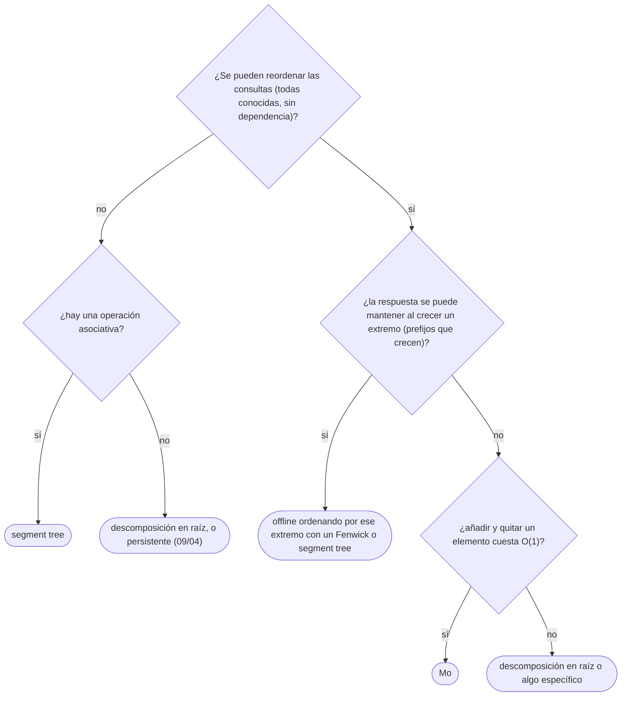

# 05 — Raíz cuadrada y Mo

> Cuando ninguna estructura logarítmica encaja, partir en bloques de tamaño `√n` da `O(√n)` por operación
> con muy poco código. El algoritmo de Mo lleva esa idea a las consultas: si se pueden **reordenar**,
> se responden todas moviendo dos punteros en `O((n + q)√n)`. Y el procesamiento *offline* en general:
> cuándo es legítimo y qué gana.
>
> **Niveles:** descomposición en raíz [B] · Mo [B] · consultas *offline* [B].
>
> **📚 Lectura troncal:** Laaksonen, *Guide to Competitive Programming*, 3.ª ed. (Springer, 2024), cap. 15;
> cp-algorithms, [*Sqrt Decomposition*](https://cp-algorithms.com/data_structures/sqrt_decomposition.html).
>
> **Vigencia:** 2026-10-04.

**Salto rápido:** [1](#1--el-problema) · [2](#2--la-teoría) · [3](#3--descomposición-en-raíz) · [4](#4--mo) · [5](#5--consultas-offline) · [6](#6-️-la-tabla-de-costes) · [7](#7--cómo-se-elige) · [8](#8--señales-del-enunciado) · [🧠](#-preguntas) · [🧩](#-problemas-propios)

---

## 1. 🎯 El problema

Algunas preguntas sobre tramos no tienen una operación asociativa que meter en un segment tree: «¿cuántos
valores distintos hay en `a[l..r]`?», «¿cuál es el valor más frecuente?», «¿cuántos pares iguales?». Con
`n = q = 2·10⁵`, recorrer cada tramo es `O(n · q) = 4·10¹⁰`.

Dos ideas resuelven muchos de estos casos con poco código:

- **Partir en bloques de `√n`**: una consulta toca como mucho dos trozos de bloque y `√n` bloques enteros;
  una actualización, un bloque. Todo `O(√n)`: con `n = 2·10⁵`, unos 450 pasos.
- **Reordenar las consultas** (Mo): si se pueden responder en cualquier orden, se ordenan para que dos
  punteros `l` y `r` se muevan poco en total, añadiendo y quitando elementos de una estructura que sabe
  hacer eso en `O(1)`.

«`√n` es lento» es un prejuicio: `(n + q)√n` con `n = q = 2·10⁵` son unos `2·10⁸` pasos sencillos, que entran
en un segundo en C++ y Java.

---

## 2. 📐 La teoría

**La descomposición.** Con bloques de tamaño `B`, hay `⌈n/B⌉` bloques. Una consulta de tramo cuesta
`O(B)` (los trozos de los extremos) más `O(n/B)` (los bloques enteros); una actualización puntual, `O(1)` o
`O(B)` según lo que se guarde por bloque. El total `B + n/B` es mínimo con `B = √n`: `O(√n)`.

**El orden de Mo.** Se ordenan las consultas `[l, r]` por el bloque de `l` (`l / B`) y, dentro del mismo
bloque, por `r`. Se mantienen dos punteros y una estructura con los elementos de `[curL, curR]`; para pasar a
la consulta siguiente, se añaden o quitan elementos de uno en uno.

**Teorema (coste de Mo).** Con bloques de `B = √n` y operaciones de añadir y quitar en `O(1)`, las `q`
consultas se responden en `O((n + q)√n)`.

*Prueba.* El puntero `r`: dentro de un mismo bloque de `l`, las consultas están ordenadas por `r` y `r` solo
avanza: `O(n)` por bloque, `O(n · n/B) = O(n√n)` en total. El puntero `l`: entre dos consultas del mismo bloque
se mueve como mucho `B`; al cambiar de bloque, como mucho `2B`: `O(q · B) = O(q√n)`. Total `O((n + q)√n)`.

**Cuándo *offline* es legítimo.** Si todas las consultas se leen antes de responder la primera y ninguna
depende de la respuesta de otra, se pueden reordenar. Los jueces que quieren impedirlo «cifran» cada consulta
con la respuesta anterior (*online forzado*).

---

## 3. 🧱 Descomposición en raíz

**Qué es.** Partir el arreglo en bloques de `√n` elementos y guardar un resumen por bloque (suma, mínimo, una
copia ordenada…). Las consultas recorren los trozos de los extremos elemento a elemento y los bloques
enteros por su resumen.

**Por qué es correcto** (el enunciado y una frase): el tramo `[l, r]` es la unión disjunta de un trozo final
de un bloque, unos bloques enteros y un trozo inicial de otro; combinar los elementos de los trozos y los
resúmenes de los bloques da la respuesta.

**Cómo va**, sumas de `[5, 2, 9, 1, 5, 6]` con `B = 2`:

```text
bloques:   [5 2] [9 1] [5 6]      sumas: 7, 10, 11
suma de [1, 4]: a[1] = 2 (trozo del bloque 0) + bloque 1 entero = 10 + a[4] = 5 (trozo del bloque 2) = 17
```

**Cuánto.** `O(√n)` por consulta y por actualización; `O(n)` de memoria.

**La plantilla**, sumas con actualización puntual:

```cpp
#include <cmath>
#include <vector>

// Descomposición en raíz para sumas: set puntual O(1), suma de [l, r] en O(√n).
struct SqrtSum {
    int n, B; std::vector<long long> a, block;
    explicit SqrtSum(const std::vector<long long>& v) : n(v.size()), a(v) {
        B = std::max(1, (int)std::sqrt(n));
        block.assign((n + B - 1) / B, 0);
        for (int i = 0; i < n; i++) block[i / B] += a[i];
    }
    void set(int p, long long x) { block[p / B] += x - a[p]; a[p] = x; }
    long long query(int l, int r) const {                    // suma de a[l..r], inclusivo
        long long s = 0;
        int bl = l / B, br = r / B;
        if (bl == br) { for (int i = l; i <= r; i++) s += a[i]; return s; }
        for (int i = l; i < (bl + 1) * B; i++) s += a[i];     // trozo del primer bloque
        for (int b = bl + 1; b < br; b++) s += block[b];      // bloques enteros
        for (int i = br * B; i <= r; i++) s += a[i];          // trozo del último bloque
        return s;
    }
};
```

```java
// Descomposición en raíz para sumas: set puntual O(1), suma de [l, r] en O(√n).
static final class SqrtSum {
    final int n, B; final long[] a, block;
    SqrtSum(long[] v) {
        n = v.length; a = v.clone(); B = Math.max(1, (int) Math.sqrt(n));
        block = new long[(n + B - 1) / B];
        for (int i = 0; i < n; i++) block[i / B] += a[i];
    }
    void set(int p, long x) { block[p / B] += x - a[p]; a[p] = x; }
    long query(int l, int r) {
        long s = 0;
        int bl = l / B, br = r / B;
        if (bl == br) { for (int i = l; i <= r; i++) s += a[i]; return s; }
        for (int i = l; i < (bl + 1) * B; i++) s += a[i];
        for (int b = bl + 1; b < br; b++) s += block[b];
        for (int i = br * B; i <= r; i++) s += a[i];
        return s;
    }
}
```

- **El resumen por bloque** puede ser cualquier cosa que se mantenga barato: una copia ordenada del bloque
  permite «cuántos `≥ x`» con una búsqueda binaria por bloque, `O(√n log n)` por consulta.
- **El tamaño del bloque** se ajusta al coste de cada parte: si la parte por bloque cuesta `log n`,
  conviene `B ≈ √(n log n)`.

**Cuándo sí**: resúmenes que un segment tree no combina bien (una copia ordenada, un histograma); prototipos
rápidos. **Cuándo no**: si hay una estructura logarítmica directa, gana con `n` grande.

> **Veredicto:** partir en `√n` bloques es la estructura de tramos más corta: `O(√n)` por operación con un
> resumen por bloque que puede ser casi cualquier cosa.

---

## 4. 🧱 Mo

**Qué es.** Responder consultas de tramo *offline* ordenándolas por `(bloque de l, r)` y moviendo dos punteros
que añaden y quitan elementos de una estructura.

**Por qué es correcto** (el enunciado y una frase): la estructura siempre contiene exactamente los
elementos de `[curL, curR]`, porque cada movimiento de puntero añade o quita uno; al llegar a `[l, r]`
de una consulta, su respuesta es la de la estructura, sea cual sea el orden en que se llegó.

**Cómo va**, «cuántos distintos» en `[5, 2, 9, 1, 5, 6]` con `B = 2` y consultas `[0,5]`, `[1,4]`, `[4,5]`:

```text
orden por (l / 2, r):  [1,4] (bloque 0, r=4) · [0,5] (bloque 0, r=5) · [4,5] (bloque 2)
[1,4]:  r → 4 añade 5, 2, 9, 1, 5; l → 1 quita el primer 5   distintos 4
[0,5]:  r → 5 añade 6; l → 0 añade 5     el 5 ya estaba: distintos 5
[4,5]:  l → 4 quita 5, 2, 9, 1           el 5 sigue (queda el de la posición 4): distintos 2
```

**Cuánto.** `O((n + q)√n)` movimientos, cada uno con el coste de añadir o quitar.

**La plantilla**, con «cuántos distintos» como estructura:

```cpp
#include <algorithm>
#include <cmath>
#include <vector>

// Mo: distintos en cada [l, r]. Valores comprimidos a 0..V−1. O((n + q)√n).
std::vector<int> moDistinct(const std::vector<int>& a, int V, const std::vector<std::pair<int, int>>& qs) {
    int n = a.size(), q = qs.size(), B = std::max(1, (int)(n / std::sqrt((double)std::max(q, 1))));
    std::vector<int> order(q), cnt(V, 0), ans(q);
    for (int i = 0; i < q; i++) order[i] = i;
    std::sort(order.begin(), order.end(), [&](int x, int y) {
        int bx = qs[x].first / B, by = qs[y].first / B;
        if (bx != by) return bx < by;
        return (bx & 1) ? qs[x].second > qs[y].second : qs[x].second < qs[y].second;   // zigzag
    });
    int curL = 0, curR = -1, distinct = 0;
    auto add = [&](int i) { if (cnt[a[i]]++ == 0) distinct++; };
    auto remove = [&](int i) { if (--cnt[a[i]] == 0) distinct--; };
    for (int id : order) {
        auto [l, r] = qs[id];
        while (curR < r) add(++curR);
        while (curL > l) add(--curL);
        while (curR > r) remove(curR--);
        while (curL < l) remove(curL++);
        ans[id] = distinct;
    }
    return ans;
}
```

```java
// Mo: distintos en cada [l, r]. Valores comprimidos a 0..V−1. O((n + q)√n).
static int[] moDistinct(int[] a, int V, int[][] qs) {
    int n = a.length, q = qs.length, B = Math.max(1, (int) (n / Math.sqrt(Math.max(q, 1))));
    Integer[] order = new Integer[q];
    for (int i = 0; i < q; i++) order[i] = i;
    java.util.Arrays.sort(order, (x, y) -> {
        int bx = qs[x][0] / B, by = qs[y][0] / B;
        if (bx != by) return Integer.compare(bx, by);
        return (bx & 1) == 1 ? Integer.compare(qs[y][1], qs[x][1]) : Integer.compare(qs[x][1], qs[y][1]);
    });
    int[] cnt = new int[V], ans = new int[q];
    int curL = 0, curR = -1, distinct = 0;
    for (int id : order) {
        int l = qs[id][0], r = qs[id][1];
        while (curR < r) if (cnt[a[++curR]]++ == 0) distinct++;
        while (curL > l) if (cnt[a[--curL]]++ == 0) distinct++;
        while (curR > r) if (--cnt[a[curR--]] == 0) distinct--;
        while (curL < l) if (--cnt[a[curL++]] == 0) distinct--;
        ans[id] = distinct;
    }
    return ans;
}
```

- **El orden de los cuatro `while`**: primero ampliar (`add`) y después reducir (`remove`), para que el tramo
  nunca quede «al revés» (`curL > curR + 1`) con cuentas negativas.
- **El zigzag** (en los bloques impares, `r` decreciente) ahorra la vuelta de `r` al principio en cada bloque:
  en la práctica, casi la mitad del movimiento.
- **`B = n / √q`** equilibra los dos punteros cuando `q` y `n` son distintos; con `q ≈ n`, es `√n`.
- **Python**: Mo con `2·10⁵` consultas suele ser demasiado lento; hay que buscar otra vía.

**Cuándo sí**: consultas de tramo *offline* sobre agregados que se mantienen con añadir y quitar en `O(1)`
(cuentas, distintos, pares iguales, frecuencia máxima con un truco). **Cuándo no**: consultas *online*
forzadas; si hay una solución `O(log n)`, con `n` grande gana.

> **Veredicto:** Mo cambia «calcular cada tramo» por «moverse entre tramos»: con las consultas ordenadas por
> bloques, `O((n + q)√n)` añadiendo y quitando elementos de uno en uno.

---

## 5. 🧱 Consultas *offline*

**Qué es.** Leer todas las consultas, ordenarlas por un parámetro (el extremo derecho, el umbral `x`, el
tiempo) y responderlas en ese orden con una estructura sencilla que va cambiando, guardando cada respuesta
en su índice original.

**Por qué es correcto** (el enunciado y una frase): cada consulta se responde con la estructura en el estado
que le corresponde (los elementos `≤ r`, o `≤ x`), y el orden de impresión se restaura con el índice
original.

**Cómo va**, «cuántos distintos en `[l, r]`» ordenando por `r`: al llegar a la posición `i`, se pone un 1 en `i`
y se quita el de la aparición anterior de `a[i]`; las consultas con `r = i` suman `[l, r]` en un Fenwick
(`09/03`, pregunta 13).

**Cuánto.** `O((n + q) log n)` en el caso de los distintos: más rápido que Mo.

**La plantilla**, los distintos *offline* con el Fenwick de [`09/02`](02-fenwick.md):

```cpp
#include <algorithm>
#include <numeric>
#include <unordered_map>
#include <vector>

// Distintos en [l, r] offline: ordenar por r y Fenwick sobre la última aparición. O((n + q) log n).
std::vector<int> offlineDistinct(const std::vector<int>& a, const std::vector<std::pair<int, int>>& qs) {
    int n = a.size(), q = qs.size();
    std::vector<int> order(q), ans(q);
    std::iota(order.begin(), order.end(), 0);
    std::sort(order.begin(), order.end(), [&](int x, int y) { return qs[x].second < qs[y].second; });
    Fenwick f(n);                                            // el de 09/02, índices 1..n
    std::unordered_map<int, int> last;
    int k = 0;
    for (int i = 0; i < n; i++) {
        auto it = last.find(a[i]);
        if (it != last.end()) f.add(it->second + 1, -1);
        last[a[i]] = i; f.add(i + 1, 1);
        while (k < q && qs[order[k]].second == i) {
            int id = order[k++];
            ans[id] = f.range(qs[id].first + 1, i + 1);
        }
    }
    return ans;
}
```

```java
// Distintos en [l, r] offline: ordenar por r y Fenwick sobre la última aparición. O((n + q) log n).
static int[] offlineDistinct(int[] a, int[][] qs) {
    int n = a.length, q = qs.length;
    Integer[] order = new Integer[q];
    for (int i = 0; i < q; i++) order[i] = i;
    java.util.Arrays.sort(order, (x, y) -> Integer.compare(qs[x][1], qs[y][1]));
    Fenwick f = new Fenwick(n);
    java.util.HashMap<Integer, Integer> last = new java.util.HashMap<>();
    int[] ans = new int[q];
    int k = 0;
    for (int i = 0; i < n; i++) {
        Integer prev = last.put(a[i], i);
        if (prev != null) f.add(prev + 1, -1);
        f.add(i + 1, 1);
        while (k < q && qs[order[k]][1] == i) { int id = order[k++]; ans[id] = (int) f.range(qs[id][0] + 1, i + 1); }
    }
    return ans;
}
```

- **Guardar el índice original** de cada consulta es lo único imprescindible; el resto es la técnica del
  problema.
- **Otros parámetros de orden**: por umbral `x` (cuántos `≤ x` en `[l, r]`, `09/04`), por tiempo (aristas que
  aparecen, [`07/07`](../07-arboles/07-arboles-dinamicos.md)).

**Cuándo sí**: siempre que las consultas se conozcan antes y no dependan unas de otras. **Cuándo no**:
consultas *online* forzadas.

> **Veredicto:** procesar *offline* convierte una pregunta difícil sobre tramos en una fácil sobre prefijos
> que crecen. Si el enunciado lo permite, es casi siempre lo más corto.

---

## 6. ⏱️ La tabla de costes

| Técnica | Coste | Requisito | Lo que la tabla no dice |
|---|---|---|---|
| Descomposición en raíz | `O(√n)` por operación | Un resumen por bloque | La más corta de escribir |
| Mo | `O((n + q)√n)` total | *Offline*; añadir y quitar en `O(1)` | Zigzag y `B = n/√q` ayudan |
| *Offline* ordenando por un extremo | `O((n + q) log n)` | *Offline*; la respuesta crece con el extremo | Casi siempre más rápida que Mo |
| Segment tree (`09/03`) | `O(log n)` | Operación asociativa | *Online* |

---

## 7. 🧭 Cómo se elige



---

## 8. 🔎 Señales del enunciado

| Señal | Técnica | Por qué |
|---|---|---|
| «Valores distintos», «más frecuente», «pares iguales» en `[l, r]` | Mo, u *offline* por `r` | No hay operación asociativa |
| `n, q ≤ 10⁵` y una operación rara por bloque | Descomposición en raíz | `O(√n)` sin estructura compleja |
| «Responde en orden» y consultas cifradas con la respuesta anterior | Nada *offline* | *Online* forzado |
| Todas las consultas en la entrada y un umbral `x` en cada una | *Offline* por `x` | Activar elementos por orden |

---

## ⚠️ Errores frecuentes

| Se dice | Lo preciso |
|---|---|
| «`√n` es lento» | `(n + q)√n` con `2·10⁵` son unos `2·10⁸` pasos sencillos: un segundo en C++ y Java |
| «Mo sirve siempre» | Solo *offline*, y si añadir y quitar son baratos |
| «En Mo da igual el orden de los cuatro bucles» | Hay que ampliar antes de reducir, o las cuentas pasan por negativos |
| «El tamaño de bloque es siempre `√n`» | Se ajusta al coste de cada parte; en Mo con `q ≠ n`, `n/√q` |
| «*Offline* es hacer trampa» | Es legítimo si el enunciado da todas las consultas y no dependen entre sí |

---

## 📚 Para profundizar

- **Libro** — Laaksonen, *Guide to Competitive Programming*, 3.ª ed. (Springer, 2024), cap. 15: algoritmos de
  raíz cuadrada y Mo. *Lectura troncal.*
- **Referencia** — cp-algorithms, [*Sqrt Decomposition*](https://cp-algorithms.com/data_structures/sqrt_decomposition.html),
  con el algoritmo de Mo y sus variantes. *Lectura troncal.*

---

## 🧠 Preguntas

1. ¿Por qué el tamaño de bloque óptimo es `√n` en la descomposición en raíz? 🟢
2. ¿Cuándo es legítimo procesar las consultas *offline*? 🟢
3. ¿En qué orden ordena Mo las consultas? 🟢
4. ¿Qué tiene que cumplir una pregunta de tramo para poder usar Mo? 🟡
5. ¿Por qué en Mo hay que ampliar el tramo antes de reducirlo? 🟡
6. ¿Qué es el orden en zigzag y qué ahorra? 🟡
7. ¿Cómo cuentas los valores distintos de `[l, r]` *offline* con un Fenwick? 🟡
8. Demuestra que Mo hace `O((n + q)√n)` movimientos de puntero. 🟠
9. ¿Cómo eliges el tamaño de bloque si una parte de la consulta cuesta `O(log n)` por bloque? 🟠
10. Compara si Mo es viable en C++, Java y Python con `n = q = 2·10⁵`, y qué harías en Python. 🟠
11. ¿Cómo mantiene Mo la **frecuencia máxima** del tramo, si quitar un elemento puede bajarla? 🟠
12. ¿Cómo funciona Mo con actualizaciones (una tercera dimensión, el tiempo), y con qué coste? 🔴
13. ¿Cómo mantiene «Mo con *rollback*» operaciones que solo saben añadir? 🔴

---

## 🧩 Problemas propios

### Pares iguales en el tramo

**Nivel:** 🟠 · **Formato:** programa completo.

Para cada consulta `l r` (0-indexada, inclusiva), imprime cuántos pares `i < j` de `[l, r]` cumplen
`a[i] = a[j]`. Todas las consultas están en la entrada.

- **Entrada.** Una línea con `n` y `q`. Una línea con los `n` valores. Después, `q` líneas con `l r`.
- **Salida.** `q` enteros, en el orden de entrada.
- **Restricciones.** `1 ≤ n, q ≤ 10⁵`; valores entre 1 y `10⁹`.

```text
Entrada            Salida
6 3                4
1 2 1 1 3 2        1
0 5                1
1 3
2 4

Entrada            Salida
4 2                6
7 7 7 7            0
0 3
2 2
```

**Pista 1:** si al tramo se le añade un elemento de valor `x`, ¿cuántos pares nuevos aparecen?

### Contar por encima con cambios

**Nivel:** 🟡 · **Formato:** programa completo.

Llegan órdenes: `= p v` (fija `a[p] = v`) y `? l r x` (imprime cuántos de `a[l..r]` son `≥ x`). Hay que
responder en orden.

- **Entrada.** Una línea con `n` y `q`. Una línea con los valores. Después, `q` órdenes.
- **Salida.** Una línea por cada `?`.
- **Restricciones.** `1 ≤ n, q ≤ 5·10⁴`; valores entre 1 y `10⁹`.

```text
Entrada            Salida
6 4                4
5 2 9 1 5 6        2
? 0 5 5            0
= 2 3
? 1 4 3
? 0 5 7

Entrada            Salida
1 3                1
5                  0
? 0 0 5
= 0 4
? 0 0 5
```

**Pista 1:** si cada bloque guarda una copia ordenada de sus valores, ¿cuánto cuesta contar los `≥ x` de un
bloque entero?

---

## 🧩 Práctica externa

> 💡 **Truco.** Antes de escribir Mo, comprueba si la respuesta se puede mantener solo «añadiendo por la
> derecha» con las consultas ordenadas por `r`: suele ser más rápido y más corto. Pide a una IA esa
> alternativa antes que el código de Mo ([`01/06`](../01-oficio-del-competidor/06-protocolo-de-resolucion.md)).

### Núcleo

| ✔ | Problema | Plataforma | Nivel | Patrón | Pista 1 |
|---|---|---|---|---|---|
| [ ] | [Range Frequency Queries](https://leetcode.com/problems/range-frequency-queries/) | LeetCode | 🟡 | Posiciones por valor + binaria | Para un valor, ¿cuántas de sus posiciones caen en `[l, r]`? |
| [ ] | [Online Majority Element In Subarray](https://leetcode.com/problems/online-majority-element-in-subarray/) | LeetCode | 🔴 | Candidato y comprobación | Si un valor es mayoritario, ¿con qué probabilidad lo encuentras eligiendo una posición al azar? |
| [ ] | [Distinct Values Queries](https://cses.fi/problemset/task/1734) | CSES | 🟠 | *Offline* por `r` o Mo | Ordenando por el extremo derecho, ¿qué aparición de cada valor cuenta? |
| [ ] | [Static Range Count Distinct](https://judge.yosupo.jp/problem/static_range_count_distinct) | Library Checker | 🟠 | *Offline* por `r` | ¿Qué posición marcas para cada valor al avanzar? |
| [ ] | [Little Elephant and Array](https://codeforces.com/problemset/problem/220/B) | Codeforces | 🟠 | Mo, o *offline* por `r` | ¿Cuántos valores pueden aparecer exactamente `x` veces con `x` grande? |

### Ampliación

| ✔ | Problema | Plataforma | Nivel | Patrón | Pista 1 |
|---|---|---|---|---|---|
| [ ] | [Powerful array](https://codeforces.com/problemset/problem/86/D) | Codeforces | 🔴 | Mo con suma de `K² · s` | Al añadir una aparición de `s`, ¿cuánto cambia `K² · s`? |
| [ ] | [XOR and Favorite Number](https://codeforces.com/problemset/problem/617/E) | Codeforces | 🔴 | Mo sobre prefijos XOR | Un tramo con XOR `k` es un par de prefijos: ¿qué cuentas? |
| [ ] | [Static Range Inversions Query](https://judge.yosupo.jp/problem/static_range_inversions_query) | Library Checker | 🔴 | Mo + Fenwick | Al añadir un elemento por la izquierda, ¿cuántas inversiones nuevas crea? |

---

## ✅ Criterio de dominio

- Escribir la descomposición en raíz y Mo sin mirar, con el orden correcto de los punteros.
- Demostrar el coste de Mo y elegir el tamaño de bloque.
- Reconocer cuándo *offline* es legítimo y preferir el orden por extremo cuando basta.
- Resolver Distinct Values Queries de dos formas y Powerful array sin pista 2.

---

**Anterior:** [`09/04` — Segment tree avanzado](04-segment-tree-avanzado.md) · **Siguiente:** [`09/06` — Árbol cartesiano y *wavelet tree*](06-arbol-cartesiano-y-wavelet.md) ·
**Relacionado:** [`09/03` — Segment tree](03-segment-tree.md).
