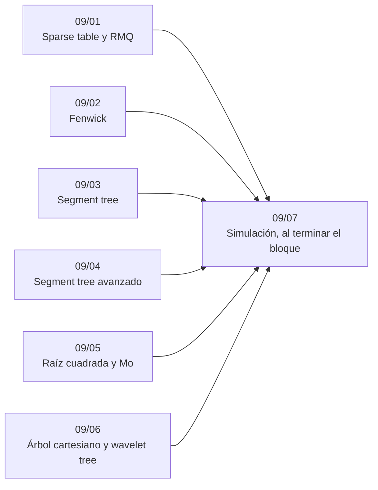

# Bloque 09 — Consultas sobre rangos

> Responder preguntas sobre tramos de un arreglo más rápido que recorriéndolos: *sparse table*, Fenwick,
> *segment tree* con y sin propagación perezosa, sus versiones avanzadas como fichas, la descomposición en raíz
> cuadrada con Mo, y el árbol cartesiano y el *wavelet tree*. La pregunta de cada capítulo es la misma: ¿hay
> actualizaciones?, ¿la operación se invierte?
>
> Las respuestas de las preguntas y las pistas 2 y 3 de los problemas, en [`08` — Respuestas](08-respuestas.md).
>
> **Vigencia:** 2026-10-04.

---

## 🧭 Índice

| Capítulo | Niveles | Ruta corta |
|---|---|---|
| [`09/01` — *Sparse table* y RMQ](01-sparse-table.md) | *sparse table* [B] |  |
| [`09/02` — Fenwick](02-fenwick.md) | puntual/rango [A] · rango/puntual [A] · rango/rango [B] · 2D [B] · búsqueda por bits [B] |  |
| [`09/03` — Segment tree](03-segment-tree.md) | iterativo [B] · recursivo [B] · *lazy propagation* [B] |  |
| [`09/04` — Segment tree avanzado](04-segment-tree-avanzado.md) | *merge sort tree* [C] · persistente [C] · sobre valores (`k`-ésimo) [C] · Li Chao [C] |  |
| [`09/05` — Raíz cuadrada y Mo](05-raiz-cuadrada-y-mo.md) | descomposición en raíz [B] · Mo [B] · consultas *offline* [B] |  |
| [`09/06` — Árbol cartesiano y *wavelet tree*](06-arbol-cartesiano-y-wavelet.md) | árbol cartesiano [C] · *wavelet tree* [C] |  |
| [`09/07` — Simulación](07-simulacion.md) | El examen del bloque: preguntas transversales y problemas cronometrados | |
| [`09/08` — Respuestas](08-respuestas.md) | Las preguntas en tres capas y las pistas 2 y 3 | |

---

## 🧭 Orden de lectura

- Fenwick (`09/02`) y el *segment tree* (`09/03`) son el núcleo; `09/01` es corto y útil antes; `09/04`–`09/06`, de concurso.

---

## 🔎 Mapa de señales del bloque

| Señal | Técnica | Capítulo |
|---|---|---|
| «Mínimo / máximo de `a[l..r]`», arreglo fijo, muchas consultas | *Sparse table* | [`09/01`](01-sparse-table.md) |
| «`gcd` de un tramo» | *Sparse table* de `gcd` | [`09/01`](01-sparse-table.md) |
| «Cambia `a[p]`; suma de `a[l..r]`» | Fenwick puntual/rango | [`09/02`](02-fenwick.md) |
| «Suma `v` a `a[l..r]`; ¿cuánto vale `a[i]`?» | Fenwick sobre diferencias | [`09/02`](02-fenwick.md) |
| «Mínimo / máximo de `a[l..r]` con cambios» | Segment tree | [`09/03`](03-segment-tree.md) |
| «Suma `v` a `[l, r]` y dame el máximo de `[a, b]`» | Segment tree con *lazy* | [`09/03`](03-segment-tree.md) |
| «Responde online» + «cuántos menores que `x` en `[l, r]`» | *Merge sort tree* o persistente | [`09/04`](04-segment-tree-avanzado.md) |
| «Vuelve a la versión `t`» | Persistente | [`09/04`](04-segment-tree-avanzado.md) |
| «Valores distintos», «más frecuente», «pares iguales» en `[l, r]` | Mo, u *offline* por `r` | [`09/05`](05-raiz-cuadrada-y-mo.md) |
| `n, q ≤ 10⁵` y una operación rara por bloque | Descomposición en raíz | [`09/05`](05-raiz-cuadrada-y-mo.md) |
| «Divide por el mínimo y recursa a los lados» | Árbol cartesiano | [`09/06`](06-arbol-cartesiano-y-wavelet.md) |
| «Para cada elemento, en cuántos subarreglos es el mínimo» | Árbol cartesiano o pila monótona | [`09/06`](06-arbol-cartesiano-y-wavelet.md) |

---

## 📚 Lectura troncal del bloque

La de cada capítulo, que es también la primera entrada de su «Para profundizar»:

- **`09/01`** — Laaksonen, *Guide to Competitive Programming*, 3.ª ed. (Springer, 2024), cap. 9; cp-algorithms, [*Sparse Table*](https://cp-algorithms.com/data_structures/sparse-table.html).
- **`09/02`** — Fenwick, «A New Data Structure for Cumulative Frequency Tables», *Software: Practice and Experience* 24(3), 1994; Laaksonen, *Guide to Competitive Programming*, 3.ª ed. (Springer, 2024), cap. 9.
- **`09/03`** — de Berg, Cheong, van Kreveld y Overmars, *Computational Geometry*, 3.ª ed. (Springer, 2008), cap. 10; Laaksonen, *Guide to Competitive Programming*, 3.ª ed. (Springer, 2024), cap. 9; cp-algorithms, [*Segment Tree*](https://cp-algorithms.com/data_structures/segment_tree.html).
- **`09/04`** — cp-algorithms, [*Segment Tree*](https://cp-algorithms.com/data_structures/segment_tree.html) y [*Convex Hull Trick and Li Chao Tree*](https://cp-algorithms.com/geometry/convex_hull_trick.html); Driscoll, Sarnak, Sleator y Tarjan, «Making Data Structures Persistent», *Journal of Computer and System Sciences* 38, 1989.
- **`09/05`** — Laaksonen, *Guide to Competitive Programming*, 3.ª ed. (Springer, 2024), cap. 15; cp-algorithms, [*Sqrt Decomposition*](https://cp-algorithms.com/data_structures/sqrt_decomposition.html).
- **`09/06`** — cp-algorithms, [*Linear RMQ*](https://cp-algorithms.com/graph/rmq_linear.html); Navarro, *Compact Data Structures* (Cambridge University Press, 2016), el capítulo de *wavelet trees*.

---

## 🧭 Qué NO está aquí

- **Los prefijos sin actualizaciones**, que bastan muy a menudo: en [`04/01` — Sumas de prefijos y arreglos de diferencias](../04-secuencias/01-prefijos-y-diferencias.md).
- **LCA**, que se reduce a RMQ: en [`07/05` — LCA](../07-arboles/05-lca.md).
- **El *convex hull trick* en DP**: en [`13/05` — Optimizaciones de DP](../13-dp-avanzada/05-optimizaciones.md).

---

**Anterior:** [Bloque 08 — Heaps y Union-Find](../08-heaps-y-union-find/README.md) ·
**Siguiente:** [Bloque 10 — Búsqueda completa y divide y vencerás](../10-busqueda-completa-y-divide-y-venceras/README.md) ·
**Inicio:** [README del corpus](../README.md)
