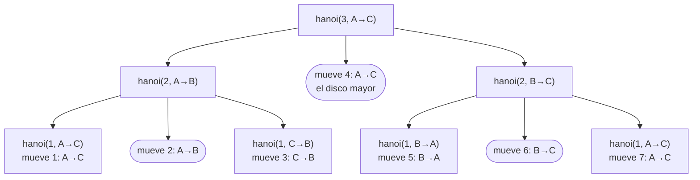
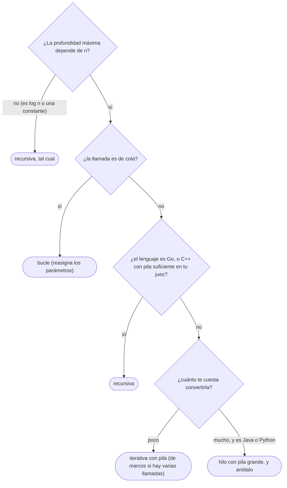

# 01 — Recursión

> La recursión como inducción que se ejecuta: el caso base, la llamada sobre algo más pequeño, la pila
> de llamadas que la sostiene y cuánto cabe en ella en cada lenguaje; y el paso a iterativo, desde el
> bucle que sustituye a una llamada de cola hasta la pila explícita de marcos con etapa. Es el dueño de
> la recursión en el corpus.
>
> **Niveles:** recursión y pila de llamadas [A] · paso a iterativo [A].
>
> **📚 Lectura troncal:** Erickson, *Algorithms* (2019, libre del autor), cap. 1; Brassard y Bratley,
> *Fundamentos de algoritmia* (Prentice Hall, 1997), cap. 1.
>
> **Ruta corta:** sí.
>
> **Vigencia:** 2026-10-04.

**Salto rápido:** [1](#1--el-problema) · [2](#2--la-teoría) · [3](#3--recursión-y-pila-de-llamadas) · [4](#4--paso-a-iterativo) · [5](#5-️-la-tabla-de-costes) · [6](#6--cómo-se-elige) · [7](#7--señales-del-enunciado) · [8](#8--dónde-aparece-de-verdad) · [🧠](#-preguntas) · [🧩](#-problemas-propios)

---

## 1. 🎯 El problema

Una función recursiva de cinco líneas recorre una cadena de reenvíos entre servidores. Pasa los tres
ejemplos del enunciado y el juez responde *Runtime Error* (error en tiempo de ejecución, RE) en el caso
9, donde la cadena mide `n = 2·10⁵`. El algoritmo es correcto y su coste es lineal: lo que se acabó es
la **pila**. Cada llamada pendiente ocupa un marco, y `2·10⁵` marcos no caben en la pila por defecto de
Java ni pasan el límite de Python, que corta a las 1000 llamadas.

La recursión tiene fama de elegante, y lo es para **pensar**: un problema se reduce a otro más pequeño
del mismo tipo, y la corrección sale por inducción casi sola. Para **ejecutar**, cada llamada tiene un
precio en memoria que el lenguaje cobra en un sitio pequeño y fijo. Este capítulo enseña las dos cosas
en orden:

- **Cómo se escribe una recursión correcta** y cómo se prueba (§3).
- **Cuánta pila gasta**, cuánta hay en C++, Java y Python, y cómo se convierte en un bucle o en una pila
  explícita cuando no alcanza (§4).

> 🧠 **Modelo mental.** Una recursión cuesta dos cosas distintas: **tiempo**, que es el número de
> llamadas por el trabajo de cada una, y **espacio de pila**, que es la profundidad máxima por el
> tamaño del marco. Se costean por separado, y la segunda es la que tumba el envío.

Lo único que se asume es saber escribir una función y leer una recurrencia como `T(n) = 2T(n − 1) + 1`;
el teorema maestro y la inducción formal están en [`02/02`](../02-analisis/02-recurrencias-y-teorema-maestro.md) y `02/04`, pero aquí se recuerda lo necesario.

---

## 2. 📐 La teoría

**Definición recursiva.** Una función es recursiva si se llama a sí misma, directa o indirectamente. Para
que termine y sea correcta necesita dos piezas:

```text
caso base       → una entrada que se resuelve sin llamarse
caso recursivo  → la entrada se reduce a una o varias entradas «más pequeñas» del mismo problema
```

«Más pequeña» tiene un sentido preciso: existe una **medida** —un entero no negativo como `n`, `hi − lo`
o la longitud de la cadena— que **baja estrictamente** en cada llamada. Como no hay sucesiones infinitas
decrecientes de naturales, la recursión termina.

**Teorema (corrección por inducción).** Si la función es correcta en los casos base, y es correcta en
una entrada de medida `m` **suponiendo** que lo es en todas las de medida menor que `m`, entonces es
correcta en todas las entradas.

Es la inducción fuerte sobre la medida, y es exactamente lo que se hace al escribir una recursión: se
confía en que la llamada interior devuelve lo correcto (la **hipótesis de inducción**) y se comprueba
solo que el paso de este nivel la usa bien. Erickson lo llama *delegar en el hada de la recursión*: no
se sigue la llamada hacia dentro, se supone resuelta. La prueba formal con sus partes está en `02/04`.

**La pila de llamadas.** Cada llamada en curso tiene un **marco** (*stack frame*) en la pila del hilo:
sus parámetros, sus variables locales y la dirección donde seguir al volver. La pila es el **estado
implícito** de la recursión: guarda, sin que lo escribas, qué llamadas están a medias y en qué punto.

```text
hanoi(3)  llama a hanoi(2), que llama a hanoi(1), que llama a hanoi(0):

  cima →  │ hanoi(0, A, C, B)  etapa: base                  │
          │ hanoi(1, A, C, B)  etapa: antes de mover         │
          │ hanoi(2, A, B, C)  etapa: antes de mover         │
  fondo → │ hanoi(3, A, C, B)  etapa: antes de mover         │
```

**El coste se mira con el árbol de recursión**: un nodo por llamada, hijos por las llamadas que hace.

```text
tiempo   = Σ (trabajo propio de cada llamada) sobre todos los nodos del árbol
espacio  = (profundidad máxima del árbol) × (tamaño del marco)  + lo que reserve cada marco
```

El árbol puede ser enorme y poco profundo (`hanoi(n)` tiene `2ⁿ⁺¹ − 1` nodos y profundidad `n + 1`) o
pequeño y profundo (una recursión lineal sobre una cadena tiene `n` nodos y profundidad `n`). Por eso
el tiempo y el espacio se derivan por separado.

**Recursión de cola.** Una llamada es **de cola** si es lo último que hace la función: su resultado se
devuelve tal cual, sin operar con él. Una recursión de cola no necesita conservar el marco de quien
llama, así que un compilador **puede** reutilizarlo y convertirla en un salto. Que pueda no significa
que lo haga:

| Lenguaje | ¿Elimina la llamada de cola? | Consecuencia |
|---|---|---|
| **C++** | GCC y Clang lo hacen a menudo con `-O2`, pero el estándar no lo garantiza, y un destructor pendiente lo impide | No se cuenta con ello: se escribe el bucle |
| **Java** | No: la JVM conserva todos los marcos | Una recursión de cola de `10⁵` niveles desborda igual |
| **Python** | No, por decisión de diseño (los marcos sirven para las trazas de error) | Igual que Java, con un límite mucho más bajo |

> 📝 **Contexto.** Los jueces habituales compilan con optimización, pero ninguno promete que tu recursión
> de cola quede convertida: **ningún juez elimina la recursión de cola por ti de forma garantizada**.

---

## 3. 🧱 Recursión y pila de llamadas

**Qué es.** Resolver un problema reduciéndolo a instancias más pequeñas de sí mismo, con un caso base
que corta. El ejemplo canónico es la **torre de Hanoi**: mover `n` discos de la varilla `A` a la `C`,
uno por vez y sin poner nunca un disco sobre otro menor, usando `B` de apoyo.

**Por qué es correcto.** Por inducción sobre `n`. Con `n = 0` no hay nada que mover. Con `n > 0`, por
hipótesis `hanoi(n − 1)` mueve correctamente una torre de `n − 1` discos entre dos varillas cualesquiera;
se usa para apartar los `n − 1` de arriba a `B`, se mueve el disco mayor de `A` a `C` (está libre, y `C`
no tiene discos menores porque todos los menores están en `B`), y se vuelven a mover los `n − 1` de `B` a
`C` encima del mayor, que no estorba a ninguno porque es más grande que todos.

**Cómo va**, `hanoi(3, A, C, B)`: el árbol de llamadas y los siete movimientos en el orden en que salen.



```text
profundidad máxima: 4 marcos (n = 3, 2, 1, 0)
```

**Cuánto.** El número de movimientos cumple `M(n) = 2M(n − 1) + 1` con `M(0) = 0`, que da
`M(n) = 2ⁿ − 1`: desplegando, `M(n) = 1 + 2 + 4 + … + 2ⁿ⁻¹`. El número de llamadas, contando las de
`n = 0`, es `2ⁿ⁺¹ − 1`. El tiempo es `Θ(2ⁿ)`; la **pila**, `Θ(n)` marcos, porque en cada momento solo
está abierta una rama del árbol. Con `n = 20` son un millón de movimientos y 21 marcos.

**La plantilla.** Toda recursión tiene la misma forma: el caso base primero, después la reducción:

```cpp
#include <cstdio>

// Mueve n discos de 'from' a 'to' usando 'via'. Θ(2ⁿ) tiempo, Θ(n) pila.
void hanoi(int n, char from, char to, char via) {
    if (n == 0) return;                       // caso base: nada que mover
    hanoi(n - 1, from, via, to);              // aparta los n − 1 de arriba
    std::printf("%c %c\n", from, to);         // mueve el disco mayor
    hanoi(n - 1, via, to, from);              // los pone encima
}
```

```java
// Mueve n discos de 'from' a 'to' usando 'via'. Θ(2ⁿ) tiempo, Θ(n) pila.
static void hanoi(int n, char from, char to, char via, StringBuilder out) {
    if (n == 0) return;                                   // caso base
    hanoi(n - 1, from, via, to, out);
    out.append(from).append(' ').append(to).append('\n');
    hanoi(n - 1, via, to, from, out);
}
```

```python
def hanoi(n, src, dst, via, out):
    """Mueve n discos de src a dst usando via. Θ(2ⁿ) tiempo, Θ(n) pila."""
    if n == 0:
        return                                  # caso base
    hanoi(n - 1, src, via, dst, out)
    out.append(f"{src} {dst}")
    hanoi(n - 1, via, dst, src, out)
```

- **El caso base va primero** y no llama a nada. Con `n == 0` como base, el caso `n = 1` no necesita
  código propio: sale de la regla general.
- **La salida se acumula** (`StringBuilder`, lista) y se imprime una vez: dos millones de `println` son
  más lentos que la recursión entera ([`01/03`](../01-oficio-del-competidor/03-entrada-salida-y-plantilla.md)).
- **En Python**, `from` es palabra reservada: por eso `src` y `dst`.
- **C++** no lleva receta: la pila del hilo principal la fija el sistema (8 MB por omisión en Linux,
  `ulimit -s`) o el juez, que a menudo la sube; si la de tu juez no basta, se pasa a iterativo (§4).
- **Cuando la profundidad dependa de `n`**, en Java y Python se lanza el programa entero en un hilo con
  pila grande: `new Thread(null, Main::solve, "solve", 1L << 28)` en Java
  ([`03/03`](../03-biblioteca-estandar/03-java-colecciones.md)), y `sys.setrecursionlimit` más
  `threading.stack_size(1 << 27)` antes de crear el hilo en Python ([`03/04`](../03-biblioteca-estandar/04-python-para-competir.md)).

**Cuánta pila hay.** Los números son órdenes de magnitud para una función con pocos parámetros; el
tamaño real del marco depende del compilador, del JIT y de cuántas variables locales tenga:

| Lenguaje | Pila por omisión | Profundidad típica | Cómo se amplía |
|---|---|---|---|
| **C++** | La del hilo principal: 8 MB en Linux, o lo que fije el juez | ~10⁵ | `ulimit -s` en local; en el juez, no se puede: iterativo |
| **Java** | ~1 MB por hilo (`-Xss`) | ~10⁴ | `new Thread(null, r, name, 1L << 28)` |
| **Python** | Límite de 1000 llamadas, además de la pila del sistema | 1000 | `setrecursionlimit` **y** un hilo con `threading.stack_size` |

**«Subo el límite y listo» no es una receta.** En Python, `sys.setrecursionlimit` solo cambia un
contador. Desde Python 3.11, una llamada entre dos funciones escritas en Python **ya no consume pila de
C**: sus marcos viven en el *heap*, y subir el límite basta para una recursión de Python puro. Pero en
cuanto la recursión pasa por código en C —una función decorada con `@functools.cache`, cuyo envoltorio
está en C, o una llamada desde `map` o `sorted`—, **cada nivel vuelve a gastar pila de C**, y con el
límite subido el proceso muere con un fallo de segmentación en vez de lanzar `RecursionError`. Por eso
la receta completa lleva el hilo. En Java, `-Xss` no se puede pasar al juez; el hilo sí.

> ⚠️ **Advertencia.** El error de pila no siempre se ve como tal. En Java es `StackOverflowError`, que
> el juez muestra como RE; en C++ y en Python con el límite subido, el proceso muere por una señal y el
> juez puede mostrar RE, o incluso *Memory Limit Exceeded* (MLE) si la pila cuenta como memoria.

### De la versión ingenua a la buena

**El problema.** Contar cuántas veces aparece `x` en un arreglo de `n = 10⁵` enteros, con una función
recursiva.

**La versión ingenua:**

```java
// Correcta por inducción sobre a.length. Θ(n²) tiempo y memoria, y n marcos de pila.
static int count(int[] a, int x) {
    if (a.length == 0) return 0;
    int rest = count(java.util.Arrays.copyOfRange(a, 1, a.length), x);   // copia n − 1 elementos
    return (a[0] == x ? 1 : 0) + rest;
}
```

> «Es correcta, pero cada llamada copia el resto del arreglo: `(n − 1) + (n − 2) + … + 1`, son
> `Θ(n²)` copias, y todas las copias siguen vivas a la vez en la pila. Además la profundidad es `n`:
> con `10⁵` desborda la pila de Java. Las dos cosas se arreglan pasando un índice en vez de una copia,
> y la segunda dejando la llamada en cola, que se convierte en un bucle.»

**El camino a la buena.** Primero, un índice `i` en lugar de la copia: `Θ(n)` de tiempo, pero sigue
habiendo `n` marcos. Después, un acumulador que deja la llamada **en cola** —`count(a, x, i + 1, acc)`
es lo último que se hace—, y una llamada de cola es un bucle disfrazado: los parámetros se reasignan y
se salta al principio.

```java
// Θ(n) tiempo, Θ(1) memoria. Es la recursión de cola count(a, x, i, acc) escrita como bucle.
static int count(int[] a, int x) {
    int acc = 0;
    for (int i = 0; i < a.length; i++) acc += (a[i] == x) ? 1 : 0;   // i ← i + 1, acc ← acc + …
    return acc;
}
```

**Cuándo sí**: la recursión es la forma de **pensar** cualquier problema que se reduce a sí mismo, y la
de **escribir** cuando la profundidad es pequeña (logarítmica, como en divide y vencerás, o acotada por
una constante, como en Hanoi con `n ≤ 20`). **Cuándo no**: cuando la profundidad crece con `n` y el
lenguaje es Java, Python o JavaScript; ahí se lanza un hilo con pila grande o se pasa a iterativo (§4).

> **Veredicto:** la recursión se prueba por inducción y se costea con su árbol: el tiempo es el tamaño
> del árbol y la pila es su altura. Antes de enviar, mira la altura y compárala con la pila de tu
> lenguaje.

---

## 4. 🧱 Paso a iterativo

**Qué es.** Sustituir la pila de llamadas, que es pequeña y la gestiona el lenguaje, por una **pila
explícita** en el *heap*, que es tan grande como la memoria del problema. Hay tres casos, de menor a
mayor esfuerzo:

```text
1. llamada de cola         → bucle: los parámetros se reasignan y se vuelve al principio
2. una llamada, trabajo     → dos fases: se baja apilando lo pendiente y se sube desapilando
   después de volver          (o se recorre en orden inverso, como el postorden de 07/01)
3. varias llamadas, trabajo → pila de marcos con una «etapa» que dice por dónde seguir
   entre ellas
```

El tercer caso es el general: cualquier recursión se convierte así, y es la plantilla del capítulo.

**Por qué es correcto.** Porque la versión iterativa **simula** la recursiva paso a paso, con este
invariante:

> **Invariante.** En cada vuelta del bucle, la pila explícita contiene exactamente los marcos que la
> versión recursiva tendría abiertos en el mismo momento, en el mismo orden, y la etapa de cada marco
> dice en qué punto de su cuerpo se reanudaría.

Se mantiene porque cada transición imita a la recursiva: «llamar» es apilar un marco nuevo en la etapa 0;
«avanzar» es ejecutar el trozo de cuerpo hasta la siguiente llamada y subir la etapa; «volver» es
desapilar. Al vaciarse la pila, la recursión original habría terminado. La función de cota es la misma
que en la recursiva, así que también termina.

**Cómo va**, Hanoi con `n = 2` desde `A` a `C`. Cada marco es `(n, from, to, via, etapa)`; la etapa 0 baja
por la izquierda, la 1 mueve y baja por la derecha, la 2 desapila:

```text
pila (cima a la derecha)                     acción
[(2,A,C,B,0)]                               etapa 0 → 1, apila (1,A,B,C,0)
[(2,A,C,B,1) (1,A,B,C,0)]                   etapa 0 → 1, apila (0,A,C,B,0), que se desapila
[(2,A,C,B,1) (1,A,B,C,1)]                   mueve A→B; etapa 1 → 2, apila (0,C,B,A,0), que se desapila
[(2,A,C,B,1) (1,A,B,C,2)]                   etapa 2: desapila
[(2,A,C,B,1)]                               mueve A→C; etapa 1 → 2, apila (1,B,C,A,0)
…                                           mueve B→C, y la pila se vacía
```

> 📝 **En Go:** las *goroutines* empiezan con una pila pequeña que **crece sola** hasta un máximo de 1 GB en
> 64 bits (`runtime/debug.SetMaxStack`): una recursión de `10⁶` niveles funciona sin receta, y el paso a
> iterativo deja de ser obligatorio. **En JavaScript**, V8 tiene una pila fija de menos de 1 MB (unos
> `10⁴` marcos) y lanza `RangeError: Maximum call stack size exceeded`; la opción `--stack-size` de Node
> puede tumbar el proceso, así que lo seguro es el iterativo.

**Cuánto.** El mismo tiempo que la recursiva, con una constante algo mayor (los marcos son objetos o
tuplas). El espacio es el mismo número de marcos, `Θ(profundidad)`, pero en el *heap*: con `2·10⁵`
marcos de unos pocos enteros, unos megabytes, que caben de sobra en el límite de memoria. En Python suele
ser **más rápida** que la recursiva, porque una llamada a función es cara.

**La plantilla**, la pila de marcos con etapa sobre Hanoi. Es la forma general: para otra recursión
cambian los campos del marco y lo que hace cada etapa.

```cpp
#include <cstdio>
#include <vector>

struct Frame { int n; char from, to, via; int stage; };

// Hanoi iterativo: simula la pila de llamadas con marcos explícitos. Θ(2ⁿ) tiempo, Θ(n) memoria.
void hanoiIterative(int n, char from, char to, char via) {
    std::vector<Frame> stack;
    stack.push_back({n, from, to, via, 0});
    while (!stack.empty()) {
        Frame& f = stack.back();
        if (f.n == 0 || f.stage == 2) { stack.pop_back(); continue; }     // base o terminado: vuelve
        if (f.stage == 0) {                                                 // primera llamada
            f.stage = 1;
            Frame child{f.n - 1, f.from, f.via, f.to, 0};
            stack.push_back(child);                                         // f puede invalidarse aquí
        } else {                                                            // etapa 1: mueve y segunda llamada
            std::printf("%c %c\n", f.from, f.to);
            f.stage = 2;
            Frame child{f.n - 1, f.via, f.to, f.from, 0};
            stack.push_back(child);
        }
    }
}
```

```java
import java.util.ArrayDeque;

// Hanoi iterativo: cada marco es {n, from, to, via, etapa}. Θ(2ⁿ) tiempo, Θ(n) memoria.
static void hanoiIterative(int n, char from, char to, char via, StringBuilder out) {
    ArrayDeque<int[]> stack = new ArrayDeque<>();
    stack.push(new int[]{n, from, to, via, 0});
    while (!stack.isEmpty()) {
        int[] f = stack.peek();
        if (f[0] == 0 || f[4] == 2) { stack.pop(); continue; }             // base o terminado
        if (f[4] == 0) {
            f[4] = 1;
            stack.push(new int[]{f[0] - 1, f[1], f[3], f[2], 0});           // hanoi(n−1, from, via, to)
        } else {
            out.append((char) f[1]).append(' ').append((char) f[2]).append('\n');
            f[4] = 2;
            stack.push(new int[]{f[0] - 1, f[3], f[2], f[1], 0});           // hanoi(n−1, via, to, from)
        }
    }
}
```

```python
def hanoi_iterative(n, src, dst, via, out):
    """Hanoi iterativo: marcos [n, src, dst, via, etapa] en una lista. Θ(2ⁿ) tiempo, Θ(n) memoria."""
    stack = [[n, src, dst, via, 0]]
    while stack:
        f = stack[-1]
        k, a, b, c, stage = f
        if k == 0 or stage == 2:
            stack.pop()                                  # base o terminado: vuelve
        elif stage == 0:
            f[4] = 1
            stack.append([k - 1, a, c, b, 0])            # hanoi(k−1, src, via, dst)
        else:
            out.append(f"{a} {b}")
            f[4] = 2
            stack.append([k - 1, c, b, a, 0])            # hanoi(k−1, via, dst, src)
```

- **La etapa** es el «contador de programa» del marco: 0 = antes de la primera llamada, 1 = entre las
  dos, 2 = después de la segunda. Con `k` llamadas en el cuerpo hay `k + 1` etapas.
- **El marco se modifica en su sitio** antes de apilar al hijo: cuando el hijo termine, el padre
  reanudará en la etapa nueva.
- **En C++**, `push_back` puede mover el vector y dejar colgando la referencia `f`: por eso se copian
  los campos al hijo **antes** de apilarlo y no se toca `f` después.
- **En Java**, `ArrayDeque` como pila, nunca `Stack`, y marcos `int[]` sin *boxing*; **en Python**, el
  marco es una lista porque se modifica en su sitio (una tupla habría que reemplazarla).
- **Si la función devuelve un valor**, el marco lleva sus resultados parciales, o se usa una segunda pila
  de valores donde cada hijo deja su resultado al terminar.

### De la versión ingenua a la buena

**El problema.** Hay `n` servidores; el servidor `i` reenvía cada mensaje al `next[i]`, o es terminal si
`next[i] = −1`, y tarda `lat[i]` en procesarlo. No hay ciclos. Para cada servidor, la latencia total hasta
que el mensaje llega a un terminal. Con los datos de juguete:

```text
servidor   0   1   2    3   4   5
next       1   2   −1   2   3   −1
lat        5   2   9    1   5   6
total      16  11  9    10  15  6        (0 → 1 → 2: 5 + 2 + 9 = 16)
```

**La versión ingenua:**

```java
// Correcta por inducción sobre la longitud de la cadena. Θ(n²) en una cadena, y n marcos de pila.
static long total(int v, int[] next, long[] lat) {
    if (next[v] == -1) return lat[v];
    return lat[v] + total(next[v], next, lat);
}
// for (int v = 0; v < n; v++) answer[v] = total(v, next, lat);
```

> «Es correcta, pero recalcula: en una cadena de `n` servidores, el último se recorre `n` veces, y el
> total es `n²/2` pasos. Y con una cadena de `2·10⁵` la profundidad desborda la pila. Guardo cada total
> la primera vez que lo calculo, y en vez de llamarme, apilo los servidores del camino hasta uno ya
> conocido y los resuelvo al desapilar.»

**El camino a la buena.** Memoización (cada total se calcula una vez; se ve a fondo en [`12/01`](../12-dp-clasica/01-de-la-recursion-a-la-tabla.md)) y el caso
2 de la lista: una sola llamada con trabajo después, que se convierte en dos fases.

```java
// Θ(n) tiempo total, Θ(n) memoria, sin recursión.
static long[] totals(int[] next, long[] lat) {
    int n = next.length;
    long[] memo = new long[n];
    boolean[] done = new boolean[n];
    int[] path = new int[n];                                   // la pila explícita
    for (int s = 0; s < n; s++) {
        int top = 0, v = s;
        while (!done[v] && next[v] != -1) { path[top++] = v; v = next[v]; }  // baja
        if (!done[v]) { memo[v] = lat[v]; done[v] = true; }    // terminal: caso base
        while (top > 0) {                                      // sube: el trabajo de después
            int u = path[--top];
            memo[u] = lat[u] + memo[next[u]];
            done[u] = true;
        }
    }
    return memo;
}
```

**Cuándo sí**: profundidad que crece con `n` (cadenas, árboles degenerados, DFS sobre grafos grandes en
[`14/03`](../14-grafos-recorridos/03-dfs.md)), sobre todo en Java, Python y JavaScript, y cuando la velocidad importa en Python. **Cuándo no**: profundidad logarítmica o constante, donde la versión
recursiva es más clara y no hay nada que ganar; y en una entrevista en vivo, donde se escribe primero la
recursiva, se dice su profundidad en voz alta y se convierte solo si hace falta.

> **Veredicto:** toda recursión se convierte en un bucle con una pila de marcos; la de cola, en un bucle
> sin pila. Se paga con legibilidad, así que se hace cuando la profundidad lo exige, no por costumbre.

---

## 5. ⏱️ La tabla de costes

| Forma | Tiempo | Pila del lenguaje | Lo que la tabla no dice |
|---|---|---|---|
| Recursiva, profundidad `d` | Tamaño del árbol × trabajo por llamada | `Θ(d)` marcos | En Java `d ≈ 10⁴` y en Python `d = 1000` sin receta |
| Recursiva en un hilo con pila grande | Igual | `Θ(d)`, en una pila de 128–256 MB | El juez puede contar esa pila como memoria |
| Recursión de cola escrita como bucle | Igual | `Θ(1)` | Solo vale si la llamada es de verdad la última operación |
| Iterativa con pila de marcos | Igual, constante algo mayor | `Θ(1)`; `Θ(d)` en el *heap* | Más código; en Python, más rápida que la recursiva |
| Recursiva con copias del subproblema | Más: `Θ(n²)` en una reducción lineal | `Θ(d)` marcos, cada uno con su copia | Es el coste oculto de `a[1:]` y `copyOfRange` |

---

## 6. 🧭 Cómo se elige



> **Regla de entrevista:** escribe la recursiva, di en voz alta «la profundidad es `n`, en Java eso
> desborda a partir de unas decenas de miles», y ofrece la conversión. Eso puntúa más que una iterativa
> ilegible desde el principio.

---

## 7. 🔎 Señales del enunciado

| Señal | Técnica | Por qué |
|---|---|---|
| «Anidado», «expresión con paréntesis», «la estructura contiene estructuras» | Recursión sobre la anidación | Cada nivel es el mismo problema más pequeño |
| La fila `k` se define a partir de la fila `k − 1` («gramática», «se duplica y se invierte») | Recursión sobre la posición | Solo hace falta la rama que contiene la posición pedida |
| Cadenas de punteros, padres o reenvíos con `n ≥ 10⁵` | Iterativo o memoización con pila explícita | La profundidad es `n` |
| `n ≤ 20` y «todas las formas de…» | Recursión de profundidad `n` | La pila es pequeña; el tiempo es lo que manda ([`10/02`](02-generar-subconjuntos-y-permutaciones.md)) |
| `k` hasta `10¹⁸` en una definición que se duplica | Recursión de profundidad `log k` | Cada nivel parte la posición por la mitad |

---

## 8. 🔭 Dónde aparece de verdad

- **Los analizadores de JSON y XML** son recursivos descendentes y por eso limitan la anidación: un JSON
  con un millón de corchetes anidados es un ataque clásico contra un analizador recursivo.
- **Los recolectores de basura** marcan los objetos vivos con una pila explícita, porque la profundidad
  del grafo de objetos no está acotada.

---

## ⚠️ Errores frecuentes

| Se dice | Lo preciso |
|---|---|
| «La recursión es más elegante y ya» | Es más clara de pensar; ejecutarla cuesta un marco por nivel en una pila pequeña y fija |
| «Subo el límite y listo» | En Python solo sube un contador; si la recursión pasa por C, el proceso muere por falta de pila. Hace falta el hilo |
| «Mi recursión es de cola, así que no gasta pila» | Java y Python no la eliminan; C++ quizá, sin garantía |
| «La recursión es `O(n)` en espacio porque tiene `n` llamadas» | El espacio es la **profundidad**, no el número de llamadas: Hanoi hace `2ⁿ` y usa `n` marcos |
| «`a[1:]` es gratis» | Copia el resto: una recursión lineal con *slicing* es `Θ(n²)` |
| «Convertir a iterativo cambia el coste» | El tiempo es el mismo; cambia dónde vive la pila y la constante |
| «Si pasa los ejemplos, la profundidad está bien» | Los ejemplos son pequeños; la profundidad se mira con el `n` máximo |

---

## 📚 Para profundizar

- **Libro** — Erickson, *Algorithms* (2019, libre del autor), cap. 1 «Recursion»: reducción, el «hada de
  la recursión», Hanoi y los árboles de recursión. *Lectura troncal.*
- **Libro** — Brassard y Bratley, *Fundamentos de algoritmia* (Prentice Hall, 1997), cap. 1: la
  inducción matemática como herramienta del análisis. *Lectura troncal.*
- **Libro** — Cormen, Leiserson, Rivest y Stein, *Introduction to Algorithms*, 3.ª ed. (MIT Press, 2009),
  cap. 4, §4.4: el método del árbol de recursión.
- **Documentación** — Python, [`sys.setrecursionlimit`](https://docs.python.org/3/library/sys.html#sys.setrecursionlimit),
  y [*What's New in Python 3.11*](https://docs.python.org/3/whatsnew/3.11.html#inlined-python-function-calls):
  las llamadas entre funciones de Python ya no consumen pila de C.
- **Documentación** — Java 21, [`Thread`](https://docs.oracle.com/en/java/javase/21/docs/api/java.base/java/lang/Thread.html):
  el constructor con tamaño de pila.
- **Documentación** — Go, [`runtime/debug`](https://pkg.go.dev/runtime/debug#SetMaxStack): el máximo de
  pila de una *goroutine*.
- **Documentación** — MDN, [*Too much recursion*](https://developer.mozilla.org/en-US/docs/Web/JavaScript/Reference/Errors/Too_much_recursion).
- **Video** — MIT OpenCourseWare, *6.006 Introduction to Algorithms*, las clases de recursión y
  recurrencias.

---

## 🧠 Preguntas

1. ¿Qué dos partes tiene toda función recursiva correcta, y qué pasa si falta cada una? 🟢
2. ¿Qué guarda un marco de pila, y de qué depende la memoria que usa una recursión? 🟢
3. ¿Cuántos movimientos y cuántas llamadas hace `hanoi(n)`, y cuál es su profundidad máxima? 🟢
4. ¿Qué es una llamada de cola, y cuál de los tres lenguajes la elimina de forma garantizada? 🟡
5. Da una recursión cuyo tiempo sea exponencial y su pila lineal, y explica por qué los dos costes no coinciden. 🟡
6. Compara cómo se amplía la profundidad máxima de recursión en C++, Java y Python, y qué límite queda después. 🟡
7. ¿Por qué `sys.setrecursionlimit(10**6)` puede bastar con una recursión de Python puro desde 3.11 y tumbar el proceso si la función está decorada con `@cache`? 🟠
8. ¿Por qué pasar una copia del subarreglo en cada llamada cambia el coste de una recursión lineal, y cuánto? 🟠
9. ¿Cuándo basta un bucle para quitar la recursión, y cuándo hace falta una pila de marcos con etapa? 🟠
10. Demuestra por inducción que `hanoi(n, from, to, via)` mueve la torre sin poner nunca un disco sobre otro menor. 🟠
11. ¿Qué invariante relaciona la pila explícita de la versión iterativa con la pila de llamadas de la recursiva, y por qué basta para la corrección? 🟠
12. Tu solución recursiva pasa todos los ejemplos y da RE en el caso 9, con `n = 2·10⁵`. ¿Qué miras primero y qué cambias en cada lenguaje? 🔴
13. Convierte a iterativa con pila explícita el recorrido en orden de un árbol binario (izquierdo, nodo, derecho) y di qué guarda cada marco y cuántas etapas tiene. 🔴
14. Da una recursión con profundidad `Θ(n)` y tiempo `Θ(n log n)`, y otra con profundidad `Θ(log n)` y tiempo `Θ(n)`. 🔴

---

## 🧩 Problemas propios

### Conjunto de Cantor

**Nivel:** 🟢 · **Formato:** programa completo.

El dibujo de nivel 0 es un guion: `-`. El de nivel `k` se forma con el de nivel `k − 1`, tantos espacios
como su longitud, y otra vez el de nivel `k − 1`. Imprime el dibujo de nivel `n`.

- **Entrada.** Una línea con `n`.
- **Salida.** Una línea con el dibujo, de longitud `3ⁿ`.
- **Restricciones.** `0 ≤ n ≤ 12`.

```text
Entrada     Salida
0           -

Entrada     Salida
2           - -   - -
```

**Pista 1:** ¿cuánto mide el dibujo de nivel `k` en función del de nivel `k − 1`, y qué pasa si
construyes cadenas nuevas en cada nivel?

🔥 **Para el geek — en JavaScript:** concatenar cadenas en un bucle de `3¹²` pasos es otra historia que en
Java con `StringBuilder`; mide cuánto tarda construir el dibujo con `+=` frente a un arreglo y `join`.

### Pliegues de papel

**Nivel:** 🟡 · **Formato:** programa completo.

Una tira de papel se dobla por la mitad `k` veces, siempre en el mismo sentido, y se despliega. Los
pliegues forman una secuencia de `V` (valle) y `M` (montaña) de longitud `2ᵏ − 1`, que cumple
`S₁ = V` y `Sₖ = Sₖ₋₁ + V + inv(Sₖ₋₁)`, donde `inv` invierte el orden y cambia cada `V` por `M` y cada `M`
por `V`. Responde `q` consultas: la letra en la posición `i` (desde 1) de `Sₖ`.

- **Entrada.** Una línea con `k` y `q`. Después, `q` líneas con `i`.
- **Salida.** `q` líneas con `V` o `M`.
- **Restricciones.** `1 ≤ k ≤ 60`; `1 ≤ q ≤ 10⁵`; `1 ≤ i ≤ 2ᵏ − 1`.

```text
Entrada     Salida
3 3         V
1           V
4           M
6

Entrada                         Salida
60 2                            V
1                               M
1152921504606846975
```

(`S₃ = VVMVVMM`; `1152921504606846975 = 2⁶⁰ − 1`, la última posición.)

**Pista 1:** si `i` cae después del centro, ¿con qué posición de la primera mitad se corresponde, y qué le
pasa a la letra?

🔥 **Para el geek — en JavaScript:** `2⁶⁰ − 1` no cabe exacto en un `number`; necesitas `BigInt` para leer
`i` y para operar con él.

### Calculadora prefija

**Nivel:** 🟠 · **Formato:** programa completo.

Una expresión en notación prefija tiene operadores `+`, `-` y `*` y enteros no negativos, separados por
espacios: `+ 3 * 2 4` es `3 + 2 · 4`. Evalúala.

- **Entrada.** Una línea con la expresión.
- **Salida.** Su valor.
- **Restricciones.** Hasta `10⁶` símbolos; enteros hasta `10⁹`; la anidación puede llegar a `5·10⁵`
  niveles; se garantiza que el resultado y todos los valores intermedios caben en 64 bits con signo.

```text
Entrada               Salida
+ 3 * 2 4             11

Entrada               Salida
- 10 - 4 1            7

Entrada               Salida
7                     7
```

**Pista 1:** la definición «una expresión es un número, o un operador seguido de dos expresiones» se
programa en seis líneas; ¿qué profundidad alcanza con `+ 1 + 1 + 1 … 1`?

---

## 🧩 Práctica externa

> 💡 **Truco.** Si te atascas, no le pidas a una IA la solución: pídele que te diga si tu caso base y tu
> medida decreciente son correctos, o cuál es la profundidad máxima de tu recursión con el `n` del
> enunciado. Eso es *feedback*; el código lo escribes tú ([`01/06`](../01-oficio-del-competidor/06-protocolo-de-resolucion.md)).

Codility no tiene lección de recursión: el núcleo sale de HackerRank y LeetCode.

### Núcleo

| ✔ | Problema | Plataforma | Nivel | Patrón | Pista 1 |
|---|---|---|---|---|---|
| [ ] | [Recursion: Fibonacci Numbers](https://www.hackerrank.com/challenges/ctci-fibonacci-numbers/problem) | HackerRank | 🟢 | Caso base y caso recursivo | ¿Qué valores devuelves sin llamar a nada? |
| [ ] | [K-th Symbol in Grammar](https://leetcode.com/problems/k-th-symbol-in-grammar/) | LeetCode | 🟡 | Recursión sobre la posición | ¿De qué símbolo de la fila anterior sale el `k`-ésimo? |
| [ ] | [Find Kth Bit in Nth Binary String](https://leetcode.com/problems/find-kth-bit-in-nth-binary-string/) | LeetCode | 🟡 | Recursión con reflejo | Si `k` cae en la mitad derecha, ¿con qué posición de la izquierda se corresponde? |
| [ ] | [Find the Winner of the Circular Game](https://leetcode.com/problems/find-the-winner-of-the-circular-game/) | LeetCode | 🟡 | Recurrencia sobre el problema reducido | Si sabes quién gana con `n − 1` amigos, ¿cómo se renumeran tras la primera eliminación? |
| [ ] | [Score of Parentheses](https://leetcode.com/problems/score-of-parentheses/) | LeetCode | 🟡 | Recursión sobre la anidación | ¿Cuánto aporta un `()` según la profundidad a la que está? |
| [ ] | [Flatten Nested List Iterator](https://leetcode.com/problems/flatten-nested-list-iterator/) | LeetCode | 🟡 | Recursión a pila explícita | ¿Qué tiene que recordar el iterador entre un `next` y el siguiente? |

### Ampliación

| ✔ | Problema | Plataforma | Nivel | Patrón | Pista 1 |
|---|---|---|---|---|---|
| [ ] | [Elimination Game](https://leetcode.com/problems/elimination-game/) | LeetCode | 🟡 | Recursión sobre el problema reducido | Tras la primera pasada, ¿qué forma tiene la lista que queda? |
| [ ] | [Mini Parser](https://leetcode.com/problems/mini-parser/) | LeetCode | 🟡 | Descenso recursivo o pila | Al ver `[`, ¿qué tienes que guardar para poder volver? |
| [ ] | [Number of Atoms](https://leetcode.com/problems/number-of-atoms/) | LeetCode | 🟠 | Descenso recursivo con multiplicadores | ¿Qué le hace un número detrás de `)` a todo lo que hay dentro? |
| [ ] | [Parsing A Boolean Expression](https://leetcode.com/problems/parsing-a-boolean-expression/) | LeetCode | 🟠 | Descenso recursivo | ¿Qué devuelve la evaluación de una subexpresión, y hasta dónde avanza en la cadena? |

### Por curiosidad

| ✔ | Problema | Plataforma | Nivel | Patrón | Pista 1 |
|---|---|---|---|---|---|
| [ ] | 💀 [Special Binary String](https://leetcode.com/problems/special-binary-string/) | LeetCode | 🔴 | Recursión sobre bloques | ¿Qué estructura tiene una cadena especial que no se puede partir en dos especiales? |

---

## ✅ Criterio de dominio

- Escribir Hanoi recursivo e iterativo con pila de marcos sin mirar, en menos de diez minutos.
- Probar por inducción una recursión propia: caso base, medida que decrece y paso inductivo.
- Decir la profundidad máxima de una recursión con el `n` del enunciado y si cabe en la pila de tu
  lenguaje, antes de enviarla.
- Resolver K-th Symbol in Grammar y Flatten Nested List Iterator sin pista 2.

---

**Anterior:** — · **Siguiente:**
[`10/02` — Generar subconjuntos, permutaciones y combinaciones](02-generar-subconjuntos-y-permutaciones.md) ·
**Relacionado:** [`02/04` — Corrección: invariantes, inducción e intercambio](../02-analisis/04-correccion-invariantes-induccion-intercambio.md);
[`12/01` — De la recursión a la tabla](../12-dp-clasica/01-de-la-recursion-a-la-tabla.md); [`14/03` — DFS](../14-grafos-recorridos/03-dfs.md).
