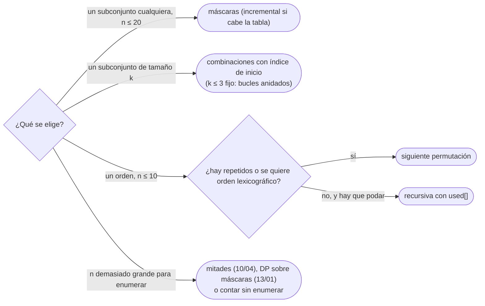

# 02 — Generar subconjuntos, permutaciones y combinaciones

> Las tres enumeraciones de la búsqueda completa, escritas sin repetir ni olvidar ningún caso: los `2ⁿ`
> subconjuntos con máscaras de bits, las `n!` permutaciones con la siguiente permutación lexicográfica o
> con recursión, y las `C(n, k)` combinaciones con un índice de inicio. Lo justo de bits para usarlas;
> el resto está en [`17/01`](../17-matematica/01-bits.md).
>
> **Niveles:** máscaras de bits [A] · permutaciones con `next_permutation` y recursivas [A] ·
> combinaciones [A].
>
> **📚 Lectura troncal:** Knuth, *The Art of Computer Programming*, Vol. 4A (Addison-Wesley, 2011),
> §7.2.1; Skiena, *The Algorithm Design Manual*, 3.ª ed. (Springer, 2020), cap. 9.
>
> **Asume leído:** [`10/01` — Recursión](01-recursion.md).
>
> **Ruta corta:** sí.
>
> **Vigencia:** 2026-10-04.

**Salto rápido:** [1](#1--el-problema) · [2](#2--la-teoría) · [3](#3--subconjuntos-con-máscaras-de-bits) · [4](#4--permutaciones) · [5](#5--combinaciones) · [6](#6-️-la-tabla-de-costes) · [7](#7--cómo-se-elige) · [8](#8--señales-del-enunciado) · [🧠](#-preguntas) · [🧩](#-problemas-propios)

---

## 1. 🎯 El problema

Un enunciado da `n ≤ 20` objetos con peso y valor, y una capacidad de hasta `10⁹`. La capacidad es
demasiado grande para la tabla de la mochila ([`12/03`](../12-dp-clasica/03-mochilas.md)), y la primera reacción es pensar que probar todas
las elecciones es imposible: «`2²⁰` es mucho». No lo es: `2²⁰ = 1 048 576`, y en un segundo caben unas
`10⁸` operaciones sencillas. Incluso pagando `n` operaciones por subconjunto, son `2·10⁷`.

La búsqueda completa es la primera solución correcta de casi cualquier problema con `n` pequeño, y la
que sirve de oráculo para el *stress test* ([`01/05`](../01-oficio-del-competidor/05-probar-sin-ide-y-stress-test.md)). Falla de dos formas que no tienen nada que ver con el
algoritmo:

- **Olvidar o repetir casos**: un bucle que salta el subconjunto vacío, permutaciones repetidas cuando
  hay elementos iguales, combinaciones que salen dos veces en distinto orden.
- **Gastar memoria en guardarlos**: generar los `2²⁰` subconjuntos como listas y procesarlos después
  ocupa cientos de megabytes; procesarlos al vuelo, nada.

```text
Regla: cuánto cabe en un segundo, enumerando y procesando en O(1) o O(n) cada caso
2ⁿ      → n ≤ 20 (holgado), n ≤ 25 con cuidado
n!      → n ≤ 10 (3,6·10⁶), n = 11 ya son 4·10⁷
C(n, k) → depende de k: C(30, 3) = 4 060, C(30, 15) ≈ 1,55·10⁸
```

Lo que se asume de [`10/01`](01-recursion.md): una recursión correcta tiene caso base y una medida que baja, y su pila
es su profundidad; aquí la profundidad es `n`, siempre pequeña.

---

## 2. 📐 La teoría

**Cuántos hay.** Un conjunto de `n` elementos tiene `2ⁿ` subconjuntos, `n!` órdenes y
`C(n, k) = n! / (k! (n − k)!)` subconjuntos de tamaño `k`. Enumerar es recorrer cada objeto **exactamente
una vez**, y la forma de garantizarlo es una **biyección** con algo fácil de recorrer.

**Teorema (subconjuntos y máscaras).** La función que asigna a cada subconjunto `S ⊆ {0, …, n − 1}` el
entero `m(S) = Σ_{i ∈ S} 2ⁱ` es una biyección entre los subconjuntos y los enteros de `[0, 2ⁿ)`.

Es la escritura en base 2: cada entero de `[0, 2ⁿ)` tiene una única representación con `n` bits, y el bit
`i` dice si `i` está en `S`. Por eso `for m in [0, 2ⁿ)` recorre cada subconjunto exactamente una vez, y en
un orden fijo.

**El orden lexicográfico.** Una secuencia `a` precede a `b` si en la primera posición donde difieren,
`a` tiene el valor menor. Es el orden del diccionario. Las permutaciones de `[1, 2, 5, 5, 6, 9]` en ese
orden empiezan en la ordenada y terminan en la ordenada al revés.

**Teorema (siguiente permutación).** Sea `a` una permutación que no es la última. Su sucesora
lexicográfica se obtiene así:

```text
1. i = la mayor posición con a[i] < a[i + 1]          (el sufijo a[i+1..] es no creciente)
2. j = la mayor posición con a[j] > a[i]              (el menor del sufijo que supera a a[i])
3. intercambiar a[i] y a[j]
4. invertir el sufijo a[i+1..]                        (queda creciente: lo menor posible)
```

**Por qué es la siguiente**, en tres pasos. (1) El sufijo `a[i+1..]` es no creciente, es decir, es la
**última** ordenación de esos valores: ninguna permutación con el mismo prefijo `a[0..i]` es mayor. Así que
la sucesora tiene que cambiar la posición `i` (y no puede cambiar ninguna anterior sin saltarse
permutaciones). (2) En la posición `i` tiene que ir el **menor** valor del sufijo que sea mayor que `a[i]`;
como el sufijo es no creciente, es el de más a la derecha que lo supera, `a[j]`. (3) Tras el intercambio, el
sufijo sigue siendo no creciente, y lo menor que se puede poner detrás es el mismo sufijo en orden
creciente: invertirlo. Si no existe `i`, la permutación es la última. Es el algoritmo L de Knuth (§7.2.1.2),
que se remonta a Narayana Pandita en el siglo XIV.

**Con repetidos** funciona igual, porque las comparaciones son estrictas: genera cada permutación
**distinta** una sola vez.

**Cuánto cuesta una llamada.** `O(n)` en el caso peor (invertir todo el sufijo), pero `O(1)` **amortizado**
sobre todas: el sufijo invertido mide `k` solo en una de cada `k!` llamadas, aproximadamente, y la suma
`Σ k / k!` converge a una constante (`e − 1 ≈ 1,72`).

> ⏱️ **Coste.** Recorrer las `n!` permutaciones con la siguiente permutación es `Θ(n!)` en total, no
> `Θ(n · n!)`: la mayoría de las llamadas tocan solo los dos o tres últimos elementos. Lo que suele costar
> `n` por permutación es **procesarla**.

---

## 3. 🧱 Subconjuntos con máscaras de bits

**Qué es.** Recorrer los enteros `m` de `0` a `2ⁿ − 1` y leer en sus bits qué elementos están. Lo justo de
bits que hace falta, en los tres lenguajes (el resto, en `17/01`):

| Operación | Expresión | Para qué |
|---|---|---|
| ¿Está `i`? | `(m >> i) & 1` | Leer el subconjunto |
| Añadir `i` | `m \| (1 << i)` | Construir una máscara |
| Quitar `i` | `m & ~(1 << i)` | Restar un elemento |
| Bit más bajo | `m & -m` | La recurrencia incremental de abajo |
| Tamaño | `__builtin_popcount`, `Integer.bitCount`, `bin(m).count("1")` | Filtrar por cardinal |

**Por qué es correcto.** Por la biyección de §2: cada entero del rango es un subconjunto distinto, y no
falta ninguno.

**Cómo va**, sobre `[5, 2, 9]` (el bit 0 es el 5):

```text
m   bits  subconjunto   suma
0   000   {}            0
1   001   {5}           5
2   010   {2}           2
3   011   {5, 2}        7
4   100   {9}           9
5   101   {5, 9}        14
6   110   {2, 9}        11
7   111   {5, 2, 9}     16
```

**Cuánto.** Recorrer y leer cada bit es `Θ(2ⁿ · n)`. Con la recurrencia incremental
`sum[m] = sum[m sin su bit más bajo] + a[ese bit]`, cada suma sale en `O(1)` y el total es `Θ(2ⁿ)` de
tiempo, pero `Θ(2ⁿ)` de memoria para la tabla. Con `n = 20`, una tabla de un millón de `long`: 8 MB.

**La plantilla**, la suma de cada subconjunto, incremental:

```cpp
#include <vector>

// sum[m] = suma de los a[i] con el bit i encendido en m. Θ(2ⁿ) tiempo y memoria. n ≤ ~25.
std::vector<long long> subsetSums(const std::vector<long long>& a) {
    int n = (int)a.size();
    std::vector<long long> sum(1 << n, 0);
    for (int m = 1; m < (1 << n); m++) {
        int low = __builtin_ctz(m);                 // índice del bit más bajo
        sum[m] = sum[m & (m - 1)] + a[low];         // m & (m − 1) apaga ese bit
    }
    return sum;
}
```

```java
// sum[m] = suma de los a[i] con el bit i encendido en m. Θ(2ⁿ) tiempo y memoria. n ≤ ~25.
static long[] subsetSums(long[] a) {
    int n = a.length;
    long[] sum = new long[1 << n];
    for (int m = 1; m < (1 << n); m++) {
        int low = Integer.numberOfTrailingZeros(m); // índice del bit más bajo
        sum[m] = sum[m & (m - 1)] + a[low];
    }
    return sum;
}
```

```python
def subset_sums(a):
    """sum[m] = suma de los a[i] con el bit i encendido en m. Θ(2ⁿ) tiempo y memoria."""
    n = len(a)
    total = [0] * (1 << n)
    for m in range(1, 1 << n):
        low = (m & -m).bit_length() - 1              # índice del bit más bajo
        total[m] = total[m & (m - 1)] + a[low]
    return total
```

- **`m & (m − 1)`** apaga el bit más bajo: es la máscara «sin ese elemento», que es menor que `m` y por
  eso ya está calculada.
- **`1 << n` con `n ≥ 31`** desborda un `int`: con máscaras de más de 30 bits, `1LL << n` en C++ y
  `1L << n` en Java. Con `n` así no se enumera, pero la máscara sí puede aparecer ([`10/04`](04-meet-in-the-middle-iddfs-y-dancing-links.md)).
- **El bit más bajo**: `__builtin_ctz` (o `std::countr_zero` desde C++20), `numberOfTrailingZeros` y
  `(m & -m).bit_length() − 1`. En Python, `2²⁰` vueltas cuestan del orden de un segundo: cabe justo.

### De la versión ingenua a la buena

**El problema.** Con `n = 20` objetos, ¿cuántos subconjuntos tienen suma a lo sumo `S`?

**La versión ingenua:**

```java
import java.util.ArrayList;
import java.util.List;

// Correcta. Guarda los 2ⁿ subconjuntos como listas: con n = 20, ~10⁷ Integer en memoria.
static List<List<Integer>> all(int[] a, int i) {
    if (i == a.length) { List<List<Integer>> base = new ArrayList<>(); base.add(new ArrayList<>()); return base; }
    List<List<Integer>> rest = all(a, i + 1), out = new ArrayList<>(rest);
    for (List<Integer> s : rest) { List<Integer> t = new ArrayList<>(s); t.add(a[i]); out.add(t); }
    return out;
}
// long count = all(a, 0).stream().filter(s -> s.stream().mapToLong(x -> x).sum() <= S).count();
```

> «Es correcta, pero materializa el millón de subconjuntos con sus elementos en cajas: unos `10⁷` objetos
> `Integer` y un millón de listas, cientos de megabytes, y el juez da MLE antes de que empiece a contar.
> Los subconjuntos no hace falta guardarlos: son los enteros de 0 a `2ⁿ − 1`, y la suma de cada uno sale
> de la de otro ya visto.»

**El camino a la buena.** La plantilla de sumas incrementales y un contador: `Θ(2ⁿ)` de tiempo, y si ni
siquiera la tabla cabe, el bucle `for m` con la suma leída bit a bit, `Θ(2ⁿ · n)` de tiempo y `O(1)` de
memoria.

**Cuándo sí**: `n ≤ 20` (hasta 25 si el trabajo por máscara es `O(1)`), cuando la pregunta es «el mejor
subconjunto» o «cuántos subconjuntos cumplen…» y no hay estructura que explotar. **Cuándo no**: con
`n ≥ 30`, donde `2ⁿ` ya no cabe y la salida es partir en dos mitades (`10/04`) o una DP; y cuando el
problema tiene subestructura, donde la DP sobre máscaras de [`13/01`](../13-dp-avanzada/01-mascaras-de-bits.md) evita repetir trabajo.

> **Veredicto:** un subconjunto es un entero. Recorrer los enteros recorre los subconjuntos sin repetir ni
> olvidar, y `2²⁰` es un millón, no un problema.

---

## 4. 🧱 Permutaciones

**Qué es.** Recorrer los `n!` órdenes de `n` elementos. Hay dos formas: **iterativa**, con la siguiente
permutación de §2, que da el orden lexicográfico y trata los repetidos sola; y **recursiva**, que elige
qué elemento va en cada posición entre los que quedan sin usar.

**Por qué es correcto.** La iterativa, por el teorema de §2. La recursiva, por inducción sobre las
posiciones libres: si para cada elección de la posición `p` se generan todas las permutaciones de los
restantes en las posiciones `p + 1..`, se genera cada permutación exactamente una vez, porque dos
permutaciones distintas difieren en una primera posición, y ahí la recursión eligió distinto.

**Cómo va**, la siguiente permutación de `[1, 5, 9, 6, 5, 2]`:

```text
1. i = 1: a[1] = 5 < a[2] = 9, y el sufijo [9, 6, 5, 2] es no creciente
2. j = 3: el de más a la derecha mayor que 5 es a[3] = 6     (a[4] = 5 no lo supera)
3. intercambio:      [1, 6, 9, 5, 5, 2]
4. invertir a[2..]:  [1, 6, 2, 5, 5, 9]
```

**Cuánto.** `Θ(n!)` permutaciones; la siguiente permutación es `O(1)` amortizada y la recursiva `O(1)` por
nodo del árbol de llamadas, que tiene `Θ(n!)` nodos (`n! · (1 + 1/1! + 1/2! + …) ≈ e · n!`). Procesar cada
una suele costar `O(n)`. La pila de la recursiva mide `n`.

**La plantilla.** C++ trae `std::next_permutation` ([`03/02`](../03-biblioteca-estandar/02-cpp-algoritmos-ranges-y-pbds.md)); Java no trae nada y Python trae
`itertools.permutations`, que **no** sirve con repetidos (genera las `n!` aunque haya iguales). Por eso
en Java y Python se escribe la siguiente permutación, y en los tres la recursiva:

```cpp
#include <algorithm>
#include <vector>

// Iterativa: recorre las permutaciones distintas en orden lexicográfico. Θ(n!) llamadas en total.
void forEachPermutation(std::vector<int> a) {
    std::sort(a.begin(), a.end());                         // hay que empezar por la primera
    do {
        // procesar a
    } while (std::next_permutation(a.begin(), a.end()));
}

// Recursiva: pos es la siguiente posición libre; used marca los índices ya colocados.
void permute(const std::vector<int>& a, std::vector<int>& cur, std::vector<bool>& used) {
    if (cur.size() == a.size()) { /* procesar cur */ return; }
    for (size_t i = 0; i < a.size(); i++) {
        if (used[i]) continue;
        used[i] = true; cur.push_back(a[i]);
        permute(a, cur, used);
        cur.pop_back(); used[i] = false;                   // deshace la elección
    }
}
```

```java
// Siguiente permutación lexicográfica en su sitio; false si a era la última (y entonces no la toca).
static boolean nextPermutation(int[] a) {
    int i = a.length - 2;
    while (i >= 0 && a[i] >= a[i + 1]) i--;               // el sufijo a[i+1..] es no creciente
    if (i < 0) return false;
    int j = a.length - 1;
    while (a[j] <= a[i]) j--;                               // el menor del sufijo mayor que a[i]
    int t = a[i]; a[i] = a[j]; a[j] = t;
    for (int l = i + 1, r = a.length - 1; l < r; l++, r--) { t = a[l]; a[l] = a[r]; a[r] = t; }
    return true;
}

// Recursiva: cur[0..pos) ya está decidido; used marca los índices colocados.
static void permute(int[] a, int[] cur, boolean[] used, int pos) {
    if (pos == a.length) { /* procesar cur */ return; }
    for (int i = 0; i < a.length; i++) {
        if (used[i]) continue;
        used[i] = true; cur[pos] = a[i];
        permute(a, cur, used, pos + 1);
        used[i] = false;                                    // deshace la elección
    }
}
```

```python
def next_permutation(a):
    """Siguiente permutación lexicográfica en su sitio; False si a era la última."""
    i = len(a) - 2
    while i >= 0 and a[i] >= a[i + 1]:
        i -= 1
    if i < 0:
        return False
    j = len(a) - 1
    while a[j] <= a[i]:
        j -= 1
    a[i], a[j] = a[j], a[i]
    a[i + 1:] = reversed(a[i + 1:])
    return True

def permute(a, cur, used):
    """Recursiva: añade a cur cada índice no usado y deshace al volver."""
    if len(cur) == len(a):
        return  # procesar cur
    for i in range(len(a)):
        if not used[i]:
            used[i] = True
            cur.append(a[i])
            permute(a, cur, used)
            cur.pop()
            used[i] = False
```

- **`>=` y `<=`** en los dos bucles de la siguiente permutación, no `>` y `<`: con iguales, esa es la
  diferencia entre generar cada permutación distinta una vez o entrar en un bucle.
- **Empezar ordenado**: la iterativa solo recorre las permutaciones **posteriores** a la inicial.
- **La recursiva con repetidos** genera duplicados; se evitan ordenando y saltando `a[i]` si es igual a
  `a[i − 1]` y `a[i − 1]` no está usado (la regla de `10/03`).
- **`itertools.permutations`** permuta **posiciones**: con `"aab"` da 6 tuplas, tres pares repetidos.
  Sirve sin repetidos; con ellos, `next_permutation` propia o un `set`, que cuesta memoria.
- **Lo que se deshace al volver** (`pop`, `used[i] = false`) es el patrón del *backtracking* de [`10/03`](03-backtracking-y-poda.md).

### De la versión ingenua a la buena

**El problema.** `n ≤ 8` ponentes exponen uno detrás de otro, y algunos pares no pueden ir seguidos
(conflictos). ¿Cuántos órdenes válidos hay? Con 4 ponentes y conflictos `{0, 1}` y `{2, 3}`, son 8.

**La versión ingenua:**

```java
import java.util.ArrayList;
import java.util.List;

// Correcta. Construye las n! permutaciones como listas nuevas y después las filtra.
static List<List<Integer>> perms(List<Integer> rest) {
    List<List<Integer>> out = new ArrayList<>();
    if (rest.isEmpty()) { out.add(new ArrayList<>()); return out; }
    for (int k = 0; k < rest.size(); k++) {
        List<Integer> others = new ArrayList<>(rest); int x = others.remove(k);
        for (List<Integer> p : perms(others)) { p.add(0, x); out.add(p); }
    }
    return out;
}
```

> «Es correcta, pero con `n = 8` construye 40 320 listas y copia los restos en cada nivel, y `add(0, x)`
> desplaza la lista entera. Con `n = 10` serían 3,6 millones de listas en memoria. No necesito guardarlas:
> recorro las permutaciones en su sitio con la siguiente permutación y compruebo cada una al vuelo.»

**El camino a la buena.** `int[] p = {0, 1, …, n − 1}`, y `do { if (valid(p)) count++; } while
(nextPermutation(p));`, con `valid` en `O(n)` mirando los pares consecutivos en una matriz de conflictos.
`Θ(n! · n)` de tiempo y `O(n)` de memoria.

**Cuándo sí**: `n ≤ 10` y la respuesta depende del orden (asignaciones, recorridos, horarios). **Cuándo
no**: `n ≥ 12`; si el coste de un orden solo depende del conjunto ya colocado y del último, la DP sobre
máscaras de `13/01` baja `n!` a `2ⁿ · n²`.

> **Veredicto:** ordenar y llamar a la siguiente permutación hasta que devuelva `false` recorre los
> órdenes distintos, con repetidos y sin memoria. La recursiva es la que se adapta cuando hay que podar.

---

## 5. 🧱 Combinaciones

**Qué es.** Recorrer los subconjuntos de **tamaño exactamente `k`**. La forma estándar es recursiva con un
**índice de inicio**: el siguiente elemento elegido siempre tiene índice mayor que el anterior, y así cada
conjunto sale una sola vez, en orden creciente de índices.

**Por qué es correcto.** Cada combinación tiene una única escritura en orden creciente de índices, y la
recursión genera exactamente las secuencias crecientes de longitud `k`: en cada nivel elige el siguiente
índice entre `start` y `n − 1`, y pasa `i + 1` como nuevo inicio. Ninguna sale dos veces, porque dos
secuencias crecientes distintas difieren en una primera posición.

**Cómo va**, las combinaciones de 3 índices de `[5, 2, 9, 1, 5, 6]` cuya suma es múltiplo de 5:

```text
índices (0, 2, 3) → 5 + 9 + 1 = 15        índices (2, 3, 4) → 9 + 1 + 5 = 15
índices (0, 2, 5) → 5 + 9 + 6 = 20        índices (2, 4, 5) → 9 + 5 + 6 = 20
de C(6, 3) = 20 combinaciones, 4 cumplen
```

**Cuánto.** `Θ(C(n, k))` hojas. La poda «quedan menos elementos que huecos» (`n − i < k − elegidos`) evita
las ramas muertas y deja el total en `O(C(n, k) · k)`. Sin ella, la recursión explora ramas que no pueden
completar `k` y el coste sube hacia `2ⁿ`.

**La plantilla:**

```cpp
#include <vector>

// Todas las combinaciones de k índices de [0, n), en orden lexicográfico. Θ(C(n, k) · k).
void combine(int n, int k, int start, std::vector<int>& cur) {
    if ((int)cur.size() == k) { /* procesar cur */ return; }
    for (int i = start; n - i >= k - (int)cur.size(); i++) {   // poda: quedan huecos suficientes
        cur.push_back(i);
        combine(n, k, i + 1, cur);
        cur.pop_back();
    }
}
```

```java
// Todas las combinaciones de k índices de [0, n): cur[0..size) es la elección parcial.
static void combine(int n, int k, int start, int[] cur, int size) {
    if (size == k) { /* procesar cur */ return; }
    for (int i = start; n - i >= k - size; i++) {               // poda: quedan huecos suficientes
        cur[size] = i;
        combine(n, k, i + 1, cur, size + 1);
    }
}
```

```python
from itertools import combinations

def combine(n, k, start, cur):
    """Todas las combinaciones de k índices de [0, n), en orden lexicográfico."""
    if len(cur) == k:
        return  # procesar cur
    for i in range(start, n - (k - len(cur)) + 1):              # poda: quedan huecos suficientes
        cur.append(i)
        combine(n, k, i + 1, cur)
        cur.pop()

# Sin recursión: for c in combinations(range(n), k): ...   (mismo orden, en C)
```

- **`i + 1`** como nuevo inicio, no `start + 1`: es lo que impide repetir y lo que fija el orden creciente.
- **La poda del bucle** (`n − i ≥ k − size`) no cambia el resultado: solo corta antes las ramas que no
  pueden llenar `k`.
- **En Java** no hace falta deshacer: `cur[size]` se sobrescribe en la siguiente vuelta.
- **`itertools.combinations`** es la opción de Python: mismo orden lexicográfico, y en C. C++ y Java no
  traen nada; en C++ se puede aplicar `std::prev_permutation` a un vector con `k` unos y `n − k` ceros.

### De la versión ingenua a la buena

**El problema.** Elegir 3 de `n = 30` sensores, y probar cada terna.

**La versión ingenua:**

```java
// Correcta: recorre las 2³⁰ máscaras y se queda con las de 3 bits. ~10⁹ vueltas.
for (int m = 0; m < (1 << 30); m++) {
    if (Integer.bitCount(m) != 3) continue;
    // procesar la terna m
}
```

> «Es correcta, pero recorre mil millones de máscaras para quedarse con 4 060. Las combinaciones se
> generan directamente: el siguiente índice elegido siempre es mayor que el anterior, y el total es
> `C(30, 3)`.»

**El camino a la buena.** `combine(30, 3, 0, cur)`: 4 060 hojas. Con `k` fijo y pequeño, tres bucles
anidados `i < j < l` son lo mismo y más claros; la recursión es para `k` variable.

**Cuándo sí**: «elige exactamente `k`», con `C(n, k)` hasta unos `10⁷`. **Cuándo no**: si `C(n, k)` es
enorme (`k ≈ n/2` con `n ≥ 30`), o si solo hace falta **contar**, donde la fórmula o la DP de [`12/06`](../12-dp-clasica/06-conteo.md) dan el
número sin enumerar.

> **Veredicto:** una combinación es una secuencia creciente de índices. El índice de inicio la genera sin
> repetir, y la poda de los huecos que faltan la deja en `C(n, k)`.

---

## 6. ⏱️ La tabla de costes

| Enumeración | Cuántos | Coste del recorrido | Lo que la tabla no dice |
|---|---|---|---|
| Subconjuntos, máscaras | `2ⁿ` | `Θ(2ⁿ)` con la recurrencia, `Θ(2ⁿ · n)` leyendo bits | La tabla incremental pesa `8 · 2ⁿ` bytes |
| Permutaciones, siguiente permutación | `n!` distintas | `Θ(n!)` amortizado | Trata los repetidos sola; hay que empezar ordenado |
| Permutaciones, recursiva | `n!` | `Θ(n!)` nodos, pila `n` | Con repetidos, duplica salvo que se salten |
| Combinaciones, índice de inicio | `C(n, k)` | `Θ(C(n, k) · k)` con la poda | Sin la poda, explora ramas muertas |
| Combinaciones por máscaras con `popcount` | `C(n, k)` | `Θ(2ⁿ)` | Solo vale si `2ⁿ` cabe |

---

## 7. 🧭 Cómo se elige



> **Regla de entrevista:** antes de escribir la enumeración, di cuántos casos son con el `n` máximo y
> cuánto cuesta cada uno. «`2²⁰` por 20 son `2·10⁷`, cabe» es la frase que convierte la fuerza bruta en una
> decisión.

---

## 8. 🔎 Señales del enunciado

| Señal | Técnica | Por qué |
|---|---|---|
| `n ≤ 20` y «elige algunos», «subconjunto», «encender/apagar» | Máscaras | `2²⁰ ≈ 10⁶` |
| `n ≤ 10` y «orden», «secuencia», «asigna cada uno a uno» | Permutaciones | `10! ≈ 3,6·10⁶` |
| «Exactamente `k`», «equipos de `k`», «elige `k` de `n`» | Combinaciones | `C(n, k)` puede ser pequeño aunque `2ⁿ` no |
| «La siguiente / la anterior en orden de diccionario» | Siguiente permutación | Es su definición |
| `n ≤ 40` | No es enumeración directa | Es la firma de partir en mitades (`10/04`) |

---

## ⚠️ Errores frecuentes

| Se dice | Lo preciso |
|---|---|
| «`2²⁰` es mucho» | Es un millón; con `O(n)` por caso, `2·10⁷`: cabe en un segundo |
| «`next_permutation` recorre todas las permutaciones» | Recorre las **posteriores** a la inicial: hay que ordenar antes |
| «`itertools.permutations` da las permutaciones distintas» | Permuta posiciones: con repetidos da duplicados |
| «Cada llamada a la siguiente permutación es `O(n)`» | En el caso peor; amortizada sobre todas es `O(1)` |
| «Para elegir `k`, recorro máscaras y filtro por `popcount`» | Cuesta `2ⁿ` aunque `C(n, k)` sea diminuto |
| «`1 << n` siempre funciona» | Con `n ≥ 31` desborda un `int`: `1L << n` |
| «Guardar los subconjuntos y procesarlos después es igual» | Materializarlos cuesta memoria exponencial; se procesan al vuelo |

---

## 📚 Para profundizar

- **Libro** — Knuth, *The Art of Computer Programming*, Vol. 4A (Addison-Wesley, 2011), §7.2.1: generación
  de tuplas, permutaciones (algoritmo L) y combinaciones. *Lectura troncal.*
- **Libro** — Skiena, *The Algorithm Design Manual*, 3.ª ed. (Springer, 2020), cap. 9: la búsqueda
  combinatoria y la construcción de subconjuntos y permutaciones. *Lectura troncal.*
- **Documentación** — cppreference, [`std::next_permutation`](https://en.cppreference.com/cpp/algorithm/next_permutation).
- **Documentación** — Python, [`itertools`](https://docs.python.org/3/library/itertools.html):
  `permutations`, `combinations` y `product`.
- **Referencia** — cp-algorithms, [*Enumerating submasks of a bitmask*](https://cp-algorithms.com/algebra/all-submasks.html):
  el paso siguiente a esta plantilla.

---

## 🧠 Preguntas

1. ¿Cuántos subconjuntos, permutaciones y combinaciones de tamaño `k` tiene un conjunto de `n` elementos, y hasta qué `n` cabe enumerar cada uno en un segundo? 🟢
2. ¿Qué subconjunto representa la máscara `13` sobre `[5, 2, 9, 1]`, y qué máscara representa `{2, 1}`? 🟢
3. ¿Qué hace `m & (m − 1)` y para qué sirve al calcular las sumas de los subconjuntos? 🟢
4. ¿Qué devuelve `next_permutation` cuando la permutación es la última, y por qué hay que ordenar antes del bucle? 🟢
5. ¿En qué se diferencian `itertools.permutations` y la siguiente permutación cuando hay elementos repetidos? 🟡
6. ¿Por qué la recursión de combinaciones pasa `i + 1` y no `start + 1` como nuevo inicio? 🟡
7. Compara qué traen C++, Java y Python para permutaciones y combinaciones, y qué tienes que escribir en cada uno. 🟡
8. ¿Por qué recorrer las `n!` permutaciones con la siguiente permutación cuesta `Θ(n!)` y no `Θ(n · n!)`? 🟠
9. Elegir 3 de 30: ¿por qué recorrer máscaras y filtrar por `popcount` es mala idea, y qué haces con `k = 15`? 🟠
10. ¿Por qué materializar los `2²⁰` subconjuntos como listas da MLE, si recorrerlos cabe? 🟠
11. Demuestra que la siguiente permutación produce la sucesora lexicográfica inmediata. 🟠
12. Si en el primer bucle de la siguiente permutación escribes `a[i] > a[i + 1]` en lugar de `>=`, ¿qué pasa con `[2, 1, 1]`? Traza el fallo y di qué le pasa al bucle `do`/`while`. 🔴
13. Diseña la generación de las permutaciones **distintas** de un multiconjunto con la versión recursiva, sin usar un `set`, y explica por qué no repite. 🔴

---

## 🧩 Problemas propios

### Mochila de capacidad enorme

**Nivel:** 🟢 · **Formato:** programa completo.

Hay `n` objetos con peso `wᵢ` y valor `vᵢ`, y una mochila de capacidad `W`. Imprime el mayor valor total
de un subconjunto cuyo peso no pase de `W`.

- **Entrada.** Una línea con `n` y `W`. Después, `n` líneas con `wᵢ` y `vᵢ`.
- **Salida.** Un entero.
- **Restricciones.** `1 ≤ n ≤ 20`; `0 ≤ W ≤ 10⁹`; `1 ≤ wᵢ ≤ 10⁹`; `1 ≤ vᵢ ≤ 10⁹`.

```text
Entrada        Salida
6 10           18
5 10
2 3
9 14
1 2
5 8
6 9

Entrada        Salida
1 0            0
3 4
```

**Pista 1:** ¿por qué no sirve una tabla indexada por la capacidad, y cuántas elecciones posibles hay?

### El menor número divisible

**Nivel:** 🟡 · **Formato:** programa completo.

Dada una cadena de dígitos y un entero `k`, imprime el menor número que se forma usando **todos** los
dígitos, sin ceros a la izquierda (salvo que el número sea el propio `0`), y que sea múltiplo de `k`. Si no
hay ninguno, imprime `-1`.

- **Entrada.** Una línea con la cadena y `k`.
- **Salida.** El número, o `-1`.
- **Restricciones.** La cadena tiene entre 1 y 10 dígitos, que pueden repetirse; `1 ≤ k ≤ 10⁹`.

```text
Entrada        Salida
5291 7         1295

Entrada        Salida
120 4          120

Entrada        Salida
100 7          -1
```

**Pista 1:** si recorres los órdenes de menor a mayor, ¿cuál es el primero que tienes que imprimir?

🔥 **Para el geek — en JavaScript:** un número de 10 dígitos cabe exacto en un `number`, pero si `k` y el
número crecieran, `n % k` dejaría de ser fiable; piensa cuándo hace falta `BigInt`.

### Comités sin rencillas

**Nivel:** 🟠 · **Formato:** programa completo.

Hay `n` personas, numeradas de 1 a `n`, y `m` pares que no pueden estar juntos en un comité. ¿Cuántos
comités de exactamente `k` personas no contienen ningún par prohibido?

- **Entrada.** Una línea con `n`, `k` y `m`. Después, `m` líneas con un par `a b`.
- **Salida.** Un entero.
- **Restricciones.** `1 ≤ k ≤ n ≤ 25`; `0 ≤ m ≤ n(n − 1)/2`; se garantiza `C(n, k) ≤ 6·10⁶`.

```text
Entrada        Salida
5 3 2          4
1 2
3 4

Entrada        Salida
3 3 1          0
1 3
```

**Pista 1:** si al elegir el tercer miembro ya hay una rencilla entre los dos primeros, ¿hace falta
seguir?

---

## 🧩 Práctica externa

Codility no tiene lección de enumeración: el núcleo sale de HackerRank y LeetCode.

### Núcleo

| ✔ | Problema | Plataforma | Nivel | Patrón | Pista 1 |
|---|---|---|---|---|---|
| [ ] | [Sum of All Subset XOR Totals](https://leetcode.com/problems/sum-of-all-subset-xor-totals/) | LeetCode | 🟢 | Subconjuntos | ¿Cuántos subconjuntos hay con `n ≤ 12`? |
| [ ] | [Subsets](https://leetcode.com/problems/subsets/) | LeetCode | 🟡 | Máscaras | ¿Qué entero corresponde a cada subconjunto? |
| [ ] | [Combinations](https://leetcode.com/problems/combinations/) | LeetCode | 🟡 | Combinaciones | ¿Cómo evitas que `{1, 2}` y `{2, 1}` salgan las dos? |
| [ ] | [Permutations II](https://leetcode.com/problems/permutations-ii/) | LeetCode | 🟡 | Permutaciones con repetidos | ¿Cuándo dos elecciones en la misma posición producen lo mismo? |
| [ ] | [Letter Case Permutation](https://leetcode.com/problems/letter-case-permutation/) | LeetCode | 🟡 | Subconjuntos de posiciones | ¿Cuántas posiciones pueden cambiar, y cuántas formas hay? |
| [ ] | [Bigger is Greater](https://www.hackerrank.com/challenges/bigger-is-greater/problem) | HackerRank | 🟡 | Siguiente permutación | ¿Qué posición es la más a la derecha que se puede aumentar? |
| [ ] | [Forming a Magic Square](https://www.hackerrank.com/challenges/magic-square-forming/problem) | HackerRank | 🟡 | Enumerar los candidatos | ¿Cuántos cuadrados mágicos de 3 × 3 con 1..9 existen? |

### Ampliación

| ✔ | Problema | Plataforma | Nivel | Patrón | Pista 1 |
|---|---|---|---|---|---|
| [ ] | [Apple Division](https://cses.fi/problemset/task/1623) | CSES | 🟢 | Máscaras | Con `n ≤ 20`, ¿cuántas formas de repartir hay? |
| [ ] | [Next Greater Element III](https://leetcode.com/problems/next-greater-element-iii/) | LeetCode | 🟡 | Siguiente permutación | Si los dígitos ya están en el último orden, ¿qué devuelves? |
| [ ] | [Count Number of Maximum Bitwise-OR Subsets](https://leetcode.com/problems/count-number-of-maximum-bitwise-or-subsets/) | LeetCode | 🟡 | Máscaras incrementales | ¿El OR de cada subconjunto sale del de otro ya calculado? |
| [ ] | [Maximum Length of a Concatenated String with Unique Characters](https://leetcode.com/problems/maximum-length-of-a-concatenated-string-with-unique-characters/) | LeetCode | 🟡 | Subconjuntos con conjuntos de letras como máscara | ¿Cómo compruebas en `O(1)` que dos palabras no comparten letras? |
| [ ] | [Permutation Sequence](https://leetcode.com/problems/permutation-sequence/) | LeetCode | 🟠 | Permutación `k`-ésima sin enumerar | ¿Cuántas permutaciones empiezan por cada valor posible? |

---

## ✅ Criterio de dominio

- Escribir la siguiente permutación en Java o Python y la recursión de combinaciones sin mirar, en menos
  de diez minutos.
- Demostrar que la siguiente permutación da la sucesora inmediata.
- Decir, para un `n` dado, si cabe enumerar subconjuntos, permutaciones o combinaciones, con la cuenta.
- Resolver Permutations II y Bigger is Greater sin pista 2.

---

**Anterior:** [`10/01` — Recursión](01-recursion.md) · **Siguiente:** [`10/03` — *Backtracking* con poda y ramificación y poda](03-backtracking-y-poda.md) ·
**Relacionado:** [`17/01` — Bits](../17-matematica/01-bits.md); [`13/01` — DP con máscaras de bits](../13-dp-avanzada/01-mascaras-de-bits.md).
