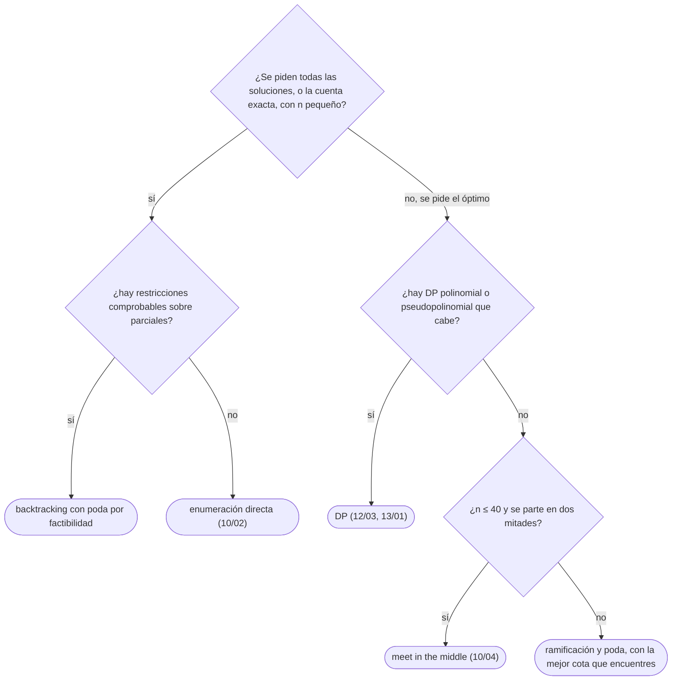

# 03 — *Backtracking* con poda y ramificación y poda

> Explorar el árbol de soluciones parciales construyéndolas paso a paso, deshaciendo cada elección al
> volver, y cortando las ramas que no pueden llevar a una solución (*backtracking*) o a una mejor que la
> que ya se tiene (ramificación y poda). Con N reinas, suma de subconjuntos, sudoku y la mochila como
> ejemplos, y con lo que la poda no puede prometer.
>
> **Niveles:** *backtracking* [A] · ramificación y poda [B].
>
> **📚 Lectura troncal:** Brassard y Bratley, *Fundamentos de algoritmia* (Prentice Hall, 1997), cap. 9;
> Erickson, *Algorithms* (2019, libre del autor), cap. 2.
>
> **Asume leído:** [`10/02` — Generar subconjuntos, permutaciones y combinaciones](02-generar-subconjuntos-y-permutaciones.md).
>
> **Ruta corta:** sí.
>
> **Vigencia:** 2026-10-04.

**Salto rápido:** [1](#1--el-problema) · [2](#2--la-teoría) · [3](#3--backtracking) · [4](#4--ramificación-y-poda) · [5](#5-️-la-tabla-de-costes) · [6](#6--cómo-se-elige) · [7](#7--señales-del-enunciado) · [🧠](#-preguntas) · [🧩](#-problemas-propios)

---

## 1. 🎯 El problema

Colocar 8 reinas en un tablero de ajedrez sin que dos se ataquen. Probar todas las formas de poner 8
fichas en 64 casillas son `C(64, 8) ≈ 4,4·10⁹` tableros. Con una reina por fila, `8⁸ ≈ 1,7·10⁷`. Con una
por fila y por columna —las permutaciones de [`10/02`](02-generar-subconjuntos-y-permutaciones.md)—, `8! = 40 320`, y se comprueba cada una al
final.

El *backtracking* (vuelta atrás) hace algo mejor: coloca las reinas **fila a fila** y, en cuanto una
reina nueva ataca a una anterior, **no sigue por esa rama**. Visita 2 057 tableros parciales en total
—contando el vacío— y encuentra las 92 soluciones. No cambia la idea de la búsqueda completa; cambia
**cuándo se descubre** que una rama es inútil.

```text
n = 8 reinas
todas las colocaciones      4,4·10⁹
una por fila                1,7·10⁷
una por fila y columna      40 320       (10/02: generar y comprobar al final)
backtracking por filas       2 057 nodos (comprobar al colocar)
```

> 🧠 **Modelo mental.** El *backtracking* no es fuerza bruta: es fuerza bruta que pregunta **antes**.
> Comprueba cada solución parcial en cuanto se forma, y una rama que ya viola una restricción no se
> extiende.

Lo que se asume de `10/02`: los generadores recursivos que eligen un elemento, recurren y deshacen la
elección al volver. Aquí se les añade la pregunta «¿todavía puede salir algo de aquí?».

---

## 2. 📐 La teoría

**El árbol de estados.** Cada nodo es una **solución parcial** —las primeras `k` decisiones tomadas—; la
raíz es la vacía, los hijos de un nodo son sus extensiones con una decisión más, y las hojas son las
soluciones completas candidatas. La búsqueda completa recorre el árbol entero; el *backtracking* lo
recorre en profundidad y **poda** subárboles enteros.

**Lema (poda por factibilidad).** Sea `P` un predicado sobre soluciones parciales tal que, si `P(x)` es
falso, ninguna extensión de `x` es una solución válida. Entonces el recorrido que no entra en los nodos
con `P` falso encuentra **exactamente** las mismas soluciones que el recorrido completo.

La prueba es inmediata: una solución válida es una hoja cuyo camino desde la raíz solo pasa por nodos
con `P` cierto (si alguno tuviera `P` falso, ninguna extensión suya, incluida esa hoja, sería válida), y
ese camino nunca se poda. Lo que hay que demostrar en cada problema es la **hipótesis**: que la
restricción violada ya no se puede arreglar más abajo. En las reinas es obvio —una reina colocada no se
mueve—; en problemas con restricciones que se pueden «compensar» después, no lo es.

**Lema (poda por cota).** En un problema de **maximización**, sea `cota(x)` un valor que **ninguna**
extensión de `x` puede superar (una cota optimista). Si `cota(x) ≤ mejor`, donde `mejor` es el valor de
una solución ya encontrada, ningún descendiente de `x` mejora `mejor`, y el subárbol se puede podar sin
perder el óptimo. Es la base de la ramificación y poda (§4); para minimizar, se invierten los signos.

**Por qué la poda no cambia el caso peor.** Las podas dependen de la entrada, y siempre hay entradas en
las que no se activan. Con suma de subconjuntos y un objetivo inalcanzable cuya imposibilidad solo se
descubre en las hojas (por ejemplo, todos los pesos pares y el objetivo impar, sin comprobar paridad), el
árbol se recorre casi entero: `Θ(2ⁿ)`. El *backtracking* resuelve problemas NP-difíciles ([`10/05`](05-divide-y-venceras.md))
**exactamente**, y por eso no puede prometer tiempo polinomial; lo que promete es explorar menos, a
veces muchísimo menos, en las entradas que no son adversarias.

> ⏱️ **Coste.** El coste de un *backtracking* es el número de nodos visitados por el trabajo en cada
> nodo, y ese número **no tiene fórmula cerrada** en general: se estima midiendo, o acotando por el
> árbol completo. Por eso las restricciones (`n ≤ 12`, `n ≤ 20`) son la pista de que cabe.

---

## 3. 🧱 *Backtracking*

**Qué es.** Una recursión que construye la solución decisión a decisión, comprueba cada parcial, y al
volver de una rama **deshace** la decisión que la abrió, para que el estado compartido (los conjuntos
usados, la suma acumulada, el tablero) vuelva a ser el del nodo padre.

```text
backtrack(parcial):
    si parcial es completa: procesarla; volver
    para cada decisión d posible en este punto:
        si d es compatible con parcial (la poda):
            aplicar d             ← modificar el estado
            backtrack(parcial + d)
            deshacer d            ← dejar el estado como estaba
```

**Por qué es correcto.** Sin poda, recorre el árbol de estados entero: es la enumeración de `10/02`. Con
poda, por el lema de factibilidad de §2. El «deshacer» mantiene este invariante: **al entrar en un nodo,
el estado compartido describe exactamente la solución parcial de ese nodo**. Si una rama olvida deshacer,
sus hermanas ven un estado que no es el suyo, y el resultado es incorrecto aunque cada comprobación sea
correcta.

**Cómo va**, 4 reinas, fila a fila. Cada reina se pone en una columna libre que no comparta diagonal con
las anteriores (`r + c` constante en una diagonal y `r − c` en la otra):

```text
fila 0: col 0 ── fila 1: col 2 ── fila 2: ninguna (todas atacadas) ← vuelve
                 fila 1: col 3 ── fila 2: col 1 ── fila 3: ninguna ← vuelve
fila 0: col 1 ── fila 1: col 3 ── fila 2: col 0 ── fila 3: col 2   ✅ (1, 3, 0, 2)
fila 0: col 2 ── fila 1: col 0 ── fila 2: col 3 ── fila 3: col 1   ✅ (2, 0, 3, 1)
fila 0: col 3 ── … (simétrica de col 0, sin solución)
nodos visitados: 17, contando el tablero vacío; soluciones: 2
```

**Cuánto.** Nodos visitados por trabajo por nodo. Con las reinas y las tres marcas de abajo, cada nodo
cuesta `O(n)` (probar las columnas), y los nodos crecen mucho menos que `n!`: 2 057 para `n = 8` frente a
40 320, y 856 189 para `n = 12` frente a `4,8·10⁸`. La pila mide la profundidad, `n`.

**La plantilla**, suma de subconjuntos: contar los subconjuntos de pesos positivos que suman exactamente
`target`, con las dos podas típicas sobre los pesos ordenados de menor a mayor:

```cpp
#include <vector>

// Cuenta los subconjuntos (por posición) de a con suma exacta 'rem'. a ordenado ascendente,
// pesos positivos; suffix[j] = a[j] + … + a[n−1]. Exponencial en el caso peor.
long long countSubsets(const std::vector<long long>& a, const std::vector<long long>& suffix,
                       int start, long long rem) {
    if (rem == 0) return 1;                                   // el parcial ya suma target
    long long count = 0;
    for (int j = start; j < (int)a.size(); j++) {
        if (a[j] > rem) break;                                // poda: los siguientes son mayores
        if (suffix[j] < rem) break;                           // poda: ni sumando todo llega
        count += countSubsets(a, suffix, j + 1, rem - a[j]);  // elegir a[j]; 'rem' se deshace solo
    }
    return count;
}
```

```java
// Cuenta los subconjuntos (por posición) de a con suma exacta rem. a ordenado ascendente,
// pesos positivos; suffix[j] = a[j] + … + a[n−1]. Exponencial en el caso peor.
static long countSubsets(long[] a, long[] suffix, int start, long rem) {
    if (rem == 0) return 1;
    long count = 0;
    for (int j = start; j < a.length; j++) {
        if (a[j] > rem) break;                                // poda por exceso
        if (suffix[j] < rem) break;                           // poda por defecto
        count += countSubsets(a, suffix, j + 1, rem - a[j]);
    }
    return count;
}
```

```python
def count_subsets(a, suffix, start, rem):
    """Subconjuntos (por posición) de a con suma exacta rem. a ascendente, positivos."""
    if rem == 0:
        return 1
    count = 0
    for j in range(start, len(a)):
        if a[j] > rem or suffix[j] < rem:                     # las dos podas
            break
        count += count_subsets(a, suffix, j + 1, rem - a[j])
    return count
```

- **El estado viaja en los parámetros** (`start`, `rem`), así que deshacer es gratis: al volver, el
  `rem` del padre sigue intacto. Cuando el estado es compartido (un tablero, conjuntos de columnas), hay
  que deshacerlo a mano, como en el ejemplo de abajo.
- **Las dos podas exigen el orden ascendente**: si `a[j]` ya se pasa, los siguientes también; si lo que
  queda desde `j` no llega, desde `j + 1` tampoco. Por eso son `break` y no `continue`.
- **Con `rem == 0`** se cuenta y se vuelve: con pesos positivos, ninguna extensión vuelve a sumar `target`.
- **Con repetidos y «combinaciones distintas»**, se añade la regla de no elegir en el mismo nivel un valor
  igual al anterior: `if (j > start && a[j] == a[j − 1]) continue;`. Es la que usa la recursión de
  permutaciones de `10/02`.
- Sobre `[1, 2, 5, 5, 6, 9]` con `target = 11` cuenta 4 subconjuntos (`2 + 9`, las dos formas de `5 + 6` y
  `1 + 5 + 5`) visitando 21 nodos.

**Sudoku y el orden de las decisiones.** La plantilla elige las decisiones en un orden fijo, pero el
orden importa mucho: en un sudoku, rellenar primero la casilla con **menos candidatos** (la heurística
MRV, *minimum remaining values*) reduce el árbol en órdenes de magnitud, porque una casilla con un solo
candidato no ramifica y una sin candidatos poda en el acto. La corrección no cambia; el número de nodos,
sí.

### De la versión ingenua a la buena

**El problema.** Contar las formas de colocar `n ≤ 12` reinas sin ataques.

**La versión ingenua**, la de `10/02`: todas las permutaciones de columnas, comprobadas al final.

```java
// Correcta: una reina por fila y columna; las diagonales se comprueban al final. Θ(n! · n).
static int countQueens(int n) {
    int[] col = new int[n];
    for (int i = 0; i < n; i++) col[i] = i;
    int count = 0;
    do {
        java.util.Set<Integer> d1 = new java.util.HashSet<>(), d2 = new java.util.HashSet<>();
        boolean ok = true;
        for (int r = 0; r < n && ok; r++) ok = d1.add(r + col[r]) && d2.add(r - col[r]);
        if (ok) count++;
    } while (nextPermutation(col));                         // la de 10/02
    return count;
}
```

> «Es correcta, pero genera las `n!` permutaciones completas antes de mirar las diagonales: con `n = 12`
> son 479 millones de tableros, cuando casi todos tienen dos reinas en diagonal desde la segunda o la
> tercera fila. Si compruebo cada reina al ponerla, todas las permutaciones que empiezan igual mal se
> descartan de una vez.»

**El camino a la buena.** *Backtracking* fila a fila con tres marcas —columnas, diagonales `r + c` y
diagonales `r − c + n`— que se ponen al colocar y se quitan al volver:

```java
// Θ(nodos · n); 856 189 nodos con n = 12.
static int place(int r, int n, boolean[] cols, boolean[] d1, boolean[] d2) {
    if (r == n) return 1;
    int count = 0;
    for (int c = 0; c < n; c++) {
        if (cols[c] || d1[r + c] || d2[r - c + n]) continue;   // poda: atacada
        cols[c] = d1[r + c] = d2[r - c + n] = true;            // aplicar
        count += place(r + 1, n, cols, d1, d2);
        cols[c] = d1[r + c] = d2[r - c + n] = false;           // deshacer
    }
    return count;
}
```

**Cuándo sí**: restricciones que se comprueban sobre soluciones parciales (no atacarse, no repetir, no
pasarse de la suma), con `n` pequeño o con podas muy eficaces; cuando se piden **todas** las soluciones o
la cuenta exacta. **Cuándo no**: cuando los subproblemas se repiten —la suma de subconjuntos con pesos
pequeños tiene una DP de `n · target` en [`12/03`](../12-dp-clasica/03-mochilas.md)— o cuando `n` es tan grande que ni con podas cabe.

> **Veredicto:** el *backtracking* es una enumeración que pregunta antes. Escríbelo con el patrón
> aplicar–recurrir–deshacer, demuestra que cada poda no pierde soluciones, y mide los nodos: su coste no
> sale de una fórmula.

---

## 4. 🧱 Ramificación y poda

**Qué es.** El *backtracking* aplicado a **optimizar**: además de la poda por factibilidad, se lleva la
mejor solución encontrada y se calcula para cada nodo una **cota optimista** de lo mejor que podría dar
su subárbol. Si la cota no mejora lo que ya se tiene, se poda (*branch and bound*).

**Por qué es correcto.** Por el lema de la poda por cota de §2: si la cota de verdad acota todas las
extensiones, nada de lo podado podía mejorar el óptimo actual.

**Cómo va**, mochila 0/1 con capacidad 10 y los objetos `(peso, valor)` = `(5, 10)`, `(2, 3)`, `(9, 14)`,
`(1, 2)`, `(5, 8)`, `(6, 9)`, ordenados por valor por unidad de peso. La cota de un nodo es su valor más
la **mochila fraccionaria** de lo que queda ([`11/03`](../11-voraces/03-plazos-huffman-y-monedas.md)), que nunca es menor que la entera:

```text
orden: (5,10) (1,2) (5,8) (9,14) (2,3) (6,9)             cota de la raíz: 18,4
toma (5,10) → toma (1,2) → … → hoja {(5,10),(1,2),(2,3)}   mejor = 15
deja (1,2)  → toma (5,8): w = 10, v = 18                   mejor = 18
              siguiente nodo: cota 18 ≤ 18                  ✂ poda
              deja (5,8): cota 17,78 ≤ 18                   ✂ poda
deja (5,10): cota 16,22 ≤ 18                               ✂ poda (la mitad del árbol)
óptimo 18 visitando 13 nodos, de los 127 del árbol completo
```

**Cuánto.** Exponencial en el caso peor, como todo *backtracking*: una cota floja no poda nada. En la
práctica depende de dos cosas: lo **ajustada** que sea la cota y lo **pronto** que se encuentre una buena
solución, que por eso se explora primero la rama prometedora (la del objeto con mejor razón). Cada nodo
paga el cálculo de la cota, `O(n)` con la fraccionaria.

**La plantilla**, la mochila 0/1 con cota fraccionaria, en profundidad:

```cpp
#include <algorithm>
#include <vector>

struct Item { long long w, v; };

// Pre: items ordenados por v/w descendente. Cota optimista: mochila fraccionaria del resto.
double bound(const std::vector<Item>& it, int i, long long cap, long long value) {
    double b = (double)value;
    for (; i < (int)it.size(); i++) {
        if (it[i].w <= cap) { cap -= it[i].w; b += it[i].v; }
        else { b += (double)it[i].v * cap / it[i].w; break; }
    }
    return b;
}

void branchAndBound(const std::vector<Item>& it, int i, long long cap, long long value, long long& best) {
    best = std::max(best, value);
    if (i == (int)it.size() || bound(it, i, cap, value) <= (double)best) return;   // poda por cota
    if (it[i].w <= cap) branchAndBound(it, i + 1, cap - it[i].w, value + it[i].v, best);  // tomar
    branchAndBound(it, i + 1, cap, value, best);                                          // dejar
}
```

```java
// Pre: w y v ordenados por v/w descendente. best[0] guarda el mejor valor encontrado.
static double bound(long[] w, long[] v, int i, long cap, long value) {
    double b = value;
    for (; i < w.length; i++) {
        if (w[i] <= cap) { cap -= w[i]; b += v[i]; }
        else { b += (double) v[i] * cap / w[i]; break; }
    }
    return b;
}

static void branchAndBound(long[] w, long[] v, int i, long cap, long value, long[] best) {
    best[0] = Math.max(best[0], value);
    if (i == w.length || bound(w, v, i, cap, value) <= best[0]) return;          // poda por cota
    if (w[i] <= cap) branchAndBound(w, v, i + 1, cap - w[i], value + v[i], best); // tomar
    branchAndBound(w, v, i + 1, cap, value, best);                                // dejar
}
```

- **El orden por razón** hace a la vez dos cosas: la cota fraccionaria se calcula recorriendo en ese
  orden, y la primera rama explorada (tomar el mejor objeto) suele dar pronto una buena solución.
- **`<=` en la poda**: si la cota solo iguala al mejor, el subárbol no puede **mejorarlo**. Con `<` se
  explora de más sin perder nada.
- **La comparación con `double`** es segura aquí porque solo se usa para podar; con valores grandes, una
  cota redondeada hacia abajo podría podar de más: se suma un margen o se compara en fracciones.
- **En Java**, `best` como arreglo de un elemento para poder modificarlo desde la recursión. Python cabe
  igual con `nonlocal`, pero con `n ≥ 30` el factor 30–50 se nota.
- **La alternativa en anchura** con una cola de prioridad por cota (*best-first*) visita menos nodos y
  gasta mucha más memoria; en concursos se usa la de profundidad.

**Cuándo sí**: problemas de optimización NP-difíciles con `n` moderado (30–60) y una relajación que da
buenas cotas (la fraccionaria para la mochila, el árbol de expansión mínima para el viajante). **Cuándo
no**: si hay una DP pseudopolinomial que cabe (la mochila con capacidad pequeña, `12/03`), o si `n ≤ 40`
y la estructura permite partir en mitades ([`10/04`](04-meet-in-the-middle-iddfs-y-dancing-links.md)), que da una cota garantizada.

> **Veredicto:** ramificación y poda es *backtracking* con memoria del mejor y una cota optimista. Su
> eficacia la decide la cota, y su caso peor sigue siendo exponencial: úsalo cuando no hay nada
> polinomial y `n` es moderado.

---

## 5. ⏱️ La tabla de costes

| Técnica | Caso peor | Lo que poda | Lo que la tabla no dice |
|---|---|---|---|
| Enumeración de `10/02` | Árbol completo | Nada | Comprueba al final: genera todas las hojas |
| *Backtracking* por factibilidad | Árbol completo | Parciales que violan una restricción | En la práctica, órdenes de magnitud menos; las reinas de 12, 856 189 nodos frente a `4,8·10⁸` |
| *Backtracking* con buen orden (MRV) | Árbol completo | Lo mismo, antes | El orden no cambia la corrección y puede cambiarlo todo en el tiempo |
| Ramificación y poda | Árbol completo | Además, subárboles que no mejoran el mejor | Depende de la cota y de encontrar pronto una buena solución |

---

## 6. 🧭 Cómo se elige



> **Regla de entrevista:** di la poda en voz alta y por qué no pierde soluciones antes de escribirla:
> «si la suma ya pasa del objetivo, con pesos positivos ninguna extensión vuelve a bajar». Y no prometas
> un coste polinomial: di «exponencial en el caso peor, y la poda lo reduce mucho en la práctica».

---

## 7. 🔎 Señales del enunciado

| Señal | Técnica | Por qué |
|---|---|---|
| «Todas las combinaciones / particiones / colocaciones válidas» | *Backtracking* | Hay que generarlas; se poda lo que ya no es válido |
| `n ≤ 12`–`15` con restricciones entre elementos (no atacarse, no repetir) | *Backtracking* | El árbol completo no cabe, el podado sí |
| Rejillas pequeñas (sudoku, sopa de letras, `m · n ≤ 30` casillas libres) | *Backtracking* con marcas | Se marca la casilla al entrar y se desmarca al salir |
| «Máximo / mínimo» de un problema NP-difícil con `n` hasta 50 | Ramificación y poda | La relajación da la cota |
| La suma de los pesos es pequeña (`≤ 10⁵`) | No es *backtracking* | Es una DP sobre la suma (`12/03`) |

---

## ⚠️ Errores frecuentes

| Se dice | Lo preciso |
|---|---|
| «El *backtracking* es fuerza bruta» | Es búsqueda completa que poda antes de generar; puede visitar millones de veces menos nodos |
| «Con buena poda, el *backtracking* es polinomial» | Las podas dependen de la entrada; el caso peor sigue siendo exponencial |
| «Si cada comprobación es correcta, el resultado lo es» | Hace falta además **deshacer** cada elección: el estado de una rama contamina a sus hermanas |
| «Podo si la suma parcial supera el objetivo» | Solo es correcto con pesos no negativos; con negativos, la suma puede volver a bajar |
| «La cota de la ramificación y poda es una estimación» | Tiene que ser una cota **segura**: nunca peor que lo que da el subárbol, o se pierde el óptimo |
| «`continue` o `break` en la poda, da igual» | `break` solo si el orden garantiza que los siguientes también fallan |
| «El orden de las decisiones no importa» | No importa para la corrección; para el tiempo, mucho (MRV en el sudoku) |

---

## 📚 Para profundizar

- **Libro** — Brassard y Bratley, *Fundamentos de algoritmia* (Prentice Hall, 1997), cap. 9: exploración
  de grafos implícitos, vuelta atrás y ramificación y poda. *Lectura troncal.*
- **Libro** — Erickson, *Algorithms* (2019, libre del autor), cap. 2 «Backtracking»: N reinas, suma de
  subconjuntos y el patrón general. *Lectura troncal.*
- **Libro** — Knuth, *The Art of Computer Programming*, Vol. 4B (Addison-Wesley, 2022), §7.2.2: el
  *backtracking* como algoritmo B, la estimación del tamaño del árbol y las estructuras para deshacer.
- **Libro** — Skiena, *The Algorithm Design Manual*, 3.ª ed. (Springer, 2020), cap. 9: el sudoku y el
  efecto del orden de las decisiones.
- **Referencia** — USACO Guide, [*Complete Search with Recursion*](https://usaco.guide/bronze/complete-rec):
  generar y podar, con problemas graduados.
- **Video** — MIT OpenCourseWare, *6.006 Introduction to Algorithms*, la clase de búsqueda completa y
  *backtracking*.

---

## 🧠 Preguntas

1. ¿Qué es un nodo del árbol de estados, y qué representan la raíz y las hojas? 🟢
2. ¿Qué son las tres operaciones del patrón aplicar–recurrir–deshacer, y qué invariante mantiene el deshacer? 🟢
3. ¿Qué marcas usas para comprobar en `O(1)` que una reina nueva no está atacada? 🟢
4. ¿En qué se diferencia el *backtracking* de la enumeración de `10/02`, si los dos recorren el mismo árbol? 🟡
5. ¿En qué se diferencia una poda por factibilidad de una poda por cota? 🟡
6. ¿Por qué las dos podas de la suma de subconjuntos son `break` y no `continue`, y qué exigen de la entrada? 🟡
7. Compara cómo se lleva el mejor valor encontrado en una ramificación y poda en C++, Java y Python. 🟡
8. ¿Por qué la poda «la suma parcial ya supera el objetivo» falla con pesos negativos? Da un ejemplo. 🟠
9. ¿Por qué el orden de las decisiones (MRV en el sudoku) cambia el tiempo y no la corrección? 🟠
10. ¿Por qué la mochila fraccionaria es una cota válida para la mochila 0/1, y por qué conviene explorar primero el objeto con mejor razón? 🟠
11. Demuestra el lema de la poda por factibilidad: podar los nodos con `P` falso no pierde ninguna solución. 🟠
12. Da una familia de entradas de suma de subconjuntos en la que las dos podas de la plantilla no evitan recorrer un árbol exponencial. 🔴
13. Tu *backtracking* de sopa de letras encuentra palabras que no existen en la rejilla. ¿Qué miras primero y por qué? 🔴

---

## 🧩 Problemas propios

### Sumandos distintos

**Nivel:** 🟢 · **Formato:** programa completo.

Imprime, en orden lexicográfico, todas las formas de escribir `N` como suma de exactamente `k` enteros
positivos **distintos** en orden creciente, una por línea. Si no hay ninguna, imprime `0`.

- **Entrada.** Una línea con `N` y `k`.
- **Salida.** Las sumas, con los sumandos separados por espacios, o `0`.
- **Restricciones.** `1 ≤ N ≤ 100`; `1 ≤ k ≤ 10`; se garantiza que hay a lo sumo `10⁴` formas.

```text
Entrada     Salida
10 3        1 2 7
            1 3 6
            1 4 5
            2 3 5

Entrada     Salida
7 4         0
```

**Pista 1:** si ya elegiste `1 2` y faltan dos sumandos mayores que 2, ¿cuál es lo mínimo que pueden
sumar?

### Cuadro latino incompleto

**Nivel:** 🟡 · **Formato:** programa completo.

Un cuadro latino de orden `n` es una rejilla `n × n` con los números de 1 a `n` en la que ningún número se
repite en una fila ni en una columna. Te dan uno incompleto (con `0` en las casillas vacías). Complétalo
de forma que, leído por filas, sea el menor posible en orden lexicográfico, o imprime `-1` si no se puede.

- **Entrada.** Una línea con `n`. Después, `n` líneas con `n` enteros.
- **Salida.** La rejilla completa, o `-1`.
- **Restricciones.** `1 ≤ n ≤ 6`.

```text
Entrada     Salida
3           1 2 3
1 0 0       2 3 1
0 0 1       3 1 2
0 0 0

Entrada     Salida
2           -1
1 0
0 2
```

**Pista 1:** si recorres las casillas en orden y en cada una pruebas los valores de menor a mayor, ¿cuál
es la primera rejilla completa que encuentras?

### Exámenes en pocos días

**Nivel:** 🟠 · **Formato:** programa completo.

Hay `n` exámenes y `m` pares de exámenes que comparten alumnos y no pueden caer el mismo día. ¿Cuál es el
menor número de días en que caben todos?

- **Entrada.** Una línea con `n` y `m`. Después, `m` líneas con un par `a b` (exámenes de 1 a `n`).
- **Salida.** Un entero.
- **Restricciones.** `1 ≤ n ≤ 12`; `0 ≤ m ≤ n(n − 1)/2`.

```text
Entrada     Salida
5 5         3
1 2
2 3
3 1
3 4
4 5

Entrada     Salida
5 5         3
1 2
2 3
3 4
4 5
5 1
```

**Pista 1:** ¿sabes responder «¿caben en `d` días?», y en qué orden probarías los valores de `d`?

---

## 🧩 Práctica externa

Codility no tiene lección de *backtracking*: el núcleo sale de HackerRank y LeetCode.

### Núcleo

| ✔ | Problema | Plataforma | Nivel | Patrón | Pista 1 |
|---|---|---|---|---|---|
| [ ] | [Generate Parentheses](https://leetcode.com/problems/generate-parentheses/) | LeetCode | 🟡 | *Backtracking* con contadores | ¿Cuándo puedes poner un `)` sin que la cadena deje de ser válida? |
| [ ] | [Combination Sum](https://leetcode.com/problems/combination-sum/) | LeetCode | 🟡 | Suma con repetición | ¿Qué índice pasas a la llamada si el mismo número se puede volver a usar? |
| [ ] | [Combination Sum II](https://leetcode.com/problems/combination-sum-ii/) | LeetCode | 🟡 | Suma sin repetir combinaciones | Con dos `1` en la entrada, ¿cuándo elegir el segundo produce lo mismo que el primero? |
| [ ] | [Word Search](https://leetcode.com/problems/word-search/) | LeetCode | 🟡 | Rejilla con marcas | ¿Qué pasa si el camino vuelve a una casilla que ya usó? |
| [ ] | [Palindrome Partitioning](https://leetcode.com/problems/palindrome-partitioning/) | LeetCode | 🟡 | Cortes de la cadena | ¿Qué decides en cada paso: dónde acaba el siguiente trozo? |
| [ ] | [Restore IP Addresses](https://leetcode.com/problems/restore-ip-addresses/) | LeetCode | 🟡 | Cortes con poda | Si quedan 9 dígitos y 2 trozos, ¿puede salir algo? |
| [ ] | [Crossword Puzzle](https://www.hackerrank.com/challenges/crossword-puzzle/problem) | HackerRank | 🟡 | Colocar palabras con deshacer | Si una palabra no encaja en ningún hueco libre, ¿qué tienes que deshacer? |
| [ ] | [Sudoku Solver](https://leetcode.com/problems/sudoku-solver/) | LeetCode | 🟠 | *Backtracking* con marcas por fila, columna y caja | ¿Qué casilla conviene rellenar primero? |

### Ampliación

| ✔ | Problema | Plataforma | Nivel | Patrón | Pista 1 |
|---|---|---|---|---|---|
| [ ] | [Path with Maximum Gold](https://leetcode.com/problems/path-with-maximum-gold/) | LeetCode | 🟡 | Rejilla con marcas, desde cada inicio | ¿Cuántas casillas con oro puede haber, y cuántos caminos salen de cada una? |
| [ ] | [Matchsticks to Square](https://leetcode.com/problems/matchsticks-to-square/) | LeetCode | 🟡 | Repartir en cuatro con poda | Si dos lados tienen ahora la misma longitud, ¿hace falta probar los dos? |
| [ ] | [Partition to K Equal Sum Subsets](https://leetcode.com/problems/partition-to-k-equal-sum-subsets/) | LeetCode | 🟡 | Repartir en `k` con poda | ¿En qué orden conviene repartir los números, de mayor a menor o al revés? |
| [ ] | [Expression Add Operators](https://leetcode.com/problems/expression-add-operators/) | LeetCode | 🟠 | *Backtracking* con el último término | Si el siguiente operador es `*`, ¿qué parte del valor acumulado cambia? |
| [ ] | [Grid Path Description](https://cses.fi/problemset/task/1625) | CSES | 🔴 | Podas por topología de la rejilla | Si el camino choca con una pared y puede girar a ambos lados, ¿puede completarse? |

---

## ✅ Criterio de dominio

- Escribir las N reinas con las tres marcas y la suma de subconjuntos con sus dos podas sin mirar, en
  menos de diez minutos.
- Demostrar que cada poda que escribes no pierde soluciones, y dar una entrada en la que no sirve.
- Explicar la cota de la mochila fraccionaria y por qué el orden por razón ayuda dos veces.
- Resolver Combination Sum II y Word Search sin pista 2.

---

**Anterior:** [`10/02` — Generar subconjuntos, permutaciones y combinaciones](02-generar-subconjuntos-y-permutaciones.md) · **Siguiente:**
[`10/04` — *Meet in the middle*, IDDFS y *Dancing Links*](04-meet-in-the-middle-iddfs-y-dancing-links.md) · **Relacionado:** [`12/03` — Mochilas](../12-dp-clasica/03-mochilas.md);
[`11/03` — Plazos, Huffman, mochila fraccionaria y monedas](../11-voraces/03-plazos-huffman-y-monedas.md).
