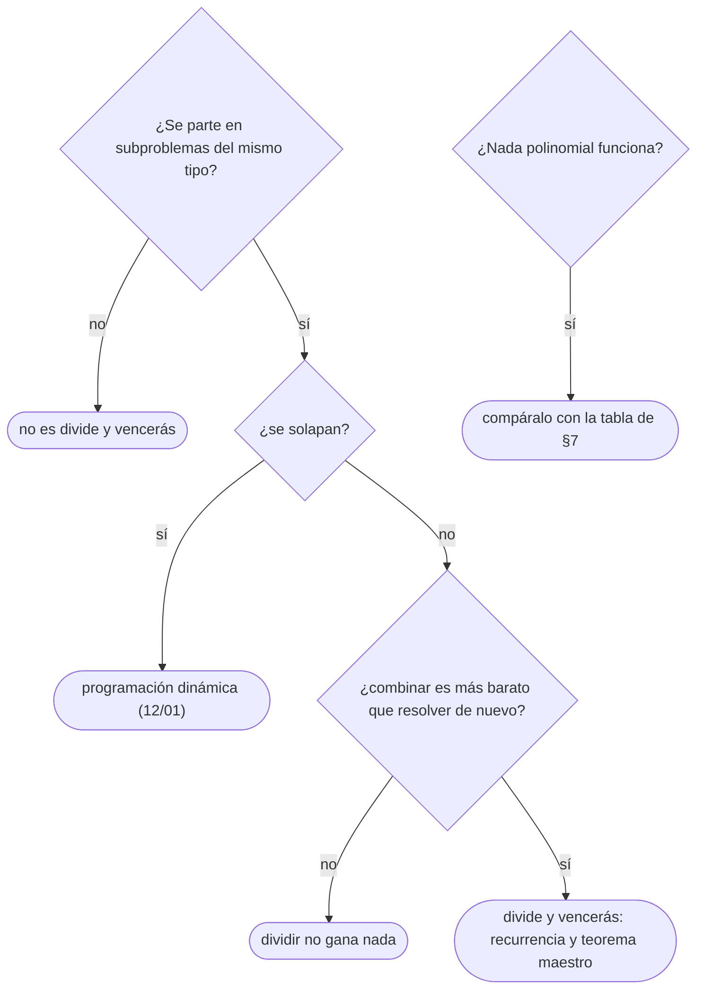

# 05 — Divide y vencerás

> El esquema de partir, resolver y combinar, con su recurrencia y con los casos en que dividir no ayuda;
> el par de puntos más cercano y Karatsuba como sus dos ejemplos clásicos; la exponenciación rápida,
> que es la aplicación que más sale; y lo justo de P, NP y reducciones para **reconocer** un problema
> NP-difícil y saber qué hacer con él en una entrevista.
>
> **Niveles:** el esquema [A] · par de puntos más cercano [B] · Karatsuba [B] · exponenciación rápida
> [A] · reconocer lo NP-difícil [A].
>
> **📚 Lectura troncal:** Brassard y Bratley, *Fundamentos de algoritmia* (Prentice Hall, 1997), caps. 7 y
> 12; Kleinberg y Tardos, *Algorithm Design* (Addison-Wesley, 2005), caps. 5 y 8.
>
> **Asume leído:** [`02/02` — Recurrencias y teorema maestro](../02-analisis/02-recurrencias-y-teorema-maestro.md).
>
> **Vigencia:** 2026-10-04.

**Salto rápido:** [1](#1--el-problema) · [2](#2--la-teoría) · [3](#3--el-esquema) · [4](#4--par-de-puntos-más-cercano) · [5](#5--karatsuba) · [6](#6--exponenciación-rápida) · [7](#7--reconocer-lo-np-difícil) · [8](#8-️-la-tabla-de-costes) · [9](#9--cómo-se-elige) · [10](#10--señales-del-enunciado) · [🧠](#-preguntas) · [🧩](#-problemas-propios)

---

## 1. 🎯 El problema

Hay `n = 2·10⁵` antenas en un plano y se quiere la distancia entre las dos más próximas. Comparar cada
par son `n²/2 = 2·10¹⁰` distancias: no cabe. Partiendo los puntos por una vertical en dos mitades, el par
más cercano está a la izquierda, a la derecha, o cruza la línea; los dos primeros casos son el mismo
problema a la mitad de tamaño, y el tercero —se demuestra en §4— solo exige mirar una franja estrecha
alrededor de la línea, en tiempo lineal. La recurrencia `T(n) = 2T(n/2) + O(n)` da `O(n log n)`.

Eso es divide y vencerás: **partir, resolver las partes y combinar**, como el *mergesort* de [`05/01`](../05-orden-y-busqueda/01-ordenacion-por-comparacion.md). Solo
ayuda si **combinar es barato** y las partes **no se solapan**; si se solapan, es programación dinámica
([`12/01`](../12-dp-clasica/01-de-la-recursion-a-la-tabla.md)).

Y la otra cara: hay problemas sin algoritmo polinomial conocido —el camino simple más largo, el viajante—,
y reconocerlos evita pasar la entrevista buscando un voraz que no existe.

---

## 2. 📐 La teoría

**El esquema.** Para una entrada de tamaño `n`: si es pequeña, se resuelve directamente; si no, se parte
en `a` subproblemas de tamaño `n/b`, se resuelven recursivamente y se combinan en `f(n)`. El coste es

```text
T(n) = a · T(n/b) + f(n)
```

y el teorema maestro (`02/02`) lo resuelve comparando `f(n)` con `n^(log_b a)`; los casos de este
capítulo están en la tabla de §8. Partir la multiplicación escolar en cuatro mitades da
`4T(n/2) + O(n) = O(n²)`: dividir no ganó nada, y Karatsuba (§5) gana justo al bajar a tres.

**La corrección** es inducción fuerte sobre el tamaño (`10/01`): si las llamadas recursivas resuelven sus
partes, hay que demostrar solo que la **combinación** da la respuesta del todo. Esa demostración es
donde está el algoritmo: qué información tiene que devolver cada parte para que combinar sea posible.

**P y NP**, enunciados sin prueba (las pruebas son del bloque [`22`](../22-teoria-de-la-computacion/README.md), opcional):

- **P** es la clase de problemas de decisión (respuesta sí o no) que se resuelven en tiempo polinomial.
- **NP** es la clase de los que tienen un **certificado verificable** en tiempo polinomial: si la respuesta
  es «sí», existe una prueba corta que se comprueba rápido. «¿Hay un camino que visite cada ciudad una vez
  con coste ≤ K?» está en NP: el certificado es el camino. **NP no significa «no polinomial»**: significa
  *nondeterministic polynomial*, y P ⊆ NP.
- **Una reducción** de `A` a `B` es una transformación polinomial que convierte cada entrada de `A` en una
  de `B` con la misma respuesta. Si `A` se reduce a `B` y `B` es fácil, `A` es fácil; si `A` es difícil,
  `B` también.
- **NP-difícil**: todo problema de NP se reduce a él. **NP-completo**: NP-difícil y además en NP.

**Teorema (Cook-Levin).** SAT es NP-completo. A partir de él, por cadenas de reducciones, lo son miles de
problemas. Si alguno de ellos estuviera en P, todos lo estarían (P = NP), y nadie sabe si es así.

---

## 3. 🧱 El esquema

**Qué es.** Partir la entrada en partes **disjuntas** del mismo tipo, resolverlas por separado y combinar
sus respuestas. La pieza que hay que diseñar es la **combinación**, y casi siempre exige que cada parte
devuelva **algo más** que la respuesta pedida.

**Por qué es correcto.** Por inducción: el caso base es correcto por cálculo directo, y si las partes
devuelven su respuesta correcta, hay que probar que la combinación cubre **todas** las soluciones del
todo. En el subarreglo máximo: un subarreglo de `[lo, hi)` está entero en la mitad izquierda, entero en la
derecha, o cruza el centro; los dos primeros los resuelve la recursión, y el tercero es un sufijo máximo
de la izquierda más un prefijo máximo de la derecha.

**Cómo va**, el subarreglo de suma máxima de los beneficios del bloque `04`, `[3, −4, 5, −1, 2, −6, 4]`:

```text
[3, −4, 5 | −1, 2, −6, 4]          centro entre 5 y −1
izquierda [3, −4, 5]       → máximo 5   ([5])
derecha   [−1, 2, −6, 4]   → máximo 4   ([4])
cruzando: mejor sufijo de la izquierda que acaba en 5:   5        ([5])
          mejor prefijo de la derecha que empieza en −1: −1 + 2 = 1  ([−1, 2])
          cruzando = 5 + 1 = 6                            ([5, −1, 2])
respuesta: max(5, 4, 6) = 6
```

**Cuánto.** `T(n) = 2T(n/2) + O(n)`: cada nivel de la recursión recorre los `n` elementos para los
sufijos y prefijos, y hay `log₂ n` niveles: `Θ(n log n)` de tiempo y `O(log n)` de pila.

**La plantilla**, el subarreglo máximo por divide y vencerás:

```cpp
#include <algorithm>
#include <climits>
#include <vector>

// Suma máxima de un subarreglo no vacío de a[lo, hi). Θ(n log n). Pre: lo < hi.
long long maxSubarray(const std::vector<long long>& a, int lo, int hi) {
    if (hi - lo == 1) return a[lo];                          // caso base: un elemento
    int mid = lo + (hi - lo) / 2;
    long long best = std::max(maxSubarray(a, lo, mid), maxSubarray(a, mid, hi));
    long long sum = 0, leftBest = LLONG_MIN, rightBest = LLONG_MIN;
    for (int i = mid - 1; i >= lo; i--) { sum += a[i]; leftBest = std::max(leftBest, sum); }
    sum = 0;
    for (int i = mid; i < hi; i++) { sum += a[i]; rightBest = std::max(rightBest, sum); }
    return std::max(best, leftBest + rightBest);             // el que cruza el centro
}
```

```java
// Suma máxima de un subarreglo no vacío de a[lo, hi). Θ(n log n). Pre: lo < hi.
static long maxSubarray(long[] a, int lo, int hi) {
    if (hi - lo == 1) return a[lo];
    int mid = (lo + hi) >>> 1;
    long best = Math.max(maxSubarray(a, lo, mid), maxSubarray(a, mid, hi));
    long sum = 0, leftBest = Long.MIN_VALUE, rightBest = Long.MIN_VALUE;
    for (int i = mid - 1; i >= lo; i--) { sum += a[i]; leftBest = Math.max(leftBest, sum); }
    sum = 0;
    for (int i = mid; i < hi; i++) { sum += a[i]; rightBest = Math.max(rightBest, sum); }
    return Math.max(best, leftBest + rightBest);
}
```

```python
def max_subarray(a, lo, hi):
    """Suma máxima de un subarreglo no vacío de a[lo:hi]. Θ(n log n). Pre: lo < hi."""
    if hi - lo == 1:
        return a[lo]
    mid = (lo + hi) // 2
    best = max(max_subarray(a, lo, mid), max_subarray(a, mid, hi))
    s, left_best = 0, float("-inf")
    for i in range(mid - 1, lo - 1, -1):
        s += a[i]
        left_best = max(left_best, s)
    s, right_best = 0, float("-inf")
    for i in range(mid, hi):
        s += a[i]
        right_best = max(right_best, s)
    return max(best, left_best + right_best)
```

- **Los índices viajan**, no las copias ([`10/01`](01-recursion.md)).
- **El cruce exige al menos un elemento de cada lado**: por eso los dos mejores empiezan en `−∞` y no en 0.
  Empezar en 0 permitiría un «cruce» vacío y daría 0 con todo negativo.
- **`leftBest + rightBest`** no desborda: cada uno es una suma real de elementos.
- **Honestidad de ceremonia**: Kadane ([`04/03`](../04-secuencias/03-kadane-y-subarreglos.md)) resuelve esto en `Θ(n)`. Esta plantilla está aquí porque
  muestra el esquema entero en veinte líneas; devolviendo cuatro valores por parte (suma total, mejor
  prefijo, mejor sufijo, mejor) la combinación es `O(1)` y el total `Θ(n)`, que es exactamente el nodo de
  un segment tree ([`09/03`](../09-consultas-sobre-rangos/03-segment-tree.md)).

### De la versión ingenua a la buena

**El problema.** El par de antenas más cercano entre `n = 2·10⁵` puntos con coordenadas enteras.

**La versión ingenua:**

```java
// Correcta: todos los pares. Θ(n²) = 2·10¹⁰ distancias con n = 2·10⁵.
static long closestSquared(long[] x, long[] y) {
    long best = Long.MAX_VALUE;
    for (int i = 0; i < x.length; i++)
        for (int j = i + 1; j < x.length; j++) {
            long dx = x[i] - x[j], dy = y[i] - y[j];
            best = Math.min(best, dx * dx + dy * dy);       // distancia al cuadrado: sin raíces
        }
    return best;
}
```

> «Es cuadrática. Si parto por la mediana de las `x`, el par más cercano está en una mitad o cruza; si la
> mejor distancia de las mitades es `δ`, un par que cruza tiene los dos puntos a menos de `δ` de la línea,
> y ordenados por `y` cada uno solo tiene que compararse con los siete siguientes. Combinar es lineal y el
> total `n log n`.»

**El camino a la buena.** El algoritmo de §4, con su plantilla.

**Cuándo sí**: cuando las partes son independientes y la combinación es más barata que resolver el todo
de nuevo. **Cuándo no**: cuando las partes se solapan (Fibonacci recursivo recalcula subproblemas: es DP),
cuando la combinación cuesta tanto como la fuerza bruta, o cuando un recorrido lineal ya resuelve el
problema (Kadane).

> **Veredicto:** divide y vencerás es una recurrencia con una combinación ingeniosa. Diseña primero qué
> devuelve cada parte para que combinar sea barato, y escribe la recurrencia antes del código.

---

## 4. 🧱 Par de puntos más cercano

**Qué es.** Encontrar los dos puntos a menor distancia euclídea entre `n` puntos del plano en `O(n log n)`.

**Por qué es correcto.** **Lema de la franja.** Sea `δ` la menor distancia dentro de cada mitad. Un par
que cruza la línea con distancia `< δ` tiene los dos puntos en la franja de anchura `2δ` alrededor de la
línea, y, ordenados por `y`, están a menos de 8 posiciones uno del otro: en un rectángulo de `δ × 2δ` caben
como mucho 8 puntos a distancia mutua `≥ δ` (cuatro por cuadrado de lado `δ`, uno por cuadrante). Así que
basta comparar cada punto de la franja con los 7 siguientes. Prueba entera en Kleinberg y Tardos, §5.4.

**Cómo va**, con los puntos de juguete `(0,0) (4,0) (4,3) (0,3) (2,1)`:

```text
ordenados por x: (0,0) (0,3) | (2,1) (4,0) (4,3)        línea en x = 2
izquierda: (0,0)-(0,3) = 3              derecha: (2,1)-(4,0) = √5 ≈ 2,24
δ = √5; franja |x − 2| < √5: los cinco puntos
por y, ningún par de la franja baja de √5: la respuesta es √5, entre (2,1) y (4,0)
```

**Cuánto.** Si en cada nivel se reordena la franja por `y`, `T(n) = 2T(n/2) + O(n log n) = O(n log² n)`;
mezclando por `y` en la vuelta de la recursión, como el *mergesort*, `T(n) = 2T(n/2) + O(n) = O(n log n)`.

**La plantilla**, con la mezcla por `y` para quedar en `O(n log n)`; distancias al cuadrado en enteros. Va
solo en C++ (desviación declarada del nivel B, por longitud): en Java es la misma función sobre
`long[][]` con la mezcla escrita a mano:

```cpp
#include <algorithm>
#include <climits>
#include <vector>

struct Pt { long long x, y; };

// pts[lo, hi) ordenados por x al entrar; al salir quedan ordenados por y. Devuelve la mínima d².
long long closest(std::vector<Pt>& pts, int lo, int hi, std::vector<Pt>& buf) {
    if (hi - lo <= 1) return LLONG_MAX;
    int mid = lo + (hi - lo) / 2;
    long long midX = pts[mid].x;
    long long d = std::min(closest(pts, lo, mid, buf), closest(pts, mid, hi, buf));
    std::inplace_merge(pts.begin() + lo, pts.begin() + mid, pts.begin() + hi,
                       [](const Pt& a, const Pt& b) { return a.y < b.y; });   // ahora por y
    int k = 0;
    for (int i = lo; i < hi; i++) {
        long long dx = pts[i].x - midX;
        if (dx * dx >= d) continue;                                  // fuera de la franja
        for (int j = k - 1; j >= 0; j--) {                           // los de la franja con y menor
            long long dy = pts[i].y - buf[j].y;
            if (dy * dy >= d) break;                                 // como mucho 7 vueltas
            long long ex = pts[i].x - buf[j].x;
            d = std::min(d, ex * ex + dy * dy);
        }
        buf[k++] = pts[i];
    }
    return d;
}
// Uso: ordenar pts por x; std::vector<Pt> buf(n); long long d2 = closest(pts, 0, n, buf);
```

- **`midX` se guarda antes de mezclar**: tras la mezcla, `pts[mid]` ya no es el punto mediano.
- **Distancias al cuadrado** en 64 bits: con coordenadas hasta `10⁹`, `d²` llega a `8·10¹⁸`, justo por
  debajo de `2⁶³ ≈ 9,2·10¹⁸`. Con coordenadas mayores, hace falta `__int128` o `double`.
- **El `break` por `dy`** es el lema de la franja: los puntos de la franja con `y` menor están ordenados, y
  en cuanto uno está a `dy ≥ δ`, los anteriores también.
- **En Python**, la recursión y la mezcla con listas dejan muy justo `n = 2·10⁵`.

**Cuándo sí**: el par más cercano de muchos puntos, en una entrevista que pide el esquema de divide y
vencerás. **Cuándo no**: con pocos puntos (`n ≤ 3 000`), la doble pasada cuadrática es más corta y segura;
en un juez, el barrido con un `set` ordenado por `y` ([`18/05`](../18-geometria/05-barrido-geometrico.md)) es más fácil de escribir bien.

> **Veredicto:** el par más cercano enseña la pieza difícil del esquema —la combinación— con un lema
> geométrico. Escríbelo en distancias al cuadrado y mezclando por `y`.

---

## 5. 🧱 Karatsuba

**Qué es.** Multiplicar dos números (o polinomios) de `n` cifras con **tres** multiplicaciones de mitades
en lugar de cuatro.

**Por qué es correcto.** Con `x = x₁ · Bᵐ + x₀` e `y = y₁ · Bᵐ + y₀`:

```text
x · y = z₂ · B²ᵐ + z₁ · Bᵐ + z₀
z₂ = x₁ · y₁        z₀ = x₀ · y₀        z₁ = (x₁ + x₀)(y₁ + y₀) − z₂ − z₀
```

El término cruzado `x₁y₀ + x₀y₁` sale de **una** multiplicación más dos restas. Es álgebra; la prueba es
desarrollar el producto.

**Cómo va**, `1234 × 5678` con `B = 10` y `m = 2`:

```text
x₁ = 12, x₀ = 34, y₁ = 56, y₀ = 78
z₂ = 12 · 56 = 672        z₀ = 34 · 78 = 2652
z₁ = (12 + 34)(56 + 78) − 672 − 2652 = 46 · 134 − 3324 = 6164 − 3324 = 2840
resultado = 672 · 10⁴ + 2840 · 10² + 2652 = 7 006 652
```

**Cuánto.** `T(n) = 3T(n/2) + O(n)`, que por el teorema maestro da `Θ(n^(log₂ 3)) ≈ Θ(n^1,585)`. Con
`n = 10⁵` coeficientes, unas `10⁸` operaciones frente a `10¹⁰` del escolar. La FFT ([`17/09`](../17-matematica/09-fft-y-ntt.md)) baja a
`O(n log n)`.

**La plantilla**, sobre polinomios con coeficientes enteros (multiplicar números grandes es lo mismo más
el acarreo):

```cpp
#include <vector>

using Poly = std::vector<long long>;

// Producto de polinomios de igual tamaño n (potencia de 2). Θ(n^1,585).
Poly karatsuba(const Poly& a, const Poly& b) {
    int n = (int)a.size();
    Poly res(2 * n, 0);
    if (n <= 32) {                                          // caso base: el escolar es más rápido
        for (int i = 0; i < n; i++)
            for (int j = 0; j < n; j++) res[i + j] += a[i] * b[j];
        return res;
    }
    int h = n / 2;
    Poly a0(a.begin(), a.begin() + h), a1(a.begin() + h, a.end());
    Poly b0(b.begin(), b.begin() + h), b1(b.begin() + h, b.end());
    Poly z0 = karatsuba(a0, b0), z2 = karatsuba(a1, b1);
    for (int i = 0; i < h; i++) { a0[i] += a1[i]; b0[i] += b1[i]; }   // (a0 + a1) y (b0 + b1)
    Poly z1 = karatsuba(a0, b0);
    for (int i = 0; i < n; i++) z1[i] -= z0[i] + z2[i];
    for (int i = 0; i < n; i++) { res[i] += z0[i]; res[i + h] += z1[i]; res[i + n] += z2[i]; }
    return res;
}
```

- **El caso base en 32**, no en 1: con constante alta, el escolar gana en tamaños pequeños.
- **Tamaño potencia de 2**, rellenando con ceros; y los coeficientes crecen: con `10⁶` y `n = 10⁵`, las
  sumas llegan a `10¹⁷`, que aún cabe en 64 bits.

**Cuándo sí**: polinomios de `10⁴`–`10⁵` coeficientes sin módulo apto para la NTT, o números grandes sin
enteros arbitrarios. **Cuándo no**: en Python y Java, cuyos `int` y `BigInteger` ya usan Karatsuba por
encima de un umbral; y con `n ≥ 10⁵`, la FFT de `17/09`.

> **Veredicto:** Karatsuba es la prueba de que contar multiplicaciones importa: pasar de cuatro a tres
> cambia el exponente. En la práctica se usa poco a mano; se reconoce y se sabe derivar su coste.

---

## 6. 🧱 Exponenciación rápida

**Qué es.** Calcular `aⁿ` (módulo `m`, o en cualquier operación asociativa) con `O(log n)` multiplicaciones
en lugar de `n − 1`, usando la escritura binaria de `n`.

**Por qué es correcto.** `aⁿ = (a^(n/2))²` si `n` es par, y `a · a^(n−1)` si es impar. La versión
iterativa mantiene el invariante `resultado · baseᵉ = aⁿ`, donde `e` es lo que queda del exponente: al
principio `resultado = 1`, `base = a`, `e = n`; si el bit bajo de `e` es 1, `resultado *= base`; después
`base = base²` y `e = e / 2`. Las dos operaciones conservan el producto, y al acabar `e = 0`, así que
`resultado = aⁿ`. Funciona en **cualquier monoide** (operación asociativa con neutro): enteros módulo
`m`, matrices ([`13/06`](../13-dp-avanzada/06-recurrencias-lineales-y-matrices.md)), permutaciones, y la suma (que da la multiplicación por duplicación).

**Cómo va**, `3¹³ mod 1000` con `13 = 1101₂`:

```text
e     bit  resultado            base
13    1    1 · 3 = 3            3² = 9
6     0    3                    9² = 81
3     1    3 · 81 = 243         81² = 6561 → 561
1     1    243 · 561 = 136 323 → 323
3¹³ = 1 594 323 → 323
```

**Cuánto.** `⌊log₂ n⌋ + 1` vueltas, cada una con una o dos multiplicaciones modulares: con `n = 10¹⁸`, 60
vueltas. `O(1)` de memoria.

**La plantilla:**

```cpp
// aⁿ mod m, con 1 ≤ m ≤ 2³¹ para que (m − 1)² quepa en 64 bits. Θ(log n).
long long powMod(long long a, long long n, long long m) {
    long long result = 1 % m, base = a % m;
    if (base < 0) base += m;
    while (n > 0) {
        if (n & 1) result = result * base % m;       // el bit bajo de n está encendido
        base = base * base % m;
        n >>= 1;
    }
    return result;
}
```

```java
// aⁿ mod m, con 1 ≤ m ≤ 2³¹. Θ(log n).
static long powMod(long a, long n, long m) {
    long result = 1 % m, base = Math.floorMod(a, m);
    while (n > 0) {
        if ((n & 1) == 1) result = result * base % m;
        base = base * base % m;
        n >>= 1;
    }
    return result;
}
```

```python
def pow_mod(a, n, m):
    """aⁿ mod m. Θ(log n). En la práctica: pow(a, n, m), que hace lo mismo en C."""
    result, base = 1 % m, a % m
    while n > 0:
        if n & 1:
            result = result * base % m
        base = base * base % m
        n >>= 1
    return result
```

- **`1 % m`** y no `1`: con `m = 1` la respuesta es 0. **Negativos**: `a % m` puede ser negativo en C++ y
  Java; `floorMod`, o sumar `m`.
- **El límite de `m`**: `base * base` tiene que caber en 64 bits, así que `m ≤ 3·10⁹`; con `m` hasta
  `10¹⁸`, `__int128` en C++, `BigInteger` en Java, o la multiplicación por duplicación de abajo.
- **Python** trae `pow(a, n, m)`, en C, y desde 3.8 admite `n = −1` para el inverso modular ([`17/03`](../17-matematica/03-aritmetica-modular.md)).

### De la versión ingenua a la buena

**El problema.** Calcular `a · b mod m` con `a, b, m` hasta `10¹⁸`, en C++ o Java sin enteros de 128 bits:
`a · b` llega a `10³⁶` y desborda.

**La versión ingenua:**

```java
// Correcta y sin desbordar si a, m < 2⁶²: suma a, b veces. Θ(b) = 10¹⁸ vueltas.
static long mulModNaive(long a, long b, long m) {
    long result = 0;
    a %= m;
    for (long i = 0; i < b; i++) result = (result + a) % m;
    return result;
}
```

> «Es correcta, pero suma `b` veces. Multiplicar es sumar repetidamente, igual que potenciar es
> multiplicar repetidamente: con la misma escritura binaria de `b`, sumo `a` duplicado en cada vuelta y
> lo añado cuando el bit está encendido. Son 60 vueltas, y como solo sumo números menores que `m`, nada
> desborda.»

**El camino a la buena.** La plantilla con `+` en lugar de `·` y `0` como neutro: `base = base + base`,
`result = result + base`, todo módulo `m`. Con `m < 2⁶²`, la suma de dos valores menores que `m` cabe.

**Cuándo sí**: exponentes grandes, inversos por Fermat, potencias de matrices (`13/06`). **Cuándo no**:
exponentes pequeños y fijos, u operaciones no asociativas.

> **Veredicto:** la exponenciación rápida es el algoritmo de divide y vencerás que más sale en la
> práctica. Recuerda el invariante `resultado · baseᵉ = aⁿ` y el `1 % m`, y vale para cualquier monoide.

---

## 7. 🧱 Reconocer lo NP-difícil

**Qué es.** Saber decir «este problema es NP-difícil» y actuar en consecuencia. **No hay plantilla de
código** (desviación declarada respecto del nivel A): la plantilla es la tabla de abajo, que se aprende
como se aprende una plantilla.

**Por qué es correcto.** Por las reducciones de §2: si un problema conocido NP-difícil se reduce a tu
problema, el tuyo también lo es. En la práctica se razona al revés: **tu problema es un disfraz** de uno de
la lista, o lo contiene como caso particular.

**Cómo va.** Los gemelos que más confunden: uno es polinomial y el otro NP-difícil.

| Polinomial | NP-difícil | Lo que cambia |
|---|---|---|
| Camino más corto ([`15/01`](../15-grafos-pesos-y-flujos/01-dijkstra.md)) | Camino simple más largo | Con ciclos positivos, «simple» lo cambia todo |
| Circuito euleriano (cada **arista** una vez, [`14/06`](../14-grafos-recorridos/06-puentes-articulacion-y-euler.md)) | Circuito hamiltoniano (cada **vértice** una vez) | Euler tiene condición local de grados; Hamilton no |
| 2-SAT ([`14/05`](../14-grafos-recorridos/05-componentes-fuertes-y-2sat.md)) | 3-SAT | Con dos literales por cláusula hay grafo de implicaciones |
| 2-colorear (bipartito, [`14/03`](../14-grafos-recorridos/03-dfs.md)) | 3-colorear | — |
| Árbol de expansión mínima ([`15/04`](../15-grafos-pesos-y-flujos/04-arbol-de-expansion-minima.md)) | Árbol de Steiner, viajante | Conectar todos frente a un subconjunto o en ciclo |
| Mochila con capacidad pequeña ([`12/03`](../12-dp-clasica/03-mochilas.md)) | Mochila con capacidad `10¹⁸` | La DP es **pseudopolinomial**: polinomial en el valor, no en sus bits |
| Cubrir con intervalos en una recta ([`11/02`](../11-voraces/02-intervalos.md)) | Cubrir conjuntos (*set cover*) | La estructura lineal permite el voraz |

**Qué hacer en una entrevista** cuando reconoces uno:

```text
1. Dilo:              «esto es el viajante / cubrir conjuntos disfrazado: no se conoce algoritmo polinomial».
2. Mira n:            n ≤ 20 → máscaras o DP sobre subconjuntos (10/02, 13/01); n ≤ 40 → mitades (10/04).
3. Mira los números:  pesos pequeños → DP pseudopolinomial (12/03).
4. Mira la estructura: árbol, bipartito, intervalos, grafo plano → muchos se vuelven polinomiales.
5. Si nada de eso:    heurística o aproximación con garantía (20/05), y dilo.
```

**Cuánto.** Exponencial en el caso peor (`2ⁿ`, `n!`, `2ⁿ · n²`); la habilidad es que el exponente caiga
sobre el parámetro pequeño del enunciado.

### De la versión ingenua a la buena

**El problema.** En un grafo de `n ≤ 15` salas con pasillos de longitud positiva, el recorrido más largo que
no repite sala.

**La versión ingenua**, un voraz que «parece obvio»:

```java
// falla: desde 0, toma siempre el pasillo más largo hacia una sala no visitada.
static long greedyLongest(long[][] w, int start) {        // w[u][v] = 0 si no hay pasillo
    int n = w.length; boolean[] seen = new boolean[n];
    int u = start; seen[u] = true; long total = 0;
    while (true) {
        int next = -1;
        for (int v = 0; v < n; v++) if (!seen[v] && w[u][v] > 0 && (next < 0 || w[u][v] > w[u][next])) next = v;
        if (next < 0) return total;
        total += w[u][next]; seen[next] = true; u = next;
    }
}
```

> «El voraz se mete en un callejón: un pasillo largo hacia una sala sin salida le quita todo lo demás. Y no
> lo puedo arreglar con otra regla, porque el camino simple más largo es NP-difícil: contiene al camino
> hamiltoniano. Pero `n ≤ 15`: puedo probar todos los recorridos con *backtracking*, o con una DP sobre
> (salas visitadas, sala actual), `2¹⁵ · 15²` ≈ 7 millones de pasos.»

**El camino a la buena.** *Backtracking* de [`10/03`](03-backtracking-y-poda.md) desde cada sala, o la DP sobre máscaras de [`13/01`](../13-dp-avanzada/01-mascaras-de-bits.md)
(`dp[S][v]` = el recorrido más largo que visita exactamente `S` y acaba en `v`).

**Cuándo sí**: siempre que un problema de optimización se resista a un voraz y a una DP polinomial,
compáralo con la tabla antes de seguir buscando. **Cuándo no**: no confundas «no se me ocurre nada
polinomial» con «es NP-difícil»; afírmalo solo si reconoces la reducción.

> **Veredicto:** NP-difícil no significa irresoluble: significa que el algoritmo exacto será exponencial
> en algo. Reconócelo pronto, y elige que el exponente caiga en el parámetro que el enunciado deja pequeño.

---

## 8. ⏱️ La tabla de costes

| Algoritmo | Recurrencia | Coste | Lo que la tabla no dice |
|---|---|---|---|
| Subarreglo máximo por mitades | `2T(n/2) + O(n)` | `Θ(n log n)` | Kadane hace lo mismo en `Θ(n)` |
| Par de puntos más cercano | `2T(n/2) + O(n)` | `Θ(n log n)` | Sin la mezcla por `y`, `O(n log² n)` |
| Karatsuba | `3T(n/2) + O(n)` | `Θ(n^1,585)` | Constante alta: caso base en ~32 |
| Exponenciación rápida | `T(n/2) + O(1)` | `Θ(log n)` multiplicaciones | El límite es que `base²` quepa en 64 bits |
| Exacto para NP-difícil | — | Exponencial | Se elige en qué parámetro |

---

## 9. 🧭 Cómo se elige



> **Regla de entrevista:** «la recurrencia es `T(n) = 2T(n/2) + O(n)`, por el teorema maestro
> `O(n log n)`» es la frase que demuestra que el diseño está pensado. Y ante un NP-difícil: «no hay
> polinomial conocido; con `n ≤ 20` hago máscaras».

---

## 10. 🔎 Señales del enunciado

| Señal | Técnica | Por qué |
|---|---|---|
| Exponente o número de repeticiones hasta `10⁹`–`10¹⁸` | Exponenciación rápida | `log₂ 10¹⁸ = 60` |
| «Par más cercano», «distancia mínima entre puntos» | Par más cercano, o barrido (`18/05`) | El lema de la franja |
| Polinomios o números de `10⁴`–`10⁵` cifras | Karatsuba o FFT (`17/09`) | El escolar es cuadrático |
| La respuesta del todo se arma con respuestas de las mitades y «lo que cruza» | Esquema de divide y vencerás | La combinación es la clave |
| «Visitar todos exactamente una vez», «el camino simple más largo», «colorear con `k ≥ 3`» con `n ≤ 20` | NP-difícil: exacto exponencial en `n` | Máscaras o *backtracking* |

---

## ⚠️ Errores frecuentes

| Se dice | Lo preciso |
|---|---|
| «NP significa no polinomial» | Significa *nondeterministic polynomial*: verificable en tiempo polinomial. P ⊆ NP |
| «Si es NP-difícil, no se puede resolver» | Se resuelve exacto en tiempo exponencial, que con `n` pequeño cabe; o se aproxima |
| «Dividir siempre ayuda» | Solo si combinar es barato y las partes no se solapan; con cuatro mitades, Karatsuba no ganaría nada |
| «La mochila es polinomial: la DP es `O(n · W)`» | Es pseudopolinomial: `W` puede tener 60 bits y `2⁶⁰` no es polinomial en el tamaño de la entrada |
| «`base * base % m` nunca desborda en 64 bits» | Solo si `m < ~3·10⁹`; con `m` de `10¹⁸`, `__int128` o multiplicación por duplicación |
| «La exponenciación rápida es solo para números» | Vale para cualquier operación asociativa: matrices, permutaciones, sumas |

---

## 📚 Para profundizar

- **Libro** — Brassard y Bratley, *Fundamentos de algoritmia* (Prentice Hall, 1997), caps. 7 (divide y
  vencerás) y 12 (complejidad computacional). *Lectura troncal.*
- **Libro** — Kleinberg y Tardos, *Algorithm Design* (Addison-Wesley, 2005), caps. 5 (par más cercano,
  multiplicación de enteros) y 8 (NP y las reducciones). *Lectura troncal.*
- **Referencia** — cp-algorithms, [*Binary Exponentiation*](https://cp-algorithms.com/algebra/binary-exp.html).
- **Referencia** — cp-algorithms, [*Finding the nearest pair of points*](https://cp-algorithms.com/geometry/nearest_points.html).

---

## 🧠 Preguntas

1. ¿Qué tres pasos tiene el esquema de divide y vencerás, y cuál es el que se diseña? 🟢
2. ¿Qué recurrencias tienen el par más cercano, Karatsuba y la exponenciación rápida, y qué da cada una? 🟢
3. ¿Qué significan P, NP, NP-difícil y NP-completo? 🟢
4. ¿Por qué la plantilla del subarreglo máximo empieza los mejores sufijo y prefijo en `−∞` y no en 0? 🟡
5. ¿En qué se diferencian divide y vencerás y programación dinámica? 🟡
6. ¿Qué invariante mantiene la exponenciación rápida iterativa y por qué termina con la respuesta? 🟡
7. Compara qué te da cada lenguaje para `aⁿ mod m` y hasta qué `m` es segura la plantilla en C++, Java y Python. 🟡
8. ¿Por qué Karatsuba hace tres multiplicaciones y no cuatro, y qué le pasa al exponente? 🟠
9. Enuncia el lema de la franja del par más cercano y explica por qué basta comparar con 7 vecinos. 🟠
10. ¿Por qué la mochila con DP `O(n · W)` no demuestra que P = NP? 🟠
11. Te piden el camino simple más largo de un grafo con `n ≤ 16`. ¿Qué dices y qué escribes? 🟠
12. Da dos pares de problemas gemelos, uno polinomial y otro NP-difícil, y di qué cambia entre ellos. 🟠
13. Demuestra que el esquema del subarreglo máximo es correcto: que la combinación cubre todos los subarreglos. 🔴
14. Diseña un algoritmo `O(log n)` para `1 + a + a² + … + aⁿ⁻¹ mod m` cuando `m` no es primo y no puedes dividir por `a − 1`. 🔴

---

## 🧩 Problemas propios

### Serie geométrica

**Nivel:** 🟡 · **Formato:** programa completo.

Imprime `(1 + a + a² + … + aⁿ⁻¹) mod m`. El módulo **no** es necesariamente primo.

- **Entrada.** Una línea con `a`, `n` y `m`.
- **Salida.** Un entero.
- **Restricciones.** `0 ≤ a ≤ 10⁹`; `1 ≤ n ≤ 10¹⁸`; `1 ≤ m ≤ 10⁹`.

```text
Entrada          Salida
2 10 1000        23

Entrada          Salida
3 5 7            2

Entrada          Salida
5 1 10           1
```

**Pista 1:** si conoces la suma de los primeros `n/2` términos, ¿cómo obtienes la de los `n` siguientes
sin volver a sumarlos?

### Equipo de guardia

**Nivel:** 🟠 · **Formato:** programa completo.

Hay `k` habilidades y `e` empleados, cada uno con algunas. Imprime el menor número de empleados que juntos
cubren todas las habilidades, o `-1` si no se puede.

- **Entrada.** Una línea con `k` y `e`. Después, `e` líneas: el número de habilidades del empleado y la
  lista (de 1 a `k`).
- **Salida.** Un entero.
- **Restricciones.** `1 ≤ k ≤ 60`; `1 ≤ e ≤ 20`.

```text
Entrada          Salida
4 4              2
2 1 2
2 2 3
2 3 4
2 1 4

Entrada          Salida
3 2              -1
1 1
1 2
```

**Pista 1:** ¿a qué problema clásico se parece, y cuál de los dos números del enunciado es lo bastante
pequeño para enumerar?

---

## 🧩 Práctica externa

Codility no tiene lección de divide y vencerás; HackerRank llega a la exponenciación. El resto del núcleo
sale de LeetCode.

### Núcleo

| ✔ | Problema | Plataforma | Nivel | Patrón | Pista 1 |
|---|---|---|---|---|---|
| [ ] | [Power - Mod Power](https://www.hackerrank.com/challenges/python-power-mod-power/problem) | HackerRank | 🟢 | Potencia modular de la biblioteca | ¿Qué hace el tercer argumento de `pow`? |
| [ ] | [Maximum Subarray](https://leetcode.com/problems/maximum-subarray/) | LeetCode | 🟡 | Mitades y cruce | Resuélvelo partiendo por la mitad: ¿qué tiene que devolver cada mitad? |
| [ ] | [Super Pow](https://leetcode.com/problems/super-pow/) | LeetCode | 🟡 | Potencia con exponente en dígitos | Si conoces `a^x`, ¿cómo obtienes `a^(10x + d)`? |
| [ ] | [Longest Substring with At Least K Repeating Characters](https://leetcode.com/problems/longest-substring-with-at-least-k-repeating-characters/) | LeetCode | 🟡 | Partir por los caracteres que no pueden estar | Una letra que aparece menos de `k` veces, ¿puede estar en la respuesta? |
| [ ] | [Beautiful Array](https://leetcode.com/problems/beautiful-array/) | LeetCode | 🟡 | Construcción por mitades | Si pones todos los impares a un lado y los pares al otro, ¿qué parejas ya no pueden fallar? |
| [ ] | [Find a Peak Element II](https://leetcode.com/problems/find-a-peak-element-ii/) | LeetCode | 🟡 | Descartar media matriz | Si miras el máximo de la columna central, ¿hacia qué lado tiene que haber un pico? |

### Ampliación

| ✔ | Problema | Plataforma | Nivel | Patrón | Pista 1 |
|---|---|---|---|---|---|
| [ ] | [Minimum Non-Zero Product of the Array Elements](https://leetcode.com/problems/minimum-non-zero-product-of-the-array-elements/) | LeetCode | 🟡 | Potencia con exponente enorme | ¿Cuántas veces aparece el mismo factor en el producto óptimo? |
| [ ] | [a-Good String](https://codeforces.com/problemset/problem/1385/D) | Codeforces | 🟡 | Mitades con coste | Si la mitad izquierda es toda `c`, ¿qué tiene que cumplir la derecha? |
| [ ] | [Painting Fence](https://codeforces.com/problemset/problem/448/C) | Codeforces | 🟠 | Divide por el mínimo | Si pintas horizontalmente hasta la altura mínima, ¿en qué trozos queda la valla? |
| [ ] | [Smallest Sufficient Team](https://leetcode.com/problems/smallest-sufficient-team/) | LeetCode | 🟠 | NP-difícil con parámetro pequeño | ¿Cuántas habilidades hay como mucho, y cuántos conjuntos de habilidades distintos? |
| [ ] | [Find the Shortest Superstring](https://leetcode.com/problems/find-the-shortest-superstring/) | LeetCode | 🔴 | NP-difícil con `n ≤ 12` | ¿A qué recorrido clásico se parece ordenar las palabras? |

---

## ✅ Criterio de dominio

- Escribir la exponenciación rápida iterativa sin mirar, con su invariante, en menos de cinco minutos.
- Escribir la recurrencia de un divide y vencerás antes de su código y resolverla con el teorema maestro.
- Enunciar el lema de la franja y la identidad de Karatsuba.
- Definir P, NP y NP-completo sin el error de «no polinomial», y nombrar cuatro pares de gemelos.
- Resolver Super Pow y Longest Substring with At Least K Repeating Characters sin pista 2.

---

**Anterior:** [`10/04` — *Meet in the middle*, IDDFS y *Dancing Links*](04-meet-in-the-middle-iddfs-y-dancing-links.md) · **Siguiente:**
[`10/06` — Juegos y búsqueda adversarial](06-juegos-y-busqueda-adversarial.md) · **Relacionado:** [`02/02` — Recurrencias y teorema maestro](../02-analisis/02-recurrencias-y-teorema-maestro.md);
[`17/03` — Aritmética modular](../17-matematica/03-aritmetica-modular.md); [`18/05` — Barrido geométrico](../18-geometria/05-barrido-geometrico.md).
