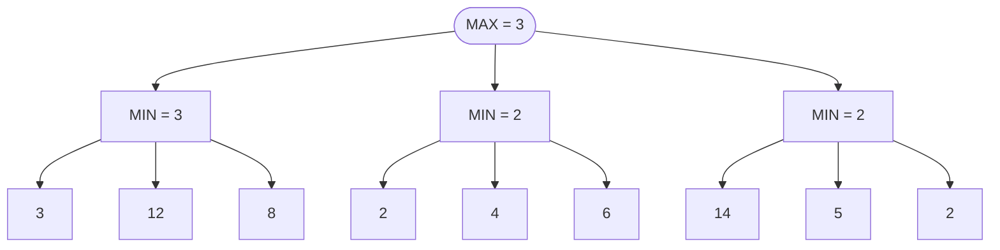

# 06 — Juegos y búsqueda adversarial

> Resolver un juego de dos jugadores por turnos y suma cero: minimax, que da el valor exacto con juego
> perfecto; la poda alfa-beta, que da **el mismo** valor visitando muchos menos nodos; y la búsqueda de
> Monte Carlo en árboles (MCTS), que cambia la exactitud por simulaciones cuando el árbol no cabe.
>
> **Niveles:** minimax [B] · alfa-beta [B] · MCTS [C].
>
> **📚 Lectura troncal:** Russell y Norvig, *Artificial Intelligence: A Modern Approach*, 4.ª ed. (Pearson,
> 2020), cap. 5; Brassard y Bratley, *Fundamentos de algoritmia* (Prentice Hall, 1997), cap. 9.
>
> **Asume leído:** [`10/03` — *Backtracking* con poda y ramificación y poda](03-backtracking-y-poda.md).
>
> **Vigencia:** 2026-10-04.

**Salto rápido:** [1](#1--el-problema) · [2](#2--la-teoría) · [3](#3--minimax) · [4](#4--alfa-beta) · [5](#5--mcts) · [6](#6-️-la-tabla-de-costes) · [7](#7--cómo-se-elige) · [8](#8--señales-del-enunciado) · [🧠](#-preguntas) · [🧩](#-problemas-propios)

---

## 1. 🎯 El problema

Dos jugadores se turnan para coger monedas de los extremos de una fila `[5, 2, 9, 1, 5, 6]`, y cada uno
quiere acabar con más dinero. ¿Cuánto se lleva el primero si los dos juegan perfecto? Un voraz («coge la
moneda mayor de las dos») acierta aquí por suerte, pero no en general: con `[1, 1, 3, 2]` coge el 2, deja
el 3 al rival y acaba con 3, cuando empezando por el 1 de la izquierda se asegura 4. Hay que **pensar en lo
que hará el otro**, que a su vez piensa en lo que harás tú.

Eso es la búsqueda adversarial: el árbol de estados de [`10/03`](03-backtracking-y-poda.md), pero con niveles alternos en los que
**uno maximiza y el otro minimiza**. Con juego perfecto, el primero se lleva 20 de las 28 monedas.

El árbol de un juego crece como `bᵈ` (ramificación `b`, profundidad `d`): el tres en raya tiene menos de
`9! ≈ 3,6·10⁵` partidas y se resuelve entero; el ajedrez, con `b ≈ 35` y partidas de 80 medios
movimientos, no. Entre los dos están las técnicas de este capítulo: minimax para el valor exacto,
alfa-beta para llegar el doble de profundo con el mismo trabajo, y MCTS cuando ni así.

---

## 2. 📐 La teoría

**Juego de suma cero con información perfecta.** Dos jugadores, MAX y MIN, alternan movimientos; los dos
ven el estado completo; no hay azar; y lo que gana uno lo pierde el otro. Cada hoja del árbol tiene una
**utilidad** para MAX.

**El valor minimax** de un estado se define por recursión:

```text
valor(s) = utilidad(s)                         si s es terminal
valor(s) = max sobre los hijos c de valor(c)   si mueve MAX
valor(s) = min sobre los hijos c de valor(c)   si mueve MIN
```

**Teorema (minimax, Zermelo).** En un juego finito de dos jugadores, suma cero e información perfecta,
el valor minimax de la raíz es lo que MAX se asegura jugando la estrategia minimax **contra cualquier
rival**, y lo que MIN se asegura que MAX no supera. Por inducción sobre la altura del árbol: en una hoja es
la utilidad; en un nodo de MAX, el mejor hijo garantiza su valor (por hipótesis) y ningún otro hijo
garantiza más; simétrico en MIN.

**La forma *negamax*.** Si la utilidad es simétrica (lo que gana uno es exactamente lo que pierde el
otro), `max(a, b) = −min(−a, −b)` permite escribir una sola función: el valor para el jugador que mueve
es el máximo, sobre sus movimientos, de **menos** el valor para el rival.

**Teorema (corrección de alfa-beta).** La poda alfa-beta devuelve **exactamente el mismo valor** que
minimax en la raíz. No es una aproximación: solo deja de explorar ramas que se demuestra que no pueden
cambiar el resultado.

**Teorema (mejor caso de alfa-beta).** Con los movimientos ordenados de mejor a peor, alfa-beta examina
`O(b^(d/2))` hojas en lugar de `bᵈ` (Knuth y Moore, 1975): con el mismo tiempo se busca **el doble de
profundo**. Con orden aleatorio, unas `O(b^(3d/4))`; con el peor orden, `bᵈ`.

---

## 3. 🧱 Minimax

**Qué es.** Recorrer el árbol del juego en profundidad y devolver en cada nodo el máximo o el mínimo de
sus hijos según a quién le toque, hasta las hojas o hasta un límite de profundidad donde se usa una
**función de evaluación** heurística.

**Por qué es correcto.** Por el teorema de §2, cuando se recorre hasta las hojas. Con un límite de
profundidad, el resultado ya no es el valor del juego sino el de la evaluación propagada: tan bueno como la
evaluación.

**Cómo va**, el árbol de dos niveles de Russell y Norvig (MAX en la raíz, tres nodos de MIN):



```text
cada MIN toma el menor de sus hojas; MAX, el mayor de los MIN: 3
```

**Cuánto.** `Θ(bᵈ)` nodos y `O(d)` de pila. Si los estados se repiten (el mismo tablero por caminos
distintos), una tabla de transposición —memoización del valor por estado— lo convierte en una DP sobre
estados, que es lo que hace falta en la mayoría de juegos de concurso con estado pequeño ([`17/08`](../17-matematica/08-teoria-de-juegos.md)).

**La plantilla**, *negamax* con memoización sobre un estado codificable (aquí, las monedas de los extremos:
el estado es el tramo `[i, j]`); devuelve la diferencia «lo mío menos lo del rival» para quien mueve:

```cpp
#include <algorithm>
#include <vector>

// Mejor diferencia (propio − rival) para quien mueve con las monedas a[i..j]. Θ(n²) estados.
long long negamax(const std::vector<long long>& a, int i, int j,
                  std::vector<std::vector<long long>>& memo, std::vector<std::vector<bool>>& seen) {
    if (i > j) return 0;                                         // terminal: no quedan monedas
    if (seen[i][j]) return memo[i][j];
    long long takeLeft  = a[i] - negamax(a, i + 1, j, memo, seen);   // el rival juega lo mejor para él
    long long takeRight = a[j] - negamax(a, i, j - 1, memo, seen);
    seen[i][j] = true;
    return memo[i][j] = std::max(takeLeft, takeRight);
}
// Lo que se lleva el primero: (suma + negamax(a, 0, n − 1, …)) / 2
```

```java
// Mejor diferencia (propio − rival) para quien mueve con las monedas a[i..j]. Θ(n²) estados.
static long negamax(long[] a, int i, int j, Long[][] memo) {
    if (i > j) return 0;
    if (memo[i][j] != null) return memo[i][j];
    long takeLeft  = a[i] - negamax(a, i + 1, j, memo);
    long takeRight = a[j] - negamax(a, i, j - 1, memo);
    return memo[i][j] = Math.max(takeLeft, takeRight);
}
```

- **El signo menos** es todo el *negamax*: lo que el rival consigue de diferencia desde el estado
  siguiente es lo que yo pierdo.
- **La diferencia, no la suma propia**: devolver «lo mío» exigiría saber de quién es el turno; devolver
  la diferencia para quien mueve hace la función simétrica. Lo mío sale de `(total + diferencia) / 2`.
- **`Long[][]` con `null`** en Java marca «no calculado» sin un arreglo aparte; cuesta *boxing*, que con
  `n²` estados pequeños no importa.
- **Sin memoización**, el árbol tiene `2ⁿ` hojas; con ella, `n²` estados: es la DP de intervalos de
  [`12/05`](../12-dp-clasica/05-rejillas-e-intervalos.md) vista desde el juego.

**Cuándo sí**: juegos con pocos estados (o pocos movimientos y poca profundidad) que se pueden resolver
enteros; y como base de cualquier IA de juegos con un límite de profundidad y una evaluación. **Cuándo no**:
si el juego es imparcial y se descompone en subjuegos independientes, Sprague-Grundy (`17/08`) es mucho
más barato; y si el árbol no cabe ni con poda, MCTS (§5).

> **Veredicto:** minimax es el *backtracking* de los juegos: un máximo o un mínimo por nivel. En concursos
> casi siempre va con memoización, y entonces es una DP sobre estados.

---

## 4. 🧱 Alfa-beta

**Qué es.** Minimax con dos cotas que viajan por la recursión: `α`, lo mínimo que MAX ya tiene asegurado
por un camino explorado, y `β`, lo máximo que MIN ya tiene asegurado. Si en un nodo `α ≥ β`, el resto de sus
hijos no se explora: ninguno puede cambiar la decisión de arriba.

**Por qué es correcto.** En un nodo de MIN, si un hijo da un valor `v ≤ α`, el nodo valdrá como mucho `v`
(MIN puede elegir ese hijo o uno peor para MAX), y MAX, más arriba, ya tiene un camino que le da `α ≥ v`:
nunca elegirá este nodo, así que su valor exacto no importa. Lo simétrico en MAX con `β`. Por inducción, el
valor de la raíz no cambia (es el teorema de §2); lo que cambia son los valores de nodos interiores
podados, que quedan solo **acotados**, no exactos.

**Cómo va**, el mismo árbol:

```text
MIN 1: hojas 3, 12, 8 → vale 3.                         α = 3 en la raíz
MIN 2: primera hoja 2 → vale ≤ 2 ≤ α: poda 4 y 6         ✂ (MAX ya tiene 3; esto da como mucho 2)
MIN 3: hojas 14, 5, 2 → vale 2 (con este orden no poda)
raíz: 3, visitando 7 de las 9 hojas
```

Si el tercer nodo tuviera sus hojas en orden `2, 5, 14`, también se podaría tras el 2: el **orden** de los
movimientos decide cuánto se poda.

**Cuánto.** Entre `Θ(b^(d/2))` con el orden ideal y `Θ(bᵈ)` con el peor, según el teorema de §2. Con
`b = 35`, pasar de `35⁸ ≈ 2,3·10¹²` a `35⁴ ≈ 1,5·10⁶` en el mejor caso.

**La plantilla**, *negamax* con alfa-beta sobre un juego genérico:

```cpp
#include <algorithm>
#include <climits>

// Negamax con alfa-beta. Devuelve el valor para el jugador que mueve en 'state', a profundidad ≤ depth.
// Game define: terminal, evaluate (para quien mueve), moves, play y undo.
template <class Game>
int alphaBeta(Game& g, int depth, int alpha, int beta) {
    if (depth == 0 || g.terminal()) return g.evaluate();
    int best = INT_MIN + 1;                                     // + 1: así −best no desborda
    for (auto mv : g.moves()) {                                 // mejor ordenados de más a menos prometedor
        g.play(mv);
        int value = -alphaBeta(g, depth - 1, -beta, -alpha);    // la ventana se invierte para el rival
        g.undo(mv);
        best = std::max(best, value);
        alpha = std::max(alpha, value);
        if (alpha >= beta) break;                               // poda: el rival no permitirá esto
    }
    return best;
}
// Llamada inicial: alphaBeta(g, D, INT_MIN + 1, INT_MAX)
```

```java
// Negamax con alfa-beta sobre un juego que se modifica y se deshace.
interface Game {
    boolean terminal();
    int evaluate();                  // valor para el jugador que mueve
    int[] moves();
    void play(int mv);
    void undo(int mv);
}

static int alphaBeta(Game g, int depth, int alpha, int beta) {
    if (depth == 0 || g.terminal()) return g.evaluate();
    int best = Integer.MIN_VALUE + 1;
    for (int mv : g.moves()) {
        g.play(mv);
        int value = -alphaBeta(g, depth - 1, -beta, -alpha);
        g.undo(mv);
        best = Math.max(best, value);
        alpha = Math.max(alpha, value);
        if (alpha >= beta) break;
    }
    return best;
}
```

- **`−beta, −alpha`**: al pasar al rival, su ventana es la mía negada e invertida. Es el único sitio donde
  se equivoca la gente.
- **`MIN_VALUE + 1`**: negar `Integer.MIN_VALUE` desborda y vuelve a dar `MIN_VALUE`.
- **El orden de `moves()`** lo es todo: capturas primero en ajedrez, el centro primero en conecta cuatro,
  o el mejor movimiento de la iteración anterior (profundización iterativa, como el IDDFS de
  [`10/04`](04-meet-in-the-middle-iddfs-y-dancing-links.md), que además da una respuesta en cualquier momento).
- **Tabla de transposición con alfa-beta**: hay que guardar si el valor es exacto, cota inferior o cota
  superior, porque un nodo podado no tiene valor exacto. Mezclarlos es un error clásico.

**Cuándo sí**: juegos deterministas de suma cero cuyo árbol no cabe entero, con una evaluación razonable
y movimientos ordenables; los *bots* de CodinGame para juegos de tablero. **Cuándo no**: con azar o
información oculta (hace falta *expectiminimax* o MCTS), con ramificación enorme y sin buena evaluación
(go), o con estados pequeños que caben en memoria (la memoización basta).

> **Veredicto:** alfa-beta no aproxima nada: da el valor de minimax y, con buen orden, llega el doble de
> profundo. Escríbelo en forma *negamax* y vigila la ventana `(−β, −α)`.

---

## 5. 🧱 MCTS

### Búsqueda de Monte Carlo en árboles

**Qué resuelve.** Elegir un buen movimiento en juegos con ramificación enorme o sin buena función de
evaluación (el go, juegos con azar), construyendo el árbol de forma asimétrica a base de **partidas
aleatorias** (*playouts*).

**Qué garantiza.** Cada iteración hace cuatro pasos: **selección** (bajar por el árbol eligiendo hijos con
la fórmula UCB1, `wᵢ/nᵢ + c · √(ln N / nᵢ)`, que equilibra explotar los hijos buenos y explorar los poco
visitados), **expansión** (añadir un hijo), **simulación** (jugar al azar hasta el final) y
**retropropagación** (sumar el resultado en el camino). Con UCT, la probabilidad de elegir el movimiento
óptimo tiende a 1 al crecer las iteraciones (Kocsis y Szepesvári, 2006). Es un algoritmo de Monte Carlo
([`19/01`](../19-aleatorizados-y-probabilisticos/01-las-vegas-y-monte-carlo.md)): da una respuesta en cualquier momento, sin garantía de exactitud en tiempo finito.

**Cuánto.** Lineal en el número de iteraciones, cada una de coste `profundidad × coste de simular`. El
presupuesto lo fija el tiempo disponible, no el tamaño del árbol.

**Cómo reconocerlo.** «Tienes 100 ms por turno», *bots* de CodinGame, juegos con azar o con evaluación
difícil de escribir.

**Si no te la sabes.** Alfa-beta con profundización iterativa y una evaluación sencilla resuelve la mayoría
de *bots* de concurso con ramificación moderada.

**Dónde está entera.** Russell y Norvig, cap. 5, §5.4; Browne y otros, «A Survey of Monte Carlo Tree Search
Methods» (2012).

---

## 6. ⏱️ La tabla de costes

| Técnica | Nodos | Resultado | Lo que la tabla no dice |
|---|---|---|---|
| Minimax completo | `Θ(bᵈ)` | Exacto | Solo cabe en juegos pequeños |
| Minimax con memoización | Estados distintos × movimientos | Exacto | Es una DP; exige estado codificable |
| Alfa-beta | `Θ(b^(d/2))` a `Θ(bᵈ)` | El mismo que minimax | Depende del orden de los movimientos |
| Minimax o alfa-beta con límite `d` | Igual, hasta `d` | El de la evaluación | Tan bueno como la evaluación |
| MCTS | Lo que dé el tiempo | Aproximado, mejora con iteraciones | No necesita evaluación; sí simulaciones rápidas |

---

## 7. 🧭 Cómo se elige

```text
¿El juego es imparcial (mismos movimientos para los dos) y se parte en subjuegos? → Sprague-Grundy (17/08)
¿Los estados distintos caben en memoria?                                       → minimax con memoización
¿El árbol es grande pero hay evaluación y orden razonables?                    → alfa-beta con profundización iterativa
¿Ramificación enorme, azar o sin evaluación?                                   → MCTS
```

> **Regla de entrevista:** ante «dos jugadores juegan de forma óptima», di primero «minimax: cada uno
> maximiza su diferencia contra lo mejor del rival», y después busca el estado que se repite para
> memoizarlo.

---

## 8. 🔎 Señales del enunciado

| Señal | Técnica | Por qué |
|---|---|---|
| «Ambos juegan de forma óptima», «¿gana el primero?» | Minimax con memoización | Valor del juego por estados |
| «Maximiza tu puntuación menos la del rival» | *Negamax* sobre la diferencia | La función es simétrica |
| Estado pequeño (máscara de `≤ 20` bits, tramo `[i, j]`) | Memoización sobre el estado | Los caminos repiten estados |
| Tablero mediano, límite de tiempo por turno, *bot* | Alfa-beta con evaluación, o MCTS | No cabe entero |
| Varias pilas o tableros independientes, «quien no puede mover pierde» | Sprague-Grundy (`17/08`) | XOR de valores de Grundy |

---

## ⚠️ Errores frecuentes

| Se dice | Lo preciso |
|---|---|
| «Alfa-beta da una aproximación» | Da exactamente el valor de minimax; solo omite ramas irrelevantes |
| «El voraz, cogiendo lo mejor ahora, basta» | El rival responde; hay que mirar su mejor respuesta |
| «Alfa-beta siempre reduce a `b^(d/2)`» | Solo con orden ideal; con el peor orden no poda nada |
| «Guardo en la tabla de transposición el valor que devolvió alfa-beta» | Un nodo podado da una cota, no un valor exacto; hay que guardar el tipo |
| «`−Integer.MIN_VALUE` es el máximo» | Desborda y vuelve a `MIN_VALUE`: se empieza en `MIN_VALUE + 1` |
| «MCTS encuentra la jugada óptima» | Converge con infinitas iteraciones; con tiempo finito, aproxima |

---

## 📚 Para profundizar

- **Libro** — Russell y Norvig, *Artificial Intelligence: A Modern Approach*, 4.ª ed. (Pearson, 2020),
  cap. 5: minimax, alfa-beta, búsqueda con límite y MCTS. *Lectura troncal.*
- **Libro** — Brassard y Bratley, *Fundamentos de algoritmia* (Prentice Hall, 1997), cap. 9: los juegos
  como exploración de grafos implícitos. *Lectura troncal.*
- **Artículo** — Knuth y Moore, «An Analysis of Alpha-Beta Pruning», *Artificial Intelligence* 6 (1975):
  la cota `b^(d/2)` con su prueba.
- **Referencia** — Russell y Norvig, [pseudocódigo de AIMA](https://aima.cs.berkeley.edu/algorithms.pdf):
  `MINIMAX-SEARCH`, `ALPHA-BETA-SEARCH` y `MONTE-CARLO-TREE-SEARCH`.
- **Libro** — Berlekamp, Conway y Guy, *Winning Ways*, 2.ª ed. (A K Peters, 2001), vol. 1: los juegos
  combinatorios que `17/08` resuelve sin árbol.

---

## 🧠 Preguntas

1. ¿Qué es un juego de suma cero con información perfecta, y qué devuelve minimax en cada tipo de nodo? 🟢
2. ¿Qué representan `α` y `β`, y cuándo se poda? 🟢
3. ¿Cuántas hojas examina alfa-beta en el mejor caso y en el peor? 🟢
4. ¿En qué se diferencian minimax y *negamax*, y qué exige *negamax* de la utilidad? 🟡
5. ¿Por qué un nodo podado por alfa-beta no tiene valor exacto, y qué consecuencia tiene para una tabla de transposición? 🟡
6. ¿Qué cambia entre minimax hasta las hojas y minimax con límite de profundidad y evaluación? 🟡
7. Compara cómo marcarías «no calculado» en la memoización del juego en C++, Java y Python, y qué cuesta cada forma. 🟡
8. ¿Por qué el voraz «coge la moneda mayor de los extremos» no es óptimo? Da el contraejemplo más pequeño que encuentres. 🟠
9. Explica por qué alfa-beta devuelve exactamente el valor de minimax. 🟠
10. ¿Por qué el orden de los movimientos cambia cuánto poda alfa-beta, y cómo se consigue un buen orden? 🟠
11. ¿Cuándo usarías MCTS en lugar de alfa-beta, y qué garantiza cada uno? 🟠
12. Traza alfa-beta sobre el árbol de §3 con las hojas del tercer nodo en orden `2, 5, 14` y di cuántas hojas visita. 🔴
13. Tu *negamax* con alfa-beta devuelve valores absurdos en cuanto la profundidad es impar. ¿Qué miras? 🔴

---

## 🧩 Problemas propios

### Tres en raya a mitad de partida

**Nivel:** 🟢 · **Formato:** programa completo.

Te dan un tablero de tres en raya a mitad de partida (`X`, `O` y `.` para vacío) y quién mueve. Con juego
perfecto de los dos, ¿quién gana? Se garantiza que el tablero es alcanzable y que nadie ha ganado aún.

- **Entrada.** Tres líneas con el tablero. Una línea con `X` u `O`, el jugador que mueve.
- **Salida.** `X`, `O` o `EMPATE`.
- **Restricciones.** Las de un tablero de 3 × 3.

```text
Entrada     Salida
X.O         X
.X.
O..
X

Entrada     Salida
...         EMPATE
...
...
X
```

**Pista 1:** ¿cuántas partidas distintas pueden quedar desde un tablero con `k` casillas vacías?

### Monedas en los extremos

**Nivel:** 🟡 · **Formato:** programa completo.

Hay `n` monedas en fila. Dos jugadores, por turnos, cogen una moneda de uno de los dos extremos. Los dos
quieren maximizar su propio total. ¿Cuánto se lleva el primero con juego perfecto?

- **Entrada.** Una línea con `n`. Una línea con los valores.
- **Salida.** Un entero.
- **Restricciones.** `1 ≤ n ≤ 2000`; `1 ≤ valor ≤ 10⁹`.

```text
Entrada            Salida
6                  20
5 2 9 1 5 6

Entrada            Salida
3                  3
1 5 2
```

**Pista 1:** si sabes lo que se lleva **de más** quien mueve con las monedas `i..j`, ¿qué se lleva de más
quien mueve con `i..j` tras coger una?

### Dominó en una tira

**Nivel:** 🟠 · **Formato:** programa completo.

Una tira de `n` casillas tiene algunas bloqueadas (`#`) y el resto libres (`.`). Por turnos, cada jugador
coloca un dominó sobre **dos casillas libres adyacentes**. Quien no puede colocar, pierde. ¿Gana el primero
o el segundo?

- **Entrada.** Una línea con la tira.
- **Salida.** `PRIMERO` o `SEGUNDO`.
- **Restricciones.** `1 ≤ n ≤ 20`.

```text
Entrada     Salida
....        PRIMERO

Entrada     Salida
..#..       SEGUNDO

Entrada     Salida
.....       SEGUNDO
```

**Pista 1:** ¿cuántos estados distintos puede tener la tira, y cuántas veces llega una búsqueda ingenua al
mismo?

---

## 🧩 Práctica externa

Codility no tiene juegos; el núcleo sale de LeetCode y HackerRank, y la ampliación añade CodinGame, la
plataforma específica de los *bots*.

### Núcleo

| ✔ | Problema | Plataforma | Nivel | Patrón | Pista 1 |
|---|---|---|---|---|---|
| [ ] | [Find Winner on a Tic Tac Toe Game](https://leetcode.com/problems/find-winner-on-a-tic-tac-toe-game/) | LeetCode | 🟢 | Estado terminal | ¿Qué ocho líneas hay que mirar, y cuándo es empate o «pendiente»? |
| [ ] | [Predict the Winner](https://leetcode.com/problems/predict-the-winner/) | LeetCode | 🟡 | *Negamax* sobre tramos | ¿Qué diferencia obtiene quien mueve con el tramo `i..j`? |
| [ ] | [Stone Game](https://leetcode.com/problems/stone-game/) | LeetCode | 🟡 | *Negamax* sobre tramos | ¿Puede el primero quedarse siempre con todas las pilas de posición par, o todas las impares? |
| [ ] | [Can I Win](https://leetcode.com/problems/can-i-win/) | LeetCode | 🟡 | Minimax con memoización sobre una máscara | ¿El total acumulado es parte del estado, o se deduce de los números usados? |
| [ ] | [Stone Game II](https://leetcode.com/problems/stone-game-ii/) | LeetCode | 🟡 | *Negamax* con estado `(i, M)` | ¿Qué necesitas saber del pasado para decidir el siguiente movimiento? |
| [ ] | [Simplified Chess Engine](https://www.hackerrank.com/challenges/simplified-chess-engine/problem) | HackerRank | 🟡 | Minimax con límite de profundidad | Con `m ≤ 6` movimientos, ¿cuántos turnos de cada uno hay que explorar? |

### Ampliación

| ✔ | Problema | Plataforma | Nivel | Patrón | Pista 1 |
|---|---|---|---|---|---|
| [ ] | [Stone Game III](https://leetcode.com/problems/stone-game-iii/) | LeetCode | 🟠 | *Negamax* con sufijos | Si quien mueve desde `i` coge 1, 2 o 3 pilas, ¿qué diferencia le queda? |
| [ ] | [Ultimate Tic-Tac-Toe](https://www.codingame.com/multiplayer/bot-programming/tic-tac-toe) | CodinGame | 🟠 | Alfa-beta o MCTS con tiempo limitado | ¿Cuántos movimientos legales hay de media, y cuánto puedes profundizar en 100 ms? |
| [ ] | [Connect 4](https://www.codingame.com/multiplayer/bot-programming/connect-4) | CodinGame | 🟠 | Alfa-beta con orden central | ¿Qué columnas conviene explorar primero para que la poda actúe antes? |
| [ ] | [Cat and Mouse](https://leetcode.com/problems/cat-and-mouse/) | LeetCode | 🔴 | Juego con ciclos: retroanálisis desde los finales | Si la partida puede repetir posiciones, ¿puede la recursión terminar? |

---

## ✅ Criterio de dominio

- Escribir *negamax* con alfa-beta sin mirar, con la ventana `(−β, −α)` bien puesta.
- Explicar por qué alfa-beta da el valor exacto y de qué depende cuánto poda.
- Reconocer cuándo el juego es una DP sobre estados y memoizarlo.
- Resolver Predict the Winner y Can I Win sin pista 2.

---

**Anterior:** [`10/05` — Divide y vencerás](05-divide-y-venceras.md) · **Siguiente:** [`10/07` — Simulación](07-simulacion.md) ·
**Relacionado:** [`17/08` — Teoría de juegos](../17-matematica/08-teoria-de-juegos.md); [`19/04` — Muestreo y cadenas de Markov](../19-aleatorizados-y-probabilisticos/04-muestreo-y-markov.md).
