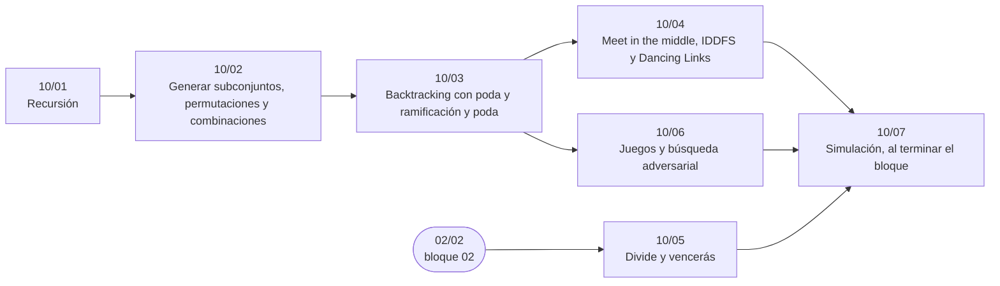

# Bloque 10 — Búsqueda completa y divide y vencerás

> Explorar todas las posibilidades, y hacerlo bien: la recursión y su pila, generar subconjuntos,
> permutaciones y combinaciones, el *backtracking* con poda, *meet in the middle* e IDDFS, divide y vencerás (con
> Karatsuba, el par más cercano y la exponenciación rápida) y la búsqueda adversarial en juegos. Es el bloque donde
> nace la versión ingenua que los demás mejoran.
>
> Las respuestas de las preguntas y las pistas 2 y 3 de los problemas, en [`08` — Respuestas](08-respuestas.md).
>
> **Vigencia:** 2026-10-04.

---

## 🧭 Índice

| Capítulo | Niveles | Ruta corta |
|---|---|---|
| [`10/01` — Recursión](01-recursion.md) | recursión y pila de llamadas [A] · paso a iterativo [A] | sí |
| [`10/02` — Generar subconjuntos, permutaciones y combinaciones](02-generar-subconjuntos-y-permutaciones.md) | máscaras de bits [A] · permutaciones con `next_permutation` y recursivas [A] · combinaciones [A] | sí |
| [`10/03` — *Backtracking* con poda y ramificación y poda](03-backtracking-y-poda.md) | *backtracking* [A] · ramificación y poda [B] | sí |
| [`10/04` — *Meet in the middle*, IDDFS y *Dancing Links*](04-meet-in-the-middle-iddfs-y-dancing-links.md) | *meet in the middle* [B] · IDDFS [B] · *Dancing Links* [C] |  |
| [`10/05` — Divide y vencerás](05-divide-y-venceras.md) | el esquema [A] · par de puntos más cercano [B] · Karatsuba [B] · exponenciación rápida [A] · reconocer lo NP-difícil [A] |  |
| [`10/06` — Juegos y búsqueda adversarial](06-juegos-y-busqueda-adversarial.md) | minimax [B] · alfa-beta [B] · MCTS [C] |  |
| [`10/07` — Simulación](07-simulacion.md) | El examen del bloque: preguntas transversales y problemas cronometrados | |
| [`10/08` — Respuestas](08-respuestas.md) | Las preguntas en tres capas y las pistas 2 y 3 | |

---

## 🧭 Orden de lectura

- La cadena `10/01` → `10/02` → `10/03` es la columna del bloque y de la ruta «Programar en vivo».
- `10/05` depende de las recurrencias de `02/02`; `10/04` y `10/06`, de `10/03`.

---

## 🔎 Mapa de señales del bloque

| Señal | Técnica | Capítulo |
|---|---|---|
| «Anidado», «expresión con paréntesis», «la estructura contiene estructuras» | Recursión sobre la anidación | [`10/01`](01-recursion.md) |
| La fila `k` se define a partir de la fila `k − 1` («gramática», «se duplica y se invierte») | Recursión sobre la posición | [`10/01`](01-recursion.md) |
| `n ≤ 20` y «elige algunos», «subconjunto», «encender/apagar» | Máscaras | [`10/02`](02-generar-subconjuntos-y-permutaciones.md) |
| `n ≤ 10` y «orden», «secuencia», «asigna cada uno a uno» | Permutaciones | [`10/02`](02-generar-subconjuntos-y-permutaciones.md) |
| «Todas las combinaciones / particiones / colocaciones válidas» | *Backtracking* | [`10/03`](03-backtracking-y-poda.md) |
| `n ≤ 12`–`15` con restricciones entre elementos (no atacarse, no repetir) | *Backtracking* | [`10/03`](03-backtracking-y-poda.md) |
| `n ≤ 40` (o 36, 44), valores hasta `10⁹` o `10¹⁸` | *Meet in the middle* | [`10/04`](04-meet-in-the-middle-iddfs-y-dancing-links.md) |
| «Repartir en dos grupos» con `n ≤ 30` y tamaños iguales | *Meet in the middle* por tamaño | [`10/04`](04-meet-in-the-middle-iddfs-y-dancing-links.md) |
| Exponente o número de repeticiones hasta `10⁹`–`10¹⁸` | Exponenciación rápida | [`10/05`](05-divide-y-venceras.md) |
| «Par más cercano», «distancia mínima entre puntos» | Par más cercano, o barrido (`18/05`) | [`10/05`](05-divide-y-venceras.md) |
| «Ambos juegan de forma óptima», «¿gana el primero?» | Minimax con memoización | [`10/06`](06-juegos-y-busqueda-adversarial.md) |
| «Maximiza tu puntuación menos la del rival» | *Negamax* sobre la diferencia | [`10/06`](06-juegos-y-busqueda-adversarial.md) |

---

## 📚 Lectura troncal del bloque

La de cada capítulo, que es también la primera entrada de su «Para profundizar»:

- **`10/01`** — Erickson, *Algorithms* (2019, libre del autor), cap. 1; Brassard y Bratley, *Fundamentos de algoritmia* (Prentice Hall, 1997), cap. 1.
- **`10/02`** — Knuth, *The Art of Computer Programming*, Vol. 4A (Addison-Wesley, 2011), §7.2.1; Skiena, *The Algorithm Design Manual*, 3.ª ed. (Springer, 2020), cap. 9.
- **`10/03`** — Brassard y Bratley, *Fundamentos de algoritmia* (Prentice Hall, 1997), cap. 9; Erickson, *Algorithms* (2019, libre del autor), cap. 2.
- **`10/04`** — Knuth, *The Art of Computer Programming*, Vol. 4B (Addison-Wesley, 2022), §7.2.2 (*Dancing Links*); Russell y Norvig, *Artificial Intelligence: A Modern Approach*, 4.ª ed. (Pearson, 2020), cap. 3 (IDDFS).
- **`10/05`** — Brassard y Bratley, *Fundamentos de algoritmia* (Prentice Hall, 1997), caps. 7 y 12; Kleinberg y Tardos, *Algorithm Design* (Addison-Wesley, 2005), caps. 5 y 8.
- **`10/06`** — Russell y Norvig, *Artificial Intelligence: A Modern Approach*, 4.ª ed. (Pearson, 2020), cap. 5; Brassard y Bratley, *Fundamentos de algoritmia* (Prentice Hall, 1997), cap. 9.

---

## 🧭 Qué NO está aquí

- **La DP**, que nace de la recursión con memoria: en el [bloque `12`](../12-dp-clasica/README.md).
- **Los voraces**, la alternativa cuando una elección local basta: en el [bloque `11`](../11-voraces/README.md).
- **Los juegos combinatorios con Grundy**: en [`17/08` — Teoría de juegos](../17-matematica/08-teoria-de-juegos.md).
- **Por qué algunos problemas no tienen nada mejor que esto** (NP-completitud): en el bloque opcional [`22`](../22-teoria-de-la-computacion/README.md).

---

**Anterior:** [Bloque 09 — Consultas sobre rangos](../09-consultas-sobre-rangos/README.md) ·
**Siguiente:** [Bloque 11 — Voraces](../11-voraces/README.md) ·
**Inicio:** [README del corpus](../README.md)
