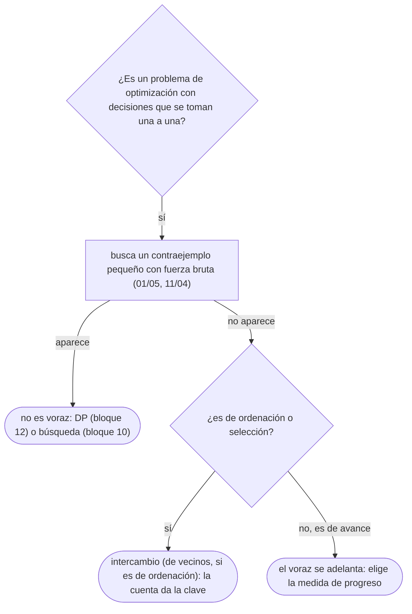

# 01 — Cuándo funciona un voraz

> Las dos propiedades que hacen correcto a un algoritmo voraz —la elección voraz y la subestructura
> óptima— y las dos formas de demostrarlo: el argumento de intercambio y «el voraz se adelanta». Con un
> ejemplo completo de cada una, y con el método para encontrar el contraejemplo antes que la prueba.
>
> **Niveles:** elección voraz y subestructura óptima [A] · argumento de intercambio [A] · «el voraz se
> adelanta» [A].
>
> **📚 Lectura troncal:** Kleinberg y Tardos, *Algorithm Design* (Addison-Wesley, 2005), cap. 4; Brassard
> y Bratley, *Fundamentos de algoritmia* (Prentice Hall, 1997), cap. 6; Cormen, Leiserson, Rivest y
> Stein, *Introduction to Algorithms*, 3.ª ed. (MIT Press, 2009), cap. 16.
>
> **Asume leído:** [`02/04` — Corrección: invariantes, inducción e intercambio](../02-analisis/04-correccion-invariantes-induccion-intercambio.md).
>
> **Vigencia:** 2026-10-04.

**Salto rápido:** [1](#1--el-problema) · [2](#2--la-teoría) · [3](#3--elección-voraz-y-subestructura-óptima) · [4](#4--argumento-de-intercambio) · [5](#5--el-voraz-se-adelanta) · [6](#6--cómo-se-elige) · [7](#7--señales-del-enunciado) · [🧠](#-preguntas) · [🧩](#-problemas-propios)

---

## 1. 🎯 El problema

Un taller tiene seis encargos con duración y peso (lo que cuesta cada hora de espera del cliente):
`(5, 2) (2, 1) (9, 3) (1, 1) (5, 2) (6, 3)`. Se hacen de uno en uno, y el coste de un encargo es su peso
por el momento en que termina. ¿En qué orden se minimiza el coste total? Hay tres voraces que «parecen
obvios»:

```text
primero el más corto        → 1, 2, 5, 5, 6, 9 por duración          coste 187
primero el de más peso      → los de peso 3 delante (y el corto antes) coste 207
primero el de menor duración/peso → (1,1) (2,1) (6,3) (5,2) (5,2) (9,3)  coste 181  ← el óptimo
```

Los tres son algoritmos de una línea, y solo uno es correcto. La diferencia no se ve probando el ejemplo
del enunciado; se ve **demostrando**. Un voraz construye la solución con decisiones locales que nunca
deshace, y eso solo funciona cuando el problema tiene una estructura que lo permite. Este capítulo es esa
estructura y las dos pruebas que la usan.

> 🧠 **Modelo mental.** Ante un voraz, el orden de trabajo es: **buscar el contraejemplo pequeño** con
> fuerza bruta (diez minutos), y si no aparece, **escribir la prueba**. Nunca al revés: una prueba que
> «casi sale» de un voraz incorrecto es tiempo perdido.

---

## 2. 📐 La teoría

Un algoritmo voraz resuelve un problema de optimización tomando en cada paso la decisión que parece mejor
**ahora**, sin volver atrás. Es correcto si el problema cumple dos propiedades:

**Propiedad de la elección voraz.** Existe una solución óptima que contiene la primera elección voraz.
Es decir, elegir lo localmente mejor **no cierra la puerta** a lo globalmente mejor.

**Subestructura óptima.** Tras hacer la elección voraz, lo que queda es un subproblema del mismo tipo, y
una solución óptima del problema completo contiene una solución óptima de ese subproblema.

Con las dos, una inducción sobre el número de decisiones da la corrección: la primera elección está en
alguna óptima, y lo que falta es un problema menor que el voraz resuelve bien por hipótesis. La
subestructura óptima la comparte con la programación dinámica ([`12/01`](../12-dp-clasica/01-de-la-recursion-a-la-tabla.md)); la elección voraz es lo que
permite **no probar** todas las opciones del primer paso.

**Las dos formas de demostrar la elección voraz:**

| Prueba | Idea | Cuándo encaja |
|---|---|---|
| **Argumento de intercambio** | Tomar una óptima `O` que no hace la elección voraz y transformarla, sin empeorar, en una que sí la hace | Problemas de ordenación y de selección: «en qué orden», «cuáles elijo» |
| **El voraz se adelanta** (*greedy stays ahead*) | Medir el progreso tras `k` pasos y probar por inducción que el voraz nunca va por detrás de ninguna otra solución | Problemas de avance: «cuántos pasos para llegar», «cuántos caben» |

El argumento de intercambio es una técnica de prueba general y su dueño es [`02/04`](../02-analisis/04-correccion-invariantes-induccion-intercambio.md), donde está aplicado a
la selección de actividades. Aquí se usa como herramienta de diseño, con la variante que más sale en
problemas de ordenación: el **intercambio de dos vecinos**.

**Teorema (intercambio de vecinos).** Si en toda ordenación que tenga dos elementos consecutivos `x, y`
con `clave(x) > clave(y)`, intercambiarlos no empeora el coste, entonces ordenar por `clave` creciente es
óptimo.

*Esbozo.* Una ordenación óptima cualquiera se puede llevar a la ordenada por `clave` con intercambios de
vecinos en orden «malo» (como el método de la burbuja, que hace exactamente eso), y ninguno empeora. Así
que la ordenada es tan buena como una óptima.

---

## 3. 🧱 Elección voraz y subestructura óptima

**Qué es.** Reconocer en el enunciado una decisión que se puede tomar **la primera y para siempre**, y
comprobar que lo que queda es el mismo problema más pequeño.

**Por qué es correcto.** Por la inducción de §2: si la primera elección está en alguna óptima y el resto es
un subproblema con subestructura óptima, el voraz es óptimo.

**Cómo va**, el número más pequeño que se obtiene quitando `k = 3` dígitos de `5291056`. La primera cifra
del resultado decide más que todas las demás juntas, así que la elección voraz es: **quitar el primer
dígito que es mayor que su siguiente** (bajar la cifra más significativa posible):

```text
5291056   el 5 es mayor que el 2 → quitarlo         291056   (quedan 2 por quitar)
291056    el 2 no es mayor que el 9; el 9 sí > 1   21056    (queda 1)
21056     el 2 es mayor que el 1 → quitarlo         1056     (quedan 0)
resultado: 1056
```

La subestructura: después de quitar un dígito, el problema es «quitar `k − 1` dígitos del resto», del
mismo tipo.

**Cuánto.** Escrito ingenuamente, cada paso busca el primer descenso desde el principio: `O(k · n)`. Con
una **pila monótona** ([`06/01`](../06-lineales-y-hashing/01-pilas-colas-y-monotonas.md)), cada dígito entra y sale una vez: `Θ(n)`.

**La plantilla.** El capítulo no añade plantilla de código, como fija su ficha: los voraces de este
bloque son «ordenar por la clave correcta y recorrer», y la plantilla de la selección de actividades está
en `02/04` y en [`11/02`](02-intervalos.md). Lo que se aprende aquí es la **prueba**.

### De la versión ingenua a la buena

**El problema.** Quitar `k` dígitos de un número de `n ≤ 10⁵` cifras para que quede el menor posible.

**La versión ingenua:**

```java
// Correcta: prueba todas las formas de conservar n − k dígitos. Θ(C(n, k) · n).
static String smallestAfterRemoving(String s, int k, int start, String kept) {
    if (kept.length() == s.length() - k) {
        String t = kept.replaceFirst("^0+(?!$)", "");          // sin ceros a la izquierda
        return t.isEmpty() ? "0" : t;
    }
    String best = null;
    for (int i = start; i < s.length(); i++) {
        String cand = smallestAfterRemoving(s, k, i + 1, kept + s.charAt(i));
        if (cand == null) continue;                             // no quedan cifras para completar
        if (best == null || cand.length() < best.length()
                || (cand.length() == best.length() && cand.compareTo(best) < 0)) best = cand;
    }
    return best;
}
```

> «Prueba `C(n, k)` subconjuntos de cifras. Pero la cifra más significativa manda: si hay un dígito
> mayor que el siguiente, quitarlo baja una cifra de más peso que cualquier otra elección. Esa elección
> está en alguna solución óptima y deja el mismo problema con `k − 1`. Con una pila que guarda la parte
> creciente, cada dígito entra y sale una vez.»

**El camino a la buena.** Recorrer los dígitos con una pila: mientras queden por quitar y la cima sea
mayor que el dígito actual, desapilar; apilar el actual. Al final, quitar los que falten del final y los
ceros a la izquierda. `Θ(n)`.

**Cuándo sí**: cuando una decisión tiene una prioridad absoluta sobre las siguientes (la cifra más
significativa, el plazo más próximo) y deja un problema del mismo tipo. **Cuándo no**: cuando la mejor
primera decisión depende de lo que venga después; ahí hay que probar todas las primeras decisiones, que es
programación dinámica.

> **Veredicto:** un voraz necesita las dos propiedades, y la que hay que demostrar es la elección voraz.
> La subestructura óptima casi siempre está; la elección voraz casi nunca es obvia.

---

## 4. 🧱 Argumento de intercambio

**Qué es.** Demostrar la elección voraz transformando una solución óptima cualquiera en la del voraz sin
empeorarla. En problemas de ordenación, la versión práctica es el intercambio de dos vecinos (§2): se
calcula cuánto cambia el coste al intercambiar dos elementos consecutivos, y esa cuenta **da la clave** por
la que hay que ordenar.

**Por qué es correcto.** Por el teorema de intercambio de vecinos de §2. La cuenta, para el taller de §1:
sean `x = (pₓ, wₓ)` e `y = (p_y, w_y)` consecutivos, empezando en el instante `T`. Los demás encargos no
cambian de coste. Con `x` primero:

```text
x antes que y:  wₓ (T + pₓ) + w_y (T + pₓ + p_y)
y antes que x:  w_y (T + p_y) + wₓ (T + p_y + pₓ)
diferencia (x primero − y primero) = w_y pₓ − wₓ p_y
```

Conviene `x` primero si `w_y pₓ < wₓ p_y`, es decir, si `pₓ / wₓ < p_y / w_y`: **la regla de Smith**,
ordenar por duración entre peso. La cuenta muestra también por qué fallan los otros dos voraces de §1: la
duración sola ignora el peso, y el peso solo ignora la duración.

**Cómo va**, los seis encargos de §1 con su razón:

```text
encargo (p, w)    (1,1)  (2,1)  (6,3)  (5,2)  (5,2)  (9,3)
p / w             1      2      2      2,5    2,5    3
termina en        1      3      9      14     19     28
coste w · fin     1      3      27     28     38     84        total 181
```

La fuerza bruta sobre las 720 ordenaciones da el mismo 181.

**Cuánto.** Ordenar, `Θ(n log n)`, y un recorrido. La comparación por razón se hace **sin dividir**,
comparando `pₓ · w_y` con `p_y · wₓ` en 64 bits: las divisiones en coma flotante pueden empatar mal.

### De la versión ingenua a la buena

**El problema.** El orden de menor coste para `n ≤ 2·10⁵` encargos con duración y peso.

**La versión ingenua:**

```java
// Correcta: todas las ordenaciones. Θ(n! · n): con n = 10 ya son 3,6·10⁷.
static long bestCost(long[][] jobs, boolean[] used, long time, int placed) {
    if (placed == jobs.length) return 0;
    long best = Long.MAX_VALUE;
    for (int i = 0; i < jobs.length; i++) {
        if (used[i]) continue;
        used[i] = true;
        long end = time + jobs[i][0];
        best = Math.min(best, jobs[i][1] * end + bestCost(jobs, used, end, placed + 1));
        used[i] = false;
    }
    return best;
}
```

> «Pruebo las `n!` ordenaciones. Pero si miro dos encargos seguidos, el resto no cambia al
> intercambiarlos, y la cuenta dice que conviene primero el de menor duración entre peso. Como cualquier
> ordenación se lleva a esa con intercambios de vecinos que no empeoran, ordenar por esa razón es óptimo.»

**El camino a la buena.** Ordenar con el comparador `Long.compare(a[0] * b[1], b[0] * a[1])` y sumar
`peso · fin` en un recorrido. `Θ(n log n)`.

**Cuándo sí**: problemas de «en qué orden» donde el coste de un elemento depende de los anteriores solo a
través de un total acumulado (el tiempo, el peso, la suma). **Cuándo no**: cuando intercambiar dos vecinos
cambia el coste de otros elementos, o cuando el orden por la clave no es transitivo; entonces no hay
clave, y suele hacer falta DP sobre subconjuntos ([`13/01`](../13-dp-avanzada/01-mascaras-de-bits.md)).

> **Veredicto:** en un problema de ordenación, intercambia dos vecinos y haz la cuenta: la desigualdad
> que sale es el comparador. Compáralo con productos, no con divisiones.

---

## 5. 🧱 El voraz se adelanta

**Qué es.** Probar que tras cada paso el voraz está **al menos tan avanzado** como cualquier otra solución,
según una medida del progreso; de ahí sale que llega antes (o con menos pasos) que todas.

**Por qué es correcto.** El esquema:

```text
1. Define la medida del progreso tras k pasos: g_k para el voraz, o_k para otra solución O.
2. Prueba por inducción que g_k ≥ o_k para todo k  (el voraz se adelanta).
3. Concluye: si O termina en m pasos, el voraz habrá terminado en m pasos o antes.
```

**Cómo va**, el camión de Kleinberg y Tardos: una carretera de longitud 20, depósito con autonomía para 6,
gasolineras en `2, 5, 6, 9, 12, 15, 18`. El voraz para en la **última gasolinera alcanzable**:

```text
desde 0, alcanza hasta 6   → para en 6
desde 6, alcanza hasta 12  → para en 12
desde 12, alcanza hasta 18 → para en 18
desde 18, alcanza 24 ≥ 20  → llega
3 paradas; la fuerza bruta sobre los subconjuntos de gasolineras también da 3
```

La medida es la posición tras la parada `k`. Inducción: si `g_k ≥ o_k`, desde `g_k` se alcanza todo lo que
se alcanzaba desde `o_k` (y más), así que la última gasolinera alcanzable desde `g_k` está al menos tan
lejos como la parada `o_{k+1}`, que era alcanzable desde `o_k`: `g_{k+1} ≥ o_{k+1}`. Si `O` llega a 20 tras
`m` paradas, el voraz también.

**Cuánto.** Con las gasolineras ordenadas, un recorrido con un puntero que nunca retrocede: `Θ(n)` tras
ordenar.

### De la versión ingenua a la buena

**El problema.** El menor número de paradas para recorrer una carretera de longitud `L` con autonomía `R` y
`n ≤ 2·10⁵` gasolineras, o `−1` si no se puede.

**La versión ingenua:**

```java
// Correcta: para cada número de paradas r, prueba todos los subconjuntos de r gasolineras. Exponencial.
static int minStops(long L, long R, long[] st) {                 // st ordenado
    int n = st.length;
    for (int r = 0; r <= n; r++)
        for (int mask = 0; mask < (1 << n); mask++) {
            if (Integer.bitCount(mask) != r) continue;
            long last = 0; boolean ok = true;
            for (int i = 0; i < n && ok; i++)
                if ((mask >> i & 1) == 1) { ok = st[i] - last <= R; last = st[i]; }
            if (ok && L - last <= R) return r;
        }
    return -1;
}
```

> «Pruebo subconjuntos de paradas. Pero si después de `k` paradas estoy al menos tan lejos como
> cualquier otra estrategia, después de `k + 1` también, porque desde más lejos alcanzo más. Así que parar
> en la última gasolinera alcanzable nunca me deja detrás, y llego con el mínimo de paradas.»

**El camino a la buena.** Ordenar las gasolineras; mientras no se alcance `L`, avanzar un puntero por las
alcanzables y parar en la última; si ninguna nueva es alcanzable, `−1`. `Θ(n log n)`.

**Cuándo sí**: problemas de «mínimo de pasos para cubrir o alcanzar» donde estar más avanzado nunca es
peor (saltos, cubrir una recta con segmentos, paradas). **Cuándo no**: si estar más avanzado puede ser
peor —por ejemplo, si cada gasolinera da una cantidad distinta de combustible—, la medida deja de ser
monótona y hace falta otra técnica (con un montículo, LeetCode Minimum Number of Refueling Stops).

> **Veredicto:** «el voraz se adelanta» es una inducción sobre una medida del progreso. Elige la medida
> que hace obvio el paso inductivo; si no la encuentras, sospecha del voraz.

---

## 6. 🧭 Cómo se elige



> **Regla de entrevista:** antes de escribir un voraz, di la regla y **un intento de romperla**: «ordeno
> por fin; ¿y si ordenara por inicio? `[0,10) [1,2) [3,4)` lo rompe». Después, la frase de la prueba.

---

## 7. 🔎 Señales del enunciado

| Señal | Técnica | Por qué |
|---|---|---|
| «En qué orden», «programa las tareas», coste que depende del instante de fin | Intercambio de vecinos | La cuenta de dos consecutivos da el comparador |
| «Mínimo número de paradas / saltos / segmentos para cubrir» | El voraz se adelanta | Llegar más lejos nunca es peor |
| «El menor número / la menor cadena», con dígitos o letras | Elección voraz por la posición más significativa | El orden lexicográfico decide de izquierda a derecha |
| `n ≤ 2·10⁵` y «maximiza / minimiza», sin estructura de DP visible | Candidato a voraz, pero hay que probarlo | El tamaño descarta casi todo lo demás |
| `n ≤ 20` con la misma pregunta | Posible trampa: no es voraz | Los autores dejan `n` pequeño cuando la solución es exhaustiva |

---

## ⚠️ Errores frecuentes

| Se dice | Lo preciso |
|---|---|
| «El voraz funciona porque es intuitivo» | Funciona si tiene elección voraz y subestructura óptima, y se demuestra |
| «Si pasa los ejemplos, el voraz es correcto» | Los ejemplos casi nunca contienen el contraejemplo; la fuerza bruta sí lo encuentra |
| «Ordeno por la clave más evidente» | La clave sale de la cuenta del intercambio; en el taller es `p/w`, no `p` ni `w` |
| «Comparo las razones con `double`» | Los empates pueden fallar; se comparan los productos cruzados en 64 bits |
| «Subestructura óptima implica voraz» | También la tiene la DP; lo que añade el voraz es la elección voraz |
| «El voraz se adelanta y el intercambio son lo mismo» | Son dos pruebas distintas: una mide progreso por pasos, la otra transforma una óptima |

---

## 📚 Para profundizar

- **Libro** — Kleinberg y Tardos, *Algorithm Design* (Addison-Wesley, 2005), cap. 4: «el voraz se
  adelanta» (§4.1) y el argumento de intercambio (§4.2), con los mejores ejemplos del tema. *Lectura
  troncal.*
- **Libro** — Brassard y Bratley, *Fundamentos de algoritmia* (Prentice Hall, 1997), cap. 6: las
  características generales de los algoritmos voraces y la planificación. *Lectura troncal.*
- **Libro** — Cormen, Leiserson, Rivest y Stein, *Introduction to Algorithms*, 3.ª ed. (MIT Press, 2009),
  cap. 16, §16.2: los elementos de la estrategia voraz. *Lectura troncal.*
- **Referencia** — cp-algorithms, [*Scheduling jobs on one machine*](https://cp-algorithms.com/schedules/schedule-with-completion-duration.html):
  la regla por razón con su prueba de intercambio.
- **Referencia** — USACO Guide, [*Greedy Algorithms with Sorting*](https://usaco.guide/silver/greedy-sorting).
- **Video** — MIT OpenCourseWare, *6.046J Design and Analysis of Algorithms*, la clase de algoritmos
  voraces.

---

## 🧠 Preguntas

1. ¿Qué dos propiedades necesita un problema para que un voraz sea correcto? 🟢
2. ¿Qué dice el teorema del intercambio de vecinos? 🟢
3. ¿Qué tres pasos tiene una prueba de «el voraz se adelanta»? 🟢
4. ¿En qué se diferencian el argumento de intercambio y «el voraz se adelanta», y cuándo encaja cada uno? 🟡
5. ¿Qué tienen en común un voraz y una DP, y qué tiene el voraz que la DP no necesita? 🟡
6. ¿Por qué la regla de Smith compara `pₓ · w_y` con `p_y · wₓ` y no las razones? 🟡
7. Compara cómo escribirías el comparador de la regla de Smith en C++, Java y Python sin errores de desbordamiento ni de coma flotante. 🟡
8. Haz la cuenta del intercambio de dos vecinos para el taller y deriva la regla de Smith. 🟠
9. Demuestra con «el voraz se adelanta» que parar en la última gasolinera alcanzable da el mínimo de paradas. 🟠
10. ¿Por qué el voraz de las gasolineras deja de funcionar si cada una da una cantidad distinta de combustible? 🟠
11. ¿Por qué quitar el primer dígito mayor que su siguiente es la elección voraz correcta, y qué haces si no hay ninguno? 🔴
12. Da el contraejemplo más pequeño que encuentres para «primero el encargo de más peso» en el taller. 🔴
13. Tu voraz da WA en el caso 23 y pasa todos los ejemplos. Describe el procedimiento para decidir si el fallo es del voraz o del código. 🔴

---

## 🧩 Problemas propios

### Paquetes en la furgoneta

**Nivel:** 🟢 · **Formato:** programa completo.

Una furgoneta admite un peso total `W`. Hay `n` paquetes con su peso. ¿Cuántos paquetes, como máximo,
caben?

- **Entrada.** Una línea con `n` y `W`. Una línea con los pesos.
- **Salida.** Un entero.
- **Restricciones.** `1 ≤ n ≤ 2·10⁵`; `0 ≤ W ≤ 10¹⁴`; `1 ≤ peso ≤ 10⁹`.

```text
Entrada            Salida
6 10               3
5 2 9 1 5 6

Entrada            Salida
1 0                0
1
```

**Pista 1:** si una solución óptima lleva un paquete pesado y deja fuera uno ligero, ¿qué pasa si los
cambias?

### Retraso máximo mínimo

**Nivel:** 🟡 · **Formato:** programa completo.

Hay `n` tareas con duración `pᵢ` y plazo `dᵢ`, y una sola máquina que empieza en el instante 0. El retraso
de una tarea es `max(0, fin − plazo)`. Imprime el menor valor posible del **mayor** retraso.

- **Entrada.** Una línea con `n`. Después, `n` líneas con `pᵢ dᵢ`.
- **Salida.** Un entero.
- **Restricciones.** `1 ≤ n ≤ 2·10⁵`; `1 ≤ pᵢ ≤ 10⁹`; `0 ≤ dᵢ ≤ 10¹⁴`.

```text
Entrada     Salida
6           1
3 6
2 8
1 9
4 9
3 14
2 15

Entrada     Salida
2           0
1 5
2 5
```

**Pista 1:** si dos tareas consecutivas tienen los plazos «al revés», ¿puede empeorar el mayor retraso al
intercambiarlas?

### Dos máquinas en cadena

**Nivel:** 🟠 · **Formato:** programa completo.

Cada pieza pasa primero por la máquina A (`aᵢ` minutos) y después por la B (`bᵢ` minutos). Las dos
máquinas procesan una pieza a la vez, y las piezas pasan por B en el mismo orden que por A. ¿Cuál es el
menor instante en que pueden estar terminadas todas?

- **Entrada.** Una línea con `n`. Después, `n` líneas con `aᵢ bᵢ`.
- **Salida.** Un entero.
- **Restricciones.** `1 ≤ n ≤ 2·10⁵`; `1 ≤ aᵢ, bᵢ ≤ 10⁹`.

```text
Entrada     Salida
6           29
5 2
2 9
9 1
1 5
5 6
6 3

Entrada     Salida
1           7
3 4
```

**Pista 1:** ¿qué piezas conviene poner al principio para que B empiece pronto, y cuáles al final para
que B no se quede esperando?

---

## 🧩 Práctica externa

> 💡 **Truco.** Cuando un voraz te dé WA, no le pidas a una IA que lo arregle: pídele que te ayude a
> escribir la fuerza bruta y el generador para encontrar el contraejemplo, o que critique tu argumento de
> intercambio. El arreglo lo escribes tú ([`01/06`](../01-oficio-del-competidor/06-protocolo-de-resolucion.md)).

### Núcleo

| ✔ | Problema | Plataforma | Nivel | Patrón | Pista 1 |
|---|---|---|---|---|---|
| [ ] | [Luck Balance](https://www.hackerrank.com/challenges/luck-balance/problem) | HackerRank | 🟢 | Elección voraz tras ordenar | ¿Qué concursos importantes conviene perder? |
| [ ] | [TieRopes](https://app.codility.com/programmers/lessons/16-greedy_algorithms/tie_ropes/) | Codility | 🟢 | El voraz se adelanta | Si cierras una cuerda en cuanto llega a `K`, ¿puede otra estrategia llevar más cuerdas cerradas en ese punto? |
| [ ] | [Greedy Florist](https://www.hackerrank.com/challenges/greedy-florist/problem) | HackerRank | 🟡 | Intercambio | ¿Qué flores debe comprar cada amigo primero, si el precio crece con las compras previas? |
| [ ] | [Jump Game II](https://leetcode.com/problems/jump-game-ii/) | LeetCode | 🟡 | El voraz se adelanta | Con `k` saltos, ¿cuál es la posición más lejana que puedes alcanzar? |
| [ ] | [Gas Station](https://leetcode.com/problems/gas-station/) | LeetCode | 🟡 | Elección voraz con prueba | Si desde `i` te quedas sin gasolina en `j`, ¿puede servir algún inicio entre `i` y `j`? |
| [ ] | [Two City Scheduling](https://leetcode.com/problems/two-city-scheduling/) | LeetCode | 🟡 | Intercambio | ¿Cuánto ahorras mandando a una persona a A en lugar de a B? |
| [ ] | [Partition Labels](https://leetcode.com/problems/partition-labels/) | LeetCode | 🟡 | El voraz se adelanta | ¿Dónde puede terminar, como pronto, el trozo que empieza con esta letra? |

### Ampliación

| ✔ | Problema | Plataforma | Nivel | Patrón | Pista 1 |
|---|---|---|---|---|---|
| [ ] | [Queue Reconstruction by Height](https://leetcode.com/problems/queue-reconstruction-by-height/) | LeetCode | 🟡 | Orden con intercambio | ¿A quién no le afecta dónde pongas a los más bajos? |
| [ ] | [Reading Books](https://cses.fi/problemset/task/1631) | CSES | 🟡 | Cota inferior y construcción | ¿Por debajo de qué tiempo es imposible terminar, mire como se mire? |
| [ ] | [Candy](https://leetcode.com/problems/candy/) | LeetCode | 🟠 | Dos pasadas voraces | Si solo miras a tu vecino izquierdo, ¿cuántos caramelos te tocan como mínimo? |
| [ ] | [Course Schedule III](https://leetcode.com/problems/course-schedule-iii/) | LeetCode | 🟠 | Plazos con arrepentimiento | Si un curso nuevo no cabe, ¿qué curso ya tomado conviene soltar? |

---

## ✅ Criterio de dominio

- Escribir una prueba de intercambio de vecinos y sacar de ella el comparador, en papel, en menos de diez
  minutos.
- Escribir una prueba de «el voraz se adelanta» eligiendo la medida del progreso.
- Romper con un contraejemplo los dos voraces falsos del taller.
- Resolver Two City Scheduling y Gas Station sin pista 2, con la prueba escrita.

---

**Anterior:** — · **Siguiente:** [`11/02` — Intervalos](02-intervalos.md) · **Relacionado:**
[`11/04` — Matroides y cómo romper un voraz](04-matroides-y-contraejemplos.md); [`12/01` — De la recursión a la tabla](../12-dp-clasica/01-de-la-recursion-a-la-tabla.md).
