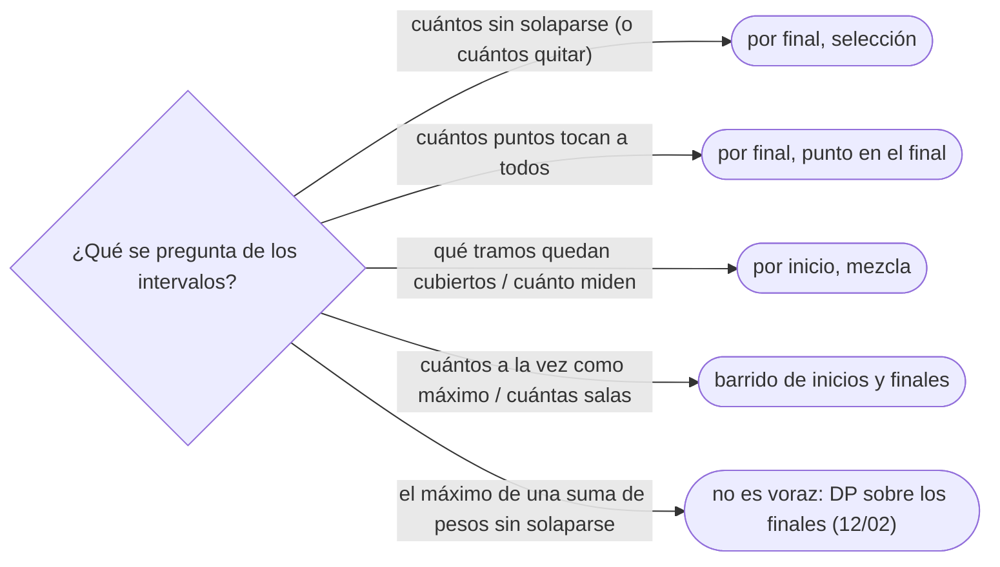

# 02 — Intervalos

> Los cuatro problemas clásicos de intervalos y el orden que resuelve cada uno: el máximo de intervalos
> disjuntos (por final), el mínimo de puntos que los pinchan a todos (por final), la mezcla de los que se
> solapan (por inicio) y el mínimo de salas (barrido de inicios y finales). Con la prueba de por qué ese
> orden y no otro.
>
> **Niveles:** selección de actividades [A] · cubrimiento con puntos [A] · mezcla [A] · mínimo de
> salas [A].
>
> **📚 Lectura troncal:** Kleinberg y Tardos, *Algorithm Design* (Addison-Wesley, 2005), §4.1; Cormen,
> Leiserson, Rivest y Stein, *Introduction to Algorithms*, 3.ª ed. (MIT Press, 2009), §16.1.
>
> **Asume leído:** [`11/01` — Cuándo funciona un voraz](01-cuando-funciona-un-voraz.md).
>
> **Ruta corta:** sí.
>
> **Vigencia:** 2026-10-04.

**Salto rápido:** [1](#1--el-problema) · [2](#2--la-teoría) · [3](#3--selección-de-actividades) · [4](#4--cubrimiento-con-puntos) · [5](#5--mezcla) · [6](#6--mínimo-de-salas) · [7](#7-️-la-tabla-de-costes) · [8](#8--cómo-se-elige) · [9](#9--señales-del-enunciado) · [🧠](#-preguntas) · [🧩](#-problemas-propios)

---

## 1. 🎯 El problema

Las once reuniones del corpus, como intervalos semiabiertos `[s, f)`:

```text
[1,4) [3,5) [0,6) [5,7) [3,9) [5,9) [6,10) [8,11) [8,12) [2,14) [12,16)
```

Sobre los mismos datos se hacen cuatro preguntas distintas, y cada una tiene su voraz y su orden:

```text
¿cuántas, como mucho, sin solaparse?             → 4     ordenar por FINAL
¿cuántos instantes bastan para tocarlas todas?    → 4     ordenar por FINAL
¿qué tramos del día están ocupados?               → [0,16) ordenar por INICIO
¿cuántas salas hacen falta?                       → 6     barrer inicios y finales
```

Los cuatro son algoritmos de diez líneas, y en los cuatro el error típico es **el orden**: ordenar por
inicio en el primero da una respuesta peor, y ordenar por final en el tercero mezcla mal. Este capítulo
fija cada orden con su argumento.

Lo que se asume de `11/01` y `02/04`: un voraz es correcto si hay una prueba —de intercambio, o de «el
voraz se adelanta»—, y un contraejemplo pequeño lo descarta. Aquí cada técnica trae la suya, completa.

> ⚠️ **Advertencia.** Antes de escribir, lee si los intervalos son **semiabiertos** `[s, f)` o
> **cerrados** `[s, f]`: decide si `[1,4)` y `[4,6)` se tocan o no, y cambia un `<` por un `≤` en cada
> plantilla. Es la causa de la mitad de los WA en intervalos.

---

## 2. 📐 La teoría

**Por qué el final.** En selección y en cubrimiento, el intervalo que **termina antes** es el más
restrictivo: es el que menos espacio deja libre (selección) y el que antes exige una decisión (cubrimiento).
Elegirlo primero nunca empeora, por intercambio.

**Por qué el inicio en la mezcla.** Para saber si un intervalo se une al bloque actual hay que saber si
empieza antes de que el bloque acabe; ordenando por inicio, todos los que pueden unirse aparecen seguidos.

**Teorema (salas y profundidad).** El mínimo número de salas para programar un conjunto de intervalos es
igual a su **profundidad**: el máximo número de intervalos que contienen un mismo instante. Es una
igualdad entre un mínimo y un máximo, como las de flujos: cualquier programación necesita al menos la
profundidad (esos intervalos se solapan todos entre sí), y el barrido la alcanza.

**El contraste con los ordenes falsos**, que hay que saber dar en una entrevista:

| Problema | Orden falso | Contraejemplo mínimo |
|---|---|---|
| Máximo de disjuntos | Por inicio | `[0,10) [1,2) [3,4)`: elige 1, el óptimo es 2 |
| Máximo de disjuntos | Por duración | `[0,5) [4,6) [5,10)`: elige 1, el óptimo es 2 |
| Mínimo de puntos | Por inicio, punto en el inicio | `[0,10] [5,6]`: pone 0 y 5, basta con 5 o 6 |
| Mezcla | Por final | `[1,10] [2,3] [4,5]`: el recorrido por final ve `[2,3]` y `[4,5]` separados antes de `[1,10]` |

---

## 3. 🧱 Selección de actividades

**Qué es.** El mayor número de intervalos disjuntos dos a dos.

**Por qué es correcto.** Argumento de intercambio, demostrado en [`02/04`](../02-analisis/04-correccion-invariantes-induccion-intercambio.md): una óptima cuyo primer intervalo no
sea el que termina antes se puede cambiar por él sin crear solapamientos. También sale con «el voraz se
adelanta»: el `k`-ésimo intervalo voraz termina no después que el `k`-ésimo de cualquier otra solución.

**Cómo va**, sobre las once reuniones ordenadas por final: elige `[1,4)`, `[5,7)`, `[8,11)`, `[12,16)` —4—,
descartando las que empiezan antes del final del último elegido. La traza completa está en `02/04`.

**Cuánto.** `Θ(n log n)` por ordenar; el recorrido es lineal. `O(1)` de memoria extra si se ordena en el
sitio.

**La plantilla**, la misma función de `02/04` en los tres lenguajes:

```cpp
#include <algorithm>
#include <climits>
#include <vector>

// Máximo número de intervalos [s, f) disjuntos. Θ(n log n).
int maxDisjoint(std::vector<std::pair<long long, long long>> iv) {
    std::sort(iv.begin(), iv.end(), [](const auto& a, const auto& b) { return a.second < b.second; });
    int count = 0;
    long long lastEnd = LLONG_MIN;
    for (auto [s, f] : iv)
        if (s >= lastEnd) { count++; lastEnd = f; }      // semiabierto: empezar al terminar vale
    return count;
}
```

```java
// Máximo número de intervalos [s, f) disjuntos. Θ(n log n).
static int maxDisjoint(int[][] intervals) {
    int[][] byEnd = intervals.clone();
    java.util.Arrays.sort(byEnd, (p, q) -> Integer.compare(p[1], q[1]));
    int count = 0;
    long lastEnd = Long.MIN_VALUE;
    for (int[] iv : byEnd)
        if (iv[0] >= lastEnd) { count++; lastEnd = iv[1]; }
    return count;
}
```

```python
def max_disjoint(intervals):
    """Máximo número de intervalos [s, f) disjuntos. Θ(n log n)."""
    count, last_end = 0, float("-inf")
    for s, f in sorted(intervals, key=lambda iv: iv[1]):
        if s >= last_end:
            count += 1
            last_end = f
    return count
```

- **`>=` con semiabiertos**, `>` con cerrados.
- **Desempates** por final: no importan para la cuenta.
- **En Java**, `Integer.compare` y no la resta, que desborda con valores de signo opuesto.

### De la versión ingenua a la buena

**El problema.** El máximo de reuniones que puede atender una persona que necesita `c` minutos de
descanso entre dos reuniones. Con `c = 1` y las once reuniones, siguen siendo 4.

**La versión ingenua:**

```java
// Correcta: prueba todos los subconjuntos, en orden de final. Θ(2ⁿ · n).
static int bruteForce(int[][] iv, int c) {           // iv ordenado por final
    int best = 0, n = iv.length;
    for (int mask = 0; mask < (1 << n); mask++) {
        long lastEnd = Long.MIN_VALUE / 2; boolean ok = true;
        for (int i = 0; i < n && ok; i++)
            if ((mask >> i & 1) == 1) { ok = iv[i][0] >= lastEnd + c; lastEnd = iv[i][1]; }
        if (ok) best = Math.max(best, Integer.bitCount(mask));
    }
    return best;
}
```

> «Es la selección de actividades con cada reunión alargada `c` minutos por el final: alargarlas todas lo
> mismo no cambia el orden por final ni el argumento de intercambio. Ordeno por final y elijo la siguiente
> que empiece al menos `c` después del último final.»

**El camino a la buena.** La plantilla con la condición `s >= lastEnd + c`. `Θ(n log n)`.

**Cuándo sí**: «el mayor número de tareas sin solaparse», «cuántas reservas acepto», «cuántos intervalos
quito para que no se solapen» (`n` menos la respuesta). **Cuándo no**: si los intervalos tienen **peso** y
se maximiza la suma, el voraz falla (un intervalo largo y valioso pesa más que dos cortos baratos): es la
DP con búsqueda binaria de [`12/02`](../12-dp-clasica/02-dp-lineal-y-lis.md).

> **Veredicto:** máximo de disjuntos, por final. La pregunta que hay que saber contestar es por qué no por
> inicio ni por duración, con el contraejemplo.

---

## 4. 🧱 Cubrimiento con puntos

**Qué es.** El menor número de puntos tales que todo intervalo (cerrado) contiene al menos uno. Es el
problema de «pinchar» intervalos: avisos, revisiones, flechas.

**Por qué es correcto.** «El voraz se adelanta», con la medida «último punto colocado». El intervalo que
termina antes necesita un punto en `[s, f]`; ponerlo en `f`, lo más a la derecha posible, pincha todos los
que empiezan antes de `f` y no pierde nada: cualquier otro punto válido para ese intervalo está a la
izquierda de `f` y pincha un subconjunto de los que pincha `f` entre los que quedan. Además, los intervalos
que terminan antes y no se tocan entre sí forman un conjunto disjunto, que necesita un punto cada uno: el
número de puntos del voraz es igual al tamaño de ese conjunto, que es una **cota inferior**.

**Cómo va**, con las once reuniones vistas como cerradas `[s, f]`, ordenadas por final:

```text
[1,4] sin pinchar → punto en 4: pincha [1,4] [3,5] [0,6] [3,9] [2,14]
[5,7] sin pinchar → punto en 7: pincha [5,7] [5,9] [6,10]
[8,11] sin pinchar → punto en 11: pincha [8,11] [8,12]
[12,16] sin pinchar → punto en 16
puntos: 4, 7, 11, 16 → 4
```

Coincide con el máximo de disjuntos: en una recta, **el mínimo de puntos que pinchan es igual al máximo de
intervalos disjuntos**, y la prueba de arriba lo demuestra.

**Cuánto.** `Θ(n log n)` por ordenar; recorrido lineal.

**La plantilla:**

```cpp
#include <algorithm>
#include <climits>
#include <vector>

// Mínimo de puntos que pinchan todos los intervalos cerrados [s, f]. Θ(n log n).
int minPoints(std::vector<std::pair<long long, long long>> iv) {
    std::sort(iv.begin(), iv.end(), [](const auto& a, const auto& b) { return a.second < b.second; });
    int count = 0;
    long long last = LLONG_MIN;                          // último punto colocado
    for (auto [s, f] : iv)
        if (s > last) { count++; last = f; }             // no lo pincha: punto en su final
    return count;
}
```

```java
// Mínimo de puntos que pinchan todos los intervalos cerrados [s, f]. Θ(n log n).
static int minPoints(long[][] intervals) {
    long[][] byEnd = intervals.clone();
    java.util.Arrays.sort(byEnd, (p, q) -> Long.compare(p[1], q[1]));
    int count = 0;
    long last = Long.MIN_VALUE;
    for (long[] iv : byEnd)
        if (iv[0] > last) { count++; last = iv[1]; }
    return count;
}
```

```python
def min_points(intervals):
    """Mínimo de puntos que pinchan todos los intervalos cerrados [s, f]. Θ(n log n)."""
    count, last = 0, float("-inf")
    for s, f in sorted(intervals, key=lambda iv: iv[1]):
        if s > last:
            count += 1
            last = f
    return count
```

- **`s > last`** con cerrados: un intervalo que empieza justo en el punto ya está pinchado.
- **Es la plantilla de §3 cambiando `>=` por `>`**: la igualdad «mínimo de puntos = máximo de disjuntos» se
  ve en el código.
- **La coordenada del punto**: si el enunciado pide los puntos, son los `last` sucesivos.

### De la versión ingenua a la buena

**El problema.** Un aviso emitido en el instante `t` dura `d` minutos y llega a toda reunión que esté en
curso en algún momento de `[t, t + d]`. ¿Cuántos avisos bastan para las once reuniones con `d = 3`?

**La versión ingenua:** probar conjuntos de instantes candidatos (los extremos de los intervalos) de
tamaño creciente hasta que uno cubra todo: exponencial.

> «Un aviso en `t` llega a `[s, f]` si `t ≤ f` y `t + d ≥ s`, es decir, si `t ∈ [s − d, f]`. Es pinchar los
> intervalos desplazados `[s − d, f]`: misma plantilla, mismo argumento.»

**El camino a la buena.** `minPoints` sobre `[s − d, f]`. Con `d = 3` bastan 2 avisos, en 4 y en 11.

**Cuándo sí**: «el mínimo de flechas, revisiones, antenas o avisos para tocar todos». **Cuándo no**: si
cada punto tiene coste distinto o los puntos solo pueden ir en posiciones dadas con precio, deja de ser
voraz (DP o flujo).

> **Veredicto:** pinchar intervalos es la selección de actividades vista desde el otro lado: por final, y
> el punto en el final.

---

## 5. 🧱 Mezcla

**Qué es.** Unir los intervalos que se solapan y devolver la unión como lista de intervalos disjuntos y
ordenados.

**Por qué es correcto.** Invariante del recorrido por inicio: **el bloque abierto es la unión de todos los
intervalos procesados que lo tocan, y ningún intervalo aún sin procesar puede tocar un bloque ya cerrado**.
Lo segundo vale porque los siguientes empiezan en `s ≥` el inicio actual, y un bloque se cierra solo cuando
el actual empieza después de su final.

**Cómo va**, con los intervalos cerrados de este capítulo para la mezcla,
`[1,3] [2,4] [6,8] [9,12] [10,11] [15,18]`:

```text
[1,3]                      bloque [1,3]
[2,4]   2 ≤ 3: se une      bloque [1,4]
[6,8]   6 > 4: cierra      salida [1,4]; bloque [6,8]
[9,12]  9 > 8: cierra      salida [6,8]; bloque [9,12]
[10,11] 10 ≤ 12: se une    bloque [9,12]  (el final no baja: max)
[15,18] 15 > 12: cierra    salida [9,12]; bloque [15,18]
resultado: [1,4] [6,8] [9,12] [15,18]
```

Con las once reuniones, todas se encadenan y la unión es `[0,16)`.

**Cuánto.** `Θ(n log n)` por ordenar; recorrido lineal; la salida ocupa hasta `n` intervalos.

**La plantilla:**

```cpp
#include <algorithm>
#include <vector>

// Unión de intervalos cerrados [s, f], como lista ordenada de disjuntos. Θ(n log n).
std::vector<std::pair<long long, long long>> mergeIntervals(std::vector<std::pair<long long, long long>> iv) {
    std::sort(iv.begin(), iv.end());                              // por inicio
    std::vector<std::pair<long long, long long>> out;
    for (auto [s, f] : iv) {
        if (!out.empty() && s <= out.back().second)
            out.back().second = std::max(out.back().second, f);   // se une al bloque
        else
            out.push_back({s, f});                                // abre bloque nuevo
    }
    return out;
}
```

```java
import java.util.ArrayList;
import java.util.Arrays;
import java.util.List;

// Unión de intervalos cerrados [s, f], como lista ordenada de disjuntos. Θ(n log n).
static List<long[]> mergeIntervals(long[][] intervals) {
    long[][] byStart = intervals.clone();
    Arrays.sort(byStart, (p, q) -> Long.compare(p[0], q[0]));
    List<long[]> out = new ArrayList<>();
    for (long[] iv : byStart) {
        long[] last = out.isEmpty() ? null : out.get(out.size() - 1);
        if (last != null && iv[0] <= last[1]) last[1] = Math.max(last[1], iv[1]);
        else out.add(new long[]{iv[0], iv[1]});                   // copia: no se modifica la entrada
    }
    return out;
}
```

```python
def merge_intervals(intervals):
    """Unión de intervalos cerrados [s, f], como lista ordenada de disjuntos. Θ(n log n)."""
    out = []
    for s, f in sorted(intervals):
        if out and s <= out[-1][1]:
            out[-1][1] = max(out[-1][1], f)
        else:
            out.append([s, f])
    return out
```

- **`max` al unir**: un intervalo contenido en el bloque (`[10,11]` dentro de `[9,12]`) no puede encoger su
  final.
- **`s <= fin`** une los que se tocan en un punto (cerrados); con semiabiertos, `s < fin` los deja
  separados, y si el enunciado quiere unir los contiguos, `<=` también.
- **En Java**, se añade una copia: modificar `last[1]` sobre el arreglo de entrada cambiaría los datos del
  llamador.

### De la versión ingenua a la buena

**El problema.** ¿Cuánto tiempo hay al menos una sala ocupada? Con `[1,3] [2,4] [6,8] [9,12] [10,11]
[15,18]`, la unión mide `3 + 2 + 3 + 3 = 11`.

**La versión ingenua:**

```java
// Correcta para coordenadas pequeñas: marca cada unidad de tiempo. Θ(n · longitud).
static long busyTime(int[][] iv, int maxT) {
    boolean[] busy = new boolean[maxT];
    for (int[] x : iv) for (int t = x[0]; t < x[1]; t++) busy[t] = true;
    long total = 0;
    for (boolean b : busy) if (b) total++;
    return total;
}
```

> «Con instantes hasta `10⁹` el arreglo no cabe, y con intervalos largos recorre lo mismo muchas veces.
> La longitud de la unión es la suma de las longitudes de los bloques de la mezcla, que no dependen de las
> coordenadas.»

**El camino a la buena.** `mergeIntervals` y sumar `f − s` de cada bloque. `Θ(n log n)`, sin importar el
rango de las coordenadas.

**Cuándo sí**: «une», «tramos ocupados», «tiempo total cubierto», «inserta un intervalo y mezcla».
**Cuándo no**: si hay que contestar muchas consultas de «¿está ocupado `t`?» con inserciones intercaladas,
un mapa ordenado de bloques ([`03/03`](../03-biblioteca-estandar/03-java-colecciones.md)) o un segment tree.

> **Veredicto:** la mezcla va por inicio y con `max` en el final. Es la base de la longitud de la unión y
> de casi todos los «tramos ocupados».

---

## 6. 🧱 Mínimo de salas

**Qué es.** El menor número de salas para que ninguna sala tenga dos reuniones a la vez. Por el teorema de
§2, es la profundidad de los intervalos.

**Por qué es correcto.** Cota inferior: en el instante de máxima profundidad, esas reuniones necesitan
salas distintas. Construcción: recorriendo las reuniones por inicio y asignando a cada una una sala que ya
haya quedado libre (o una nueva), solo se abre una sala nueva cuando todas las abiertas están ocupadas, es
decir, cuando el número de reuniones en curso supera las salas abiertas; así que nunca se abren más salas
que la profundidad.

**Cómo va**, el barrido de [`04/04`](../04-secuencias/04-compresion-y-barrido.md) sobre las once reuniones: en `t = 8` están en curso
`[3,9) [5,9) [6,10) [8,11) [8,12) [2,14)` —seis—, y ningún instante tiene más. Hacen falta 6 salas.

**Cuánto.** `Θ(n log n)`: ordenar inicios y finales por separado, y dos punteros. Con el montículo de
finales de [`08/02`](../08-heaps-y-union-find/02-patrones-con-heap.md), también `Θ(n log n)`, y además dice **qué sala** recibe cada reunión.

**La plantilla**, con dos arreglos ordenados y dos punteros:

```cpp
#include <algorithm>
#include <vector>

// Mínimo de salas para reuniones [s, f) (profundidad). Θ(n log n).
int minRooms(const std::vector<std::pair<long long, long long>>& iv) {
    std::vector<long long> starts, ends;
    for (auto [s, f] : iv) { starts.push_back(s); ends.push_back(f); }
    std::sort(starts.begin(), starts.end());
    std::sort(ends.begin(), ends.end());
    int rooms = 0, best = 0;
    for (size_t i = 0, j = 0; i < starts.size(); i++) {
        while (j < ends.size() && ends[j] <= starts[i]) { j++; rooms--; }   // semiabierto: libera antes
        rooms++;
        best = std::max(best, rooms);
    }
    return best;
}
```

```java
// Mínimo de salas para reuniones [s, f) (profundidad). Θ(n log n).
static int minRooms(long[][] intervals) {
    int n = intervals.length;
    long[] starts = new long[n], ends = new long[n];
    for (int i = 0; i < n; i++) { starts[i] = intervals[i][0]; ends[i] = intervals[i][1]; }
    java.util.Arrays.sort(starts);
    java.util.Arrays.sort(ends);
    int rooms = 0, best = 0;
    for (int i = 0, j = 0; i < n; i++) {
        while (j < n && ends[j] <= starts[i]) { j++; rooms--; }
        rooms++;
        best = Math.max(best, rooms);
    }
    return best;
}
```

```python
def min_rooms(intervals):
    """Mínimo de salas para reuniones [s, f) (profundidad). Θ(n log n)."""
    starts = sorted(s for s, _ in intervals)
    ends = sorted(f for _, f in intervals)
    rooms = best = j = 0
    for s in starts:
        while j < len(ends) and ends[j] <= s:
            j += 1
            rooms -= 1
        rooms += 1
        best = max(best, rooms)
    return best
```

- **`ends[j] <= starts[i]`** con semiabiertos: una reunión que acaba en 4 deja la sala libre para una que
  empieza en 4. Con cerrados, `<`.
- **Separar inicios y finales** pierde qué final es de qué reunión, y no importa: solo se cuenta.
- **Para asignar salas** concretas, el montículo de pares `(final, sala)` de `08/02`.

### De la versión ingenua a la buena

**El problema.** Cada sala necesita `c` minutos de limpieza tras cada reunión. ¿Cuántas salas hacen falta?

**La versión ingenua:** para cada instante entero entre el mínimo y el máximo, contar cuántas reuniones
están en curso (incluida la limpieza): `Θ(n · rango)`, imposible con instantes hasta `10⁹`.

> «La limpieza alarga cada reunión `c` minutos por el final, y lo que pregunto es la profundidad de los
> intervalos alargados. El barrido solo mira los extremos, así que no depende del rango.»

**El camino a la buena.** `minRooms` sobre `[s, f + c)`. Con las once reuniones y `c = 1`, siguen siendo 6.

**Cuándo sí**: «salas», «andenes», «máquinas», «el máximo de solapados a la vez». **Cuándo no**: si las
salas tienen capacidades distintas o las reuniones prefieren salas, ya no basta contar: asignación con
montículos o flujo ([`15/06`](../15-grafos-pesos-y-flujos/06-emparejamientos.md)).

> **Veredicto:** el mínimo de salas es la profundidad, y se calcula con un barrido de inicios y finales
> ordenados por separado. El montículo solo hace falta para decir qué sala es cada una.

---

## 7. ⏱️ La tabla de costes

| Problema | Orden | Coste | Lo que la tabla no dice |
|---|---|---|---|
| Máximo de disjuntos | Por final | `Θ(n log n)` | Con pesos, el voraz falla: DP (`12/02`) |
| Mínimo de puntos | Por final | `Θ(n log n)` | Igual al máximo de disjuntos |
| Mezcla | Por inicio | `Θ(n log n)` | El `max` del final es lo que se olvida |
| Mínimo de salas | Inicios y finales por separado | `Θ(n log n)` | Igual a la profundidad; el montículo da la asignación |

---

## 8. 🧭 Cómo se elige



> **Regla de entrevista:** di el orden y el porqué en una frase: «por final, porque el que termina antes
> deja más sitio a los demás; si ordenara por inicio, `[0,10) [1,2) [3,4)` me haría elegir uno solo».

---

## 9. 🔎 Señales del enunciado

| Señal | Técnica | Por qué |
|---|---|---|
| «El mayor número de reuniones / tareas sin solaparse» | Selección por final | Intercambio |
| «Cuántos hay que quitar para que no se solapen» | `n −` selección por final | Es el complementario |
| «Mínimo de flechas / revisiones / puntos que tocan todos» | Cubrimiento por final | El voraz se adelanta |
| «Une los que se solapan», «tramos ocupados», «inserta y mezcla» | Mezcla por inicio | Invariante del bloque abierto |
| «Salas, andenes, máquinas», «máximo a la vez» | Barrido de inicios y finales | Profundidad |
| Intervalos con **valor** o **peso** | No es voraz | DP con búsqueda binaria |

---

## ⚠️ Errores frecuentes

| Se dice | Lo preciso |
|---|---|
| «Ordeno por inicio y listo» | Para selección y cubrimiento, por final; `[0,10) [1,2) [3,4)` rompe el inicio |
| «El intervalo más corto primero» | `[0,5) [4,6) [5,10)`: el corto bloquea a dos |
| «En la mezcla, el final del bloque es el del último intervalo» | Es el máximo de los finales; un contenido no lo baja |
| «`[1,4)` y `[4,6)` se solapan» | Semiabiertos, no; cerrados `[1,4]` y `[4,6]`, sí: cambia `<` por `≤` |
| «El mínimo de salas necesita simular la asignación con un montículo» | Basta la profundidad con dos punteros; el montículo, si piden la asignación |
| «La selección por final sirve con pesos» | Con pesos el voraz falla; es una DP |

---

## 📚 Para profundizar

- **Libro** — Kleinberg y Tardos, *Algorithm Design* (Addison-Wesley, 2005), §4.1: la selección de
  intervalos (*interval scheduling*) con «el voraz se adelanta», y la partición de intervalos con la
  profundidad. *Lectura troncal.*
- **Libro** — Cormen, Leiserson, Rivest y Stein, *Introduction to Algorithms*, 3.ª ed. (MIT Press, 2009),
  §16.1: el problema de selección de actividades. *Lectura troncal.*
- **Libro** — Halim, Halim y Effendy, *Competitive Programming 4*, libro 1 (2020): las variantes de
  intervalos en la sección de voraces.
- **Referencia** — USACO Guide, [*Greedy Algorithms with Sorting*](https://usaco.guide/silver/greedy-sorting):
  intervalos con problemas graduados.

---

## 🧠 Preguntas

1. ¿Por qué orden se resuelve cada uno de los cuatro problemas del capítulo? 🟢
2. ¿Qué es la profundidad de un conjunto de intervalos y qué tiene que ver con las salas? 🟢
3. ¿Qué cambia en cada plantilla si los intervalos son cerrados en lugar de semiabiertos? 🟢
4. ¿En qué se diferencian la selección de actividades y el cubrimiento con puntos, si se ordenan igual? 🟡
5. ¿Por qué la mezcla se ordena por inicio y no por final? Da el contraejemplo. 🟡
6. ¿Por qué en la mezcla el final del bloque se actualiza con `max`? 🟡
7. Compara cómo ordenas intervalos por su final en C++, Java y Python, y qué trampa tiene cada uno. 🟡
8. Demuestra que el mínimo de puntos que pinchan unos intervalos en la recta es igual al máximo de intervalos disjuntos. 🟠
9. Demuestra que el mínimo de salas es igual a la profundidad. 🟠
10. ¿Por qué el voraz por final falla si los intervalos tienen peso, y qué técnica usas? 🟠
11. ¿Cuándo usas el montículo de finales para las salas en lugar de los dos punteros? 🟠
12. Te piden cuántos intervalos quitar para que no se solapen y respondes `n − maxDisjoint`. Demuestra que es correcto. 🔴
13. Tu mínimo de salas da uno más de lo esperado en el caso 7. ¿Qué miras primero? 🔴

---

## 🧩 Problemas propios

### Sesiones del congreso

**Nivel:** 🟢 · **Formato:** programa completo.

Un congreso tiene `n` sesiones `[s, f)` y una persona quiere asistir al mayor número posible de sesiones
**completas**. Imprime ese número.

- **Entrada.** Una línea con `n`. Después, `n` líneas con `s f`.
- **Salida.** Un entero.
- **Restricciones.** `1 ≤ n ≤ 2·10⁵`; `0 ≤ s < f ≤ 10⁹`.

```text
Entrada     Salida
4           3
1 3
2 5
3 4
4 6

Entrada     Salida
1           1
0 1
```

**Pista 1:** si tuvieras que elegir solo la primera sesión, ¿cuál dejaría más tarde libre?

### Andenes de la estación

**Nivel:** 🟡 · **Formato:** programa completo.

Cada tren ocupa un andén desde su llegada hasta su salida, **ambos instantes incluidos**. ¿Cuántos andenes
hacen falta como mínimo?

- **Entrada.** Una línea con `n`. Después, `n` líneas con `llegada salida`.
- **Salida.** Un entero.
- **Restricciones.** `1 ≤ n ≤ 2·10⁵`; `0 ≤ llegada ≤ salida ≤ 2359`.

```text
Entrada     Salida
3           2
900 910
910 920
915 930

Entrada     Salida
2           1
900 909
910 920
```

**Pista 1:** un tren que sale a las 910 y otro que llega a las 910, ¿pueden compartir andén?

### Calendario compacto

**Nivel:** 🟠 · **Formato:** programa completo.

Te dan `n` intervalos cerrados de días ocupados de una persona y `q` consultas `[a, b]`. Para cada
consulta, imprime cuántos días del intervalo `[a, b]` están ocupados.

- **Entrada.** Una línea con `n` y `q`. Después, `n` líneas con `s f`, y `q` líneas con `a b`.
- **Salida.** `q` enteros.
- **Restricciones.** `1 ≤ n, q ≤ 2·10⁵`; `1 ≤ s ≤ f ≤ 10⁹`; `1 ≤ a ≤ b ≤ 10⁹`.

```text
Entrada                Salida
3 3                    7
1 3                    2
2 4                    0
6 8
1 8
4 6
9 12

Entrada                Salida
1 1                    1000000000
1 1000000000
1 1000000000
```

**Pista 1:** si los ocupados fueran tramos disjuntos y ordenados, ¿cómo sumarías rápido lo que cae dentro
de `[a, b]`?

---

## 🧩 Práctica externa

Codility solo tiene un problema de intervalos en su lección de voraces, y su solución es el ejemplo
trabajado de `02/04`: no se repite aquí.

### Núcleo

| ✔ | Problema | Plataforma | Nivel | Patrón | Pista 1 |
|---|---|---|---|---|---|
| [ ] | [Interval List Intersections](https://leetcode.com/problems/interval-list-intersections/) | LeetCode | 🟡 | Dos punteros sobre listas ordenadas | De los dos intervalos actuales, ¿cuál puede descartarse ya? |
| [ ] | [Remove Covered Intervals](https://leetcode.com/problems/remove-covered-intervals/) | LeetCode | 🟡 | Orden por inicio con desempate | Si dos empiezan igual, ¿cuál conviene ver primero? |
| [ ] | [Car Pooling](https://leetcode.com/problems/car-pooling/) | LeetCode | 🟡 | Profundidad con pesos | ¿Cuántos pasajeros van en el coche justo después de cada parada? |
| [ ] | [My Calendar I](https://leetcode.com/problems/my-calendar-i/) | LeetCode | 🟡 | Solapamiento con un mapa ordenado | ¿Con qué dos reservas existentes basta comparar la nueva? |
| [ ] | [Video Stitching](https://leetcode.com/problems/video-stitching/) | LeetCode | 🟡 | Cubrir un tramo con el menor número | Desde lo ya cubierto, ¿qué clip te lleva más lejos? |
| [ ] | [Hackerland Radio Transmitters](https://www.hackerrank.com/challenges/hackerland-radio-transmitters/problem) | HackerRank | 🟡 | Cubrimiento con puntos | La casa más a la izquierda sin cubrir, ¿dónde conviene poner su antena? |
| [ ] | [Maximum Number of Events That Can Be Attended](https://leetcode.com/problems/maximum-number-of-events-that-can-be-attended/) | LeetCode | 🟡 | Plazos con montículo | Cada día, de los eventos disponibles, ¿cuál es el más urgente? |

### Ampliación

| ✔ | Problema | Plataforma | Nivel | Patrón | Pista 1 |
|---|---|---|---|---|---|
| [ ] | [Room Allocation](https://cses.fi/problemset/task/1164) | CSES | 🟡 | Salas con asignación | Además de cuántas, ¿qué sala recibe cada cliente? |
| [ ] | [Movie Festival II](https://cses.fi/problemset/task/1632) | CSES | 🟠 | Selección con `k` personas | Cuando una película no cabe con nadie libre, ¿a quién se la das? |
| [ ] | [Minimum Number of Taps to Open to Water a Garden](https://leetcode.com/problems/minimum-number-of-taps-to-open-to-water-a-garden/) | LeetCode | 🟠 | Cubrir un tramo | Convierte cada grifo en un intervalo: ¿qué problema queda? |
| [ ] | [Set Intersection Size At Least Two](https://leetcode.com/problems/set-intersection-size-at-least-two/) | LeetCode | 🟠 | Cubrimiento con dos puntos por intervalo | Si un intervalo necesita dos puntos, ¿dónde conviene ponerlos? |

---

## ✅ Criterio de dominio

- Escribir las cuatro plantillas sin mirar, en menos de quince minutos en total, con la frontera
  semiabierta o cerrada correcta.
- Dar el contraejemplo de cada orden falso de la tabla de §2.
- Demostrar «mínimo de puntos = máximo de disjuntos» y «salas = profundidad».
- Resolver Video Stitching y Car Pooling sin pista 2.

---

**Anterior:** [`11/01` — Cuándo funciona un voraz](01-cuando-funciona-un-voraz.md) · **Siguiente:**
[`11/03` — Plazos, Huffman, mochila fraccionaria y monedas](03-plazos-huffman-y-monedas.md) · **Relacionado:** [`04/04` — Compresión de coordenadas y barrido de eventos](../04-secuencias/04-compresion-y-barrido.md);
[`12/02` — DP lineal y LIS](../12-dp-clasica/02-dp-lineal-y-lis.md).
