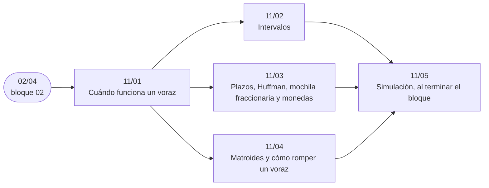

# Bloque 11 — Voraces

> Cuándo funciona un algoritmo voraz y cómo se demuestra: la elección voraz y la subestructura óptima, el
> argumento de intercambio, los problemas de intervalos, los plazos, Huffman, la mochila fraccionaria y las monedas,
> y cómo encontrar el contraejemplo que rompe un voraz que parecía obvio.
>
> Las respuestas de las preguntas y las pistas 2 y 3 de los problemas, en [`06` — Respuestas](06-respuestas.md).
>
> **Vigencia:** 2026-10-04.

---

## 🧭 Índice

| Capítulo | Niveles | Ruta corta |
|---|---|---|
| [`11/01` — Cuándo funciona un voraz](01-cuando-funciona-un-voraz.md) | elección voraz y subestructura óptima [A] · argumento de intercambio [A] · «el voraz se adelanta» [A] |  |
| [`11/02` — Intervalos](02-intervalos.md) | selección de actividades [A] · cubrimiento con puntos [A] · mezcla [A] · mínimo de salas [A] | sí |
| [`11/03` — Plazos, Huffman, mochila fraccionaria y monedas](03-plazos-huffman-y-monedas.md) | planificación con plazos [A] · Huffman [A] · mochila fraccionaria [A] · monedas canónicas [A] |  |
| [`11/04` — Matroides y cómo romper un voraz](04-matroides-y-contraejemplos.md) | matroides [C] · contraejemplos [A] |  |
| [`11/05` — Simulación](05-simulacion.md) | El examen del bloque: preguntas transversales y problemas cronometrados | |
| [`11/06` — Respuestas](06-respuestas.md) | Las preguntas en tres capas y las pistas 2 y 3 | |

---

## 🧭 Orden de lectura

- `11/01` primero: su argumento de intercambio es el que justifican los otros tres. `11/02` es el de entrevista.

---

## 🔎 Mapa de señales del bloque

| Señal | Técnica | Capítulo |
|---|---|---|
| «En qué orden», «programa las tareas», coste que depende del instante de fin | Intercambio de vecinos | [`11/01`](01-cuando-funciona-un-voraz.md) |
| «Mínimo número de paradas / saltos / segmentos para cubrir» | El voraz se adelanta | [`11/01`](01-cuando-funciona-un-voraz.md) |
| «El mayor número de reuniones / tareas sin solaparse» | Selección por final | [`11/02`](02-intervalos.md) |
| «Cuántos hay que quitar para que no se solapen» | `n −` selección por final | [`11/02`](02-intervalos.md) |
| «Cada tarea dura un día», «plazo», «beneficio si a tiempo» | Plazos con montículo | [`11/03`](03-plazos-huffman-y-monedas.md) |
| «Unir montones / cuerdas / ficheros pagando la suma» | Huffman | [`11/03`](03-plazos-huffman-y-monedas.md) |
| «Subconjunto de peso máximo» sin ciclos, independiente, que cabe en plazos | Voraz sobre una matroide | [`11/04`](04-matroides-y-contraejemplos.md) |
| Las soluciones maximales pueden tener tamaños distintos | Sospecha del voraz | [`11/04`](04-matroides-y-contraejemplos.md) |

---

## 📚 Lectura troncal del bloque

La de cada capítulo, que es también la primera entrada de su «Para profundizar»:

- **`11/01`** — Kleinberg y Tardos, *Algorithm Design* (Addison-Wesley, 2005), cap. 4; Brassard y Bratley, *Fundamentos de algoritmia* (Prentice Hall, 1997), cap. 6; Cormen, Leiserson, Rivest y Stein, *Introduction to Algorithms*, 3.ª ed. (MIT Press, 2009), cap. 16.
- **`11/02`** — Kleinberg y Tardos, *Algorithm Design* (Addison-Wesley, 2005), §4.1; Cormen, Leiserson, Rivest y Stein, *Introduction to Algorithms*, 3.ª ed. (MIT Press, 2009), §16.1.
- **`11/03`** — Brassard y Bratley, *Fundamentos de algoritmia* (Prentice Hall, 1997), cap. 6; Cormen, Leiserson, Rivest y Stein, *Introduction to Algorithms*, 3.ª ed. (MIT Press, 2009), §16.3; Kleinberg y Tardos, *Algorithm Design* (Addison-Wesley, 2005), cap. 4.
- **`11/04`** — Cormen, Leiserson, Rivest y Stein, *Introduction to Algorithms*, 3.ª ed. (MIT Press, 2009), §16.4; Brassard y Bratley, *Fundamentos de algoritmia* (Prentice Hall, 1997), cap. 6.

---

## 🧭 Qué NO está aquí

- **Dijkstra, Prim y Kruskal**, voraces sobre grafos: en el [bloque `15`](../15-grafos-pesos-y-flujos/README.md).
- **La DP**, cuando el voraz no tiene argumento: en el [bloque `12`](../12-dp-clasica/README.md).
- **La demostración por intercambio en general**: en [`02/04` — Corrección: invariante de bucle, inducción y argumento de intercambio](../02-analisis/04-correccion-invariantes-induccion-intercambio.md).

---

**Anterior:** [Bloque 10 — Búsqueda completa y divide y vencerás](../10-busqueda-completa-y-divide-y-venceras/README.md) ·
**Siguiente:** [Bloque 12 — DP clásica](../12-dp-clasica/README.md) ·
**Inicio:** [README del corpus](../README.md)
