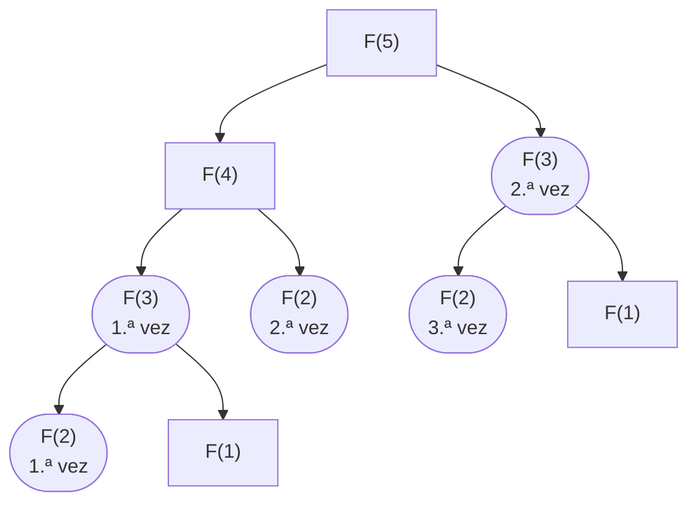
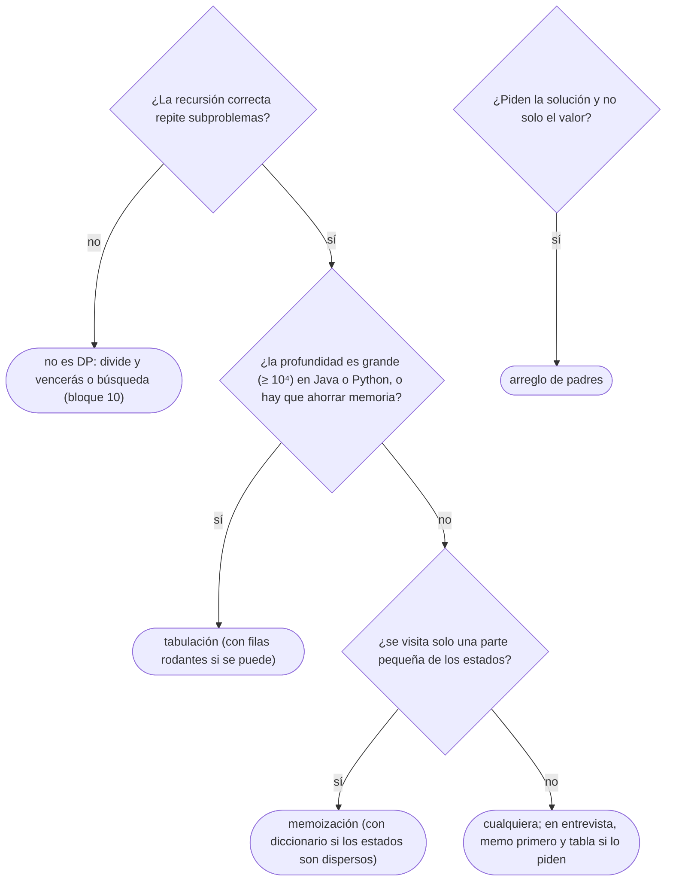

# 01 — De la recursión a la tabla

> Cómo se convierte una recursión exponencial en una programación dinámica: el estado, la transición, el
> caso base, el orden de cálculo y la memoria; la memoización (de arriba abajo), la tabulación (de abajo
> arriba) y la reconstrucción de la solución, no solo de su valor. Es el dueño de la DP en el corpus.
>
> **Niveles:** memoización [A] · tabulación [A] · reconstrucción [A].
>
> **📚 Lectura troncal:** Brassard y Bratley, *Fundamentos de algoritmia* (Prentice Hall, 1997), cap. 8;
> Erickson, *Algorithms* (2019, libre del autor), cap. 3; Cormen, Leiserson, Rivest y Stein,
> *Introduction to Algorithms*, 3.ª ed. (MIT Press, 2009), cap. 15.
>
> **Ruta corta:** sí.
>
> **Vigencia:** 2026-10-04.

**Salto rápido:** [1](#1--el-problema) · [2](#2--la-teoría) · [3](#3--memoización) · [4](#4--tabulación) · [5](#5--reconstrucción) · [6](#6-️-la-tabla-de-costes) · [7](#7--cómo-se-elige) · [8](#8--señales-del-enunciado) · [🧠](#-preguntas) · [🧩](#-problemas-propios)

---

## 1. 🎯 El problema

Fibonacci escrito como su definición, `F(n) = F(n − 1) + F(n − 2)`, es correcto y es exponencial: para
`n = 40` hace **331 160 281** llamadas. El motivo se ve en el árbol de llamadas: `F(38)` se calcula dos
veces, `F(37)` tres, `F(36)` cinco… y solo hay **41 valores distintos** que calcular.



La programación dinámica (DP) es la idea de **calcular cada subproblema una sola vez**. Hay dos formas de
hacerlo —guardar los resultados en la recursión (memoización) o rellenar una tabla en orden (tabulación)—,
y en las dos lo que hay que diseñar es lo mismo: **qué es un subproblema** (el estado), **cómo se combina**
(la transición), **dónde se para** (los casos base) y **en qué orden** se calcula.

> 🧠 **Modelo mental.** Una DP es una recursión correcta más una tabla. Primero se escribe la recursión y
> se prueba por inducción, como en [`10/01`](../10-busqueda-completa-y-divide-y-venceras/01-recursion.md); después se ve que los subproblemas se repiten, y se guardan.

Lo que se asume, en una línea: una recursión correcta tiene caso base y una medida que baja, se prueba por
inducción, y su pila es su profundidad.

---

## 2. 📐 La teoría

**Las dos propiedades.** Un problema se resuelve con DP cuando tiene:

- **Subestructura óptima**: la solución óptima se construye con soluciones óptimas de subproblemas. (La
  comparte con los voraces de `11/01`, que además saben qué subproblema elegir sin probarlos todos.)
- **Subproblemas solapados**: la recursión vuelve una y otra vez a los mismos subproblemas. Sin solape, la
  DP no ahorra nada y es divide y vencerás ([`10/05`](../10-busqueda-completa-y-divide-y-venceras/05-divide-y-venceras.md)).

**Principio de optimalidad de Bellman.** Una política óptima tiene la propiedad de que, sean cuales sean
el estado y la decisión iniciales, las decisiones restantes forman una política óptima para el estado que
resulta de la primera decisión. Dicho para programar: **el estado tiene que contener todo lo que el futuro
necesita saber del pasado**. Si dos caminos llegan al mismo estado y el mejor futuro depende de por cuál
llegaste, el estado está mal elegido.

**Las cinco piezas de una DP:**

```text
estado       → qué identifica a un subproblema           dp[i] = formas de llegar al escalón i
transición   → cómo se calcula a partir de otros          dp[i] = dp[i−1] + dp[i−2] + dp[i−3]
casos base   → los que no dependen de nadie               dp[0] = 1
orden        → uno en que las dependencias ya estén       i creciente
respuesta    → qué estado (o combinación) se devuelve     dp[n]
```

**El coste.** Si cada estado se calcula una vez:

```text
tiempo  = (número de estados) × (coste de la transición)
memoria = (número de estados que hay que guardar a la vez)
```

Fibonacci: `n + 1` estados × `O(1)` = `Θ(n)`; y como cada estado solo usa los dos anteriores, la memoria
baja a `O(1)`. La corrección es la de la recursión, por inducción sobre el orden de cálculo: cuando se
calcula un estado, todos los que usa ya son correctos.

---

## 3. 🧱 Memoización

**Qué es.** La recursión original con una tabla (`memo`) donde cada llamada mira primero si su resultado
ya está calculado; si no, lo calcula, lo guarda y lo devuelve. Es DP **de arriba abajo**: solo se calculan
los estados que la recursión visita.

**Por qué es correcto.** Devuelve lo mismo que la recursión sin memo, porque una función pura (sin efectos y
dependiente solo de sus argumentos) da siempre el mismo valor para el mismo estado: guardarlo no cambia
nada salvo el coste.

**Cómo va**, `F(5)` con memo: la rama izquierda baja `F(5) → F(4) → F(3) → F(2) → F(1), F(0)`, rellena
`memo[2..5]` al volver, y todas las demás llamadas (`F(3)` desde `F(5)`, `F(2)` desde `F(4)`) encuentran el
valor guardado. Son `2n − 1 = 9` llamadas en lugar de 15, y para `n = 40`, 79 en lugar de 331 millones.

**Cuánto.** Estados × transición, como toda DP; además, la **pila** de la recursión llega a la profundidad
máxima de la cadena de dependencias, que en una DP lineal es `n`.

**La plantilla**, las formas de subir `n` escalones con pasos de 1, 2 o 3:

```cpp
#include <vector>

const long long MOD = 1'000'000'007;

// Formas de llegar al escalón i con pasos de 1, 2 o 3. memo[i] = −1 si no se ha calculado.
long long ways(int i, std::vector<long long>& memo) {
    if (i < 0) return 0;                                  // se pasó: ninguna forma
    if (i == 0) return 1;                                 // caso base: ya está arriba
    if (memo[i] != -1) return memo[i];                    // ¿calculado?
    return memo[i] = (ways(i - 1, memo) + ways(i - 2, memo) + ways(i - 3, memo)) % MOD;
}
// std::vector<long long> memo(n + 1, -1); ways(n, memo);
```

```java
static final long MOD = 1_000_000_007L;

// Formas de llegar al escalón i con pasos de 1, 2 o 3. memo[i] = −1 si no se ha calculado.
static long ways(int i, long[] memo) {
    if (i < 0) return 0;
    if (i == 0) return 1;
    if (memo[i] != -1) return memo[i];
    return memo[i] = (ways(i - 1, memo) + ways(i - 2, memo) + ways(i - 3, memo)) % MOD;
}
// long[] memo = new long[n + 1]; Arrays.fill(memo, -1); ways(n, memo);
```

```python
from functools import cache

MOD = 1_000_000_007

@cache
def ways(i):
    """Formas de llegar al escalón i con pasos de 1, 2 o 3."""
    if i < 0:
        return 0
    if i == 0:
        return 1
    return (ways(i - 1) + ways(i - 2) + ways(i - 3)) % MOD
```

- **El centinela** `−1` marca «no calculado»: tiene que ser un valor que la función nunca devuelva. Con
  respuestas que pueden ser cualquier entero, un arreglo `boolean` aparte.
- **`return memo[i] = …`** guarda y devuelve en una línea; olvidar guardar deja la recursión exponencial y
  da TLE con la respuesta correcta.
- **En Python**, `@cache` hace la tabla sola; pero su envoltorio está en C, y una recursión de profundidad
  `n = 10⁵` revienta la pila de C aunque se suba el límite ([`10/01`](../10-busqueda-completa-y-divide-y-venceras/01-recursion.md)). Para profundidades grandes, tabulación.
- **El módulo** en cada suma: los valores crecen como `1,84ⁿ` y desbordan 64 bits hacia `n = 70`.

### De la versión ingenua a la buena

**El problema.** Las formas de subir `n ≤ 10⁵` escalones con pasos de 1, 2 o 3, sin pisar ciertos escalones
rotos, módulo `10⁹ + 7`. Con `n = 6` y el escalón 3 roto, son 8.

**La versión ingenua:**

```java
// Correcta por inducción sobre i. Exponencial: unas 1,84ⁿ llamadas.
static long waysNaive(int i, boolean[] broken) {
    if (i < 0) return 0;
    if (i == 0) return 1;
    if (broken[i]) return 0;                              // no se puede pisar
    return waysNaive(i - 1, broken) + waysNaive(i - 2, broken) + waysNaive(i - 3, broken);
}
```

> «Es correcta, pero `waysNaive(i − 3)` se calcula desde `i − 1`, desde `i − 2` y desde `i`: los mismos
> subproblemas una y otra vez. Solo hay `n + 1` estados distintos; guardando cada uno la primera vez, el
> coste baja a `Θ(n)`.»

**El camino a la buena.** La plantilla con un arreglo `memo` y la línea `if (broken[i]) return 0;`. Con
`n = 10⁵` en Java hace falta el hilo con pila grande de `10/01`, o pasar a la tabulación de §4.

**Cuándo sí**: cuando la recursión es fácil de escribir y solo se visita una parte pequeña de los estados
posibles (estados dispersos, en un diccionario); y como primer paso en una entrevista. **Cuándo no**: con
profundidades de recursión grandes en Java o Python, o cuando hace falta reducir memoria con filas
rodantes, que la memoización no permite.

> **Veredicto:** memoizar es añadir tres líneas a una recursión correcta. Es la forma más rápida de pasar
> de exponencial a polinomial, y su límite es la pila.

---

## 4. 🧱 Tabulación

**Qué es.** Rellenar la tabla de estados **en un orden** en que, al calcular cada estado, todos los que usa
ya están calculados. Es DP **de abajo arriba**, sin recursión.

**Por qué es correcto.** Inducción sobre el orden: los casos base son correctos por definición, y si todos
los estados anteriores en el orden son correctos, la transición calcula bien el actual. El orden es un
**orden topológico** del grafo de dependencias entre estados ([`14/04`](../14-grafos-recorridos/04-orden-topologico.md)).

**Cómo va**, las formas de subir con el escalón 3 roto:

```text
i        0   1   2   3   4   5   6
roto                 ✕
dp[i]    1   1   2   0   3   5   8       dp[4] = dp[3] + dp[2] + dp[1] = 0 + 2 + 1
```

**Cuánto.** El mismo tiempo que la memoización, sin pila y con mejor constante (un bucle en lugar de
llamadas). Si cada estado solo depende de los `k` anteriores, la memoria baja a `O(k)` guardando solo esos
(«filas rodantes»).

**La plantilla:**

```cpp
#include <vector>

// Formas de subir n escalones con pasos de 1, 2 o 3, sin pisar los rotos. Θ(n) tiempo y memoria.
long long waysTable(int n, const std::vector<bool>& broken) {
    const long long MOD = 1'000'000'007;
    std::vector<long long> dp(n + 1, 0);
    dp[0] = 1;                                            // caso base
    for (int i = 1; i <= n; i++) {
        if (broken[i]) continue;                          // dp[i] queda en 0
        for (int step = 1; step <= 3 && step <= i; step++) dp[i] = (dp[i] + dp[i - step]) % MOD;
    }
    return dp[n];
}
```

```java
// Formas de subir n escalones con pasos de 1, 2 o 3, sin pisar los rotos. Θ(n) tiempo y memoria.
static long waysTable(int n, boolean[] broken) {
    final long MOD = 1_000_000_007L;
    long[] dp = new long[n + 1];
    dp[0] = 1;
    for (int i = 1; i <= n; i++) {
        if (broken[i]) continue;
        for (int step = 1; step <= 3 && step <= i; step++) dp[i] = (dp[i] + dp[i - step]) % MOD;
    }
    return dp[n];
}
```

```python
def ways_table(n, broken):
    """Formas de subir n escalones con pasos de 1, 2 o 3, sin pisar los rotos. Θ(n)."""
    MOD = 1_000_000_007
    dp = [0] * (n + 1)
    dp[0] = 1
    for i in range(1, n + 1):
        if not broken[i]:
            dp[i] = sum(dp[i - s] for s in (1, 2, 3) if s <= i) % MOD
    return dp[n]
```

- **El orden** es `i` creciente porque `dp[i]` solo mira hacia atrás. En otras DP el orden es menos obvio
  (por longitud de intervalo en [`12/05`](05-rejillas-e-intervalos.md)), y escribirlo mal lee valores sin calcular.
- **`step <= i`** sustituye al «si se pasó, 0» de la memoización: el índice no puede ser negativo.
- **Filas rodantes**: como solo se usan los tres anteriores, bastan tres variables; aquí se deja la tabla
  porque la reconstrucción de §5 la necesita.

### De la versión ingenua a la buena

**El problema.** Llevar el número 1 hasta `n ≤ 10⁶` con el menor número de operaciones `+1`, `×2` o `×3`.

**La versión ingenua**, un voraz que «parece obvio»: desde `n` hacia atrás, dividir entre 3 si se puede,
si no entre 2, si no restar 1.

```java
// falla: con n = 10 da 10 → 5 → 4 → 2 → 1, 4 operaciones; el óptimo es 1 → 3 → 9 → 10, 3.
static int greedyOps(int n) {
    int ops = 0;
    while (n > 1) {
        if (n % 3 == 0) n /= 3; else if (n % 2 == 0) n /= 2; else n--;
        ops++;
    }
    return ops;
}
```

> «El voraz falla con 10, así que pruebo las tres opciones desde cada número: `ops(x) = 1 + min(ops(x − 1),
> ops(x / 2), ops(x / 3))` cuando se puede dividir. Recursiva y memoizada tendría profundidad `10⁶`; como
> cada `x` solo depende de números menores, relleno la tabla de 1 a `n`.»

**El camino a la buena.** `dp[1] = 0` y, para `x` de 2 a `n`, `dp[x] = dp[x − 1] + 1`, mejorado con
`dp[x / 2] + 1` y `dp[x / 3] + 1` si `x` es divisible. `Θ(n)` sin pila. Con `n = 100` son 7 operaciones.

**Cuándo sí**: siempre que el orden de los estados sea fácil, la tabla quepa y se vayan a visitar casi
todos; cuando hay que ahorrar memoria con filas rodantes; con profundidades grandes. **Cuándo no**: si solo
se visita una fracción mínima de los estados (por ejemplo, `n` hasta `10¹⁸` con transiciones que dividen),
donde la memoización con diccionario solo toca los estados alcanzables.

> **Veredicto:** tabular es memoizar sin pila: el mismo estado, la misma transición, y un bucle en el
> orden correcto. Es la forma que se envía en Java y Python cuando la profundidad es grande.

---

## 5. 🧱 Reconstrucción

**Qué es.** Recuperar **la solución** (las decisiones), no solo su valor. Se guarda, para cada estado, qué
decisión dio el óptimo (un **padre**), y al final se sigue esa cadena desde la respuesta hasta un caso base.

**Por qué es correcto.** Si `dp[x]` es óptimo y `padre[x]` es la decisión que lo alcanzó, la solución de
`x` es la de `padre[x]` más esa decisión; por inducción sobre el orden, la cadena reconstruida tiene el
coste `dp[x]` y es válida.

**Cómo va**, las operaciones para `n = 10`:

```text
x        1   2   3   4   5   6   7   8   9   10
dp[x]    0   1   1   2   3   2   3   3   2   3
padre    —   1   1   3   4   3   6   4   3   9
desde 10: 10 ← 9 ← 3 ← 1    →    1 → 3 → 9 → 10
```

**Cuánto.** Un arreglo de padres del mismo tamaño que la tabla, y `O(longitud de la solución)` para
recorrerlo. Si se usaron filas rodantes para el valor, hay que guardar las decisiones aparte, o recalcular
hacia atrás.

**La plantilla**, las operaciones con su secuencia:

```cpp
#include <algorithm>
#include <vector>

// Menor número de operaciones +1, ×2, ×3 de 1 a n, y la secuencia. Θ(n).
std::vector<int> opsPath(int n) {
    std::vector<int> dp(n + 1, 0), parent(n + 1, 0);
    for (int x = 2; x <= n; x++) {
        dp[x] = dp[x - 1] + 1; parent[x] = x - 1;
        if (x % 2 == 0 && dp[x / 2] + 1 < dp[x]) { dp[x] = dp[x / 2] + 1; parent[x] = x / 2; }
        if (x % 3 == 0 && dp[x / 3] + 1 < dp[x]) { dp[x] = dp[x / 3] + 1; parent[x] = x / 3; }
    }
    std::vector<int> path;
    for (int x = n; x != 1; x = parent[x]) path.push_back(x);  // se sigue la cadena de padres
    path.push_back(1);
    std::reverse(path.begin(), path.end());
    return path;                                               // dp[n] = path.size() − 1
}
```

```java
import java.util.ArrayList;
import java.util.Collections;
import java.util.List;

// Menor número de operaciones +1, ×2, ×3 de 1 a n, y la secuencia. Θ(n).
static List<Integer> opsPath(int n) {
    int[] dp = new int[n + 1], parent = new int[n + 1];
    for (int x = 2; x <= n; x++) {
        dp[x] = dp[x - 1] + 1; parent[x] = x - 1;
        if (x % 2 == 0 && dp[x / 2] + 1 < dp[x]) { dp[x] = dp[x / 2] + 1; parent[x] = x / 2; }
        if (x % 3 == 0 && dp[x / 3] + 1 < dp[x]) { dp[x] = dp[x / 3] + 1; parent[x] = x / 3; }
    }
    List<Integer> path = new ArrayList<>();
    for (int x = n; x != 1; x = parent[x]) path.add(x);
    path.add(1);
    Collections.reverse(path);
    return path;
}
```

```python
def ops_path(n):
    """Menor número de operaciones +1, ×2, ×3 de 1 a n, y la secuencia. Θ(n)."""
    dp, parent = [0] * (n + 1), [0] * (n + 1)
    for x in range(2, n + 1):
        dp[x], parent[x] = dp[x - 1] + 1, x - 1
        for d in (2, 3):
            if x % d == 0 and dp[x // d] + 1 < dp[x]:
                dp[x], parent[x] = dp[x // d] + 1, x // d
    path, x = [], n
    while x != 1:
        path.append(x)                                   # se sigue la cadena de padres
        x = parent[x]
    path.append(1)
    return path[::-1]
```

- **El padre se actualiza a la vez que el valor**, con la misma comparación estricta: así los empates se
  resuelven siempre igual, y la reconstrucción es reproducible.
- **La cadena va de la respuesta hacia atrás**: se invierte al final.
- **Para reconstruir la lexicográficamente menor** entre las óptimas, el truco es calcular la DP «hacia
  atrás» (el mejor desde cada estado hasta el final) y reconstruir hacia delante eligiendo la menor
  decisión que conserva el óptimo.

### De la versión ingenua a la buena

**El problema.** Además del número de operaciones, imprimir la secuencia, con `n = 10⁶`.

**La versión ingenua**: guardar en cada estado **la lista entera** de números que lleva hasta él
(`List<Integer>[] best`), copiándola y añadiendo `x` al mejorar.

> «Cada estado copia una lista de hasta `log n` elementos en el mejor caso, pero en el peor —una cadena de
> `+1`— la lista mide `x`, y copiar en cada estado es `Θ(n²)` de tiempo y memoria. No necesito guardar la
> solución en cada estado: me basta con la última decisión, porque el resto es la solución del estado
> padre, que ya está guardada de la misma forma.»

**El camino a la buena.** Un arreglo `parent` y el recorrido final, como en la plantilla: `Θ(n)` de memoria
extra.

**Cuándo sí**: siempre que se pida la solución además del valor: «imprime el camino», «qué objetos»,
«la subsecuencia». **Cuándo no**: si solo se pide el valor, el arreglo de padres sobra y puede impedir
reducir memoria.

> **Veredicto:** reconstruir es guardar la última decisión de cada estado y seguir la cadena de padres
> desde la respuesta. Nunca se guarda la solución entera en cada estado.

---

## 6. ⏱️ La tabla de costes

| Forma | Tiempo | Memoria | Lo que la tabla no dice |
|---|---|---|---|
| Recursión sin memo | Exponencial (tamaño del árbol) | Pila = profundidad | Correcta y lenta: el oráculo del *stress test* |
| Memoización | Estados visitados × transición | Tabla + pila | Solo toca los estados alcanzables; la pila es su límite |
| Tabulación | Estados × transición | Tabla, o filas rodantes | Sin pila; hay que conocer un orden válido |
| Reconstrucción | `+ O(longitud de la solución)` | `+` arreglo de padres | Impide las filas rodantes si se guarda todo |

---

## 7. 🧭 Cómo se elige



> **Regla de entrevista:** di las cinco piezas antes de teclear: «el estado es `dp[i]` = …, la transición
> es …, el caso base …, el orden es `i` creciente, la respuesta es `dp[n]`; son `n` estados por `O(1)`».

---

## 8. 🔎 Señales del enunciado

| Señal | Técnica | Por qué |
|---|---|---|
| «De cuántas formas», «el mínimo / máximo», con decisiones que se repiten | DP | Subproblemas solapados |
| La recursión natural tiene dos o más llamadas sobre argumentos que se repiten | Memoización | El árbol tiene pocos estados distintos |
| `n` hasta `10⁶` con dependencias hacia atrás | Tabulación | La pila no aguanta la memo |
| «Imprime la secuencia / los elementos / el camino» | Reconstrucción | Padres |
| El voraz natural falla en un ejemplo pequeño | DP | Hay que probar todas las decisiones de cada estado |

---

## ⚠️ Errores frecuentes

| Se dice | Lo preciso |
|---|---|
| «DP es memorizar» | DP es elegir estado y transición; memorizar es una forma de no repetirlos |
| «La memoización siempre es más lenta» | Puede ser más rápida si solo visita una fracción de los estados |
| «Con memo ya no hay problema de pila» | La profundidad sigue siendo la de la recursión: `n` en una DP lineal |
| «Guardo en cada estado la solución completa» | Basta la última decisión: la reconstrucción sigue los padres |
| «El estado es lo que me pregunta el enunciado» | El estado es lo que el futuro necesita del pasado (Bellman); a veces hay que añadir información |
| «El orden de la tabla da igual» | Tiene que respetar las dependencias; uno mal puesto lee ceros sin calcular |

---

## 📚 Para profundizar

- **Libro** — Brassard y Bratley, *Fundamentos de algoritmia* (Prentice Hall, 1997), cap. 8: el principio
  de optimalidad y los ejemplos clásicos de programación dinámica. *Lectura troncal.*
- **Libro** — Erickson, *Algorithms* (2019, libre del autor), cap. 3 «Dynamic Programming»: de la
  recursión a la tabla, con la receta paso a paso. *Lectura troncal.*
- **Libro** — Cormen, Leiserson, Rivest y Stein, *Introduction to Algorithms*, 3.ª ed. (MIT Press, 2009),
  cap. 15, §15.3: los elementos de la programación dinámica y la reconstrucción. *Lectura troncal.*
- **Documentación** — Python, [`functools.cache`](https://docs.python.org/3/library/functools.html#functools.cache).
- **Referencia** — cp-algorithms, [*Introduction to Dynamic Programming*](https://cp-algorithms.com/dynamic_programming/intro-to-dp.html).
- **Referencia** — USACO Guide, [*Introduction to DP*](https://usaco.guide/gold/intro-dp).
- **Video** — MIT OpenCourseWare, *6.006 Introduction to Algorithms*, las clases de programación dinámica
  (el método SRTBOT).

---

## 🧠 Preguntas

1. ¿Qué dos propiedades necesita un problema para resolverse con DP? 🟢
2. ¿Qué cinco piezas tiene una DP? 🟢
3. ¿Cuántas llamadas hace el Fibonacci recursivo para `n = 40`, y cuántas con memoización? 🟢
4. ¿Qué dice el principio de optimalidad de Bellman, dicho para programar? 🟢
5. ¿En qué se diferencian memoización y tabulación, y qué tienen en común? 🟡
6. ¿Cuándo la memoización es más rápida que la tabulación? 🟡
7. Compara cómo memoizas en C++, Java y Python, y qué límite de pila tiene cada uno. 🟡
8. ¿Por qué el voraz «divide entre 3 si puedes, si no entre 2, si no resta 1» falla, y qué DP lo resuelve? 🟠
9. Demuestra por inducción que la tabulación calcula bien todos los estados. 🟠
10. ¿Por qué guardar la solución completa en cada estado es mala idea, y qué guardas en su lugar? 🟠
11. ¿Qué es un orden válido de cálculo y qué tiene que ver con el orden topológico? 🟠
12. Tu DP con memo da TLE con la respuesta correcta en los ejemplos. ¿Qué tres cosas miras? 🔴
13. Diseña la reconstrucción de la secuencia lexicográficamente menor entre todas las óptimas de un problema de DP lineal. 🔴

---

## 🧩 Problemas propios

### Baldosas de 2 × n

**Nivel:** 🟢 · **Formato:** programa completo.

Un pasillo de 2 × `n` se cubre con baldosas de 2 × 1 (que pueden ponerse de pie o tumbadas) y de 2 × 2. ¿De
cuántas formas? Imprime el resultado módulo `10⁹ + 7`.

- **Entrada.** Una línea con `n`.
- **Salida.** Un entero.
- **Restricciones.** `1 ≤ n ≤ 10⁶`.

```text
Entrada     Salida
1           1

Entrada     Salida
3           5

Entrada     Salida
4           11
```

**Pista 1:** ¿qué puede haber en la última columna del pasillo, y qué queda a su izquierda en cada caso?

### Saltos de la rana

**Nivel:** 🟡 · **Formato:** programa completo.

Hay `n` piedras con alturas `h₁, …, hₙ`. Una rana empieza en la primera y quiere llegar a la última; desde
la piedra `i` puede saltar a cualquiera de las `k` siguientes, y saltar de `i` a `j` cuesta `|hᵢ − hⱼ|`.
Imprime el coste mínimo.

- **Entrada.** Una línea con `n` y `k`. Una línea con las alturas.
- **Salida.** Un entero.
- **Restricciones.** `1 ≤ n ≤ 10⁵`; `1 ≤ k ≤ 100`; `1 ≤ hᵢ ≤ 10⁹`.

```text
Entrada            Salida
6 2                9
5 2 9 1 5 6

Entrada            Salida
6 3                7
5 2 9 1 5 6
```

**Pista 1:** si conoces el coste mínimo para llegar a cada una de las `k` piedras anteriores a la `i`, ¿qué
te falta para la `i`?

### Partir en palabras

**Nivel:** 🟠 · **Formato:** programa completo.

Un texto sin espacios se quiere partir en palabras de un diccionario usando el menor número de palabras.
Imprime ese número y la partición; si hay varias óptimas, la que tenga la primera palabra más corta, y si
empatan, la segunda más corta, y así. Si no se puede, imprime `-1`.

- **Entrada.** Una línea con el texto. Una línea con `m`. Después, `m` líneas con una palabra.
- **Salida.** El número y, en la línea siguiente, las palabras separadas por espacios; o `-1`.
- **Restricciones.** Texto de hasta `5 000` letras minúsculas; `1 ≤ m ≤ 1 000`; palabras de hasta 50
  letras.

```text
Entrada     Salida
abcab       2
7           ab cab
a
ab
abc
b
bc
c
cab

Entrada     Salida
ccc         2
2           c cc
c
cc
```

**Pista 1:** si supieras, para cada posición, cuántas palabras hacen falta como mínimo **hasta el final**,
¿cómo elegirías la primera palabra?

---

## 🧩 Práctica externa

> 💡 **Truco.** Con una DP atascada, pídele a una IA que critique **tu estado y tu transición** («¿falta
> información en el estado?», «¿qué caso base me falta?»), no la recurrencia resuelta. Escribir el estado
> es el ejercicio ([`01/06`](../01-oficio-del-competidor/06-protocolo-de-resolucion.md)).

### Núcleo

| ✔ | Problema | Plataforma | Nivel | Patrón | Pista 1 |
|---|---|---|---|---|---|
| [ ] | [Climbing Stairs](https://leetcode.com/problems/climbing-stairs/) | LeetCode | 🟢 | DP lineal | ¿Desde qué escalones se llega al `n`? |
| [ ] | [Min Cost Climbing Stairs](https://leetcode.com/problems/min-cost-climbing-stairs/) | LeetCode | 🟢 | DP lineal de mínimo | ¿Qué te cuesta como mínimo estar en el escalón `i`? |
| [ ] | [Ladder](https://app.codility.com/programmers/lessons/13-fibonacci_numbers/ladder/) | Codility | 🟡 | Tabla de Fibonacci con módulo potencia de 2 | ¿Hasta qué `L` hace falta la tabla, y qué módulo basta para todos? |
| [ ] | [FibFrog](https://app.codility.com/programmers/lessons/13-fibonacci_numbers/fib_frog/) | Codility | 🟡 | DP sobre posiciones | ¿Cuántos números de Fibonacci menores que `10⁵` hay? |
| [ ] | [Decode Ways](https://leetcode.com/problems/decode-ways/) | LeetCode | 🟡 | DP lineal con casos | ¿Cuándo un `0` no se puede leer solo? |
| [ ] | [Word Break](https://leetcode.com/problems/word-break/) | LeetCode | 🟡 | DP sobre prefijos | Si el prefijo hasta `i` se puede partir, ¿qué hace falta para el prefijo hasta `j`? |
| [ ] | [Perfect Squares](https://leetcode.com/problems/perfect-squares/) | LeetCode | 🟡 | DP de mínimo | ¿Qué cuadrado es el último de la suma? |

### Ampliación

| ✔ | Problema | Plataforma | Nivel | Patrón | Pista 1 |
|---|---|---|---|---|---|
| [ ] | [Dice Combinations](https://cses.fi/problemset/task/1633) | CSES | 🟢 | DP de conteo | ¿Cuál fue la última tirada? |
| [ ] | [Removing Digits](https://cses.fi/problemset/task/1637) | CSES | 🟢 | DP de mínimo | ¿A qué números se puede pasar desde `n`? |
| [ ] | [Fibonacci Modified](https://www.hackerrank.com/challenges/fibonacci-modified/problem) | HackerRank | 🟡 | Tabulación con enteros grandes | ¿Cuántas cifras tiene el término 20, y qué tipo hace falta? |

---

## ✅ Criterio de dominio

- Escribir la memoización y la tabulación de una DP lineal en los tres lenguajes sin mirar, con el
  arreglo de padres, en menos de diez minutos.
- Decir las cinco piezas de una DP antes de escribirla, y su coste como estados × transición.
- Explicar por qué una memoización puede dar RE en Java y Python y cómo se arregla.
- Resolver Decode Ways y Word Break sin pista 2.

---

**Anterior:** — · **Siguiente:** [`12/02` — DP lineal y LIS](02-dp-lineal-y-lis.md) · **Relacionado:**
[`10/01` — Recursión](../10-busqueda-completa-y-divide-y-venceras/01-recursion.md); [`11/01` — Cuándo funciona un voraz](../11-voraces/01-cuando-funciona-un-voraz.md).
