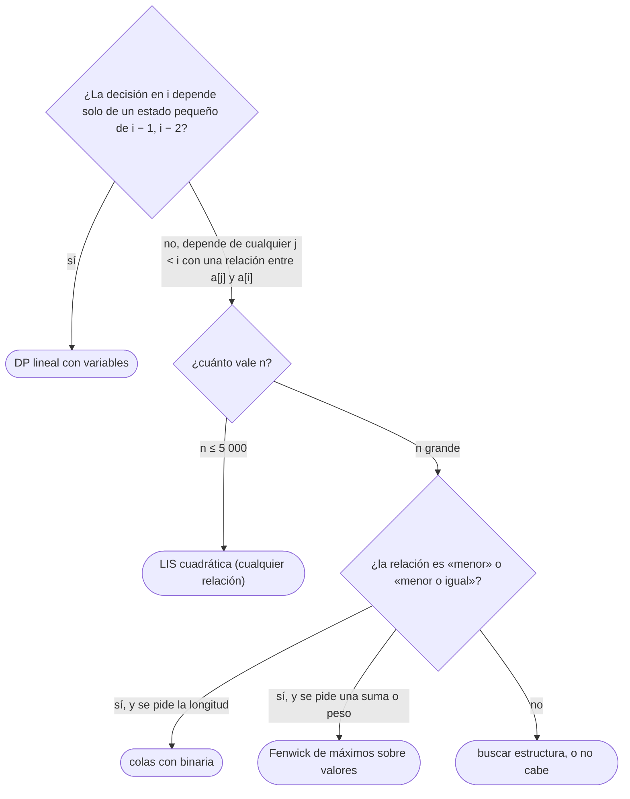

# 02 — DP lineal y LIS

> Las DP de una dimensión —un estado por posición, a veces con un pequeño estado extra— y la subsecuencia
> creciente más larga (LIS) en sus dos versiones: la cuadrática, fácil de adaptar, y la de `O(n log n)`
> con el arreglo de «colas» y búsqueda binaria, con el invariante que la hace correcta y la reconstrucción.
>
> **Niveles:** escaleras y robos [A] · LIS O(n²) [A] · LIS O(n log n) [A].
>
> **📚 Lectura troncal:** Cormen, Leiserson, Rivest y Stein, *Introduction to Algorithms*, 3.ª ed. (MIT
> Press, 2009), cap. 15 (problemas 15-4 y siguientes); Skiena, *The Algorithm Design Manual*, 3.ª ed.
> (Springer, 2020), cap. 10.
>
> **Asume leído:** [`12/01` — De la recursión a la tabla](01-de-la-recursion-a-la-tabla.md).
>
> **Ruta corta:** sí.
>
> **Vigencia:** 2026-10-04.

**Salto rápido:** [1](#1--el-problema) · [2](#2--la-teoría) · [3](#3--escaleras-y-robos) · [4](#4--lis-en-on) · [5](#5--lis-en-on-log-n) · [6](#6-️-la-tabla-de-costes) · [7](#7--cómo-se-elige) · [8](#8--señales-del-enunciado) · [🧠](#-preguntas) · [🧩](#-problemas-propios)

---

## 1. 🎯 El problema

Con el arreglo de juguete `[5, 2, 9, 1, 5, 6]` se pueden hacer dos preguntas que parecen parecidas:

```text
¿la mayor suma sin coger dos vecinos?            → 20 (5 + 9 + 6)       DP lineal: 2 estados por posición
¿la subsecuencia estrictamente creciente más larga? → 3 (2, 5, 6)         LIS
```

Las dos se resuelven con un estado por posición. La primera mira solo una o dos posiciones atrás: `Θ(n)`.
La segunda, tal cual, mira **todas** las anteriores: `Θ(n²)`, que con `n = 2·10⁵` son `4·10¹⁰`
operaciones. La versión de `O(n log n)` no cambia el estado: cambia **qué se guarda** —para cada longitud,
el menor final posible— y eso permite buscar con una binaria.

Lo que se asume de [`12/01`](01-de-la-recursion-a-la-tabla.md): una DP es estado, transición, casos base, orden y respuesta, y cuesta estados por
transición; la reconstrucción sigue un arreglo de padres.

> ⚠️ **Advertencia.** La LIS de `O(n log n)` tiene la trampa más citada de la DP: el arreglo de colas que
> deja **no es** una subsecuencia creciente. Su **longitud** es la de la LIS; su contenido, no. Para la
> subsecuencia hay que guardar padres.

---

## 2. 📐 La teoría

**DP lineal.** El estado es una posición `i` (el prefijo `a[0..i]`), a veces con un estado pequeño extra
(«tengo acción o no», «cogí el anterior o no»). La transición mira un número fijo de posiciones atrás, y el
coste es `Θ(n · estados extra)`. Kadane (`04/03`) es una DP lineal: `mejor[i]` = la mejor suma de un
subarreglo que acaba en `i`, con `mejor[i] = a[i] + max(0, mejor[i − 1])`.

**LIS cuadrática.** `d[i]` = la longitud de la LIS que **acaba en `i`**. Toda subsecuencia creciente que
acaba en `i` es una que acaba en algún `j < i` con `a[j] < a[i]`, más `a[i]`:

```text
d[i] = 1 + max{ d[j] : j < i, a[j] < a[i] }     (1 si no hay ninguno)
LIS = max d[i]
```

**Teorema (el invariante de las colas).** Sea `tails[k]` el **menor valor final** de una subsecuencia
estrictamente creciente de longitud `k + 1` entre los elementos procesados. Entonces `tails` es
**estrictamente creciente**, y al procesar `x`:

- si `x` es mayor que todos, extiende la LIS: se añade al final;
- si no, sea `k` el primer índice con `tails[k] ≥ x`: `x` mejora el final de longitud `k + 1`
  (`tails[k] = x`), y ninguna otra entrada cambia.

*Por qué es creciente:* si hay una subsecuencia de longitud `k + 2` que acaba en `v`, su prefijo de
longitud `k + 1` acaba en algo menor que `v`, así que `tails[k] < tails[k + 1]`. *Por qué solo cambia
`tails[k]`:* `x` puede extender una subsecuencia de longitud `k` (que acaba en `tails[k − 1] < x`), pero no
una de longitud `k + 1` (que acaba en `tails[k] ≥ x`). La longitud final de `tails` es la longitud de la
LIS. Como `tails` es creciente, el índice `k` se encuentra con una **búsqueda binaria** (*lower bound*,
[`05/04`](../05-orden-y-busqueda/04-busqueda-binaria.md)).

---

## 3. 🧱 Escaleras y robos

**Qué es.** La familia de DP con un estado por posición y transiciones a un número fijo de posiciones
anteriores: escaleras (formas de subir), robos (no coger dos vecinos), Kadane, y las «máquinas de estados»
con un par de estados por día (comprar, vender, esperar).

**Por qué es correcto.** Por inducción sobre la posición, con la subestructura de cada problema. En el robo:
la mejor suma en el prefijo hasta `i` o **coge** `a[i]` (y entonces no coge `a[i − 1]`) o **no** la coge;
las dos opciones cubren todos los casos.

**Cómo va**, el robo sobre `[5, 2, 9, 1, 5, 6]` con dos estados: `coge` (la mejor suma que coge `a[i]`) y
`deja` (la mejor que no):

```text
i       0    1    2    3    4    5
a[i]    5    2    9    1    5    6
coge    5    2    14   6    19   20       coge[i] = deja[i−1] + a[i]
deja    0    5    5    14   14   19       deja[i] = max(coge[i−1], deja[i−1])
respuesta: max(20, 19) = 20  (5 + 9 + 6)
```

**Cuánto.** `Θ(n)` tiempo y `O(1)` memoria: cada estado solo usa los del paso anterior.

**La plantilla**, la mayor suma sin vecinos con dos variables:

```cpp
#include <algorithm>
#include <vector>

// Mayor suma de elementos sin coger dos consecutivos. Θ(n), O(1) memoria.
long long maxNonAdjacent(const std::vector<long long>& a) {
    long long take = 0, skip = 0;                  // mejores sumas hasta el anterior
    for (long long x : a) {
        long long newTake = skip + x;              // coger x obliga a no haber cogido el anterior
        skip = std::max(skip, take);
        take = newTake;
    }
    return std::max(take, skip);
}
```

```java
// Mayor suma de elementos sin coger dos consecutivos. Θ(n), O(1) memoria.
static long maxNonAdjacent(long[] a) {
    long take = 0, skip = 0;
    for (long x : a) {
        long newTake = skip + x;
        skip = Math.max(skip, take);
        take = newTake;
    }
    return Math.max(take, skip);
}
```

```python
def max_non_adjacent(a):
    """Mayor suma de elementos sin coger dos consecutivos. Θ(n), O(1) memoria."""
    take = skip = 0
    for x in a:
        take, skip = skip + x, max(take, skip)       # asignación simultánea
    return max(take, skip)
```

- **`newTake`** con la variable temporal en C++ y Java: si se actualizara `take` antes de calcular `skip`,
  se leería el valor nuevo. En Python, la asignación simultánea evalúa los dos lados antes de asignar.
- **Con valores negativos**, `max(take, skip)` con `skip = 0` inicial permite no coger nada; si el enunciado
  exige coger al menos uno, se inicializa distinto.
- **Kadane** es esta misma forma con un solo estado: `best = x + max(0, best)`.

### De la versión ingenua a la buena

**El problema.** Comprar y vender una acción con los precios de cada día, con una comisión `f` por cada
venta, sin tener más de una acción a la vez. Con precios `[5, 2, 9, 1, 5, 6]` y `f = 2`, el beneficio
máximo es 8 (comprar a 2 y vender a 9; comprar a 1 y vender a 6).

**La versión ingenua:**

```java
// Correcta: en cada día, prueba comprar/vender/esperar según si tienes acción. Θ(2ⁿ).
static long best(int[] p, int day, boolean holding, int fee) {
    if (day == p.length) return 0;
    long wait = best(p, day + 1, holding, fee);
    long act = holding ? p[day] - fee + best(p, day + 1, false, fee)    // vender
                       : -p[day] + best(p, day + 1, true, fee);         // comprar
    return Math.max(wait, act);
}
```

> «Es correcta y exponencial, pero el futuro solo depende del día y de si tengo la acción: `2n` estados.
> Recorro los días con dos variables: `cash`, lo mejor sin acción, y `hold`, lo mejor con ella.»

**El camino a la buena.** `hold = −p[0]`, `cash = 0`; para cada día, `cash = max(cash, hold + p − f)` y
`hold = max(hold, cash_anterior − p)`. `Θ(n)` y `O(1)`.

**Cuándo sí**: «el mejor resultado hasta la posición `i`» cuando la decisión en `i` solo depende de un
estado pequeño del pasado (el anterior, si tengo algo, cuántos llevo). **Cuándo no**: si la decisión
depende de **cualquier** elemento anterior (como en la LIS), el estado por posición necesita mirar atrás
entero, y hace falta otra estructura.

> **Veredicto:** en una DP lineal, el diseño está en el estado extra: «¿qué necesito saber del día
> anterior?». Con dos o tres variables, `Θ(n)` y `O(1)`.

---

## 4. 🧱 LIS en O(n²)

**Qué es.** La subsecuencia (no necesariamente contigua) estrictamente creciente más larga, con
`d[i]` = la LIS que acaba en `i`.

**Por qué es correcto.** La recurrencia de §2 cubre todas las subsecuencias que acaban en `i`: la penúltima
posición, si existe, es un `j < i` con `a[j] < a[i]`, y lo mejor que acaba en `j` es `d[j]` por hipótesis
de inducción.

**Cómo va**, sobre `[5, 2, 9, 1, 5, 6]`:

```text
i        0   1   2   3   4   5
a[i]     5   2   9   1   5   6
d[i]     1   1   2   1   2   3       d[5] = 1 + d[4] (5 < 6)
padre    —   —   0   —   1   4
reconstrucción desde i = 5: 6 ← 5 ← 2   →   2, 5, 6
```

**Cuánto.** `n(n − 1)/2` comparaciones: `Θ(n²)`. Con `n = 5 000`, `1,25·10⁷`, cómodo; con `n = 2·10⁵`, no.

**La plantilla**, con la reconstrucción:

```cpp
#include <algorithm>
#include <vector>

// Una LIS estrictamente creciente, por índices. Θ(n²).
std::vector<int> lisQuadratic(const std::vector<long long>& a) {
    int n = (int)a.size(), best = -1;
    std::vector<int> d(n, 1), parent(n, -1);
    for (int i = 0; i < n; i++) {
        for (int j = 0; j < i; j++)
            if (a[j] < a[i] && d[j] + 1 > d[i]) { d[i] = d[j] + 1; parent[i] = j; }
        if (best < 0 || d[i] > d[best]) best = i;
    }
    std::vector<int> seq;
    for (int i = best; i != -1; i = parent[i]) seq.push_back(i);
    std::reverse(seq.begin(), seq.end());
    return seq;
}
```

```java
import java.util.ArrayList;
import java.util.Collections;
import java.util.List;

// Una LIS estrictamente creciente, por índices. Θ(n²).
static List<Integer> lisQuadratic(long[] a) {
    int n = a.length, best = -1;
    int[] d = new int[n], parent = new int[n];
    for (int i = 0; i < n; i++) {
        d[i] = 1; parent[i] = -1;
        for (int j = 0; j < i; j++)
            if (a[j] < a[i] && d[j] + 1 > d[i]) { d[i] = d[j] + 1; parent[i] = j; }
        if (best < 0 || d[i] > d[best]) best = i;
    }
    List<Integer> seq = new ArrayList<>();
    for (int i = best; i != -1; i = parent[i]) seq.add(i);
    Collections.reverse(seq);
    return seq;
}
```

```python
def lis_quadratic(a):
    """Una LIS estrictamente creciente, por índices. Θ(n²)."""
    n = len(a)
    d, parent = [1] * n, [-1] * n
    for i in range(n):
        for j in range(i):
            if a[j] < a[i] and d[j] + 1 > d[i]:
                d[i], parent[i] = d[j] + 1, j
    i = max(range(n), key=d.__getitem__) if n else -1
    seq = []
    while i != -1:
        seq.append(i)
        i = parent[i]
    return seq[::-1]
```

- **`a[j] < a[i]`** da la estrictamente creciente; con `<=`, la no decreciente.
- **La respuesta no es `d[n − 1]`**: la LIS puede acabar en cualquier posición, por eso se toma el máximo.
- **La forma cuadrática se adapta a todo**: cambiar `<` por «cabe dentro de», «divide a», «es predecesor
  de», o `d[j] + 1` por `d[j] + a[i]` (suma máxima), sin tocar la estructura.

### De la versión ingenua a la buena

**El problema.** La subsecuencia estrictamente creciente de **suma** máxima. Con `[5, 2, 9, 1, 5, 6]`, es
`5 + 9 = 14`.

**La versión ingenua:** todos los subconjuntos de posiciones, comprobando que son crecientes: `Θ(2ⁿ · n)`.

```java
// Correcta: cada máscara es una subsecuencia; se queda con la creciente de mayor suma. Θ(2ⁿ · n).
static long maxIncreasingSumNaive(long[] a) {
    long best = 0;
    for (int mask = 1; mask < (1 << a.length); mask++) {
        long last = Long.MIN_VALUE, sum = 0; boolean ok = true;
        for (int i = 0; i < a.length && ok; i++)
            if ((mask >> i & 1) == 1) { ok = a[i] > last; last = a[i]; sum += a[i]; }
        if (ok) best = Math.max(best, sum);
    }
    return best;
}
```

> «Es la LIS con otra medida: en lugar de la longitud de la mejor que acaba en `i`, su suma. La recurrencia
> es la misma con `s[j] + a[i]` en lugar de `d[j] + 1`.»

**El camino a la buena.** `s[i] = a[i] + max{s[j] : j < i, a[j] < a[i]}` (o `a[i]` solo), y la respuesta es
el máximo de `s`. `Θ(n²)`; con un Fenwick de máximos sobre los valores comprimidos, `Θ(n log n)` ([`09/02`](../09-consultas-sobre-rangos/02-fenwick.md)).

**Cuándo sí**: `n ≤ 5 000` y cualquier variante de «subsecuencia más larga / mejor con una relación entre
consecutivos». **Cuándo no**: `n ≥ 10⁵` con la relación «menor que», donde la versión de §5 es la que cabe.

> **Veredicto:** la LIS cuadrática es la plantilla de las subsecuencias con una relación entre elementos.
> Se adapta cambiando una comparación o una suma.

---

## 5. 🧱 LIS en O(n log n)

**Qué es.** La longitud de la LIS con el arreglo `tails` del teorema de §2: para cada longitud, el menor
final posible. Con un arreglo de índices y padres, también la subsecuencia.

**Por qué es correcto.** Por el invariante de las colas de §2: `tails` es estrictamente creciente, y su
longitud es la de la LIS.

**Cómo va**, sobre `[5, 2, 9, 1, 5, 6]`:

```text
x    primera posición con tails[k] ≥ x    tails tras procesar x
5    0 (vacío)                             [5]
2    0                                     [2]          un final menor para longitud 1
9    1 (al final)                          [2, 9]
1    0                                     [1, 9]       ¡no es una subsecuencia: el 1 va después del 9!
5    1                                     [1, 5]
6    2 (al final)                          [1, 5, 6]    longitud 3
```

La fila del 1 muestra la trampa: `[1, 9]` no es una subsecuencia del arreglo. `tails` dice cuál es el mejor
final **para cada longitud por separado**, no una subsecuencia.

**Cuánto.** Una búsqueda binaria por elemento: `Θ(n log n)`. Memoria `Θ(n)`.

**La plantilla**, con la reconstrucción por índices:

```cpp
#include <algorithm>
#include <vector>

// Una LIS estrictamente creciente, por índices. Θ(n log n).
std::vector<int> lisFast(const std::vector<long long>& a) {
    int n = (int)a.size();
    std::vector<long long> tails;                  // tails[k]: menor final de longitud k + 1
    std::vector<int> tailIdx, parent(n, -1);       // índice de ese final y padres
    for (int i = 0; i < n; i++) {
        int k = std::lower_bound(tails.begin(), tails.end(), a[i]) - tails.begin();  // estricta
        if (k == (int)tails.size()) { tails.push_back(a[i]); tailIdx.push_back(i); }
        else { tails[k] = a[i]; tailIdx[k] = i; }
        if (k > 0) parent[i] = tailIdx[k - 1];     // el final de longitud k que extiende
    }
    std::vector<int> seq;
    for (int i = tailIdx.empty() ? -1 : tailIdx.back(); i != -1; i = parent[i]) seq.push_back(i);
    std::reverse(seq.begin(), seq.end());
    return seq;
}
```

```java
import java.util.ArrayList;
import java.util.Collections;
import java.util.List;

// Una LIS estrictamente creciente, por índices. Θ(n log n).
static List<Integer> lisFast(long[] a) {
    int n = a.length, len = 0;
    long[] tails = new long[n];
    int[] tailIdx = new int[n], parent = new int[n];
    for (int i = 0; i < n; i++) {
        int lo = 0, hi = len;                      // lower bound de a[i] en tails[0..len)
        while (lo < hi) { int mid = (lo + hi) >>> 1; if (tails[mid] < a[i]) lo = mid + 1; else hi = mid; }
        tails[lo] = a[i]; tailIdx[lo] = i;
        parent[i] = lo > 0 ? tailIdx[lo - 1] : -1;
        if (lo == len) len++;
    }
    List<Integer> seq = new ArrayList<>();
    for (int i = len > 0 ? tailIdx[len - 1] : -1; i != -1; i = parent[i]) seq.add(i);
    Collections.reverse(seq);
    return seq;
}
```

```python
from bisect import bisect_left

def lis_fast(a):
    """Una LIS estrictamente creciente, por índices. Θ(n log n)."""
    tails, tail_idx, parent = [], [], [-1] * len(a)
    for i, x in enumerate(a):
        k = bisect_left(tails, x)                  # estricta; bisect_right para no decreciente
        if k == len(tails):
            tails.append(x)
            tail_idx.append(i)
        else:
            tails[k], tail_idx[k] = x, i
        if k > 0:
            parent[i] = tail_idx[k - 1]
    seq, i = [], tail_idx[-1] if tail_idx else -1
    while i != -1:
        seq.append(i)
        i = parent[i]
    return seq[::-1]
```

- **`lower_bound` (`bisect_left`)** da la estrictamente creciente: un valor igual **sustituye**. Con
  `upper_bound` (`bisect_right`), un igual **extiende**: la no decreciente.
- **El padre** se fija en el momento de insertar: el final de longitud `k` que había entonces. Por eso hace
  falta `tailIdx`, no `tails`.
- **En Java** no hay `lower_bound` sobre un prefijo de arreglo; la binaria se escribe a mano sobre
  `[0, len)` (con `Arrays.binarySearch` habría que corregir su retorno negativo y su elección entre iguales).

### De la versión ingenua a la buena

**El problema.** La subsecuencia **no decreciente** más larga de `n = 2·10⁵` valores. Con
`[3, 1, 2, 2, 5, 2, 6]`, mide 5 (`1, 2, 2, 2, 6`); la estrictamente creciente, 4.

**La versión ingenua**, la cuadrática de §4 con `<=`:

```java
// Correcta: Θ(n²) = 4·10¹⁰ con n = 2·10⁵.
static int longestNonDecreasing(long[] a) {
    int[] d = new int[a.length]; int best = 0;
    for (int i = 0; i < a.length; i++) {
        d[i] = 1;
        for (int j = 0; j < i; j++) if (a[j] <= a[i]) d[i] = Math.max(d[i], d[j] + 1);
        best = Math.max(best, d[i]);
    }
    return best;
}
```

> «La relación es "menor o igual", que es un orden: sirve el arreglo de los menores finales por longitud,
> que se mantiene creciente. Cambiando la búsqueda a *upper bound*, un valor igual extiende en lugar de
> sustituir. `n log n`.»

**El camino a la buena.** `lisFast` con `upper_bound` en lugar de `lower_bound`.

**Cuándo sí**: `n ≥ 10⁴` con la relación «menor que» o «menor o igual» sobre valores comparables; también
para LIS en dos dimensiones ordenando por una y buscando por la otra (Russian Doll Envelopes). **Cuándo
no**: con relaciones que no son un orden total («divide a», «es subcadena de»), donde vuelve la cuadrática.

> **Veredicto:** la LIS rápida guarda el menor final por longitud y busca con una binaria. Su arreglo no es
> la LIS; con índices y padres sí se reconstruye.

---

## 6. ⏱️ La tabla de costes

| Técnica | Tiempo | Memoria | Lo que la tabla no dice |
|---|---|---|---|
| DP lineal con estado pequeño | `Θ(n · estados)` | `O(estados)` con variables | El diseño está en el estado extra |
| LIS cuadrática | `Θ(n²)` | `Θ(n)` | Se adapta a cualquier relación entre consecutivos |
| LIS con colas y binaria | `Θ(n log n)` | `Θ(n)` | Solo para órdenes; `tails` no es la LIS |
| LIS con Fenwick sobre valores | `Θ(n log n)` | `Θ(n)` | Admite sumas o pesos en lugar de longitudes (`09/02`) |

---

## 7. 🧭 Cómo se elige



> **Regla de entrevista:** para la LIS, primero la cuadrática con su recurrencia en voz alta; después,
> «se puede en `n log n` guardando el menor final por longitud, que es creciente». Y si preguntan si ese
> arreglo es la LIS: «no; con `[5, 2, 9, 1]` queda `[1, 9]`».

---

## 8. 🔎 Señales del enunciado

| Señal | Técnica | Por qué |
|---|---|---|
| «No puedes coger dos seguidos», «enfriamiento», «comisión», estados por día | DP lineal con estados | El futuro depende de un estado pequeño |
| «Subsecuencia creciente más larga», «cadena más larga» | LIS | Recurrencia sobre el último elemento |
| «Sobres», «cajas», «personas en torre» con dos dimensiones | LIS tras ordenar por una dimensión | Se reduce a una dimensión |
| «Mínimo número de subsecuencias decrecientes que cubren» | Longitud de la LIS | Teorema de Dilworth |
| `n ≤ 2·10⁵` y subsecuencia creciente | `n log n` | La cuadrática no cabe |

---

## ⚠️ Errores frecuentes

| Se dice | Lo preciso |
|---|---|
| «El arreglo de colas es la LIS» | Su longitud sí; su contenido puede no ser ni una subsecuencia (`[1, 9]` en el ejemplo) |
| «La respuesta de la LIS es `d[n − 1]`» | Es el máximo de `d[i]`: puede acabar en cualquier posición |
| «`lower_bound` o `upper_bound`, da igual» | `lower` da la estricta; `upper`, la no decreciente |
| «En el robo, la respuesta es `coge` del último» | Es el máximo de `coge` y `deja` |
| «Actualizo las dos variables una tras otra» | Hay que usar el valor anterior: variable temporal o asignación simultánea |
| «Kadane no es DP» | Es la DP lineal con un estado por posición (`04/03`) |

---

## 📚 Para profundizar

- **Libro** — Cormen, Leiserson, Rivest y Stein, *Introduction to Algorithms*, 3.ª ed. (MIT Press, 2009),
  cap. 15, ejercicios 15.4-5 y 15.4-6: la LIS en `O(n²)` y en `O(n log n)`. *Lectura troncal.*
- **Libro** — Skiena, *The Algorithm Design Manual*, 3.ª ed. (Springer, 2020), cap. 10: DP sobre
  secuencias. *Lectura troncal.*
- **Libro** — Erickson, *Algorithms* (2019, libre del autor), cap. 3: la LIS como ejemplo de diseño del
  estado.
- **Referencia** — cp-algorithms, [*Longest increasing subsequence*](https://cp-algorithms.com/sequences/longest_increasing_subsequence.html).
- **Referencia** — USACO Guide, [*Longest Increasing Subsequence*](https://usaco.guide/gold/lis).

---

## 🧠 Preguntas

1. ¿Qué es `d[i]` en la LIS cuadrática, y por qué la respuesta es su máximo? 🟢
2. ¿Qué guarda `tails[k]` en la LIS de `O(n log n)`? 🟢
3. ¿Qué dos estados lleva el robo de casas, y cuál es su transición? 🟢
4. ¿Por qué el arreglo `tails` no es la LIS? Da un ejemplo. 🟡
5. ¿Qué cambia entre la LIS estricta y la no decreciente en la versión rápida? 🟡
6. ¿Por qué hace falta una variable temporal al actualizar las dos variables del robo? 🟡
7. Compara cómo haces el *lower bound* de la LIS rápida en C++, Java y Python. 🟡
8. Demuestra que `tails` es estrictamente creciente. 🟠
9. ¿Por qué al procesar `x` solo cambia una entrada de `tails`? 🟠
10. ¿Cómo reconstruyes la LIS en la versión rápida, y por qué hace falta `tailIdx`? 🟠
11. ¿Cuándo usas la cuadrática aunque `n` permita la rápida? 🟠
12. Da una entrada en la que la LIS cuadrática escrita con `<=` en lugar de `<` da más que la estrictamente creciente, y explica qué cuenta de más. 🔴
13. Diseña una DP lineal para comprar y vender una acción con, como mucho, dos compras en total: estados y transiciones. 🔴

---

## 🧩 Problemas propios

### Turnos de guardia

**Nivel:** 🟢 · **Formato:** programa completo.

Un médico puede hacer guardias en `n` noches seguidas; la noche `i` paga `pᵢ`. No puede hacer **tres**
noches seguidas. Imprime el pago máximo.

- **Entrada.** Una línea con `n`. Una línea con los pagos.
- **Salida.** Un entero.
- **Restricciones.** `1 ≤ n ≤ 2·10⁵`; `0 ≤ pᵢ ≤ 10⁹`.

```text
Entrada            Salida
6                  25
5 2 9 1 5 6

Entrada            Salida
3                  2
1 1 1
```

**Pista 1:** ¿qué necesitas saber de las noches anteriores para decidir si trabajas esta?

### Pila de libros

**Nivel:** 🟡 · **Formato:** programa completo.

Cada libro tiene ancho y alto. Un libro se puede poner encima de otro si es **estrictamente** más estrecho
**y** más bajo. ¿Cuántos libros, como máximo, forman una pila?

- **Entrada.** Una línea con `n`. Después, `n` líneas con `ancho alto`.
- **Salida.** Un entero.
- **Restricciones.** `1 ≤ n ≤ 2·10⁵`; `1 ≤ ancho, alto ≤ 10⁹`.

```text
Entrada     Salida
5           3
5 4
6 4
6 7
2 3
5 5

Entrada     Salida
3           1
2 2
2 3
2 4
```

**Pista 1:** si ordenas por ancho, ¿qué tienes que hacer con los libros del mismo ancho para que no se
apilen entre sí?

### Mínimo de pistas de despegue

**Nivel:** 🟠 · **Formato:** programa completo.

Llegan `n` aviones en orden, cada uno con su peso. En cada pista, los aviones tienen que despegar en orden
de llegada y con peso **estrictamente decreciente**. ¿Cuántas pistas hacen falta como mínimo?

- **Entrada.** Una línea con `n`. Una línea con los pesos.
- **Salida.** Un entero.
- **Restricciones.** `1 ≤ n ≤ 2·10⁵`; `1 ≤ peso ≤ 10⁹`.

```text
Entrada            Salida
6                  3
5 2 9 1 5 6

Entrada            Salida
3                  1
9 5 2
```

**Pista 1:** dos aviones en orden creciente de peso, ¿pueden ir en la misma pista?

---

## 🧩 Práctica externa

Codility no tiene problemas de LIS; el de su lección de DP está en [`12/03`](03-mochilas.md).

### Núcleo

| ✔ | Problema | Plataforma | Nivel | Patrón | Pista 1 |
|---|---|---|---|---|---|
| [ ] | [The Maximum Subarray](https://www.hackerrank.com/challenges/maxsubarray/problem) | HackerRank | 🟡 | DP lineal (subarreglo y subsecuencia) | ¿Qué cambia entre lo contiguo y lo no contiguo? |
| [ ] | [Longest Increasing Subsequence](https://leetcode.com/problems/longest-increasing-subsequence/) | LeetCode | 🟡 | LIS | ¿Cuál es el menor final posible de una subsecuencia de cada longitud? |
| [ ] | [Maximum Sum Circular Subarray](https://leetcode.com/problems/maximum-sum-circular-subarray/) | LeetCode | 🟡 | DP lineal en círculo | Si el mejor subarreglo da la vuelta, ¿qué parte del arreglo **no** coge? |
| [ ] | [Best Time to Buy and Sell Stock with Cooldown](https://leetcode.com/problems/best-time-to-buy-and-sell-stock-with-cooldown/) | LeetCode | 🟡 | Máquina de estados por día | ¿En cuántos estados puedes estar al final de cada día? |
| [ ] | [Number of Longest Increasing Subsequence](https://leetcode.com/problems/number-of-longest-increasing-subsequence/) | LeetCode | 🟡 | LIS cuadrática con conteo | Además de la longitud, ¿qué tienes que guardar de las que acaban en `i`? |
| [ ] | [Largest Divisible Subset](https://leetcode.com/problems/largest-divisible-subset/) | LeetCode | 🟡 | LIS cuadrática con otra relación | Si ordenas, ¿qué relación tiene que haber solo entre consecutivos? |

### Ampliación

| ✔ | Problema | Plataforma | Nivel | Patrón | Pista 1 |
|---|---|---|---|---|---|
| [ ] | [Increasing Subsequence](https://cses.fi/problemset/task/1145) | CSES | 🟡 | LIS en `n log n` | Con `n = 2·10⁵`, ¿cabe mirar todos los anteriores? |
| [ ] | [Longest String Chain](https://leetcode.com/problems/longest-string-chain/) | LeetCode | 🟡 | LIS sobre palabras ordenadas por longitud | ¿De qué palabras puede venir una palabra en la cadena? |
| [ ] | [Wiggle Subsequence](https://leetcode.com/problems/wiggle-subsequence/) | LeetCode | 🟡 | DP lineal con dos estados | ¿Basta saber la mejor que acaba subiendo y la que acaba bajando? |
| [ ] | [Russian Doll Envelopes](https://leetcode.com/problems/russian-doll-envelopes/) | LeetCode | 🟠 | LIS en dos dimensiones | Si dos sobres tienen el mismo ancho, ¿en qué orden conviene ponerlos? |

---

## ✅ Criterio de dominio

- Escribir la LIS rápida con reconstrucción sin mirar, en menos de diez minutos, y explicar el invariante
  de las colas.
- Dar el ejemplo en que `tails` no es una subsecuencia.
- Diseñar el estado de una DP lineal de «máquina de estados» por día.
- Resolver Best Time to Buy and Sell Stock with Cooldown y Largest Divisible Subset sin pista 2.

---

**Anterior:** [`12/01` — De la recursión a la tabla](01-de-la-recursion-a-la-tabla.md) · **Siguiente:** [`12/03` — Mochilas](03-mochilas.md) ·
**Relacionado:** [`04/03` — Kadane y subarreglos](../04-secuencias/03-kadane-y-subarreglos.md); [`05/04` — Búsqueda binaria](../05-orden-y-busqueda/04-busqueda-binaria.md).
