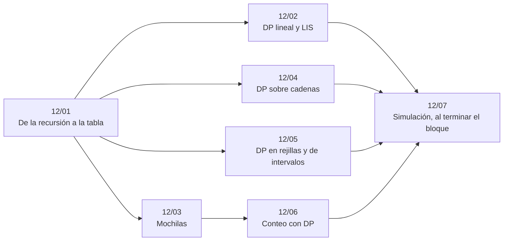

# Bloque 12 — DP clásica

> La programación dinámica de siempre: pasar de la recursión a la tabla, la DP lineal y la LIS, las
> mochilas, la DP sobre cadenas (LCS, edición, palíndromos), rejillas e intervalos, y el conteo. Es el bloque con
> más ejemplos trabajados del corpus, porque la DP es lo que más se pide escribir en vivo.
>
> Las respuestas de las preguntas y las pistas 2 y 3 de los problemas, en [`08` — Respuestas](08-respuestas.md).
>
> **Vigencia:** 2026-10-04.

---

## 🧭 Índice

| Capítulo | Niveles | Ruta corta |
|---|---|---|
| [`12/01` — De la recursión a la tabla](01-de-la-recursion-a-la-tabla.md) | memoización [A] · tabulación [A] · reconstrucción [A] | sí |
| [`12/02` — DP lineal y LIS](02-dp-lineal-y-lis.md) | escaleras y robos [A] · LIS O(n²) [A] · LIS O(n log n) [A] | sí |
| [`12/03` — Mochilas](03-mochilas.md) | 0/1 [A] · ilimitada [A] · acotada con división binaria [B] · monedas: contar y mínimo [A] · una fila de memoria [A] | sí |
| [`12/04` — DP sobre cadenas](04-dp-sobre-cadenas.md) | LCS [A] · distancia de edición [A] · subsecuencias y palíndromos [A] |  |
| [`12/05` — DP en rejillas y de intervalos](05-rejillas-e-intervalos.md) | rejillas [A] · intervalos: cadena de matrices [B] · *burst balloons* [B] |  |
| [`12/06` — Conteo con DP](06-conteo.md) | conteo [A] · particiones [B] |  |
| [`12/07` — Simulación](07-simulacion.md) | El examen del bloque: preguntas transversales y problemas cronometrados | |
| [`12/08` — Respuestas](08-respuestas.md) | Las preguntas en tres capas y las pistas 2 y 3 | |

---

## 🧭 Orden de lectura

- `12/01` es prerrequisito de todos; después, en cualquier orden. `12/06` usa la mochila de `12/03`.

---

## 🔎 Mapa de señales del bloque

| Señal | Técnica | Capítulo |
|---|---|---|
| «De cuántas formas», «el mínimo / máximo», con decisiones que se repiten | DP | [`12/01`](01-de-la-recursion-a-la-tabla.md) |
| La recursión natural tiene dos o más llamadas sobre argumentos que se repiten | Memoización | [`12/01`](01-de-la-recursion-a-la-tabla.md) |
| «No puedes coger dos seguidos», «enfriamiento», «comisión», estados por día | DP lineal con estados | [`12/02`](02-dp-lineal-y-lis.md) |
| «Subsecuencia creciente más larga», «cadena más larga» | LIS | [`12/02`](02-dp-lineal-y-lis.md) |
| «Presupuesto», «capacidad», «elige un subconjunto», `W ≤ 10⁵` | Mochila 0/1 | [`12/03`](03-mochilas.md) |
| «¿Se puede repartir en dos de igual suma?» | 0/1 de booleanos hasta `Σ/2` | [`12/03`](03-mochilas.md) |
| «Subsecuencia común», «borrar lo mínimo para que coincidan» | LCS | [`12/04`](04-dp-sobre-cadenas.md) |
| «Mínimo de operaciones para transformar una cadena en otra» | Distancia de edición | [`12/04`](04-dp-sobre-cadenas.md) |
| Rejilla, «solo derecha y abajo», «contar caminos», obstáculos | DP de rejilla | [`12/05`](05-rejillas-e-intervalos.md) |
| «El mayor cuadrado / rectángulo de…» en una matriz | DP de rejilla con mínimo de vecinos | [`12/05`](05-rejillas-e-intervalos.md) |
| «De cuántas formas», «módulo `10⁹ + 7`» | DP de conteo | [`12/06`](06-conteo.md) |
| «Palabras / sucesiones de longitud `n` con reglas entre vecinos» | Estado = la última letra (o las últimas) | [`12/06`](06-conteo.md) |

---

## 📚 Lectura troncal del bloque

La de cada capítulo, que es también la primera entrada de su «Para profundizar»:

- **`12/01`** — Brassard y Bratley, *Fundamentos de algoritmia* (Prentice Hall, 1997), cap. 8; Erickson, *Algorithms* (2019, libre del autor), cap. 3; Cormen, Leiserson, Rivest y Stein, *Introduction to Algorithms*, 3.ª ed. (MIT Press, 2009), cap. 15.
- **`12/02`** — Cormen, Leiserson, Rivest y Stein, *Introduction to Algorithms*, 3.ª ed. (MIT Press, 2009), cap. 15 (problemas 15-4 y siguientes); Skiena, *The Algorithm Design Manual*, 3.ª ed. (Springer, 2020), cap. 10.
- **`12/03`** — Brassard y Bratley, *Fundamentos de algoritmia* (Prentice Hall, 1997), cap. 8; Kleinberg y Tardos, *Algorithm Design* (Addison-Wesley, 2005), §6.4.
- **`12/04`** — Cormen, Leiserson, Rivest y Stein, *Introduction to Algorithms*, 3.ª ed. (MIT Press, 2009), §15.4; Kleinberg y Tardos, *Algorithm Design* (Addison-Wesley, 2005), §6.6.
- **`12/05`** — Cormen, Leiserson, Rivest y Stein, *Introduction to Algorithms*, 3.ª ed. (MIT Press, 2009), §15.2; Brassard y Bratley, *Fundamentos de algoritmia* (Prentice Hall, 1997), cap. 8.
- **`12/06`** — Graham, Knuth y Patashnik, *Concrete Mathematics*, 2.ª ed. (Addison-Wesley, 1994), cap. 7; Laaksonen, *Guide to Competitive Programming*, 3.ª ed. (Springer, 2024), cap. 6.

---

## 🧭 Qué NO está aquí

- **La DP sobre máscaras, dígitos, árboles y con optimizaciones**: en el [bloque `13`](../13-dp-avanzada/README.md).
- **La recursión y la memoización como técnica**: en [`10/01` — Recursión](../10-busqueda-completa-y-divide-y-venceras/01-recursion.md).
- **La combinatoria con fórmulas cerradas**: en [`17/05` — Combinatoria](../17-matematica/05-combinatoria.md).

---

**Anterior:** [Bloque 11 — Voraces](../11-voraces/README.md) ·
**Siguiente:** [Bloque 13 — DP avanzada](../13-dp-avanzada/README.md) ·
**Inicio:** [README del corpus](../README.md)
