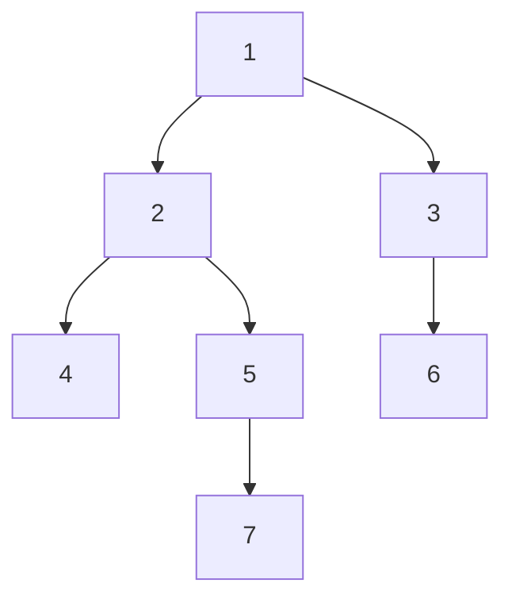

# 03 — DP en árboles y en DAG

> La programación dinámica cuyos estados son los nodos de un árbol (calculados de las hojas a la raíz) o
> de un grafo dirigido acíclico (calculados en orden topológico). El conjunto independiente máximo en un
> árbol, contar y optimizar caminos en un DAG, y el *rerooting* visto como una segunda pasada de la misma
> DP.
>
> **Niveles:** DP en árboles [A] · DP sobre DAG [A] · *rerooting* como DP [B].
>
> **📚 Lectura troncal:** Kleinberg y Tardos, *Algorithm Design* (Addison-Wesley, 2005), §10.2 (conjunto
> independiente en árboles); Laaksonen, *Guide to Competitive Programming*, 3.ª ed. (Springer, 2024),
> cap. 10.
>
> **Vigencia:** 2026-10-04.

**Salto rápido:** [1](#1--el-problema) · [2](#2--la-teoría) · [3](#3--dp-en-árboles) · [4](#4--dp-sobre-dag) · [5](#5--rerooting-como-dp) · [6](#6-️-la-tabla-de-costes) · [7](#7--señales-del-enunciado) · [🧠](#-preguntas) · [🧩](#-problemas-propios)

---

## 1. 🎯 El problema

En una empresa, nadie quiere ir a una fiesta con su jefe directo. ¿Cuántas personas, como máximo, se
pueden invitar? En un grafo cualquiera es el conjunto independiente máximo, NP-difícil ([`10/05`](../10-busqueda-completa-y-divide-y-venceras/05-divide-y-venceras.md)). En un
**árbol** —la jerarquía— es lineal: cada persona o va o no va, y lo mejor de su departamento solo depende
de esa decisión y de lo mejor de cada subdepartamento.

Lo mismo pasa con los grafos dirigidos **sin ciclos**: el camino más largo es NP-difícil en un grafo
general y lineal en un DAG, porque hay un orden —el topológico— en que cada nodo se calcula después de
todos sus predecesores.

El árbol y el DAG son las dos estructuras donde la DP aparece sin que el enunciado lo diga: el estado es el
nodo, y el orden lo da la forma del grafo.

> 🧠 **Modelo mental.** En un árbol, el orden de la DP es «los hijos antes que el padre»: un recorrido en
> postorden. En un DAG, «los predecesores antes»: un orden topológico. En ninguno de los dos hace falta
> memoización, porque cada nodo se calcula exactamente una vez si se recorre en ese orden.

Lo que se asume: la representación por listas de adyacencia, los recorridos de un árbol enraizado
([`07/01`](../07-arboles/01-arboles-y-recorridos.md)) y el orden topológico ([`14/04`](../14-grafos-recorridos/04-orden-topologico.md)), que aquí se resumen en lo necesario.

---

## 2. 📐 La teoría

**DP en árboles.** Con el árbol enraizado, el estado es un nodo `v` (a veces con un pequeño estado extra) y
el subproblema es **su subárbol**. La transición combina los valores de los hijos. Como los subárboles de
dos hijos son disjuntos, no hay solapamiento entre hermanos, y cada nodo se calcula una vez.

**Conjunto independiente máximo en un árbol.** `dp[v][1]` = el mayor conjunto independiente del subárbol
de `v` que **incluye** a `v`; `dp[v][0]`, el que **no** lo incluye:

```text
dp[v][1] = w(v) + Σ dp[c][0]                  (si v está, ningún hijo puede estar)
dp[v][0] = Σ max(dp[c][0], dp[c][1])          (si v no está, cada hijo elige)
respuesta = max(dp[raíz][0], dp[raíz][1])
```

**Teorema (Kleinberg y Tardos, §10.2).** En un árbol, existe un conjunto independiente máximo que contiene
**todas las hojas**; de ahí un voraz lineal en el caso sin pesos. Con pesos, el voraz falla y hace falta la
DP de arriba.

**DP sobre un DAG.** El estado es un nodo, y la transición mira sus predecesores (o sucesores). Un DAG
admite un **orden topológico** —una ordenación de los nodos en que toda arista va hacia delante—, y
calcular en ese orden garantiza que los predecesores ya están. Toda DP es, de hecho, una DP sobre el DAG de
sus estados ([`12/01`](../12-dp-clasica/01-de-la-recursion-a-la-tabla.md)).

```text
caminos(v)  = Σ caminos(u)            sobre las aristas u → v      (caminos(s) = 1)
largo(v)    = max (largo(u) + w(u,v)) sobre las aristas u → v      (largo(s) = 0)
```

**Por qué el orden importa y la memo no.** Con la memoización también funciona (se recorre en profundidad
y se guarda), pero el orden explícito evita la recursión, que en árboles degenerados y DAG largos llega a
`n` niveles ([`10/01`](../10-busqueda-completa-y-divide-y-venceras/01-recursion.md)).

---

## 3. 🧱 DP en árboles

**Qué es.** Calcular un valor por nodo a partir de los de sus hijos, en postorden.

**Por qué es correcto.** Inducción sobre la altura del subárbol: las hojas son el caso base, y si los hijos
tienen su valor correcto, la transición calcula el del padre, porque los subárboles de los hijos son
disjuntos y cubren el del padre salvo el propio nodo.

**Cómo va**, el conjunto independiente máximo en el árbol de juguete T (todos los pesos 1), en postorden:



```text
nodo   dp[·][1] (está)   dp[·][0] (no está)
4      1                  0
7      1                  0
5      1 + 0 = 1          max(0,1) = 1
6      1                  0
2      1 + 0 + 1 = 2      max(0,1) + max(1,1) = 2
3      1 + 0 = 1          1
1      1 + 2 + 1 = 4      max(2,2) + max(1,1) = 3
respuesta: 4  (por ejemplo, {1, 4, 7, 6})
```

**Cuánto.** `Θ(n)`: cada nodo hace trabajo proporcional a sus hijos, y la suma de hijos es `n − 1`.

**La plantilla**, iterativa (preorden al revés como postorden, `07/01`) para no depender de la pila:

```cpp
#include <algorithm>
#include <vector>

// Conjunto independiente de peso máximo en un árbol con raíz 0 y padres parent[] (parent[0] = −1). Θ(n).
long long maxIndependentSet(const std::vector<int>& parent, const std::vector<long long>& w) {
    int n = (int)parent.size();
    std::vector<std::vector<int>> children(n);
    for (int v = 1; v < n; v++) children[parent[v]].push_back(v);
    std::vector<int> order, stack = {0};
    while (!stack.empty()) {                                  // preorden iterativo
        int v = stack.back(); stack.pop_back();
        order.push_back(v);
        for (int c : children[v]) stack.push_back(c);
    }
    std::vector<long long> in(n), out(n);
    for (int i = n - 1; i >= 0; i--) {                        // al revés: hijos antes que padres
        int v = order[i];
        in[v] = w[v]; out[v] = 0;
        for (int c : children[v]) { in[v] += out[c]; out[v] += std::max(in[c], out[c]); }
    }
    return std::max(in[0], out[0]);
}
```

```java
import java.util.ArrayList;
import java.util.List;

// Conjunto independiente de peso máximo en un árbol con raíz 0 y padres parent[] (parent[0] = −1). Θ(n).
static long maxIndependentSet(int[] parent, long[] w) {
    int n = parent.length;
    List<List<Integer>> children = new ArrayList<>();
    for (int v = 0; v < n; v++) children.add(new ArrayList<>());
    for (int v = 1; v < n; v++) children.get(parent[v]).add(v);
    int[] order = new int[n], stack = new int[n];
    int top = 0, k = 0;
    stack[top++] = 0;
    while (top > 0) {
        int v = stack[--top];
        order[k++] = v;
        for (int c : children.get(v)) stack[top++] = c;
    }
    long[] in = new long[n], out = new long[n];
    for (int i = n - 1; i >= 0; i--) {
        int v = order[i];
        in[v] = w[v];
        for (int c : children.get(v)) { in[v] += out[c]; out[v] += Math.max(in[c], out[c]); }
    }
    return Math.max(in[0], out[0]);
}
```

```python
def max_independent_set(parent, w):
    """Conjunto independiente de peso máximo en un árbol con raíz 0 y padres parent (parent[0] = -1)."""
    n = len(parent)
    children = [[] for _ in range(n)]
    for v in range(1, n):
        children[parent[v]].append(v)
    order, stack = [], [0]
    while stack:                                   # preorden iterativo
        v = stack.pop()
        order.append(v)
        stack.extend(children[v])
    inc, exc = [0] * n, [0] * n
    for v in reversed(order):                      # hijos antes que padres
        inc[v] = w[v] + sum(exc[c] for c in children[v])
        exc[v] = sum(max(inc[c], exc[c]) for c in children[v])
    return max(inc[0], exc[0])
```

- **El preorden recorrido al revés** es un orden válido de la DP: todo hijo aparece después de su padre en
  el preorden, luego antes al invertirlo.
- **Dos estados por nodo** (está / no está) son el «estado extra» típico de la DP en árboles; otros
  problemas llevan más (vigilado por un hijo, por el padre, o vigila).
- **Sin recursión**: un árbol en cadena de `2·10⁵` nodos desborda la recursión en Java y Python.

### De la versión ingenua a la buena

**El problema.** El menor número de guardias en las intersecciones de una red de pasillos en forma de árbol
para que todo pasillo tenga un guardia en algún extremo (cobertura de vértices mínima). En T, 3 (por
ejemplo, `{2, 3, 5}`).

**La versión ingenua:**

```java
// Correcta: todos los subconjuntos de nodos, comprobando cada arista. Θ(2ⁿ · n).
static int minCoverNaive(int[] parent) {
    int n = parent.length, best = n;
    for (int mask = 0; mask < (1 << n); mask++) {
        boolean ok = true;
        for (int v = 1; v < n && ok; v++) ok = ((mask >> v) & 1) == 1 || ((mask >> parent[v]) & 1) == 1;
        if (ok) best = Math.min(best, Integer.bitCount(mask));
    }
    return best;
}
```

> «Pruebo los `2ⁿ` subconjuntos. Pero lo mejor para el subárbol de `v` solo depende de si `v` tiene guardia:
> si no lo tiene, todos sus hijos tienen que tenerlo. Dos estados por nodo en postorden, `Θ(n)`. De hecho,
> es el complemento del conjunto independiente máximo: `n − 4 = 3`.»

**El camino a la buena.** `cub[v][1] = 1 + Σ min(cub[c][0], cub[c][1])`, `cub[v][0] = Σ cub[c][1]`, en el
mismo orden que la plantilla.

**Cuándo sí**: árboles enraizados (o que se pueden enraizar) con una pregunta sobre subárboles: tamaños,
sumas, conjuntos independientes, coberturas, emparejamientos. **Cuándo no**: si la respuesta hace falta
para **todas** las raíces, la segunda pasada del *rerooting* (§5); si el grafo tiene ciclos, deja de ser un
árbol y la DP no se aplica sin más.

> **Veredicto:** en un árbol la DP no necesita memo: los hijos antes que el padre, con el preorden al
> revés. El diseño está en el estado extra por nodo.

---

## 4. 🧱 DP sobre DAG

**Qué es.** Calcular un valor por nodo de un grafo dirigido acíclico a partir de sus predecesores,
siguiendo un orden topológico (Kahn: ir quitando nodos sin aristas de entrada).

**Por qué es correcto.** En un orden topológico, toda arista `u → v` tiene `u` antes que `v`; cuando se
calcula `v`, todos sus predecesores ya tienen su valor. Inducción sobre la posición en el orden.

**Cómo va**, en el DAG de juguete D con los pesos de G (`A→B 2 · A→C 4 · B→D 3 · B→E 1 · C→E 7 · D→F 2 ·
E→F 5`), en el orden de Kahn `A, B, C, D, E, F`:

```text
nodo   caminos desde A   camino más corto   camino más largo
A      1                 0                  0
B      1                 2                  2
C      1                 4                  4
D      1                 5                  5
E      2 (por B y C)     3                  11 (A→C→E)
F      3                 7                  16 (A→C→E→F)
```

El más corto coincide con Dijkstra ([`15/01`](../15-grafos-pesos-y-flujos/01-dijkstra.md)); el más largo, que en un grafo general es NP-difícil, aquí es
lineal.

**Cuánto.** `Θ(V + E)`: el orden topológico es lineal, y cada arista se mira una vez en la transición.

**La plantilla**, número de caminos y camino más largo desde `s`, con Kahn:

```cpp
#include <algorithm>
#include <climits>
#include <queue>
#include <vector>

// En un DAG con aristas (u, v, w): número de caminos desde s (mod p) y el camino más largo. Θ(V + E).
void dagDP(int n, const std::vector<std::vector<std::pair<int, long long>>>& adj, int s,
           std::vector<long long>& ways, std::vector<long long>& longest) {
    const long long MOD = 1'000'000'007, NONE = LLONG_MIN;
    std::vector<int> indeg(n, 0), order;
    for (int u = 0; u < n; u++) for (auto [v, w] : adj[u]) indeg[v]++;
    std::queue<int> q;
    for (int u = 0; u < n; u++) if (indeg[u] == 0) q.push(u);
    while (!q.empty()) {                                           // Kahn: orden topológico
        int u = q.front(); q.pop(); order.push_back(u);
        for (auto [v, w] : adj[u]) if (--indeg[v] == 0) q.push(v);
    }
    ways.assign(n, 0); longest.assign(n, NONE);
    ways[s] = 1; longest[s] = 0;
    for (int u : order) {
        if (longest[u] == NONE) continue;                          // no alcanzable desde s
        for (auto [v, w] : adj[u]) {
            ways[v] = (ways[v] + ways[u]) % MOD;
            longest[v] = std::max(longest[v], longest[u] + w);
        }
    }
}
```

```java
import java.util.ArrayDeque;
import java.util.List;

// En un DAG con aristas adj.get(u) = {v, w}: número de caminos desde s (mod p) y el más largo. Θ(V + E).
static void dagDP(int n, List<List<long[]>> adj, int s, long[] ways, long[] longest) {
    final long MOD = 1_000_000_007L, NONE = Long.MIN_VALUE;
    int[] indeg = new int[n];
    for (int u = 0; u < n; u++) for (long[] e : adj.get(u)) indeg[(int) e[0]]++;
    ArrayDeque<Integer> q = new ArrayDeque<>();
    for (int u = 0; u < n; u++) if (indeg[u] == 0) q.add(u);
    int[] order = new int[n]; int k = 0;
    while (!q.isEmpty()) {
        int u = q.poll(); order[k++] = u;
        for (long[] e : adj.get(u)) if (--indeg[(int) e[0]] == 0) q.add((int) e[0]);
    }
    java.util.Arrays.fill(ways, 0); java.util.Arrays.fill(longest, NONE);
    ways[s] = 1; longest[s] = 0;
    for (int i = 0; i < k; i++) {
        int u = order[i];
        if (longest[u] == NONE) continue;
        for (long[] e : adj.get(u)) {
            int v = (int) e[0];
            ways[v] = (ways[v] + ways[u]) % MOD;
            longest[v] = Math.max(longest[v], longest[u] + e[1]);
        }
    }
}
```

```python
from collections import deque

def dag_dp(n, adj, s):
    """En un DAG con adj[u] = [(v, w)]: (caminos desde s mod p, camino más largo). Θ(V + E)."""
    MOD = 1_000_000_007
    indeg = [0] * n
    for u in range(n):
        for v, _ in adj[u]:
            indeg[v] += 1
    q = deque(u for u in range(n) if indeg[u] == 0)
    order = []
    while q:                                       # Kahn
        u = q.popleft()
        order.append(u)
        for v, _ in adj[u]:
            indeg[v] -= 1
            if indeg[v] == 0:
                q.append(v)
    ways, longest = [0] * n, [None] * n
    ways[s], longest[s] = 1, 0
    for u in order:
        if longest[u] is None:
            continue
        for v, w in adj[u]:
            ways[v] = (ways[v] + ways[u]) % MOD
            longest[v] = longest[u] + w if longest[v] is None else max(longest[v], longest[u] + w)
    return ways, longest
```

- **Kahn da a la vez el orden y la comprobación**: si `order` tiene menos de `n` nodos, hay un ciclo y la DP
  no tiene sentido.
- **Los no alcanzables desde `s`** se saltan con el centinela: si no, propagarían valores falsos.
- **Para el más corto**, `min` en lugar de `max` (y es correcto incluso con pesos negativos, a diferencia de
  Dijkstra, porque no hay ciclos).

### De la versión ingenua a la buena

**El problema.** ¿Cuántas rutas distintas hay de la entrada a la salida de una cueva cuyas galerías solo se
recorren cuesta abajo (un DAG), módulo `10⁹ + 7`? En D, de A a F hay 3.

**La versión ingenua:**

```java
// Correcta: enumera los caminos con un DFS. Exponencial en el número de caminos.
static long countPaths(List<List<Integer>> adj, int u, int target) {
    if (u == target) return 1;
    long total = 0;
    for (int v : adj.get(u)) total += countPaths(adj, v, target);
    return total;
}
```

> «Recorre cada camino entero, y puede haber exponencialmente muchos. Pero el número de caminos desde `u`
> es la suma de los de sus sucesores, sin importar cómo llegué a `u`: un valor por nodo, en orden
> topológico, `Θ(V + E)`.»

**El camino a la buena.** La plantilla con `ways`, o la versión memoizada de esta misma recursión (que
también es `Θ(V + E)`, con el riesgo de pila).

**Cuándo sí**: grafos dirigidos sin ciclos —dependencias, tareas, «solo cuesta abajo», estados de un
juego que no se repiten—: contar caminos, camino más largo o más corto, número de formas. **Cuándo no**: si
hay ciclos, el más largo es NP-difícil y el más corto pide Bellman-Ford o Dijkstra (`15/01`, [`15/02`](../15-grafos-pesos-y-flujos/02-bellman-ford-floyd-y-johnson.md)).

> **Veredicto:** en un DAG, el orden topológico es el orden de la DP. El camino más largo, imposible en
> general, aquí es una pasada lineal.

---

## 5. 🧱 *Rerooting* como DP

**Qué es.** Calcular una DP de árbol **para todas las raíces** a la vez: una primera pasada de abajo arriba
(como §3) y una segunda de arriba abajo que, al mover la raíz de un padre a un hijo, corrige el valor con
lo que aporta «el resto del árbol» visto desde el hijo.

**Por qué es correcto** (enunciado y una frase). Si la DP de un nodo se obtiene combinando las de sus
vecinos con una operación que permite **quitar** la contribución de un hijo (una suma, o un máximo con los
dos mejores guardados), el valor con raíz en el hijo se calcula en `O(1)` desde el del padre.

**Cómo va.** La técnica, con su traza (la suma de distancias desde cada nodo de T, 10 desde el nodo 2) y su
plantilla en C++ y Java, está en [`07/06`](../07-arboles/06-tecnicas-sobre-arboles.md), que es su capítulo; aquí se reutiliza sin reescribirla. Lo que añade la
mirada de DP es la receta: escribir primero la DP para una raíz con su estado; después, para cada arista
padre-hijo, la fórmula del «valor del padre visto desde el hijo».

**Cuánto.** Dos recorridos: `Θ(n)`, frente a `Θ(n²)` de repetir la DP desde cada raíz.

**Cuándo sí**: «para cada nodo como raíz», «la suma de distancias desde cada nodo», «el nodo más lejano de
cada nodo». **Cuándo no**: si la combinación no permite quitar un hijo (un mínimo sin los dos mejores, un
producto con ceros sin inversos), hace falta guardar prefijos y sufijos de los hijos.

> **Veredicto:** el *rerooting* es la misma DP de árbol con una segunda pasada que mueve la raíz. Lo que hay
> que diseñar es cómo quitar la contribución de un hijo.

---

## 6. ⏱️ La tabla de costes

| Técnica | Tiempo | Memoria | Lo que la tabla no dice |
|---|---|---|---|
| DP en árboles, una raíz | `Θ(n)` | `Θ(n)` | Iterativa: la recursión desborda en cadenas |
| DP sobre DAG | `Θ(V + E)` | `Θ(V)` | Kahn detecta ciclos de paso |
| *Rerooting* | `Θ(n)` | `Θ(n)` | La operación tiene que permitir quitar un hijo |
| Repetir la DP desde cada raíz | `Θ(n²)` | `Θ(n)` | Lo que el *rerooting* evita |

---

## 7. 🔎 Señales del enunciado

| Señal | Técnica | Por qué |
|---|---|---|
| Jerarquía, `n − 1` aristas, «nadie con su jefe», «cada subárbol» | DP en árboles | Los subárboles son disjuntos |
| «Proyecto con dependencias», «solo se puede bajar», «tareas previas» | DP sobre DAG | Orden topológico |
| «Número de caminos de `s` a `t`» en un grafo sin ciclos | DP de conteo sobre DAG | Suma de los predecesores |
| «Camino más largo» y el grafo es un DAG | DP sobre DAG | Lineal; en general sería NP-difícil |
| «Para cada nodo como raíz» | *Rerooting* (`07/06`) | Segunda pasada |

---

## ⚠️ Errores frecuentes

| Se dice | Lo preciso |
|---|---|
| «En un árbol la DP necesita memo» | Basta el postorden (preorden al revés): cada nodo una vez |
| «El camino más largo es como el más corto con `max`» | Solo en un DAG; con ciclos es NP-difícil |
| «En el conjunto independiente, el voraz por hojas sirve siempre» | Solo sin pesos; con pesos, la DP |
| «La DP de árboles recursiva está bien» | Con una cadena de `2·10⁵` nodos desborda en Java y Python |
| «Propago desde nodos no alcanzables» | Hay que saltarlos con un centinela, o contaminan los valores |
| «El *rerooting* repite la DP desde cada nodo» | Eso es `n²`; el *rerooting* mueve la raíz en `O(1)` por arista |

---

## 📚 Para profundizar

- **Libro** — Kleinberg y Tardos, *Algorithm Design* (Addison-Wesley, 2005), §10.2: el conjunto
  independiente en árboles, con el voraz por hojas y la DP con pesos. *Lectura troncal.*
- **Libro** — Laaksonen, *Guide to Competitive Programming*, 3.ª ed. (Springer, 2024), cap. 10: algoritmos
  sobre árboles y DP en árboles. *Lectura troncal.*
- **Libro** — Cormen, Leiserson, Rivest y Stein, *Introduction to Algorithms*, 3.ª ed. (MIT Press, 2009),
  §24.2: caminos mínimos en DAG en `Θ(V + E)`.
- **Referencia** — USACO Guide, [*DP on Trees*](https://usaco.guide/gold/dp-trees) y [*Topological Sort*](https://usaco.guide/gold/toposort).

---

## 🧠 Preguntas

1. ¿En qué orden se calcula una DP de árbol, y por qué el preorden al revés sirve? 🟢
2. ¿Qué dos estados lleva el conjunto independiente máximo en un árbol, y cuál es su transición? 🟢
3. ¿Por qué el camino más largo es lineal en un DAG? 🟢
4. ¿En qué se diferencia contar caminos en un DAG de contar caminos en un grafo con ciclos? 🟡
5. ¿Por qué la DP de árbol no necesita memoización? 🟡
6. ¿Qué relación hay entre la cobertura de vértices mínima y el conjunto independiente máximo en un árbol? 🟡
7. Compara cómo recorres un árbol de `2·10⁵` nodos en cadena en C++, Java y Python sin desbordar. 🟡
8. Demuestra por inducción que la DP del conjunto independiente es correcta. 🟠
9. ¿Por qué Kahn detecta ciclos, y qué haces con la DP si los hay? 🟠
10. ¿Qué hace falta para que una DP de árbol admita *rerooting*? 🟠
11. ¿Por qué el camino más corto en un DAG admite pesos negativos y Dijkstra no? 🔴
12. Diseña la DP que cuenta **cuántos** conjuntos independientes tiene un árbol (módulo `10⁹ + 7`) y di en qué se diferencia de la del máximo. 🔴
13. Tu DP sobre un DAG da números enormes en nodos a los que no se llega desde `s`. ¿Qué falta? 🔴

---

## 🧩 Problemas propios

### Fiesta de la empresa

**Nivel:** 🟡 · **Formato:** programa completo.

Cada empleado tiene una simpatía; el empleado 1 es el director, y cada otro tiene un jefe directo. Nadie
asiste con su jefe directo. Imprime la simpatía total máxima de los invitados.

- **Entrada.** Una línea con `n`. Una línea con las simpatías. Una línea con los jefes de los empleados
  2 a `n`.
- **Salida.** Un entero.
- **Restricciones.** `1 ≤ n ≤ 2·10⁵`; `0 ≤ simpatía ≤ 10⁹`.

```text
Entrada            Salida
7                  17
5 2 9 1 5 6 4
1 1 2 2 3 5

Entrada            Salida
1                  4
4
```

**Pista 1:** si sabes lo mejor de cada subdepartamento con y sin su jefe, ¿qué te falta para el
departamento entero?

### Ruta crítica

**Nivel:** 🟡 · **Formato:** programa completo.

Un proyecto tiene `n` tareas con su duración y `m` dependencias «`a` antes que `b`». Con trabajadores
ilimitados, ¿en cuánto tiempo, como mínimo, se termina todo? Se garantiza que no hay dependencias
circulares.

- **Entrada.** Una línea con `n` y `m`. Una línea con las duraciones. Después, `m` líneas con `a b` (tareas
  de 1 a `n`).
- **Salida.** Un entero.
- **Restricciones.** `1 ≤ n, m ≤ 2·10⁵`; `1 ≤ duración ≤ 10⁹`.

```text
Entrada            Salida
6 7                25
5 2 9 1 5 6
1 2
1 3
2 4
2 5
3 5
4 6
5 6

Entrada            Salida
1 0                7
7
```

**Pista 1:** ¿cuándo puede empezar, como pronto, una tarea con varias dependencias?

### Colorear la jerarquía

**Nivel:** 🟠 · **Formato:** programa completo.

Hay que asignar a cada nodo de un árbol uno de `k` colores, con un coste por nodo y color, de modo que dos
nodos unidos no tengan el mismo color. Imprime el coste mínimo.

- **Entrada.** Una línea con `n` y `k`. Una línea con los padres de los nodos 2 a `n`. Después, `n` líneas
  con los `k` costes de cada nodo.
- **Salida.** Un entero.
- **Restricciones.** `1 ≤ n ≤ 10⁵`; `2 ≤ k ≤ 20`; costes entre 0 y `10⁹`.

```text
Entrada     Salida
7 3         18
1 1 2 2 3 5
5 2 9
1 5 6
9 1 5
2 2 8
3 1 1
4 7 2
6 3 3

Entrada     Salida
2 2         10
1
1 9
1 9
```

**Pista 1:** si el padre tiene el color `c`, ¿qué necesitas saber de cada hijo para elegir el suyo?

---

## 🧩 Práctica externa

Codility no tiene DP en árboles ni en DAG. La específica es la sección de árboles y grafos de CSES.

### Núcleo

| ✔ | Problema | Plataforma | Nivel | Patrón | Pista 1 |
|---|---|---|---|---|---|
| [ ] | [Even Tree](https://www.hackerrank.com/challenges/even-tree/problem) | HackerRank | 🟡 | Tamaños de subárbol | ¿Qué aristas se pueden cortar sin dejar un trozo impar? |
| [ ] | [Cut the Tree](https://www.hackerrank.com/challenges/cut-the-tree/problem) | HackerRank | 🟡 | Sumas de subárbol | Si cortas la arista sobre `v`, ¿qué suma queda de cada lado? |
| [ ] | [House Robber III](https://leetcode.com/problems/house-robber-iii/) | LeetCode | 🟡 | Conjunto independiente en árbol | ¿Qué dos valores devuelve cada nodo a su padre? |
| [ ] | [Tree Matching](https://cses.fi/problemset/task/1130) | CSES | 🟡 | DP de árbol con dos estados | ¿El nodo ya está emparejado con algún hijo o no? |
| [ ] | [Longest Flight Route](https://cses.fi/problemset/task/1680) | CSES | 🟡 | Camino más largo en DAG con reconstrucción | ¿En qué orden calculas, y qué guardas para escribir la ruta? |
| [ ] | [Longest Increasing Path in a Matrix](https://leetcode.com/problems/longest-increasing-path-in-a-matrix/) | LeetCode | 🟠 | DP sobre el DAG implícito | ¿Puede un camino creciente volver a una casilla? |

### Ampliación

| ✔ | Problema | Plataforma | Nivel | Patrón | Pista 1 |
|---|---|---|---|---|---|
| [ ] | [Number of Ways to Arrive at Destination](https://leetcode.com/problems/number-of-ways-to-arrive-at-destination/) | LeetCode | 🟡 | Conteo sobre el DAG de caminos mínimos | ¿Qué aristas pertenecen a algún camino mínimo? |
| [ ] | [Kingdom Division](https://www.hackerrank.com/challenges/kingdom-division/problem) | HackerRank | 🟠 | DP de árbol con estados de vecindad | ¿Qué tiene que cumplir un nodo respecto a su padre y sus hijos para estar a salvo? |
| [ ] | [Binary Tree Cameras](https://leetcode.com/problems/binary-tree-cameras/) | LeetCode | 🟠 | DP de árbol con tres estados | ¿Un nodo está vigilado por un hijo, por su padre, o tiene cámara? |
| [ ] | [Investigation](https://cses.fi/problemset/task/1202) | CSES | 🟠 | DP sobre el DAG de caminos mínimos | Ordenados por distancia, ¿qué cuatro valores llevas por nodo? |

---

## ✅ Criterio de dominio

- Escribir el conjunto independiente en árbol iterativo y la DP sobre DAG con Kahn sin mirar.
- Explicar por qué no hace falta memo y por qué el camino más largo es lineal en un DAG.
- Diseñar los estados de una DP de árbol con vecindad (cámaras, guardias).
- Resolver House Robber III y Longest Flight Route sin pista 2.

---

**Anterior:** [`13/02` — *Digit DP*](02-digit-dp.md) · **Siguiente:** [`13/04` — DP de probabilidad y esperanza](04-probabilidad-y-esperanza.md) ·
**Relacionado:** [`07/06` — Técnicas sobre árboles](../07-arboles/06-tecnicas-sobre-arboles.md); [`14/04` — Orden topológico y DP sobre DAG](../14-grafos-recorridos/04-orden-topologico.md).
