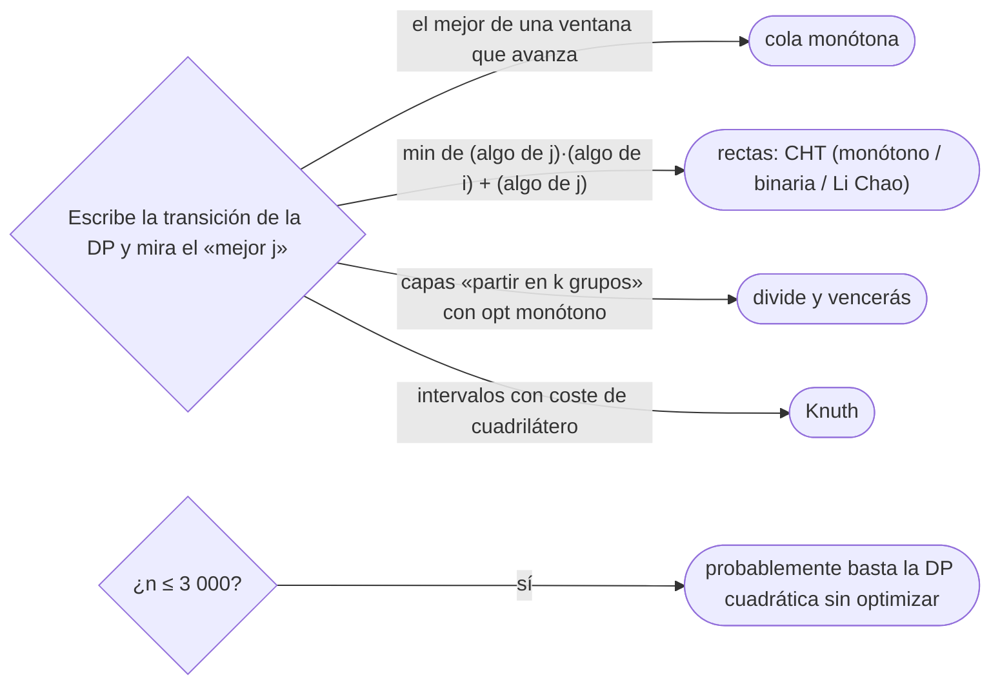

# 05 — Optimizaciones de DP

> Cuando una DP es correcta pero su transición recorre todos los estados anteriores, a veces la estructura
> de la transición permite hacerla en `O(1)` o `O(log n)` amortizado: la **cola monótona** (el mejor de una
> ventana), el ***convex hull trick*** (el mínimo de un conjunto de rectas), y, como fichas, la
> optimización por **divide y vencerás** y la de **Knuth**, que explotan la monotonía del óptimo.
>
> **Niveles:** cola monótona [B] · *convex hull trick* [B] · divide y vencerás [C] · Knuth [C].
>
> **📚 Lectura troncal:** cp-algorithms, [*Convex Hull Trick and Li Chao Tree*](https://cp-algorithms.com/geometry/convex_hull_trick.html)
> y [*Divide and Conquer DP*](https://cp-algorithms.com/dynamic_programming/divide-and-conquer-dp.html);
> Halim, Halim y Effendy, *Competitive Programming 4*, libro 2 (2020).
>
> **Asume leído:** [`12/01` — De la recursión a la tabla](../12-dp-clasica/01-de-la-recursion-a-la-tabla.md).
>
> **Vigencia:** 2026-10-04.

**Salto rápido:** [1](#1--el-problema) · [2](#2--la-teoría) · [3](#3--cola-monótona) · [4](#4--convex-hull-trick) · [5](#5--divide-y-vencerás-y-knuth) · [6](#6-️-la-tabla-de-costes) · [7](#7--cómo-se-elige) · [8](#8--señales-del-enunciado) · [🧠](#-preguntas) · [🧩](#-problemas-propios)

---

## 1. 🎯 El problema

Una rana salta por piedras de alturas crecientes `[1, 2, 5, 5, 6, 9]`; saltar de `j` a `i` cuesta
`(hᵢ − hⱼ)² + C`. La DP es inmediata:

```text
dp[i] = min sobre j < i de  dp[j] + (hᵢ − hⱼ)² + C
```

y con `n = 2·10⁵` cuesta `n²/2 = 2·10¹⁰`: no cabe. El estado y la recurrencia están bien; lo que sobra es
**recorrer todos los `j`** en cada `i`. Desarrollando el cuadrado,

```text
dp[j] + hᵢ² − 2hᵢhⱼ + hⱼ² + C  =  (hᵢ² + C) + [ (−2hⱼ) · hᵢ + (dp[j] + hⱼ²) ]
```

el término entre corchetes es una **recta** de pendiente `−2hⱼ` evaluada en `x = hᵢ`. El mínimo sobre `j`
es el mínimo de un conjunto de rectas en un punto, y eso se mantiene en `O(1)` amortizado: de `2·10¹⁰` a
`2·10⁵`.

> 🧠 **Modelo mental.** Antes de optimizar una DP, escribe la transición y pregúntate qué forma tiene «el
> mejor `j`»: el mejor de una ventana (cola monótona), el mínimo de rectas (*convex hull trick*), o un
> óptimo que se mueve en una dirección (divide y vencerás, Knuth).

---

## 2. 📐 La teoría

**Cola monótona.** Si `dp[i] = c(i) + min{ dp[j] : j ∈ [i − R, i − L] }` y la ventana avanza con `i`, el
mínimo de una ventana deslizante se mantiene con una deque de índices con `dp` creciente: los que son
peores que uno posterior nunca volverán a ser el mínimo y salen por detrás; los que quedan fuera de la
ventana, por delante. Cada índice entra y sale una vez: `O(1)` amortizado. La estructura es la de
[`06/01`](../06-lineales-y-hashing/01-pilas-colas-y-monotonas.md), que es su dueño.

**El *convex hull trick* (CHT).** Si `dp[i] = a(i) + min_j (mⱼ · xᵢ + bⱼ)`, cada `j` aporta una recta. El
mínimo de un conjunto de rectas en función de `x` es una función cóncava a trozos: la **envolvente
inferior**. Una recta que no aparece en la envolvente no será nunca el mínimo y se puede tirar.

**Teorema (CHT monótono).** Si las rectas se añaden con pendientes **decrecientes** y las consultas llegan
con `x` **crecientes**, la envolvente se mantiene en una deque y cada recta entra y sale una vez: `O(n)` en
total. Si solo las pendientes son monótonas, la consulta se hace con búsqueda binaria (`O(log n)`); si nada
es monótono, el árbol de Li Chao (`09/04`).

**La recta que sobra.** Con tres rectas `l₁, l₂, l₃` de pendientes decrecientes, `l₂` sobra si el punto
donde `l₃` corta a `l₁` está a la izquierda (o en) el punto donde `l₂` corta a `l₁`: a partir de ahí `l₃` ya
está por debajo de `l₂`. La comparación se hace con productos cruzados, sin dividir.

**Monotonía del óptimo** (para las fichas de §5). Si `opt(i)`, el `j` que da el mínimo en `dp[i]`, es no
decreciente en `i`, la búsqueda de cada `opt` se restringe, y una DP de `Θ(n²)` por capa baja a
`Θ(n log n)` (divide y vencerás) o una de intervalos de `Θ(n³)` a `Θ(n²)` (Knuth). La condición suficiente
habitual es la **desigualdad del cuadrilátero** del coste: `C(a, c) + C(b, d) ≤ C(a, d) + C(b, c)` para
`a ≤ b ≤ c ≤ d`.

---

## 3. 🧱 Cola monótona

**Qué es.** Calcular `dp[i] = c(i) + min_{j ∈ ventana(i)} dp[j]` manteniendo los candidatos de la ventana
en una deque ordenada por `dp`.

**Por qué es correcto** (enunciado y una frase). Si `j₁ < j₂` y `dp[j₁] ≥ dp[j₂]`, `j₁` sale de la ventana
antes que `j₂` y no es mejor: nunca será el mínimo, y quitarlo no cambia ningún resultado.

**Cómo va**, saltos con coste `c = [5, 2, 9, 1, 5, 6]`, desde cada piedra a una de las dos siguientes
(`L = 1`, `R = 2`), pagando el coste de la piedra a la que se llega: `dp = [5, 7, 14, 8, 13, 14]`; en cada
paso la deque tiene como mucho dos índices, y el frente es el mínimo.

**Cuánto.** `Θ(n)` en total: cada índice entra y sale de la deque una vez.

**La plantilla**, con ventana `[i − R, i − L]`:

```cpp
#include <deque>
#include <vector>

// dp[i] = c[i] + min dp[j] con j ∈ [i − R, i − L] (1 ≤ L ≤ R); dp[0] = c[0]. −1 si inalcanzable. Θ(n).
long long windowDP(const std::vector<long long>& c, int L, int R) {
    int n = (int)c.size();
    const long long NONE = -1;
    std::vector<long long> dp(n, NONE);
    dp[0] = c[0];
    std::deque<int> dq;                                           // índices con dp creciente
    for (int i = 1; i < n; i++) {
        int add = i - L;                                          // entra en la ventana
        if (add >= 0 && dp[add] != NONE) {
            while (!dq.empty() && dp[dq.back()] >= dp[add]) dq.pop_back();
            dq.push_back(add);
        }
        while (!dq.empty() && dq.front() < i - R) dq.pop_front();  // sale por la izquierda
        if (!dq.empty()) dp[i] = c[i] + dp[dq.front()];
    }
    return dp[n - 1];
}
```

```java
// dp[i] = c[i] + min dp[j] con j ∈ [i − R, i − L] (1 ≤ L ≤ R); dp[0] = c[0]. −1 si inalcanzable. Θ(n).
static long windowDP(long[] c, int L, int R) {
    int n = c.length;
    long[] dp = new long[n];
    java.util.Arrays.fill(dp, -1);
    dp[0] = c[0];
    int[] dq = new int[n];
    int head = 0, tail = 0;
    for (int i = 1; i < n; i++) {
        int add = i - L;
        if (add >= 0 && dp[add] != -1) {
            while (tail > head && dp[dq[tail - 1]] >= dp[add]) tail--;
            dq[tail++] = add;
        }
        while (tail > head && dq[head] < i - R) head++;
        if (tail > head) dp[i] = c[i] + dp[dq[head]];
    }
    return dp[n - 1];
}
```

- **El índice entra cuando se vuelve elegible** (`i − L`), no cuando se calcula: con `L > 1` hay un desfase.
- **En Java**, una deque sobre un arreglo con `head` y `tail` es más rápida que `ArrayDeque<Integer>`.
- **Los inalcanzables** no entran en la deque.

**Cuándo sí**: transiciones sobre una ventana que avanza (saltos de longitud acotada, «como mucho `k`
atrás»). **Cuándo no**: si la ventana no avanza monótonamente, o el coste depende de `j` y de `i` de forma
que mezcla los dos (ahí, CHT).

> **Veredicto:** una DP cuya transición es «el mejor de los últimos `k`» baja de `n · k` a `n` con la cola
> monótona de `06/01`.

---

## 4. 🧱 *Convex hull trick*

**Qué es.** Mantener la envolvente inferior de las rectas `y = mⱼ x + bⱼ` que aportan los estados ya
calculados y consultar su mínimo en `x = xᵢ`.

**Por qué es correcto** (enunciado y una frase). Por el teorema de §2: con pendientes decrecientes y
consultas crecientes, una recta que deja de ser mínima en una consulta no vuelve a serlo en las siguientes,
y una recta tapada por sus vecinas no lo es nunca.

**Cómo va**, la rana con `h = [1, 2, 5, 5, 6, 9]` y `C = 6`. La recta de `j` es `y = −2hⱼ · x + dp[j] + hⱼ²`,
y `dp[i] = hᵢ² + C + mín en x = hᵢ`:

```text
i   h   dp[i]                         recta añadida (m, b)
0   1   0                             (−2, 1)
1   2   4 + 6 + (−2·2 + 1) = 7        (−4, 11)
2   5   25 + 6 + min(−9, −9) = 22     (−10, 47)
3   5   25 + 6 + min(…) = 22          (−10, 47)  (igual pendiente: se queda la de menor b)
4   6   36 + 6 + (−13) = 29           (−12, 65)
5   9   81 + 6 + (−43) = 44
```

**Cuánto.** `Θ(n)` con pendientes y consultas monótonas; `Θ(n log n)` si solo las pendientes lo son
(binaria sobre la deque).

**La plantilla**, el mínimo con pendientes decrecientes y consultas crecientes:

```cpp
#include <deque>

// Envolvente inferior de rectas y = m·x + b. Pre: pendientes decrecientes al añadir, x crecientes al consultar.
struct MonotoneCHT {
    std::deque<std::pair<long long, long long>> lines;         // (m, b)

    // ¿Sobra l2 entre l1 y l3? Con m1 > m2 > m3, comparar los cortes sin dividir (__int128 por seguridad).
    static bool bad(const std::pair<long long, long long>& l1, const std::pair<long long, long long>& l2,
                    const std::pair<long long, long long>& l3) {
        return (__int128)(l3.second - l1.second) * (l1.first - l2.first)
            <= (__int128)(l2.second - l1.second) * (l1.first - l3.first);
    }
    void add(long long m, long long b) {
        if (!lines.empty() && lines.back().first == m) {          // misma pendiente: la de menor b
            if (lines.back().second <= b) return;
            lines.pop_back();
        }
        while (lines.size() >= 2 && bad(lines[lines.size() - 2], lines.back(), {m, b})) lines.pop_back();
        lines.push_back({m, b});
    }
    long long query(long long x) {                               // x no decrecientes entre llamadas
        auto val = [&](const std::pair<long long, long long>& l) { return l.first * x + l.second; };
        while (lines.size() >= 2 && val(lines[1]) <= val(lines[0])) lines.pop_front();
        return val(lines.front());
    }
};
```

```java
// Envolvente inferior de rectas y = m·x + b. Pre: pendientes decrecientes al añadir, x crecientes al consultar.
static final class MonotoneCHT {
    long[] m = new long[1 << 18], b = new long[1 << 18];       // capacidad: el máximo de rectas
    int head = 0, tail = 0;

    private boolean bad(int i1, int i2, long m3, long b3) {      // ¿sobra la recta i2?
        return java.math.BigInteger.valueOf(b3 - b[i1]).multiply(java.math.BigInteger.valueOf(m[i1] - m[i2]))
            .compareTo(java.math.BigInteger.valueOf(b[i2] - b[i1]).multiply(java.math.BigInteger.valueOf(m[i1] - m3))) <= 0;
    }
    void add(long mm, long bb) {
        if (tail > head && m[tail - 1] == mm) {
            if (b[tail - 1] <= bb) return;
            tail--;
        }
        while (tail - head >= 2 && bad(tail - 2, tail - 1, mm, bb)) tail--;
        m[tail] = mm; b[tail] = bb; tail++;
    }
    long query(long x) {
        while (tail - head >= 2 && m[head + 1] * x + b[head + 1] <= m[head] * x + b[head]) head++;
        return m[head] * x + b[head];
    }
}
```

- **Pendientes iguales**: se conserva la de menor ordenada; si no, `bad` dividiría por cero.
- **Los productos de `bad`** pueden pasar de 64 bits (diferencias de `10¹²` por diferencias de `10⁶`): en C++
  `__int128`; en Java, `BigInteger` o `Math.multiplyHigh`. Si las magnitudes son pequeñas, `long` basta y es
  mucho más rápido.
- **Para el máximo**, se niegan las rectas (o se invierten las desigualdades).
- **Sin monotonía en las consultas**, en lugar de sacar por delante se hace una búsqueda binaria sobre la
  deque; sin monotonía en las pendientes, Li Chao.

**Cuándo sí**: transiciones que, desarrolladas, son `aᵢ + min_j (mⱼ · xᵢ + bⱼ)` con `mⱼ` y `xᵢ` monótonos
(alturas, sumas de prefijos crecientes). **Cuándo no**: si el término cruzado no es un producto
`f(j) · g(i)`, no hay rectas.

> **Veredicto:** el CHT convierte «el mejor `j`» en «la recta más baja en `x`». El trabajo está en
> desarrollar la transición hasta separar lo que depende de `j`, de `i` y de los dos multiplicados.

---

## 5. 🧱 Divide y vencerás y Knuth

### Optimización por divide y vencerás

- **Qué resuelve.** DP por capas `dp[k][i] = min_{j < i} dp[k−1][j] + C(j, i)` (partir un arreglo en `k`
  grupos) de `Θ(k · n²)` a `Θ(k · n log n)`.
- **Qué garantiza.** Si `opt(i)` es no decreciente en `i` (lo cumple un coste con la desigualdad del
  cuadrilátero), se calcula `opt` del punto medio y se recurre a la izquierda con los `j ≤ opt(mid)` y a la
  derecha con los `j ≥ opt(mid)`.
- **Cuánto.** `Θ(n log n)` por capa, más el coste de evaluar `C`.
- **Cómo reconocerlo.** «Divide en `k` grupos consecutivos minimizando la suma de costes por grupo», con
  `n · k` hasta `10⁷` y `n²` fuera de alcance.
- **Si no te la sabes.** La DP directa con `n ≤ 3 000`; o el *Aliens trick* de [`13/07`](07-trucos-de-nivel-alto.md) para quitar `k`.
- **Dónde está entera.** cp-algorithms, [*Divide and Conquer DP*](https://cp-algorithms.com/dynamic_programming/divide-and-conquer-dp.html).

### Optimización de Knuth

- **Qué resuelve.** DP de intervalos `dp[i][j] = min_{i ≤ k < j} dp[i][k] + dp[k+1][j] + C(i, j)` de `Θ(n³)` a
  `Θ(n²)`.
- **Qué garantiza.** Si `C` cumple la desigualdad del cuadrilátero y es monótono por inclusión,
  `opt[i][j−1] ≤ opt[i][j] ≤ opt[i+1][j]`, y el bucle de `k` se restringe a ese rango; la suma telescópica
  da `Θ(n²)`.
- **Cuánto.** `Θ(n²)`.
- **Cómo reconocerlo.** El ABB óptimo, unir montones vecinos (`12/05`), con `n` hasta `5 000`.
- **Si no te la sabes.** La DP de intervalos de `12/05` en `Θ(n³)`, que con `n ≤ 500` basta.
- **Dónde está entera.** cp-algorithms, [*Knuth's Optimization*](https://cp-algorithms.com/dynamic_programming/knuth-optimization.html).

---

## 6. ⏱️ La tabla de costes

| Optimización | De | A | Condición | Lo que la tabla no dice |
|---|---|---|---|---|
| Cola monótona | `Θ(n · k)` | `Θ(n)` | Transición sobre una ventana que avanza | Es la deque de `06/01` |
| CHT monótono | `Θ(n²)` | `Θ(n)` | Rectas con pendientes y consultas monótonas | Cuidado con el desbordamiento en `bad` |
| CHT con binaria | `Θ(n²)` | `Θ(n log n)` | Solo pendientes monótonas | Consultas en cualquier orden |
| Li Chao (`09/04`) | `Θ(n²)` | `Θ(n log C)` | Ninguna monotonía | Rango de `x` acotado o comprimido |
| Divide y vencerás | `Θ(k · n²)` | `Θ(k · n log n)` | `opt` monótono | Hay que demostrar la monotonía |
| Knuth | `Θ(n³)` | `Θ(n²)` | Cuadrilátero y monotonía | Solo DP de intervalos |

---

## 7. 🧭 Cómo se elige



> **Regla de entrevista:** en una entrevista casi nunca hace falta pasar de la DP cuadrática; basta decir
> «si `n` fuera `10⁵`, desarrollaría el cuadrado para ver rectas y usaría el *convex hull trick*».

---

## 8. 🔎 Señales del enunciado

| Señal | Técnica | Por qué |
|---|---|---|
| «Saltar como mucho `k`», «de los últimos `k`» con `n · k` enorme | Cola monótona | Ventana deslizante |
| Coste de una transición con `(xᵢ − xⱼ)²` o `xᵢ · yⱼ` | CHT | Al desarrollar, rectas en `xᵢ` |
| «Partir en `k` grupos consecutivos», coste por grupo | Divide y vencerás | `opt` monótono |
| DP de intervalos con `n` hasta 5 000 | Knuth | `Θ(n²)` |
| `n ≤ 3 000` y DP cuadrática | Ninguna | `9·10⁶` cabe |

---

## ⚠️ Errores frecuentes

| Se dice | Lo preciso |
|---|---|
| «Si la DP es `O(n²)`, no hay nada que hacer» | La forma de la transición puede bajar a `O(n)` o `O(n log n)` |
| «El CHT funciona con cualquier orden» | La deque exige pendientes y consultas monótonas; si no, binaria o Li Chao |
| «En `bad` divido para comparar los cortes» | Con divisiones hay errores de redondeo y división por cero; productos cruzados |
| «Divide y vencerás sirve siempre que haya capas» | Solo si el óptimo es monótono; sin demostrarlo, da resultados falsos sin avisar |
| «Knuth vale para cualquier DP de intervalos» | Exige la desigualdad del cuadrilátero; la cadena de matrices no la cumple en general |
| «Optimizo antes de tener la DP correcta» | Primero la DP cuadrática como oráculo; después, la optimización contra ella |

---

## 📚 Para profundizar

- **Referencia** — cp-algorithms, [*Convex Hull Trick and Li Chao Tree*](https://cp-algorithms.com/geometry/convex_hull_trick.html).
  *Lectura troncal.*
- **Referencia** — cp-algorithms, [*Divide and Conquer DP*](https://cp-algorithms.com/dynamic_programming/divide-and-conquer-dp.html)
  y [*Knuth's Optimization*](https://cp-algorithms.com/dynamic_programming/knuth-optimization.html). *Lectura
  troncal.*
- **Libro** — Halim, Halim y Effendy, *Competitive Programming 4*, libro 2 (2020): las optimizaciones de DP en
  la parte de temas avanzados. *Lectura troncal.*
- **Referencia** — USACO Guide, [*Convex Hull Trick*](https://usaco.guide/plat/convex-hull-trick).
- **Libro** — Cormen, Leiserson, Rivest y Stein, *Introduction to Algorithms*, 3.ª ed. (MIT Press, 2009),
  cap. 15: las DP de partida sobre las que se aplican.

---

## 🧠 Preguntas

1. ¿Qué forma tiene que tener la transición para usar una cola monótona? 🟢
2. ¿Qué es la envolvente inferior de un conjunto de rectas? 🟢
3. ¿Qué condiciones de monotonía exige el CHT con deque? 🟢
4. ¿Cuándo sobra la recta del medio entre tres, y cómo se comprueba sin dividir? 🟢
5. Desarrolla `dp[j] + (hᵢ − hⱼ)² + C` para ver las rectas: ¿cuál es la pendiente y cuál la ordenada? 🟡
6. ¿En qué se diferencian el CHT con deque, el CHT con binaria y Li Chao? 🟡
7. Compara cómo evitas el desbordamiento en la comparación de cortes en C++, Java y Python. 🟡
8. ¿Por qué un índice dominado nunca vuelve a ser el mínimo en la cola monótona? 🟠
9. ¿Qué es la monotonía del óptimo, y qué permite en la optimización por divide y vencerás? 🟠
10. ¿Qué dice la desigualdad del cuadrilátero, y para qué la necesita Knuth? 🟠
11. ¿Cómo adaptas el CHT para maximizar en lugar de minimizar? 🟠
12. Diseña la DP con CHT para partir un arreglo en grupos consecutivos con coste `(suma del grupo)² + C`. 🔴
13. Tu CHT da resultados correctos con `n ≤ 1 000` y WA con `n = 2·10⁵`. ¿Qué miras? 🔴

---

## 🧩 Problemas propios

### Saltos con ventana

**Nivel:** 🟠 · **Formato:** programa completo.

Hay `n` piedras con coste `cᵢ`; se empieza en la 0 (pagando `c₀`) y desde la piedra `j` se puede saltar a
cualquier `i` con `L ≤ i − j ≤ R`, pagando `cᵢ`. Imprime el coste mínimo de llegar a la última, o `-1`.

- **Entrada.** Una línea con `n`, `L` y `R`. Una línea con los costes.
- **Salida.** Un entero.
- **Restricciones.** `1 ≤ n ≤ 2·10⁵`; `1 ≤ L ≤ R ≤ n`; `0 ≤ cᵢ ≤ 10⁹`.

```text
Entrada            Salida
6 1 2              14
5 2 9 1 5 6

Entrada            Salida
6 2 3              12
5 2 9 1 5 6

Entrada            Salida
2 2 2              -1
3 4
```

**Pista 1:** el mejor origen para la piedra `i`, ¿puede seguir siendo el mejor para la `i + 1`?

### Lotes de impresión

**Nivel:** 🔴 · **Formato:** programa completo.

Hay que imprimir `n` documentos en orden, agrupados en lotes de documentos consecutivos. Un lote cuesta
`(suma de páginas del lote)² + C`. Imprime el coste total mínimo.

- **Entrada.** Una línea con `n` y `C`. Una línea con las páginas de cada documento.
- **Salida.** Un entero.
- **Restricciones.** `1 ≤ n ≤ 2·10⁵`; `0 ≤ C ≤ 10⁹`; `1 ≤ páginas ≤ 1 000`.

```text
Entrada            Salida
6 20               282
5 2 9 1 5 6

Entrada            Salida
4 3                14
1 1 1 1
```

**Pista 1:** con las sumas de prefijos `S`, el coste de un lote `(j, i]` es `(Sᵢ − Sⱼ)² + C`: ¿qué parte
depende solo de `j`, cuál solo de `i`, y cuál de los dos?

---

## 🧩 Práctica externa

Las bases no llegan a estas optimizaciones salvo en dificultad alta; las específicas son AtCoder, CSES y
Codeforces. SPOJ tiene la colección clásica, pero responde `403` a la verificación automática y no se
enlaza.

### Núcleo

| ✔ | Problema | Plataforma | Nivel | Patrón | Pista 1 |
|---|---|---|---|---|---|
| [ ] | [Frog 3](https://atcoder.jp/contests/dp/tasks/dp_z) | AtCoder | 🟠 | CHT monótono | Desarrolla el cuadrado: ¿qué recta aporta cada piedra? |
| [ ] | [Monster Game I](https://cses.fi/problemset/task/2084) | CSES | 🟠 | CHT monótono | ¿El tiempo de matar al monstruo `i` con la habilidad de `j` es una recta en qué variable? |
| [ ] | [Max Value of Equation](https://leetcode.com/problems/max-value-of-equation/) | LeetCode | 🟠 | Cola monótona con clave `y − x` | Si fijas el punto de la derecha, ¿qué tienes que maximizar entre los de la izquierda? |

### Ampliación

| ✔ | Problema | Plataforma | Nivel | Patrón | Pista 1 |
|---|---|---|---|---|---|
| [ ] | [Kalila and Dimna in the Logging Industry](https://codeforces.com/problemset/problem/319/C) | Codeforces | 🟠 | CHT monótono | ¿Qué árbol conviene cortar el último antes de cortar el `n`? |
| [ ] | [Monster Game II](https://cses.fi/problemset/task/2085) | CSES | 🔴 | CHT sin monotonía (Li Chao) | Si las consultas ya no son crecientes, ¿cómo encuentras la recta mínima? |
| [ ] | [The Fair Nut and Rectangles](https://codeforces.com/problemset/problem/1083/E) | Codeforces | 🔴 | CHT tras ordenar | Ordenados por `x`, ¿qué recta aporta el rectángulo `j` al calcular el `i`? |

### Por curiosidad

| ✔ | Problema | Plataforma | Nivel | Patrón | Pista 1 |
|---|---|---|---|---|---|
| [ ] | 💀 [Ciel and Gondolas](https://codeforces.com/problemset/problem/321/E) | Codeforces | 🔴 | Divide y vencerás sobre capas | ¿Es monótono el punto de corte óptimo al avanzar el último pasajero? |

---

## ✅ Criterio de dominio

- Desarrollar una transición hasta reconocer la cola monótona o las rectas del CHT.
- Escribir el CHT monótono con la comparación de cortes sin dividir y sin desbordar.
- Enunciar la monotonía del óptimo y la desigualdad del cuadrilátero, y decir qué optimización piden.
- Resolver Frog 3 sin pista 2, comprobándolo contra la DP cuadrática.

---

**Anterior:** [`13/04` — DP de probabilidad y esperanza](04-probabilidad-y-esperanza.md) · **Siguiente:** [`13/06` — Recurrencias lineales y exponenciación de matrices](06-recurrencias-lineales-y-matrices.md) ·
**Relacionado:** [`06/01` — Pila, cola, deque y sus versiones monótonas](../06-lineales-y-hashing/01-pilas-colas-y-monotonas.md); [`09/04` — Segment tree avanzado](../09-consultas-sobre-rangos/04-segment-tree-avanzado.md); [`12/05` — DP en rejillas y de intervalos](../12-dp-clasica/05-rejillas-e-intervalos.md).
