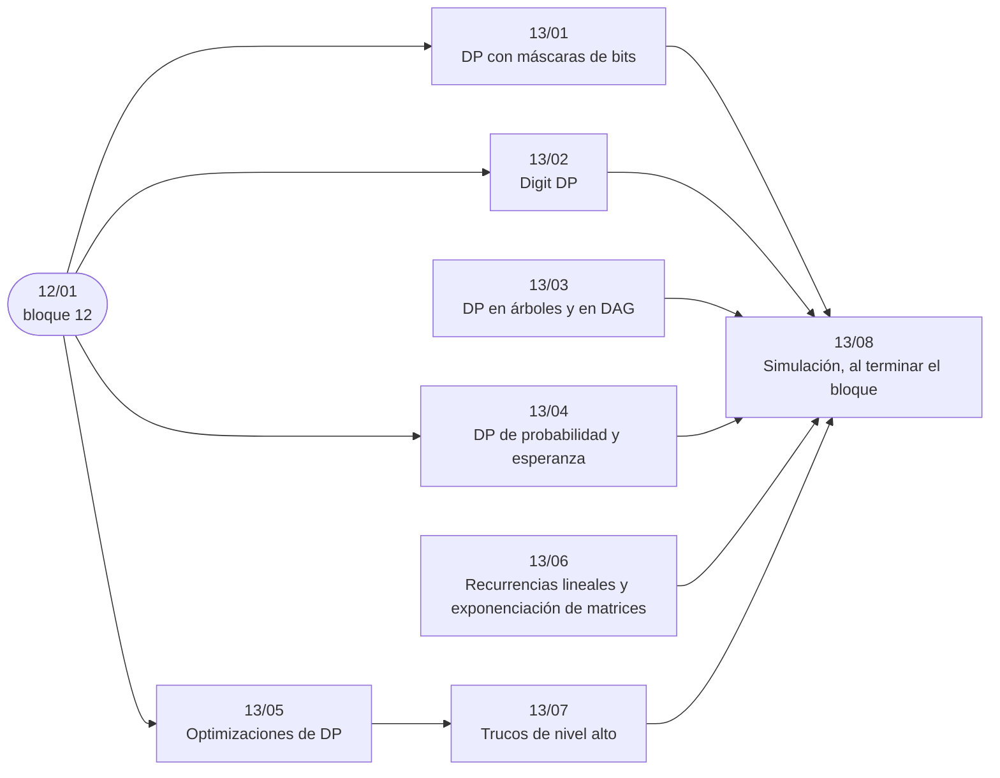

# Bloque 13 — DP avanzada

> La DP cuando el estado ya no es un índice: máscaras de bits, dígitos, árboles y DAG, probabilidad y
> esperanza, las optimizaciones (cola monótona, *convex hull trick*, divide y vencerás, Knuth), la exponenciación de
> matrices para recurrencias lineales, y dos trucos de nivel alto como fichas. Es de concurso más que de entrevista.
>
> Las respuestas de las preguntas y las pistas 2 y 3 de los problemas, en [`09` — Respuestas](09-respuestas.md).
>
> **Vigencia:** 2026-10-04.

---

## 🧭 Índice

| Capítulo | Niveles | Ruta corta |
|---|---|---|
| [`13/01` — DP con máscaras de bits](01-mascaras-de-bits.md) | DP sobre subconjuntos [B] · viajante [B] · SOS DP [B] |  |
| [`13/02` — *Digit DP*](02-digit-dp.md) | *digit DP* [B] |  |
| [`13/03` — DP en árboles y en DAG](03-dp-en-arboles-y-dag.md) | DP en árboles [A] · DP sobre DAG [A] · *rerooting* como DP [B] |  |
| [`13/04` — DP de probabilidad y esperanza](04-probabilidad-y-esperanza.md) | DP de probabilidad [B] · esperanza hacia atrás [B] |  |
| [`13/05` — Optimizaciones de DP](05-optimizaciones.md) | cola monótona [B] · *convex hull trick* [B] · divide y vencerás [C] · Knuth [C] |  |
| [`13/06` — Recurrencias lineales y exponenciación de matrices](06-recurrencias-lineales-y-matrices.md) | exponenciación de matrices [B] |  |
| [`13/07` — Trucos de nivel alto](07-trucos-de-nivel-alto.md) | *Aliens trick* [C] · *slope trick* [C] |  |
| [`13/08` — Simulación](08-simulacion.md) | El examen del bloque: preguntas transversales y problemas cronometrados | |
| [`13/09` — Respuestas](09-respuestas.md) | Las preguntas en tres capas y las pistas 2 y 3 | |

---

## 🧭 Orden de lectura

- Casi todos asumen `12/01` y son independientes entre sí; `13/07` usa las optimizaciones de `13/05`, y `13/06` se puede leer desde el álgebra, sin DP previa.

---

## 🔎 Mapa de señales del bloque

| Señal | Técnica | Capítulo |
|---|---|---|
| `n ≤ 20` y «visitar todos», «asignar uno a uno», «ordenar con coste entre vecinos» | DP sobre máscaras | [`13/01`](01-mascaras-de-bits.md) |
| «Cada uno exactamente una vez», con `n ≤ 16`–`20` | Held-Karp | [`13/01`](01-mascaras-de-bits.md) |
| «Cuántos números entre `a` y `b`» con `b` hasta `10¹⁸` y una condición sobre sus dígitos | *Digit DP* | [`13/02`](02-digit-dp.md) |
| «La suma de los dígitos es…», «tiene exactamente `k` sietes», «no hay dos dígitos iguales seguidos» | *Digit DP* con `extra` | [`13/02`](02-digit-dp.md) |
| Jerarquía, `n − 1` aristas, «nadie con su jefe», «cada subárbol» | DP en árboles | [`13/03`](03-dp-en-arboles-y-dag.md) |
| «Proyecto con dependencias», «solo se puede bajar», «tareas previas» | DP sobre DAG | [`13/03`](03-dp-en-arboles-y-dag.md) |
| «¿Con qué probabilidad…?», número fijo de pasos | DP de probabilidad hacia delante | [`13/04`](04-probabilidad-y-esperanza.md) |
| «Número esperado de…» hasta llegar a algo | Esperanza hacia atrás | [`13/04`](04-probabilidad-y-esperanza.md) |
| «Saltar como mucho `k`», «de los últimos `k`» con `n · k` enorme | Cola monótona | [`13/05`](05-optimizaciones.md) |
| Coste de una transición con `(xᵢ − xⱼ)²` o `xᵢ · yⱼ` | CHT | [`13/05`](05-optimizaciones.md) |
| `n` hasta `10¹⁸` en una recurrencia o un conteo por pasos | Exponenciación de matrices | [`13/06`](06-recurrencias-lineales-y-matrices.md) |
| «Número de caminos de longitud exactamente `k`» | Potencia de la matriz de adyacencia | [`13/06`](06-recurrencias-lineales-y-matrices.md) |
| «Exactamente `k`» con `n · k` fuera de alcance y la versión sin `k` lineal | *Aliens trick* | [`13/07`](07-trucos-de-nivel-alto.md) |
| «Como mucho `k`» con rendimientos decrecientes | *Aliens trick* | [`13/07`](07-trucos-de-nivel-alto.md) |

---

## 📚 Lectura troncal del bloque

La de cada capítulo, que es también la primera entrada de su «Para profundizar»:

- **`13/01`** — Laaksonen, *Guide to Competitive Programming*, 3.ª ed. (Springer, 2024), cap. 6; cp-algorithms, [*Enumerating submasks of a bitmask*](https://cp-algorithms.com/algebra/all-submasks.html).
- **`13/02`** — ningún libro del canon trata la técnica (excepción declarada en la guía, §11.2). La guía fija cp-algorithms como referencia, pero cp-algorithms **no tiene** página de *digit DP* (comprobado el 2026-10-04); la referencia troncal es USACO Guide, [*Digit DP*](https://usaco.guide/gold/digit-dp).
- **`13/03`** — Kleinberg y Tardos, *Algorithm Design* (Addison-Wesley, 2005), §10.2 (conjunto independiente en árboles); Laaksonen, *Guide to Competitive Programming*, 3.ª ed. (Springer, 2024), cap. 10.
- **`13/04`** — Mitzenmacher y Upfal, *Probability and Computing*, 2.ª ed. (Cambridge, 2017), cap. 2; Laaksonen, *Guide to Competitive Programming*, 3.ª ed. (Springer, 2024), cap. 11.
- **`13/05`** — cp-algorithms, [*Convex Hull Trick and Li Chao Tree*](https://cp-algorithms.com/geometry/convex_hull_trick.html) y [*Divide and Conquer DP*](https://cp-algorithms.com/dynamic_programming/divide-and-conquer-dp.html); Halim, Halim y Effendy, *Competitive Programming 4*, libro 2 (2020).
- **`13/06`** — Graham, Knuth y Patashnik, *Concrete Mathematics*, 2.ª ed. (Addison-Wesley, 1994), cap. 7; cp-algorithms, [*Binary Exponentiation*](https://cp-algorithms.com/algebra/binary-exp.html) (la sección de matrices).
- **`13/07`** — ningún libro del canon los trata (excepción declarada en la guía, §11.2). La guía fija cp-algorithms, pero cp-algorithms **no tiene** página de ninguno de los dos (comprobado el 2026-10-04); las referencias troncales son USACO Guide, [*Lagrangian Relaxation*](https://usaco.guide/adv/lagrange) y [*Slope Trick*](https://usaco.guide/adv/slope-trick), y los artículos de Codeforces «The Trick From Aliens» y «Slope trick explained», por título.

---

## 🧭 Qué NO está aquí

- **Los fundamentos de la DP**: en el [bloque `12`](../12-dp-clasica/README.md).
- **La exponenciación de matrices como álgebra**: en [`17/07` — Matrices y eliminación de Gauss](../17-matematica/07-matrices-y-gauss.md).
- **La probabilidad sin DP** (linealidad de la esperanza): en [`17/06` — Probabilidad y esperanza](../17-matematica/06-probabilidad-y-esperanza.md).

---

**Anterior:** [Bloque 12 — DP clásica](../12-dp-clasica/README.md) ·
**Siguiente:** [Bloque 14 — Grafos: recorridos](../14-grafos-recorridos/README.md) ·
**Inicio:** [README del corpus](../README.md)
