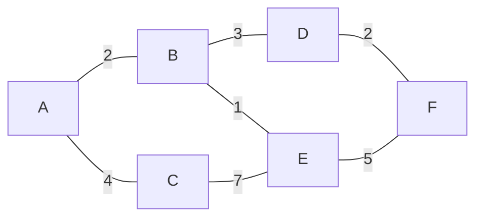
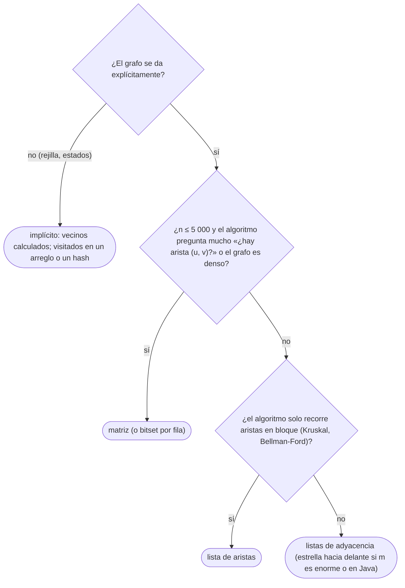

# 01 — Representaciones y su coste

> Cómo se guarda un grafo en memoria —listas de adyacencia, matriz de adyacencia, lista de aristas, la
> estrella hacia delante y el grafo implícito de una rejilla— y qué cuesta cada operación en cada una. Con
> el lema de los grados, la diferencia entre grafos densos y dispersos, y la lectura de un grafo de la
> entrada en los tres lenguajes. Es el dueño de las representaciones en el corpus.
>
> **Niveles:** listas de adyacencia, matriz, lista de aristas, implícito en rejilla [A].
>
> **📚 Lectura troncal:** Brassard y Bratley, *Fundamentos de algoritmia* (Prentice Hall, 1997), cap. 5;
> Cormen, Leiserson, Rivest y Stein, *Introduction to Algorithms*, 3.ª ed. (MIT Press, 2009), §22.1;
> Sedgewick y Wayne, *Algorithms*, 4.ª ed. (Addison-Wesley, 2011), §4.1.
>
> **Asume leído:** [`07/01` — Árboles: representación y recorridos](../07-arboles/01-arboles-y-recorridos.md).
>
> **Vigencia:** 2026-10-04.

**Salto rápido:** [1](#1--el-problema) · [2](#2--la-teoría) · [3](#3--representaciones) · [4](#4-️-la-tabla-de-costes) · [5](#5--cómo-se-elige) · [6](#6--señales-del-enunciado) · [7](#7--dónde-aparece-de-verdad) · [🧠](#-preguntas) · [🧩](#-problemas-propios)

---

## 1. 🎯 El problema

Una red tiene `n = 2·10⁵` routers y `m = 2·10⁵` cables. Una matriz de adyacencia de `n × n` booleanos son
`4·10¹⁰` celdas: 40 GB con un byte por celda, cuando el grafo entero cabe en unos megabytes. Al revés, en un
grafo de 2 000 ciudades donde casi todas están unidas con todas, la matriz son 4 MB y responde «¿están
unidas `u` y `v`?» en `O(1)`, mientras que las listas tienen que recorrer los vecinos.

La representación no es un detalle de implementación: decide la memoria y el coste de cada operación que el
algoritmo hace millones de veces. Este capítulo fija las cuatro que se usan, qué cuesta cada operación en
cada una, y cómo se elige por el tamaño y por las operaciones que pide el algoritmo.

> 🧠 **Modelo mental.** La pregunta para elegir es doble: ¿cuántas aristas hay respecto a `n²`?, y ¿qué
> hace el algoritmo: recorrer vecinos, preguntar por una arista concreta, o recorrer todas las aristas? Casi
> siempre la respuesta es **listas de adyacencia**.

---

## 2. 📐 La teoría

**Grafo.** Un par `G = (V, E)` de vértices y aristas. **Dirigido** si las aristas tienen sentido (`u → v`);
**ponderado** si tienen peso; **simple** si no hay aristas repetidas ni bucles (`v — v`). Con `n = |V|` y
`m = |E|`, un grafo simple no dirigido tiene como mucho `n(n − 1)/2` aristas; uno dirigido, `n(n − 1)`.

**Lema de los grados (*handshake lemma*).** En un grafo no dirigido, `Σ_v deg(v) = 2m`.

*Prueba.* Cada arista `{u, v}` suma 1 al grado de `u` y 1 al de `v`: contada por extremos, cada arista
aparece dos veces. En un dirigido, `Σ grado de salida = Σ grado de entrada = m`. Corolario: el número de
vértices de grado impar es par.

**Por qué importa al costear.** Recorrer todos los vecinos de todos los vértices con listas de adyacencia
cuesta `Σ deg(v) = 2m` más `n` por visitar los vértices: `Θ(n + m)`. Es el coste de BFS y DFS ([`14/02`](02-bfs.md),
[`14/03`](03-dfs.md)), y sale directamente del lema.

**Denso y disperso.** Un grafo es **denso** si `m = Θ(n²)` y **disperso** si `m` es del orden de `n` (o
`n log n`). Los grafos de los jueces casi siempre son dispersos (`m ≤ 2·10⁵`); los densos aparecen cuando
la entrada es una matriz de distancias o «todos contra todos».

**El grafo implícito.** A veces el grafo no se da: sus vértices son estados (casillas de una rejilla,
configuraciones de un puzzle) y sus aristas se **calculan** al vuelo. No se guarda nada; los vecinos se
generan con una función.

---

## 3. 🧱 Representaciones

**Qué es.** Las cuatro formas de guardar un grafo, y una variante compacta:

```text
lista de adyacencia   adj[u] = vecinos de u (con su peso)          Θ(n + m) memoria
matriz de adyacencia  mat[u][v] = 1 (o el peso) si hay arista      Θ(n²) memoria
lista de aristas      (u, v, w) para cada arista                   Θ(m) memoria
implícito             vecinos(estado) calculados al vuelo         Θ(1) memoria por el grafo
estrella hacia delante (CSR): las aristas ordenadas por origen y un arreglo de inicios
```

**Por qué es correcto.** Las cuatro guardan la misma información —el conjunto de aristas—; lo que cambia es
qué consultas responden barato. Que la lista de adyacencia de un no dirigido tiene `2m` entradas es el lema
de los grados.

**Cómo va**, el grafo de juguete G:



```text
lista de adyacencia (vecino, peso)
A: (B,2) (C,4)
B: (A,2) (D,3) (E,1)
C: (A,4) (E,7)
D: (B,3) (F,2)
E: (B,1) (C,7) (F,5)
F: (D,2) (E,5)
grados: 2 + 3 + 2 + 2 + 3 + 2 = 14 = 2 · 7 aristas
```

Y el DAG D (las mismas aristas de la letra menor a la mayor) como lista de adyacencia dirigida:
`A → B, C · B → D, E · C → E · D → F · E → F`.

**Cuánto.** Memoria `Θ(n + m)` las listas, `Θ(n²)` la matriz, `Θ(m)` la lista de aristas. Las operaciones,
en la tabla de §4.

**La plantilla**, leer un grafo no dirigido con pesos de la entrada (`n m` y `m` líneas `u v w`, vértices
desde 1):

```cpp
#include <cstdio>
#include <vector>

struct Edge { int to; long long w; };

// Lee n, m y m aristas no dirigidas «u v w» (vértices de 1 a n) en listas de adyacencia, índices desde 0.
std::vector<std::vector<Edge>> readGraph(int& n, int& m) {
    std::scanf("%d %d", &n, &m);
    std::vector<std::vector<Edge>> adj(n);
    for (int i = 0; i < m; i++) {
        int u, v; long long w;
        std::scanf("%d %d %lld", &u, &v, &w);
        u--; v--;                                            // a índices desde 0
        adj[u].push_back({v, w});
        adj[v].push_back({u, w});                            // no dirigido: en los dos sentidos
    }
    return adj;
}

// Vecinos implícitos en una rejilla R × C: las cuatro direcciones.
const int DR[4] = {-1, 1, 0, 0}, DC[4] = {0, 0, -1, 1};
// for (int d = 0; d < 4; d++) { int r2 = r + DR[d], c2 = c + DC[d];
//     if (r2 >= 0 && r2 < R && c2 >= 0 && c2 < C && grid[r2][c2] != '#') … }
```

```java
import java.io.DataInputStream;
import java.io.IOException;
import java.util.ArrayList;
import java.util.List;

// Lee n, m y m aristas no dirigidas «u v w» en listas de adyacencia (índices desde 0). Cada arista: {to, w}.
static List<long[]>[] readGraph(FastReader in) throws IOException {
    int n = in.nextInt(), m = in.nextInt();
    @SuppressWarnings("unchecked")
    List<long[]>[] adj = new List[n];
    for (int i = 0; i < n; i++) adj[i] = new ArrayList<>();
    for (int i = 0; i < m; i++) {
        int u = in.nextInt() - 1, v = in.nextInt() - 1;
        long w = in.nextLong();
        adj[u].add(new long[]{v, w});
        adj[v].add(new long[]{u, w});
    }
    return adj;
}
// FastReader: el lector con DataInputStream de 01/03.
```

```python
import sys

def read_graph():
    """Lee n, m y m aristas no dirigidas «u v w» en listas de adyacencia (índices desde 0)."""
    data = sys.stdin.buffer.read().split()
    n, m = int(data[0]), int(data[1])
    adj = [[] for _ in range(n)]
    idx = 2
    for _ in range(m):
        u, v, w = int(data[idx]) - 1, int(data[idx + 1]) - 1, int(data[idx + 2])
        idx += 3
        adj[u].append((v, w))
        adj[v].append((u, w))
    return n, adj
```

- **Índices desde 0** en memoria aunque la entrada venga desde 1: un `−1` al leer y un `+1` al escribir.
- **No dirigido = dos entradas** por arista; olvidarlo da recorridos que «no llegan».
- **En Java**, `List<long[]>[]` es cómodo pero cada arista es un objeto; con `m = 10⁶`, la estrella hacia
  delante (`head[]`, `next[]`, `to[]`, `w[]` como arreglos de primitivos) usa la mitad de memoria y es más
  rápida.
- **En Python**, leer toda la entrada de una vez ([`01/03`](../01-oficio-del-competidor/03-entrada-salida-y-plantilla.md)) y listas de tuplas; con `m = 10⁶` ya pesa.
- **Rejillas**: no se construye el grafo; los vecinos se calculan con los vectores de dirección.

### De la versión ingenua a la buena

**El problema.** Un grafo de `n = 10⁵` personas y `m = 2·10⁵` amistades; para `q = 10⁵` consultas `(u, v)`,
¿cuántos amigos tienen en común? En G, `A` y `E` tienen 2 en común (`B` y `C`).

**La versión ingenua:**

```java
// Correcta: matriz de adyacencia y recorrido de todos los vértices por consulta.
// Θ(n²) memoria (10¹⁰ celdas) y Θ(q · n) tiempo.
static int[] commonNaive(int n, int[][] edges, int[][] queries) {
    boolean[][] mat = new boolean[n][n];
    for (int[] e : edges) { mat[e[0]][e[1]] = true; mat[e[1]][e[0]] = true; }
    int[] ans = new int[queries.length];
    for (int i = 0; i < queries.length; i++)
        for (int x = 0; x < n; x++)
            if (mat[queries[i][0]][x] && mat[queries[i][1]][x]) ans[i]++;
    return ans;
}
```

> «La matriz no cabe con `n = 10⁵`, y recorrer los `n` vértices por consulta sobra: los únicos candidatos
> son los vecinos de `u`. Con listas de adyacencia, y los vecinos de cada vértice en un conjunto hash,
> recorro los del que tiene menos y pregunto en el otro: `O(min(deg u, deg v))` por consulta.»

**El camino a la buena.** Listas de adyacencia más un `HashSet` (o la lista ordenada y búsqueda binaria) por
vértice; para cada consulta, iterar sobre el de menor grado. Memoria `Θ(n + m)`.

**Cuándo sí** (listas): casi siempre; grafos dispersos y algoritmos que recorren vecinos (BFS, DFS,
Dijkstra). **Cuándo no**: grafos densos con consultas de arista frecuentes (matriz, o `bitset` por fila);
algoritmos que solo recorren aristas (Kruskal, Bellman-Ford: lista de aristas).

> **Veredicto:** listas de adyacencia por defecto; la matriz solo con `n ≤ 5 000` y consultas de arista; la
> lista de aristas para algoritmos que las recorren en bloque; y el grafo implícito cuando los vecinos se
> calculan.

---

## 4. ⏱️ La tabla de costes

| Representación | Memoria | ¿Arista `(u, v)`? | Vecinos de `u` | Todas las aristas | Lo que la tabla no dice |
|---|---|---|---|---|---|
| Lista de adyacencia | `Θ(n + m)` | `O(deg u)` | `Θ(deg u)` | `Θ(n + m)` | Con conjuntos hash, la consulta es `O(1)` esperado |
| Matriz | `Θ(n²)` | `O(1)` | `Θ(n)` | `Θ(n²)` | Con `bitset`, 64 celdas por palabra |
| Lista de aristas | `Θ(m)` | `O(m)` | `O(m)` | `Θ(m)` | La de Kruskal y Bellman-Ford |
| Estrella hacia delante | `Θ(n + m)` | `O(deg u)` | `Θ(deg u)` | `Θ(n + m)` | Sin objetos: la mejor localidad y la menor memoria |
| Implícito | `Θ(1)` | Lo que cueste calcularla | Lo que cueste generarlos | — | Hay que guardar aparte los visitados |

---

## 5. 🧭 Cómo se elige



> **Regla de entrevista:** di la representación y su memoria antes de escribir el recorrido: «listas de
> adyacencia, `Θ(n + m)`, porque el grafo es disperso y el BFS recorre vecinos».

---

## 6. 🔎 Señales del enunciado

| Señal | Técnica | Por qué |
|---|---|---|
| `n, m ≤ 2·10⁵`, «aristas `u v`» | Listas de adyacencia | Disperso |
| «Matriz de distancias», `n ≤ 500`, todos con todos | Matriz | Denso; Floyd-Warshall la usa directamente |
| Rejilla con `#` y `.`, laberinto | Grafo implícito | Los vecinos son las cuatro casillas |
| «Ordena las aristas por peso» | Lista de aristas | Kruskal ([`15/04`](../15-grafos-pesos-y-flujos/04-arbol-de-expansion-minima.md)) |
| Estados (posición, llaves, tiempo) | Grafo implícito sobre estados | Se generan al vuelo (`14/02`) |

---

## 7. 🔭 Dónde aparece de verdad

- **Los grafos sociales y web** se guardan en formatos CSR (la estrella hacia delante): dos arreglos, uno de
  inicios por vértice y otro de destinos, porque con miles de millones de aristas cada byte por arista
  cuenta.
- **Los mapas de navegación** guardan la red de calles como listas de adyacencia con pesos (tiempos), y el
  terreno como rejillas implícitas para la planificación local.

---

## ⚠️ Errores frecuentes

| Se dice | Lo preciso |
|---|---|
| «La matriz es más simple, así que es mejor» | Con `n = 2·10⁵` no cabe; es mejor solo en grafos densos y pequeños |
| «Recorrer el grafo con listas es `O(n · m)`» | Es `Θ(n + m)`: por el lema de los grados, la suma de los grados es `2m` |
| «En un no dirigido basta añadir `u → v`» | Hay que añadir también `v → u` |
| «La lista de aristas sirve para un BFS» | Para un BFS hay que encontrar los vecinos rápido: listas de adyacencia |
| «En una rejilla hay que construir el grafo» | Los vecinos se calculan con vectores de dirección |
| «`vector<vector<int>>` y `List<List<Integer>>` son gratis» | Con `m = 10⁶`, los objetos pesan; la estrella hacia delante usa arreglos planos |

---

## 📚 Para profundizar

- **Libro** — Brassard y Bratley, *Fundamentos de algoritmia* (Prentice Hall, 1997), cap. 5: los grafos
  como estructura de datos. *Lectura troncal.*
- **Libro** — Cormen, Leiserson, Rivest y Stein, *Introduction to Algorithms*, 3.ª ed. (MIT Press, 2009),
  §22.1: listas y matriz de adyacencia, con sus costes. *Lectura troncal.*
- **Libro** — Sedgewick y Wayne, *Algorithms*, 4.ª ed. (Addison-Wesley, 2011), §4.1: la API de grafo y sus
  implementaciones en Java. *Lectura troncal.*
- **Referencia** — Sedgewick y Wayne, [código de `Graph.java`](https://algs4.cs.princeton.edu/41graph/Graph.java.html).
- **Visualización** — VisuAlgo, [*Graph Data Structures*](https://visualgo.net/en/graphds), interactivo.

---

## 🧠 Preguntas

1. ¿Qué dice el lema de los grados y cómo se prueba? 🟢
2. ¿Cuánta memoria usan las listas de adyacencia y la matriz? 🟢
3. ¿Cuántas entradas tiene la lista de adyacencia de un grafo no dirigido con `m` aristas? 🟢
4. ¿Qué es un grafo implícito? Da un ejemplo. 🟢
5. ¿En qué se diferencian un grafo denso y uno disperso, y cuál es el habitual en los jueces? 🟡
6. ¿Cuándo prefieres la lista de aristas a las listas de adyacencia? 🟡
7. Compara cómo representas listas de adyacencia en C++, Java y Python, y qué cuesta cada forma con `m = 10⁶`. 🟡
8. ¿Por qué recorrer todos los vecinos de todos los vértices cuesta `Θ(n + m)` y no `Θ(n · m)`? 🟠
9. ¿Qué es la estrella hacia delante y qué gana frente a `vector<vector<…>>`? 🟠
10. ¿Cuándo conviene la matriz, aunque ocupe `n²`? 🟠
11. ¿Por qué el número de vértices de grado impar es par? 🟠
12. Diseña cómo contar los vecinos comunes de `q` pares en un grafo de `10⁵` vértices y di su coste. 🔴
13. Tu BFS sobre un grafo no dirigido no llega a vértices que deberían ser alcanzables. ¿Qué miras primero? 🔴

---

## 🧩 Problemas propios

### El más conectado

**Nivel:** 🟢 · **Formato:** programa completo.

Dado un grafo no dirigido, imprime el vértice de mayor grado (el de menor número si hay empate) y sus
vecinos en orden creciente.

- **Entrada.** Una línea con `n` y `m`. Después, `m` líneas con una arista `u v` (de 1 a `n`, sin repetidas).
- **Salida.** Una línea con el vértice; otra con sus vecinos separados por espacios.
- **Restricciones.** `1 ≤ n ≤ 2·10⁵`; `0 ≤ m ≤ 2·10⁵`.

```text
Entrada     Salida
6 7         2
1 2         1 4 5
1 3
2 4
2 5
3 5
4 6
5 6

Entrada     Salida
1 0         1

```

**Pista 1:** ¿qué estructura te da el grado de cada vértice y sus vecinos sin recorrer todas las aristas
cada vez?

### Rejilla con portales

**Nivel:** 🟡 · **Formato:** programa completo.

Una rejilla tiene casillas libres `.`, paredes `#` y portales (letras minúsculas). Desde una casilla se pasa a
sus vecinas libres en las cuatro direcciones; desde un portal, además, a cualquier otra casilla con la misma
letra. ¿Cuántas casillas son alcanzables desde la esquina superior izquierda (que es libre)?

- **Entrada.** Una línea con `R` y `C`. Después, `R` líneas con la rejilla.
- **Salida.** Un entero.
- **Restricciones.** `1 ≤ R, C ≤ 1 000`.

```text
Entrada     Salida
3 5         4
.a#..
##.##
..#a.

Entrada     Salida
2 2         3
.#
..
```

**Pista 1:** ¿qué aristas tiene un portal además de las de la rejilla, y cómo las encuentras sin recorrer la
rejilla entera?

### Triángulos

**Nivel:** 🟠 · **Formato:** programa completo.

¿Cuántos triángulos (tres vértices unidos dos a dos) tiene un grafo no dirigido?

- **Entrada.** Una línea con `n` y `m`. Después, `m` líneas con una arista `u v` (sin repetidas).
- **Salida.** Un entero.
- **Restricciones.** `1 ≤ n ≤ 2 000`; `0 ≤ m ≤ n(n − 1)/2`.

```text
Entrada     Salida
5 6         2
1 2
2 3
1 3
3 4
2 4
4 5

Entrada     Salida
4 4         0
1 2
2 3
3 4
4 1
```

**Pista 1:** para una arista `(u, v)`, ¿cuántos triángulos la contienen, y cómo se cuentan rápido si las
filas de la matriz son conjuntos de bits?

🔥 **Para el geek — en JavaScript:** no hay `bitset`; una fila de 2 000 bits cabe en un `Uint32Array` de 63
palabras, y contar los unos de un AND exige escribir el `popcount` a mano.

---

## 🧩 Práctica externa

> 💡 **Truco.** En grafos, antes de pedir ayuda, dibuja el ejemplo del enunciado como lista de adyacencia
> a mano. Si una IA te ayuda, que sea a revisar tu representación y tus índices (desde 0 o desde 1), no a
> escribir el recorrido ([`01/06`](../01-oficio-del-competidor/06-protocolo-de-resolucion.md)).

Codility no tiene lecciones de grafos.

### Núcleo

| ✔ | Problema | Plataforma | Nivel | Patrón | Pista 1 |
|---|---|---|---|---|---|
| [ ] | [Find the Town Judge](https://leetcode.com/problems/find-the-town-judge/) | LeetCode | 🟢 | Grados de entrada y salida | ¿Qué grados de entrada y de salida tiene el juez? |
| [ ] | [Find Center of Star Graph](https://leetcode.com/problems/find-center-of-star-graph/) | LeetCode | 🟢 | Grados | ¿Cuántas aristas hace falta mirar? |
| [ ] | [Find if Path Exists in Graph](https://leetcode.com/problems/find-if-path-exists-in-graph/) | LeetCode | 🟢 | Listas de adyacencia y recorrido | ¿Qué estructura construyes con las aristas antes de recorrer? |
| [ ] | [Maximal Network Rank](https://leetcode.com/problems/maximal-network-rank/) | LeetCode | 🟡 | Grados y consulta de arista | Para un par, ¿cuánto suman los grados y qué restas si están unidos? |
| [ ] | [Minimum Number of Vertices to Reach All Nodes](https://leetcode.com/problems/minimum-number-of-vertices-to-reach-all-nodes/) | LeetCode | 🟡 | Grados de entrada | ¿Qué vértices no pueden alcanzarse desde ningún otro? |
| [ ] | [Clone Graph](https://leetcode.com/problems/clone-graph/) | LeetCode | 🟡 | Recorrido con mapa de copias | ¿Cómo evitas copiar dos veces el mismo vértice? |

### Ampliación

| ✔ | Problema | Plataforma | Nivel | Patrón | Pista 1 |
|---|---|---|---|---|---|
| [ ] | [Breadth First Search: Shortest Reach](https://www.hackerrank.com/challenges/bfsshortreach/problem) | HackerRank | 🟡 | Leer el grafo y recorrerlo | ¿Cómo guardas las aristas para recorrer los vecinos rápido? |
| [ ] | [Keys and Rooms](https://leetcode.com/problems/keys-and-rooms/) | LeetCode | 🟡 | Grafo dado como listas | ¿Ya te dan el grafo en forma de listas de adyacencia? |
| [ ] | [Building Roads](https://cses.fi/problemset/task/1666) | CSES | 🟡 | Componentes en un grafo disperso | Con `10⁵` ciudades, ¿qué representación cabe? |

---

## ✅ Criterio de dominio

- Leer un grafo de la entrada en listas de adyacencia en los tres lenguajes sin mirar, con los índices bien.
- Demostrar el lema de los grados y usarlo para costear un recorrido.
- Elegir la representación por densidad y operaciones, y decir su memoria.
- Resolver Maximal Network Rank y Clone Graph sin pista 2.

---

**Anterior:** — · **Siguiente:** [`14/02` — BFS](02-bfs.md) · **Relacionado:**
[`04/05` — Matrices](../04-secuencias/05-matrices.md); [`07/01` — Árboles: representación y recorridos](../07-arboles/01-arboles-y-recorridos.md).
