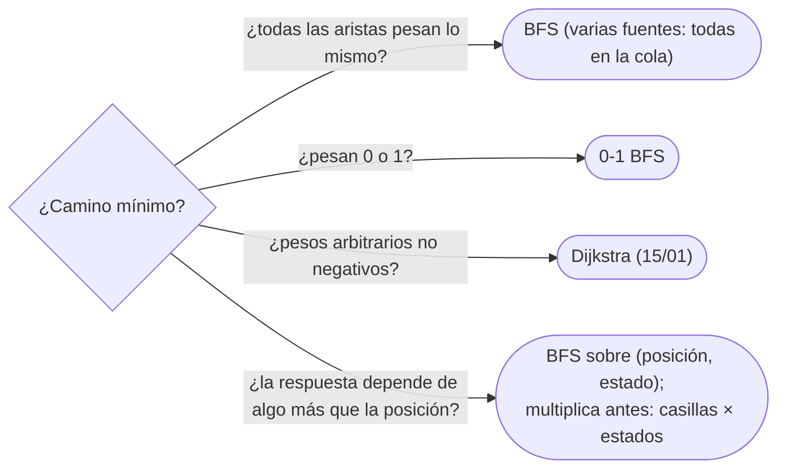

# 02 — BFS

> La búsqueda en anchura y su invariante por niveles: por qué la primera vez que llega a un vértice lo hace
> por un camino mínimo, por qué se marca al encolar y cómo se reconstruye el camino. Con sus tres
> extensiones de todos los días: varias fuentes a la vez y rejillas, aristas de peso 0 o 1 con una cola
> doble, y estados compuestos —posición más llaves, más saltos, más modo— como vértices de un grafo
> implícito.
>
> **Niveles:** BFS [A] · multifuente [A] · 0-1 BFS [A] · estados compuestos [A].
>
> **📚 Lectura troncal:** Cormen, Leiserson, Rivest y Stein, *Introduction to Algorithms*, 3.ª ed. (MIT
> Press, 2009), §22.2; Brassard y Bratley, *Fundamentos de algoritmia* (Prentice Hall, 1997), cap. 9.
>
> **Ruta corta:** sí.
>
> **Vigencia:** 2026-10-04.

**Salto rápido:** [1](#1--el-problema) · [2](#2--la-teoría) · [3](#3--bfs) · [4](#4--multifuente-y-rejillas) · [5](#5--0-1-bfs) · [6](#6--estados-compuestos) · [7](#7-️-la-tabla-de-costes) · [8](#8--cómo-se-elige) · [9](#9--señales-del-enunciado) · [🧠](#-preguntas) · [🧩](#-problemas-propios)

---

## 1. 🎯 El problema

En una red social de `n = 2·10⁵` personas, ¿a cuántos saltos de amistad está cada una de la persona `A`? Un
recorrido en profundidad llega a todos, pero no por el camino más corto: con los vecinos en otro orden,
llega a `F` por `A → C → E → B → D → F` cuando `A → B → D → F` tenía tres saltos. Probar todos los caminos
es exponencial.

La búsqueda en anchura (BFS) resuelve las distancias de todos los vértices en `Θ(n + m)` con una idea
simple: visitar por capas, primero todos los de distancia 1, después todos los de distancia 2. Y esa idea
se estira sin cambiar de algoritmo: varias fuentes a la vez, aristas de peso 0, y vértices que no son
lugares sino estados.

> 🧠 **Modelo mental.** Una mancha de tinta que se extiende un paso por turno desde la fuente: la primera
> vez que moja una casilla, lo hace por el camino más corto, porque todo lo que está más cerca ya estaba
> mojado.

Los ejemplos usan el grafo G de `14/01` **sin pesos** (las aristas `A–B`, `A–C`, `B–D`, `B–E`, `C–E`,
`D–F`, `E–F`) y, en §5, con los pesos leídos como peajes.

---

## 2. 📐 La teoría

**Distancia.** `δ(s, v)` es el número mínimo de aristas de un camino de `s` a `v` (∞ si no hay).

**El invariante por niveles.** En todo momento, la cola contiene vértices con distancia `d` seguidos de
vértices con distancia `d + 1`, para algún `d`, y nada más: las distancias en la cola son no decrecientes y
difieren como mucho en 1.

*Prueba por inducción sobre las operaciones.* Al principio solo está `s`, con `d = 0`. Al sacar un `u` de
distancia `d` (el frente), se encolan sus vecinos nuevos con `d + 1`, al final, detrás de los de `d + 1`
que ya hubiera. El invariante se mantiene.

**Teorema.** Cuando BFS asigna `dist[v] = dist[u] + 1`, vale `dist[v] = δ(s, v)`.

*Prueba.* `dist[v] ≥ δ(s, v)` siempre, porque `dist` se construye siguiendo un camino real. Para la otra
desigualdad, supón que `v` es, entre los vértices con distancia mal asignada, el de menor `δ(s, v)`, y sea
`w` su predecesor en un camino mínimo: `δ(s, w) = δ(s, v) − 1`, y `w` tiene su distancia correcta. Por el
invariante, los vértices salen de la cola con `dist` no decreciente. Al sacar `w`, o `v` ya estaba marcado
por un vértice que salió antes, con `dist ≤ dist[w]`, y entonces `dist[v] ≤ dist[w] + 1 = δ(s, v)`; o se
marca ahora con `dist[w] + 1 = δ(s, v)`. En los dos casos, `dist[v] ≤ δ(s, v)`: contradicción.

**Corolario: se marca al encolar.** Marcando al sacar, un vértice entra una vez por cada vecino procesado
antes y la cola crece hasta `Θ(m)`; marcando al encolar, entra una vez: `Θ(n + m)` por el lema de los grados.

---

## 3. 🧱 BFS

**Qué es.** Recorrido con una cola FIFO desde una o varias fuentes, que calcula `dist[v]` y `parent[v]`
(el vértice desde el que se descubrió `v`).

**Por qué es correcto.** El teorema de §2; `parent` forma un árbol de caminos mínimos: seguirlo desde `t`
hasta la fuente da un camino de longitud `dist[t]`.

**Cómo va**, en G desde `A` (las listas de vecinos en orden alfabético):

```text
sacar  cola después           dist asignadas         parent
A      B C                    B = 1, C = 1           B ← A, C ← A
B      C D E                  D = 2, E = 2           D ← B, E ← B
C      D E                    (E ya marcado)
D      E F                    F = 3                  F ← D
E      F                      (F ya marcado)
F      —
camino a F: F ← D ← B ← A  →  A B D F
```

**Cuánto.** `Θ(n + m)` tiempo, `Θ(n)` memoria extra.

**La plantilla**, con una lista de fuentes (con una sola, la lista tiene un elemento):

```cpp
#include <queue>
#include <vector>

// Distancias desde las fuentes en un grafo sin pesos; −1 = inalcanzable. parent para reconstruir caminos.
std::vector<int> bfs(const std::vector<std::vector<int>>& adj, const std::vector<int>& sources,
                     std::vector<int>& parent) {
    int n = adj.size();
    std::vector<int> dist(n, -1);
    parent.assign(n, -1);
    std::queue<int> q;
    for (int s : sources) { dist[s] = 0; q.push(s); }       // se marca al encolar
    while (!q.empty()) {
        int u = q.front(); q.pop();
        for (int v : adj[u])
            if (dist[v] == -1) { dist[v] = dist[u] + 1; parent[v] = u; q.push(v); }
    }
    return dist;
}

```

```java
import java.util.Arrays;

// Distancias desde las fuentes; la cola es un arreglo con cabeza y cola (cada vértice entra una vez).
static int[] bfs(int[][] adj, int[] sources, int[] parent) {
    int n = adj.length;
    int[] dist = new int[n], queue = new int[n];
    Arrays.fill(dist, -1);
    Arrays.fill(parent, -1);
    int head = 0, tail = 0;
    for (int s : sources) { dist[s] = 0; queue[tail++] = s; }
    while (head < tail) {
        int u = queue[head++];
        for (int v : adj[u])
            if (dist[v] == -1) { dist[v] = dist[u] + 1; parent[v] = u; queue[tail++] = v; }
    }
    return dist;
}
```

```python
from collections import deque

def bfs(adj, sources):
    """Distancias desde las fuentes (−1 = inalcanzable) y el arreglo de padres."""
    n = len(adj)
    dist, parent = [-1] * n, [-1] * n
    q = deque(sources)
    for s in sources:
        dist[s] = 0
    while q:
        u = q.popleft()
        for v in adj[u]:
            if dist[v] == -1:
                dist[v] = dist[u] + 1
                parent[v] = u
                q.append(v)
    return dist, parent
```

- **En Java**, la cola es un `int[n]` (cada vértice entra una vez) y `dist == -1` hace de visitado: sin
  objetos ni `ArrayDeque<Integer>`; el grafo, en `int[][]` o en la estrella hacia delante de `14/01`.
- **En Python**, `deque` y `popleft`; nunca `list.pop(0)`, que es lineal
  ([`03/04`](../03-biblioteca-estandar/04-python-para-competir.md)).
- **Reconstruir**: seguir `parent` desde `t` hasta `-1` y darle la vuelta (`std::reverse`,
  `Collections.reverse`, `[::-1]`); si `dist[t] == -1`, no hay camino.

### De la versión ingenua a la buena

**El problema.** Distancias en saltos desde `A` a todos los vértices.

**La versión ingenua:** relajar todas las aristas (en los dos sentidos) hasta que nada cambie, como mucho
`n − 1` rondas: `dist[v] = mín(dist[v], dist[u] + 1)`. Correcta, `Θ(n · m)`.

> «Esto es Bellman-Ford con pesos 1: correcto, pero `n · m` son `4·10¹⁰`. Con todos los pesos iguales, el
> orden en que se descubren los vértices ya es el orden de distancias: con una cola, cada vértice se fija
> la primera vez que se ve y cada arista se mira dos veces.»

**El camino a la buena.** Cola FIFO, marcar al encolar, `Θ(n + m)`.

**Cuándo sí:** distancias mínimas con todas las aristas del mismo peso; conectividad y componentes (aunque
DFS también sirve). **Cuándo no:** pesos distintos (Dijkstra, [`15/01`](../15-grafos-pesos-y-flujos/01-dijkstra.md)), salvo 0 y 1 (§5).

> **Veredicto:** BFS es el camino mínimo cuando todas las aristas pesan lo mismo: cola, marcar al encolar,
> `dist` y `parent`.

---

## 4. 🧱 Multifuente y rejillas

**Qué es.** La distancia de cada vértice a la **fuente más cercana** de un conjunto `S`: se encolan todas
las fuentes con distancia 0 al principio. La plantilla de §3 ya lo hace.

**Por qué es correcto.** Equivale a un BFS desde una superfuente `s*` unida a todas las de `S`, restando 1:
tras sacar `s*`, la cola son exactamente las fuentes con distancia 1. El invariante y el teorema de §2
valen sin cambios.

**Cómo va**, en G con `S = {A, F}`: `dist = A 0, F 0, B 1, C 1, D 1, E 1`. Cada vértice queda con la
distancia a la fuente más cercana, y `parent` lleva hasta ella. **Cuánto:** `Θ(n + m)`, con cualquier
número de fuentes.

**La plantilla** en rejilla: casillas `R × C`, paredes `#`, varias fuentes; el índice de una casilla es
`r · C + c`.

```cpp
#include <queue>
#include <string>
#include <vector>

// Distancia de cada casilla libre a la fuente más cercana (−1 = pared o inalcanzable).
std::vector<std::vector<int>> gridBfs(const std::vector<std::string>& g,
                                      const std::vector<std::pair<int, int>>& sources) {
    int R = g.size(), C = g[0].size();
    const int DR[4] = {-1, 1, 0, 0}, DC[4] = {0, 0, -1, 1};
    std::vector<std::vector<int>> dist(R, std::vector<int>(C, -1));
    std::queue<std::pair<int, int>> q;
    for (auto [r, c] : sources) { dist[r][c] = 0; q.push({r, c}); }
    while (!q.empty()) {
        auto [r, c] = q.front(); q.pop();
        for (int d = 0; d < 4; d++) {
            int r2 = r + DR[d], c2 = c + DC[d];
            if (r2 < 0 || r2 >= R || c2 < 0 || c2 >= C) continue;
            if (g[r2][c2] == '#' || dist[r2][c2] != -1) continue;
            dist[r2][c2] = dist[r][c] + 1;
            q.push({r2, c2});
        }
    }
    return dist;
}
```

```java
// Rejilla aplanada: casilla r · C + c; la cola es un int[R · C].
static int[] gridBfs(char[][] g, int[] sources) {
    int R = g.length, C = g[0].length;
    int[] DR = {-1, 1, 0, 0}, DC = {0, 0, -1, 1};
    int[] dist = new int[R * C], queue = new int[R * C];
    java.util.Arrays.fill(dist, -1);
    int head = 0, tail = 0;
    for (int s : sources) { dist[s] = 0; queue[tail++] = s; }
    while (head < tail) {
        int cur = queue[head++], r = cur / C, c = cur % C;
        for (int d = 0; d < 4; d++) {
            int r2 = r + DR[d], c2 = c + DC[d];
            if (r2 < 0 || r2 >= R || c2 < 0 || c2 >= C || g[r2][c2] == '#') continue;
            int nxt = r2 * C + c2;
            if (dist[nxt] == -1) { dist[nxt] = dist[cur] + 1; queue[tail++] = nxt; }
        }
    }
    return dist;
}
```

```python
from collections import deque

def grid_bfs(g, sources):
    """Distancia de cada casilla a la fuente más cercana; −1 = pared o inalcanzable."""
    R, C = len(g), len(g[0])
    dist = [[-1] * C for _ in range(R)]
    q = deque(sources)
    for r, c in sources:
        dist[r][c] = 0
    while q:
        r, c = q.popleft()
        for r2, c2 in ((r - 1, c), (r + 1, c), (r, c - 1), (r, c + 1)):
            if 0 <= r2 < R and 0 <= c2 < C and g[r2][c2] != '#' and dist[r2][c2] == -1:
                dist[r2][c2] = dist[r][c] + 1
                q.append((r2, c2))
    return dist
```

- **Aplanar** la rejilla a `r · C + c` ahorra pares y objetos (Java) y deja `dist` en un solo arreglo.
- **Comprobar los bordes antes** de leer `g[r2][c2]`; en Python, un índice `-1` no falla: lee la última
  fila. Ocho direcciones o saltos de caballo solo cambian `DR` y `DC`.

### De la versión ingenua a la buena

**El problema.** En una ciudad, `k` de los `n` cruces tienen hospital. ¿A cuántos tramos está cada cruce
del hospital más cercano?

**La versión ingenua:** un BFS por hospital y el mínimo por cruce. Correcta, `Θ(k · (n + m))`: cuadrática.

> «No me importa **cuál** hospital, solo el más cercano: meto todos en la cola con distancia 0 y hago un
> solo BFS. Es lo mismo que un BFS desde un vértice ficticio unido a todos.»

**El camino a la buena.** Todas las fuentes en la cola al principio: `Θ(n + m)`.

**Cuándo sí:** «la más cercana de varias», incendios o infecciones que se propagan desde varios puntos a la
vez, el tiempo hasta que todo se cubre. **Cuándo no:** si se pide la distancia a **cada** fuente por
separado (eso son `k` BFS).

> **Veredicto:** «la más cercana de un conjunto» es un BFS con todas las fuentes en la cola; en rejillas,
> casilla aplanada y vectores de dirección.

---

## 5. 🧱 0-1 BFS

**Qué es.** Camino mínimo cuando las aristas pesan 0 o 1. Se usa una **cola doble**: el vecino por una
arista de peso 0 entra por delante; el de peso 1, por detrás.

**Por qué es correcto.** Es Dijkstra (`15/01`) sin montículo: la cola doble guarda distancias `d` seguidas
de `d + 1`; una arista de 0 produce `d` (delante) y una de 1, `d + 1` (detrás), así que el frente es
siempre el mínimo, lo único que Dijkstra pide a su montículo. Un vértice puede **mejorar** después de
encolado (primero por una de 1, luego por una de 0): se relaja con `<` y la copia vieja no hace nada.

**Cómo va**, en G con peaje (1) en las carreteras de peso impar y gratis (0) las de peso par:

```text
sacar  dist       relaja                      cola doble después
A      A 0        B 0 (delante), C 0 (delante)   C B
C      C 0        E 1 (detrás)                   B E
B      B 0        D 1 (detrás), E no mejora      E D
E      E 1        F 2 (detrás)                   D F
D      D 1        F 1 (gratis: delante)          F F
F      F 1        —                              F   (la copia vieja, con dist ya 1: se ignora)
```

**Cuánto.** `Θ(n + m)`: cada vértice mejora como mucho una vez desde cada arista entrante.

**La plantilla:**

```cpp
#include <deque>
#include <vector>

// Aristas {vecino, peso} con peso 0 o 1. dist = INF si inalcanzable.
std::vector<int> bfs01(const std::vector<std::vector<std::pair<int, int>>>& adj, int s) {
    const int INF = 1e9;
    std::vector<int> dist(adj.size(), INF);
    std::deque<int> dq;
    dist[s] = 0; dq.push_back(s);
    while (!dq.empty()) {
        int u = dq.front(); dq.pop_front();
        for (auto [v, w] : adj[u])
            if (dist[u] + w < dist[v]) {
                dist[v] = dist[u] + w;
                if (w == 0) dq.push_front(v); else dq.push_back(v);
            }
    }
    return dist;
}
```


```python
from collections import deque

def bfs01(adj, s):
    """adj[u] = [(v, w)] con w en {0, 1}."""
    INF = float('inf')
    dist = [INF] * len(adj)
    dist[s] = 0
    dq = deque([s])
    while dq:
        u = dq.popleft()
        for v, w in adj[u]:
            if dist[u] + w < dist[v]:
                dist[v] = dist[u] + w
                (dq.appendleft if w == 0 else dq.append)(v)
    return dist
```

- **Se relaja con `<`**, no con «visitado»: un vértice puede entrar dos veces, y la segunda salida no
  relaja nada porque sus vecinos ya tienen distancias al menos tan buenas.
- **En Java** no se repite la plantilla: es la de C++ con `ArrayDeque<Integer>` (`addFirst`, `addLast`,
  `pollFirst`). Con `10⁶` casillas, el boxeo pesa: una cola doble circular sobre `int[]` de capacidad
  `2m + 1` (las inserciones totales no pasan de ahí) es más rápida.
- **Pesos 0 y `k`** sirven igual; pesos `0, 1, 2…` ya no (Dijkstra, o el BFS con `k + 1` colas).

### De la versión ingenua a la buena

La versión ingenua es Dijkstra con montículo: correcta, `Θ((n + m) log n)`.

> «Con pesos 0 y 1, el montículo solo tiene dos valores distintos a la vez: `d` y `d + 1`. Una cola doble
> los mantiene ordenados sin comparar: los de 0 delante, los de 1 detrás. Me quito el logaritmo.»

**Cuándo sí:** romper paredes (cada pared cuesta 1), cambiar de dirección o de línea de metro (cuesta 1,
seguir es gratis), aristas «de regalo». **Cuándo no:** pesos arbitrarios.

> **Veredicto:** con pesos 0 y 1, cola doble: 0 por delante, 1 por detrás, y relajar con `<`.

---

## 6. 🧱 Estados compuestos

**Qué es.** Cuando la distancia depende de algo más que la posición —llaves recogidas, saltos usados, el
modo de un interruptor—, el vértice es el **par (posición, estado)**. El grafo implícito tiene `n · K`
vértices, y BFS lo recorre igual.

**Por qué es correcto.** Es un BFS normal sobre otro grafo: el teorema de §2 vale tal cual. Lo que hay que
probar es que el estado elegido es **suficiente**: dos caminos que llegan al mismo `(posición, estado)`
tienen el mismo futuro.

**Cómo va.** En esta rejilla se puede atravesar **un** muro como mucho:

```text
S . # . .
. # # . #
. . . # T
```

Sin atravesar muros, `T` es inalcanzable. Con uno: `S ↓ ↓ → → → →`, 6 pasos; el quinto pisa el muro de
la fila 3 y el estado pasa de 0 a 1. El estado `(r, c, usados)` es suficiente: lo que importa del pasado es
cuántos saltos quedan, no dónde se gastaron.

**Cuánto.** `Θ(n · K + m · K)`: el número de estados por el de transiciones. Con `K` llaves de un conjunto,
`K = 2^llaves`.

**La plantilla**, en rejilla con `K` estados por casilla y una función de transición (aquí: atravesar como
mucho `K − 1` muros):

```cpp
#include <queue>
#include <string>
#include <vector>

// Pasos mínimos de (sr, sc) a T pudiendo atravesar hasta maxWalls muros. Estado: (r · C + c) · K + k.
int bfsWithState(const std::vector<std::string>& g, int sr, int sc, int maxWalls) {
    int R = g.size(), C = g[0].size(), K = maxWalls + 1;
    const int DR[4] = {-1, 1, 0, 0}, DC[4] = {0, 0, -1, 1};
    std::vector<int> dist(R * C * K, -1);
    std::queue<int> q;
    dist[(sr * C + sc) * K] = 0; q.push((sr * C + sc) * K);
    while (!q.empty()) {
        int st = q.front(); q.pop();
        int k = st % K, r = st / K / C, c = st / K % C;
        if (g[r][c] == 'T') return dist[st];                 // el primero que sale es el mínimo
        for (int d = 0; d < 4; d++) {
            int r2 = r + DR[d], c2 = c + DC[d];
            if (r2 < 0 || r2 >= R || c2 < 0 || c2 >= C) continue;
            int k2 = k + (g[r2][c2] == '#');                 // la transición del estado
            if (k2 >= K) continue;
            int nxt = (r2 * C + c2) * K + k2;
            if (dist[nxt] == -1) { dist[nxt] = dist[st] + 1; q.push(nxt); }
        }
    }
    return -1;
}
```

```python
from collections import deque

def bfs_with_state(g, sr, sc, max_walls):
    """Pasos mínimos de (sr, sc) a T atravesando hasta max_walls muros. Estado (r, c, k) en un dict."""
    R, C = len(g), len(g[0])
    dist = {(sr, sc, 0): 0}
    q = deque([(sr, sc, 0)])
    while q:
        r, c, k = q.popleft()
        if g[r][c] == 'T':
            return dist[(r, c, k)]
        for r2, c2 in ((r - 1, c), (r + 1, c), (r, c - 1), (r, c + 1)):
            if 0 <= r2 < R and 0 <= c2 < C:
                k2 = k + (g[r2][c2] == '#')
                if k2 <= max_walls and (r2, c2, k2) not in dist:
                    dist[(r2, c2, k2)] = dist[(r, c, k)] + 1
                    q.append((r2, c2, k2))
    return -1
```

- **Codificar el estado en un entero** (`(r · C + c) · K + k`) da un arreglo plano de distancias. **En
  Java** no se repite la plantilla: es la de C++ con un `int[R · C · K]` como cola, igual que en §4. El
  `dict` de Python es cómodo, pero con `10⁶` estados conviene el arreglo.
- **La salida en cuanto sale `T`**, con cualquier estado: el primero que sale tiene la menor distancia.
- **Llaves como máscara**: `k2 = k | (1 << llave)` al pisar una llave; una puerta exige `k >> puerta & 1`.

### De la versión ingenua a la buena

**La versión ingenua:** para cada muro, quitarlo y hacer un BFS; y uno más sin quitar ninguno. Correcta
para un salto, `Θ(W · R · C)` con `W` muros; con dos saltos ya serían `W²` BFS.

> «El pasado solo importa por cuántos saltos me quedan. Duplico la rejilla en capas, una por saltos usados,
> y pisar un muro me sube de capa: un BFS sobre `R · C · K` estados.»

**Cuándo sí:** llaves y puertas, saltos o bombas limitados, dirección actual, paridad del tiempo, un modo
que cambia. **Cuándo no:** si el estado no cabe (`2^20` llaves por `10⁶` casillas): hay que encontrar un
estado más pequeño.

> **Veredicto:** si el pasado importa, se mete en el vértice: (posición, lo mínimo que hay que recordar).
> Antes de escribir, se multiplica: casillas por estados.

---

## 7. ⏱️ La tabla de costes

| Variante | Tiempo | Memoria | Lo que la tabla no dice |
|---|---|---|---|
| BFS | `Θ(n + m)` | `Θ(n)` | Solo con todas las aristas del mismo peso |
| Multifuente | `Θ(n + m)` | `Θ(n)` | Da la distancia a la más cercana, no a cada una |
| 0-1 BFS | `Θ(n + m)` | `Θ(n + m)` la cola en el peor caso | Un vértice puede salir dos veces |
| Estados compuestos | `Θ(K · (n + m))` | `Θ(K · n)` | `K` puede ser `2^llaves`: se multiplica antes |

---

## 8. 🧭 Cómo se elige



> **Regla de entrevista:** antes de escribir el BFS, di qué es un vértice y qué es una arista. En rejillas
> con condiciones, la mitad de la nota está en la frase «el estado es (fila, columna, llaves)».

---

## 9. 🔎 Señales del enunciado

| Señal | Técnica | Por qué |
|---|---|---|
| «Número mínimo de pasos / movimientos / saltos» | BFS | Todas las aristas pesan 1 |
| «La más cercana», «desde varios puntos a la vez», «se propaga» | Multifuente | Una superfuente |
| «Romper paredes cuesta 1», «cambiar de dirección cuesta 1» | 0-1 BFS | Dos pesos: 0 y 1 |
| «Con llaves», «puedes usar `k` veces», «el interruptor cambia» | Estados compuestos | El pasado importa |
| Puzzles, candados, palabras que cambian una letra | BFS en grafo implícito | Los vecinos se generan |

---

## ⚠️ Errores frecuentes

| Se dice | Lo preciso |
|---|---|
| «DFS también da el camino más corto» | DFS llega por el camino que la recursión eligió; solo BFS garantiza el mínimo con pesos iguales |
| «Se marca visitado al sacar» | Se marca al encolar; si no, un vértice entra varias veces y la cola crece hasta `Θ(m)` |
| «Para varias fuentes, un BFS desde cada una» | Todas a la vez en la cola: un solo BFS |
| «0-1 BFS es BFS con visitados» | Un vértice puede mejorar después de encolado: se relaja con `<` |
| «El estado es solo la posición» | Si el futuro depende de llaves, saltos o modo, el estado los incluye |
| «BFS sirve con pesos si son pequeños» | Solo si son todos iguales (o 0 y 1); si no, Dijkstra |

---

## 📚 Para profundizar

- **Libro** — Cormen, Leiserson, Rivest y Stein, *Introduction to Algorithms*, 3.ª ed. (MIT Press, 2009),
  §22.2: BFS con la prueba de las distancias mínimas. *Lectura troncal.*
- **Libro** — Brassard y Bratley, *Fundamentos de algoritmia* (Prentice Hall, 1997), cap. 9: recorridos de
  grafos. *Lectura troncal.*
- **Referencia** — cp-algorithms, [*Breadth-first search*](https://cp-algorithms.com/graph/breadth-first-search.html).
- **Referencia** — cp-algorithms, [*0-1 BFS*](https://cp-algorithms.com/graph/01_bfs.html).
- **Visualización** — VisuAlgo, [*Graph Traversal (DFS/BFS)*](https://visualgo.net/en/dfsbfs).

---

## 🧠 Preguntas

1. ¿Qué garantiza BFS sobre la primera vez que visita un vértice, y con qué pesos? 🟢
2. ¿Por qué se marca visitado al encolar y no al sacar? 🟢
3. ¿Cómo se reconstruye el camino mínimo después de un BFS? 🟢
4. ¿Cómo haces un BFS desde varias fuentes, y qué distancia obtienes? 🟢
5. Enuncia el invariante de la cola en BFS. 🟡
6. ¿Por qué DFS no sirve para distancias mínimas sin pesos? Da un ejemplo pequeño. 🟡
7. ¿Qué cambia en 0-1 BFS respecto de BFS, y por qué un vértice puede salir dos veces? 🟡
8. ¿Qué cola usas para BFS en C++, Java y Python, y qué error de rendimiento es típico en cada uno? 🟡
9. Demuestra que BFS asigna a cada vértice su distancia mínima. 🟠
10. Demuestra que 0-1 BFS es correcto relacionándolo con Dijkstra. 🟠
11. En un laberinto con llaves y puertas, ¿cuál es el estado y cuántos estados hay? 🟠
12. Te piden el número de caminos mínimos de `s` a `t`. ¿Cómo adaptas BFS y por qué no cuenta de más? 🔴
13. Tu BFS en rejilla da TLE con `R = C = 1 000` y el grafo tiene `10⁶` casillas. ¿Qué miras? 🔴

---

## 🧩 Problemas propios

### Capas de la red

**Nivel:** 🟢 · **Formato:** programa completo.

En un grafo no dirigido, imprime cuántos vértices hay a cada distancia del vértice 1 (de 0 a la máxima) y
cuántos son inalcanzables.

- **Entrada.** Una línea con `n` y `m`. Después, `m` líneas con una arista `u v`.
- **Salida.** Una línea con los conteos por distancia separados por espacios; otra con los inalcanzables.
- **Restricciones.** `1 ≤ n ≤ 2·10⁵`; `0 ≤ m ≤ 2·10⁵`.

```text
Entrada     Salida
6 7         1 2 2 1
1 2         0
1 3
2 4
2 5
3 5
4 6
5 6

Entrada     Salida
7 3         1 1 1
1 2         4
2 3
4 5
```

**Pista 1:** ¿qué te da BFS desde 1, y cómo lo conviertes en conteos?

### Cuántos caminos mínimos

**Nivel:** 🟡 · **Formato:** programa completo.

Imprime la longitud del camino más corto de 1 a `n` en un grafo no dirigido y cuántos caminos de esa
longitud hay, módulo `10⁹ + 7`. Si no hay camino, imprime `-1 0`.

- **Entrada.** Una línea con `n` y `m`. Después, `m` líneas con una arista `u v` (sin repetidas).
- **Salida.** Dos enteros.
- **Restricciones.** `2 ≤ n ≤ 2·10⁵`; `0 ≤ m ≤ 2·10⁵`.

```text
Entrada     Salida
6 7         3 3
1 2
1 3
2 4
2 5
3 5
4 6
5 6

Entrada     Salida
4 2         -1 0
1 2
3 4
```

**Pista 1:** si `v` está a distancia `d`, ¿desde qué vértices puede venir el último paso de un camino
mínimo?

### El interruptor

**Nivel:** 🟠 · **Formato:** programa completo.

Una rejilla tiene casillas libres `.`, paredes `#`, la salida `S` y la meta `T`, puertas `x` (cerradas al
principio) y puertas `o` (abiertas al principio), e interruptores `*`. Cada vez que entras en un
interruptor, todas las puertas cambian: las `x` se abren y las `o` se cierran, o al revés. No puedes entrar
en una puerta cerrada. ¿Cuántos pasos necesitas, como mínimo, para llegar a `T`? Imprime `-1` si no se
puede.

- **Entrada.** Una línea con `R` y `C`. Después, `R` líneas con la rejilla.
- **Salida.** Un entero.
- **Restricciones.** `1 ≤ R, C ≤ 1 000`; hay exactamente una `S` y una `T`.

```text
Entrada     Salida
2 5         6
S.x.T
*.#o.

Entrada     Salida
1 4         -1
Sx.T
```

**Pista 1:** si llegas a la misma casilla con las puertas en posiciones distintas, ¿tienes el mismo futuro?

---

## 🧩 Práctica externa

> 💡 **Truco.** En los problemas de rejilla, escribe primero en una línea qué es el estado y cuántos hay,
> antes de pedir ayuda. Si una IA te ayuda, que sea a encontrar el caso que tu estado no distingue, no a
> escribir el BFS ([`01/06`](../01-oficio-del-competidor/06-protocolo-de-resolucion.md)).

Codility no tiene lecciones de grafos.

### Núcleo

| ✔ | Problema | Plataforma | Nivel | Patrón | Pista 1 |
|---|---|---|---|---|---|
| [ ] | [Message Route](https://cses.fi/problemset/task/1667) | CSES | 🟢 | BFS y reconstrucción | ¿Qué guardas al descubrir cada vértice para poder escribir el camino? |
| [ ] | [Shortest Path in Binary Matrix](https://leetcode.com/problems/shortest-path-in-binary-matrix/) | LeetCode | 🟡 | BFS en rejilla con 8 direcciones | ¿Cuántos vecinos tiene una casilla aquí? |
| [ ] | [Nearest Exit from Entrance in Maze](https://leetcode.com/problems/nearest-exit-from-entrance-in-maze/) | LeetCode | 🟡 | BFS en rejilla | ¿Cuándo es una casilla una salida, y la entrada lo es? |
| [ ] | [Rotting Oranges](https://leetcode.com/problems/rotting-oranges/) | LeetCode | 🟡 | Multifuente | ¿Desde cuántas naranjas empieza la podredumbre a la vez? |
| [ ] | [Open the Lock](https://leetcode.com/problems/open-the-lock/) | LeetCode | 🟡 | BFS en grafo implícito | ¿Cuántos vecinos tiene una combinación de cuatro ruedas? |
| [ ] | [Jump Game III](https://leetcode.com/problems/jump-game-iii/) | LeetCode | 🟡 | Grafo implícito sobre índices | ¿Qué aristas salen de la posición `i`? |
| [ ] | [Labyrinth](https://cses.fi/problemset/task/1193) | CSES | 🟡 | BFS en rejilla y camino | ¿Cómo escribes el camino como letras `U D L R`? |

### Ampliación

| ✔ | Problema | Plataforma | Nivel | Patrón | Pista 1 |
|---|---|---|---|---|---|
| [ ] | [Minimum Obstacle Removal to Reach Corner](https://leetcode.com/problems/minimum-obstacle-removal-to-reach-corner/) | LeetCode | 🟠 | 0-1 BFS | ¿Cuánto cuesta entrar en una casilla libre y en una con obstáculo? |
| [ ] | [Minimum Cost to Make at Least One Valid Path in a Grid](https://leetcode.com/problems/minimum-cost-to-make-at-least-one-valid-path-in-a-grid/) | LeetCode | 🟠 | 0-1 BFS | Seguir la flecha, ¿cuánto cuesta? ¿Y cambiarla? |
| [ ] | [Monsters](https://cses.fi/problemset/task/1194) | CSES | 🟠 | Multifuente y comparación | ¿Cuándo llega el monstruo más rápido a cada casilla? |
| [ ] | [Word Ladder](https://leetcode.com/problems/word-ladder/) | LeetCode | 🔴 | BFS en grafo implícito | ¿Cómo encuentras los vecinos de una palabra sin compararla con todas? |
| [ ] | [Shortest Path to Get All Keys](https://leetcode.com/problems/shortest-path-to-get-all-keys/) | LeetCode | 🔴 | Estados compuestos | ¿Qué hay que recordar además de la posición, y cuántos valores tiene? |

---

## ✅ Criterio de dominio

- Escribir BFS con `dist` y `parent`, multifuente y en rejilla, en los tres lenguajes sin mirar.
- Demostrar el invariante por niveles y por qué se marca al encolar.
- Reconocer 0-1 BFS y explicar por qué un vértice puede salir dos veces.
- Elegir el estado de un BFS compuesto y multiplicar su tamaño antes de escribir.
- Resolver Rotting Oranges y Open the Lock sin pista 2.

---

**Anterior:** [`14/01` — Representaciones y su coste](01-representaciones.md) · **Siguiente:** [`14/03` — DFS](03-dfs.md) ·
**Relacionado:** [`15/01` — Dijkstra](../15-grafos-pesos-y-flujos/01-dijkstra.md); [`06/01` — Pila, cola, deque y sus versiones monótonas](../06-lineales-y-hashing/01-pilas-colas-y-monotonas.md).
