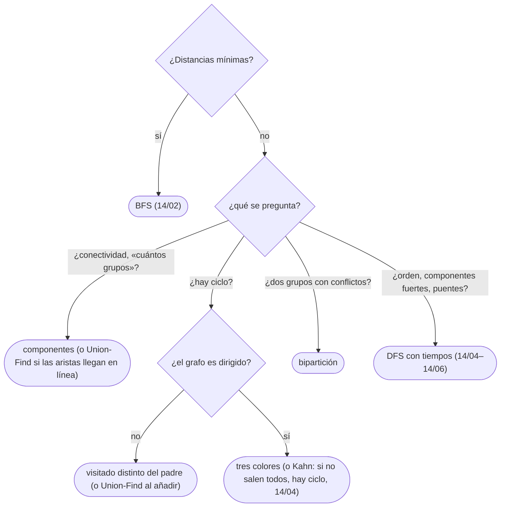

# 03 — DFS

> La búsqueda en profundidad con sus tiempos de entrada y salida, y lo que se deduce de ellos: el teorema
> del paréntesis, las componentes conexas, los ciclos —con la distinción entre no dirigido y dirigido, que
> exige tres colores— y la bipartición. Con la versión iterativa por la pila, que es la que no revienta en
> Java ni en Python, y la clasificación de aristas que usan los capítulos siguientes.
>
> **Niveles:** DFS [A] · componentes [A] · ciclos [A] · bipartición [A] · clasificación de aristas [B].
>
> **📚 Lectura troncal:** Cormen, Leiserson, Rivest y Stein, *Introduction to Algorithms*, 3.ª ed. (MIT
> Press, 2009), §22.3; Brassard y Bratley, *Fundamentos de algoritmia* (Prentice Hall, 1997), cap. 9.
>
> **Asume leído:** [`14/02` — BFS](02-bfs.md).
>
> **Ruta corta:** sí.
>
> **Vigencia:** 2026-10-04.

**Salto rápido:** [1](#1--el-problema) · [2](#2--la-teoría) · [3](#3--dfs) · [4](#4--componentes) · [5](#5--ciclos) · [6](#6--bipartición) · [7](#7--clasificación-de-aristas) · [8](#8-️-la-tabla-de-costes) · [9](#9--cómo-se-elige) · [10](#10--señales-del-enunciado) · [🧠](#-preguntas) · [🧩](#-problemas-propios)

---

## 1. 🎯 El problema

Un sistema de compilación tiene `2·10⁵` módulos y cada uno declara de cuáles depende. Antes de compilar
hay que saber si hay una dependencia circular. La intuición «recorro el grafo y, si llego a un vértice ya
visitado, hay ciclo» falla: en el DAG D, `A → B → E` y `A → C → E` llegan dos veces a `E` sin que haya
ciclo. Lo que distingue un ciclo es volver a un vértice **que todavía está en la pila de la recursión**.

La búsqueda en profundidad (DFS) no da distancias —eso es BFS—, pero su orden de entrada y salida responde
a otras preguntas en `Θ(n + m)`: qué vértices están conectados, si hay ciclos, si el grafo se puede
colorear con dos colores, y, en los capítulos siguientes, el orden topológico, las componentes fuertes y los
puentes.

> 🧠 **Modelo mental.** Recorrer un laberinto con un ovillo de hilo: avanzar mientras haya pasillos sin
> explorar, y retroceder por el hilo cuando no. Los vértices «con hilo» —en la pila— son los grises.

Los ejemplos usan el grafo G de [`14/01`](01-representaciones.md) sin pesos y el DAG D (`A → B, C · B → D, E · C → E · D → F ·
E → F`), con los vecinos en orden alfabético.

---

## 2. 📐 La teoría

**Colores y tiempos.** Cada vértice empieza **blanco** (no descubierto), se vuelve **gris** al entrar
(`tin[v]`) y **negro** al terminar con todos sus vecinos (`tout[v]`). Con un contador que sube en cada
entrada y cada salida, `tin` y `tout` toman valores de 1 a `2n`.

**Teorema del paréntesis.** Para dos vértices `u`, `v`, los intervalos `[tin[u], tout[u]]` y
`[tin[v], tout[v]]` son disjuntos o uno contiene al otro; y `v` es descendiente de `u` en el bosque del DFS
si y solo si el de `v` está dentro del de `u`.

*Prueba.* Si `tin[u] < tin[v]` y `v` se descubre mientras `u` es gris, `v` entra en la pila encima de `u`
y sale antes: anidado, y `v` es descendiente. Si `v` se descubre con `u` ya negro, `tout[u] < tin[v]`:
disjuntos. No hay otro caso, porque la pila es LIFO.

**Teorema del camino blanco** (CLRS 22.9). `v` es descendiente de `u` si y solo si, en el instante
`tin[u]`, hay un camino de `u` a `v` formado solo por vértices blancos.

**Ciclo en un dirigido ↔ arista de retroceso.** Una arista `u → v` con `v` **gris** al examinarla.

*Prueba.* (⇐) Si `v` es gris, está en la pila por debajo de `u`: es un antecesor, y el camino del árbol de
`v` a `u` más la arista `u → v` es un ciclo. (⇒) Sea `v` el primer vértice del ciclo que se descubre y `u`
su predecesor en el ciclo. En `tin[v]`, el resto del ciclo es blanco: por el camino blanco, `u` será
descendiente de `v`, y cuando `u` examine `u → v`, `v` seguirá gris.

**Bipartito ↔ sin ciclos impares.** (⇒) Un ciclo alterna lados: tiene longitud par. (⇐) Colorea cada
vértice por la paridad de su profundidad en el árbol del DFS. En un no dirigido, toda arista que no es del
árbol une un vértice con un antecesor; si los dos tienen el mismo color, su diferencia de profundidad es par
y la arista cierra un ciclo impar.

---

## 3. 🧱 DFS

**Qué es.** Recorrido que avanza al primer vecino blanco y retrocede al agotar los vecinos, registrando
`tin`, `tout` y `parent`.

**Por qué es correcto.** Visita todo lo alcanzable: si `v` es alcanzable desde `s` y no se visitara, el
primer vértice no visitado de un camino `s ⇝ v` tendría un predecesor visitado que lo habría descubierto.

**Cómo va**, en G desde `A`:

```text
entra A (1) → B (2) → D (3) → F (4) → E (5) → C (6)    C: A y E ya grises → sale C (7)
sale E (8), F (9), D (10), B (11), A (12)
intervalos: A [1,12] ⊃ B [2,11] ⊃ D [3,10] ⊃ F [4,9] ⊃ E [5,8] ⊃ C [6,7]
árbol: A – B – D – F – E – C (un camino: el DFS de G es muy profundo)
```

**Cuánto.** `Θ(n + m)` tiempo; `Θ(n)` de pila (de la recursión o explícita).

**La plantilla**, sobre todo el grafo (un árbol del bosque por cada vértice blanco):

```cpp
#include <vector>

// DFS recursivo con tiempos. tin = 0 marca «blanco». Profundidad n: en C++ cabe con n ≈ 2·10⁵.
struct Dfs {
    const std::vector<std::vector<int>>& adj;
    std::vector<int> tin, tout, parent;
    int timer = 0;
    explicit Dfs(const std::vector<std::vector<int>>& g)
        : adj(g), tin(g.size(), 0), tout(g.size(), 0), parent(g.size(), -1) {
        for (int s = 0; s < (int)g.size(); s++) if (!tin[s]) visit(s);
    }
    void visit(int u) {
        tin[u] = ++timer;
        for (int v : adj[u]) if (!tin[v]) { parent[v] = u; visit(v); }
        tout[u] = ++timer;
    }
};
```

```java
// DFS iterativo con tiempos: la pila guarda el vértice; it[u] es el próximo vecino por mirar.
static int[] tin, tout, parent;

static void dfsAll(int[][] adj) {
    int n = adj.length, timer = 0;
    tin = new int[n]; tout = new int[n]; parent = new int[n];
    java.util.Arrays.fill(parent, -1);
    int[] it = new int[n], stack = new int[n];
    for (int s = 0; s < n; s++) {
        if (tin[s] != 0) continue;
        int top = 0;
        stack[top++] = s; tin[s] = ++timer;
        while (top > 0) {
            int u = stack[top - 1];
            if (it[u] < adj[u].length) {
                int v = adj[u][it[u]++];
                if (tin[v] == 0) { parent[v] = u; tin[v] = ++timer; stack[top++] = v; }
            } else {
                tout[u] = ++timer; top--;                    // todos los vecinos vistos: sale
            }
        }
    }
}
```

```python
def dfs_all(adj):
    """DFS iterativo con tiempos; tin[v] = 0 marca «blanco»."""
    n = len(adj)
    tin, tout, parent, it = [0] * n, [0] * n, [-1] * n, [0] * n
    timer = 0
    for s in range(n):
        if tin[s]:
            continue
        timer += 1
        tin[s] = timer
        stack = [s]
        while stack:
            u = stack[-1]
            if it[u] < len(adj[u]):
                v = adj[u][it[u]]
                it[u] += 1
                if not tin[v]:
                    parent[v] = u
                    timer += 1
                    tin[v] = timer
                    stack.append(v)
            else:
                timer += 1
                tout[u] = timer
                stack.pop()
    return tin, tout, parent
```

- **El índice `it[u]`** es lo que hace al iterativo idéntico al recursivo: el vértice se queda en la pila
  hasta agotar sus vecinos, y su salida (`tout`) ocurre en el mismo instante.
- **En C++**, la recursión con `n = 2·10⁵` suele caber: muchos jueces dan tanta pila como memoria; con
  `10⁶` en una cadena, o si el juez no lo garantiza, el iterativo.
- **En Java**, la pila por defecto revienta hacia `10⁴`–`10⁵` niveles: iterativo, o el hilo con pila grande
  ([`03/03`](../03-biblioteca-estandar/03-java-colecciones.md)).
- **En Python**, siempre iterativo: el límite de recursión es 1 000 y subirlo no da más pila de C
  ([`03/04`](../03-biblioteca-estandar/04-python-para-competir.md)).
- **Si no hacen falta los tiempos**, basta una pila de vértices: sacar, marcar, apilar vecinos blancos. El
  orden de visita cambia, pero alcanza lo mismo.

### De la versión ingenua a la buena

**El problema.** Recorrer una cadena de `2·10⁵` vértices en Java.

**La versión ingenua:** el DFS recursivo de C++ traducido a Java. Correcto, y da `StackOverflowError` en el
caso más grande.

> «La recursión guarda en la pila de la JVM lo mismo que puedo guardar yo: el vértice y por qué vecino iba.
> Con una pila explícita y el índice `it[u]`, el recorrido es idéntico, con los mismos tiempos, y la
> profundidad ya no importa.»

**El camino a la buena.** Pila explícita con `it[u]`, o recursión en un hilo con pila de 256 MB.

**Cuándo sí:** conectividad, ciclos, bipartición, orden topológico, componentes fuertes, puentes; todo lo
que usa la estructura de antecesores. **Cuándo no:** distancias mínimas (BFS).

> **Veredicto:** DFS con `tin`, `tout` y `parent`; iterativo con `it[u]` en Java y Python, recursivo en C++
> mientras la profundidad quepa.

---

## 4. 🧱 Componentes

**Qué es.** Las clases de «hay un camino entre ellos» en un no dirigido. Un recorrido desde cada vértice
aún no visitado etiqueta una componente entera.

**Por qué es correcto.** Un recorrido desde `s` visita exactamente lo alcanzable desde `s` (§3), que en un
no dirigido es su componente.

**Cómo va.** En el grafo de 8 vértices con aristas `1–2, 2–3, 3–4, 5–6`: desde 1 se etiquetan `{1, 2, 3, 4}`
con 0; desde 5, `{5, 6}` con 1; 7 y 8 quedan solos con 2 y 3. Cuatro componentes. **Cuánto:** `Θ(n + m)`.

**La plantilla:**

```cpp
#include <vector>

// comp[v] = número de componente; devuelve cuántas hay. Pila explícita.
int components(const std::vector<std::vector<int>>& adj, std::vector<int>& comp) {
    int n = adj.size(), c = 0;
    comp.assign(n, -1);
    std::vector<int> stack;
    for (int s = 0; s < n; s++) {
        if (comp[s] != -1) continue;
        comp[s] = c; stack.push_back(s);
        while (!stack.empty()) {
            int u = stack.back(); stack.pop_back();
            for (int v : adj[u]) if (comp[v] == -1) { comp[v] = c; stack.push_back(v); }
        }
        c++;
    }
    return c;
}
```

```java
static int components(int[][] adj, int[] comp) {
    int n = adj.length, c = 0;
    java.util.Arrays.fill(comp, -1);
    int[] stack = new int[n];
    for (int s = 0; s < n; s++) {
        if (comp[s] != -1) continue;
        int top = 0;
        comp[s] = c; stack[top++] = s;
        while (top > 0) {
            int u = stack[--top];
            for (int v : adj[u]) if (comp[v] == -1) { comp[v] = c; stack[top++] = v; }
        }
        c++;
    }
    return c;
}
```

```python
def components(adj):
    """Etiqueta de componente por vértice y número de componentes."""
    n = len(adj)
    comp = [-1] * n
    c = 0
    for s in range(n):
        if comp[s] != -1:
            continue
        comp[s] = c
        stack = [s]
        while stack:
            u = stack.pop()
            for v in adj[u]:
                if comp[v] == -1:
                    comp[v] = c
                    stack.append(v)
        c += 1
    return comp, c
```

- **Se marca al apilar**, como en BFS: cada vértice entra una vez y la pila nunca pasa de `n`.
- **Tamaños**: contar por etiqueta. **Rejillas**: igual, con la casilla aplanada y los vectores de
  dirección de `14/02`.
- **Si las aristas llegan poco a poco** y se pregunta entre medias, Union-Find
  ([`08/04`](../08-heaps-y-union-find/04-union-find.md)) es mejor que recorrer de nuevo.

### De la versión ingenua a la buena

**La versión ingenua:** para cada par `(u, v)`, un BFS para ver si se alcanzan, y agrupar. Correcta,
`Θ(n² (n + m))`.

> «Un recorrido no responde solo por un par: me da la componente entera de su origen. Así que un recorrido
> por componente, empezando en el primer vértice sin etiqueta, basta.»

**El camino a la buena.** Barrido de los vértices y un recorrido desde cada uno sin etiqueta: `Θ(n + m)`.

**Cuándo sí:** contar islas, regiones, grupos de amigos; «cuántas aristas faltan para conectar» (las
componentes menos 1). **Cuándo no:** dirigidos, donde «conectado» se parte en dos nociones ([`14/05`](05-componentes-fuertes-y-2sat.md)).

> **Veredicto:** un recorrido por cada vértice sin etiqueta: `comp[v]` y el número de componentes en
> `Θ(n + m)`.

---

## 5. 🧱 Ciclos

**Qué es.** Detectar (y encontrar) un ciclo. **No dirigido:** una arista a un vértice ya visitado que no es
el padre. **Dirigido:** una arista a un vértice **gris**; un negro no indica ciclo.

**Por qué es correcto.** En el no dirigido, el DFS solo tiene aristas del árbol y de retroceso, y una de
retroceso a un antecesor que no es el padre cierra un ciclo (con aristas múltiples, la arista al padre
cuenta si es otra copia: se compara el índice de la arista, no el vértice). En el dirigido, el teorema de
§2.

**Cómo va**, en D: el DFS desde `A` examina `E → F` con `F` ya **negro**, y `C → E` con `E` negro: no hay
ciclo, aunque dos veces llega a un visitado. Si se añade `F → B`, al examinarla `B` está **gris** (en la
pila `A, B, D, F`): ciclo `B → D → F → B`.

**Cuánto.** `Θ(n + m)`.

**La plantilla**, en dirigido con tres colores, devolviendo un ciclo:

```cpp
#include <algorithm>
#include <vector>

// Ciclo en un dirigido: color 0 blanco, 1 gris, 2 negro. Devuelve los vértices del ciclo, o vacío.
struct CycleFinder {
    const std::vector<std::vector<int>>& adj;
    std::vector<int> color, parent, cycle;
    explicit CycleFinder(const std::vector<std::vector<int>>& g)
        : adj(g), color(g.size(), 0), parent(g.size(), -1) {
        for (int s = 0; s < (int)g.size() && cycle.empty(); s++) if (!color[s]) visit(s);
    }
    bool visit(int u) {
        color[u] = 1;
        for (int v : adj[u]) {
            if (color[v] == 1) {                             // arista de retroceso: hay ciclo
                for (int x = u; x != v; x = parent[x]) cycle.push_back(x);
                cycle.push_back(v);
                std::reverse(cycle.begin(), cycle.end());
                return true;
            }
            if (color[v] == 0) { parent[v] = u; if (visit(v)) return true; }
        }
        color[u] = 2;
        return false;
    }
};
```

```python
def has_directed_cycle(adj):
    """Tres colores, iterativo: True si hay una arista a un vértice gris."""
    n = len(adj)
    color, it = [0] * n, [0] * n
    for s in range(n):
        if color[s]:
            continue
        color[s] = 1
        stack = [s]
        while stack:
            u = stack[-1]
            if it[u] < len(adj[u]):
                v = adj[u][it[u]]
                it[u] += 1
                if color[v] == 1:
                    return True
                if color[v] == 0:
                    color[v] = 1
                    stack.append(v)
            else:
                color[u] = 2
                stack.pop()
    return False
```

- **En Java**, la estructura es la de §3 con `color` en lugar de `tin`: gris al apilar, negro al desapilar,
  y ciclo si `adj[u][it[u]]` es gris. No se repite.
- **Reconstruir**: seguir `parent` desde `u` hasta `v` (el gris) y añadir `v`; en el iterativo, el ciclo es
  el tramo de la pila desde `v` hasta la cima.
- **No dirigido**: un solo color basta, más `parent` (o el índice de la arista por la que se llegó).

### De la versión ingenua a la buena

**La versión ingenua:** para cada vértice `u`, un recorrido desde `u` para ver si vuelve a `u`. Correcta,
`Θ(n (n + m))`.

> «No necesito preguntar por cada vértice: un solo DFS encuentra un ciclo en cuanto examina una arista
> hacia un vértice que todavía está en la pila. Por eso el gris: el negro es un camino que ya terminó y no
> me lleva de vuelta.»

**El camino a la buena.** Tres colores, un solo DFS: `Θ(n + m)`.

**Cuándo sí:** dependencias circulares, deadlocks en grafos de espera, validar que un grafo es un DAG antes
de ordenarlo ([`14/04`](04-orden-topologico.md)). **Cuándo no:** si se pide el ciclo **más corto**, que es un BFS desde cada vértice.

> **Veredicto:** en dirigido, ciclo = arista a un gris; en no dirigido, arista a un visitado que no es el
> padre (por arista, no por vértice, si hay repetidas).

---

## 6. 🧱 Bipartición

**Qué es.** Colorear con dos colores de modo que toda arista una colores distintos, o probar que no se
puede. Equivale a no tener ciclos impares (§2).

**Por qué es correcto.** En cada componente, el color de un vértice fija el de sus vecinos: el recorrido
propaga la única coloración posible (salvo intercambiar los dos colores) y solo falla si una arista une dos
del mismo color, que es la evidencia de un ciclo impar.

**Cómo va**, en G desde `A` con color 0: `B, C` 1; `D, E` 0; `F` 1. Ninguna arista une colores iguales: G
es bipartito (`{A, D, E}` y `{B, C, F}`). Si se añade `B–C`, los dos tienen color 1: el triángulo
`A, B, C` es impar. **Cuánto:** `Θ(n + m)`.

**La plantilla.** En C++ y Java es la de componentes de §4 con dos cambios, y no se repite: al apilar
`v`, `color[v] = color[u] ^ 1` en lugar de la etiqueta; y si `v` ya tiene color y es igual al de `u`,
`return false`. En Python, completa:

```python
def bipartite(adj):
    """Colores 0/1 por vértice, o None si hay un ciclo impar."""
    color = [-1] * len(adj)
    for s in range(len(adj)):
        if color[s] != -1:
            continue
        color[s] = 0
        stack = [s]
        while stack:
            u = stack.pop()
            for v in adj[u]:
                if color[v] == -1:
                    color[v] = color[u] ^ 1
                    stack.append(v)
                elif color[v] == color[u]:
                    return None
    return color
```

- **Por componentes**: un grafo con varias es bipartito si cada una lo es; olvidar el bucle externo es el
  error clásico.
- **Con una cola** en lugar de la pila funciona igual: lo que cuenta es la propagación, no el orden.
- **Variante con Union-Find** (`08/04`): «`u` y `v` en lados distintos» con paridad en la unión, útil si
  las restricciones llegan en línea.

### De la versión ingenua a la buena

**La versión ingenua:** probar las `2ⁿ` coloraciones. Correcta, inútil a partir de `n = 30`.

> «El color de un vértice obliga el de todos sus vecinos: no hay nada que elegir salvo el primero de cada
> componente. Propago y, si choco, tengo un ciclo impar.»

**Cuándo sí:** dos equipos, dos turnos, «enemigos en grupos distintos», emparejamientos ([`15/06`](../15-grafos-pesos-y-flujos/06-emparejamientos.md)).
**Cuándo no:** con tres colores el problema es NP-completo: no hay propagación que lo resuelva.

> **Veredicto:** bipartito = propagar dos colores por componente y fallar en una arista monocolor; la
> evidencia es un ciclo impar.

---

## 7. 🧱 Clasificación de aristas

**Qué es.** En un DFS de un dirigido, cada arista `u → v` es de un tipo según el color de `v` al
examinarla:

| Color de `v` | Condición extra | Tipo | Ejemplo en D |
|---|---|---|---|
| Blanco | — | Del árbol | `A → B`, `B → D`, `D → F`, `B → E`, `A → C` |
| Gris | — | De retroceso | `F → B`, si se añade |
| Negro | `tin[u] < tin[v]` | De avance (a un descendiente) | `A → F`, si se añade |
| Negro | `tin[u] > tin[v]` | De cruce | `E → F`, `C → E` |

**Por qué es correcto.** Es el teorema del paréntesis: un negro con `tin[v] > tin[u]` se descubrió y
terminó dentro del intervalo de `u` (descendiente); con `tin[v] < tin[u]`, su intervalo terminó antes de
empezar el de `u` (otra rama). En un **no dirigido** solo hay aristas del árbol y de retroceso.

**Cuánto.** `Θ(n + m)`: es el mismo DFS con una comparación más.

**Dónde se usa:** el retroceso detecta ciclos (§5); el postorden y la ausencia de retroceso dan el orden
topológico (`14/04`); `low[v]`, el mínimo `tin` alcanzable con una arista de retroceso, da las componentes
fuertes (`14/05`) y los puentes ([`14/06`](06-puentes-articulacion-y-euler.md)). En C++ y Java es una línea en la plantilla de §3: dentro del
bucle de vecinos, `if (tin[v] == 0) árbol; else if (tout[v] == 0) retroceso; else if (tin[u] < tin[v])
avance; else cruce;` (con `tout[v] == 0` como «gris»).

---

## 8. ⏱️ La tabla de costes

| Tarea | Técnica | Tiempo | Lo que la tabla no dice |
|---|---|---|---|
| Recorrer, tiempos | DFS | `Θ(n + m)` | Pila de profundidad `n`: iterativo en Java y Python |
| Componentes | Recorrido por vértice sin etiqueta | `Θ(n + m)` | Con aristas en línea, Union-Find |
| Ciclo no dirigido | Arista a visitado que no es el padre | `Θ(n + m)` | Con aristas repetidas, comparar índices |
| Ciclo dirigido | Tres colores | `Θ(n + m)` | Visitado no basta |
| Bipartición | Propagar dos colores | `Θ(n + m)` | Por componentes |

---

## 9. 🧭 Cómo se elige



> **Regla de entrevista:** al detectar un ciclo dirigido, nombra los tres colores en voz alta antes de que
> te lo pregunten: «visitado no basta; necesito saber si el vértice sigue en la pila».

---

## 10. 🔎 Señales del enunciado

| Señal | Técnica | Por qué |
|---|---|---|
| «Islas», «regiones», «grupos conectados» | Componentes | Un recorrido por región |
| «Dependencias», «¿se puede terminar?», «prerrequisitos» | Ciclo dirigido | Un ciclo impide el orden |
| «Dos equipos», «enemigos», «colorear con dos» | Bipartición | Sin ciclos impares |
| «Todos los caminos de `s` a `t`» en un DAG | DFS con vuelta atrás | Enumerar ([`10/02`](../10-busqueda-completa-y-divide-y-venceras/02-generar-subconjuntos-y-permutaciones.md)) |
| «Desde el borde», «lo que no toca el borde» | Recorrido desde el borde | Invertir la pregunta |

---

## ⚠️ Errores frecuentes

| Se dice | Lo preciso |
|---|---|
| «Para detectar ciclo en dirigido basta con visitado» | Hace falta el gris: llegar a un negro (`E` en D) no es ciclo |
| «En no dirigido, cualquier visitado es ciclo» | El padre no cuenta; con aristas repetidas, se compara la arista |
| «DFS recursivo vale siempre» | En Java y Python revienta con profundidad `10⁵`: iterativo |
| «Bipartito se comprueba desde el vértice 0» | Hay que recorrer todas las componentes |
| «El iterativo con pila da el mismo orden» | Solo con el índice `it[u]`; apilando todos los vecinos, el orden y los tiempos cambian |

---

## 📚 Para profundizar

- **Libro** — Cormen, Leiserson, Rivest y Stein, *Introduction to Algorithms*, 3.ª ed. (MIT Press, 2009),
  §22.3: DFS, paréntesis, camino blanco y clasificación de aristas. *Lectura troncal.*
- **Libro** — Brassard y Bratley, *Fundamentos de algoritmia* (Prentice Hall, 1997), cap. 9: recorridos en
  profundidad. *Lectura troncal.*
- **Referencia** — cp-algorithms, [*Depth First Search*](https://cp-algorithms.com/graph/depth-first-search.html).
- **Referencia** — cp-algorithms, [*Checking a graph for acyclicity and finding a cycle*](https://cp-algorithms.com/graph/finding-cycle.html).
- **Referencia** — cp-algorithms, [*Check whether a graph is bipartite*](https://cp-algorithms.com/graph/bipartite-check.html).

---

## 🧠 Preguntas

1. ¿Qué significan los colores blanco, gris y negro en un DFS? 🟢
2. ¿Cómo cuentas las componentes conexas de un grafo no dirigido? 🟢
3. ¿Qué condición indica un ciclo en un grafo no dirigido? 🟢
4. ¿Por qué no basta «visitado» para detectar un ciclo en un dirigido? 🟡
5. Enuncia el teorema del paréntesis. 🟡
6. ¿Cómo escribes un DFS iterativo que dé los mismos tiempos que el recursivo? 🟡
7. ¿Cómo compruebas si un grafo es bipartito, y qué olvida la gente? 🟡
8. ¿Qué hace cada lenguaje con un DFS recursivo de profundidad `2·10⁵`, y cómo lo resuelves? 🟡
9. Demuestra que un dirigido tiene ciclo si y solo si el DFS encuentra una arista de retroceso. 🟠
10. Demuestra que un grafo es bipartito si y solo si no tiene ciclos impares. 🟠
11. ¿Qué tipos de arista hay en un DFS de un dirigido, y por qué en un no dirigido solo dos? 🟠
12. ¿Cuándo prefieres Union-Find a un DFS para componentes o ciclos? 🟠
13. ¿Cómo reconstruyes el ciclo que encontró el DFS? 🔴
14. Cuentas las formas de repartir a `n` personas en dos turnos con conflictos. ¿Cuál es la fórmula? 🔴

---

## 🧩 Problemas propios

### Grupos aislados

**Nivel:** 🟢 · **Formato:** programa completo.

Imprime el número de componentes conexas de un grafo no dirigido y el tamaño de la mayor.

- **Entrada.** Una línea con `n` y `m`. Después, `m` líneas con una arista `u v`.
- **Salida.** Dos enteros.
- **Restricciones.** `1 ≤ n ≤ 2·10⁵`; `0 ≤ m ≤ 2·10⁵`.

```text
Entrada     Salida
8 4         4 4
1 2
2 3
3 4
5 6

Entrada     Salida
3 0         3 1
```

**Pista 1:** ¿qué devuelve un recorrido desde un vértice sin etiquetar, y cuánto mide?

### Repartos en dos turnos

**Nivel:** 🟡 · **Formato:** programa completo.

`n` empleados, `m` pares que no pueden coincidir en el mismo turno. ¿De cuántas formas se puede asignar a
cada empleado uno de dos turnos (A o B) sin conflictos? Módulo `10⁹ + 7`.

- **Entrada.** Una línea con `n` y `m`. Después, `m` líneas con un par `u v`.
- **Salida.** Un entero.
- **Restricciones.** `1 ≤ n ≤ 2·10⁵`; `0 ≤ m ≤ 2·10⁵`.

```text
Entrada     Salida
6 7         2
1 2
1 3
2 4
2 5
3 5
4 6
5 6

Entrada     Salida
3 3         0
1 2
2 3
1 3
```

**Pista 1:** si fijas el turno de un empleado, ¿cuántas opciones le quedan al resto de su componente?

### La primera dependencia circular

**Nivel:** 🟠 · **Formato:** programa completo.

Se añaden `m` dependencias dirigidas `u → v`, una tras otra. Imprime el número de la primera cuya llegada
crea un ciclo (las dependencias se numeran desde 1), o `-1` si nunca se forma ninguno.

- **Entrada.** Una línea con `n` y `m`. Después, `m` líneas con una arista `u v`.
- **Salida.** Un entero.
- **Restricciones.** `1 ≤ n ≤ 10⁵`; `1 ≤ m ≤ 2·10⁵`.

```text
Entrada     Salida
4 6         5
1 2
2 3
3 4
1 3
4 2
4 1

Entrada     Salida
3 3         -1
1 2
2 3
1 3
```

**Pista 1:** si con las `k` primeras ya hay ciclo, ¿lo hay con las `k + 1` primeras?

---

## 🧩 Práctica externa

> 💡 **Truco.** Antes de pedir ayuda con un ciclo dirigido, traza a mano tu DFS en un ejemplo con dos
> caminos que confluyen, como D. Si una IA te ayuda, que sea a encontrar el grafo pequeño donde tu
> condición falla, no a escribir el DFS ([`01/06`](../01-oficio-del-competidor/06-protocolo-de-resolucion.md)).

Codility no tiene lecciones de grafos.

### Núcleo

| ✔ | Problema | Plataforma | Nivel | Patrón | Pista 1 |
|---|---|---|---|---|---|
| [ ] | [Number of Islands](https://leetcode.com/problems/number-of-islands/) | LeetCode | 🟡 | Componentes en rejilla | ¿Cuántas veces lanzas un recorrido? |
| [ ] | [Max Area of Island](https://leetcode.com/problems/max-area-of-island/) | LeetCode | 🟡 | Componentes con tamaño | ¿Qué devuelve el recorrido además de marcar? |
| [ ] | [Is Graph Bipartite?](https://leetcode.com/problems/is-graph-bipartite/) | LeetCode | 🟡 | Bipartición | ¿El grafo es conexo? |
| [ ] | [Building Teams](https://cses.fi/problemset/task/1668) | CSES | 🟡 | Bipartición con salida | ¿Qué equipo le toca a un vértice si fijas el de su vecino? |
| [ ] | [Round Trip](https://cses.fi/problemset/task/1669) | CSES | 🟡 | Ciclo no dirigido y reconstrucción | ¿Qué arista te avisa de un ciclo, y cuál no cuenta? |
| [ ] | [Round Trip II](https://cses.fi/problemset/task/1678) | CSES | 🟠 | Ciclo dirigido y reconstrucción | ¿Qué color tiene que tener el vértice al que llegas? |
| [ ] | [All Paths From Source to Target](https://leetcode.com/problems/all-paths-from-source-to-target/) | LeetCode | 🟡 | DFS con vuelta atrás en DAG | ¿Por qué aquí no hace falta marcar visitados? |

### Ampliación

| ✔ | Problema | Plataforma | Nivel | Patrón | Pista 1 |
|---|---|---|---|---|---|
| [ ] | [Surrounded Regions](https://leetcode.com/problems/surrounded-regions/) | LeetCode | 🟡 | Recorrido desde el borde | ¿Qué regiones **no** se capturan? |
| [ ] | [Pacific Atlantic Water Flow](https://leetcode.com/problems/pacific-atlantic-water-flow/) | LeetCode | 🟡 | Recorrido inverso desde dos bordes | ¿Y si el agua subiera desde el océano? |
| [ ] | [Find Eventual Safe States](https://leetcode.com/problems/find-eventual-safe-states/) | LeetCode | 🟡 | Tres colores | ¿Qué color tienen al final los vértices que llevan a un ciclo? |
| [ ] | [Detect Cycles in 2D Grid](https://leetcode.com/problems/detect-cycles-in-2d-grid/) | LeetCode | 🟡 | Ciclo no dirigido en rejilla | ¿De qué casilla vienes, y por qué esa no cuenta? |
| [ ] | [Roads and Libraries](https://www.hackerrank.com/challenges/torque-and-development/problem) | HackerRank | 🟡 | Componentes y coste | En una componente de tamaño `k`, ¿qué dos opciones hay? |

---

## ✅ Criterio de dominio

- Escribir el DFS iterativo con `it[u]` y los tiempos en Java o Python sin mirar.
- Demostrar el criterio de ciclo dirigido y el de bipartición.
- Detectar y reconstruir un ciclo, dirigido o no, con el criterio correcto para cada uno.
- Contar componentes y bipartir por componentes, sin olvidar el bucle externo.
- Resolver Round Trip II y Find Eventual Safe States sin pista 2.

---

**Anterior:** [`14/02` — BFS](02-bfs.md) · **Siguiente:** [`14/04` — Orden topológico y DP sobre DAG](04-orden-topologico.md) ·
**Relacionado:** [`08/04` — Union-Find](../08-heaps-y-union-find/04-union-find.md); [`14/05` — Componentes fuertemente conexas y 2-SAT](05-componentes-fuertes-y-2sat.md).
