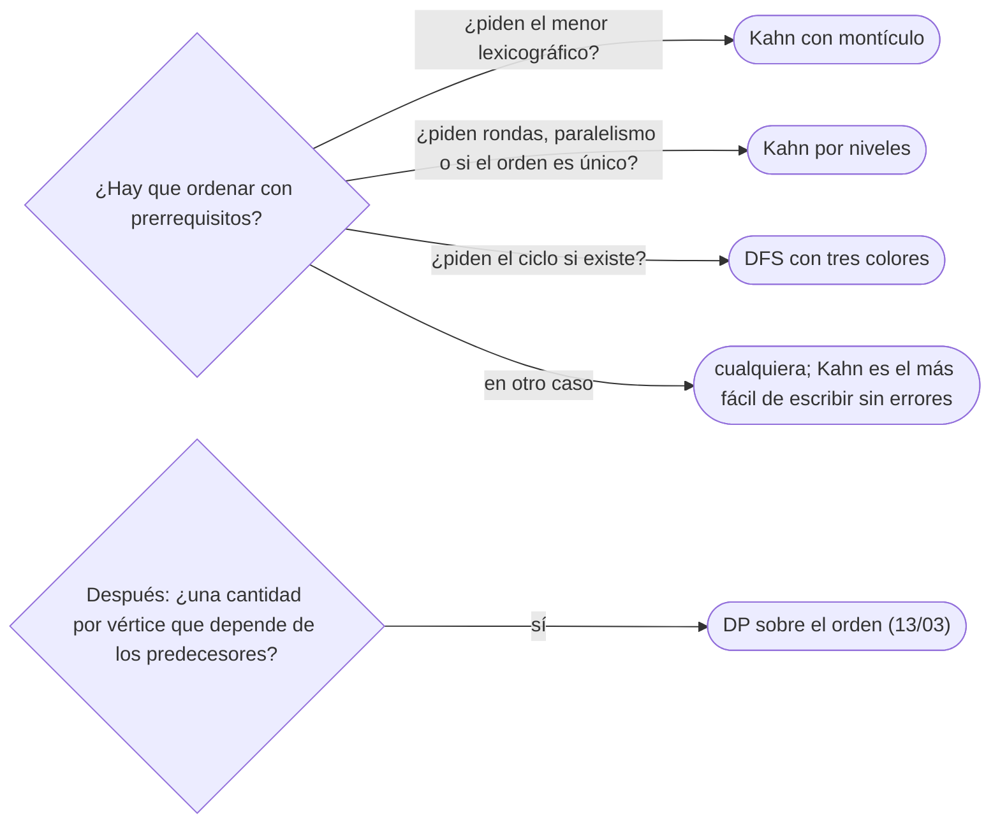

# 04 — Orden topológico y DP sobre DAG

> Ordenar los vértices de un grafo dirigido para que toda arista vaya hacia delante, y detectar que no se
> puede: el algoritmo de Kahn, que quita fuentes con una cola, y el postorden invertido de un DFS. Con la
> prueba de que existe orden si y solo si no hay ciclos, por qué no es único, el orden lexicográfico mínimo
> con un montículo y la DP que recorre un DAG en ese orden.
>
> **Niveles:** Kahn [A] · por DFS [A].
>
> **📚 Lectura troncal:** Cormen, Leiserson, Rivest y Stein, *Introduction to Algorithms*, 3.ª ed. (MIT
> Press, 2009), §22.4; Sedgewick y Wayne, *Algorithms*, 4.ª ed. (Addison-Wesley, 2011), §4.2.
>
> **Asume leído:** [`14/03` — DFS](03-dfs.md).
>
> **Ruta corta:** sí.
>
> **Vigencia:** 2026-10-04.

**Salto rápido:** [1](#1--el-problema) · [2](#2--la-teoría) · [3](#3--kahn) · [4](#4--por-dfs) · [5](#5--la-dp-sobre-el-orden) · [6](#6-️-la-tabla-de-costes) · [7](#7--cómo-se-elige) · [8](#8--señales-del-enunciado) · [🧠](#-preguntas) · [🧩](#-problemas-propios)

---

## 1. 🎯 El problema

Un monorepo tiene `10⁵` módulos y cada uno declara de cuáles depende. El sistema de compilación necesita una
secuencia en la que cada módulo aparezca después de todas sus dependencias; y si hay una dependencia
circular, tiene que decirlo en lugar de quedarse colgado. Probar permutaciones es `n!`; y la idea «compilo
primero los que tienen menos dependencias» falla en cuanto una dependencia tiene a su vez otras.

Un **orden topológico** es justo esa secuencia, y existe exactamente cuando el grafo no tiene ciclos. Hay
dos algoritmos lineales para encontrarlo, y los dos detectan el ciclo. Además, el orden es la columna
vertebral de toda DP sobre un DAG: calcular cada vértice después de sus predecesores.

> 🧠 **Modelo mental.** Desvestirse: no puedes quitarte la camisa antes que el jersey. Kahn quita en cada
> paso una prenda que no tiene nada encima; el DFS se viste al revés: anota cada prenda cuando ya no queda
> nada debajo.

Los ejemplos usan el DAG D de [`14/01`](01-representaciones.md): `A → B, C · B → D, E · C → E · D → F · E → F`, con los vecinos en
orden alfabético.

---

## 2. 📐 La teoría

**Orden topológico.** Una permutación `v₁, …, vₙ` de los vértices de un dirigido tal que toda arista
`vᵢ → vⱼ` cumple `i < j`.

**Teorema.** Un dirigido tiene orden topológico si y solo si no tiene ciclos (es un DAG).

*Prueba.* (⇒) En un ciclo `u₁ → u₂ → … → u₁`, cada vértice tendría que ir antes que el siguiente, y el
último antes que el primero: imposible. (⇐) Todo DAG con vértices tiene una **fuente** (grado de entrada
0): si no, partiendo de cualquier vértice y retrocediendo por aristas de entrada, a los `n + 1` pasos se
repite un vértice, y eso es un ciclo. Se pone la fuente primera; quitarla deja un DAG con `n − 1` vértices,
y por inducción se ordena el resto. Esa prueba **es** el algoritmo de Kahn.

**El postorden invertido es un orden topológico.** En un DFS de un DAG, para toda arista `u → v` vale
`tout[v] < tout[u]`.

*Prueba.* Al examinar `u → v` desde `u` (gris): si `v` es blanco, se vuelve descendiente de `u` y termina
antes (paréntesis, `14/03`); si es negro, ya terminó; gris no puede ser, porque sería una arista de
retroceso y habría ciclo. Ordenando por `tout` decreciente, toda arista va hacia delante.

**No es único.** D tiene cinco órdenes topológicos: `ABCDEF`, `ABCEDF`, `ABDCEF`, `ACBDEF` y `ACBEDF`. El
orden es único si y solo si en cada paso de Kahn hay exactamente una fuente; equivalentemente, si el DAG
tiene un camino que pasa por todos los vértices (y entonces es el orden).

---

## 3. 🧱 Kahn

**Qué es.** Calcular el grado de entrada de cada vértice; meter en una cola las fuentes; sacar una,
añadirla al orden y restar 1 al grado de cada sucesor, encolando los que llegan a 0.

**Por qué es correcto.** Es la prueba de §2: cada vértice se añade cuando todos sus predecesores ya están
en el orden. Si al terminar hay menos de `n` vértices en el orden, los restantes tienen siempre grado de
entrada positivo dentro de lo que queda: ese resto contiene un ciclo.

**Cómo va**, en D:

```text
cola    saca  orden    grados de entrada que bajan
A       A     A        B 1→0, C 1→0  (se encolan B y C)
B C     B     AB       D 1→0, E 2→1
C D     C     ABC      E 1→0
D E     D     ABCD     F 2→1
E       E     ABCDE    F 1→0
F       F     ABCDEF   —   6 = n: es un DAG
```

**Cuánto.** `Θ(n + m)`; con un montículo en lugar de la cola, `Θ(n log n + m)`.

**La plantilla:**

```cpp
#include <queue>
#include <vector>

// Orden topológico por Kahn. Devuelve vacío si hay ciclo (el orden queda con menos de n vértices).
std::vector<int> kahn(const std::vector<std::vector<int>>& adj) {
    int n = adj.size();
    std::vector<int> indeg(n, 0), order;
    for (int u = 0; u < n; u++) for (int v : adj[u]) indeg[v]++;
    std::queue<int> q;                                  // min-heap aquí para el lexicográfico mínimo
    for (int v = 0; v < n; v++) if (indeg[v] == 0) q.push(v);
    while (!q.empty()) {
        int u = q.front(); q.pop();
        order.push_back(u);
        for (int v : adj[u]) if (--indeg[v] == 0) q.push(v);
    }
    if ((int)order.size() < n) order.clear();           // hay ciclo
    return order;
}
```

```java
// Orden topológico por Kahn; null si hay ciclo. La cola es el propio arreglo del orden.
static int[] kahn(int[][] adj) {
    int n = adj.length;
    int[] indeg = new int[n], order = new int[n];
    for (int[] out : adj) for (int v : out) indeg[v]++;
    int head = 0, tail = 0;
    for (int v = 0; v < n; v++) if (indeg[v] == 0) order[tail++] = v;
    while (head < tail) {
        int u = order[head++];
        for (int v : adj[u]) if (--indeg[v] == 0) order[tail++] = v;
    }
    return tail == n ? order : null;
}
```

```python
from collections import deque

def kahn(adj):
    """Orden topológico, o None si hay ciclo."""
    n = len(adj)
    indeg = [0] * n
    for out in adj:
        for v in out:
            indeg[v] += 1
    q = deque(v for v in range(n) if indeg[v] == 0)
    order = []
    while q:
        u = q.popleft()
        order.append(u)
        for v in adj[u]:
            indeg[v] -= 1
            if indeg[v] == 0:
                q.append(v)
    return order if len(order) == n else None
```

- **El truco de Java**: la cola de Kahn es el arreglo del orden; lo que sale ya está en su sitio.
- **Lexicográfico mínimo**: cambiar la cola por un montículo de mínimos (`priority_queue` con `greater`,
  `PriorityQueue<Integer>`, `heapq`). Sale siempre la menor fuente disponible, y eso da el menor orden
  posible: si la menor fuente no fuera primera, ningún orden podría empezar por algo menor.
- **Por niveles**: si se procesa la cola ronda a ronda, cada ronda son los vértices que pueden hacerse en
  paralelo, y el número de rondas es el camino más largo en vértices.
- **Detectar el ciclo** es gratis (`order.size() < n`), pero Kahn no lo **encuentra**: para imprimirlo,
  tres colores (`14/03`).

### De la versión ingenua a la buena

**El problema.** ¿Hay **un único** orden de compilación? (Si hay varios, el sistema tiene libertad y las
compilaciones pueden diferir en el orden.)

**La versión ingenua:**

```java
// Correcta: cuenta órdenes por vuelta atrás hasta encontrar dos. Exponencial con muchos órdenes parciales.
static int countUpTo2(int[][] adj, int[] indeg, boolean[] used, int placed) {
    if (placed == adj.length) return 1;
    int total = 0;
    for (int v = 0; v < adj.length && total < 2; v++) {
        if (used[v] || indeg[v] != 0) continue;
        used[v] = true;
        for (int w : adj[v]) indeg[w]--;
        total += countUpTo2(adj, indeg, used, placed + 1);
        for (int w : adj[v]) indeg[w]++;
        used[v] = false;
    }
    return Math.min(total, 2);
}
```

> «No hace falta contar. En Kahn, si en algún momento hay dos fuentes en la cola, puedo sacar cualquiera de
> las dos primero: ya hay dos órdenes. Y si nunca hay dos, cada paso estaba obligado. Basta mirar el tamaño
> de la cola en cada paso.»

**El camino a la buena.** Kahn comprobando `q.size() ≤ 1` antes de cada extracción: `Θ(n + m)`. En D, la
cola tiene `B C` en el segundo paso: no es único.

**Cuándo sí:** dependencias, planificación de tareas, compilación, evaluación de hojas de cálculo, todo
orden con prerrequisitos; cuando además interesan las rondas o el orden lexicográfico. **Cuándo no:** si
hay ciclos y hay que tratarlos (componentes fuertes, [`14/05`](05-componentes-fuertes-y-2sat.md)).

> **Veredicto:** Kahn es la prueba de existencia convertida en algoritmo: grados de entrada y una cola; el
> montículo da el menor orden, y menos de `n` vértices delatan un ciclo.

---

## 4. 🧱 Por DFS

**Qué es.** Un DFS sobre todo el grafo que añade cada vértice a una lista **al terminar**; la lista
invertida es un orden topológico. Con tres colores, una arista a un gris delata el ciclo.

**Por qué es correcto.** El teorema del postorden de §2.

**Cómo va**, en D:

```text
entra A → B → D → F        sale F, sale D            postorden: F D
          B → E            (E → F: F negro) sale E    postorden: F D E
     sale B                                          postorden: F D E B
     A → C (C → E: E negro) sale C, sale A           postorden: F D E B C A
invertido: A C B E D F      (otro de los cinco órdenes de D, distinto del de Kahn)
```

**Cuánto.** `Θ(n + m)`.

**La plantilla:**

```cpp
#include <algorithm>
#include <vector>

// Postorden invertido con tres colores. Devuelve vacío si encuentra una arista a un gris (ciclo).
struct TopoDfs {
    const std::vector<std::vector<int>>& adj;
    std::vector<int> color, order;
    bool cyclic = false;
    explicit TopoDfs(const std::vector<std::vector<int>>& g) : adj(g), color(g.size(), 0) {
        for (int s = 0; s < (int)g.size() && !cyclic; s++) if (!color[s]) visit(s);
        if (cyclic) order.clear(); else std::reverse(order.begin(), order.end());
    }
    void visit(int u) {
        color[u] = 1;
        for (int v : adj[u]) {
            if (color[v] == 1) { cyclic = true; return; }
            if (color[v] == 0) { visit(v); if (cyclic) return; }
        }
        color[u] = 2;
        order.push_back(u);                              // al terminar: postorden
    }
};
```

```java
// Iterativo con it[u] (14/03): al desapilar, el vértice va al postorden. null si hay ciclo.
static int[] topoDfs(int[][] adj) {
    int n = adj.length, k = n;
    int[] color = new int[n], it = new int[n], stack = new int[n], order = new int[n];
    for (int s = 0; s < n; s++) {
        if (color[s] != 0) continue;
        int top = 0;
        stack[top++] = s; color[s] = 1;
        while (top > 0) {
            int u = stack[top - 1];
            if (it[u] < adj[u].length) {
                int v = adj[u][it[u]++];
                if (color[v] == 1) return null;              // arista de retroceso
                if (color[v] == 0) { color[v] = 1; stack[top++] = v; }
            } else {
                color[u] = 2; top--;
                order[--k] = u;                              // se llena desde el final: ya invertido
            }
        }
    }
    return order;
}
```

```python
def topo_dfs(adj):
    """Postorden invertido, iterativo; None si hay ciclo."""
    n = len(adj)
    color, it, post = [0] * n, [0] * n, []
    for s in range(n):
        if color[s]:
            continue
        color[s] = 1
        stack = [s]
        while stack:
            u = stack[-1]
            if it[u] < len(adj[u]):
                v = adj[u][it[u]]
                it[u] += 1
                if color[v] == 1:
                    return None
                if color[v] == 0:
                    color[v] = 1
                    stack.append(v)
            else:
                color[u] = 2
                stack.pop()
                post.append(u)
    return post[::-1]
```

- **En Java**, llenar el orden desde el final (`order[--k]`) ahorra la inversión.
- **Recursivo en C++** mientras la profundidad quepa; en Java y Python, siempre el iterativo de `14/03`.
- **El postorden sin invertir** es un orden topológico del grafo con las aristas al revés: útil cuando se
  quiere procesar «primero lo que no depende de nada aguas abajo».

### De la versión ingenua a la buena

**El problema.** Un gestor de paquetes desinstala todo: cada paquete se puede quitar cuando ningún otro
instalado depende de él. Con la arista `u → v` como «`u` depende de `v`», ¿en qué orden?

**La versión ingenua:** buscar, entre los que quedan, uno del que nadie dependa; quitarlo y repetir.
Correcta, `Θ(n · (n + m))` si la búsqueda recorre todo cada vez.

> «Quitar primero lo que nadie necesita es poner cada paquete antes que sus dependencias: el orden
> topológico del grafo tal cual. Un DFS lo da en una pasada: el postorden pone cada paquete **después** de
> todo lo que depende de él… al revés; lo invierto.»

**El camino a la buena.** DFS con postorden invertido, `Θ(n + m)`; o Kahn con los grados de entrada.

**Cuándo sí:** cuando ya hay un DFS en marcha (se obtiene el orden de paso), en componentes fuertes
(Kosaraju usa el postorden, `14/05`), o para encontrar el ciclo además de detectarlo. **Cuándo no:** si se
pide el lexicográfico mínimo o las rondas: eso es Kahn.

> **Veredicto:** el postorden de un DFS, invertido, es un orden topológico; con tres colores, el mismo
> recorrido da el ciclo si lo hay.

---

## 5. 🧱 La DP sobre el orden

Toda DP sobre un DAG se calcula recorriendo el orden topológico: cada vértice, después de todos sus
predecesores. Con los pesos de D (`A→B 2`, `A→C 4`, `B→D 3`, `B→E 1`, `C→E 7`, `D→F 2`, `E→F 5`), en el
orden `ABCDEF`:

```text
camino más largo desde A:  A 0, B 2, C 4, D 5, E max(2+1, 4+7) = 11, F max(5+2, 11+5) = 16
número de caminos desde A: A 1, B 1, C 1, D 1, E 2, F 3
```

El camino más largo, NP-difícil en general, es lineal en un DAG porque el orden elimina los ciclos. Las
recurrencias, sus variantes (más corto, contar, ruta crítica) y sus plantillas son de
[`13/03`](../13-dp-avanzada/03-dp-en-arboles-y-dag.md); lo que este capítulo añade es de dónde sale el
orden y qué hacer si no existe.

---

## 6. ⏱️ La tabla de costes

| Algoritmo | Tiempo | Detecta ciclo | Lo encuentra | Lo que la tabla no dice |
|---|---|---|---|---|
| Kahn con cola | `Θ(n + m)` | Sí (`< n`) | No | Da rondas y unicidad gratis |
| Kahn con montículo | `Θ(n log n + m)` | Sí | No | El lexicográfico mínimo |
| DFS postorden | `Θ(n + m)` | Sí (gris) | Sí | Pila: iterativo en Java y Python |
| DP sobre el orden | `Θ(n + m)` | — | — | Cualquier recurrencia sobre predecesores |

---

## 7. 🧭 Cómo se elige



> **Regla de entrevista:** di primero «esto es un orden topológico; si hay ciclo no existe», y elige Kahn
> salvo que necesites el ciclo: se escribe sin recursión y la detección es una comparación.

---

## 8. 🔎 Señales del enunciado

| Señal | Técnica | Por qué |
|---|---|---|
| «Prerrequisitos», «dependencias», «antes de» | Orden topológico | Es la definición |
| «¿Se pueden completar todas?» | Kahn y `< n` | Existe orden ↔ no hay ciclo |
| «Mínimo número de semestres / rondas» | Kahn por niveles | Camino más largo en vértices |
| «El menor orden lexicográfico» | Kahn con montículo | La menor fuente disponible |
| «Orden de letras de un alfabeto desconocido» | Aristas por la primera diferencia + orden | Cada par de palabras da una arista |
| «Camino más largo», «ruta crítica» en un DAG | DP sobre el orden | `13/03` |

---

## ⚠️ Errores frecuentes

| Se dice | Lo preciso |
|---|---|
| «El orden topológico es único» | D tiene cinco; es único solo si en cada paso de Kahn hay una sola fuente |
| «El preorden de un DFS es un orden topológico» | Es el postorden **invertido**; el preorden falla con caminos que confluyen |
| «Kahn encuentra el ciclo» | Lo detecta (`< n`), no lo devuelve; para eso, tres colores |
| «Ordenar por grado de entrada basta» | El grado cambia al quitar vértices; hay que actualizarlo, que es Kahn |
| «Con BFS desde la fuente sale el orden» | BFS ordena por distancia: con `A → B → C` y `A → C`, puede sacar `C` antes que `B` |
| «Lexicográfico mínimo = Kahn con cola y fuentes ordenadas» | La cola no reordena lo que entra después: hace falta un montículo |

---

## 📚 Para profundizar

- **Libro** — Cormen, Leiserson, Rivest y Stein, *Introduction to Algorithms*, 3.ª ed. (MIT Press, 2009),
  §22.4: orden topológico por DFS con su prueba. *Lectura troncal.*
- **Libro** — Sedgewick y Wayne, *Algorithms*, 4.ª ed. (Addison-Wesley, 2011), §4.2: dígrafos, ciclos y
  orden topológico. *Lectura troncal.*
- **Referencia** — Sedgewick y Wayne, [código de `Topological.java`](https://algs4.cs.princeton.edu/42digraph/Topological.java.html).
- **Referencia** — cp-algorithms, [*Topological Sorting*](https://cp-algorithms.com/graph/topological-sort.html).

---

## 🧠 Preguntas

1. ¿Qué es un orden topológico y cuándo existe? 🟢
2. Describe el algoritmo de Kahn. 🟢
3. ¿Cómo detecta Kahn que hay un ciclo? 🟢
4. ¿Por qué el orden topológico no es único? Da un ejemplo con cuatro vértices. 🟡
5. ¿Cómo obtienes el orden topológico lexicográficamente menor, y cuánto cuesta? 🟡
6. ¿Cómo calculas el número mínimo de rondas si cada ronda hace en paralelo todo lo disponible? 🟡
7. ¿Qué cola o montículo usas en C++, Java y Python para Kahn y su versión lexicográfica? 🟡
8. Demuestra que todo DAG tiene una fuente y que, por tanto, tiene orden topológico. 🟠
9. Demuestra que el postorden invertido de un DFS es un orden topológico. 🟠
10. ¿Cómo sabes si el orden topológico es único sin enumerarlos? 🟠
11. Te dan palabras ordenadas en un alfabeto desconocido. ¿Cómo reconstruyes el orden de las letras y qué casos dan «imposible»? 🔴
12. ¿Por qué el camino más largo es lineal en un DAG si es NP-difícil en general? 🔴

---

## 🧩 Problemas propios

### ¿Es un orden válido?

**Nivel:** 🟢 · **Formato:** programa completo.

Dado un grafo dirigido y una permutación de sus vértices, imprime `YES` si toda arista va de un vértice
anterior a uno posterior en la permutación, y `NO` si no.

- **Entrada.** Una línea con `n` y `m`. Después, `m` líneas con una arista `u v`. Al final, una línea con la
  permutación.
- **Salida.** `YES` o `NO`.
- **Restricciones.** `1 ≤ n ≤ 2·10⁵`; `0 ≤ m ≤ 2·10⁵`.

```text
Entrada         Salida
6 7             YES
1 2
1 3
2 4
2 5
3 5
4 6
5 6
1 3 2 5 4 6

Entrada         Salida
3 0             YES
3 2 1
```

Con la misma red y la permutación `1 2 4 6 3 5`, la salida es `NO`.

**Pista 1:** ¿qué necesitas saber de cada vértice para comprobar una arista en `O(1)`?

### Semestres

**Nivel:** 🟡 · **Formato:** programa completo.

Un plan de estudios tiene `n` cursos y `m` prerrequisitos «`u` antes que `v`». Cada semestre puedes cursar
todos los que tengan sus prerrequisitos aprobados. ¿Cuántos semestres necesitas como mínimo? Si hay un ciclo
de prerrequisitos, imprime `-1`.

- **Entrada.** Una línea con `n` y `m`. Después, `m` líneas con un par `u v`.
- **Salida.** Un entero.
- **Restricciones.** `1 ≤ n ≤ 2·10⁵`; `0 ≤ m ≤ 2·10⁵`.

```text
Entrada     Salida
6 7         4
1 2
1 3
2 4
2 5
3 5
4 6
5 6

Entrada     Salida
3 3         -1
1 2
2 3
3 1
```

**Pista 1:** ¿en qué semestre puede cursarse, como pronto, un curso cuyos prerrequisitos acaban en los
semestres 2 y 3?

### El orden menor

**Nivel:** 🟠 · **Formato:** programa completo.

Imprime el orden topológico lexicográficamente menor de un grafo dirigido, o `IMPOSSIBLE` si no existe.

- **Entrada.** Una línea con `n` y `m`. Después, `m` líneas con una arista `u v`.
- **Salida.** Una línea con el orden, o `IMPOSSIBLE`.
- **Restricciones.** `1 ≤ n ≤ 2·10⁵`; `0 ≤ m ≤ 2·10⁵`.

```text
Entrada     Salida
5 4         3 4 1 5 2
4 1
4 2
3 5
5 2

Entrada     Salida
3 3         IMPOSSIBLE
1 2
2 3
3 1
```

**Pista 1:** con una cola, ¿por qué sale el 5 antes que el 1 en el primer ejemplo?

---

## 🧩 Práctica externa

> 💡 **Truco.** Antes de pedir ayuda, escribe la dirección de las aristas en una frase («`u → v` significa
> que `u` va antes»): la mitad de los fallos de orden topológico son aristas al revés. Si una IA te ayuda,
> que sea a comprobar esa frase contra el enunciado ([`01/06`](../01-oficio-del-competidor/06-protocolo-de-resolucion.md)).

### Núcleo

| ✔ | Problema | Plataforma | Nivel | Patrón | Pista 1 |
|---|---|---|---|---|---|
| [ ] | [Course Schedule](https://leetcode.com/problems/course-schedule/) | LeetCode | 🟡 | Existencia del orden | ¿Qué te dice que Kahn no saque todos los cursos? |
| [ ] | [Course Schedule II](https://leetcode.com/problems/course-schedule-ii/) | LeetCode | 🟡 | Kahn | ¿En qué dirección van las aristas del par `[a, b]`? |
| [ ] | [Course Schedule](https://cses.fi/problemset/task/1679) | CSES | 🟡 | Kahn con `IMPOSSIBLE` | ¿Qué imprimes si quedan cursos sin sacar? |
| [ ] | [Find All Possible Recipes from Given Supplies](https://leetcode.com/problems/find-all-possible-recipes-from-given-supplies/) | LeetCode | 🟡 | Kahn sobre ingredientes | ¿Qué son los suministros iniciales en el grafo? |
| [ ] | [All Ancestors of a Node in a Directed Acyclic Graph](https://leetcode.com/problems/all-ancestors-of-a-node-in-a-directed-acyclic-graph/) | LeetCode | 🟡 | Propagar por el orden | Si conoces los antecesores de `u`, ¿qué sabes de los de `v` con `u → v`? |
| [ ] | [Loud and Rich](https://leetcode.com/problems/loud-and-rich/) | LeetCode | 🟡 | DP sobre el orden | ¿De quién hereda cada persona su candidato más callado? |
| [ ] | [Course Schedule IV](https://leetcode.com/problems/course-schedule-iv/) | LeetCode | 🟡 | Alcanzabilidad por el orden | Con `n ≤ 100`, ¿qué conjunto puedes guardar por curso? |

### Ampliación

| ✔ | Problema | Plataforma | Nivel | Patrón | Pista 1 |
|---|---|---|---|---|---|
| [ ] | [Parallel Courses III](https://leetcode.com/problems/parallel-courses-iii/) | LeetCode | 🟠 | Ruta crítica | ¿Cuándo puede empezar, como pronto, un curso? |
| [ ] | [Largest Color Value in a Directed Graph](https://leetcode.com/problems/largest-color-value-in-a-directed-graph/) | LeetCode | 🟠 | DP por color sobre Kahn | ¿Qué guardas por vértice si hay 26 colores? |
| [ ] | [Fox And Names](https://codeforces.com/problemset/problem/510/C) | Codeforces | 🟠 | Alfabeto desconocido | ¿Qué arista da cada par de nombres consecutivos, y cuándo es imposible? |
| [ ] | [Course Schedule II](https://cses.fi/problemset/task/1757) | CSES | 🔴 | Orden con prioridades | ¿Es lo mismo que el lexicográfico menor? Pruébalo con dos cursos y una arista. |
| [ ] | [Sort Items by Groups Respecting Dependencies](https://leetcode.com/problems/sort-items-by-groups-respecting-dependencies/) | LeetCode | 🔴 | Dos órdenes anidados | ¿Qué grafo ordenas primero: el de grupos o el de elementos? |

---

## ✅ Criterio de dominio

- Escribir Kahn en los tres lenguajes sin mirar, con la detección de ciclo.
- Demostrar que existe orden si y solo si no hay ciclo, y que el postorden invertido lo da.
- Obtener el menor lexicográfico, las rondas y la unicidad cambiando una línea de Kahn.
- Resolver Course Schedule II y Fox And Names sin pista 2.

---

**Anterior:** [`14/03` — DFS](03-dfs.md) · **Siguiente:** [`14/05` — Componentes fuertemente conexas y 2-SAT](05-componentes-fuertes-y-2sat.md) ·
**Relacionado:** [`13/03` — DP en árboles y en DAG](../13-dp-avanzada/03-dp-en-arboles-y-dag.md).
