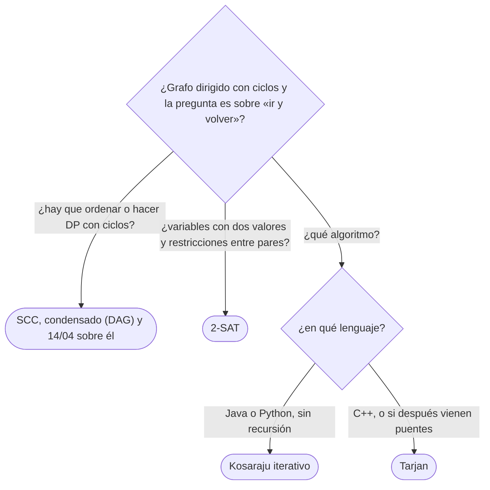

# 05 — Componentes fuertemente conexas y 2-SAT

> Las componentes fuertemente conexas (SCC) de un grafo dirigido —los grupos de vértices que se alcanzan
> mutuamente— con los dos algoritmos lineales que las encuentran, Kosaraju y Tarjan, y el grafo condensado,
> que siempre es un DAG. Y su aplicación más famosa: 2-SAT, la satisfacibilidad de cláusulas de dos
> literales, que se resuelve con las SCC del grafo de implicaciones.
>
> **Niveles:** Kosaraju [B] · Tarjan [B] · 2-SAT [B].
>
> **📚 Lectura troncal:** Cormen, Leiserson, Rivest y Stein, *Introduction to Algorithms*, 3.ª ed. (MIT
> Press, 2009), §22.5; Sedgewick y Wayne, *Algorithms*, 4.ª ed. (Addison-Wesley, 2011), §4.2.
>
> **Asume leído:** [`14/03` — DFS](03-dfs.md); [`14/04` — Orden topológico y DP sobre DAG](04-orden-topologico.md).
>
> **Vigencia:** 2026-10-04.

**Salto rápido:** [1](#1--el-problema) · [2](#2--la-teoría) · [3](#3--kosaraju) · [4](#4--tarjan) · [5](#5--2-sat) · [6](#6-️-la-tabla-de-costes) · [7](#7--cómo-se-elige) · [8](#8--señales-del-enunciado) · [🧠](#-preguntas) · [🧩](#-problemas-propios)

---

## 1. 🎯 El problema

Una aerolínea tiene `10⁵` aeropuertos y `2·10⁵` rutas de un solo sentido. ¿Se puede volar de cualquier
aeropuerto a cualquier otro? Y si no, ¿qué grupos de aeropuertos están «bien comunicados» entre sí? Las
componentes conexas de `14/03` no responden: en un dirigido, que `u` alcance a `v` no dice nada de que `v`
alcance a `u`. Comprobar la alcanzabilidad de cada par son `n` recorridos: `Θ(n · (n + m))`.

Las **componentes fuertemente conexas** responden las dos preguntas en `Θ(n + m)`, y al colapsarlas el grafo
se vuelve un DAG, sobre el que funciona todo lo de `14/04`. El mismo cálculo resuelve un problema que no
parece de grafos: decidir si unas restricciones de la forma «`a` o `b`» sobre variables booleanas se pueden
cumplir a la vez.

> 🧠 **Modelo mental.** Una ciudad con calles de sentido único: los barrios son los grupos de manzanas entre
> las que puedes ir y volver. Entre barrios, solo se puede ir en un sentido; si pudieras volver, serían el
> mismo barrio.

Los ejemplos usan el DAG D de [`14/01`](01-representaciones.md) **con una arista más**, `F → B`, que cierra los ciclos `B D F` y
`B E F`: lo llamamos D′.

---

## 2. 📐 La teoría

**Fuertemente conexos.** `u ~ v` si `u` alcanza a `v` y `v` alcanza a `u`. Es una relación de
equivalencia (reflexiva, simétrica y transitiva); sus clases son las **SCC**. En D′: `{A}`, `{C}` y
`{B, D, E, F}`.

**El grafo condensado es un DAG.** Un vértice por SCC y una arista `X → Y` si hay alguna arista de `X` a
`Y`. Si tuviera un ciclo `X → Y → … → X`, todos los vértices de esas SCC se alcanzarían mutuamente y serían
una sola: contradicción. En D′: `{A} → {C}`, `{A} → {BDEF}`, `{C} → {BDEF}`.

**Lema de Kosaraju.** Haz un DFS de todo el grafo y sea `f(X)` el mayor `tout` de los vértices de la SCC
`X`. Si hay una arista de `X` a `Y` (SCC distintas), entonces `f(X) > f(Y)`.

*Esbozo.* Si el DFS entra antes en `X`, todo `Y` es alcanzable con vértices blancos y termina antes que el
primero de `X` (camino blanco). Si entra antes en `Y`, no puede llegar a `X` (sería un ciclo en el
condensado), así que `Y` termina entera antes de empezar `X`.

**Consecuencia.** El vértice con mayor `tout` está en una SCC **fuente** del condensado. En el grafo
**transpuesto** (aristas invertidas), esa SCC es un sumidero: un DFS desde ese vértice recorre exactamente
su SCC. Repetir en orden de `tout` decreciente con lo que no se ha visitado saca las SCC una a una.

**Tarjan, en una frase.** `low[v]` es el menor `tin` alcanzable desde el subárbol de `v` con una sola arista
a un vértice que siga en la pila; `v` es la **raíz** de su SCC si y solo si `low[v] = tin[v]`, y entonces
la SCC es lo que hay en la pila desde `v` hasta la cima.

**2-SAT.** Una fórmula en FNC con cláusulas de dos literales, `(a ∨ b)`. Cada cláusula equivale a dos
implicaciones: `¬a → b` y `¬b → a`. En el **grafo de implicaciones** (`2n` vértices: `xᵢ` y `¬xᵢ`):

> La fórmula es satisfacible si y solo si ninguna variable está en la misma SCC que su negación.

*Esbozo.* Si `x` y `¬x` están en la misma SCC, `x → … → ¬x` y `¬x → … → x`: ningún valor de `x` funciona.
Si no, se asigna `x = verdadero` cuando la SCC de `x` va **después** que la de `¬x` en el orden topológico
del condensado; el grafo es simétrico (si `u → v`, entonces `¬v → ¬u`), y con esa regla ninguna implicación
lleva de verdadero a falso.

---

## 3. 🧱 Kosaraju

**Qué es.** Dos DFS: el primero sobre el grafo, guardando el postorden; el segundo sobre el transpuesto, en
orden de postorden decreciente, y cada árbol del segundo es una SCC.

**Por qué es correcto.** El lema de §2: cada árbol del segundo DFS empieza en la SCC fuente de lo que queda
y no puede escaparse de ella en el transpuesto.

**Cómo va**, en D′:

```text
DFS 1 sobre D′ (vecinos en orden alfabético):  postorden F D E B C A
DFS 2 sobre el transpuesto, desde el final del postorden:
  A: sus entrantes (ninguno) → SCC 0 = {A}
  C: entrantes A (ya visitado) → SCC 1 = {C}
  B: entrantes A, F → F: entrantes D, E → D, E → SCC 2 = {B, F, D, E}
```

Las SCC salen **en orden topológico** del condensado: `{A}`, `{C}`, `{BDEF}`.

**Cuánto.** `Θ(n + m)`, más el transpuesto (`Θ(n + m)` de memoria).

**La plantilla:**

```cpp
#include <vector>

// Kosaraju: comp[v] = número de SCC, numeradas en orden topológico del condensado.
struct Kosaraju {
    std::vector<std::vector<int>> adj, radj;
    std::vector<int> order, comp;
    std::vector<bool> seen;
    int count = 0;
    explicit Kosaraju(const std::vector<std::vector<int>>& g) : adj(g), radj(g.size()) {
        int n = g.size();
        for (int u = 0; u < n; u++) for (int v : g[u]) radj[v].push_back(u);
        seen.assign(n, false);
        for (int v = 0; v < n; v++) if (!seen[v]) dfs1(v);
        comp.assign(n, -1);
        for (int i = n - 1; i >= 0; i--)
            if (comp[order[i]] == -1) dfs2(order[i], count++);
    }
    void dfs1(int u) {
        seen[u] = true;
        for (int v : adj[u]) if (!seen[v]) dfs1(v);
        order.push_back(u);                              // postorden
    }
    void dfs2(int u, int c) {
        comp[u] = c;
        for (int v : radj[u]) if (comp[v] == -1) dfs2(v, c);
    }
};
```

```java
// Kosaraju iterativo: el primer DFS con it[u] (14/03); el segundo, con una pila simple sobre el transpuesto.
static int[] kosaraju(int[][] adj, int[][] radj) {
    int n = adj.length, k = 0;
    int[] order = new int[n], it = new int[n], stack = new int[n], comp = new int[n];
    boolean[] seen = new boolean[n];
    for (int s = 0; s < n; s++) {
        if (seen[s]) continue;
        int top = 0;
        stack[top++] = s; seen[s] = true;
        while (top > 0) {
            int u = stack[top - 1];
            if (it[u] < adj[u].length) {
                int v = adj[u][it[u]++];
                if (!seen[v]) { seen[v] = true; stack[top++] = v; }
            } else { order[k++] = u; top--; }
        }
    }
    java.util.Arrays.fill(comp, -1);
    int c = 0;
    for (int i = n - 1; i >= 0; i--) {
        int s = order[i];
        if (comp[s] != -1) continue;
        int top = 0;
        stack[top++] = s; comp[s] = c;
        while (top > 0) {
            int u = stack[--top];
            for (int v : radj[u]) if (comp[v] == -1) { comp[v] = c; stack[top++] = v; }
        }
        c++;
    }
    return comp;
}
```

- **El segundo DFS no necesita orden**: solo etiquetar lo alcanzable en el transpuesto; una pila simple.
- **Numeración**: Kosaraju numera las SCC en orden topológico; Tarjan, en el inverso. Para 2-SAT y para la
  DP sobre el condensado importa cuál se tiene.
- **El condensado**: para cada arista `u → v` con `comp[u] ≠ comp[v]`, la arista `comp[u] → comp[v]`
  (puede repetirse; si molesta, se deduplica).

**Cuándo sí:** cuando se quiere el algoritmo más fácil de explicar y de escribir iterativo. **Cuándo no:** si
la memoria aprieta (guarda el transpuesto) o si ya se tiene un DFS con `low` en marcha.

> **Veredicto:** Kosaraju son dos recorridos: postorden en el grafo y etiquetado en el transpuesto en orden
> inverso; las SCC salen en orden topológico.

---

## 4. 🧱 Tarjan

**Qué es.** Un solo DFS que mantiene una pila de vértices «abiertos» y `low[v]`; cuando un vértice termina
con `low[v] = tin[v]`, desapila su SCC.

**Por qué es correcto.** La raíz de una SCC es su primer vértice descubierto; todos los demás son
descendientes suyos (camino blanco) y siguen en la pila cuando ella termina. `low[v] = tin[v]` dice que
nada del subárbol de `v` alcanza un vértice abierto anterior: `v` es la raíz.

**Cómo va**, en D′:

```text
vértice  tin  low   por qué
A        1    1
B        2    2     raíz de su SCC
D        3    2     D → F → B (B en la pila, tin 2)
F        4    2     F → B
E        5    4     E → F (F en la pila, tin 4)
C        6    6     C → E: E ya salió de la pila con su SCC, no cuenta
termina B con low = tin = 2 → desapila E F D B: SCC {B, D, E, F}
termina C → {C};  termina A → {A}
```

Las SCC salen en orden topológico **inverso**: `{BDEF}`, `{C}`, `{A}`.

**Cuánto.** `Θ(n + m)`, un solo recorrido y sin transpuesto.

**La plantilla:**

```cpp
#include <algorithm>
#include <vector>

// Tarjan: comp[v] en orden topológico inverso del condensado.
struct Tarjan {
    const std::vector<std::vector<int>>& adj;
    std::vector<int> tin, low, comp, stk;
    std::vector<bool> onStack;
    int timer = 0, count = 0;
    explicit Tarjan(const std::vector<std::vector<int>>& g)
        : adj(g), tin(g.size(), 0), low(g.size(), 0), comp(g.size(), -1), onStack(g.size(), false) {
        for (int v = 0; v < (int)g.size(); v++) if (!tin[v]) dfs(v);
    }
    void dfs(int u) {
        tin[u] = low[u] = ++timer;
        stk.push_back(u); onStack[u] = true;
        for (int v : adj[u]) {
            if (!tin[v]) { dfs(v); low[u] = std::min(low[u], low[v]); }
            else if (onStack[v]) low[u] = std::min(low[u], tin[v]);
        }
        if (low[u] == tin[u]) {                          // u es la raíz de su SCC
            while (true) {
                int w = stk.back(); stk.pop_back();
                onStack[w] = false; comp[w] = count;
                if (w == u) break;
            }
            count++;
        }
    }
};
```

```java
// Tarjan recursivo: con n grande, en un hilo con pila de 256 MB (03/03).
static int[] tin, low, comp, stk;
static boolean[] onStack;
static int timer, top, count;

static void tarjan(int[][] adj) {
    int n = adj.length;
    tin = new int[n]; low = new int[n]; comp = new int[n]; stk = new int[n];
    onStack = new boolean[n];
    timer = 0; top = 0; count = 0;
    for (int v = 0; v < n; v++) if (tin[v] == 0) dfs(adj, v);
}

static void dfs(int[][] adj, int u) {
    tin[u] = low[u] = ++timer;
    stk[top++] = u; onStack[u] = true;
    for (int v : adj[u]) {
        if (tin[v] == 0) { dfs(adj, v); low[u] = Math.min(low[u], low[v]); }
        else if (onStack[v]) low[u] = Math.min(low[u], tin[v]);
    }
    if (low[u] == tin[u]) {
        int w;
        do { w = stk[--top]; onStack[w] = false; comp[w] = count; } while (w != u);
        count++;
    }
}
```

- **`onStack`, no «visitado»**: una arista a un vértice de una SCC ya cerrada (como `C → E`) no actualiza
  `low`; es el error más común.
- **`tin[v]` y no `low[v]`** en la arista de retroceso: con `low[v]` también funciona para SCC, pero no para
  puentes y articulación ([`14/06`](06-puentes-articulacion-y-euler.md)); conviene la versión que sirve para los tres.
- **En Python**, Tarjan recursivo no pasa de `10⁴` vértices: la versión iterativa existe, pero es larga;
  Kosaraju iterativo es más sencillo de portar.

**Cuándo sí:** un solo recorrido, sin transpuesto; la base de 2-SAT en la mayoría de bibliotecas y de los
puentes de `14/06`. **Cuándo no:** si hay que escribirlo iterativo y sin errores bajo presión: Kosaraju.

> **Veredicto:** Tarjan es un DFS con `low` y una pila de abiertos; la SCC sale cuando `low[v] = tin[v]`, en
> orden topológico inverso.

---

## 5. 🧱 2-SAT

**Qué es.** Decidir si existe una asignación de `n` variables booleanas que cumpla `m` cláusulas
`(a ∨ b)`, y dar una. Se construye el grafo de implicaciones con `2n` vértices, se calculan las SCC y se
comprueba que ninguna variable comparte SCC con su negación.

**Por qué es correcto.** El teorema de §2. Con la numeración de Tarjan (orden topológico inverso), la regla
de asignación es `xᵢ = verdadero` si `comp[xᵢ] < comp[¬xᵢ]`.

**Cómo va**, con tres variables y las cláusulas `(x₁ ∨ x₂)`, `(¬x₁ ∨ x₃)`, `(¬x₂ ∨ ¬x₃)`, `(¬x₃ ∨ ¬x₁)`:

```text
implicaciones:  ¬x₁ → x₂, ¬x₂ → x₁ · x₁ → x₃, ¬x₃ → ¬x₁ · x₂ → ¬x₃, x₃ → ¬x₂ · x₃ → ¬x₁, x₁ → ¬x₃
ninguna xᵢ comparte SCC con ¬xᵢ → satisfacible
asignación por la regla: x₁ = falso, x₂ = verdadero, x₃ = falso
comprobación: (F ∨ V) (V ∨ F) (F ∨ V) (V ∨ V) ✓
```

Con `x₁ → x₃` y `x₃ → ¬x₁`, poner `x₁ = verdadero` obliga a `¬x₁`: el algoritmo lo descubre sin probar.
Con las cuatro cláusulas `(x₁ ∨ x₂)`, `(x₁ ∨ ¬x₂)`, `(¬x₁ ∨ x₂)`, `(¬x₁ ∨ ¬x₂)`, `x₁` y `¬x₁` caen en la misma
SCC: insatisfacible.

**Cuánto.** `Θ(n + m)`: `2n` vértices y `2m` aristas.

**La plantilla**, sobre el `Tarjan` de §4 (literal `xᵢ` → vértice `2i`; `¬xᵢ` → `2i + 1`):

```cpp
#include <vector>

struct TwoSat {
    int n;
    std::vector<std::vector<int>> g;
    explicit TwoSat(int vars) : n(vars), g(2 * vars) {}
    static int lit(int i, bool value) { return 2 * i + (value ? 0 : 1); }
    // Cláusula (xi == vi) ∨ (xj == vj).
    void addClause(int i, bool vi, int j, bool vj) {
        g[lit(i, !vi)].push_back(lit(j, vj));            // ¬a → b
        g[lit(j, !vj)].push_back(lit(i, vi));            // ¬b → a
    }
    // Devuelve la asignación, o vacío si no hay.
    std::vector<bool> solve() {
        Tarjan t(g);
        std::vector<bool> value(n);
        for (int i = 0; i < n; i++) {
            if (t.comp[2 * i] == t.comp[2 * i + 1]) return {};
            value[i] = t.comp[2 * i] < t.comp[2 * i + 1];
        }
        return value;
    }
};
```

```java
// Sobre tarjan(int[][]) de §4. Las cláusulas se acumulan en listas y se pasan a int[][] al resolver.
static boolean[] twoSat(int n, int[][] clauses) {      // cada fila: {i, vi, j, vj} con vi, vj en {0, 1}
    java.util.List<java.util.List<Integer>> g = new java.util.ArrayList<>();
    for (int k = 0; k < 2 * n; k++) g.add(new java.util.ArrayList<>());
    for (int[] c : clauses) {
        int a = 2 * c[0] + (c[1] == 1 ? 0 : 1), b = 2 * c[2] + (c[3] == 1 ? 0 : 1);
        g.get(a ^ 1).add(b);                             // ¬a → b
        g.get(b ^ 1).add(a);                             // ¬b → a
    }
    int[][] adj = new int[2 * n][];
    for (int k = 0; k < 2 * n; k++) adj[k] = g.get(k).stream().mapToInt(Integer::intValue).toArray();
    tarjan(adj);
    boolean[] value = new boolean[n];
    for (int i = 0; i < n; i++) {
        if (comp[2 * i] == comp[2 * i + 1]) return null;
        value[i] = comp[2 * i] < comp[2 * i + 1];
    }
    return value;
}
```

- **`a ^ 1` es la negación** con la codificación `2i` / `2i + 1`: un XOR en lugar de un `if`.
- **Restricciones típicas** como cláusulas: «`a` obligatorio» es `(a ∨ a)`; «no ambos» es `(¬a ∨ ¬b)`;
  «exactamente uno» son dos cláusulas, `(a ∨ b)` y `(¬a ∨ ¬b)`; «`a` implica `b`» es `(¬a ∨ b)`.
- **Con Kosaraju** la regla se invierte: `xᵢ` verdadero si `comp[xᵢ] > comp[¬xᵢ]`.

**Cuándo sí:** cada elemento tiene dos opciones y las restricciones son entre pares: dos posiciones por
etiqueta, dos turnos, encender o no, orientar una arista. **Cuándo no:** con tres opciones o cláusulas de
tres literales es 3-SAT, NP-completo; ahí, búsqueda ([`10/03`](../10-busqueda-completa-y-divide-y-venceras/03-backtracking-y-poda.md)) o un solucionador SAT.

> **Veredicto:** 2-SAT es «cada cláusula, dos implicaciones; SCC; ninguna variable con su negación»; la
> asignación sale del orden de las componentes.

---

## 6. ⏱️ La tabla de costes

| Algoritmo | Tiempo | Memoria | Orden de las SCC | Lo que la tabla no dice |
|---|---|---|---|---|
| Kosaraju | `Θ(n + m)` | Grafo + transpuesto | Topológico | Fácil de escribir iterativo |
| Tarjan | `Θ(n + m)` | Grafo, `tin`, `low`, pila | Topológico inverso | Base de puentes y articulación |
| 2-SAT | `Θ(n + m)` | `2n` vértices, `2m` aristas | — | Solo cláusulas de dos literales |
| Alcanzabilidad por pares | `Θ(n · (n + m))` | `Θ(n²)` | — | La alternativa ingenua |

---

## 7. 🧭 Cómo se elige



> **Regla de entrevista:** si aparece «se alcanzan mutuamente» o «ciclos en un dirigido» y hay que hacer
> algo **sobre** el grafo, la frase es «colapso las SCC y el resto es un DAG».

---

## 8. 🔎 Señales del enunciado

| Señal | Técnica | Por qué |
|---|---|---|
| «Desde cualquiera se llega a cualquiera» en un dirigido | SCC (una sola) | Fuertemente conexo |
| «Grupos que se alcanzan mutuamente» | SCC | Es la definición |
| DP de caminos en un dirigido **con** ciclos | Condensado + DP | El condensado es un DAG |
| «Cada uno elige entre dos», «no pueden ser ambos» | 2-SAT | Cláusulas de dos literales |
| «Cuántas aristas añadir para que sea fuertemente conexo» | Fuentes y sumideros del condensado | Teorema de Eswaran y Tarjan |

---

## ⚠️ Errores frecuentes

| Se dice | Lo preciso |
|---|---|
| «Componentes fuertes es lo mismo que componentes» | En un dirigido, alcanzar no es simétrico: `A → B` sin vuelta son dos SCC |
| «En Tarjan, una arista a un visitado actualiza `low`» | Solo si sigue en la pila (`onStack`) |
| «Kosaraju: el segundo DFS va sobre el mismo grafo» | Va sobre el transpuesto, en orden de postorden decreciente |
| «2-SAT se resuelve probando asignaciones» | `2ⁿ`; las SCC del grafo de implicaciones lo hacen lineal |
| «3-SAT se resuelve igual con más aristas» | 3-SAT es NP-completo; no hay grafo de implicaciones |
| «La regla de asignación es la misma con Kosaraju y Tarjan» | Se invierte: numeran en órdenes opuestos |

---

## 📚 Para profundizar

- **Libro** — Cormen, Leiserson, Rivest y Stein, *Introduction to Algorithms*, 3.ª ed. (MIT Press, 2009),
  §22.5: SCC por Kosaraju con su prueba. *Lectura troncal.*
- **Libro** — Sedgewick y Wayne, *Algorithms*, 4.ª ed. (Addison-Wesley, 2011), §4.2: Kosaraju-Sharir y
  Tarjan. *Lectura troncal.*
- **Referencia** — Sedgewick y Wayne, [código de `KosarajuSharirSCC.java`](https://algs4.cs.princeton.edu/42digraph/KosarajuSharirSCC.java.html)
  y [de `TarjanSCC.java`](https://algs4.cs.princeton.edu/42digraph/TarjanSCC.java.html).
- **Referencia** — cp-algorithms, [*Strongly connected components and condensation graph*](https://cp-algorithms.com/graph/strongly-connected-components.html).
- **Referencia** — cp-algorithms, [*2-SAT*](https://cp-algorithms.com/graph/2SAT.html).

---

## 🧠 Preguntas

1. ¿Qué es una componente fuertemente conexa? 🟢
2. ¿Por qué el grafo condensado es siempre un DAG? 🟢
3. Describe Kosaraju en tres pasos. 🟡
4. ¿Qué es `low[v]` en Tarjan y cuándo se cierra una SCC? 🟡
5. ¿Por qué en Tarjan una arista a un vértice ya visitado que no está en la pila no actualiza `low`? 🟡
6. ¿Cómo se traduce una cláusula `(a ∨ b)` al grafo de implicaciones? 🟡
7. ¿Cómo implementas Kosaraju sin recursión en Java o Python? 🟡
8. Demuestra el lema de Kosaraju sobre los tiempos de salida máximos. 🟠
9. Demuestra que 2-SAT es satisfacible si y solo si ninguna variable comparte SCC con su negación. 🟠
10. ¿Cómo obtienes la asignación de 2-SAT, y qué cambia entre Kosaraju y Tarjan? 🟠
11. ¿Cómo expresas «exactamente uno de `a` y `b`» y «`a` es obligatorio» como cláusulas? 🟠
12. ¿Cuántas aristas hay que añadir, como mínimo, para que un dirigido sea fuertemente conexo? 🔴
13. ¿Por qué 2-SAT es polinómico y 3-SAT no? ¿Qué se rompe? 🔴

---

## 🧩 Problemas propios

### Barrios

**Nivel:** 🟡 · **Formato:** programa completo.

Imprime el número de componentes fuertemente conexas de un grafo dirigido y el tamaño de la mayor.

- **Entrada.** Una línea con `n` y `m`. Después, `m` líneas con una arista `u v`.
- **Salida.** Dos enteros.
- **Restricciones.** `1 ≤ n ≤ 10⁵`; `0 ≤ m ≤ 2·10⁵`.

```text
Entrada     Salida
6 8         3 4
1 2
1 3
2 4
2 5
3 5
4 6
5 6
6 2

Entrada     Salida
3 3         1 3
1 2
2 3
3 1
```

**Pista 1:** ¿qué algoritmo te da la etiqueta de SCC de cada vértice en una pasada?

### Calles que faltan

**Nivel:** 🟠 · **Formato:** programa completo.

¿Cuántas calles de sentido único hay que añadir, como mínimo, para que desde cada cruce se pueda llegar a
todos los demás?

- **Entrada.** Una línea con `n` y `m`. Después, `m` líneas con una calle `u v`.
- **Salida.** Un entero.
- **Restricciones.** `1 ≤ n ≤ 10⁵`; `0 ≤ m ≤ 2·10⁵`.

```text
Entrada     Salida
6 8         1
1 2
1 3
2 4
2 5
3 5
4 6
5 6
6 2

Entrada     Salida
4 0         4
```

**Pista 1:** después de colapsar las SCC, ¿qué componentes necesitan sí o sí una calle nueva que entre, y
cuáles una que salga?

### Banderas en la costa

**Nivel:** 🔴 · **Formato:** programa completo.

Hay que plantar `n` banderas a lo largo de una costa recta. La bandera `i` solo puede ir en la posición
`aᵢ` o en la `bᵢ`. ¿Se pueden plantar todas de modo que dos banderas cualesquiera estén a distancia al
menos `D`?

- **Entrada.** Una línea con `n` y `D`. Después, `n` líneas con `aᵢ bᵢ`.
- **Salida.** `YES` o `NO`.
- **Restricciones.** `1 ≤ n ≤ 1 000`; `0 ≤ D, aᵢ, bᵢ ≤ 10⁹`.

```text
Entrada     Salida
3 2         YES
0 5
1 6
2 7

Entrada     Salida
3 3         NO
0 5
1 6
2 7
```

**Pista 1:** si la bandera `i` en `aᵢ` choca con la `j` en `bⱼ`, ¿qué cláusula de dos literales lo prohíbe?

---

## 🧩 Práctica externa

> 💡 **Truco.** En 2-SAT, escribe la tabla de las cláusulas en papel antes de codificar: una fila por
> restricción y sus dos implicaciones. Si una IA te ayuda, que sea a revisar esa tabla, no a escribir
> Tarjan ([`01/06`](../01-oficio-del-competidor/06-protocolo-de-resolucion.md)).

### Núcleo

| ✔ | Problema | Plataforma | Nivel | Patrón | Pista 1 |
|---|---|---|---|---|---|
| [ ] | [Planets and Kingdoms](https://cses.fi/problemset/task/1683) | CSES | 🟡 | SCC | ¿Qué es un reino en términos de alcanzabilidad? |
| [ ] | [Flight Routes Check](https://cses.fi/problemset/task/1682) | CSES | 🟡 | Fuertemente conexo | ¿Basta mirar si 1 alcanza a todos y todos alcanzan a 1? |
| [ ] | [Dominos](https://open.kattis.com/problems/dominos) | Kattis | 🟠 | Fuentes del condensado | ¿Qué fichas hay que tirar sí o sí con la mano? |
| [ ] | [Checkposts](https://codeforces.com/problemset/problem/427/C) | Codeforces | 🟠 | SCC con mínimo por componente | ¿Cuántos puestos necesita cada SCC, y de cuántas formas? |
| [ ] | [Coin Collector](https://cses.fi/problemset/task/1686) | CSES | 🟠 | Condensado y DP | Si entras en una SCC, ¿cuántas monedas puedes recoger? |
| [ ] | [Giant Pizza](https://cses.fi/problemset/task/1684) | CSES | 🟠 | 2-SAT | Cada familia pide dos cosas y basta una: ¿qué cláusula es? |

### Ampliación

| ✔ | Problema | Plataforma | Nivel | Patrón | Pista 1 |
|---|---|---|---|---|---|
| [ ] | [The Road to Berland is Paved With Good Intentions](https://codeforces.com/problemset/problem/228/E) | Codeforces | 🟠 | 2-SAT con paridad | ¿Cuántas veces conviene asfaltar una ciudad? |
| [ ] | [The Door Problem](https://codeforces.com/problemset/problem/776/D) | Codeforces | 🔴 | 2-SAT con XOR | Una puerta y sus dos interruptores: ¿qué relación tienen que cumplir? |
| [ ] | [Catowice City](https://codeforces.com/problemset/problem/1239/D) | Codeforces | 🔴 | SCC sumidero | Si alguien es jurado, ¿quiénes más tienen que serlo? |

---

## ✅ Criterio de dominio

- Explicar Kosaraju y Tarjan con la traza de D′ y escribir uno de los dos con la plantilla delante.
- Demostrar que el condensado es un DAG y el criterio de 2-SAT.
- Traducir restricciones de enunciado a cláusulas y sacar la asignación con la regla correcta.
- Resolver Planets and Kingdoms y Giant Pizza sin pista 2.

---

**Anterior:** [`14/04` — Orden topológico y DP sobre DAG](04-orden-topologico.md) ·
**Siguiente:** [`14/06` — Puentes, puntos de articulación y Euler](06-puentes-articulacion-y-euler.md) · **Relacionado:** [`22/04` — P, NP y reducciones](../22-teoria-de-la-computacion/04-p-np-y-reducciones.md).
