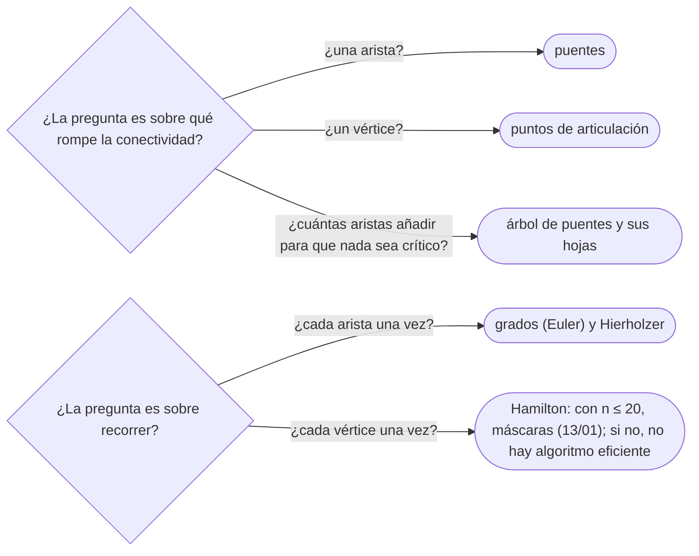

# 06 — Puentes, puntos de articulación y Euler

> Las aristas y los vértices cuya caída desconecta un grafo —puentes y puntos de articulación— con el
> `low[v]` de un solo DFS; y los caminos y circuitos que usan **cada arista** exactamente una vez, con el
> teorema de Euler sobre los grados y el algoritmo de Hierholzer, en grafos no dirigidos y dirigidos.
>
> **Niveles:** puentes y articulación [B] · Euler (Hierholzer) [B].
>
> **📚 Lectura troncal:** Brassard y Bratley, *Fundamentos de algoritmia* (Prentice Hall, 1997), cap. 9;
> Cormen, Leiserson, Rivest y Stein, *Introduction to Algorithms*, 3.ª ed. (MIT Press, 2009), problemas
> 22-2 (articulación, puentes y componentes biconexas) y 22-3 (recorrido de Euler).
>
> **Asume leído:** [`14/03` — DFS](03-dfs.md).
>
> **Vigencia:** 2026-10-04.

**Salto rápido:** [1](#1--el-problema) · [2](#2--la-teoría) · [3](#3--puentes-y-puntos-de-articulación) · [4](#4--euler-hierholzer) · [5](#5-️-la-tabla-de-costes) · [6](#6--cómo-se-elige) · [7](#7--señales-del-enunciado) · [🧠](#-preguntas) · [🧩](#-problemas-propios)

---

## 1. 🎯 El problema

Una red de `10⁵` routers y `2·10⁵` cables. ¿Qué cables, si se cortan, dejan a alguien incomunicado? ¿Qué
routers son imprescindibles? Quitar cada arista y comprobar la conectividad son `m` recorridos:
`Θ(m · (n + m))`, `4·10¹⁰`. Un solo DFS, con un número más por vértice, responde las dos preguntas en
`Θ(n + m)`.

Y una pregunta que suena parecida y es de otra familia: un camión de limpieza tiene que pasar **una vez por
cada calle**. ¿Se puede, y por dónde? Euler la resolvió en 1736 con un criterio de grados, y Hierholzer dio
el algoritmo lineal que construye el recorrido.

> 🧠 **Modelo mental.** Un puente es una calle sin desvío: si la cortas, no hay otra forma de cruzar. El
> DFS lo detecta preguntando a cada subárbol: «¿tienes alguna salida hacia arriba que no sea la calle por
> la que entré?».

Los ejemplos usan el grafo G de [`14/01`](01-representaciones.md) sin pesos, y **G sin la arista `C–E`**, que llamamos G⁻.

---

## 2. 📐 La teoría

**Definiciones.** En un no dirigido conexo, un **puente** es una arista cuya eliminación lo desconecta; un
**punto de articulación**, un vértice cuya eliminación (con sus aristas) lo desconecta. G no tiene ninguno:
todas sus aristas están en algún ciclo. En G⁻, `A–B` y `A–C` son puentes, y `A` y `B` son puntos de
articulación.

**`low[v]`.** El menor `tin` alcanzable desde el subárbol de `v` en el árbol del DFS usando como mucho una
arista de retroceso, sin volver por la arista del árbol que llega a `v`.

**Criterio de puente.** La arista del árbol `u – v` (`v` hijo de `u`) es puente si y solo si `low[v] > tin[u]`.

*Prueba.* En un no dirigido, el DFS solo tiene aristas del árbol y de retroceso (`14/03`). Si el subárbol de
`v` tiene una de retroceso a `u` o más arriba, quitar `u – v` no lo desconecta: hay desvío. Si no la tiene
(`low[v] > tin[u]`), todas las aristas que salen del subárbol de `v` son la del árbol hacia `u`: es puente.
Una arista de retroceso nunca es puente, porque cierra un ciclo.

**Criterio de articulación.** Un vértice `u` que no es raíz es punto de articulación si y solo si tiene un
hijo `v` con `low[v] ≥ tin[u]` (el subárbol de `v` no sube **por encima** de `u`). La raíz lo es si y solo
si tiene al menos dos hijos en el árbol del DFS.

**Teorema de Euler.** Un no dirigido con todas sus aristas en una misma componente tiene un **circuito** de
Euler (empieza y acaba en el mismo vértice) si y solo si todos los grados son pares; y un **camino** de
Euler si y solo si hay exactamente 0 o 2 vértices de grado impar (en ese caso, el camino va de uno a otro).
En un dirigido: circuito si y solo si el grado de entrada es igual al de salida en todos; camino si,
además, puede haber un vértice con una salida de más (el inicio) y otro con una entrada de más (el final);
y las aristas, en una sola componente débilmente conexa.

*Prueba de la necesidad.* Cada paso por un vértice intermedio usa una arista para entrar y otra para salir:
los grados suman de dos en dos. Solo los extremos de un camino abierto quedan con una de más. La
suficiencia la prueba el algoritmo de Hierholzer.

**Euler no es Hamilton.** Euler usa cada **arista** una vez y se decide por los grados, en tiempo lineal.
Hamilton usa cada **vértice** una vez y es NP-completo; con `n ≤ 20`, máscaras (`13/01`).

---

## 3. 🧱 Puentes y puntos de articulación

**Qué es.** Un DFS que calcula `tin` y `low`, y aplica los dos criterios de §2 al volver de cada hijo.

**Por qué es correcto.** Los criterios de §2: `low[v] > tin[u]` para el puente; `low[v] ≥ tin[u]` (o dos
hijos en la raíz) para la articulación.

**Cómo va**, en G⁻ desde `A` (vecinos en orden alfabético):

```text
vértice  tin  low   de dónde sale low
A        1    1
B        2    2     el subárbol de B no sube por encima de B
D        3    2     F → E → B: E tiene la arista de retroceso a B (tin 2)
F        4    2
E        5    2     E – B, de retroceso
C        6    6     solo la arista del árbol con A
puentes: A–B (low[B] = 2 > tin[A] = 1) y A–C (low[C] = 6 > 1)
articulación: A (raíz con dos hijos, B y C) y B (hijo D con low 2 ≥ tin[B] = 2)
```

**Cuánto.** `Θ(n + m)`.

**La plantilla**, con el índice de la arista para que las aristas repetidas no se confundan con la del
padre:

```cpp
#include <algorithm>
#include <vector>

// adj[u] = {vecino, índice de la arista}. Puentes (índices) y puntos de articulación.
struct Bridges {
    const std::vector<std::vector<std::pair<int, int>>>& adj;
    std::vector<int> tin, low, bridges;
    std::vector<bool> isCut;
    int timer = 0;
    explicit Bridges(const std::vector<std::vector<std::pair<int, int>>>& g)
        : adj(g), tin(g.size(), 0), low(g.size(), 0), isCut(g.size(), false) {
        for (int s = 0; s < (int)g.size(); s++) if (!tin[s]) dfs(s, -1);
    }
    void dfs(int u, int parentEdge) {
        tin[u] = low[u] = ++timer;
        int children = 0;
        for (auto [v, id] : adj[u]) {
            if (id == parentEdge) continue;              // la arista del árbol hacia el padre, solo esa
            if (tin[v]) { low[u] = std::min(low[u], tin[v]); continue; }   // de retroceso
            dfs(v, id);
            children++;
            low[u] = std::min(low[u], low[v]);
            if (low[v] > tin[u]) bridges.push_back(id);
            if (parentEdge != -1 && low[v] >= tin[u]) isCut[u] = true;
        }
        if (parentEdge == -1 && children > 1) isCut[u] = true;   // la raíz
    }
};
```

```java
// Recursivo: con n grande, en un hilo con pila de 256 MB (03/03). adj[u] = {vecino, índice} alternados.
static int[] tin, low;
static boolean[] isCut, isBridge;
static int timer;

static void bridges(int[][] adj, int m) {
    int n = adj.length;
    tin = new int[n]; low = new int[n]; isCut = new boolean[n]; isBridge = new boolean[m];
    timer = 0;
    for (int s = 0; s < n; s++) if (tin[s] == 0) dfs(adj, s, -1);
}

static void dfs(int[][] adj, int u, int parentEdge) {
    tin[u] = low[u] = ++timer;
    int children = 0;
    for (int k = 0; k < adj[u].length; k += 2) {
        int v = adj[u][k], id = adj[u][k + 1];
        if (id == parentEdge) continue;
        if (tin[v] != 0) { low[u] = Math.min(low[u], tin[v]); continue; }
        dfs(adj, v, id);
        children++;
        low[u] = Math.min(low[u], low[v]);
        if (low[v] > tin[u]) isBridge[id] = true;
        if (parentEdge != -1 && low[v] >= tin[u]) isCut[u] = true;
    }
    if (parentEdge == -1 && children > 1) isCut[u] = true;
}
```

- **Saltar la arista del padre por índice**, no por vértice: con dos cables entre `u` y `v`, ninguno es
  puente, y comparar el vértice lo diría.
- **`>` para puentes, `≥` para articulación**: es la diferencia entre «no vuelve a `u`» y «no sube por
  encima de `u`». Un ciclo que cierra justo en `u` salva la arista pero no el vértice.
- **Componentes 2-arista-conexas**: quitar los puentes y etiquetar componentes; colapsadas, forman un
  árbol (el árbol de puentes).

**Cuándo sí:** fiabilidad de redes, «qué carretera es crítica», componentes 2-arista-conexas y su árbol.
**Cuándo no:** en dirigidos (la noción útil son las SCC, `14/05`); y si las aristas se borran en línea,
hay estructuras dinámicas más allá de este corpus.

> **Veredicto:** puentes y articulación salen del mismo DFS con `low`: `low[hijo] > tin[u]` es puente;
> `≥` en un no raíz, o dos hijos en la raíz, es articulación. Siempre por índice de arista.

---

## 4. 🧱 Euler (Hierholzer)

**Qué es.** Construir un camino o circuito que use cada arista una vez. Hierholzer: desde el inicio, avanzar
por aristas no usadas con una pila; cuando un vértice no tiene más aristas, se saca de la pila y se añade al
recorrido. El recorrido sale al revés.

**Por qué es correcto.** Con los grados de §2, avanzar siempre termina en el vértice final (en un circuito,
en el inicial): cualquier otro tiene una arista libre para salir. Lo que queda sin recorrer son circuitos
que cuelgan de vértices de la pila, y la pila los inserta en su sitio al retroceder.

**Cómo va**, en G, que tiene `B` y `E` de grado 3 y el resto par: hay camino de Euler de `B` a `E`.

```text
pila           acción
B              B → A (la menor libre)
B A            A → C
B A C          C → E
B A C E        E → B
B A C E B      B → D
… D F E        D → F, F → E; E sin aristas libres: sale E, F, D, B, E, C, A, B
camino (invertido): B A C E B D F E   — 7 aristas, cada una una vez
```

**Cuánto.** `Θ(n + m)`, con un puntero por vértice a su próxima arista.

**La plantilla**, no dirigida, con comprobación de que se usaron todas las aristas:

```cpp
#include <algorithm>
#include <vector>

// adj[u] = {vecino, índice de la arista}. Camino de Euler desde start; vacío si no usa las m aristas.
std::vector<int> euler(const std::vector<std::vector<std::pair<int, int>>>& adj, int m, int start) {
    std::vector<int> ptr(adj.size(), 0), path, stack = {start};
    std::vector<bool> used(m, false);
    while (!stack.empty()) {
        int u = stack.back();
        while (ptr[u] < (int)adj[u].size() && used[adj[u][ptr[u]].second]) ptr[u]++;
        if (ptr[u] == (int)adj[u].size()) {              // sin aristas libres: al recorrido
            path.push_back(u); stack.pop_back();
        } else {
            auto [v, id] = adj[u][ptr[u]];
            used[id] = true;
            stack.push_back(v);
        }
    }
    if ((int)path.size() != m + 1) return {};            // aristas en otra componente
    std::reverse(path.begin(), path.end());
    return path;
}
```

```java
// Dirigido: adj[u] = vecinos; cada arista se usa al avanzar el puntero, sin arreglo used.
static int[] eulerDirected(int[][] adj, int m, int start) {
    int[] ptr = new int[adj.length], stack = new int[m + 1], path = new int[m + 1];
    int top = 0, k = 0;
    stack[top++] = start;
    while (top > 0) {
        int u = stack[top - 1];
        if (ptr[u] < adj[u].length) stack[top++] = adj[u][ptr[u]++];
        else path[k++] = stack[--top];
    }
    if (k != m + 1) return null;
    for (int i = 0, j = k - 1; i < j; i++, j--) { int t = path[i]; path[i] = path[j]; path[j] = t; }
    return path;
}
```

- **Antes de llamar, los grados**: no dirigido, 0 o 2 impares (y se empieza en uno de ellos); dirigido,
  `salida − entrada = 1` en el inicio, `−1` en el final y 0 en el resto (o 0 en todos).
- **La conectividad la comprueba la longitud**: si el recorrido no tiene `m + 1` vértices, había aristas en
  otra componente.
- **En no dirigido, cada arista está en dos listas**: el arreglo `used` por índice evita usarla dos veces;
  en dirigido basta el puntero.
- **En Python** es la misma pila con listas, sin recursión: se traduce línea a línea.

**Cuándo sí:** recorrer cada calle o cable una vez, reconstruir una secuencia a partir de sus pares
consecutivos (itinerarios, fragmentos), secuencias de De Bruijn. **Cuándo no:** si se pide visitar cada
**vértice** una vez: es Hamilton, NP-completo.

> **Veredicto:** Euler se decide por los grados y se construye con Hierholzer: una pila y un puntero por
> vértice; el recorrido sale al revés.

---

## 5. ⏱️ La tabla de costes

| Tarea | Técnica | Tiempo | Lo que la tabla no dice |
|---|---|---|---|
| Puentes | DFS con `low`, `low[v] > tin[u]` | `Θ(n + m)` | Saltar el padre por índice de arista |
| Articulación | DFS con `low`, `≥` o raíz con dos hijos | `Θ(n + m)` | La raíz es un caso aparte |
| ¿Existe Euler? | Grados y conectividad | `Θ(n + m)` | Dirigido: entrada y salida |
| Construir Euler | Hierholzer | `Θ(n + m)` | El recorrido sale invertido |
| Hamilton (comparación) | Máscaras | `Θ(2ⁿ · n²)` | NP-completo (`13/01`) |

---

## 6. 🧭 Cómo se elige



> **Regla de entrevista:** ante «pasar por todas las calles» o «por todas las ciudades», di primero cuál de
> las dos es, porque una es lineal y la otra NP-completa.

---

## 7. 🔎 Señales del enunciado

| Señal | Técnica | Por qué |
|---|---|---|
| «Conexión crítica», «si se corta este cable» | Puentes | Sin desvío |
| «Router imprescindible», «si cae este servidor» | Articulación | Vértice de corte |
| «Recorre cada calle / arista una vez» | Euler | Grados |
| «Usa todas las fichas / billetes / pares encadenados» | Euler sobre los pares | Cada pieza es una arista |
| «La secuencia más corta que contiene todas las cadenas de longitud `k`» | De Bruijn | Euler en el grafo de prefijos |

---

## ⚠️ Errores frecuentes

| Se dice | Lo preciso |
|---|---|
| «Un camino de Euler es un camino hamiltoniano» | Euler: cada arista, lineal. Hamilton: cada vértice, NP-completo |
| «Para saltar el padre, se compara el vértice» | Con aristas repetidas falla: se compara el índice de la arista |
| «Puente y articulación usan la misma desigualdad» | Puente `>`, articulación `≥`, y la raíz con dos hijos |
| «Todo extremo de un puente es punto de articulación» | No si es una hoja: quitarla no desconecta a nadie más |
| «Grados pares basta para el circuito» | Y todas las aristas en una componente; dos triángulos separados no tienen circuito |
| «Hierholzer da el camino en el orden en que se avanza» | El recorrido es el orden de salida de la pila, invertido |

---

## 📚 Para profundizar

- **Libro** — Brassard y Bratley, *Fundamentos de algoritmia* (Prentice Hall, 1997), cap. 9: puntos de
  articulación por DFS. *Lectura troncal.*
- **Libro** — Cormen, Leiserson, Rivest y Stein, *Introduction to Algorithms*, 3.ª ed. (MIT Press, 2009),
  problemas 22-2 y 22-3. *Lectura troncal.*
- **Referencia** — cp-algorithms, [*Finding bridges in a graph in O(N+M)*](https://cp-algorithms.com/graph/bridge-searching.html).
- **Referencia** — cp-algorithms, [*Finding articulation points in a graph in O(N+M)*](https://cp-algorithms.com/graph/cutpoints.html).
- **Referencia** — cp-algorithms, [*Finding the Eulerian path in O(M)*](https://cp-algorithms.com/graph/euler_path.html).

---

## 🧠 Preguntas

1. ¿Qué es un puente y qué es un punto de articulación? 🟢
2. Enuncia el teorema de Euler para no dirigidos. 🟢
3. ¿Qué es `low[v]` y cómo se actualiza? 🟢
4. ¿Por qué el criterio de puente usa `>` y el de articulación `≥`? 🟡
5. ¿Por qué la raíz del DFS necesita un criterio distinto para ser articulación? 🟡
6. ¿Qué cambia en las condiciones de Euler para un dirigido? 🟡
7. ¿Por qué se salta la arista del padre por índice y no por vértice? 🟡
8. Demuestra el criterio de puente `low[v] > tin[u]`. 🟠
9. Demuestra que un camino de Euler exige 0 o 2 vértices de grado impar. 🟠
10. ¿Cómo funciona Hierholzer y por qué el recorrido sale invertido? 🟠
11. ¿En qué se diferencian Euler y Hamilton, y por qué uno es lineal y el otro NP-completo? 🟠
12. ¿Cuántas aristas hay que añadir para que un grafo conexo no tenga puentes? 🔴
13. ¿Cómo construyes la secuencia más corta que contiene todas las cadenas binarias de longitud `k`? 🔴

---

## 🧩 Problemas propios

### Lo que no se puede cortar

**Nivel:** 🟡 · **Formato:** programa completo.

Imprime el número de puentes y el número de puntos de articulación de un grafo no dirigido (puede tener
aristas repetidas).

- **Entrada.** Una línea con `n` y `m`. Después, `m` líneas con una arista `u v`.
- **Salida.** Dos enteros.
- **Restricciones.** `1 ≤ n ≤ 10⁵`; `0 ≤ m ≤ 2·10⁵`; `u ≠ v`.

```text
Entrada     Salida
6 6         2 2
1 2
1 3
2 4
2 5
4 6
5 6

Entrada     Salida
4 3         3 2
1 2
2 3
3 4
```

**Pista 1:** ¿qué número por vértice te dice si un subárbol del DFS tiene una salida hacia arriba?

### Fila de dominó

**Nivel:** 🟠 · **Formato:** programa completo.

Tienes `k` fichas de dominó con dos números cada una, que se pueden girar. ¿Se pueden poner **todas** en
una fila de modo que los números que se tocan coincidan?

- **Entrada.** Una línea con `k`. Después, `k` líneas con `a b`.
- **Salida.** `YES` o `NO`.
- **Restricciones.** `1 ≤ k ≤ 2·10⁵`; `0 ≤ a, b ≤ 10⁵`.

```text
Entrada     Salida
4           YES
1 2
2 3
3 1
1 4

Entrada     Salida
3           NO
1 2
1 3
1 4
```

**Pista 1:** si cada número es un vértice, ¿qué es una ficha, y qué es una fila que las usa todas?

### Red sin cables críticos

**Nivel:** 🔴 · **Formato:** programa completo.

Una red conexa tiene `n` routers y `m` cables. ¿Cuántos cables hay que añadir, como mínimo, para que cortar
**cualquier** cable no deje a nadie incomunicado?

- **Entrada.** Una línea con `n` y `m`. Después, `m` líneas con un cable `u v`.
- **Salida.** Un entero.
- **Restricciones.** `1 ≤ n ≤ 10⁵`; `n − 1 ≤ m ≤ 2·10⁵`; la red es conexa.

```text
Entrada     Salida
6 6         1
1 2
1 3
2 4
2 5
4 6
5 6

Entrada     Salida
5 4         2
1 2
1 3
1 4
1 5
```

**Pista 1:** si colapsas cada grupo de routers sin puentes entre sí, ¿qué forma tiene lo que queda?

---

## 🧩 Práctica externa

> 💡 **Truco.** En puentes, prueba siempre a mano tu código con dos aristas entre los mismos dos vértices
> antes de pedir ayuda. Si una IA te ayuda, que sea a encontrar ese tipo de caso, no a escribir el DFS con
> `low` ([`01/06`](../01-oficio-del-competidor/06-protocolo-de-resolucion.md)).

### Núcleo

| ✔ | Problema | Plataforma | Nivel | Patrón | Pista 1 |
|---|---|---|---|---|---|
| [ ] | [Critical Connections in a Network](https://leetcode.com/problems/critical-connections-in-a-network/) | LeetCode | 🟠 | Puentes | ¿Qué condición sobre `low` hace crítica una conexión? |
| [ ] | [Necessary Roads](https://cses.fi/problemset/task/2076) | CSES | 🟠 | Puentes | ¿Qué carreteras no están en ningún ciclo? |
| [ ] | [Necessary Cities](https://cses.fi/problemset/task/2077) | CSES | 🟠 | Articulación | ¿Qué pasa con la raíz del DFS? |
| [ ] | [Mail Delivery](https://cses.fi/problemset/task/1691) | CSES | 🟠 | Circuito de Euler no dirigido | ¿Qué grados tienen que tener las calles para volver a la oficina? |
| [ ] | [Teleporters Path](https://cses.fi/problemset/task/1693) | CSES | 🟠 | Camino de Euler dirigido | ¿Qué tienen que cumplir los grados de 1 y de `n`? |
| [ ] | [Reconstruct Itinerary](https://leetcode.com/problems/reconstruct-itinerary/) | LeetCode | 🟠 | Euler con orden lexicográfico | ¿Qué orden tienen que tener las listas de vecinos? |

### Ampliación

| ✔ | Problema | Plataforma | Nivel | Patrón | Pista 1 |
|---|---|---|---|---|---|
| [ ] | [De Bruijn Sequence](https://cses.fi/problemset/task/1692) | CSES | 🟠 | Euler sobre prefijos | ¿Qué es un vértice y qué es una arista si los vértices son cadenas de `n − 1` bits? |
| [ ] | [Valid Arrangement of Pairs](https://leetcode.com/problems/valid-arrangement-of-pairs/) | LeetCode | 🔴 | Camino de Euler dirigido | ¿Por qué vértice tiene que empezar el camino? |
| [ ] | [Cracking the Safe](https://leetcode.com/problems/cracking-the-safe/) | LeetCode | 🔴 | De Bruijn | ¿Cuántas aristas tiene que recorrer la secuencia? |
| [ ] | [Bertown roads](https://codeforces.com/problemset/problem/118/E) | Codeforces | 🔴 | Puentes y orientación por DFS | ¿Qué grafos se pueden orientar para ser fuertemente conexos? |
| [ ] | [We Need More Bosses](https://codeforces.com/problemset/problem/1000/E) | Codeforces | 🔴 | Árbol de puentes y diámetro | Colapsadas las componentes sin puentes, ¿qué buscas en el árbol? |
| [ ] | [One-Way Reform](https://codeforces.com/problemset/problem/723/E) | Codeforces | 🔴 | Euler para orientar | ¿Qué vértices pueden tener entrada igual a salida? |

---

## ✅ Criterio de dominio

- Explicar `low` con la traza de G⁻ y escribir puentes y articulación con la plantilla delante.
- Demostrar el criterio de puente y la necesidad de los grados en Euler.
- Decidir y construir un camino de Euler, dirigido o no, comprobando la conectividad por la longitud.
- Resolver Necessary Roads y Mail Delivery sin pista 2.

---

**Anterior:** [`14/05` — Componentes fuertemente conexas y 2-SAT](05-componentes-fuertes-y-2sat.md) ·
**Siguiente:** [`14/07` — Simulación](07-simulacion.md) · **Relacionado:** [`13/01` — DP con máscaras de bits](../13-dp-avanzada/01-mascaras-de-bits.md).
