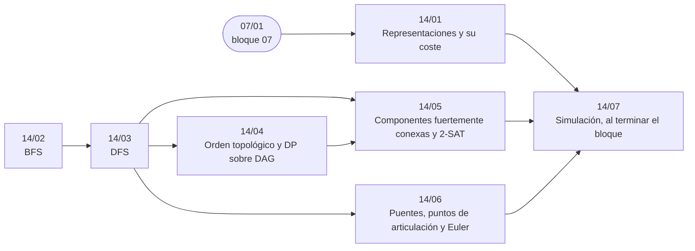

# Bloque 14 — Grafos: recorridos

> Recorrer un grafo y lo que sale de recorrerlo: las representaciones y su coste, BFS (multifuente, 0-1,
> sobre estados), DFS (componentes, ciclos, bipartición, clasificación de aristas), el orden topológico, las
> componentes fuertes con 2-SAT, y puentes, articulación y caminos de Euler.
>
> Las respuestas de las preguntas y las pistas 2 y 3 de los problemas, en [`08` — Respuestas](08-respuestas.md).
>
> **Vigencia:** 2026-10-04.

---

## 🧭 Índice

| Capítulo | Niveles | Ruta corta |
|---|---|---|
| [`14/01` — Representaciones y su coste](01-representaciones.md) | listas de adyacencia, matriz, lista de aristas, implícito en rejilla [A] |  |
| [`14/02` — BFS](02-bfs.md) | BFS [A] · multifuente [A] · 0-1 BFS [A] · estados compuestos [A] | sí |
| [`14/03` — DFS](03-dfs.md) | DFS [A] · componentes [A] · ciclos [A] · bipartición [A] · clasificación de aristas [B] | sí |
| [`14/04` — Orden topológico y DP sobre DAG](04-orden-topologico.md) | Kahn [A] · por DFS [A] | sí |
| [`14/05` — Componentes fuertemente conexas y 2-SAT](05-componentes-fuertes-y-2sat.md) | Kosaraju [B] · Tarjan [B] · 2-SAT [B] |  |
| [`14/06` — Puentes, puntos de articulación y Euler](06-puentes-articulacion-y-euler.md) | puentes y articulación [B] · Euler (Hierholzer) [B] |  |
| [`14/07` — Simulación](07-simulacion.md) | El examen del bloque: preguntas transversales y problemas cronometrados | |
| [`14/08` — Respuestas](08-respuestas.md) | Las preguntas en tres capas y las pistas 2 y 3 | |

---

## 🧭 Orden de lectura

- `14/01` → `14/02` → `14/03` → `14/04` es lineal; `14/05` y `14/06` se apoyan en el DFS de `14/03`.

---

## 🔎 Mapa de señales del bloque

| Señal | Técnica | Capítulo |
|---|---|---|
| `n, m ≤ 2·10⁵`, «aristas `u v`» | Listas de adyacencia | [`14/01`](01-representaciones.md) |
| «Matriz de distancias», `n ≤ 500`, todos con todos | Matriz | [`14/01`](01-representaciones.md) |
| «Número mínimo de pasos / movimientos / saltos» | BFS | [`14/02`](02-bfs.md) |
| «La más cercana», «desde varios puntos a la vez», «se propaga» | Multifuente | [`14/02`](02-bfs.md) |
| «Islas», «regiones», «grupos conectados» | Componentes | [`14/03`](03-dfs.md) |
| «Dependencias», «¿se puede terminar?», «prerrequisitos» | Ciclo dirigido | [`14/03`](03-dfs.md) |
| «Prerrequisitos», «dependencias», «antes de» | Orden topológico | [`14/04`](04-orden-topologico.md) |
| «¿Se pueden completar todas?» | Kahn y `< n` | [`14/04`](04-orden-topologico.md) |
| «Desde cualquiera se llega a cualquiera» en un dirigido | SCC (una sola) | [`14/05`](05-componentes-fuertes-y-2sat.md) |
| «Grupos que se alcanzan mutuamente» | SCC | [`14/05`](05-componentes-fuertes-y-2sat.md) |
| «Conexión crítica», «si se corta este cable» | Puentes | [`14/06`](06-puentes-articulacion-y-euler.md) |
| «Router imprescindible», «si cae este servidor» | Articulación | [`14/06`](06-puentes-articulacion-y-euler.md) |

---

## 📚 Lectura troncal del bloque

La de cada capítulo, que es también la primera entrada de su «Para profundizar»:

- **`14/01`** — Brassard y Bratley, *Fundamentos de algoritmia* (Prentice Hall, 1997), cap. 5; Cormen, Leiserson, Rivest y Stein, *Introduction to Algorithms*, 3.ª ed. (MIT Press, 2009), §22.1; Sedgewick y Wayne, *Algorithms*, 4.ª ed. (Addison-Wesley, 2011), §4.1.
- **`14/02`** — Cormen, Leiserson, Rivest y Stein, *Introduction to Algorithms*, 3.ª ed. (MIT Press, 2009), §22.2; Brassard y Bratley, *Fundamentos de algoritmia* (Prentice Hall, 1997), cap. 9.
- **`14/03`** — Cormen, Leiserson, Rivest y Stein, *Introduction to Algorithms*, 3.ª ed. (MIT Press, 2009), §22.3; Brassard y Bratley, *Fundamentos de algoritmia* (Prentice Hall, 1997), cap. 9.
- **`14/04`** — Cormen, Leiserson, Rivest y Stein, *Introduction to Algorithms*, 3.ª ed. (MIT Press, 2009), §22.4; Sedgewick y Wayne, *Algorithms*, 4.ª ed. (Addison-Wesley, 2011), §4.2.
- **`14/05`** — Cormen, Leiserson, Rivest y Stein, *Introduction to Algorithms*, 3.ª ed. (MIT Press, 2009), §22.5; Sedgewick y Wayne, *Algorithms*, 4.ª ed. (Addison-Wesley, 2011), §4.2.
- **`14/06`** — Brassard y Bratley, *Fundamentos de algoritmia* (Prentice Hall, 1997), cap. 9; Cormen, Leiserson, Rivest y Stein, *Introduction to Algorithms*, 3.ª ed. (MIT Press, 2009), problemas 22-2 (articulación, puentes y componentes biconexas) y 22-3 (recorrido de Euler).

---

## 🧭 Qué NO está aquí

- **Los árboles como estructura de datos**: en el [bloque `07`](../07-arboles/README.md).
- **Los caminos con pesos**: en el [bloque `15`](../15-grafos-pesos-y-flujos/README.md).
- **Union-Find para componentes con aristas que llegan**: en [`08/04` — Union-Find](../08-heaps-y-union-find/04-union-find.md).

---

**Anterior:** [Bloque 13 — DP avanzada](../13-dp-avanzada/README.md) ·
**Siguiente:** [Bloque 15 — Grafos con pesos y flujos](../15-grafos-pesos-y-flujos/README.md) ·
**Inicio:** [README del corpus](../README.md)
