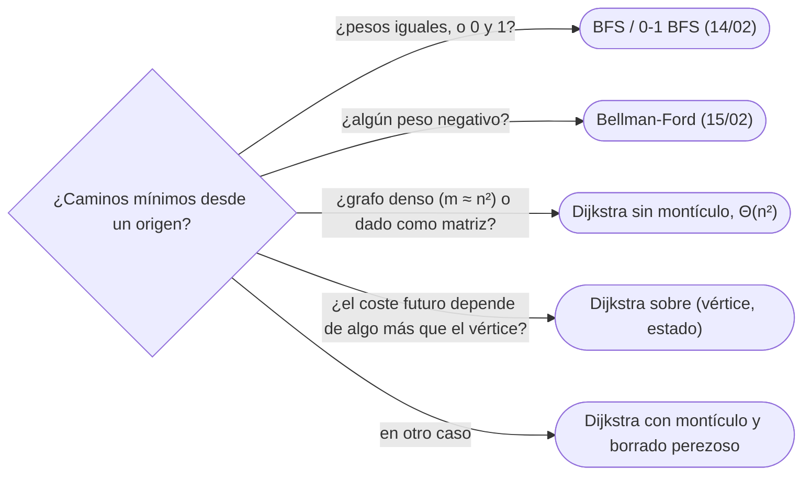

# 01 — Dijkstra

> Caminos mínimos desde un origen con pesos no negativos: el invariante que hace correcto a Dijkstra, por qué
> un solo peso negativo lo rompe, la versión con montículo y borrado perezoso —con la autopsia del bug que
> la vuelve cuadrática— y la versión `O(n²)` que gana en grafos densos. Y Dijkstra sobre estados, cuando el
> vértice no basta para decidir el futuro.
>
> **Niveles:** Dijkstra con montículo y perezoso [A] · sobre estados [A].
>
> **📚 Lectura troncal:** Cormen, Leiserson, Rivest y Stein, *Introduction to Algorithms*, 3.ª ed. (MIT
> Press, 2009), §24.3; Brassard y Bratley, *Fundamentos de algoritmia* (Prentice Hall, 1997), cap. 6;
> Sedgewick y Wayne, *Algorithms*, 4.ª ed. (Addison-Wesley, 2011), §4.4.
>
> **Asume leído:** [`08/01` — El montículo binario](../08-heaps-y-union-find/01-monticulo-binario.md); [`14/02` — BFS](../14-grafos-recorridos/02-bfs.md).
>
> **Vigencia:** 2026-10-04.

**Salto rápido:** [1](#1--el-problema) · [2](#2--la-teoría) · [3](#3--dijkstra-con-montículo) · [4](#4--dijkstra-sobre-estados) · [5](#5-️-la-tabla-de-costes) · [6](#6--cómo-se-elige) · [7](#7--señales-del-enunciado) · [8](#8--dónde-aparece-de-verdad) · [🧠](#-preguntas) · [🧩](#-problemas-propios)

---

## 1. 🎯 El problema

Un mapa de `10⁵` cruces y `2·10⁵` calles, cada una con su tiempo de recorrido. ¿Cuánto se tarda, como
mínimo, desde el depósito a cada cruce? BFS no sirve: cuenta aristas, y dos calles cortas pueden ganar a una
larga. Bellman-Ford sí sirve, pero cuesta `n · m = 2·10¹⁰`.

Dijkstra aprovecha que los pesos no son negativos: el cruce más cercano de los que faltan ya no puede
mejorar, porque cualquier desvío pasa por algo más lejano y solo suma. Con un montículo, eso da
`Θ((n + m) log n)`. La condición importa tanto como el algoritmo: con un solo peso negativo, Dijkstra da una
respuesta equivocada sin avisar.

> 🧠 **Modelo mental.** BFS con un reloj: en lugar de avanzar por capas de una arista, avanza por el tiempo
> de llegada. El montículo es la lista de llegadas previstas, y la primera llegada a un cruce es la buena.

Los ejemplos usan el grafo G de [`14/01`](../14-grafos-recorridos/01-representaciones.md) **con sus pesos**: `A–B 2`, `A–C 4`, `B–D 3`, `B–E 1`, `C–E 7`,
`D–F 2`, `E–F 5`.

---

## 2. 📐 La teoría

**El algoritmo.** `dist[s] = 0` y `∞` el resto. Repetir: extraer el vértice `u` no fijado de menor
`dist`, **fijarlo**, y relajar sus aristas: `dist[v] = min(dist[v], dist[u] + w(u, v))`.

**Invariante.** Cuando `u` se fija, `dist[u] = δ(s, u)`.

*Prueba.* Supón que `u` es el primer vértice fijado con `dist[u] > δ(s, u)`. Sea `P` un camino mínimo de `s`
a `u`, `y` el primer vértice de `P` sin fijar y `x` su predecesor en `P` (fijado, con `dist[x] = δ(s, x)`).
Al fijar `x` se relajó `x → y`, así que `dist[y] ≤ δ(s, x) + w(x, y) = δ(s, y)`. Como los pesos son **no
negativos**, `δ(s, y) ≤ δ(s, u)`. Entonces `dist[y] ≤ δ(s, u) < dist[u]`, y el algoritmo habría extraído
`y` antes que `u`: contradicción.

**Dónde lo rompe un peso negativo.** El paso `δ(s, y) ≤ δ(s, u)` dice que un prefijo de un camino no cuesta
más que el camino entero, y eso es falso con pesos negativos. Con `s → a` de 1, `s → b` de 2 y `b → a` de
`−2`: Dijkstra fija `a` con 1, y la distancia real es 0. No es «más lento»: es **incorrecto**.

**Coste.** Con un montículo binario y borrado perezoso, cada relajación exitosa mete una entrada: como mucho
`m` entradas, `Θ((n + m) log m) = Θ((n + m) log n)` (porque `m ≤ n²`). Sin montículo, buscar el mínimo
recorriendo el arreglo: `n` veces `Θ(n)`, `Θ(n² + m)`, mejor cuando `m` es del orden de `n²`.

**Árbol de caminos mínimos.** Guardando `parent[v]` en cada relajación exitosa, los padres forman un árbol;
seguirlo desde `t` da el camino, como en BFS.

---

## 3. 🧱 Dijkstra con montículo

**Qué es.** Dijkstra con una cola de prioridad de pares `(distancia, vértice)`. Como las bibliotecas no
tienen `decrease-key`, cada mejora mete una entrada nueva, y al extraer se **descarta** la entrada si su
distancia ya no es la vigente: el borrado perezoso de
[`08/02`](../08-heaps-y-union-find/02-patrones-con-heap.md).

**Por qué es correcto.** El invariante de §2. La entrada vigente de un vértice sale antes que sus copias
viejas, que tienen distancia mayor; las viejas no hacen nada.

**Cómo va**, en G desde `A`:

```text
saca    relaja                 montículo después
(0, A)  B = 2, C = 4            (2,B) (4,C)
(2, B)  D = 5, E = 3            (3,E) (4,C) (5,D)
(3, E)  F = 8                   (4,C) (5,D) (8,F)
(4, C)  — (C–E daría 11)        (5,D) (8,F)
(5, D)  F = 7                   (7,F) (8,F)
(7, F)  —                       (8,F)
(8, F)  vieja: 8 > dist[F] = 7, se descarta
dist: A 0, B 2, C 4, D 5, E 3, F 7 · camino a F: A B D F
```

**Cuánto.** `Θ((n + m) log n)` tiempo; `Θ(n + m)` memoria (el montículo puede tener hasta `m` entradas).

**La plantilla:**

```cpp
#include <functional>
#include <queue>
#include <vector>

const long long INF = (long long)4e18;

// adj[u] = {vecino, peso}, pesos ≥ 0. Distancias desde s (INF = inalcanzable) y padres.
std::vector<long long> dijkstra(const std::vector<std::vector<std::pair<int, long long>>>& adj, int s,
                         std::vector<int>& parent) {
    int n = adj.size();
    std::vector<long long> dist(n, INF);
    parent.assign(n, -1);
    using Item = std::pair<long long, int>;
    std::priority_queue<Item, std::vector<Item>, std::greater<Item>> pq;
    dist[s] = 0; pq.push({0, s});
    while (!pq.empty()) {
        auto [d, u] = pq.top(); pq.pop();
        if (d > dist[u]) continue;                       // entrada vieja: se descarta
        for (auto [v, w] : adj[u])
            if (d + w < dist[v]) { dist[v] = d + w; parent[v] = u; pq.push({dist[v], v}); }
    }
    return dist;
}
```

```java
import java.util.Arrays;
import java.util.PriorityQueue;

// adj[u] = {vecino, peso} en filas de long[]. Distancias desde s; Long.MAX_VALUE = inalcanzable.
static long[] dijkstra(long[][][] adj, int s, int[] parent) {
    int n = adj.length;
    long[] dist = new long[n];
    Arrays.fill(dist, Long.MAX_VALUE);
    Arrays.fill(parent, -1);
    PriorityQueue<long[]> pq = new PriorityQueue<>((a, b) -> Long.compare(a[0], b[0]));
    dist[s] = 0;
    pq.add(new long[]{0, s});
    while (!pq.isEmpty()) {
        long[] top = pq.poll();
        long d = top[0];
        int u = (int) top[1];
        if (d > dist[u]) continue;                       // entrada vieja
        for (long[] e : adj[u]) {
            int v = (int) e[0];
            if (d + e[1] < dist[v]) {
                dist[v] = d + e[1]; parent[v] = u;
                pq.add(new long[]{dist[v], v});
            }
        }
    }
    return dist;
}
```

```python
import heapq

def dijkstra(adj, s):
    """adj[u] = [(v, w)] con w >= 0. Distancias (inf = inalcanzable) y padres."""
    n = len(adj)
    INF = float('inf')
    dist, parent = [INF] * n, [-1] * n
    dist[s] = 0
    pq = [(0, s)]
    while pq:
        d, u = heapq.heappop(pq)
        if d > dist[u]:
            continue                                     # entrada vieja
        for v, w in adj[u]:
            nd = d + w
            if nd < dist[v]:
                dist[v] = nd
                parent[v] = u
                heapq.heappush(pq, (nd, v))
    return dist, parent
```

- **`greater<>` en C++**: `priority_queue` es de máximos; sin él, sale el **más lejano** y el algoritmo
  sigue «funcionando» con resultados falsos.
- **Distancias en 64 bits**: `2·10⁵` aristas de `10⁹` son `2·10¹⁴`. `INF` de C++ es `4·10¹⁸` y la suma
  `d + w` se hace solo con `d` finito, que sale del montículo.
- **En Java**, `PriorityQueue<long[]>` crea un objeto por entrada; con `10⁶` aristas va bien. Si aprieta,
  se codifica `(dist, vértice)` en un solo `long` cuando las distancias lo permiten, o la cola indexada con
  `decrease-key` de [`08/01`](../08-heaps-y-union-find/01-monticulo-binario.md).
- **En Python**, tuplas `(d, v)` en `heapq`; con `2·10⁵` aristas, del orden de un segundo en CPython.

**La autopsia del bug: el `continue` que falta.** Sin `if (d > dist[u]) continue`, la respuesta sigue
siendo correcta —las relajaciones desde una entrada vieja fallan todas—, pero cada entrada vieja recorre
otra vez la lista de vecinos. Un vértice con `10⁵` vecinos que mejora `10⁵` veces antes de fijarse recorre
su lista `10⁵` veces: `10¹⁰` pasos, TLE en un solo caso de prueba y AC en todos los demás.

### De la versión ingenua a la buena

**El problema.** Tiempos mínimos desde el depósito a los `10⁵` cruces.

**La versión ingenua:**

```java
// Correcta: Dijkstra sin montículo; el mínimo se busca recorriendo el arreglo. Θ(n² + m).
static long[] dijkstraDense(long[][][] adj, int s) {
    int n = adj.length;
    long[] dist = new long[n];
    boolean[] done = new boolean[n];
    Arrays.fill(dist, Long.MAX_VALUE);
    dist[s] = 0;
    for (int it = 0; it < n; it++) {
        int u = -1;
        for (int v = 0; v < n; v++)                          // Θ(n) por extracción
            if (!done[v] && dist[v] != Long.MAX_VALUE && (u == -1 || dist[v] < dist[u])) u = v;
        if (u == -1) break;                                  // el resto es inalcanzable
        done[u] = true;
        for (long[] e : adj[u])
            if (dist[u] + e[1] < dist[(int) e[0]]) dist[(int) e[0]] = dist[u] + e[1];
    }
    return dist;
}
```

> «Buscar el mínimo recorriendo los `10⁵` vértices en cada paso son `10¹⁰`. Un montículo me da el mínimo en
> `O(log n)`; como no tiene `decrease-key`, meto la mejora como entrada nueva y descarto las viejas al
> sacarlas.»

**El camino a la buena.** Montículo con borrado perezoso: `Θ((n + m) log n)`.

**Cuándo sí:** caminos mínimos con pesos no negativos desde un origen (o varios: todos al montículo con 0).
**Cuándo no:** con pesos negativos (Bellman-Ford, [`15/02`](02-bellman-ford-floyd-y-johnson.md)); con todos los pesos iguales o 0 y 1, BFS y 0-1 BFS
son más simples y lineales; y en grafos densos (`m` cerca de `n²`), la versión ingenua de arriba **es** la
buena: `Θ(n²)` contra `Θ(n² log n)`.

> **Veredicto:** Dijkstra es el camino mínimo con pesos no negativos: montículo de pares, borrado perezoso
> con su `continue`, y 64 bits. En grafos densos, sin montículo.

---

## 4. 🧱 Dijkstra sobre estados

**Qué es.** Igual que en `14/02`, cuando el coste futuro depende de algo más que el vértice —vales usados,
combustible, paridad—, el vértice del grafo es el par `(vértice, estado)`, y Dijkstra lo recorre sin
cambios. Las transiciones pueden cambiar el estado, con su propio coste.

**Por qué es correcto.** Es Dijkstra sobre otro grafo, con pesos no negativos: vale el invariante de §2. Lo
que hay que justificar es que el estado sea **suficiente**.

**Cómo va.** En G, desde `A`, con **un vale** que hace gratis una calle: estado `(cruce, vales usados)`.
Cada arista se puede tomar pagando (mismo estado) o con el vale (estado + 1, coste 0).

```text
sin vale:  A 0, B 2, C 4, D 5, E 3, F 7
con vale:  A 0, B 0, C 0, D 2, E 1, F 3     F: A B E F pagando 2 + 1 y el vale en E–F (5)
con dos:   F 1                                 A B E F con los vales en A–B y E–F
```

El camino óptimo con vale (`A B E F`, 3) no es el óptimo sin vale (`A B D F`, 7) con su arista más cara
gratis (`7 − 3 = 4`): por eso no basta con un Dijkstra y un retoque.

**Cuánto.** `Θ(K · (n + m) log(K · n))` con `K` estados por vértice.

**La plantilla**, con hasta `K` vales:

```cpp
#include <functional>
#include <queue>
#include <tuple>
#include <vector>


// Distancia mínima de s a cada vértice usando hasta K vales (cada vale hace gratis una arista).
std::vector<long long> dijkstraVouchers(const std::vector<std::vector<std::pair<int, long long>>>& adj, int s, int K) {
    int n = adj.size();
    const long long INF = (long long)4e18;
    std::vector<std::vector<long long>> dist(n, std::vector<long long>(K + 1, INF));
    using Item = std::tuple<long long, int, int>;
    std::priority_queue<Item, std::vector<Item>, std::greater<Item>> pq;
    dist[s][0] = 0; pq.push({0, s, 0});
    while (!pq.empty()) {
        auto [d, u, k] = pq.top(); pq.pop();
        if (d > dist[u][k]) continue;
        for (auto [v, w] : adj[u]) {
            if (d + w < dist[v][k]) { dist[v][k] = d + w; pq.push({d + w, v, k}); }        // pagar
            if (k < K && d < dist[v][k + 1]) { dist[v][k + 1] = d; pq.push({d, v, k + 1}); } // vale
        }
    }
    std::vector<long long> best(n, INF);
    for (int v = 0; v < n; v++) for (int k = 0; k <= K; k++) best[v] = std::min(best[v], dist[v][k]);
    return best;
}
```

```java
import java.util.PriorityQueue;

// Estado codificado en un entero: u · (K + 1) + k. La entrada del montículo: {dist, estado}.
static long[] dijkstraVouchers(long[][][] adj, int s, int K) {
    int n = adj.length, S = K + 1;
    long[] dist = new long[n * S];
    java.util.Arrays.fill(dist, Long.MAX_VALUE);
    PriorityQueue<long[]> pq = new PriorityQueue<>((a, b) -> Long.compare(a[0], b[0]));
    dist[s * S] = 0;
    pq.add(new long[]{0, s * S});
    while (!pq.isEmpty()) {
        long[] top = pq.poll();
        long d = top[0];
        int st = (int) top[1], u = st / S, k = st % S;
        if (d > dist[st]) continue;
        for (long[] e : adj[u]) {
            int v = (int) e[0];
            if (d + e[1] < dist[v * S + k]) { dist[v * S + k] = d + e[1]; pq.add(new long[]{d + e[1], v * S + k}); }
            if (k < K && d < dist[v * S + k + 1]) { dist[v * S + k + 1] = d; pq.add(new long[]{d, v * S + k + 1}); }
        }
    }
    long[] best = new long[n];
    for (int v = 0; v < n; v++) {
        best[v] = Long.MAX_VALUE;
        for (int k = 0; k < S; k++) best[v] = Math.min(best[v], dist[v * S + k]);
    }
    return best;
}
```

```python
import heapq

def dijkstra_vouchers(adj, s, K):
    """Distancia mínima usando hasta K vales; estado (vértice, vales usados)."""
    n = len(adj)
    INF = float('inf')
    dist = [[INF] * (K + 1) for _ in range(n)]
    dist[s][0] = 0
    pq = [(0, s, 0)]
    while pq:
        d, u, k = heapq.heappop(pq)
        if d > dist[u][k]:
            continue
        for v, w in adj[u]:
            if d + w < dist[v][k]:
                dist[v][k] = d + w
                heapq.heappush(pq, (d + w, v, k))
            if k < K and d < dist[v][k + 1]:
                dist[v][k + 1] = d
                heapq.heappush(pq, (d, v, k + 1))
    return [min(row) for row in dist]
```

- **Las transiciones de estado son aristas**: «usar un vale» es una arista de coste 0 a la capa siguiente.
  Cualquier regla nueva (combustible, paridad, transbordos) se escribe así.
- **La respuesta es el mínimo sobre los estados** del destino, salvo que el enunciado exija un estado final.
- **El tamaño**: con `n = 10⁵` y `K = 10`, `10⁶` estados y `4·10⁶` aristas; se multiplica antes de
  escribir, como en `14/02`.

### De la versión ingenua a la buena

**La versión ingenua:** para cada arista, ponerla a 0 y correr Dijkstra; quedarse con el mínimo. Correcta
para un vale, `Θ(m · (n + m) log n)`; con `K` vales, `m^K` combinaciones.

> «El vale es una decisión dentro del camino: en cada arista elijo pagar o gastar. Si el estado lleva
> cuántos vales gasté, la decisión es una arista más y un solo Dijkstra la explora.»

**Cuándo sí:** vales, descuentos, combustible, número de transbordos, paridad, «como mucho `k`
excepciones». **Cuándo no:** si el estado no cabe (`K · n` enorme), o si el límite es sobre el número de
aristas y los pesos pueden ser negativos (Bellman-Ford por rondas, `15/02`).

> **Veredicto:** si el futuro depende de lo que gastaste, el estado lo lleva: Dijkstra sobre
> `(vértice, estado)`, con las decisiones como aristas.

---

## 5. ⏱️ La tabla de costes

| Variante | Tiempo | Memoria | Lo que la tabla no dice |
|---|---|---|---|
| Montículo binario, perezoso | `Θ((n + m) log n)` | `Θ(n + m)` | Sin el `continue`, puede ser cuadrático |
| Cola indexada con `decrease-key` | `Θ((n + m) log n)` | `Θ(n)` | Montículo de `n` entradas (`08/01`) |
| Sin montículo | `Θ(n² + m)` | `Θ(n)` | Gana en grafos densos |
| Sobre estados | `Θ(K (n + m) log(Kn))` | `Θ(K n)` | Se multiplica antes de escribir |
| BFS / 0-1 BFS (comparación) | `Θ(n + m)` | `Θ(n)` | Solo con pesos iguales o 0 y 1 (`14/02`) |

---

## 6. 🧭 Cómo se elige



> **Regla de entrevista:** antes de escribir Dijkstra, di en voz alta «los pesos son no negativos». Es la
> condición del teorema, y es lo primero que preguntan.

---

## 7. 🔎 Señales del enunciado

| Señal | Técnica | Por qué |
|---|---|---|
| «Tiempo / coste mínimo», pesos `≥ 0`, `n ≤ 2·10⁵` | Dijkstra con montículo | Disperso |
| «Minimizar el máximo esfuerzo / la mayor altura del camino» | Dijkstra con `max` en lugar de `+` | La relajación sigue siendo monótona |
| «Probabilidad máxima de llegar» | Dijkstra con producto (o `−log`) | Factores en `[0, 1]` no mejoran al alargar |
| «Puedes usar `k` descuentos», «con combustible» | Dijkstra sobre estados | El estado lleva lo gastado |
| «A lo sumo `k` escalas» | Estados `(vértice, escalas)` o Bellman-Ford por rondas | Límite sobre aristas |

---

## 8. 🔭 Dónde aparece de verdad

- **Los protocolos de encaminamiento por estado de enlace** (OSPF, IS-IS) corren Dijkstra en cada router
  sobre el mapa completo de la red para calcular su tabla de rutas.
- **Los navegadores de mapas** parten de Dijkstra, con A\* ([`15/03`](03-a-estrella.md)) y preprocesos como las jerarquías de
  contracción para responder en milisegundos sobre redes continentales.

---

## ⚠️ Errores frecuentes

| Se dice | Lo preciso |
|---|---|
| «Dijkstra encuentra el camino más corto» | Con pesos **no negativos**; sin esa condición, puede fallar |
| «Con pesos negativos solo es más lento» | Es incorrecto: fija vértices con distancias que luego bajarían |
| «Si sumo una constante a todos los pesos, ya no hay negativos» | Cambia qué camino es mínimo: penaliza los de más aristas |
| «El `continue` de las entradas viejas es una optimización menor» | Sin él, un vértice de grado alto puede volver el algoritmo cuadrático |
| «`priority_queue` de C++ saca el menor» | Saca el mayor: hace falta `greater<>` |
| «Dijkstra con `int` basta» | Las sumas de pesos de `10⁹` desbordan: 64 bits |
| «En grafos densos, el montículo siempre gana» | Con `m ≈ n²`, la versión `Θ(n²)` gana |

---

## 📚 Para profundizar

- **Libro** — Cormen, Leiserson, Rivest y Stein, *Introduction to Algorithms*, 3.ª ed. (MIT Press, 2009),
  §24.3: Dijkstra con la prueba del invariante. *Lectura troncal.*
- **Libro** — Brassard y Bratley, *Fundamentos de algoritmia* (Prentice Hall, 1997), cap. 6: Dijkstra como
  algoritmo voraz. *Lectura troncal.*
- **Libro** — Sedgewick y Wayne, *Algorithms*, 4.ª ed. (Addison-Wesley, 2011), §4.4: caminos mínimos con la
  cola indexada. *Lectura troncal.*
- **Referencia** — cp-algorithms, [*Dijkstra on sparse graphs*](https://cp-algorithms.com/graph/dijkstra_sparse.html)
  y [*Dijkstra Algorithm*](https://cp-algorithms.com/graph/dijkstra.html) (la versión `O(n²)`).
- **Referencia** — Sedgewick y Wayne, [código de `DijkstraSP.java`](https://algs4.cs.princeton.edu/44sp/DijkstraSP.java.html).

---

## 🧠 Preguntas

1. ¿Qué condición exige Dijkstra sobre los pesos, y qué pasa si no se cumple? 🟢
2. ¿Qué es el borrado perezoso y por qué hace falta con `priority_queue`, `PriorityQueue` y `heapq`? 🟢
3. ¿Cuánto cuesta Dijkstra con montículo binario, y cuánto sin montículo? 🟢
4. ¿Cómo reconstruyes el camino mínimo? 🟢
5. ¿Qué pasa si olvidas `greater<>` en la `priority_queue` de C++? 🟡
6. ¿Por qué hacen falta 64 bits en las distancias, y dónde puede desbordar la suma? 🟡
7. Enuncia el invariante de Dijkstra. 🟡
8. ¿Cuándo es mejor la versión `O(n²)` sin montículo? 🟡
9. Demuestra el invariante de Dijkstra y señala el paso que usa los pesos no negativos. 🟠
10. Da un contraejemplo de tres vértices con un peso negativo donde Dijkstra falla. 🟠
11. ¿Qué pasa exactamente si quitas la comprobación de las entradas viejas? ¿Es incorrecto o lento? 🟠
12. ¿Cómo adaptas Dijkstra para «minimizar el máximo peso del camino», y por qué sigue siendo correcto? 🔴
13. Diseña el estado para el camino más barato con hasta `k` aristas gratis y di su coste. 🔴

---

## 🧩 Problemas propios

### Tiempos desde el depósito

**Nivel:** 🟢 · **Formato:** programa completo.

Imprime la distancia mínima desde el vértice 1 a cada vértice de un grafo no dirigido con pesos, o `-1` si
es inalcanzable.

- **Entrada.** Una línea con `n` y `m`. Después, `m` líneas con `u v w`.
- **Salida.** Una línea con `n` enteros.
- **Restricciones.** `1 ≤ n ≤ 10⁵`; `0 ≤ m ≤ 2·10⁵`; `1 ≤ w ≤ 10⁹`.

```text
Entrada     Salida
6 7         0 2 4 5 3 7
1 2 2
1 3 4
2 4 3
2 5 1
3 5 7
4 6 2
5 6 5

Entrada     Salida
3 1         0 5 -1
1 2 5
```

**Pista 1:** con pesos hasta `10⁹`, ¿qué tipo necesitan las distancias?

### El más barato y el más corto

**Nivel:** 🟡 · **Formato:** programa completo.

Entre todos los caminos de coste mínimo de 1 a `n` en un grafo no dirigido con pesos, elige el de menos
aristas. Imprime el coste y el número de aristas, o `-1 -1` si no hay camino.

- **Entrada.** Una línea con `n` y `m`. Después, `m` líneas con `u v w`.
- **Salida.** Dos enteros.
- **Restricciones.** `2 ≤ n ≤ 10⁵`; `0 ≤ m ≤ 2·10⁵`; `1 ≤ w ≤ 10⁹`.

```text
Entrada     Salida
4 4         3 1
1 2 1
2 3 1
3 4 1
1 4 3

Entrada     Salida
6 7         7 3
1 2 2
1 3 4
2 4 3
2 5 1
3 5 7
4 6 2
5 6 5
```

**Pista 1:** ¿qué pasa si la distancia de cada vértice es un par `(coste, aristas)` comparado en ese orden?

### Trenes con horario

**Nivel:** 🟠 · **Formato:** programa completo.

Hay `m` líneas de tren dirigidas. La línea `u v p d` sale de `u` en los instantes `0, p, 2p, …` y llega a
`v` `d` unidades después. Estás en la estación 1 en el instante 0 y puedes esperar lo que quieras en
cualquier estación. ¿En qué instante llegas, como pronto, a la estación `n`? Imprime `-1` si no se puede.

- **Entrada.** Una línea con `n` y `m`. Después, `m` líneas con `u v p d`.
- **Salida.** Un entero.
- **Restricciones.** `2 ≤ n ≤ 10⁵`; `1 ≤ m ≤ 2·10⁵`; `1 ≤ p, d ≤ 10⁹`.

```text
Entrada     Salida
4 4         7
1 2 5 3
1 3 2 4
2 4 1 6
3 4 5 2

Entrada     Salida
3 2         -1
1 2 1 1
3 2 1 1
```

**Pista 1:** si llegas antes a una estación, ¿puedes salir después que si llegas más tarde?

🔥 **Para el geek — en Go y en JavaScript:** sin montículo en la biblioteca, Dijkstra cambia entero: en Go
hay que implementar `heap.Interface` sobre un tipo propio, y en JavaScript escribir el montículo a mano;
la versión `O(n²)` sin montículo es a veces la más rápida de escribir bajo presión.

---

## 🧩 Práctica externa

> 💡 **Truco.** Antes de pedir ayuda con un Dijkstra que da WA, imprime la primera relajación que mejora un
> vértice ya fijado: si existe, hay un peso negativo o un montículo de máximos. Si una IA te ayuda, que sea
> a encontrar ese caso, no a escribir Dijkstra ([`01/06`](../01-oficio-del-competidor/06-protocolo-de-resolucion.md)).

### Núcleo

| ✔ | Problema | Plataforma | Nivel | Patrón | Pista 1 |
|---|---|---|---|---|---|
| [ ] | [Shortest Routes I](https://cses.fi/problemset/task/1671) | CSES | 🟡 | Dijkstra dirigido | ¿Qué tipo necesitan las distancias? |
| [ ] | [Network Delay Time](https://leetcode.com/problems/network-delay-time/) | LeetCode | 🟡 | Dijkstra y máximo | ¿Cuándo recibe la señal el último nodo? |
| [ ] | [Dijkstra: Shortest Reach 2](https://www.hackerrank.com/challenges/dijkstrashortreach/problem) | HackerRank | 🟡 | Dijkstra con aristas repetidas | Entre dos ciudades hay varias carreteras: ¿cuál importa? |
| [ ] | [Path With Minimum Effort](https://leetcode.com/problems/path-with-minimum-effort/) | LeetCode | 🟡 | Dijkstra con máximo | ¿Qué se acumula a lo largo del camino, una suma o un máximo? |
| [ ] | [Path with Maximum Probability](https://leetcode.com/problems/path-with-maximum-probability/) | LeetCode | 🟡 | Dijkstra con producto | ¿Alargar un camino puede aumentar su probabilidad? |
| [ ] | [Cheapest Flights Within K Stops](https://leetcode.com/problems/cheapest-flights-within-k-stops/) | LeetCode | 🟡 | Estados o rondas | ¿Qué hay que recordar, además del aeropuerto? |
| [ ] | [Swim in Rising Water](https://leetcode.com/problems/swim-in-rising-water/) | LeetCode | 🟠 | Dijkstra con máximo en rejilla | ¿Cuándo puedes entrar, como pronto, en una casilla? |

### Ampliación

| ✔ | Problema | Plataforma | Nivel | Patrón | Pista 1 |
|---|---|---|---|---|---|
| [ ] | [Full Tank?](https://open.kattis.com/problems/fulltank) | Kattis | 🟠 | Estados con combustible | ¿Cuántos estados hay si el depósito tiene hasta 100 unidades? |
| [ ] | [Minimum Cost to Reach Destination in Time](https://leetcode.com/problems/minimum-cost-to-reach-destination-in-time/) | LeetCode | 🟠 | Estados con tiempo | ¿El estado es el tiempo, el coste, o los dos? |
| [ ] | [Dijkstra?](https://codeforces.com/problemset/problem/20/C) | Codeforces | 🟠 | Dijkstra y camino | ¿Qué guardas para imprimir el camino? |
| [ ] | [Flight Routes](https://cses.fi/problemset/task/1196) | CSES | 🔴 | Los `k` caminos más cortos | ¿Cuántas veces puede salir del montículo un mismo vértice? |
| [ ] | [Second Minimum Time to Reach Destination](https://leetcode.com/problems/second-minimum-time-to-reach-destination/) | LeetCode | 🔴 | Segunda distancia | ¿Cuántas distancias guardas por vértice? |

---

## ✅ Criterio de dominio

- Escribir Dijkstra con montículo y borrado perezoso en los tres lenguajes sin mirar, con 64 bits.
- Demostrar el invariante y dar el contraejemplo con un peso negativo.
- Explicar la autopsia del `continue` y cuándo gana la versión `O(n²)`.
- Diseñar el estado de un Dijkstra con vales o combustible y multiplicar su tamaño.
- Resolver Path With Minimum Effort y Cheapest Flights Within K Stops sin pista 2.

---

**Anterior:** — · **Siguiente:** [`15/02` — Bellman-Ford, Floyd-Warshall y Johnson](02-bellman-ford-floyd-y-johnson.md) · **Relacionado:**
[`14/02` — BFS](../14-grafos-recorridos/02-bfs.md); [`08/02` — Patrones con montículo](../08-heaps-y-union-find/02-patrones-con-heap.md).
