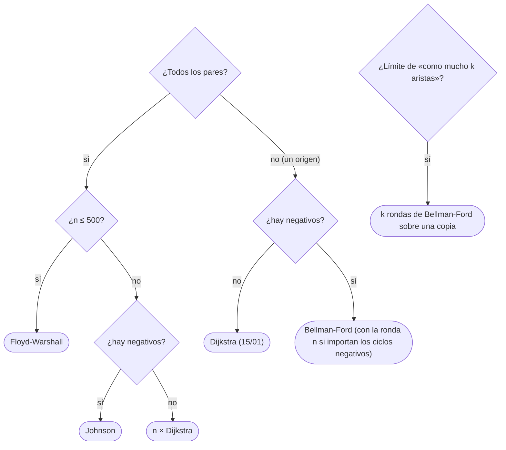

# 02 — Bellman-Ford, Floyd-Warshall y Johnson

> Caminos mínimos cuando hay pesos negativos y cuando se quieren entre todos los pares: Bellman-Ford, que
> relaja todas las aristas `n − 1` veces y detecta los ciclos negativos con una ronda más; Floyd-Warshall,
> una DP sobre el vértice intermedio en tres bucles cuyo orden no es negociable; SPFA, la cola que promete
> velocidad y no la garantiza; y Johnson, que repesa para poder usar Dijkstra.
>
> **Niveles:** Bellman-Ford [A] · Floyd-Warshall [A] · por qué no SPFA [B] · Johnson [C].
>
> **📚 Lectura troncal:** Cormen, Leiserson, Rivest y Stein, *Introduction to Algorithms*, 3.ª ed. (MIT
> Press, 2009), §24.1 y cap. 25; Brassard y Bratley, *Fundamentos de algoritmia* (Prentice Hall, 1997),
> cap. 8 (Floyd).
>
> **Asume leído:** [`15/01` — Dijkstra](01-dijkstra.md).
>
> **Vigencia:** 2026-10-04.

**Salto rápido:** [1](#1--el-problema) · [2](#2--la-teoría) · [3](#3--bellman-ford) · [4](#4--floyd-warshall) · [5](#5--por-qué-no-spfa) · [6](#6--johnson) · [7](#7-️-la-tabla-de-costes) · [8](#8--cómo-se-elige) · [9](#9--señales-del-enunciado) · [🧠](#-preguntas) · [🧩](#-problemas-propios)

---

## 1. 🎯 El problema

Dos preguntas que Dijkstra no responde. La primera: en una red de transporte con **reembolsos** —tramos que
devuelven dinero, pesos negativos—, ¿cuánto cuesta ir de la estación 1 a cada una? Y si hay una vuelta que
deja más dinero del que cuesta, ¿qué estaciones pueden salir gratis o mejor? La segunda: en un mapa de 400
ciudades, ¿cuál es la distancia entre **cada par**? Correr Dijkstra desde cada una es posible, pero hay
algo más corto de escribir.

Bellman-Ford responde la primera en `Θ(n · m)`, sin condiciones sobre los pesos y avisando del ciclo
negativo. Floyd-Warshall responde la segunda en `Θ(n³)` con tres bucles. Y Johnson combina los dos mundos
para grafos grandes y dispersos.

> 🧠 **Modelo mental.** Bellman-Ford es paciencia: «si nadie mejora en una ronda, ya está; y en `n − 1`
> rondas, todo camino simple se ha propagado entero». Floyd es una tabla que se pregunta, vértice a vértice,
> «¿me conviene pasar por aquí?».

Los ejemplos usan el DAG D de [`14/01`](../14-grafos-recorridos/01-representaciones.md) con los pesos de G salvo uno, **`C → E` de `−7`**: lo llamamos D⁻.
Para Floyd, el grafo G con sus pesos.

---

## 2. 📐 La teoría

**Relajar.** `dist[v] = min(dist[v], dist[u] + w(u, v))`. Nunca deja `dist[v]` por debajo de `δ(s, v)`,
porque siempre corresponde a un camino real.

**Bellman-Ford: `n − 1` rondas bastan.** Tras la ronda `k`, `dist[v] ≤` el coste del mejor camino de `s` a
`v` con **como mucho `k` aristas**.

*Prueba por inducción.* Para `k = 0` es cierto (solo `s`). Si un camino óptimo de `k` aristas termina en
`u → v`, su prefijo tiene `k − 1` aristas y, tras la ronda `k − 1`, `dist[u]` ya es como mucho su coste; en la
ronda `k` se relaja `u → v`. Sin ciclos negativos, un camino mínimo es simple y tiene como mucho `n − 1`
aristas: tras `n − 1` rondas, `dist = δ`.

**Detectar un ciclo negativo.** Si en la ronda `n` todavía se relaja alguna arista, hay un ciclo negativo
alcanzable desde `s`: sin él, todo estaría ya en su valor final. Los vértices con distancia `−∞` son los
alcanzables **desde** un vértice que mejoró en esa ronda.

**Floyd-Warshall como DP.** `d_k[i][j]` = camino mínimo de `i` a `j` usando solo los vértices `1..k` como
intermedios:

```text
d_k[i][j] = min( d_{k−1}[i][j],  d_{k−1}[i][k] + d_{k−1}[k][j] )
```

El camino óptimo o no pasa por `k`, o pasa una vez (sin ciclos negativos) y se parte en dos tramos que solo
usan `1..k−1`. Se puede hacer **en el sitio** porque en la ronda `k` la fila y la columna `k` no cambian
(`d[k][k] = 0`). Por eso `k` va **por fuera**: cada ronda necesita la tabla completa de la anterior. Un ciclo
negativo aparece como `d[i][i] < 0`.

**Johnson: repesar.** Con `h(v)` = distancia desde una superfuente unida a todo con peso 0 (Bellman-Ford),
los pesos `w′(u, v) = w(u, v) + h(u) − h(v)` son no negativos —es la desigualdad triangular
`h(v) ≤ h(u) + w(u, v)`— y todo camino de `s` a `t` cambia en la misma constante `h(s) − h(t)`. Los caminos
mínimos se conservan, y se puede correr Dijkstra desde cada vértice.

---

## 3. 🧱 Bellman-Ford

**Qué es.** `n − 1` rondas en las que se relajan todas las aristas, con salida anticipada si una ronda no
cambia nada; y una ronda `n` para detectar el ciclo negativo.

**Por qué es correcto.** El lema de las rondas de §2.

**Cómo va**, en D⁻ desde `A`, con las aristas en el orden `A→B, A→C, B→D, B→E, C→E, D→F, E→F`:

```text
ronda 1: B 2, C 4, D 5, E 3 → −3 (por C → E), F 2 (por E → F)
ronda 2: nada cambia → fin
con las aristas en orden inverso: ronda 1 solo B y C; ronda 2 D y E; ronda 3 F; ronda 4 nada
añadiendo F → A de −3: el ciclo A C E F cuesta 4 − 7 + 5 − 3 = −1, y la ronda 6 todavía relaja
```

El orden de las aristas cambia **cuántas** rondas hacen falta, nunca el resultado.

**Cuánto.** `Θ(n · m)` en el peor caso; `Θ(m)` por ronda.

**La plantilla:**

```cpp
#include <vector>

struct Edge { int u, v; long long w; };

// Distancias desde s; devuelve false si hay un ciclo negativo alcanzable desde s.
bool bellmanFord(int n, const std::vector<Edge>& edges, int s, std::vector<long long>& dist) {
    const long long INF = (long long)4e18;
    dist.assign(n, INF);
    dist[s] = 0;
    for (int round = 0; round < n; round++) {
        bool changed = false;
        for (const Edge& e : edges)
            if (dist[e.u] != INF && dist[e.u] + e.w < dist[e.v]) { dist[e.v] = dist[e.u] + e.w; changed = true; }
        if (!changed) return true;                       // estable: no hay ciclo negativo alcanzable
        if (round == n - 1) return false;                // la ronda n todavía mejora
    }
    return true;
}
```

```java
// edges[i] = {u, v, w}. Distancias desde s; false si hay ciclo negativo alcanzable.
static boolean bellmanFord(int n, long[][] edges, int s, long[] dist) {
    final long INF = Long.MAX_VALUE / 4;
    java.util.Arrays.fill(dist, INF);
    dist[s] = 0;
    for (int round = 0; round < n; round++) {
        boolean changed = false;
        for (long[] e : edges) {
            int u = (int) e[0], v = (int) e[1];
            if (dist[u] != INF && dist[u] + e[2] < dist[v]) { dist[v] = dist[u] + e[2]; changed = true; }
        }
        if (!changed) return true;
        if (round == n - 1) return false;
    }
    return true;
}
```

```python
def bellman_ford(n, edges, s):
    """edges = [(u, v, w)]. Devuelve (dist, hay_ciclo_negativo)."""
    INF = float('inf')
    dist = [INF] * n
    dist[s] = 0
    for rnd in range(n):
        changed = False
        for u, v, w in edges:
            if dist[u] != INF and dist[u] + w < dist[v]:
                dist[v] = dist[u] + w
                changed = True
        if not changed:
            return dist, False
    return dist, True                                    # la ronda n todavía mejoró
```

- **`dist[u] != INF`** antes de sumar: sin la comprobación, `INF + (−5)` «mejora» a un vértice inalcanzable.
- **Lista de aristas**, no de adyacencia: el algoritmo las recorre en bloque (`14/01`).
- **Para marcar los `−∞`**: los vértices que mejoran en la ronda `n` (o en `n` rondas más) y todo lo que
  alcanzan desde ellos con un recorrido.
- **«Como mucho `k` aristas»**: `k` rondas relajando desde una **copia** de la ronda anterior, para que una
  ronda no encadene dos aristas.

### De la versión ingenua a la buena

**El problema.** Costes mínimos desde la estación 1 con tramos de reembolso, sin ciclos negativos.

**La versión ingenua:** probar todos los caminos simples desde 1 con vuelta atrás y quedarse con el mínimo
por estación. Correcta, exponencial.

> «Dijkstra no vale por los negativos. Pero un camino mínimo simple tiene como mucho `n − 1` aristas, y
> relajar todas las aristas una vez alarga en uno los caminos ya correctos: `n − 1` rondas de `m`
> relajaciones, y una más me dice si hay ciclo negativo.»

**Cuándo sí:** pesos negativos con un origen; detectar ciclos negativos (arbitraje); límite de aristas.
**Cuándo no:** si todos los pesos son no negativos (Dijkstra, mucho más rápido); entre todos los pares con
`n ≤ 500` (Floyd).

> **Veredicto:** Bellman-Ford es `n − 1` rondas de relajar todo y una ronda más de control; lento y seguro,
> y el único de los básicos que dice «hay ciclo negativo».

---

## 4. 🧱 Floyd-Warshall

**Qué es.** Una matriz `n × n` inicializada con los pesos (0 en la diagonal, `∞` sin arista) y tres bucles,
`k` por fuera, que la convierten en la matriz de distancias.

**Por qué es correcto.** La DP de §2; en el sitio, porque la fila y la columna `k` no cambian en su ronda.

**Cómo va**, en G: la matriz final de distancias es

```text
      A   B   C   D   E   F
A     0   2   4   5   3   7
B     2   0   6   3   1   5
C     4   6   0   9   7  11
D     5   3   9   0   4   2
E     3   1   7   4   0   5
F     7   5  11   2   5   0
```

`C → F` vale 11, por `C A B D F`: el camino directo `C E F` cuesta 12. El diámetro ponderado de G es 11.

**El orden de los bucles.** Con `i, j, k` (el `k` por dentro), en el grafo `2 → 1` de 5, `3 → 4` de 2 y
`4 → 2` de 4, el par `(3, 1)` queda en `∞`: cuando se calcula, `d[4][1]` y `d[3][2]` todavía no tienen su
valor, y nadie vuelve a calcular `(3, 1)`. La distancia real es 11, por `3 4 2 1`.

**Cuánto.** `Θ(n³)` tiempo, `Θ(n²)` memoria. Con `n = 500`, `1,25·10⁸` pasos muy simples.

**La plantilla:**

```cpp
#include <algorithm>
#include <vector>

const long long INF = (long long)1e18;

// d[i][j] = peso de la arista (o INF), d[i][i] = 0. Al terminar, distancias; d[i][i] < 0 si hay ciclo negativo.
void floydWarshall(std::vector<std::vector<long long>>& d) {
    int n = d.size();
    for (int k = 0; k < n; k++)                          // k por fuera, siempre
        for (int i = 0; i < n; i++) {
            if (d[i][k] == INF) continue;
            for (int j = 0; j < n; j++)
                if (d[k][j] != INF) d[i][j] = std::min(d[i][j], d[i][k] + d[k][j]);
        }
}
```

```java
static void floydWarshall(long[][] d) {
    final long INF = Long.MAX_VALUE / 4;
    int n = d.length;
    for (int k = 0; k < n; k++)
        for (int i = 0; i < n; i++) {
            if (d[i][k] >= INF) continue;
            long[] di = d[i], dk = d[k];                 // filas en variables: menos indirecciones
            long dik = di[k];
            for (int j = 0; j < n; j++)
                if (dik + dk[j] < di[j]) di[j] = dik + dk[j];
        }
}
```

```python
def floyd_warshall(d):
    """d: matriz n × n con INF (float('inf')) sin arista y 0 en la diagonal; se modifica en el sitio."""
    n = len(d)
    for k in range(n):
        dk = d[k]
        for i in range(n):
            dik = d[i][k]
            if dik == float('inf'):
                continue
            di = d[i]
            for j in range(n):
                if dik + dk[j] < di[j]:
                    di[j] = dik + dk[j]
```

- **Saltar `d[i][k] = INF`** ahorra trabajo y evita sumas con infinito.
- **En Java**, `INF = Long.MAX_VALUE / 4` deja sumar dos infinitos sin desbordar.
- **En Python**, `n = 500` son `1,25·10⁸` pasos: no cabe en CPython. Con NumPy, cada ronda `k` es una
  operación de matriz (`d = np.minimum(d, d[:, k, None] + d[None, k, :])`), del orden de un segundo.
- **Aristas repetidas**: inicializar con el **mínimo** de las paralelas.
- **Cierre transitivo**: la misma forma con booleanos (`d[i][j] |= d[i][k] && d[k][j]`), y con `bitset`
  por fila, `n³/64`.

### De la versión ingenua a la buena

**La versión ingenua:** Bellman-Ford desde cada vértice. Correcta con negativos, `Θ(n² · m)`: en un grafo
denso, `n⁴`.

> «Si quiero todos los pares, me sale más barato preguntar por los intermedios: ¿mejora `i → j` pasando por
> `k`? Con `k` por fuera, cada ronda añade un vértice al conjunto de intermedios permitidos: `n³` y tres
> líneas.»

**Cuándo sí:** todos los pares con `n ≤ 500` (o hasta unos 1 000 en C++), cierre transitivo, el grafo dado
como matriz. **Cuándo no:** `n` grande y disperso: Dijkstra desde cada vértice (o Johnson, si hay negativos).

> **Veredicto:** Floyd-Warshall es la DP del vértice intermedio, `k` por fuera, `Θ(n³)`; corto, con
> negativos y con detección de ciclos en la diagonal.

---

## 5. 🧱 Por qué no SPFA

**Qué es.** El *Shortest Path Faster Algorithm*: Bellman-Ford que solo relaja desde los vértices que
cambiaron, con una cola. Un vértice entra en la cola cuando mejora y no está ya dentro.

**Por qué es correcto.** Hace las mismas relajaciones útiles que Bellman-Ford, en otro orden; si un vértice
entra `n` veces, hay un ciclo negativo.

**Cómo va.** En D⁻ desde `A`, la cola pasa por `A`, `B C`, `C D E`, `D E`, `E F` y `F`: cada vértice entra
una vez (`E` mejora dos veces, pero la segunda ya está en la cola). En grafos aleatorios suele hacer pocas pasadas; en grafos construidos a propósito (rejillas con pesos
elegidos), cada vértice entra `Θ(n)` veces.

**Cuánto.** Caso medio a menudo cerca de `O(m)`; **peor caso `Θ(n · m)`**, igual que Bellman-Ford, con más
constante.

**La plantilla:**

```cpp
#include <queue>
#include <vector>


// adj[u] = {v, w}. false si hay ciclo negativo alcanzable (un vértice entra n veces).
bool spfa(const std::vector<std::vector<std::pair<int, long long>>>& adj, int s, std::vector<long long>& dist) {
    int n = adj.size();
    const long long INF = (long long)4e18;
    dist.assign(n, INF);
    std::vector<int> cnt(n, 0);
    std::vector<bool> inQueue(n, false);
    std::queue<int> q;
    dist[s] = 0; q.push(s); inQueue[s] = true;
    while (!q.empty()) {
        int u = q.front(); q.pop(); inQueue[u] = false;
        for (auto [v, w] : adj[u])
            if (dist[u] + w < dist[v]) {
                dist[v] = dist[u] + w;
                if (!inQueue[v]) {
                    if (++cnt[v] >= n) return false;
                    q.push(v); inQueue[v] = true;
                }
            }
    }
    return true;
}
```

```java
// Igual que la versión de C++, con la cola en un ArrayDeque<Integer>.
static boolean spfa(long[][][] adj, int s, long[] dist) {
    int n = adj.length;
    int[] cnt = new int[n];
    boolean[] inQueue = new boolean[n];
    java.util.Arrays.fill(dist, Long.MAX_VALUE / 4);
    java.util.ArrayDeque<Integer> q = new java.util.ArrayDeque<>();
    dist[s] = 0; q.add(s); inQueue[s] = true;
    while (!q.isEmpty()) {
        int u = q.poll(); inQueue[u] = false;
        for (long[] e : adj[u]) {
            int v = (int) e[0];
            if (dist[u] + e[1] < dist[v]) {
                dist[v] = dist[u] + e[1];
                if (!inQueue[v]) {
                    if (++cnt[v] >= n) return false;
                    q.add(v); inQueue[v] = true;
                }
            }
        }
    }
    return true;
}
```

**Cuándo sí:** con pesos negativos y un juez sin casos adversarios, o como heurística cuando Bellman-Ford
completo no cabe y no hay otra opción. **Cuándo no:** con pesos no negativos (Dijkstra es mejor y
garantizado) y en cualquier problema de concurso serio, donde los casos anti-SPFA son habituales.

> **Veredicto:** SPFA no es «Bellman-Ford rápido»: es Bellman-Ford con suerte. Su peor caso es el mismo, y
> los jueces lo saben.

---

## 6. 🧱 Johnson

**Qué resuelve.** Todos los pares en un grafo **disperso** con pesos negativos (sin ciclos negativos), más
rápido que Floyd cuando `m` es mucho menor que `n²`.

**Qué garantiza.** Con `h` de Bellman-Ford desde una superfuente, los pesos `w + h(u) − h(v)` son no
negativos y conservan los caminos mínimos (§2). En D⁻: `h = A 0, B 0, C 0, D 0, E −7, F −2`, y los pesos
repesados quedan `B→E 8`, `C→E 0`, `D→F 4`, `E→F 0`, el resto igual: todos `≥ 0`.

**Cuánto.** `Θ(n · m)` (Bellman-Ford) más `n` Dijkstras: `Θ(n · m log n)`.

**Cómo reconocerlo.** «Todos los pares», `n` de miles, `m` del orden de `n`, y pesos negativos.

**Si no te la sabes.** Floyd si `n ≤ 500`; si no hay negativos, `n` Dijkstras directamente.

**Dónde está entera.** CLRS, §25.3.

---

## 7. ⏱️ La tabla de costes

| Algoritmo | Tiempo | Pesos negativos | Ciclo negativo | Lo que la tabla no dice |
|---|---|---|---|---|
| Bellman-Ford | `Θ(n · m)` | Sí | Lo detecta | Con salida anticipada suele ser mucho menos |
| SPFA | `Θ(n · m)` peor caso | Sí | Lo detecta | Rápido en la media, no garantizado |
| Floyd-Warshall | `Θ(n³)` | Sí | `d[i][i] < 0` | `k` por fuera; `n ≤ 500` |
| Johnson | `Θ(n · m log n)` | Sí | Lo detecta (Bellman-Ford) | Para todos los pares dispersos |
| `n` × Dijkstra | `Θ(n (n + m) log n)` | No | — | Sin negativos, todos los pares dispersos |

---

## 8. 🧭 Cómo se elige



> **Regla de entrevista:** si el enunciado tiene pesos negativos, di de inmediato «Dijkstra no vale» y por
> qué; después, Bellman-Ford y su ronda de control. Si te ofrecen SPFA, explica su peor caso.

---

## 9. 🔎 Señales del enunciado

| Señal | Técnica | Por qué |
|---|---|---|
| «Reembolsos», «ganancias», pesos negativos | Bellman-Ford | Dijkstra no vale |
| «¿Se puede ganar infinito?», «arbitraje» | Ciclo negativo (con `−log` de las tasas) | La ronda `n` |
| «Distancia entre todos los pares», `n ≤ 500` | Floyd-Warshall | `n³` |
| «¿Alcanza `i` a `j`?» para todos los pares | Cierre transitivo | Floyd booleano o `bitset` |
| «Como mucho `k` escalas» | `k` rondas de Bellman-Ford | Límite de aristas |

---

## ⚠️ Errores frecuentes

| Se dice | Lo preciso |
|---|---|
| «El orden de los bucles de Floyd da igual» | `k` va por fuera; con `i, j, k` hay pares que quedan mal |
| «SPFA es Bellman-Ford rápido» | Su peor caso es el mismo `Θ(n · m)`, y hay casos construidos para provocarlo |
| «Bellman-Ford necesita exactamente `n − 1` rondas siempre» | Como mucho; con salida anticipada, a menudo muchas menos |
| «Si hay un ciclo negativo, todas las distancias son `−∞`» | Solo las de los vértices alcanzables desde el ciclo |
| «Relajar desde `INF` no hace nada» | `INF + peso negativo` puede «mejorar»: hay que comprobar `dist[u] != INF` |
| «Floyd no admite pesos negativos» | Los admite; solo los ciclos negativos lo rompen, y los detecta en la diagonal |

---

## 📚 Para profundizar

- **Libro** — Cormen, Leiserson, Rivest y Stein, *Introduction to Algorithms*, 3.ª ed. (MIT Press, 2009),
  §24.1 (Bellman-Ford), §25.2 (Floyd-Warshall) y §25.3 (Johnson). *Lectura troncal.*
- **Libro** — Brassard y Bratley, *Fundamentos de algoritmia* (Prentice Hall, 1997), cap. 8: Floyd como
  programación dinámica. *Lectura troncal.*
- **Referencia** — cp-algorithms, [*Bellman-Ford Algorithm*](https://cp-algorithms.com/graph/bellman_ford.html).
- **Referencia** — cp-algorithms, [*Floyd-Warshall Algorithm*](https://cp-algorithms.com/graph/all-pair-shortest-path-floyd-warshall.html).
- **Referencia** — cp-algorithms, [*Finding a negative cycle in the graph*](https://cp-algorithms.com/graph/finding-negative-cycle-in-graph.html).

---

## 🧠 Preguntas

1. ¿Por qué Bellman-Ford necesita como mucho `n − 1` rondas? 🟢
2. ¿Cómo detecta Bellman-Ford un ciclo negativo? 🟢
3. ¿Cuánto cuestan Bellman-Ford y Floyd-Warshall? 🟢
4. ¿Qué indica `d[i][i] < 0` al terminar Floyd-Warshall? 🟡
5. ¿Por qué hay que comprobar `dist[u] != INF` antes de relajar? 🟡
6. ¿Qué es SPFA y por qué no es más rápido en el peor caso? 🟡
7. ¿Cómo marcas los vértices con distancia `−∞`? 🟡
8. ¿Cómo escribes Floyd-Warshall en Python si `n = 500` y CPython no da? 🟡
9. Demuestra el lema de las rondas de Bellman-Ford. 🟠
10. Explica Floyd-Warshall como DP y por qué `k` tiene que ir por fuera. 🟠
11. ¿Cómo limitas Bellman-Ford a caminos de como mucho `k` aristas, y qué error típico evitas? 🟠
12. ¿Por qué la repesada de Johnson conserva los caminos mínimos y deja los pesos no negativos? 🔴
13. ¿Cómo detectas una oportunidad de arbitraje entre monedas con tasas de cambio? 🔴

---

## 🧩 Problemas propios

### El par más lejano

**Nivel:** 🟢 · **Formato:** programa completo.

En un grafo no dirigido con pesos, imprime la mayor distancia mínima entre dos vértices conectados (el
diámetro ponderado), o 0 si no hay ningún par conectado.

- **Entrada.** Una línea con `n` y `m`. Después, `m` líneas con `u v w`.
- **Salida.** Un entero.
- **Restricciones.** `1 ≤ n ≤ 300`; `0 ≤ m ≤ n(n − 1)/2`; `1 ≤ w ≤ 10⁹`.

```text
Entrada     Salida
6 7         11
1 2 2
1 3 4
2 4 3
2 5 1
3 5 7
4 6 2
5 6 5

Entrada     Salida
2 0         0
```

**Pista 1:** con `n ≤ 300`, ¿puedes calcular la distancia entre todos los pares?

### Estaciones sin fondo

**Nivel:** 🟡 · **Formato:** programa completo.

Un grafo dirigido tiene tramos con coste (negativo si es un reembolso). ¿Cuántas estaciones tienen un coste
mínimo desde la estación 1 que se puede hacer tan negativo como se quiera?

- **Entrada.** Una línea con `n` y `m`. Después, `m` líneas con `u v w`.
- **Salida.** Un entero.
- **Restricciones.** `1 ≤ n ≤ 2 500`; `0 ≤ m ≤ 5 000`; `|w| ≤ 10⁹`.

```text
Entrada     Salida
5 5         2
1 2 1
2 3 -2
3 2 1
1 4 3
4 5 1

Entrada     Salida
6 7         0
1 2 2
1 3 4
2 4 3
2 5 1
3 5 -7
4 6 2
5 6 5
```

**Pista 1:** ¿qué vértices siguen mejorando después de `n − 1` rondas, y qué pasa con lo que alcanzan?

### Pares alcanzables

**Nivel:** 🟠 · **Formato:** programa completo.

¿Cuántos pares ordenados `(u, v)` con `u ≠ v` cumplen que `u` alcanza a `v` en un grafo dirigido?

- **Entrada.** Una línea con `n` y `m`. Después, `m` líneas con `u v`.
- **Salida.** Un entero.
- **Restricciones.** `1 ≤ n ≤ 2 000`; `0 ≤ m ≤ 10⁵`.

```text
Entrada     Salida
6 7         12
1 2
1 3
2 4
2 5
3 5
4 6
5 6

Entrada     Salida
3 2         2
1 2
2 1
```

**Pista 1:** con `n = 2 000`, `n³` son `8·10⁹`; ¿cuántos pares procesa una sola instrucción con 64 bits?

---

## 🧩 Práctica externa

> 💡 **Truco.** Antes de pedir ayuda con un Bellman-Ford que da WA, escribe en papel qué vértices deben
> salir con `−∞` en el ejemplo, y compáralos con los tuyos. Si una IA te ayuda, que sea a encontrar el
> grafo pequeño que falla ([`01/06`](../01-oficio-del-competidor/06-protocolo-de-resolucion.md)).

### Núcleo

| ✔ | Problema | Plataforma | Nivel | Patrón | Pista 1 |
|---|---|---|---|---|---|
| [ ] | [Shortest Routes II](https://cses.fi/problemset/task/1672) | CSES | 🟡 | Floyd-Warshall | Con `n ≤ 500` y `10⁵` consultas, ¿precalculas o respondes una a una? |
| [ ] | [Find the City With the Smallest Number of Neighbors at a Threshold Distance](https://leetcode.com/problems/find-the-city-with-the-smallest-number-of-neighbors-at-a-threshold-distance/) | LeetCode | 🟡 | Floyd y conteo | ¿Qué tabla te da todas las distancias de golpe? |
| [ ] | [Floyd : City of Blinding Lights](https://www.hackerrank.com/challenges/floyd-city-of-blinding-lights/problem) | HackerRank | 🟡 | Floyd con consultas | Si una arista se repite, ¿qué peso cuenta? |
| [ ] | [Minimum Cost to Convert String I](https://leetcode.com/problems/minimum-cost-to-convert-string-i/) | LeetCode | 🟡 | Floyd sobre 26 letras | ¿Cuántos vértices tiene el grafo de las conversiones? |
| [ ] | [High Score](https://cses.fi/problemset/task/1673) | CSES | 🟠 | Bellman-Ford y ciclos | ¿Un ciclo positivo importa si no lleva a `n`? |
| [ ] | [Cycle Finding](https://cses.fi/problemset/task/1197) | CSES | 🟠 | Ciclo negativo y reconstrucción | El vértice que mejora en la ronda `n`, ¿está en el ciclo? |

### Ampliación

| ✔ | Problema | Plataforma | Nivel | Patrón | Pista 1 |
|---|---|---|---|---|---|
| [ ] | [Single source shortest path, negative weights](https://open.kattis.com/problems/shortestpath3) | Kattis | 🟠 | Bellman-Ford con `−∞` | ¿Qué vértices imprimen `-Infinity`? |
| [ ] | [All Pairs Shortest Path](https://open.kattis.com/problems/allpairspath) | Kattis | 🟠 | Floyd con ciclos negativos | Si `k` está en un ciclo negativo, ¿qué pasa con `i → k → j`? |
| [ ] | [Greg and Graph](https://codeforces.com/problemset/problem/295/B) | Codeforces | 🟠 | Floyd al revés | Si los vértices se borran uno a uno, ¿y si los añades en orden inverso? |
| [ ] | [Arbitrage?](https://open.kattis.com/problems/arbitrage) | Kattis | 🔴 | Ciclo de producto mayor que 1 | ¿Qué transformación convierte productos en sumas? |

---

## ✅ Criterio de dominio

- Escribir Bellman-Ford con su ronda de control y Floyd-Warshall con `k` por fuera, en los tres lenguajes.
- Demostrar el lema de las rondas y explicar Floyd como DP.
- Explicar por qué SPFA no mejora el peor caso y qué hace Johnson.
- Resolver High Score y Shortest Routes II sin pista 2.

---

**Anterior:** [`15/01` — Dijkstra](01-dijkstra.md) · **Siguiente:** [`15/03` — A\* y heurísticas admisibles](03-a-estrella.md) ·
**Relacionado:** [`12/01` — De la recursión a la tabla](../12-dp-clasica/01-de-la-recursion-a-la-tabla.md).
