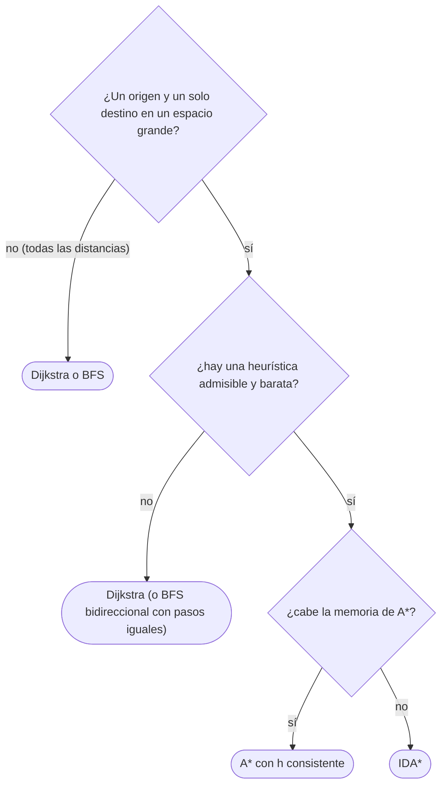

# 03 — A\* y heurísticas admisibles

> Dijkstra con brújula: A\* ordena por `g + h`, el coste ya pagado más una estimación de lo que falta, y
> explora hacia el destino en lugar de en círculo. Qué tiene que cumplir la estimación para que el camino
> siga siendo óptimo —admisible y, mejor, consistente—, por qué con una heurística consistente A\* es
> Dijkstra sobre pesos repesados, las heurísticas de rejilla de siempre y, en ficha, IDA\*.
>
> **Niveles:** A\* [B]; IDA\* como ficha.
>
> **📚 Lectura troncal:** Russell y Norvig, *Artificial Intelligence: A Modern Approach*, 4.ª ed. (Pearson,
> 2020), cap. 3 (§3.5 y §3.6); Brassard y Bratley, *Fundamentos de algoritmia* (Prentice Hall, 1997),
> cap. 13.
>
> **Asume leído:** [`15/01` — Dijkstra](01-dijkstra.md).
>
> **Vigencia:** 2026-10-04.

**Salto rápido:** [1](#1--el-problema) · [2](#2--la-teoría) · [3](#3--a) · [4](#4--las-heurísticas-de-siempre) · [5](#5--ida) · [6](#6-️-la-tabla-de-costes) · [7](#7--cómo-se-elige) · [8](#8--señales-del-enunciado) · [9](#9--dónde-aparece-de-verdad) · [🧠](#-preguntas) · [🧩](#-problemas-propios)

---

## 1. 🎯 El problema

Un mapa de `4 000 × 4 000` casillas y una sola pregunta: el camino más corto de `S` a `T`. Dijkstra (o BFS,
con pasos iguales) explora en círculos crecientes desde `S` hasta tocar `T`: si `T` está a 3 000 pasos, mira
del orden de `3 000²` casillas en todas las direcciones, también las que se alejan. Con **un** destino, eso
es trabajo tirado.

A\* añade a cada casilla una estimación de lo que le falta, y saca primero la que promete el camino total
más corto. Si la estimación nunca exagera, el camino sigue siendo óptimo; y si es buena, la exploración se
estira hacia `T` en lugar de expandirse en círculo.

> 🧠 **Modelo mental.** Dijkstra pregunta «¿qué tengo más cerca?»; A\* pregunta «¿por dónde parece más
> corto llegar?». La heurística es el olfato: si nunca promete de más, no te lleva por un camino peor.

En los ejemplos, una rejilla de `5 × 7` con un muro en medio, pasos de coste 1 en cuatro direcciones:

```text
. . . . . . .
. . . # . . .
S . . # . . T
. . . # . . .
. . . . . . .
```

---

## 2. 📐 La teoría

**A\*.** Dijkstra con prioridad `f(v) = g(v) + h(v)`: `g` es la distancia provisional desde `S` y `h(v)`
una estimación del coste de `v` a `T`. Con `h = 0`, **es** Dijkstra.

**Admisible.** `h(v) ≤ h*(v)` para todo `v`, siendo `h*` el coste real mínimo de `v` a `T`: nunca
sobreestima.

**Consistente (o monótona).** `h(T) = 0` y `h(u) ≤ w(u, v) + h(v)` para toda arista: la desigualdad
triangular. Consistente implica admisible (sumando a lo largo de un camino mínimo hasta `T`).

**Teorema.** Con `h` consistente, A\* es Dijkstra sobre los pesos `w′(u, v) = w(u, v) − h(u) + h(v)`, que son
no negativos. Por tanto, cada vértice se extrae una vez con su distancia final, y el camino a `T` es óptimo.

*Prueba.* `w′ ≥ 0` es la consistencia reescrita. Un camino de `S` a `v` tiene coste repesado
`g(v) − h(S) + h(v) = f(v) − h(S)`: ordenar por `f` es ordenar por distancia repesada, y Dijkstra sobre `w′`
(no negativos) es correcto (`15/01`). Es la misma repesada que Johnson (`15/02`).

**Solo admisible.** Si `h` es admisible pero no consistente, A\* sigue siendo óptimo **siempre que se permita
reabrir** vértices ya extraídos cuando se encuentra un camino mejor; con un conjunto cerrado que no se
reabre, puede devolver un camino subóptimo.

*Contraejemplo.* `S → A` de 1, `S → B` de 2, `A → C` de 3, `B → C` de 1, `C → T` de 3. El óptimo es
`S B C T` = 6. Con `h(B) = 4` (admisible: `h*(B) = 4`) y `h = 0` en el resto, `h(B) > w(B, C) + h(C)`: no es
consistente. A\* saca `S`, luego `A` (`f = 1`), luego `C` por `A` (`f = 4`) y lo cierra; `B` (`f = 6`) ya
no puede mejorar `C`, y `T` sale con 7.

**Por qué no siempre es más rápido.** El número de vértices expandidos depende de lo informativa que sea
`h`: con `h = 0` expande lo mismo que Dijkstra, más el coste de calcular `h`. Y en laberintos donde la
distancia en línea recta engaña, una buena parte de la ventaja desaparece.

---

## 3. 🧱 A\*

**Qué es.** El Dijkstra de `15/01` con `f = g + h` como prioridad, parando al extraer `T`.

**Por qué es correcto.** El teorema de §2, con `h` consistente. La salida al extraer `T` es segura porque
`T` ya tiene su distancia final.

**Cómo va**, en la rejilla de §1 con Manhattan (`|Δfila| + |Δcolumna|`) y desempate por mayor `g`:

```text
Dijkstra: 32 casillas expandidas       A* con Manhattan: 16
* * * * * * *                          . . * * * * *
* * * # * * *                          * * * # . . *
S * * # * * T                          S * * # . . T
* * * # * * *                          * * * # . . .
* * * * * * *                          . . . . . . .
los dos: distancia 10 (rodear el muro por arriba o por abajo)
```

A\* explora la columna del muro hasta encontrar el hueco y sigue directo; Dijkstra llena la rejilla entera.

**Cuánto.** En el peor caso, lo mismo que Dijkstra: `Θ((n + m) log n)`. En la práctica, depende de `h`: con
la `h` exacta (`h = h*`) solo expande el camino.

**La plantilla**, en rejilla con pasos de coste 1 en cuatro direcciones y Manhattan:

```cpp
#include <cstdint>
#include <cstdlib>
#include <functional>
#include <queue>
#include <string>
#include <tuple>
#include <vector>

// Distancia mínima de (sr, sc) a (tr, tc) evitando '#'; −1 si no se llega.
int aStar(const std::vector<std::string>& g, int sr, int sc, int tr, int tc) {
    int R = g.size(), C = g[0].size();
    const int DR[4] = {-1, 1, 0, 0}, DC[4] = {0, 0, -1, 1};
    auto h = [&](int r, int c) { return std::abs(r - tr) + std::abs(c - tc); };   // Manhattan
    std::vector<int> dist(R * C, INT32_MAX);
    using Item = std::tuple<int, int, int>;                  // {f, −g (desempate), casilla}
    std::priority_queue<Item, std::vector<Item>, std::greater<Item>> pq;
    dist[sr * C + sc] = 0;
    pq.push({h(sr, sc), 0, sr * C + sc});
    while (!pq.empty()) {
        auto [f, negG, cur] = pq.top(); pq.pop();
        int g0 = -negG, r = cur / C, c = cur % C;
        if (g0 > dist[cur]) continue;                        // entrada vieja
        if (r == tr && c == tc) return g0;                   // T sale con su distancia final
        for (int d = 0; d < 4; d++) {
            int r2 = r + DR[d], c2 = c + DC[d];
            if (r2 < 0 || r2 >= R || c2 < 0 || c2 >= C || g[r2][c2] == '#') continue;
            int nxt = r2 * C + c2;
            if (g0 + 1 < dist[nxt]) { dist[nxt] = g0 + 1; pq.push({g0 + 1 + h(r2, c2), -(g0 + 1), nxt}); }
        }
    }
    return -1;
}
```

```java
// Misma idea; la entrada del montículo es {f, g, casilla} y el comparador desempata por mayor g.
static int aStar(char[][] g, int sr, int sc, int tr, int tc) {
    int R = g.length, C = g[0].length;
    int[] DR = {-1, 1, 0, 0}, DC = {0, 0, -1, 1};
    int[] dist = new int[R * C];
    java.util.Arrays.fill(dist, Integer.MAX_VALUE);
    java.util.PriorityQueue<int[]> pq = new java.util.PriorityQueue<>(
        (a, b) -> a[0] != b[0] ? Integer.compare(a[0], b[0]) : Integer.compare(b[1], a[1]));
    dist[sr * C + sc] = 0;
    pq.add(new int[]{Math.abs(sr - tr) + Math.abs(sc - tc), 0, sr * C + sc});
    while (!pq.isEmpty()) {
        int[] top = pq.poll();
        int g0 = top[1], cur = top[2], r = cur / C, c = cur % C;
        if (g0 > dist[cur]) continue;
        if (r == tr && c == tc) return g0;
        for (int d = 0; d < 4; d++) {
            int r2 = r + DR[d], c2 = c + DC[d];
            if (r2 < 0 || r2 >= R || c2 < 0 || c2 >= C || g[r2][c2] == '#') continue;
            int nxt = r2 * C + c2;
            if (g0 + 1 < dist[nxt]) {
                dist[nxt] = g0 + 1;
                pq.add(new int[]{g0 + 1 + Math.abs(r2 - tr) + Math.abs(c2 - tc), g0 + 1, nxt});
            }
        }
    }
    return -1;
}
```

- **El desempate por mayor `g`** (o menor `h`) a igual `f` hace que A\* avance hacia `T` en lugar de abrir
  un frente ancho entre empates; no cambia la corrección.
- **Parar al extraer `T`**, no al descubrirlo: al descubrirlo, su `g` puede no ser la final.
- **Con varios destinos**, `h` es el mínimo de las heurísticas a cada uno (sigue siendo consistente).
- **Python** cabe sin forzar: es el Dijkstra de `15/01` con `(g + h, -g, casilla)` en `heapq`.

**Cuándo sí:** un origen y **un** destino, espacio grande (rejillas, mapas, puzzles) y una heurística
informativa y barata. **Cuándo no:** si se piden las distancias a todos los vértices (A\* no ahorra nada:
Dijkstra o BFS); si no hay una heurística admisible útil; si el grafo es pequeño y la constante de `h`
pesa más que lo que ahorra.

> **Veredicto:** A\* es Dijkstra con `g + h`; con `h` consistente es óptimo y nunca reabre. Ahorra cuando
> hay un destino y una `h` que informa; con `h = 0`, es Dijkstra.

---

## 4. 🧱 Las heurísticas de siempre

| Dominio | Heurística | Admisible y consistente cuando |
|---|---|---|
| Rejilla, 4 direcciones, coste 1 | Manhattan `\|Δr\| + \|Δc\|` | Siempre |
| Rejilla, 8 direcciones, coste 1 | Chebyshev `max(\|Δr\|, \|Δc\|)` | Siempre |
| Rejilla, 8 direcciones, diagonal `√2` | Octil `max + (√2 − 1) · min` | Siempre |
| Movimiento libre en el plano | Euclídea | Siempre |
| Puzzle de 8 o 15 | Suma de las Manhattan de cada ficha | Siempre (cada movimiento mueve una ficha una casilla) |
| Puzzle de 8 o 15 | Fichas fuera de sitio | Siempre, pero menos informativa |
| Rejilla con casillas de coste `≥ c_min` | Manhattan `· c_min` | Siempre |

Una heurística **dominante** (`h₁ ≥ h₂` en todo vértice, ambas admisibles) expande como mucho los mismos
vértices: la suma de Manhattan domina a «fichas fuera de sitio». Y el máximo de dos admisibles es admisible.

---

## 5. 🧱 IDA\*

**Qué resuelve.** A\* con memoria lineal: búsqueda en profundidad con un umbral sobre `f = g + h`, que
sube en cada iteración al menor `f` que se pasó del umbral anterior. Es la profundización iterativa de
[`10/04`](../10-busqueda-completa-y-divide-y-venceras/04-meet-in-the-middle-iddfs-y-dancing-links.md) con
`f` en lugar de la profundidad.

**Qué garantiza.** Con `h` admisible, la primera solución encontrada es óptima; la memoria es la del camino
actual, `O(d)`.

**Cuánto.** Expande repetidas veces los niveles de arriba; con pocas iteraciones distintas de `f` (costes
enteros pequeños), el sobrecoste es un factor constante.

**Cómo reconocerlo.** Espacio de estados enorme y sin ciclos cortos (puzzles de 15, cubos), donde A\* se
quedaría sin memoria.

**Si no te la sabes.** BFS bidireccional o *meet in the middle* (`10/04`) en puzzles de tamaño moderado.

**Dónde está entera.** Russell y Norvig, 4.ª ed., §3.5.5 (memoria acotada).

---

## 6. ⏱️ La tabla de costes

| Algoritmo | Tiempo peor caso | Memoria | Óptimo si | Lo que la tabla no dice |
|---|---|---|---|---|
| Dijkstra | `Θ((n + m) log n)` | `Θ(n)` | Pesos `≥ 0` | Explora en círculo |
| A\* | `Θ((n + m) log n)` | `Θ(n)` | `h` consistente (o admisible con reapertura) | Expande según lo buena que sea `h` |
| IDA\* | Exponencial en `d` | `Θ(d)` | `h` admisible | Repite trabajo; sin memoria |
| BFS bidireccional | `Θ(b^(d/2))` en árboles | `Θ(b^(d/2))` | Pasos iguales | Necesita el destino explícito |

---

## 7. 🧭 Cómo se elige



> **Regla de entrevista:** si propones A\*, di en la misma frase la heurística y por qué no sobreestima:
> «Manhattan, porque cada paso mueve una casilla en una dirección». Sin eso, no hay garantía.

---

## 8. 🔎 Señales del enunciado

| Señal | Técnica | Por qué |
|---|---|---|
| «Camino más corto de `S` a `T`» en mapa o rejilla enorme | A\* con distancia geométrica | Un destino y geometría |
| Puzzle de piezas deslizantes | A\* o IDA\* con Manhattan sumada | Espacio de estados con buena `h` |
| «Distancias desde `S` a todos» | Dijkstra o BFS | A\* no ahorra nada |
| Juego en tiempo real con persecución | A\* por turno | Un destino que cambia |

---

## 9. 🔭 Dónde aparece de verdad

- **Los videojuegos** usan A\* sobre rejillas o mallas de navegación para mover personajes; es el ejemplo
  canónico de la búsqueda heurística.
- **La planificación de movimiento en robótica** usa variantes de A\* sobre mapas de ocupación, con
  heurísticas euclídeas.

---

## ⚠️ Errores frecuentes

| Se dice | Lo preciso |
|---|---|
| «A\* siempre es más rápido que Dijkstra» | Con `h = 0` es Dijkstra más el coste de `h`; la ventaja depende de lo informativa que sea `h` |
| «Cualquier heurística vale si es razonable» | Tiene que ser admisible, y consistente si no se reabren vértices |
| «Admisible basta, con conjunto cerrado» | Sin consistencia, cerrar puede dar un camino peor (§2) |
| «Se para al descubrir `T`» | Se para al **extraer** `T` |
| «Euclídea en rejilla de 4 direcciones es mejor» | Es admisible pero menos informativa que Manhattan |
| «A\* sirve para todas las distancias» | Está pensado para un destino; para todos, Dijkstra |

---

## 📚 Para profundizar

- **Libro** — Russell y Norvig, *Artificial Intelligence: A Modern Approach*, 4.ª ed. (Pearson, 2020),
  cap. 3: A\*, admisibilidad, consistencia e IDA\*. *Lectura troncal.*
- **Libro** — Brassard y Bratley, *Fundamentos de algoritmia* (Prentice Hall, 1997), cap. 13: heurísticos.
  *Lectura troncal.*
- **Referencia** — Russell y Norvig, [pseudocódigo de AIMA](https://aima.cs.berkeley.edu/algorithms.pdf)
  (A\* y búsqueda de mejor primero).
- **Tutorial aplicado** — Amit Patel, Red Blob Games, [*Introduction to the A\* Algorithm*](https://www.redblobgames.com/pathfinding/a-star/introduction.html).

---

## 🧠 Preguntas

1. ¿Qué diferencia hay entre `g`, `h` y `f` en A\*? 🟢
2. ¿Qué es una heurística admisible? 🟢
3. ¿Por qué A\* con `h = 0` es Dijkstra? 🟢
4. ¿Qué es una heurística consistente y por qué implica admisible? 🟡
5. ¿Por qué se para al extraer el destino y no al descubrirlo? 🟡
6. ¿Qué heurística usas en una rejilla de 4 direcciones, en una de 8 y en un puzzle de 15? 🟡
7. ¿Qué hace el desempate por mayor `g` y por qué no afecta a la corrección? 🟡
8. Demuestra que con `h` consistente A\* es óptimo, usando la repesada. 🟠
9. Da un ejemplo de heurística admisible pero no consistente donde A\* con conjunto cerrado falla. 🟠
10. ¿Por qué A\* no es siempre más rápido que Dijkstra? 🟠
11. ¿Qué es IDA\* y cuándo lo prefieres a A\*? 🔴
12. Si tienes dos heurísticas admisibles, ¿cómo las combinas y por qué sigue siendo admisible? 🔴

---

## 🧩 Problemas propios

### Rejilla con pantanos

**Nivel:** 🟡 · **Formato:** programa completo.

En una rejilla, entrar en una casilla `.` cuesta 1 y en una `~` (pantano) cuesta 3; `#` es una pared. Los
movimientos son en cuatro direcciones. Imprime el coste mínimo de `S` a `T`, o `-1`.

- **Entrada.** Una línea con `R` y `C`. Después, `R` líneas con la rejilla (`S` y `T` cuestan 1 al entrar).
- **Salida.** Un entero.
- **Restricciones.** `1 ≤ R, C ≤ 1 000`.

```text
Entrada     Salida
3 5         6
S~~~T
.....
.....

Entrada     Salida
1 3         -1
S#T
```

**Pista 1:** ¿qué heurística sigue sin sobreestimar si la casilla más barata cuesta 1?

### ¿Sirve esta heurística?

**Nivel:** 🟠 · **Formato:** programa completo.

Dado un grafo dirigido con pesos no negativos, un destino `T` y un valor `h(v)` por vértice, imprime
`CONSISTENT` si `h` es consistente, `ADMISSIBLE` si es admisible pero no consistente, y `NONE` si no es
admisible. (Para un vértice que no alcanza `T`, cualquier `h` es admisible.)

- **Entrada.** Una línea con `n`, `m` y `T`. Después, `m` líneas con `u v w`. Al final, una línea con
  `h(1) … h(n)`.
- **Salida.** Una palabra.
- **Restricciones.** `1 ≤ n ≤ 10⁵`; `0 ≤ m ≤ 2·10⁵`; `0 ≤ w, h(v) ≤ 10⁹`.

```text
Entrada         Salida
5 5 5           ADMISSIBLE
1 2 1
1 3 2
2 4 3
3 4 1
4 5 3
0 0 4 0 0

Entrada         Salida
3 1 2           CONSISTENT
1 2 5
0 0 1000000000
```

Con el mismo grafo y `h = 0 0 1 0 0`, la salida es `CONSISTENT`.

**Pista 1:** para saber si `h` sobreestima, necesitas `h*(v)` de todos los vértices a la vez: ¿desde dónde
corres Dijkstra, y sobre qué grafo?

---

## 🧩 Práctica externa

> 💡 **Truco.** Antes de pedir ayuda con un A\* que da caminos peores que Dijkstra, compara los dos en el
> mismo caso: si difieren, tu `h` sobreestima en algún sitio. Si una IA te ayuda, que sea a encontrar ese
> sitio ([`01/06`](../01-oficio-del-competidor/06-protocolo-de-resolucion.md)).

### Núcleo

| ✔ | Problema | Plataforma | Nivel | Patrón | Pista 1 |
|---|---|---|---|---|---|
| [ ] | [A-star exercise](https://www.codingame.com/training/medium/a-star-exercise) | CodinGame | 🟡 | A\* con la heurística dada | ¿En qué orden pide el enunciado imprimir los nodos expandidos? |
| [ ] | [N-Puzzle](https://open.kattis.com/problems/npuzzle) | Kattis | 🟡 | La heurística de Manhattan | ¿Qué suma te piden exactamente? |
| [ ] | [Sliding Puzzle](https://leetcode.com/problems/sliding-puzzle/) | LeetCode | 🟠 | Estados de puzzle | ¿Cuántos estados tiene un tablero de `2 × 3`? |
| [ ] | [Cut Off Trees for Golf Event](https://leetcode.com/problems/cut-off-trees-for-golf-event/) | LeetCode | 🟠 | Muchas búsquedas punto a punto | ¿Cuántas búsquedas de un origen a un destino haces? |
| [ ] | [Minimum Moves to Move a Box to Their Target Location](https://leetcode.com/problems/minimum-moves-to-move-a-box-to-their-target-location/) | LeetCode | 🔴 | Estados con heurística | ¿Qué es un estado: la caja, el jugador, o los dos? |

### Ampliación

| ✔ | Problema | Plataforma | Nivel | Patrón | Pista 1 |
|---|---|---|---|---|---|
| [ ] | [Minimum Moves to Reach Target with Rotations](https://leetcode.com/problems/minimum-moves-to-reach-target-with-rotations/) | LeetCode | 🟠 | Estados con orientación | ¿Qué tres datos describen la posición de la serpiente? |
| [ ] | [Death First Search - Episode 1](https://www.codingame.com/training/medium/death-first-search-episode-1) | CodinGame | 🟡 | Búsqueda por turno | ¿Qué enlace cortas si el agente está al lado de una salida? |
| [ ] | [The Labyrinth](https://www.codingame.com/training/hard/the-labyrinth) | CodinGame | 🔴 | Exploración y camino de vuelta | ¿Qué parte del mapa conoces en cada turno? |

---

## ✅ Criterio de dominio

- Explicar admisible y consistente, y demostrar la optimalidad con la repesada.
- Adaptar el Dijkstra de `15/01` a A\* con la plantilla delante, parando al extraer `T`.
- Elegir la heurística por el dominio y justificar que no sobreestima.
- Resolver Sliding Puzzle y A-star exercise sin pista 2.

---

**Anterior:** [`15/02` — Bellman-Ford, Floyd-Warshall y Johnson](02-bellman-ford-floyd-y-johnson.md) ·
**Siguiente:** [`15/04` — Árbol de expansión mínima](04-arbol-de-expansion-minima.md) · **Relacionado:**
[`10/04` — *Meet in the middle*, IDDFS y *Dancing Links*](../10-busqueda-completa-y-divide-y-venceras/04-meet-in-the-middle-iddfs-y-dancing-links.md).
