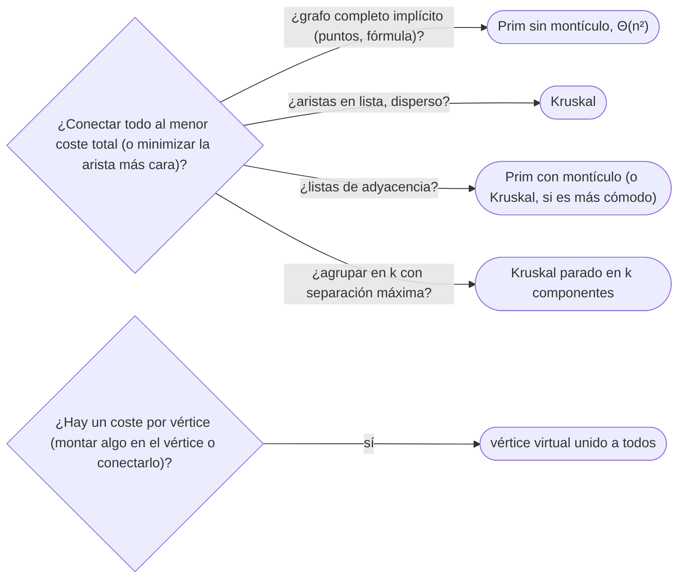

# 04 — Árbol de expansión mínima

> El árbol que conecta todos los vértices con el menor peso total: la propiedad del corte y la del ciclo,
> con su prueba por intercambio; Kruskal, que ordena las aristas y une con Union-Find; Prim, que crece un
> árbol desde un vértice con un montículo —o sin él, en grafos densos—; y Borůvka en ficha. Con la
> diferencia, que se pregunta, entre el árbol de Prim y el de Dijkstra.
>
> **Niveles:** Kruskal [A] · Prim [A] · Borůvka [C].
>
> **📚 Lectura troncal:** Cormen, Leiserson, Rivest y Stein, *Introduction to Algorithms*, 3.ª ed. (MIT
> Press, 2009), cap. 23; Brassard y Bratley, *Fundamentos de algoritmia* (Prentice Hall, 1997), cap. 6;
> Kleinberg y Tardos, *Algorithm Design* (Addison-Wesley, 2005), §4.5.
>
> **Asume leído:** [`15/01` — Dijkstra](01-dijkstra.md).
>
> **Vigencia:** 2026-10-04.

**Salto rápido:** [1](#1--el-problema) · [2](#2--la-teoría) · [3](#3--kruskal) · [4](#4--prim) · [5](#5--borůvka) · [6](#6-️-la-tabla-de-costes) · [7](#7--cómo-se-elige) · [8](#8--señales-del-enunciado) · [9](#9--dónde-aparece-de-verdad) · [🧠](#-preguntas) · [🧩](#-problemas-propios)

---

## 1. 🎯 El problema

Hay que conectar con fibra `10⁵` edificios; cada tramo posible tiene un coste, y basta con que todos queden
conectados, directa o indirectamente. Elegir el subconjunto de tramos más barato que conecta todo es elegir
un **árbol de expansión mínima** (MST): conectar sin ciclos (un ciclo sobra: se quita su arista más cara) y
con el menor peso total. Probar todos los árboles es imposible: un grafo completo de `n` vértices tiene
`nⁿ⁻²`.

Dos voraces lo resuelven, y la misma propiedad prueba los dos: en cualquier división de los vértices en dos
grupos, la arista más barata que cruza está en algún MST. Kruskal recorre las aristas de la más barata a la
más cara; Prim hace crecer un árbol desde un vértice. Los dos en `Θ(m log n)`.

> 🧠 **Modelo mental.** Kruskal es una subasta de aristas: se ofrecen de la más barata a la más cara, y se
> compra cada una que une dos grupos distintos. Prim es una mancha: siempre se anexiona el vecino más barato
> de llegar desde lo que ya es suyo.

Los ejemplos usan el grafo G de [`14/01`](../14-grafos-recorridos/01-representaciones.md) con sus pesos (`A–B 2`, `A–C 4`, `B–D 3`, `B–E 1`, `C–E 7`, `D–F 2`,
`E–F 5`). Su MST pesa **12**.

---

## 2. 📐 La teoría

**Árbol de expansión.** Un subconjunto de `n − 1` aristas que conecta los `n` vértices sin ciclos. El
**MST** es el de menor peso total; si hay pesos repetidos, puede haber varios, todos con el mismo peso.

**Propiedad del corte.** Para cualquier corte `(S, V − S)`, una arista de peso mínimo entre las que lo
cruzan pertenece a **algún** MST (a todos, si es la única mínima).

*Prueba por intercambio.* Sea `e = (u, v)` la más ligera que cruza el corte y `T` un MST sin `e`. En `T` hay
un camino de `u` a `v`, que cruza el corte por alguna arista `f`. `T − f + e` es un árbol de expansión de
peso `w(T) − w(f) + w(e) ≤ w(T)`: también mínimo, y contiene `e`.

**Propiedad del ciclo.** En cualquier ciclo, una arista estrictamente más pesada que todas las demás del
ciclo no está en ningún MST.

*Prueba.* Si un MST `T` contuviera esa arista `f`, quitarla parte `T` en dos; el resto del ciclo tiene una
arista `e` que reconecta las dos partes, más ligera: `T − f + e` pesa menos, contradicción.

**Corolarios útiles.**

- Kruskal y Prim son correctos: cada arista que añaden es la más ligera que cruza un corte concreto.
- Una arista `(u, v, w)` está en **algún** MST si y solo si `u` y `v` no están conectados usando solo aristas
  de peso **menor** que `w`.
- El MST minimiza también la arista **más pesada** del árbol (árbol de cuello de botella), y el camino
  entre dos vértices en el MST minimiza su arista más pesada (camino *minimax*).

**Prim no es Dijkstra.** Los dos crecen un árbol con un montículo, pero la prioridad es distinta: Prim usa
el **peso de la arista** que conecta al árbol; Dijkstra, la **distancia acumulada** desde el origen. En el
triángulo `A–B 2`, `B–C 2`, `A–C 3`: Prim desde `A` elige `A–B` y `B–C` (peso 4); el árbol de caminos
mínimos de Dijkstra desde `A` es `A–B` y `A–C` (peso 5, porque `C` está a 3 directo y a 4 por `B`).

---

## 3. 🧱 Kruskal

**Qué es.** Ordenar las aristas por peso y recorrerlas: añadir cada una que une dos componentes distintas
(Union-Find, [`08/04`](../08-heaps-y-union-find/04-union-find.md)), hasta tener `n − 1`.

**Por qué es correcto.** Cuando Kruskal añade `(u, v)`, es la arista más ligera que cruza el corte entre la
componente de `u` y el resto: las más ligeras ya se miraron y o están dentro o unieron otras componentes.
Por la propiedad del corte, está en algún MST.

**Cómo va**, en G:

```text
arista   peso  ¿une componentes?           componentes después
B–E      1     sí                          {B,E} {A} {C} {D} {F}
A–B      2     sí                          {A,B,E} {C} {D} {F}
D–F      2     sí                          {A,B,E} {C} {D,F}
B–D      3     sí                          {A,B,D,E,F} {C}
A–C      4     sí  → 5 aristas: fin        {A,B,C,D,E,F}
E–F 5 y C–E 7 ni se miran (cerrarían ciclos)              peso = 1 + 2 + 2 + 3 + 4 = 12
```

**Cuánto.** `Θ(m log m)` por la ordenación; las operaciones de Union-Find son casi constantes.

**La plantilla:**

```cpp
#include <algorithm>
#include <numeric>
#include <tuple>
#include <vector>


struct DSU {
    std::vector<int> p, sz;
    explicit DSU(int n) : p(n), sz(n, 1) { std::iota(p.begin(), p.end(), 0); }
    int find(int x) { while (p[x] != x) x = p[x] = p[p[x]]; return x; }   // compresión a la mitad
    bool unite(int a, int b) {
        a = find(a); b = find(b);
        if (a == b) return false;
        if (sz[a] < sz[b]) std::swap(a, b);
        p[b] = a; sz[a] += sz[b];
        return true;
    }
};

// edges = {peso, u, v}. Peso del MST, o −1 si el grafo no es conexo.
long long kruskal(int n, std::vector<std::tuple<long long, int, int>> edges) {
    std::sort(edges.begin(), edges.end());
    DSU dsu(n);
    long long total = 0; int used = 0;
    for (auto [w, u, v] : edges)
        if (dsu.unite(u, v)) { total += w; if (++used == n - 1) break; }
    return used == n - 1 ? total : -1;
}
```

```java
// edges[i] = {u, v, w}. Peso del MST, o −1 si no es conexo.
static long kruskal(int n, long[][] edges) {
    java.util.Arrays.sort(edges, (a, b) -> Long.compare(a[2], b[2]));
    int[] parent = new int[n], size = new int[n];
    for (int i = 0; i < n; i++) { parent[i] = i; size[i] = 1; }
    long total = 0;
    int used = 0;
    for (long[] e : edges) {
        int a = find(parent, (int) e[0]), b = find(parent, (int) e[1]);
        if (a == b) continue;
        if (size[a] < size[b]) { int t = a; a = b; b = t; }
        parent[b] = a; size[a] += size[b];
        total += e[2];
        if (++used == n - 1) break;
    }
    return used == n - 1 ? total : -1;
}

static int find(int[] parent, int x) {
    while (parent[x] != x) { parent[x] = parent[parent[x]]; x = parent[x]; }
    return x;
}
```

```python
def kruskal(n, edges):
    """edges = [(w, u, v)]. Peso del MST, o -1 si no es conexo."""
    parent, size = list(range(n)), [1] * n

    def find(x):
        while parent[x] != x:
            parent[x] = parent[parent[x]]
            x = parent[x]
        return x

    total = used = 0
    for w, u, v in sorted(edges):
        a, b = find(u), find(v)
        if a == b:
            continue
        if size[a] < size[b]:
            a, b = b, a
        parent[b] = a
        size[a] += size[b]
        total += w
        used += 1
        if used == n - 1:
            break
    return total if used == n - 1 else -1
```

- **Comprobar `n − 1` aristas** al final: si no se llega, el grafo no es conexo (y lo que se tiene es un
  bosque de expansión mínima).
- **Union-Find iterativo** con compresión a la mitad y unión por tamaño: sin recursión, ni en Java ni en
  Python.
- **El total en 64 bits**: `10⁵` aristas de `10⁹`.
- **Varios MST**: con pesos iguales, el orden de desempate decide cuál sale; el peso es el mismo.

### De la versión ingenua a la buena

**El problema.** Agrupar `n` sensores en `k` grupos de modo que la **separación** —la menor distancia
entre dos sensores de grupos distintos— sea la máxima posible. En G con `k = 2`, la separación óptima es 4
(`{C}` contra el resto); con `k = 3`, 3.

**La versión ingenua:** empezar con cada sensor solo y, mientras haya más de `k` grupos, recorrer todas las
aristas buscando el par más cercano de grupos distintos y unirlos. Correcta, `Θ(n · m)`.

> «Unir siempre el par más cercano de grupos distintos es exactamente lo que hace Kruskal. Ordeno las
> aristas una vez, uno con Union-Find, y me detengo al quedar `k` componentes: la separación es la
> siguiente arista que cruzaría.»

**El camino a la buena.** Kruskal parado en `k` componentes (Kleinberg y Tardos, §4.7): `Θ(m log m)`.
Equivale a quitar las `k − 1` aristas más pesadas del MST.

**Cuándo sí:** el grafo viene como lista de aristas; grafos dispersos; agrupamiento; cuando además se
necesita Union-Find para otra cosa. **Cuándo no:** grafos densos o completos implícitos (generar y ordenar
`n²` aristas): Prim sin montículo.

> **Veredicto:** Kruskal es ordenar y unir con Union-Find, `Θ(m log m)`; correcto por la propiedad del
> corte, y la herramienta para agrupar.

---

## 4. 🧱 Prim

**Qué es.** Crecer un árbol desde un vértice: en cada paso, añadir el vértice fuera del árbol más barato de
conectar, con la arista que lo conecta. Con un montículo y borrado perezoso, como Dijkstra, pero con el
peso de la arista como prioridad.

**Por qué es correcto.** En cada paso, la arista añadida es la más ligera que cruza el corte entre el árbol
y el resto: propiedad del corte.

**Cómo va**, en G desde `A`:

```text
en el árbol      candidatas (peso, vértice)          añade
A                (2,B) (4,C)                          A–B 2
A B              (1,E) (3,D) (4,C)                    B–E 1
A B E            (3,D) (4,C) (5,F) (7,C)              B–D 3
A B D E          (2,F) (4,C) (5,F) (7,C)              D–F 2
A B D E F        (4,C) (5,F)vieja (7,C)               A–C 4
peso = 2 + 1 + 3 + 2 + 4 = 12, el mismo árbol que Kruskal en otro orden
```

**Cuánto.** Con montículo, `Θ(m log n)`; sin montículo (mínimo por recorrido), `Θ(n²)`.

**La plantilla:**

```cpp
#include <functional>
#include <queue>
#include <vector>


// adj[u] = {vecino, peso}. Peso del MST, o −1 si no es conexo. Montículo con borrado perezoso.
long long prim(const std::vector<std::vector<std::pair<int, long long>>>& adj) {
    int n = adj.size(), taken = 0;
    std::vector<bool> inTree(n, false);
    using Item = std::pair<long long, int>;
    std::priority_queue<Item, std::vector<Item>, std::greater<Item>> pq;
    pq.push({0, 0});
    long long total = 0;
    while (!pq.empty() && taken < n) {
        auto [w, u] = pq.top(); pq.pop();
        if (inTree[u]) continue;                         // entrada vieja
        inTree[u] = true; total += w; taken++;
        for (auto [v, wv] : adj[u]) if (!inTree[v]) pq.push({wv, v});   // el peso de la arista, no d + w
    }
    return taken == n ? total : -1;
}
```

```java
static long prim(long[][][] adj) {
    int n = adj.length, taken = 0;
    boolean[] inTree = new boolean[n];
    java.util.PriorityQueue<long[]> pq = new java.util.PriorityQueue<>((a, b) -> Long.compare(a[0], b[0]));
    pq.add(new long[]{0, 0});
    long total = 0;
    while (!pq.isEmpty() && taken < n) {
        long[] top = pq.poll();
        int u = (int) top[1];
        if (inTree[u]) continue;
        inTree[u] = true; total += top[0]; taken++;
        for (long[] e : adj[u]) if (!inTree[(int) e[0]]) pq.add(new long[]{e[1], e[0]});
    }
    return taken == n ? total : -1;
}
```

```python
import heapq

def prim(adj):
    """adj[u] = [(v, w)]. Peso del MST, o -1 si no es conexo."""
    n = len(adj)
    in_tree = [False] * n
    pq = [(0, 0)]
    total = taken = 0
    while pq and taken < n:
        w, u = heapq.heappop(pq)
        if in_tree[u]:
            continue
        in_tree[u] = True
        total += w
        taken += 1
        for v, wv in adj[u]:
            if not in_tree[v]:
                heapq.heappush(pq, (wv, v))
    return total if taken == n else -1
```

- **La única línea que lo separa de Dijkstra** es la prioridad: `wv` y no `d + wv`.
- **`taken == n`** al final detecta un grafo no conexo.
- **Grafos completos implícitos** (puntos del plano): Prim sin montículo, con `best[v]` = arista más barata
  de `v` al árbol, calculando los pesos al vuelo. Ver abajo.

### De la versión ingenua a la buena

**El problema.** `n = 5 000` antenas en el plano; conectar dos cuesta el cuadrado de su distancia. Peso del
árbol más barato que las conecta todas.

**La versión ingenua:** generar las `n(n − 1)/2 ≈ 1,25·10⁷` aristas y correr Kruskal. Correcta, pero
`Θ(n² log n)` y del orden de 300 MB solo para guardarlas.

> «El grafo es completo: cada vértice es vecino de todos. Prim sin montículo no necesita guardar aristas:
> llevo para cada antena fuera del árbol el coste más barato de conectarla, y al añadir una, actualizo las
> demás calculando la distancia al vuelo. `n²` pasos y `Θ(n)` de memoria.»

**El camino a la buena:**

```java
// Prim denso Θ(n²) sobre puntos del plano; coste = distancia al cuadrado. Memoria Θ(n).
static long primDense(long[] x, long[] y) {
    int n = x.length;
    long[] best = new long[n];
    boolean[] inTree = new boolean[n];
    java.util.Arrays.fill(best, Long.MAX_VALUE);
    best[0] = 0;
    long total = 0;
    for (int it = 0; it < n; it++) {
        int u = -1;
        for (int v = 0; v < n; v++) if (!inTree[v] && (u == -1 || best[v] < best[u])) u = v;
        inTree[u] = true; total += best[u];
        for (int v = 0; v < n; v++) {
            long dx = x[u] - x[v], dy = y[u] - y[v], c = dx * dx + dy * dy;
            if (!inTree[v] && c < best[v]) best[v] = c;
        }
    }
    return total;
}
```

**Cuándo sí:** grafos densos o completos (sin montículo); listas de adyacencia y crecer desde un vértice.
**Cuándo no:** si las aristas vienen en lista y el grafo es disperso, Kruskal es más corto de escribir; y
para «agrupar en `k`», Kruskal.

> **Veredicto:** Prim es Dijkstra con el peso de la arista como prioridad; con montículo en dispersos y
> sin él, `Θ(n²)`, en completos implícitos.

---

## 5. 🧱 Borůvka

**Qué resuelve.** El MST en rondas: en cada ronda, cada componente elige su arista más barata hacia fuera
y se añaden todas a la vez.

**Qué garantiza.** Cada ronda al menos divide entre dos el número de componentes: `O(log n)` rondas, y
`Θ(m log n)` en total. Cada arista elegida es correcta por la propiedad del corte (con desempate fijo para
pesos iguales).

**Cuánto.** `Θ(m log n)`; paralelizable, porque las componentes eligen independientemente.

**Cómo reconocerlo.** Grafos completos implícitos donde «la arista más barata hacia fuera de una
componente» se puede encontrar rápido con una estructura (por ejemplo, el MST con peso `aᵢ XOR aⱼ`, con un
trie).

**Si no te la sabes.** Kruskal o Prim, si el grafo cabe explícito.

**Dónde está entera.** Erickson, *Algorithms* (2019), cap. 7, §7.3.

---

## 6. ⏱️ La tabla de costes

| Algoritmo | Tiempo | Memoria | Lo que la tabla no dice |
|---|---|---|---|
| Kruskal | `Θ(m log m)` | `Θ(m)` | Las aristas en lista; para agrupar |
| Prim con montículo | `Θ(m log n)` | `Θ(n + m)` | Listas de adyacencia |
| Prim sin montículo | `Θ(n²)` | `Θ(n)` | El de los grafos completos implícitos |
| Borůvka | `Θ(m log n)` | `Θ(n + m)` | Paralelizable; base de trucos con estructuras |

---

## 7. 🧭 Cómo se elige



> **Regla de entrevista:** cuando te pregunten por qué es correcto, nombra la propiedad del corte y haz el
> intercambio en dos frases. Es la prueba que esperan.

---

## 8. 🔎 Señales del enunciado

| Señal | Técnica | Por qué |
|---|---|---|
| «Conectar todos con el menor coste» | MST | Es la definición |
| «Minimizar el tramo más largo» de la red | MST (cuello de botella) | El MST minimiza el máximo |
| «El camino entre `u` y `v` con la arista más pesada mínima» | Camino en el MST | Propiedad *minimax* |
| «Agrupar en `k` maximizando la separación» | Kruskal hasta `k` componentes | Agrupamiento de enlace simple |
| «Cada nodo puede montar su propia fuente o conectarse» | Vértice virtual | El coste del vértice es una arista |

---

## 9. 🔭 Dónde aparece de verdad

- **El diseño de redes** (cableado, tuberías, fibra) parte del MST como primera aproximación, antes de
  añadir redundancia.
- **El agrupamiento jerárquico de enlace simple** en análisis de datos es Kruskal: el dendrograma es el
  orden en que se unen las componentes.

---

## ⚠️ Errores frecuentes

| Se dice | Lo preciso |
|---|---|
| «Prim y Dijkstra son lo mismo» | Misma estructura, distinta prioridad: arista frente a distancia acumulada; dan árboles distintos |
| «El MST da los caminos mínimos» | No: en el triángulo `2, 2, 3`, el MST une `A` y `C` por 4 |
| «El MST es único» | Solo si los pesos son distintos; si no, puede haber varios del mismo peso |
| «Kruskal sin comprobar `n − 1` aristas siempre da un árbol» | En un grafo no conexo da un bosque |
| «Con pesos negativos no funciona» | Funciona igual: solo importa el orden de los pesos |
| «Para el árbol de peso máximo hace falta otro algoritmo» | Kruskal con el orden invertido |

---

## 📚 Para profundizar

- **Libro** — Cormen, Leiserson, Rivest y Stein, *Introduction to Algorithms*, 3.ª ed. (MIT Press, 2009),
  cap. 23: propiedad del corte, Kruskal y Prim. *Lectura troncal.*
- **Libro** — Brassard y Bratley, *Fundamentos de algoritmia* (Prentice Hall, 1997), cap. 6: los dos voraces
  con su prueba. *Lectura troncal.*
- **Libro** — Kleinberg y Tardos, *Algorithm Design* (Addison-Wesley, 2005), §4.5 y §4.7: el intercambio y
  el agrupamiento. *Lectura troncal.*
- **Referencia** — cp-algorithms, [*Minimum spanning tree - Kruskal with Disjoint Set Union*](https://cp-algorithms.com/graph/mst_kruskal_with_dsu.html).
- **Referencia** — cp-algorithms, [*Minimum spanning tree - Prim's algorithm*](https://cp-algorithms.com/graph/mst_prim.html).
- **Visualización** — VisuAlgo, [*Minimum Spanning Tree*](https://visualgo.net/en/mst).

---

## 🧠 Preguntas

1. ¿Qué es un árbol de expansión mínima y cuántas aristas tiene? 🟢
2. Describe Kruskal en dos pasos. 🟢
3. Describe Prim y di qué prioridad usa el montículo. 🟢
4. ¿Cuánto cuestan Kruskal y Prim, con y sin montículo? 🟢
5. ¿Qué detecta comprobar que Kruskal añadió `n − 1` aristas? 🟡
6. ¿Funciona el MST con pesos negativos? 🟡
7. ¿Cómo obtienes el árbol de expansión de peso **máximo**? 🟡
8. Enuncia y demuestra la propiedad del corte. 🟠
9. Enuncia y demuestra la propiedad del ciclo. 🟠
10. ¿En qué se diferencian Prim y Dijkstra? Da un grafo donde den árboles distintos. 🟠
11. ¿Cómo decides si una arista está en algún MST? 🟠
12. ¿Cómo agrupas `n` puntos en `k` grupos maximizando la separación, y por qué es correcto? 🔴
13. Tienes que conectar `5 000` puntos del plano. ¿Kruskal o Prim, y cuál de los dos Prim? Justifica con memoria y tiempo. 🔴

---

## 🧩 Problemas propios

### El tramo más largo

**Nivel:** 🟢 · **Formato:** programa completo.

Conecta todos los edificios con tramos de fibra de modo que el tramo **más largo** usado sea lo más corto
posible. Imprime esa longitud, o `-1` si no se pueden conectar todos (0 si solo hay un edificio).

- **Entrada.** Una línea con `n` y `m`. Después, `m` líneas con `u v w`.
- **Salida.** Un entero.
- **Restricciones.** `1 ≤ n ≤ 10⁵`; `0 ≤ m ≤ 2·10⁵`; `1 ≤ w ≤ 10⁹`.

```text
Entrada     Salida
6 7         4
1 2 2
1 3 4
2 4 3
2 5 1
3 5 7
4 6 2
5 6 5

Entrada     Salida
3 1         -1
1 2 5
```

**Pista 1:** ¿qué árbol minimiza, a la vez, el peso total y la arista más pesada?

### Terreno

**Nivel:** 🟡 · **Formato:** programa completo.

Una rejilla de alturas; unir dos casillas vecinas (cuatro direcciones) cuesta la diferencia de alturas.
Imprime el coste mínimo de unir todas las casillas.

- **Entrada.** Una línea con `R` y `C`. Después, `R` líneas con `C` alturas.
- **Salida.** Un entero.
- **Restricciones.** `1 ≤ R, C ≤ 500`; `0 ≤ altura ≤ 10⁶`.

```text
Entrada     Salida
2 3         12
1 5 2
4 4 9

Entrada     Salida
1 1         0
7
```

**Pista 1:** ¿cuántas aristas tiene el grafo de una rejilla de `R × C`, y conviene ordenarlas todas?

### ¿Entra en algún árbol?

**Nivel:** 🟠 · **Formato:** programa completo.

Para cada arista de un grafo conexo, imprime `YES` si pertenece a **algún** árbol de expansión mínima y `NO`
si no.

- **Entrada.** Una línea con `n` y `m`. Después, `m` líneas con `u v w`.
- **Salida.** `m` líneas.
- **Restricciones.** `2 ≤ n ≤ 10⁵`; `n − 1 ≤ m ≤ 2·10⁵`; `1 ≤ w ≤ 10⁹`.

```text
Entrada     Salida
6 7         YES
1 2 2       YES
1 3 4       YES
2 4 3       YES
2 5 1       NO
3 5 7       YES
4 6 2       NO
5 6 5

Entrada     Salida
2 3         YES
1 2 5       YES
1 2 5       NO
2 1 6
```

Con un triángulo de tres aristas de peso 1, las tres son `YES`.

**Pista 1:** si `u` y `v` ya están conectados con aristas estrictamente más ligeras que la suya, ¿puede
entrar?

---

## 🧩 Práctica externa

> 💡 **Truco.** Antes de pedir ayuda con un MST que da un peso de más, comprueba que no confundiste la
> prioridad de Prim con la de Dijkstra. Si una IA te ayuda, que sea a encontrar el grafo de tres vértices
> donde tu código falla ([`01/06`](../01-oficio-del-competidor/06-protocolo-de-resolucion.md)).

### Núcleo

| ✔ | Problema | Plataforma | Nivel | Patrón | Pista 1 |
|---|---|---|---|---|---|
| [ ] | [Road Reparation](https://cses.fi/problemset/task/1675) | CSES | 🟡 | Kruskal con `IMPOSSIBLE` | ¿Cómo sabes al final si quedó todo conectado? |
| [ ] | [Kruskal (MST): Really Special Subtree](https://www.hackerrank.com/challenges/kruskalmstrsub/problem) | HackerRank | 🟡 | Kruskal | ¿Cómo se desempatan las aristas de igual peso, y cambia el total? |
| [ ] | [Prim's (MST) : Special Subtree](https://www.hackerrank.com/challenges/primsmstsub/problem) | HackerRank | 🟡 | Prim | ¿Qué prioridad lleva el montículo? |
| [ ] | [Minimum Spanning Tree](https://open.kattis.com/problems/minspantree) | Kattis | 🟡 | MST con aristas listadas | ¿En qué orden pide las aristas la salida? |
| [ ] | [Make It Connected](https://codeforces.com/problemset/problem/1095/F) | Codeforces | 🟠 | Aristas implícitas | Entre las aristas sin oferta, ¿cuáles pueden entrar en el MST? |

### Ampliación

| ✔ | Problema | Plataforma | Nivel | Patrón | Pista 1 |
|---|---|---|---|---|---|
| [ ] | [Shichikuji and Power Grid](https://codeforces.com/problemset/problem/1245/D) | Codeforces | 🟠 | Vértice virtual y Prim denso | Construir una central en una ciudad, ¿qué arista es? |
| [ ] | [Lost Map](https://open.kattis.com/problems/lostmap) | Kattis | 🟠 | MST desde una matriz de distancias | En un árbol, ¿qué arista conecta el vértice más cercano a cada uno? |
| [ ] | [Find Critical and Pseudo-Critical Edges in Minimum Spanning Tree](https://leetcode.com/problems/find-critical-and-pseudo-critical-edges-in-minimum-spanning-tree/) | LeetCode | 🔴 | Forzar y excluir aristas | ¿Qué pasa con el peso del MST si prohíbes una arista? ¿Y si la obligas? |
| [ ] | [Edges in MST](https://codeforces.com/problemset/problem/160/D) | Codeforces | 🔴 | Por grupos de peso y puentes | Dentro de un grupo de aristas de igual peso, ¿cuáles son imprescindibles? |
| [ ] | [GCD and MST](https://codeforces.com/problemset/problem/1513/D) | Codeforces | 🔴 | Aristas implícitas | ¿Qué aristas de peso menor que `p` puede ofrecer cada mínimo? |

---

## ✅ Criterio de dominio

- Escribir Kruskal con Union-Find y Prim con montículo en los tres lenguajes sin mirar.
- Demostrar la propiedad del corte y la del ciclo por intercambio.
- Explicar con un ejemplo por qué Prim no es Dijkstra.
- Elegir Prim sin montículo en grafos completos y Kruskal para agrupar.
- Resolver Road Reparation y Make It Connected sin pista 2.

---

**Anterior:** [`15/03` — A\* y heurísticas admisibles](03-a-estrella.md) · **Siguiente:** [`15/05` — Flujo máximo y corte mínimo](05-flujo-maximo.md) ·
**Relacionado:** [`11/04` — Matroides y cómo romper un voraz](../11-voraces/04-matroides-y-contraejemplos.md).
