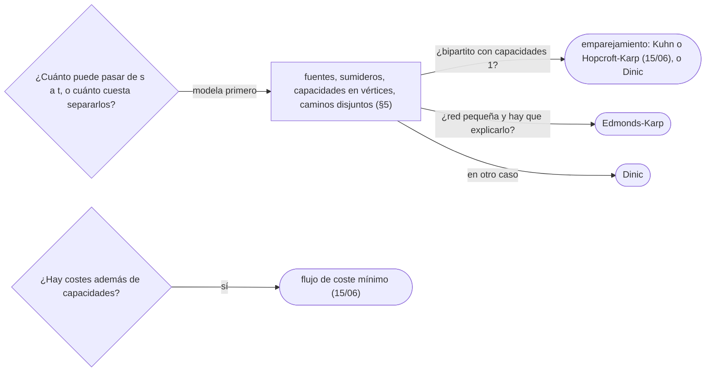

# 05 — Flujo máximo y corte mínimo

> Cuánto puede pasar de una fuente a un sumidero por una red con capacidades, y por qué esa cantidad es
> exactamente la capacidad del corte más barato que los separa. La red residual y sus aristas de vuelta,
> Ford-Fulkerson con caminos más cortos (Edmonds-Karp), Dinic con su grafo de niveles, y el oficio que de
> verdad se evalúa: modelar como flujo un problema que no lo parece.
>
> **Niveles:** Ford-Fulkerson y Edmonds-Karp [B] · Dinic [B].
>
> **📚 Lectura troncal:** Cormen, Leiserson, Rivest y Stein, *Introduction to Algorithms*, 3.ª ed. (MIT
> Press, 2009), cap. 26; Kleinberg y Tardos, *Algorithm Design* (Addison-Wesley, 2005), cap. 7.
>
> **Asume leído:** [`14/02` — BFS](../14-grafos-recorridos/02-bfs.md).
>
> **Vigencia:** 2026-10-04.

**Salto rápido:** [1](#1--el-problema) · [2](#2--la-teoría) · [3](#3--ford-fulkerson-y-edmonds-karp) · [4](#4--dinic) · [5](#5--modelar-como-flujo) · [6](#6-️-la-tabla-de-costes) · [7](#7--cómo-se-elige) · [8](#8--señales-del-enunciado) · [9](#9--dónde-aparece-de-verdad) · [🧠](#-preguntas) · [🧩](#-problemas-propios)

---

## 1. 🎯 El problema

Una red de servidores con enlaces dirigidos de capacidad limitada. ¿Cuántos megabits por segundo pueden ir,
como máximo, del servidor `s` al `t`? La respuesta tentadora —la suma de lo que sale de `s`— falla en
cuanto un cuello de botella está más adelante. Y la estrategia voraz «busco un camino con capacidad libre,
lo lleno y repito» también falla: un primer camino mal elegido bloquea a los demás.

La teoría de flujos resuelve las dos cosas con una idea: permitir **deshacer** flujo, con aristas de vuelta
en una red residual. Y da un regalo: el flujo máximo es igual a la capacidad del corte mínimo, así que el
mismo cálculo responde «¿cuántos enlaces, como mínimo y por capacidad, hay que cortar para aislar `t`?».

> 🧠 **Modelo mental.** Tuberías con válvulas de un sentido. Cada camino que encuentras es agua que pasa;
> las aristas de vuelta son la posibilidad de redirigir agua que ya mandaste por un sitio peor.

Los ejemplos usan la red R de la guía: `s→a 3`, `s→b 2`, `a→b 1`, `a→t 2`, `b→t 3`, con flujo máximo 5.

---

## 2. 📐 La teoría

**Flujo.** Una función `f(u, v)` en las aristas con `0 ≤ f(u, v) ≤ c(u, v)` (capacidad) y, en todo vértice
distinto de `s` y `t`, lo que entra igual a lo que sale (conservación). Su valor `|f|` es lo que sale de `s`
neto.

**Corte.** Una partición `(S, T)` con `s ∈ S` y `t ∈ T`; su capacidad `c(S, T)` es la suma de las
capacidades de las aristas de `S` a `T`. Para cualquier flujo y cualquier corte, `|f| ≤ c(S, T)`: todo lo
que llega a `t` cruza el corte, y no puede cruzar más de lo que cabe.

**Red residual.** Para cada arista `u → v` con flujo `f`, la residual tiene `u → v` con capacidad
`c − f` (lo que aún cabe) y `v → u` con capacidad `f` (lo que se puede **deshacer**). Un **camino
aumentante** es un camino de `s` a `t` en la residual; empujar por él su capacidad mínima aumenta `|f|`.

**Teorema de flujo máximo y corte mínimo.** Son equivalentes: (1) `f` es máximo; (2) no hay camino
aumentante; (3) `|f| = c(S, T)` para algún corte.

*Prueba.* (1 ⇒ 2): si hubiera camino aumentante, `f` no sería máximo. (2 ⇒ 3): sea `S` lo alcanzable desde
`s` en la residual; `t ∉ S`. Toda arista de `S` a `T` está saturada (si no, su destino sería alcanzable) y
toda de `T` a `S` tiene flujo 0 (si no, su arista de vuelta haría alcanzable el origen); así que el flujo
neto que cruza es exactamente `c(S, T)`. (3 ⇒ 1): como `|f| ≤ c(S′, T′)` para cualquier corte, el flujo que
iguala un corte es máximo, y ese corte es mínimo.

**Por qué hacen falta las aristas de vuelta.** En `s→a 1`, `s→b 1`, `a→b 1`, `a→t 1`, `b→t 1`, si el primer
camino es `s a b t`, ya no queda camino sin deshacer: el voraz se queda en 1. Con la residual, `s b a t`
usa la arista de vuelta `b → a` y llega a 2.

**Edmonds-Karp.** Ford-Fulkerson con el camino aumentante **más corto** (BFS). Las distancias desde `s` en
la residual no decrecen, y cada arista es cuello de botella `O(V)` veces: `O(V · E)` aumentos, `O(V · E²)`
en total, **independiente de las capacidades**. Con caminos arbitrarios y capacidades irracionales,
Ford-Fulkerson puede no terminar; con enteros, termina en `O(E · |f|)`.

**Dinic.** Por fases: un BFS construye el grafo de niveles (solo aristas de nivel `d` a `d + 1`) y un DFS
con punteros encuentra un **flujo bloqueante** en él. Cada fase aumenta estrictamente la distancia de `s`
a `t`: como mucho `V` fases, `O(V² · E)` en total; con capacidades unitarias, `O(E · √V)`.

---

## 3. 🧱 Ford-Fulkerson y Edmonds-Karp

**Qué es.** Repetir: buscar con BFS un camino de `s` a `t` en la residual, empujar su capacidad mínima y
actualizar las aristas de ida y vuelta.

**Por qué es correcto.** El teorema de §2: cuando no hay camino aumentante, el flujo es máximo.

**Cómo va**, en R:

```text
camino (BFS)    cuello   flujo total   residual que cambia
s a t           2        2             a→t 0, t→a 2, s→a 1
s b t           2        4             s→b 0, b→t 1
s a b t         1        5             s→a 0, a→b 0, b→t 0
no hay camino: alcanzables desde s en la residual = {s} → corte {s} | {a, b, t}, capacidad 3 + 2 = 5
```

**Cuánto.** `O(V · E²)`; en la práctica, mucho menos.

**La plantilla**, con las aristas en un arreglo y la vuelta de la arista `e` en `e ^ 1`:

```cpp
#include <algorithm>
#include <queue>
#include <vector>


struct EdmondsKarp {
    struct Edge { int to; long long cap; };
    std::vector<Edge> edges;                              // la arista e y su vuelta e ^ 1, contiguas
    std::vector<std::vector<int>> g;
    explicit EdmondsKarp(int n) : g(n) {}
    void addEdge(int u, int v, long long c) {
        g[u].push_back(edges.size()); edges.push_back({v, c});
        g[v].push_back(edges.size()); edges.push_back({u, 0});
    }
    long long maxFlow(int s, int t) {
        long long flow = 0;
        while (true) {
            std::vector<int> parentEdge(g.size(), -1);
            std::queue<int> q; q.push(s);
            while (!q.empty() && parentEdge[t] == -1) {
                int u = q.front(); q.pop();
                for (int e : g[u]) {
                    int v = edges[e].to;
                    if (edges[e].cap > 0 && v != s && parentEdge[v] == -1) { parentEdge[v] = e; q.push(v); }
                }
            }
            if (parentEdge[t] == -1) return flow;        // sin camino aumentante: máximo
            long long push = (long long)4e18;
            for (int v = t; v != s; v = edges[parentEdge[v] ^ 1].to) push = std::min(push, edges[parentEdge[v]].cap);
            for (int v = t; v != s; v = edges[parentEdge[v] ^ 1].to) {
                edges[parentEdge[v]].cap -= push;
                edges[parentEdge[v] ^ 1].cap += push;   // se puede deshacer
            }
            flow += push;
        }
    }
};
```

```java
// Misma estructura con arreglos: to[e], cap[e], y la vuelta de e en e ^ 1.
static int[] head, next, to;
static long[] cap;
static int edgeCount;

static void init(int n, int maxEdges) {
    head = new int[n]; java.util.Arrays.fill(head, -1);
    next = new int[2 * maxEdges]; to = new int[2 * maxEdges]; cap = new long[2 * maxEdges];
    edgeCount = 0;
}

static void addEdge(int u, int v, long c) {
    to[edgeCount] = v; cap[edgeCount] = c; next[edgeCount] = head[u]; head[u] = edgeCount++;
    to[edgeCount] = u; cap[edgeCount] = 0; next[edgeCount] = head[v]; head[v] = edgeCount++;
}

static long maxFlow(int n, int s, int t) {
    long flow = 0;
    int[] parentEdge = new int[n], queue = new int[n];
    while (true) {
        java.util.Arrays.fill(parentEdge, -1);
        int qh = 0, qt = 0;
        queue[qt++] = s;
        while (qh < qt && parentEdge[t] == -1) {
            int u = queue[qh++];
            for (int e = head[u]; e != -1; e = next[e])
                if (cap[e] > 0 && to[e] != s && parentEdge[to[e]] == -1) { parentEdge[to[e]] = e; queue[qt++] = to[e]; }
        }
        if (parentEdge[t] == -1) return flow;
        long push = Long.MAX_VALUE;
        for (int v = t; v != s; v = to[parentEdge[v] ^ 1]) push = Math.min(push, cap[parentEdge[v]]);
        for (int v = t; v != s; v = to[parentEdge[v] ^ 1]) { cap[parentEdge[v]] -= push; cap[parentEdge[v] ^ 1] += push; }
        flow += push;
    }
}
```

- **`e ^ 1`**: añadir cada arista y su vuelta seguidas (índices par e impar) da la vuelta con un XOR.
- **Aristas no dirigidas**: una sola llamada con capacidad `c` en los dos sentidos (`edges.push_back({u, c})`
  para la vuelta), o dos aristas dirigidas.
- **El corte mínimo**: al terminar, un BFS por aristas con capacidad residual positiva desde `s`; las aristas
  originales de lo alcanzado a lo no alcanzado son el corte.
- **Capacidades en 64 bits**: el flujo puede sumar muchas capacidades.

**Cuándo sí:** redes pequeñas o medianas (cientos de vértices, miles de aristas) y como primera versión
fácil de verificar. **Cuándo no:** redes grandes o con capacidades unitarias y muchos vértices
(emparejamientos grandes): Dinic.

> **Veredicto:** Edmonds-Karp es BFS en la residual, empujar el cuello y anotar la vuelta; correcto por el
> teorema, `O(V · E²)` sin depender de las capacidades.

---

## 4. 🧱 Dinic

**Qué es.** Fases de BFS (niveles desde `s`) seguidas de DFS que empujan flujo solo de nivel `d` a `d + 1`,
con un puntero por vértice que recuerda qué aristas ya están agotadas en la fase.

**Por qué es correcto.** Es Ford-Fulkerson: cada DFS encuentra caminos aumentantes; cuando el BFS ya no
alcanza `t`, no hay camino aumentante y el flujo es máximo.

**Cómo va**, en R:

```text
fase 1: niveles s 0, a 1, b 1, t 2 (a→b no cuenta: mismo nivel)
        flujo bloqueante: s a t 2, s b t 2 → total 4
fase 2: residual s→a 1, a→b 1, b→t 1; niveles s 0, a 1, b 2, t 3
        flujo bloqueante: s a b t 1 → total 5
fase 3: t no alcanzable → fin
```

**Cuánto.** `O(V² · E)` en general; `O(E · √V)` con capacidades unitarias (emparejamiento bipartito,
[`15/06`](06-emparejamientos.md)).

**La plantilla:**

```cpp
#include <algorithm>
#include <queue>
#include <vector>


struct Dinic {
    struct Edge { int to; long long cap; };
    std::vector<Edge> edges;
    std::vector<std::vector<int>> g;
    std::vector<int> level, it;
    explicit Dinic(int n) : g(n), level(n), it(n) {}
    void addEdge(int u, int v, long long c) {
        g[u].push_back(edges.size()); edges.push_back({v, c});
        g[v].push_back(edges.size()); edges.push_back({u, 0});
    }
    bool bfs(int s, int t) {
        std::fill(level.begin(), level.end(), -1);
        std::queue<int> q; q.push(s); level[s] = 0;
        while (!q.empty()) {
            int u = q.front(); q.pop();
            for (int e : g[u])
                if (edges[e].cap > 0 && level[edges[e].to] == -1) { level[edges[e].to] = level[u] + 1; q.push(edges[e].to); }
        }
        return level[t] != -1;
    }
    long long dfs(int u, int t, long long pushed) {
        if (u == t) return pushed;
        for (int& i = it[u]; i < (int)g[u].size(); i++) {   // el puntero no retrocede en la fase
            int e = g[u][i], v = edges[e].to;
            if (edges[e].cap > 0 && level[v] == level[u] + 1) {
                long long got = dfs(v, t, std::min(pushed, edges[e].cap));
                if (got > 0) { edges[e].cap -= got; edges[e ^ 1].cap += got; return got; }
            }
        }
        return 0;
    }
    long long maxFlow(int s, int t) {
        long long flow = 0;
        while (bfs(s, t)) {
            std::fill(it.begin(), it.end(), 0);
            while (long long f = dfs(s, t, (long long)4e18)) flow += f;
        }
        return flow;
    }
};
```

```java
// Sobre los arreglos head/next/to/cap de §3. level e it por vértice; it guarda una arista (índice), no una posición.
static int[] level, it;

static boolean bfs(int n, int s, int t) {
    level = new int[n]; java.util.Arrays.fill(level, -1);
    int[] queue = new int[n];
    int qh = 0, qt = 0;
    queue[qt++] = s; level[s] = 0;
    while (qh < qt) {
        int u = queue[qh++];
        for (int e = head[u]; e != -1; e = next[e])
            if (cap[e] > 0 && level[to[e]] == -1) { level[to[e]] = level[u] + 1; queue[qt++] = to[e]; }
    }
    return level[t] != -1;
}

static long dfs(int u, int t, long pushed) {
    if (u == t) return pushed;
    for (; it[u] != -1; it[u] = next[it[u]]) {
        int e = it[u], v = to[e];
        if (cap[e] > 0 && level[v] == level[u] + 1) {
            long got = dfs(v, t, Math.min(pushed, cap[e]));
            if (got > 0) { cap[e] -= got; cap[e ^ 1] += got; return got; }
        }
    }
    return 0;
}

static long dinic(int n, int s, int t) {
    long flow = 0;
    while (bfs(n, s, t)) {
        it = head.clone();                               // el puntero empieza en la primera arista
        long f;
        while ((f = dfs(s, t, Long.MAX_VALUE)) > 0) flow += f;
    }
    return flow;
}
```

- **El puntero `it[u]`** es lo que da la cota: una arista que no llevó a `t` en esta fase no se vuelve a
  probar hasta la siguiente.
- **La recursión** tiene profundidad como mucho la distancia de `s` a `t` en niveles, `≤ V`; en Java, con
  redes de miles de vértices, cabe; con `10⁵` en cadena, hilo con pila grande.
- **Python** no está en la plantilla: Dinic en CPython solo pasa con redes pequeñas; PyPy, si el juez lo
  ofrece.

**Cuándo sí:** cualquier problema de flujo de concurso; emparejamientos grandes. **Cuándo no:** si la red es
diminuta y Edmonds-Karp es más fácil de defender en una entrevista; con costes, hace falta flujo de coste
mínimo (`15/06`).

> **Veredicto:** Dinic es Edmonds-Karp por fases con un puntero por vértice: `O(V² E)` en general y
> `O(E √V)` en redes unitarias. Es la plantilla de flujo del cuaderno.

---

## 5. 🧱 Modelar como flujo

Lo que se evalúa casi nunca es el algoritmo: es la red. Las transformaciones de siempre:

| Situación | Modelo | Por qué funciona |
|---|---|---|
| Varias fuentes o sumideros | Superfuente unida a todas (y supersumidero) con capacidad ∞ o la oferta | Un solo `s` y un solo `t` |
| Capacidad en un vértice | Partirlo en `v_in → v_out` con esa capacidad | Todo lo que pasa por `v` cruza esa arista |
| Arista no dirigida | Dos aristas dirigidas (o capacidad en los dos sentidos) | El flujo neto elige el sentido |
| Caminos disjuntos en aristas | Capacidad 1 por arista; el flujo es el número de caminos | Cada unidad es un camino (descomposición) |
| Caminos disjuntos en vértices | Partir vértices con capacidad 1 | Combina las dos anteriores |
| Mínimo de aristas que cortar para aislar `t` | Corte mínimo con capacidad 1 por arista | Flujo máximo = corte mínimo |
| Elegir proyectos con requisitos (cierre de peso máximo) | `s → proyecto` (beneficio), `herramienta → t` (coste), `proyecto → herramienta` ∞; respuesta: beneficios − corte | El corte decide qué se hace y qué se compra |
| Asignar con capacidades (personas a turnos con cupo) | Bipartito con `s → persona` 1, `turno → t` cupo | Emparejamiento con cupos (`15/06`) |

**Recuperar la respuesta.** El corte: los alcanzables desde `s` en la residual final. Los caminos: seguir
aristas con flujo positivo desde `s`, restando una unidad cada vez.

> 💡 **Truco.** Antes de escribir código de flujo, dibuja la red en papel con dos o tres nodos de cada tipo
> y comprueba que cada unidad de flujo corresponde a una decisión del enunciado, y cada corte a una
> elección válida.

---

## 6. ⏱️ La tabla de costes

| Algoritmo | Tiempo | Lo que la tabla no dice |
|---|---|---|
| Ford-Fulkerson (DFS) | `O(E · \|f\|)` con enteros | Puede no terminar con capacidades irracionales |
| Edmonds-Karp | `O(V · E²)` | Independiente de las capacidades |
| Dinic | `O(V² · E)` | `O(E √V)` con capacidades unitarias; muy rápido en la práctica |
| Push-relabel | `O(V³)` (FIFO) | El de las bibliotecas industriales; fuera de este corpus |

---

## 7. 🧭 Cómo se elige



> **Regla de entrevista:** si te preguntan por el corte mínimo, contesta con el teorema y la construcción:
> «flujo máximo, y luego los alcanzables desde `s` en la residual».

---

## 8. 🔎 Señales del enunciado

| Señal | Técnica | Por qué |
|---|---|---|
| «Máximo que se puede enviar», capacidades en las aristas | Flujo máximo | Es la definición |
| «Mínimo de enlaces / carreteras que cortar para separar» | Corte mínimo | El dual |
| «Cuántos caminos sin compartir aristas (o vértices)» | Flujo con capacidad 1 | Descomposición en caminos |
| «Elegir proyectos que requieren recursos con coste» | Cierre de peso máximo | Corte mínimo |
| `n ≤ 500`, restricciones de «a lo sumo» por nodo y por arista | Probablemente flujo | Las cotas de flujo |

---

## 9. 🔭 Dónde aparece de verdad

- **La segmentación de imágenes** clásica (separar objeto y fondo) se resuelve como un corte mínimo entre
  dos terminales en el grafo de los píxeles.
- **La planificación de redes y la logística** usan flujo y flujo de coste mínimo para repartir capacidad y
  calcular cuellos de botella.

---

## ⚠️ Errores frecuentes

| Se dice | Lo preciso |
|---|---|
| «El flujo máximo es la suma de las capacidades que salen de la fuente» | Es una cota; en R′ (con `a → t` de 1) salen 5 de `s` y el máximo es 4 |
| «Basta llenar caminos de forma voraz» | Sin aristas de vuelta, un mal primer camino bloquea; la residual permite deshacer |
| «Ford-Fulkerson siempre termina» | Con enteros, sí; con capacidades irracionales y caminos arbitrarios, puede no hacerlo |
| «El corte mínimo son las aristas saturadas» | Son las saturadas que van de lo alcanzable desde `s` a lo no alcanzable |
| «La arista de vuelta tiene la misma capacidad que la de ida» | Empieza en 0 (en dirigidas) y crece con el flujo enviado |
| «Las capacidades en vértices no se pueden modelar» | Se parte el vértice en entrada y salida |

---

## 📚 Para profundizar

- **Libro** — Cormen, Leiserson, Rivest y Stein, *Introduction to Algorithms*, 3.ª ed. (MIT Press, 2009),
  cap. 26: el teorema, Edmonds-Karp y su cota. *Lectura troncal.*
- **Libro** — Kleinberg y Tardos, *Algorithm Design* (Addison-Wesley, 2005), cap. 7: flujo, el corte mínimo
  y las aplicaciones (selección de proyectos, segmentación). *Lectura troncal.*
- **Referencia** — cp-algorithms, [*Maximum flow - Ford-Fulkerson and Edmonds-Karp*](https://cp-algorithms.com/graph/edmonds_karp.html).
- **Referencia** — cp-algorithms, [*Maximum flow - Dinic's algorithm*](https://cp-algorithms.com/graph/dinic.html).
- **Referencia** — Sedgewick y Wayne, [código de `FordFulkerson.java`](https://algs4.cs.princeton.edu/64maxflow/FordFulkerson.java.html).

---

## 🧠 Preguntas

1. ¿Qué dos condiciones cumple un flujo? 🟢
2. ¿Qué es la red residual y para qué sirven sus aristas de vuelta? 🟢
3. Enuncia el teorema de flujo máximo y corte mínimo. 🟢
4. ¿Cómo encuentras el corte mínimo después de calcular el flujo máximo? 🟡
5. ¿Qué cambia Edmonds-Karp respecto de Ford-Fulkerson, y qué cota gana? 🟡
6. ¿Cómo modelas capacidades en los vértices? 🟡
7. ¿Por qué falla la suma de las capacidades que salen de la fuente? Da una red. 🟡
8. Demuestra que, si no hay camino aumentante, el flujo es máximo. 🟠
9. ¿Qué es el grafo de niveles de Dinic y para qué sirve el puntero por vértice? 🟠
10. ¿Cómo cuentas el máximo de caminos disjuntos en aristas entre `s` y `t`? 🟠
11. Da una red donde el voraz sin aristas de vuelta no llega al máximo. 🟠
12. Modela como flujo la selección de proyectos con herramientas compartidas. 🔴
13. ¿Por qué Dinic es `O(E √V)` con capacidades unitarias, y dónde lo aprovechas? 🔴

---

## 🧩 Problemas propios

### Estaciones con límite

**Nivel:** 🟡 · **Formato:** programa completo.

Una red dirigida de tuberías con capacidades; además, cada estación intermedia (todas menos la 1 y la `n`)
deja pasar como mucho `k_v` unidades. ¿Cuánto puede llegar de la 1 a la `n`?

- **Entrada.** Una línea con `n` y `m`. Una línea con `k_1 … k_n` (se ignoran `k_1` y `k_n`). Después, `m`
  líneas con `u v c`.
- **Salida.** Un entero.
- **Restricciones.** `2 ≤ n ≤ 500`; `0 ≤ m ≤ 1 000`; `1 ≤ k_v, c ≤ 10⁹`.

```text
Entrada         Salida
4 5             4
0 2 2 0
1 2 3
1 3 2
2 3 1
2 4 2
3 4 3

Entrada         Salida
2 1             1000000000
0 0
1 2 1000000000
```

Con las mismas tuberías y `k = 0 10 10 0`, la salida es 5.

**Pista 1:** ¿cómo conviertes el límite de un vértice en el límite de una arista?

### El lado de la fuente

**Nivel:** 🟠 · **Formato:** programa completo.

Después de enviar el flujo máximo de 1 a `n`, ¿cuántos vértices quedan del lado de la fuente en el corte
mínimo **más cercano a la fuente** (los alcanzables desde 1 en la red residual)?

- **Entrada.** Una línea con `n` y `m`. Después, `m` líneas con `u v c` (dirigidas).
- **Salida.** Un entero.
- **Restricciones.** `2 ≤ n ≤ 500`; `0 ≤ m ≤ 1 000`; `1 ≤ c ≤ 10⁹`.

```text
Entrada     Salida
4 5         1
1 2 3
1 3 2
2 3 1
2 4 2
3 4 3

Entrada     Salida
4 3         2
1 2 5
2 3 1
3 4 5
```

**Pista 1:** al terminar, ¿qué vértices alcanzas desde la fuente por aristas con capacidad residual?

### Proyectos y herramientas

**Nivel:** 🔴 · **Formato:** programa completo.

Hay `p` proyectos con un beneficio cada uno y `h` herramientas con un coste cada una. Cada proyecto necesita
un conjunto de herramientas; una herramienta comprada sirve para todos los proyectos. ¿Cuál es la ganancia
máxima (beneficios de los proyectos hechos menos costes de las herramientas compradas)?

- **Entrada.** Una línea con `p` y `h`. Una línea con los beneficios; otra con los costes. Después, `p`
  líneas: la `i`-ésima con `k` y las `k` herramientas (desde 1) del proyecto `i`.
- **Salida.** Un entero.
- **Restricciones.** `1 ≤ p, h ≤ 200`; beneficios y costes hasta `10⁶`.

```text
Entrada     Salida
3 3         7
10 6 5
4 7 3
2 1 2
1 2
1 3

Entrada     Salida
1 1         0
3
5
1 1
```

**Pista 1:** si cortar una arista significa «no hago este proyecto» o «compro esta herramienta», ¿qué
aristas no se deben poder cortar nunca?

---

## 🧩 Práctica externa

> 💡 **Truco.** Antes de pedir ayuda, comprueba tu red con el teorema: calcula a mano un corte en el ejemplo
> y verifica que tu flujo no lo supera. Si una IA te ayuda, que sea a revisar el modelo, no a escribir Dinic
> ([`01/06`](../01-oficio-del-competidor/06-protocolo-de-resolucion.md)). SPOJ tiene los clásicos de flujo
> (FASTFLOW, MTOTALF) pero no se enlaza: responde `403` a la verificación.

### Núcleo

| ✔ | Problema | Plataforma | Nivel | Patrón | Pista 1 |
|---|---|---|---|---|---|
| [ ] | [Download Speed](https://cses.fi/problemset/task/1694) | CSES | 🟡 | Flujo máximo | ¿Qué tipo necesita el resultado? |
| [ ] | [Maximum Flow](https://open.kattis.com/problems/maxflow) | Kattis | 🟡 | Flujo y descomposición | ¿Qué aristas imprimes, y con qué flujo? |
| [ ] | [Minimum Cut](https://open.kattis.com/problems/mincut) | Kattis | 🟡 | Corte desde la residual | ¿Qué conjunto es el lado de `s`? |
| [ ] | [Police Chase](https://cses.fi/problemset/task/1695) | CSES | 🟠 | Corte mínimo no dirigido | ¿Qué aristas del corte imprimes? |
| [ ] | [Distinct Routes](https://cses.fi/problemset/task/1711) | CSES | 🟠 | Caminos disjuntos en aristas | ¿Cómo sacas cada camino del flujo? |

### Ampliación

| ✔ | Problema | Plataforma | Nivel | Patrón | Pista 1 |
|---|---|---|---|---|---|
| [ ] | [Soldier and Traveling](https://codeforces.com/problemset/problem/546/E) | Codeforces | 🟠 | Bipartito de ciudades | ¿Qué lado son las ciudades de antes y cuál las de después? |
| [ ] | [Delivery Bears](https://codeforces.com/problemset/problem/653/D) | Codeforces | 🔴 | Binaria sobre el flujo | Si cada oso lleva `w`, ¿qué capacidad tiene cada arista en «número de osos»? |
| [ ] | [Fox And Dinner](https://codeforces.com/problemset/problem/510/E) | Codeforces | 🔴 | Paridad y grados en flujo | ¿Qué paridad tiene la suma de dos números para ser primo (mayor que 2)? |

---

## ✅ Criterio de dominio

- Enunciar y demostrar el teorema de flujo máximo y corte mínimo.
- Escribir Edmonds-Karp o Dinic con la plantilla delante y recuperar el corte.
- Modelar con superfuente, vértices partidos y capacidades unitarias.
- Resolver Download Speed y Police Chase sin pista 2.

---

**Anterior:** [`15/04` — Árbol de expansión mínima](04-arbol-de-expansion-minima.md) · **Siguiente:** [`15/06` — Emparejamientos](06-emparejamientos.md) ·
**Relacionado:** [`15/07` — Grafos de nivel experto](07-grafos-de-nivel-experto.md).
