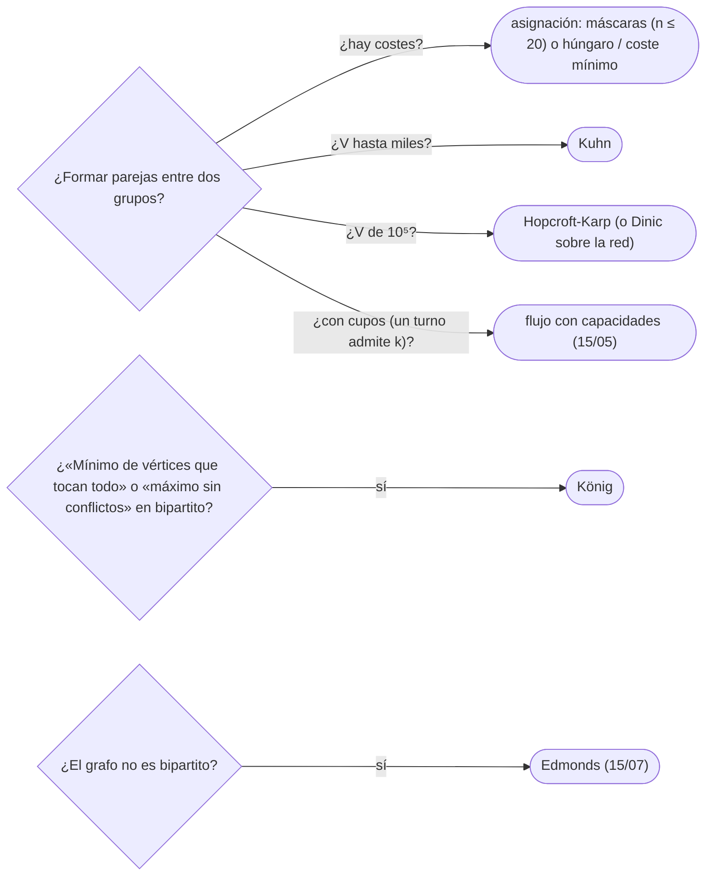

# 06 — Emparejamientos

> Emparejar los vértices de un grafo bipartito —trabajadores con tareas, alumnos con plazas— para formar el
> mayor número de parejas: los caminos aumentantes y el teorema de Berge, el algoritmo de Kuhn en pocas
> líneas, Hopcroft-Karp como Dinic sobre la red unitaria, el teorema de König que convierte el emparejamiento
> en una cobertura de vértices, y en ficha la asignación de coste mínimo con el húngaro.
>
> **Niveles:** Kuhn [B] · Hopcroft-Karp [B] · König [B] · coste mínimo y húngaro [C].
>
> **📚 Lectura troncal:** Kleinberg y Tardos, *Algorithm Design* (Addison-Wesley, 2005), §7.5; Cormen,
> Leiserson, Rivest y Stein, *Introduction to Algorithms*, 3.ª ed. (MIT Press, 2009), §26.3.
>
> **Asume leído:** [`15/05` — Flujo máximo y corte mínimo](05-flujo-maximo.md).
>
> **Vigencia:** 2026-10-04.

**Salto rápido:** [1](#1--el-problema) · [2](#2--la-teoría) · [3](#3--kuhn) · [4](#4--hopcroft-karp) · [5](#5--könig) · [6](#6--coste-mínimo-y-húngaro) · [7](#7-️-la-tabla-de-costes) · [8](#8--cómo-se-elige) · [9](#9--señales-del-enunciado) · [🧠](#-preguntas) · [🧩](#-problemas-propios)

---

## 1. 🎯 El problema

Tres técnicos y tres averías. El técnico 1 sabe arreglar `a` y `b`; el 2, solo `a`; el 3, `b` y `c`. Si se
asigna en orden «a cada técnico, la primera avería libre que sabe arreglar», el 1 toma `a`, el 2 se queda
sin nada y el 3 toma `b`: dos parejas. Pero hay tres: `1–b`, `2–a`, `3–c`. El voraz no sabe **reasignar**.

Un emparejamiento máximo en un bipartito se encuentra con caminos aumentantes, la misma idea que el flujo de
`15/05`: si hay una forma de mover a alguien a otra tarea para liberar la que otro necesita, se hace. Y el
tamaño del máximo emparejamiento responde, por el teorema de König, una pregunta que no parece de parejas:
¿cuántos vértices, como mínimo, tocan todas las aristas?

> 🧠 **Modelo mental.** Un baile donde cada recién llegado pregunta a su pareja preferida «¿te puedes ir con
> otra persona?»; si esa persona puede, se encadena la pregunta. El camino de preguntas que termina en
> alguien libre es el camino aumentante.

Los ejemplos usan esos técnicos y averías: `1: a, b` · `2: a` · `3: b, c`.

---

## 2. 📐 La teoría

**Emparejamiento.** Un conjunto de aristas sin vértices en común. **Máximo**: con el mayor número de aristas.
**Perfecto**: cubre todos los vértices.

**Camino alternante y aumentante.** Un camino que alterna aristas fuera y dentro del emparejamiento `M`; es
**aumentante** si empieza y termina en vértices libres. Intercambiar sus aristas (las de fuera entran, las
de dentro salen) da un emparejamiento con una arista más.

**Teorema de Berge.** `M` es máximo si y solo si no hay camino aumentante respecto de `M`.

*Esbozo.* (⇒) Un camino aumentante daría uno mayor. (⇐) Si `M′` es mayor que `M`, la diferencia simétrica
`M ⊕ M′` tiene grado como mucho 2 en cada vértice: son caminos y ciclos alternantes. Los ciclos tienen tantas
aristas de una como de otra; como `M′` tiene más, algún camino tiene más aristas de `M′`, y es aumentante
para `M`.

**El emparejamiento como flujo.** `s → izquierda` con capacidad 1, `izquierda → derecha` con 1 por arista,
`derecha → t` con 1. Un flujo entero es un emparejamiento y viceversa; el flujo máximo es el emparejamiento
máximo, y un camino aumentante del flujo es un camino alternante del emparejamiento.

**Teorema de König.** En un grafo **bipartito**, el tamaño del emparejamiento máximo es igual al de la
**cobertura de vértices mínima** (el menor conjunto de vértices que toca todas las aristas).

*Esbozo.* Toda cobertura necesita un vértice por arista del emparejamiento (no comparten vértices), así que
`cobertura ≥ emparejamiento`. Para la igualdad: sea `Z` lo alcanzable desde los libres de la izquierda por
caminos alternantes; la cobertura es (izquierda `− Z`) `∪` (derecha `∩ Z`), con exactamente un vértice por
arista de `M`. Es el corte mínimo de la red de flujo.

**Consecuencias.** Conjunto independiente máximo = `n −` emparejamiento máximo (en bipartito). Cobertura de
un DAG por caminos disjuntos en vértices = `n −` emparejamiento en el bipartito «salida de `u` → entrada de
`v`».

---

## 3. 🧱 Kuhn

**Qué es.** Para cada vértice de la izquierda, un DFS que busca un camino aumentante: intenta cada vecino de
la derecha; si está libre, lo toma; si no, pide recursivamente a su pareja actual que busque otro.

**Por qué es correcto.** Berge: cada DFS exitoso aumenta en uno; si falla para un vértice, ese vértice no
puede emparejarse en ningún emparejamiento que extienda el actual, y no hace falta reintentarlo.

**Cómo va**, con los técnicos:

```text
técnico 1: a libre → 1–a
técnico 2: a la tiene 1 → ¿1 puede ir a otra? b libre → 1–b, 2–a
técnico 3: b la tiene 1 → ¿1 a otra? a la tiene 2 → ¿2 a otra? no → falla;  c libre → 3–c
emparejamiento: 1–b, 2–a, 3–c (3 parejas)
```

**Cuánto.** `O(V · E)`: un DFS de `O(E)` por vértice de la izquierda. En la práctica, mucho menos, sobre
todo con una pasada voraz previa.

**La plantilla:**

```cpp
#include <vector>

// Bipartito con nl vértices a la izquierda y nr a la derecha; adj[u] = vecinos derechos de u.
struct Kuhn {
    const std::vector<std::vector<int>>& adj;
    std::vector<int> matchR;                             // matchR[v] = pareja izquierda de v, o −1
    std::vector<int> seen;                               // marca de la ronda en que se visitó v
    int round = 0;
    Kuhn(const std::vector<std::vector<int>>& g, int nr) : adj(g), matchR(nr, -1), seen(nr, 0) {}
    bool tryKuhn(int u) {
        for (int v : adj[u]) {
            if (seen[v] == round) continue;
            seen[v] = round;
            if (matchR[v] == -1 || tryKuhn(matchR[v])) { matchR[v] = u; return true; }
        }
        return false;
    }
    int maxMatching() {
        int result = 0;
        for (int u = 0; u < (int)adj.size(); u++) { round++; if (tryKuhn(u)) result++; }
        return result;
    }
};
```

```java
// matchR[v] = pareja de v (derecha), o −1. seen por ronda para no reinicializar.
static int[][] adj;
static int[] matchR, seen;
static int round;

static boolean tryKuhn(int u) {
    for (int v : adj[u]) {
        if (seen[v] == round) continue;
        seen[v] = round;
        if (matchR[v] == -1 || tryKuhn(matchR[v])) { matchR[v] = u; return true; }
    }
    return false;
}

static int maxMatching(int nr) {
    matchR = new int[nr]; seen = new int[nr];
    java.util.Arrays.fill(matchR, -1);
    int result = 0;
    for (int u = 0; u < adj.length; u++) { round++; if (tryKuhn(u)) result++; }
    return result;
}
```

- **`seen` por ronda** evita reinicializar un arreglo de `n` en cada DFS: se compara con el número de
  ronda.
- **La recursión** tiene profundidad como mucho el tamaño del emparejamiento; con `10⁵` vértices en Java,
  hilo con pila grande, o Hopcroft-Karp.
- **Heurística barata**: emparejar primero de forma voraz y lanzar Kuhn solo para los libres; no cambia la
  cota, pero ahorra mucho.

**Cuándo sí:** bipartitos de hasta unos miles de vértices y decenas de miles de aristas; en entrevistas,
por lo corto. **Cuándo no:** `10⁵` vértices y `2·10⁵` aristas (Hopcroft-Karp o Dinic); grafos no bipartitos
(Edmonds, [`15/07`](07-grafos-de-nivel-experto.md)).

> **Veredicto:** Kuhn es un DFS de caminos aumentantes por cada vértice izquierdo: diez líneas y
> `O(V · E)`. Es la plantilla de emparejamiento del cuaderno.

---

## 4. 🧱 Hopcroft-Karp

**Qué es.** Por fases: un BFS desde todos los libres de la izquierda calcula distancias alternantes; un DFS
encuentra un conjunto maximal de caminos aumentantes **más cortos y disjuntos**, y los aplica todos a la vez.

**Por qué es correcto.** Cada fase aplica caminos aumentantes (Berge). Y es exactamente Dinic sobre la red
unitaria del emparejamiento: el BFS es el grafo de niveles y el DFS, el flujo bloqueante.

**Cómo va.** En el ejemplo, la primera fase encuentra a la vez `1–a` y `3–b` (caminos de longitud 1); la
segunda, el camino `2 → a → 1 → b → 3 → c` de longitud 5, que reasigna a 1 y a 3 de una vez.

**Cuánto.** `O(E · √V)`: tras `√V` fases, los caminos que quedan son largos y caben pocos.

**La plantilla.** Por ficha, el código del corpus es Kuhn; Hopcroft-Karp se obtiene con el Dinic de
[`15/05`](05-flujo-maximo.md) sobre la red `s → izquierda → derecha → t` con capacidades 1, que tiene la
misma cota. La versión directa, sin red de flujo, está en las referencias.

**Cuándo sí:** emparejamientos con `10⁵` vértices. **Cuándo no:** si Kuhn cabe, que es casi siempre en
entrevistas.

> **Veredicto:** Hopcroft-Karp es Dinic sobre la red del emparejamiento: `O(E √V)`. Con la plantilla de
> Dinic a mano, no hace falta otra.

---

## 5. 🧱 König

**Qué es.** El teorema de §2, y su construcción: tras el emparejamiento máximo, marcar lo alcanzable desde
los libres de la izquierda por caminos alternantes (izquierda → derecha por aristas fuera de `M`, derecha →
izquierda por aristas de `M`). Cobertura mínima = izquierdos **no** marcados + derechos marcados.

**Por qué es correcto.** Cada arista de `M` aporta exactamente un vértice a ese conjunto, y toda arista del
grafo tiene un extremo en él (si su extremo izquierdo está marcado, el derecho también).

**Cómo va.** En una rejilla, cubrir todas las casillas `X` con el mínimo de filas y columnas: cada `X` en
`(r, c)` es la arista `fila r — columna c`; elegir una fila o columna es elegir un vértice; la respuesta es la
cobertura mínima, igual al emparejamiento máximo.

```text
X . . X        aristas: f0–c0, f0–c3, f1–c1, f2–c0, f2–c3
. X . .        emparejamiento máximo 3 (f0–c0, f1–c1, f2–c3)
X . . X        cobertura mínima 3: columnas 0 y 3, fila 1
```

**Cuánto.** El emparejamiento más un recorrido `O(V + E)`.

**La plantilla.** El recorrido alternante, sobre el `matchR` de Kuhn, en C++:

```cpp
#include <vector>

// Tras Kuhn: visitados por caminos alternantes desde los izquierdos libres.
// Cobertura = izquierdos con visL = false + derechos con visR = true.
void konig(const std::vector<std::vector<int>>& adj, const std::vector<int>& matchR,
           std::vector<bool>& visL, std::vector<bool>& visR) {
    int nl = adj.size();
    std::vector<bool> matchedL(nl, false);
    for (int v = 0; v < (int)matchR.size(); v++) if (matchR[v] != -1) matchedL[matchR[v]] = true;
    visL.assign(nl, false); visR.assign(matchR.size(), false);
    std::vector<int> stack;
    for (int u = 0; u < nl; u++) if (!matchedL[u]) { visL[u] = true; stack.push_back(u); }
    while (!stack.empty()) {
        int u = stack.back(); stack.pop_back();
        for (int v : adj[u])
            if (!visR[v] && matchR[v] != u) {            // arista fuera de M, de izquierda a derecha
                visR[v] = true;
                int w = matchR[v];                       // y de vuelta por la arista de M
                if (w != -1 && !visL[w]) { visL[w] = true; stack.push_back(w); }
            }
    }
}
```

En Java es la misma pila sobre los arreglos de Kuhn; no se repite.

**Cuándo sí:** «mínimo de filas y columnas», «mínimo de vértices que tocan todas las aristas», «máximo de
elementos sin conflicto» (independiente = `n −` cobertura) en bipartitos. **Cuándo no:** en grafos no
bipartitos, la cobertura mínima de vértices es NP-difícil.

> **Veredicto:** en bipartitos, cobertura mínima = emparejamiento máximo, y la cobertura sale de un
> recorrido alternante desde los libres.

---

## 6. 🧱 Coste mínimo y húngaro

**Qué resuelve.** La **asignación**: emparejar `n` trabajadores con `n` tareas con una matriz de costes,
minimizando el coste total. Más general, el **flujo de coste mínimo**: enviar `k` unidades con costes por
arista al menor precio.

**Qué garantiza.** El húngaro (Kuhn-Munkres) resuelve la asignación en `O(n³)` con potenciales duales; el
flujo de coste mínimo por caminos más cortos sucesivos (Bellman-Ford o Dijkstra con potenciales de Johnson,
[`15/02`](02-bellman-ford-floyd-y-johnson.md)) da el óptimo para cada valor del flujo.

**Cuánto.** Húngaro `O(n³)`; coste mínimo con Dijkstra y potenciales `O(F · E log V)` para un flujo `F`.

**Cómo reconocerlo.** «Asignar uno a uno minimizando la suma» con `n` hasta unos cientos; con `n ≤ 15`,
una DP con máscaras (`13/01`) basta. En la matriz `4 1 3 / 2 0 5 / 3 2 2`, el óptimo es 5 (`1–2`, `2–1`,
`3–3`).

**Si no te la sabes.** Máscaras para `n ≤ 20`; flujo de coste mínimo con Bellman-Ford en cada aumento si la
red es pequeña.

**Dónde está entera.** Kleinberg y Tardos, §7.13 (la asignación como flujo de coste mínimo); cp-algorithms,
el húngaro.

---

## 7. ⏱️ La tabla de costes

| Algoritmo | Tiempo | Lo que la tabla no dice |
|---|---|---|
| Kuhn | `O(V · E)` | Muy rápido en la práctica; recursivo |
| Hopcroft-Karp / Dinic unitario | `O(E √V)` | Para `10⁵` vértices |
| König (cobertura) | Emparejamiento + `O(V + E)` | Solo en bipartitos |
| Húngaro | `O(n³)` | Asignación con costes |
| Coste mínimo con potenciales | `O(F · E log V)` | La generalización con capacidades |

---

## 8. 🧭 Cómo se elige



> **Regla de entrevista:** si te piden «asignar uno a uno», di primero «emparejamiento bipartito» y
> «el voraz no basta», con el ejemplo de tres elementos; después, Kuhn.

---

## 9. 🔎 Señales del enunciado

| Señal | Técnica | Por qué |
|---|---|---|
| «Cada uno con como mucho uno», dos grupos | Emparejamiento bipartito | Es la definición |
| «Mínimo de filas y columnas que cubren las marcas» | König | Cobertura = emparejamiento |
| «Máximo de elementos sin conflicto» con conflictos bipartitos | `n −` emparejamiento | Independiente = complemento de la cobertura |
| «Mínimo de caminos que cubren un DAG» | `n −` emparejamiento | Cada arista emparejada une dos caminos |
| Fichas de dominó en un tablero | Emparejamiento en el tablero bicolor | Cada ficha une una casilla blanca y una negra |

---

## ⚠️ Errores frecuentes

| Se dice | Lo preciso |
|---|---|
| «El voraz da el emparejamiento máximo» | Sin reasignar se queda corto; en el ejemplo da 2 de 3 |
| «Kuhn hay que repetirlo hasta que no mejore» | Una pasada por cada vértice izquierdo basta (Berge) |
| «König vale en cualquier grafo» | Solo en bipartitos; en general, la cobertura mínima es NP-difícil |
| «El emparejamiento en grafos generales es igual» | Los ciclos impares rompen el método: hace falta Edmonds |
| «`seen` se reinicia una vez al principio» | Se reinicia en cada intento de cada vértice (o se usa el número de ronda) |
| «Asignación con costes = emparejamiento máximo» | Es otro problema: húngaro o coste mínimo |

---

## 📚 Para profundizar

- **Libro** — Kleinberg y Tardos, *Algorithm Design* (Addison-Wesley, 2005), §7.5: el emparejamiento
  bipartito como flujo. *Lectura troncal.*
- **Libro** — Cormen, Leiserson, Rivest y Stein, *Introduction to Algorithms*, 3.ª ed. (MIT Press, 2009),
  §26.3. *Lectura troncal.*
- **Referencia** — cp-algorithms, [*Kuhn's Algorithm for Maximum Bipartite Matching*](https://cp-algorithms.com/graph/kuhn_maximum_bipartite_matching.html).
- **Referencia** — cp-algorithms, [*Hungarian algorithm for solving the assignment problem*](https://cp-algorithms.com/graph/hungarian-algorithm.html).
- **Referencia** — cp-algorithms, [*Minimum-cost flow*](https://cp-algorithms.com/graph/min_cost_flow.html).

---

## 🧠 Preguntas

1. ¿Qué es un emparejamiento y qué lo hace máximo? 🟢
2. ¿Qué es un camino aumentante? 🟢
3. ¿Cómo se modela el emparejamiento bipartito como flujo? 🟢
4. Describe Kuhn y su coste. 🟡
5. ¿Por qué en Kuhn no hace falta reintentar un vértice que falló? 🟡
6. ¿Qué relación hay entre Hopcroft-Karp y Dinic? 🟡
7. Enuncia el teorema de König y di qué permite calcular. 🟡
8. Demuestra el teorema de Berge. 🟠
9. ¿Cómo construyes la cobertura mínima a partir del emparejamiento máximo? 🟠
10. ¿Cómo calculas el mínimo de caminos disjuntos que cubren un DAG? 🟠
11. ¿Qué resuelve el húngaro y cuándo te basta una DP con máscaras? 🟠
12. ¿Por qué el método de caminos aumentantes de Kuhn no funciona en grafos no bipartitos? 🔴
13. Da un ejemplo donde el voraz de emparejamiento falla y explica qué hace Kuhn para corregirlo. 🔴

---

## 🧩 Problemas propios

### Fichas de dominó

**Nivel:** 🟡 · **Formato:** programa completo.

¿Cuántas fichas de dominó (cada una cubre dos casillas vecinas) caben, sin solaparse, en las casillas libres
`.` de una rejilla con agujeros `#`?

- **Entrada.** Una línea con `R` y `C`. Después, `R` líneas con la rejilla.
- **Salida.** Un entero.
- **Restricciones.** `1 ≤ R, C ≤ 100`.

```text
Entrada     Salida
3 4         4
..#.
....
#...

Entrada     Salida
2 3         0
#.#
.#.
```

**Pista 1:** si pintas la rejilla como un tablero de ajedrez, ¿de qué colores son las dos casillas de una
ficha?

### Barridos

**Nivel:** 🟠 · **Formato:** programa completo.

Un barrido limpia una fila o una columna entera. ¿Cuántos barridos hacen falta, como mínimo, para limpiar
todas las casillas `X`?

- **Entrada.** Una línea con `R` y `C`. Después, `R` líneas con `X` y `.`.
- **Salida.** Un entero.
- **Restricciones.** `1 ≤ R, C ≤ 500`.

```text
Entrada     Salida
3 4         3
X..X
.X..
X..X

Entrada     Salida
1 3         1
XXX
```

**Pista 1:** si cada `X` es una arista entre su fila y su columna, ¿qué es un conjunto de barridos que limpia
todo?

### Rutas de reparto

**Nivel:** 🔴 · **Formato:** programa completo.

Un grafo dirigido sin ciclos de `n` paradas. Cada furgoneta recorre un camino del grafo (puede empezar y
terminar en cualquier parada), y cada parada la visita exactamente una furgoneta. ¿Cuántas furgonetas hacen
falta como mínimo?

- **Entrada.** Una línea con `n` y `m`. Después, `m` líneas con una arista `u v`.
- **Salida.** Un entero.
- **Restricciones.** `1 ≤ n ≤ 500`; `0 ≤ m ≤ 10⁴`.

```text
Entrada     Salida
6 7         2
1 2
1 3
2 4
2 5
3 5
4 6
5 6

Entrada     Salida
3 0         3
```

**Pista 1:** si cada parada empieza siendo su propio camino, ¿cuántos caminos ahorra cada arista que une el
final de uno con el principio de otro?

---

## 🧩 Práctica externa

> 💡 **Truco.** Antes de pedir ayuda, dibuja el bipartito del ejemplo con los dos lados en columnas y busca
> a mano un camino aumentante. Si una IA te ayuda, que sea a revisar qué es cada lado, no a escribir Kuhn
> ([`01/06`](../01-oficio-del-competidor/06-protocolo-de-resolucion.md)). SPOJ tiene clásicos de
> emparejamiento (MATCHING) pero no se enlaza: responde `403`.

### Núcleo

| ✔ | Problema | Plataforma | Nivel | Patrón | Pista 1 |
|---|---|---|---|---|---|
| [ ] | [School Dance](https://cses.fi/problemset/task/1696) | CSES | 🟡 | Emparejamiento con parejas | ¿Cómo recuperas las parejas al final? |
| [ ] | [Gopher II](https://open.kattis.com/problems/gopher2) | Kattis | 🟡 | Bipartito por distancia | ¿Qué agujeros alcanza cada topo a tiempo? |
| [ ] | [Book Club](https://open.kattis.com/problems/bookclub) | Kattis | 🟠 | Cubrir con ciclos = perfecto | Si cada uno da un libro y recibe otro, ¿qué dos copias de cada persona hay? |
| [ ] | [Paintball](https://open.kattis.com/problems/paintball) | Kattis | 🟠 | Perfecto con reconstrucción | ¿Qué lado son los tiradores y cuál los blancos? |
| [ ] | [Cat vs. Dog](https://open.kattis.com/problems/catvsdog) | Kattis | 🟠 | Independiente máximo (König) | ¿Qué votantes no pueden quedar contentos a la vez, y es bipartito? |
| [ ] | [Maximum Compatibility Score Sum](https://leetcode.com/problems/maximum-compatibility-score-sum/) | LeetCode | 🟡 | Asignación pequeña | Con `n ≤ 8`, ¿cuántas asignaciones hay? |

### Ampliación

| ✔ | Problema | Plataforma | Nivel | Patrón | Pista 1 |
|---|---|---|---|---|---|
| [ ] | [Escape Plan](https://open.kattis.com/problems/escapeplan) | Kattis | 🟠 | Emparejamiento por umbral de tiempo | ¿Qué agujeros alcanza cada robot en 5, 10 y 20 segundos? |
| [ ] | [Maximum Students Taking Exam](https://leetcode.com/problems/maximum-students-taking-exam/) | LeetCode | 🔴 | Independiente en bipartito | Si los conflictos son entre columnas de paridad distinta, ¿qué teorema usas? |
| [ ] | [Maximize Mex](https://codeforces.com/problemset/problem/1139/E) | Codeforces | 🔴 | Emparejamiento incremental al revés | Si quitas alumnos, ¿y si los añades en orden inverso? |

---

## ✅ Criterio de dominio

- Escribir Kuhn con la plantilla delante y explicar Berge.
- Enunciar König y construir la cobertura mínima desde el emparejamiento.
- Reconocer cobertura por caminos, dominó e independiente como emparejamientos.
- Resolver School Dance y Cat vs. Dog sin pista 2.

---

**Anterior:** [`15/05` — Flujo máximo y corte mínimo](05-flujo-maximo.md) · **Siguiente:** [`15/07` — Grafos de nivel experto](07-grafos-de-nivel-experto.md) ·
**Relacionado:** [`13/01` — DP con máscaras de bits](../13-dp-avanzada/01-mascaras-de-bits.md).
