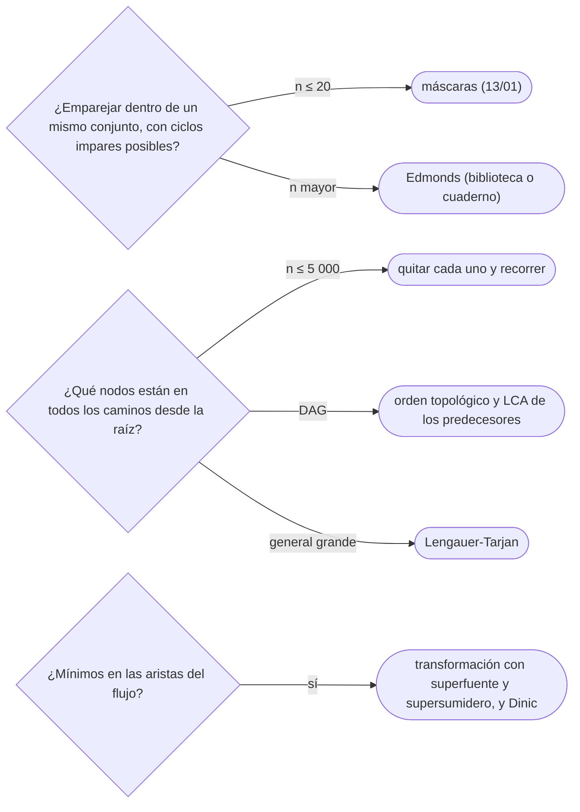

# 07 — Grafos de nivel experto

> Tres herramientas que se reconocen y se nombran, pero no se escriben de memoria: el emparejamiento en grafos
> generales con el algoritmo de las flores de Edmonds, el árbol de dominadores de un grafo dirigido y los
> flujos con cotas inferiores en las aristas. Para cada una, qué resuelve, qué garantiza, cuánto cuesta, cómo
> se reconoce y qué hacer si no se sabe.
>
> **Niveles:** Edmonds (*blossom*) [C] · dominadores [C] · cotas inferiores [C].
>
> **📚 Lectura troncal:** Tarjan, *Data Structures and Network Algorithms* (SIAM, 1983), caps. 8 y 9
> (flujos y emparejamientos); cp-algorithms, *Flows with demands*. cp-algorithms no tiene página de las
> flores ni de los dominadores: para esas dos, el libro de Tarjan y los artículos originales.
>
> **Asume leído:** [`15/06` — Emparejamientos](06-emparejamientos.md).
>
> **Vigencia:** 2026-10-04.

**Salto rápido:** [1](#1--el-problema) · [2](#2--la-teoría) · [3](#3--emparejamiento-general-edmonds) · [4](#4--árbol-de-dominadores) · [5](#5--flujo-con-cotas-inferiores) · [6](#6--cómo-se-elige) · [7](#7--señales-del-enunciado) · [🧠](#-preguntas) · [🧩](#-problemas-propios)

---

## 1. 🎯 El problema

Tres enunciados en los que la herramienta del capítulo anterior parece servir y no sirve.

- **Compañeros de habitación.** Cualquier par de estudiantes compatibles puede compartir cuarto: no hay dos
  bandos. El grafo no es bipartito, y Kuhn falla en cuanto hay un ciclo impar: el camino alternante puede
  volver sobre sí mismo por el lado equivocado.
- **Puntos de paso obligados.** En la red de un compilador o de una empresa, ¿qué nodos están en **todos**
  los caminos desde la entrada hasta cada nodo? Quitar cada nodo y recorrer cuesta `n · (n + m)`.
- **Mínimos por tubería.** Cada tubería debe llevar al menos `l` y como mucho `c`. El flujo de [`15/05`](05-flujo-maximo.md) solo
  sabe de máximos.

Cada uno tiene un algoritmo conocido, con garantías limpias; lo que se espera es reconocerlos y saber dónde
están, no escribirlos en una entrevista.

> 🧠 **Modelo mental.** Las tres son extensiones de algo ya sabido: Edmonds es Kuhn que sabe encoger los
> ciclos impares; los dominadores son los puntos de articulación de un dirigido con raíz; las cotas
> inferiores son flujo con un adelanto obligatorio que hay que cuadrar.

---

## 2. 📐 La teoría

**Teorema de Berge** (`15/06`): vale en cualquier grafo; lo que se complica fuera de los bipartitos es
**encontrar** el camino aumentante.

**Flores.** Una flor (*blossom*) es un ciclo impar de `2k + 1` vértices con `k` aristas del emparejamiento.
Edmonds demostró que, si se contrae la flor a un solo vértice, hay camino aumentante en el grafo contraído si
y solo si lo hay en el original. Contraer, buscar y expandir da un algoritmo polinómico.

**Fórmula de Tutte-Berge.** El tamaño del emparejamiento máximo es
`min_U ½ (n + |U| − odd(G − U))`, donde `odd` cuenta las componentes de tamaño impar. Con `U = ∅`, un grafo
con una componente impar no tiene emparejamiento perfecto.

**Dominadores.** En un dirigido con raíz `r`, `d` **domina** a `v` si todo camino de `r` a `v` pasa por `d`.
Cada `v ≠ r` alcanzable tiene un **dominador inmediato** (el más cercano a `v`), y los dominadores
inmediatos forman un árbol con raíz `r`: el **árbol de dominadores**. Los dominadores de `v` son sus
antecesores en ese árbol.

**Cotas inferiores.** Una arista `u → v` con `l ≤ f ≤ c` se reemplaza por capacidad `c − l` y una
«deuda»: `v` recibe `l` de más y `u` envía `l` de más. Con una superfuente que paga los excesos y un
supersumidero que cobra los déficits, existe un flujo factible si y solo si el flujo máximo de la
superfuente satura todas sus aristas. Para un flujo de `s` a `t` (no una circulación), se añade antes la
arista `t → s` con capacidad infinita.

---

## 3. 🧱 Emparejamiento general (Edmonds)

**Qué resuelve.** El emparejamiento máximo en un grafo **cualquiera**, con ciclos impares.

**Qué garantiza.** Exactitud por Berge y por el lema de contracción de las flores; `O(V³)` con la
implementación clásica, `O(V · E)` con una buena, y `O(E √V)` con Micali-Vazirani. Su versión con pesos
(emparejamiento de peso máximo en general) es `O(V³)` y bastante más larga.

**Cuánto.** `O(V³)`; con `V ≤ 500`, sin problemas.

**Cómo reconocerlo.** «Emparejar elementos de un mismo conjunto» (personas con personas, no personas con
tareas), y el grafo de compatibilidad puede tener triángulos.

**Si no te la sabes.** Con `n ≤ 20`, DP con máscaras: el menor vértice libre se empareja con alguno de sus
vecinos o se queda solo ([`13/01`](../13-dp-avanzada/01-mascaras-de-bits.md)), `O(2ⁿ · n)`. Con el grafo bipartito disfrazado (posiciones de un
tablero, paridad), Kuhn.

**Dónde está entera.** Tarjan, *Data Structures and Network Algorithms*, cap. 9; Edmonds, «Paths, Trees,
and Flowers» (1965).

---

## 4. 🧱 Árbol de dominadores

**Qué resuelve.** Para cada vértice de un dirigido con raíz, su dominador inmediato y, con el árbol, todos
sus dominadores y cuántos vértices domina cada uno.

**Qué garantiza.** El algoritmo de Lengauer-Tarjan lo calcula en `O(E · α(E, V))` con DFS, semidominadores y
un Union-Find especial. El algoritmo iterativo de Cooper, Harvey y Kennedy, más simple, es `O(V · E)` en el
peor caso y muy rápido en grafos de flujo de programas.

**Cuánto.** Casi lineal (Lengauer-Tarjan).

**Cómo reconocerlo.** «Nodos por los que pasa todo camino desde la entrada», «si quito este nodo, ¿a
cuántos ya no se llega?», análisis de flujo de control en compiladores (forma SSA). En un **DAG**, el
dominador inmediato de `v` es el LCA, en el árbol de dominadores ya construido, de todos sus predecesores:
en orden topológico, con LCA ([`07/05`](../07-arboles/05-lca.md)).

**Si no te la sabes.** Con `n ≤ 5 000`: para cada vértice `d`, quitarlo y recorrer desde la raíz; los que
dejan de alcanzarse son los dominados por `d`. `O(n · (n + m))`.

**Dónde está entera.** Lengauer y Tarjan, «A Fast Algorithm for Finding Dominators in a Flowgraph» (1979);
Cooper, Harvey y Kennedy, «A Simple, Fast Dominance Algorithm» (2001).

---

## 5. 🧱 Flujo con cotas inferiores

**Qué resuelve.** Circulaciones y flujos donde cada arista tiene un mínimo además de un máximo; con costes,
el flujo de coste mínimo con demandas (*b-flow*).

**Qué garantiza.** La transformación de §2 reduce la factibilidad a un flujo máximo; después, el máximo (o
el mínimo) flujo de `s` a `t` sobre la solución factible se obtiene con otro flujo en la residual.

**Cuánto.** Dos flujos máximos: lo que cueste Dinic (`15/05`) sobre la red transformada.

**Cómo reconocerlo.** «Al menos `l` y como mucho `c`», «cada tarea necesita entre `a` y `b` trabajadores»,
«cada fila suma entre…» (problemas de matrices con sumas acotadas), circulaciones con mínimos.

**Si no te la sabes.** Si todas las cotas inferiores son 0, es flujo normal; si son iguales a la capacidad
(aristas obligatorias), se fijan y se ajustan las demandas a mano.

**Dónde está entera.** Kleinberg y Tardos, §7.7 (circulaciones con demandas y cotas inferiores);
cp-algorithms, *Flows with demands*.

---

## 6. 🧭 Cómo se elige



> **Regla de entrevista:** si sale uno de estos tres, nombra el algoritmo y su coste, ofrece la alternativa
> que sí escribirías (máscaras, fuerza bruta acotada) y pregunta por las cotas. Eso es lo que se evalúa.

---

## 7. 🔎 Señales del enunciado

| Señal | Técnica | Por qué |
|---|---|---|
| «Formar parejas» sin dos bandos | Emparejamiento general | Ciclos impares |
| «Todo camino desde la entrada pasa por…» | Dominadores | Es la definición |
| «Si este nodo cae, ¿cuántos quedan inalcanzables?» | Tamaño del subárbol en el árbol de dominadores | Los dominados por `d` |
| «Entre `l` y `c` por arista», «al menos tantos por tarea» | Cotas inferiores | Flujo con demandas |

---

## ⚠️ Errores frecuentes

| Se dice | Lo preciso |
|---|---|
| «El emparejamiento general es como el bipartito» | Los ciclos impares rompen la búsqueda de Kuhn; hace falta contraer flores |
| «Un dominador es un punto de articulación» | Es una noción dirigida y con raíz; en no dirigidos se parece, pero no coincide |
| «Las cotas inferiores se resuelven restándolas a la capacidad y ya» | Hay que compensar las deudas con superfuente y supersumidero, y comprobar la saturación |
| «Si no es bipartito, el emparejamiento es NP-difícil» | Es polinómico (Edmonds); lo NP-difícil es, por ejemplo, la cobertura de vértices general |
| «El árbol de dominadores se saca con un DFS y sus tiempos» | El orden del DFS es solo el primer paso; Lengauer-Tarjan necesita además los semidominadores y un *union-find* con compresión |

---

## 📚 Para profundizar

- **Libro** — Tarjan, *Data Structures and Network Algorithms* (SIAM, 1983), caps. 8 y 9: flujos y
  emparejamientos, con el algoritmo de las flores. *Lectura troncal.*
- **Libro** — Kleinberg y Tardos, *Algorithm Design* (Addison-Wesley, 2005), §7.7: circulaciones con
  demandas y cotas inferiores.
- **Referencia** — cp-algorithms, [*Flows with demands*](https://cp-algorithms.com/graph/flow_with_demands.html).
  *Lectura troncal.*

---

## 🧠 Preguntas

1. ¿Por qué Kuhn no sirve en grafos que no son bipartitos? 🟢
2. ¿Qué es una flor en el algoritmo de Edmonds? 🟢
3. ¿Qué es un dominador y qué es el dominador inmediato? 🟢
4. ¿Cuánto cuestan Edmonds y Lengauer-Tarjan? 🟡
5. ¿Qué alternativa escribes en una entrevista si te piden emparejamiento general con `n ≤ 16`? 🟡
6. ¿Cómo calculas los dominadores en un DAG? 🟡
7. ¿Qué dice la fórmula de Tutte-Berge con `U = ∅`? 🟡
8. ¿Cómo se transforma una arista con cota inferior en un problema de flujo normal? 🟠
9. ¿Cómo compruebas que existe un flujo factible con cotas inferiores? 🟠
10. ¿Qué diferencia hay entre un dominador y un punto de articulación? 🟠
11. ¿Cómo cuentas, para cada nodo, a cuántos dejaría inalcanzables si cayera? 🔴
12. ¿Por qué contraer una flor no destruye los caminos aumentantes? 🔴

---

## 🧩 Problemas propios

### Compañeros de cuarto

**Nivel:** 🟡 · **Formato:** programa completo.

`n` estudiantes y `m` pares compatibles. Cada cuarto es para dos estudiantes compatibles. ¿Cuántos cuartos
dobles se pueden llenar como máximo?

- **Entrada.** Una línea con `n` y `m`. Después, `m` líneas con un par `u v`.
- **Salida.** Un entero.
- **Restricciones.** `1 ≤ n ≤ 18`; `0 ≤ m ≤ n(n − 1)/2`.

```text
Entrada     Salida
4 4         2
1 2
2 3
1 3
3 4

Entrada     Salida
5 5         2
1 2
2 3
3 4
4 5
5 1
```

**Pista 1:** con `n ≤ 18`, ¿qué decides para el estudiante de menor número que todavía no tiene cuarto?

### Paso obligado

**Nivel:** 🟠 · **Formato:** programa completo.

En un grafo dirigido, ¿cuántos vértices distintos de 1 y de `n` están en **todos** los caminos de 1 a `n`?
Imprime `-1` si `n` no es alcanzable desde 1.

- **Entrada.** Una línea con `n` y `m`. Después, `m` líneas con una arista `u v`.
- **Salida.** Un entero.
- **Restricciones.** `2 ≤ n ≤ 2 000`; `0 ≤ m ≤ 4 000`.

```text
Entrada     Salida
6 6         2
1 2
2 3
2 4
3 5
4 5
5 6

Entrada     Salida
3 1         -1
1 2
```

**Pista 1:** con estas cotas, ¿cuánto cuesta comprobar, para un vértice concreto, si quitarlo desconecta 1
de `n`?

---

## 🧩 Práctica externa

> 💡 **Truco.** Antes de buscar el algoritmo de Edmonds, comprueba si el grafo es bipartito disfrazado
> (paridad de posiciones, dos tipos de objetos): muchas veces lo es. Una IA puede ayudarte a verlo; pídele
> eso, no la implementación ([`01/06`](../01-oficio-del-competidor/06-protocolo-de-resolucion.md)). SPOJ no
> se enlaza (`403`).

Las bases no tienen problemas de estas técnicas; todo es 💀, por curiosidad.

### Por curiosidad

| ✔ | Problema | Plataforma | Nivel | Patrón | Pista 1 |
|---|---|---|---|---|---|
| [ ] | 💀 [Matching on General Graph](https://judge.yosupo.jp/problem/general_matching) | Library Checker | 🔴 | Edmonds | ¿Qué hace tu búsqueda cuando encuentra una arista entre dos vértices pares del mismo árbol? |
| [ ] | 💀 [Dominator Tree](https://judge.yosupo.jp/problem/dominatortree) | Library Checker | 🔴 | Lengauer-Tarjan | ¿Qué es el semidominador de un vértice? |
| [ ] | 💀 [Minimum Cost b-flow](https://judge.yosupo.jp/problem/min_cost_b_flow) | Library Checker | 🔴 | Coste mínimo con demandas y cotas | ¿Cómo conviertes las cotas inferiores en demandas de los vértices? |
| [ ] | 💀 [Team Rocket Rises Again](https://codeforces.com/problemset/problem/757/F) | Codeforces | 🔴 | Dominadores en el DAG de caminos mínimos | Después de Dijkstra, ¿qué aristas forman un DAG? |
| [ ] | 💀 [Incorrect Flow](https://codeforces.com/problemset/problem/708/D) | Codeforces | 🔴 | Coste mínimo con cotas inferiores | ¿Cuánto cuesta subir o bajar el flujo de una arista, según si supera la capacidad? |

---

## ✅ Criterio de dominio

- Explicar qué resuelve cada técnica, su garantía y su coste, sin escribirla.
- Dar la alternativa que sí escribirías: máscaras, fuerza bruta acotada o la transformación a flujo normal.
- Resolver Compañeros de cuarto y Paso obligado.

---

**Anterior:** [`15/06` — Emparejamientos](06-emparejamientos.md) · **Siguiente:** [`15/08` — Simulación](08-simulacion.md) ·
**Relacionado:** [`14/06` — Puentes, puntos de articulación y Euler](../14-grafos-recorridos/06-puentes-articulacion-y-euler.md).
