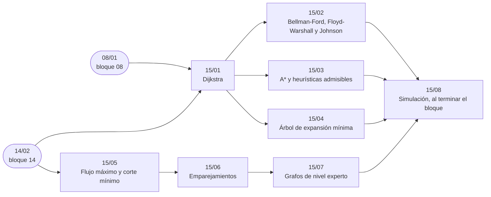

# Bloque 15 — Grafos con pesos y flujos

> Grafos con pesos y con capacidades: Dijkstra, Bellman-Ford, Floyd-Warshall y Johnson, A\* con sus
> heurísticas, el árbol de expansión mínima, el flujo máximo con el corte mínimo, los emparejamientos y, como
> fichas, los algoritmos de nivel experto. Una de las preguntas más frecuentes de todo el temario es por qué Dijkstra falla con pesos negativos.
>
> Las respuestas de las preguntas y las pistas 2 y 3 de los problemas, en [`09` — Respuestas](09-respuestas.md).
>
> **Vigencia:** 2026-10-04.

---

## 🧭 Índice

| Capítulo | Niveles | Ruta corta |
|---|---|---|
| [`15/01` — Dijkstra](01-dijkstra.md) | Dijkstra con montículo y perezoso [A] · sobre estados [A] |  |
| [`15/02` — Bellman-Ford, Floyd-Warshall y Johnson](02-bellman-ford-floyd-y-johnson.md) | Bellman-Ford [A] · Floyd-Warshall [A] · por qué no SPFA [B] · Johnson [C] |  |
| [`15/03` — A\* y heurísticas admisibles](03-a-estrella.md) | A\* [B]; IDA\* como ficha |  |
| [`15/04` — Árbol de expansión mínima](04-arbol-de-expansion-minima.md) | Kruskal [A] · Prim [A] · Borůvka [C] |  |
| [`15/05` — Flujo máximo y corte mínimo](05-flujo-maximo.md) | Ford-Fulkerson y Edmonds-Karp [B] · Dinic [B] |  |
| [`15/06` — Emparejamientos](06-emparejamientos.md) | Kuhn [B] · Hopcroft-Karp [B] · König [B] · coste mínimo y húngaro [C] |  |
| [`15/07` — Grafos de nivel experto](07-grafos-de-nivel-experto.md) | Edmonds (*blossom*) [C] · dominadores [C] · cotas inferiores [C] |  |
| [`15/08` — Simulación](08-simulacion.md) | El examen del bloque: preguntas transversales y problemas cronometrados | |
| [`15/09` — Respuestas](09-respuestas.md) | Las preguntas en tres capas y las pistas 2 y 3 | |

---

## 🧭 Orden de lectura

- `15/01` primero; los caminos mínimos (`15/02`, `15/03`) y el árbol de expansión (`15/04`) parten de él.
- El flujo (`15/05`) solo necesita BFS; `15/06` y `15/07` lo continúan.

---

## 🔎 Mapa de señales del bloque

| Señal | Técnica | Capítulo |
|---|---|---|
| «Tiempo / coste mínimo», pesos `≥ 0`, `n ≤ 2·10⁵` | Dijkstra con montículo | [`15/01`](01-dijkstra.md) |
| «Minimizar el máximo esfuerzo / la mayor altura del camino» | Dijkstra con `max` en lugar de `+` | [`15/01`](01-dijkstra.md) |
| «Reembolsos», «ganancias», pesos negativos | Bellman-Ford | [`15/02`](02-bellman-ford-floyd-y-johnson.md) |
| «¿Se puede ganar infinito?», «arbitraje» | Ciclo negativo (con `−log` de las tasas) | [`15/02`](02-bellman-ford-floyd-y-johnson.md) |
| «Camino más corto de `S` a `T`» en mapa o rejilla enorme | A\* con distancia geométrica | [`15/03`](03-a-estrella.md) |
| Puzzle de piezas deslizantes | A\* o IDA\* con Manhattan sumada | [`15/03`](03-a-estrella.md) |
| «Conectar todos con el menor coste» | MST | [`15/04`](04-arbol-de-expansion-minima.md) |
| «Minimizar el tramo más largo» de la red | MST (cuello de botella) | [`15/04`](04-arbol-de-expansion-minima.md) |
| «Máximo que se puede enviar», capacidades en las aristas | Flujo máximo | [`15/05`](05-flujo-maximo.md) |
| «Mínimo de enlaces / carreteras que cortar para separar» | Corte mínimo | [`15/05`](05-flujo-maximo.md) |
| «Cada uno con como mucho uno», dos grupos | Emparejamiento bipartito | [`15/06`](06-emparejamientos.md) |
| «Mínimo de filas y columnas que cubren las marcas» | König | [`15/06`](06-emparejamientos.md) |
| «Formar parejas» sin dos bandos | Emparejamiento general | [`15/07`](07-grafos-de-nivel-experto.md) |
| «Todo camino desde la entrada pasa por…» | Dominadores | [`15/07`](07-grafos-de-nivel-experto.md) |

---

## 📚 Lectura troncal del bloque

La de cada capítulo, que es también la primera entrada de su «Para profundizar»:

- **`15/01`** — Cormen, Leiserson, Rivest y Stein, *Introduction to Algorithms*, 3.ª ed. (MIT Press, 2009), §24.3; Brassard y Bratley, *Fundamentos de algoritmia* (Prentice Hall, 1997), cap. 6; Sedgewick y Wayne, *Algorithms*, 4.ª ed. (Addison-Wesley, 2011), §4.4.
- **`15/02`** — Cormen, Leiserson, Rivest y Stein, *Introduction to Algorithms*, 3.ª ed. (MIT Press, 2009), §24.1 y cap. 25; Brassard y Bratley, *Fundamentos de algoritmia* (Prentice Hall, 1997), cap. 8 (Floyd).
- **`15/03`** — Russell y Norvig, *Artificial Intelligence: A Modern Approach*, 4.ª ed. (Pearson, 2020), cap. 3 (§3.5 y §3.6); Brassard y Bratley, *Fundamentos de algoritmia* (Prentice Hall, 1997), cap. 13.
- **`15/04`** — Cormen, Leiserson, Rivest y Stein, *Introduction to Algorithms*, 3.ª ed. (MIT Press, 2009), cap. 23; Brassard y Bratley, *Fundamentos de algoritmia* (Prentice Hall, 1997), cap. 6; Kleinberg y Tardos, *Algorithm Design* (Addison-Wesley, 2005), §4.5.
- **`15/05`** — Cormen, Leiserson, Rivest y Stein, *Introduction to Algorithms*, 3.ª ed. (MIT Press, 2009), cap. 26; Kleinberg y Tardos, *Algorithm Design* (Addison-Wesley, 2005), cap. 7.
- **`15/06`** — Kleinberg y Tardos, *Algorithm Design* (Addison-Wesley, 2005), §7.5; Cormen, Leiserson, Rivest y Stein, *Introduction to Algorithms*, 3.ª ed. (MIT Press, 2009), §26.3.
- **`15/07`** — Tarjan, *Data Structures and Network Algorithms* (SIAM, 1983), caps. 8 y 9 (flujos y emparejamientos); cp-algorithms, *Flows with demands*. cp-algorithms no tiene página de las flores ni de los dominadores: para esas dos, el libro de Tarjan y los artículos originales.

---

## 🧭 Qué NO está aquí

- **Los recorridos sin pesos**: en el [bloque `14`](../14-grafos-recorridos/README.md).
- **El montículo que usa Dijkstra**: en [`08/01` — Montículo binario](../08-heaps-y-union-find/01-monticulo-binario.md).
- **Por qué el viajante y el ciclo hamiltoniano no tienen algoritmo polinomial conocido**: en el bloque opcional [`22`](../22-teoria-de-la-computacion/README.md).

---

**Anterior:** [Bloque 14 — Grafos: recorridos](../14-grafos-recorridos/README.md) ·
**Siguiente:** [Bloque 16 — Cadenas](../16-cadenas/README.md) ·
**Inicio:** [README del corpus](../README.md)
