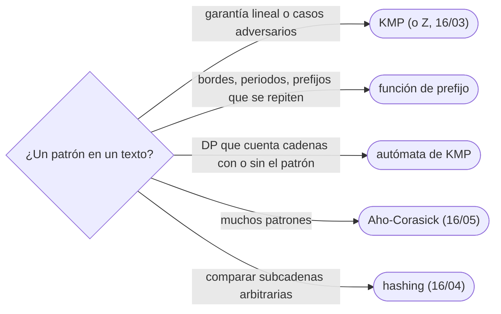

# 02 — KMP y la función de prefijo

> Buscar un patrón en un texto en `Θ(n + m)` sin volver nunca atrás en el texto: la función de prefijo
> —para cada posición, el borde más largo— calculada en tiempo lineal con un argumento de potencial, el
> algoritmo de Knuth-Morris-Pratt que la usa, y el autómata que resulta de llevarla a una tabla de
> transiciones, base de las DP que cuentan cadenas que contienen (o evitan) un patrón.
>
> **Niveles:** función de prefijo [A] · KMP [A] · autómata de KMP [B].
>
> **📚 Lectura troncal:** Cormen, Leiserson, Rivest y Stein, *Introduction to Algorithms*, 3.ª ed. (MIT
> Press, 2009), §32.3 y §32.4; Sedgewick y Wayne, *Algorithms*, 4.ª ed. (Addison-Wesley, 2011), §5.3.
>
> **Asume leído:** [`16/01` — Cadenas en los tres lenguajes y patrones básicos](01-cadenas-y-patrones-basicos.md).
>
> **Vigencia:** 2026-10-04.

**Salto rápido:** [1](#1--el-problema) · [2](#2--la-teoría) · [3](#3--función-de-prefijo) · [4](#4--kmp) · [5](#5--autómata-de-kmp) · [6](#6-️-la-tabla-de-costes) · [7](#7--cómo-se-elige) · [8](#8--señales-del-enunciado) · [🧠](#-preguntas) · [🧩](#-problemas-propios)

---

## 1. 🎯 El problema

Buscar el patrón `aaaab` en un texto de `10⁶` aes con la búsqueda ingenua —probar cada posición y comparar
hasta el primer fallo— compara 5 caracteres en cada una de las `10⁶` posiciones; con un patrón de `10⁵`
aes y una `b`, son `10¹¹` comparaciones. `indexOf` de Java y `find` de C++ hacen esa búsqueda ingenua (con
trucos que no cambian el peor caso). El problema es que, tras un fallo, la búsqueda ingenua **olvida** lo
que ya leyó y vuelve a empezar una posición más allá.

KMP no olvida: cuando falla tras leer `j` caracteres del patrón, sabe —por la función de prefijo— cuál es el
prefijo más largo del patrón que sigue coincidiendo con lo leído, y continúa desde ahí sin retroceder en el
texto. Resultado: `Θ(n + m)` siempre.

> 🧠 **Modelo mental.** Leer el texto con el dedo sin levantarlo nunca: si el patrón deja de encajar, no
> vuelves atrás con el dedo; deslizas el patrón hasta el mayor prefijo que todavía encaja con lo que tienes
> bajo él.

Los ejemplos usan la cadena de juguete: texto `"abracadabra"`, patrón `"abra"`, que aparece en 0 y en 7.

---

## 2. 📐 La teoría

**Borde.** Un borde de `s` es una cadena que es a la vez prefijo propio y sufijo propio de `s`. Los bordes de
`abracadabra` son `abra` y `a`.

**Función de prefijo.** `π[i]` es la longitud del borde más largo de `s[0..i]`. Para `abracadabra`:

```text
i:   0 1 2 3 4 5 6 7 8 9 10
s:   a b r a c a d a b r a
π:   0 0 0 1 0 1 0 1 2 3 4
```

**La recurrencia.** Los bordes de `s[0..i]` se obtienen extendiendo bordes de `s[0..i−1]`: si el borde de
longitud `k` se puede extender (`s[i] = s[k]`), queda uno de `k + 1`. Y los bordes de `s[0..i−1]`, de mayor a
menor, son `π[i−1]`, `π[π[i−1] − 1]`, …: el borde de un borde es un borde. Así que se prueba con `k = π[i−1]`
y, si falla, se baja a `k = π[k − 1]`.

**Por qué es lineal (potencial).** Sea `k` el valor actual. En cada `i`, `k` sube como mucho 1; cada
iteración del `while` lo baja al menos 1, y nunca baja de 0. Las bajadas totales no superan las subidas
totales, que son como mucho `n`: `Θ(n)` en total.

**Búsqueda.** El patrón `p` aparece terminando en la posición `i` del texto si y solo si, en la cadena
`p + '#' + t` (con `#` fuera del alfabeto), `π` vale `|p|` en la posición correspondiente. O, sin
concatenar, recorriendo `t` con el estado `k` (cuánto del patrón encaja) y la misma regla de retroceso.

**Periodo.** `s` tiene periodo `p` (`s[i] = s[i + p]` para todo `i`) si y solo si tiene un borde de longitud
`n − p`. El periodo más corto es `n − π[n − 1]`. En `abracadabra`, `11 − 4 = 7`.

**El autómata.** KMP es un autómata finito disfrazado: estado = cuánto del patrón encaja; transición con el
carácter `c` = el borde más largo de (lo que encajaba + `c`). Precomputando la tabla `δ[estado][c]` se tiene
el autómata de cadenas de CLRS §32.3, con una transición `O(1)` por carácter sin retrocesos.

---

## 3. 🧱 Función de prefijo

**Qué es.** El arreglo `π` de §2, calculado en una pasada.

**Por qué es correcto.** La recurrencia de los bordes: el borde de `s[0..i]` es un borde de `s[0..i−1]`
extendido, y la cadena `π[i−1], π[π[i−1]−1], …` enumera todos los bordes de `s[0..i−1]` de mayor a menor.

**Cómo va**, en `abracadabra`, las posiciones interesantes:

```text
i=3  s[3]=a  k=π[2]=0, s[0]=a coincide → π[3]=1
i=4  s[4]=c  k=1: s[1]=b ≠ c → k=π[0]=0: s[0]=a ≠ c → π[4]=0
i=8  s[8]=b  k=π[7]=1: s[1]=b coincide → π[8]=2
i=10 s[10]=a k=π[9]=3: s[3]=a coincide → π[10]=4   (borde «abra»)
```

**Cuánto.** `Θ(n)` tiempo y memoria.

**La plantilla:**

```cpp
#include <string>
#include <vector>

// pi[i] = longitud del borde más largo de s[0..i].
std::vector<int> prefixFunction(const std::string& s) {
    int n = s.size();
    std::vector<int> pi(n, 0);
    for (int i = 1; i < n; i++) {
        int k = pi[i - 1];
        while (k > 0 && s[i] != s[k]) k = pi[k - 1];     // bajar al siguiente borde
        if (s[i] == s[k]) k++;
        pi[i] = k;
    }
    return pi;
}
```

```java
static int[] prefixFunction(String s) {
    int n = s.length();
    int[] pi = new int[n];
    for (int i = 1; i < n; i++) {
        int k = pi[i - 1];
        while (k > 0 && s.charAt(i) != s.charAt(k)) k = pi[k - 1];
        if (s.charAt(i) == s.charAt(k)) k++;
        pi[i] = k;
    }
    return pi;
}
```

```python
def prefix_function(s):
    """pi[i] = longitud del borde más largo de s[0..i]."""
    n = len(s)
    pi = [0] * n
    for i in range(1, n):
        k = pi[i - 1]
        while k and s[i] != s[k]:
            k = pi[k - 1]
        if s[i] == s[k]:
            k += 1
        pi[i] = k
    return pi
```

- **`π[k − 1]`, no `π[k]`**: el siguiente borde de un prefijo de longitud `k` es `π[k − 1]` (índice del
  último carácter de ese prefijo). Es el error de índice clásico.
- **En Java**, con `10⁶` caracteres, `s.toCharArray()` una vez y el arreglo en el bucle es más rápido que
  `charAt`.
- **En Python**, el bucle sobre `10⁶` caracteres tarda del orden de un segundo; sobre `bytes` con índices
  enteros, algo menos.
- **Todos los bordes** de `s`: `π[n−1]`, `π[π[n−1]−1]`, … hasta 0.

### De la versión ingenua a la buena

**El problema.** ¿Cuál es el borde más largo de una cadena de `10⁶` caracteres?

**La versión ingenua:**

```java
// Correcta: probar cada longitud de mayor a menor y comparar prefijo con sufijo. Θ(n²) en el peor caso.
static int longestBorderNaive(String s) {
    int n = s.length();
    for (int len = n - 1; len > 0; len--)
        if (s.regionMatches(0, s, n - len, len)) return len;
    return 0;
}
```

> «Con `aaaa…ab` cada comparación llega casi al final antes de fallar: `n²/2`. La función de prefijo
> construye los bordes de cada prefijo a partir de los del anterior, y el último valor es justo el borde
> que busco: `π[n − 1]`, en lineal.»

**El camino a la buena.** `prefixFunction(s)[n − 1]`: `Θ(n)`.

**Cuándo sí:** bordes, periodos, cuántas veces aparece cada prefijo, compresión de una cadena por su
periodo. **Cuándo no:** si lo que se quiere es comparar con el prefijo **en cada posición** (no solo el
borde que termina ahí): eso es la función Z ([`16/03`](03-funcion-z-y-manacher.md)).

> **Veredicto:** la función de prefijo da el borde más largo de cada prefijo en lineal; el retroceso
> `k = π[k − 1]` recorre los bordes, y el potencial de `k` acota el total.

---

## 4. 🧱 KMP

**Qué es.** Recorrer el texto con un estado `k` (caracteres del patrón que encajan): si el siguiente
carácter coincide, `k` sube; si no, `k = π[k − 1]` hasta que coincida o llegue a 0. Cuando `k = m`, hay una
aparición terminando ahí, y se sigue con `k = π[m − 1]`.

**Por qué es correcto.** El estado `k` es siempre el sufijo más largo de lo leído que es prefijo del
patrón: lo que hace la función de prefijo sobre `p + '#' + t`, sin concatenar.

**Cómo va**, patrón `abra` (`π = 0 0 0 1`) sobre `abracadabra`:

```text
i:      0 1 2 3 4 5 6 7 8 9 10
t:      a b r a c a d a b r a
k:      1 2 3 4 0 1 0 1 2 3 4
                ↑ k = 4: aparición en 3 − 4 + 1 = 0          ↑ aparición en 7
tras cada aparición, k = π[3] = 1 (la «a» final puede empezar otra)
```

**Cuánto.** `Θ(n + m)`: `Θ(m)` la función de prefijo y `Θ(n)` el recorrido, por el mismo potencial.

**La plantilla:**

```cpp
#include <string>
#include <vector>

std::vector<int> prefixFunction(const std::string& s);   // la de §3

// Posiciones de inicio de todas las apariciones (solapadas) de p en t.
std::vector<int> kmpSearch(const std::string& t, const std::string& p) {
    std::vector<int> pi = prefixFunction(p), found;
    int m = p.size(), k = 0;
    for (int i = 0; i < (int)t.size(); i++) {
        while (k > 0 && t[i] != p[k]) k = pi[k - 1];
        if (t[i] == p[k]) k++;
        if (k == m) { found.push_back(i - m + 1); k = pi[k - 1]; }   // seguir buscando solapadas
    }
    return found;
}
```

```java
static java.util.List<Integer> kmpSearch(String t, String p) {
    int[] pi = prefixFunction(p);
    java.util.List<Integer> found = new java.util.ArrayList<>();
    int m = p.length(), k = 0;
    for (int i = 0; i < t.length(); i++) {
        while (k > 0 && t.charAt(i) != p.charAt(k)) k = pi[k - 1];
        if (t.charAt(i) == p.charAt(k)) k++;
        if (k == m) { found.add(i - m + 1); k = pi[k - 1]; }
    }
    return found;
}
```

```python
def kmp_search(t, p):
    """Posiciones de inicio de las apariciones (solapadas) de p en t."""
    pi = prefix_function(p)
    found, k, m = [], 0, len(p)
    for i, ch in enumerate(t):
        while k and ch != p[k]:
            k = pi[k - 1]
        if ch == p[k]:
            k += 1
        if k == m:
            found.append(i - m + 1)
            k = pi[k - 1]
    return found
```

- **Solapadas o no**: tras una aparición, `k = π[m − 1]` permite solapamientos; para contarlas sin solapar,
  `k = 0`.
- **El truco del separador**: `prefixFunction(p + '#' + t)` y buscar los `π = m`; más corto de escribir,
  con `m + n + 1` de memoria.
- **El estado final** `k` al acabar el texto es el prefijo más largo del patrón que es sufijo del texto.
- **`indexOf`, `find`, `in`** son ingenuos en el peor caso (CPython usa una mezcla de Boyer-Moore y
  *two-way* que suele ir bien, pero no da la garantía de KMP en todas las versiones).

### De la versión ingenua a la buena

**El problema.** ¿Es `b` una rotación de `a` (`a = xy` y `b = yx`)? Con `|a| = |b| = 10⁵`.

**La versión ingenua:** probar las `n` rotaciones de `a` y comparar cada una con `b`. Correcta, `Θ(n²)`.

> «Toda rotación de `a` aparece como subcadena de `a + a`, y solo ellas tienen longitud `n`. Así que la
> pregunta es si `b` aparece en `a + a`: una búsqueda KMP, lineal.»

**El camino a la buena.** `|a| = |b|` y `kmpSearch(a + a, b)` no vacío: `Θ(n)`.

**Cuándo sí:** buscar un patrón con garantía lineal; contar apariciones solapadas; problemas que se reducen a
«¿aparece `x` en `y`?». **Cuándo no:** muchos patrones a la vez (Aho-Corasick, [`16/05`](05-aho-corasick.md)); comparar subcadenas
arbitrarias entre sí (*hashing*, [`16/04`](04-hashing-de-cadenas.md)); comodines.

> **Veredicto:** KMP es la función de prefijo aplicada al texto: un estado que nunca retrocede en el texto
> y `Θ(n + m)` garantizado.

---

## 5. 🧱 Autómata de KMP

**Qué es.** La tabla `δ[q][c]`, para cada estado `q ∈ [0, m]` y cada carácter `c` del alfabeto: el estado
siguiente. Se calcula en `Θ(m · σ)` con la función de prefijo: si `p[q] = c`, `q + 1`; si no, `δ[π[q−1]][c]`
(y `0` desde el estado 0).

**Por qué es correcto.** Es la misma transición que el bucle `while` de KMP, precomputada: `δ[π[q−1]][c]` ya
contiene el resultado de seguir bajando por los bordes.

**Cómo va**, para `abra` sobre el alfabeto `{a, b, c, d, r}` (las columnas que no salen son 0):

```text
estado   a  b  r      el estado 4 es «aparición completa»
0        1  0  0
1        1  2  0
2        1  0  3
3        4  0  0
4        1  2  0      desde 4 con «b» se va a 2: «ab» es el borde de «abra» + «b»
```

**Cuánto.** `Θ(m · σ)` construir; `Θ(1)` por carácter al recorrer.

**La plantilla:**

```cpp
#include <array>
#include <string>
#include <vector>

std::vector<int> prefixFunction(const std::string& s);   // la de §3

// Autómata de KMP sobre minúsculas: delta[q][c] para q en [0, m].
std::vector<std::array<int, 26>> kmpAutomaton(const std::string& p) {
    int m = p.size();
    std::vector<int> pi = prefixFunction(p);
    std::vector<std::array<int, 26>> delta(m + 1);
    for (int q = 0; q <= m; q++)
        for (int c = 0; c < 26; c++) {
            if (q < m && p[q] - 'a' == c) delta[q][c] = q + 1;
            else delta[q][c] = q == 0 ? 0 : delta[pi[q - 1]][c];
        }
    return delta;
}
```

```java
static int[][] kmpAutomaton(String p) {
    int m = p.length();
    int[] pi = prefixFunction(p);
    int[][] delta = new int[m + 1][26];
    for (int q = 0; q <= m; q++)
        for (int c = 0; c < 26; c++) {
            if (q < m && p.charAt(q) - 'a' == c) delta[q][c] = q + 1;
            else delta[q][c] = q == 0 ? 0 : delta[pi[q - 1]][c];
        }
    return delta;
}
```

- **La DP que lo usa**: «¿cuántas cadenas de longitud `n` contienen (o evitan) `p`?» es una DP sobre
  `(posición, estado)` con las transiciones de `δ`: `Θ(n · m · σ)`.
- **Varios patrones** generalizan este autómata a Aho-Corasick (`16/05`).

**Cuándo sí:** DP sobre cadenas con un patrón prohibido u obligatorio; recorrer textos enormes con `O(1)`
estricto por carácter. **Cuándo no:** alfabetos grandes (la tabla es `m · σ`): KMP con el `while`.

> **Veredicto:** el autómata de KMP es la función de prefijo convertida en tabla; su sitio natural es la
> DP sobre `(posición, estado)`.

---

## 6. ⏱️ La tabla de costes

| Técnica | Preproceso | Búsqueda | Memoria | Lo que la tabla no dice |
|---|---|---|---|---|
| Búsqueda ingenua (`indexOf`, `find`) | — | `Θ(n · m)` peor caso | `Θ(1)` | Rápida en textos «normales» |
| Función de prefijo | `Θ(m)` | — | `Θ(m)` | Bordes y periodos |
| KMP | `Θ(m)` | `Θ(n)` | `Θ(m)` | Nunca retrocede en el texto |
| Autómata de KMP | `Θ(m · σ)` | `Θ(n)`, `O(1)` estricto | `Θ(m · σ)` | La base de las DP con patrón |

---

## 7. 🧭 Cómo se elige



> **Regla de entrevista:** si te piden buscar un patrón, di primero el coste de `indexOf` en el peor caso
> y después ofrece KMP: «la búsqueda de la biblioteca puede ser `n · m`; KMP es `n + m`».

---

## 8. 🔎 Señales del enunciado

| Señal | Técnica | Por qué |
|---|---|---|
| «Todas las apariciones», `n, m ≤ 10⁶` | KMP | Garantía lineal |
| «Prefijo que también es sufijo» | Función de prefijo | Es un borde |
| «La cadena es repetición de un trozo», «periodo» | `n − π[n − 1]` | Periodo y borde |
| «Rotación», «cíclico» | Buscar en `a + a` | Toda rotación está en la doble |
| «Cuántas cadenas de longitud `n` contienen `p`» | Autómata y DP | Estado = cuánto del patrón encaja |

---

## ⚠️ Errores frecuentes

| Se dice | Lo preciso |
|---|---|
| «`indexOf` es `O(n)`» | Es `O(n · m)` en el peor caso; solo KMP, Z o similares garantizan `Θ(n + m)` |
| «El `while` dentro del `for` hace la función de prefijo cuadrática» | El potencial de `k` acota todas las bajadas por `n`: es lineal |
| «Tras una aparición se reinicia `k = 0`» | Eso pierde las solapadas; `k = π[m − 1]` las cuenta |
| «El siguiente borde es `π[k]`» | Es `π[k − 1]`: el índice del último carácter del prefijo de longitud `k` |
| «El periodo más corto siempre divide a `n`» | `abracadabra` tiene periodo 7; divide a `n` solo si la cadena es repetición exacta |

---

## 📚 Para profundizar

- **Libro** — Cormen, Leiserson, Rivest y Stein, *Introduction to Algorithms*, 3.ª ed. (MIT Press, 2009),
  §32.4: KMP con el análisis amortizado; §32.3, el autómata. *Lectura troncal.*
- **Libro** — Sedgewick y Wayne, *Algorithms*, 4.ª ed. (Addison-Wesley, 2011), §5.3: búsqueda de subcadenas,
  con KMP como autómata. *Lectura troncal.*
- **Referencia** — cp-algorithms, [*Prefix function. Knuth–Morris–Pratt algorithm*](https://cp-algorithms.com/string/prefix-function.html).
- **Referencia** — Sedgewick y Wayne, [código de `KMP.java`](https://algs4.cs.princeton.edu/53substring/KMP.java.html).

---

## 🧠 Preguntas

1. ¿Qué es un borde y qué guarda la función de prefijo? 🟢
2. ¿Cuánto cuesta la búsqueda ingenua en el peor caso, y con qué entrada se alcanza? 🟢
3. ¿Cómo se obtiene el periodo más corto de una cadena con la función de prefijo? 🟢
4. ¿Por qué el siguiente borde a probar es `π[k − 1]`? 🟡
5. ¿Cómo cuentas las apariciones solapadas y las no solapadas? 🟡
6. ¿Qué es el truco del separador `p + '#' + t`? 🟡
7. ¿Qué hacen `indexOf`, `find` y `in` en el peor caso? 🟡
8. Demuestra que la función de prefijo se calcula en tiempo lineal. 🟠
9. Demuestra que los bordes de `s` son `π[n−1]`, `π[π[n−1]−1]`, … 🟠
10. ¿Cómo compruebas si `b` es una rotación de `a` en lineal? 🟠
11. ¿Cómo se construye el autómata de KMP y para qué DP sirve? 🟠
12. ¿Cómo calculas cuántas veces aparece cada prefijo de `s` dentro de `s`? 🔴
13. ¿Qué relación hay entre tener periodo `p` y tener un borde de longitud `n − p`? Demuéstrala. 🔴

---

## 🧩 Problemas propios

### Sin solaparse

**Nivel:** 🟢 · **Formato:** programa completo.

¿Cuántas apariciones **no solapadas** de `p` se pueden marcar en `t`, como máximo?

- **Entrada.** Una línea con `t` y otra con `p`.
- **Salida.** Un entero.
- **Restricciones.** `1 ≤ |p| ≤ |t| ≤ 10⁶`; minúsculas.

```text
Entrada         Salida
abracadabra     2
abra

Entrada         Salida
aaaaa           2
aa
```

**Pista 1:** si marcas una aparición en cuanto la encuentras, ¿desde qué estado tienes que seguir?

### Encaje final

**Nivel:** 🟡 · **Formato:** programa completo.

Imprime la longitud del prefijo más largo de `p` que es sufijo de `t`.

- **Entrada.** Una línea con `t` y otra con `p`.
- **Salida.** Un entero.
- **Restricciones.** `1 ≤ |t|, |p| ≤ 10⁶`; minúsculas.

```text
Entrada         Salida
abracadabra     4
abrazo

Entrada         Salida
ababab          6
abababx
```

**Pista 1:** al terminar de recorrer `t` con KMP, ¿qué significa el estado `k`?

### Cada prefijo, cuántas veces

**Nivel:** 🟠 · **Formato:** programa completo.

Para cada `i` de 1 a `n`, imprime cuántas veces aparece el prefijo de longitud `i` de `s` dentro de `s`
(apariciones solapadas).

- **Entrada.** Una línea con `s`.
- **Salida.** `n` enteros separados por espacios.
- **Restricciones.** `1 ≤ |s| ≤ 10⁶`; minúsculas.

```text
Entrada         Salida
abracadabra     5 2 2 2 1 1 1 1 1 1 1

Entrada         Salida
aaaa            4 3 2 1
```

**Pista 1:** si el prefijo de longitud `k` termina en la posición `i`, ¿qué otros prefijos terminan
también ahí?

---

## 🧩 Práctica externa

> 💡 **Truco.** Antes de pedir ayuda con un KMP que da WA, imprime `π` del patrón y compáralo a mano con
> la definición en un ejemplo pequeño: casi siempre es un índice (`π[k]` en vez de `π[k − 1]`). Si una IA
> te ayuda, que sea a encontrar ese índice ([`01/06`](../01-oficio-del-competidor/06-protocolo-de-resolucion.md)).

### Núcleo

| ✔ | Problema | Plataforma | Nivel | Patrón | Pista 1 |
|---|---|---|---|---|---|
| [ ] | [Repeated Substring Pattern](https://leetcode.com/problems/repeated-substring-pattern/) | LeetCode | 🟢 | Periodo que divide a `n` | ¿Qué condición sobre el periodo más corto hace falta? |
| [ ] | [String Matching](https://open.kattis.com/problems/stringmatching) | Kattis | 🟡 | KMP con todas las apariciones | ¿Cuántos casos hay por entrada y cómo lees hasta el final? |
| [ ] | [Power Strings](https://open.kattis.com/problems/powerstrings) | Kattis | 🟡 | Periodo | ¿Cuántas veces cabe el periodo más corto si divide a `n`? |
| [ ] | [Repeated String Match](https://leetcode.com/problems/repeated-string-match/) | LeetCode | 🟡 | Búsqueda en repeticiones | ¿Cuántas copias de `a` bastan como mucho para contener `b`? |
| [ ] | [Form Array by Concatenating Subarrays of Another Array](https://leetcode.com/problems/form-array-by-concatenating-subarrays-of-another-array/) | LeetCode | 🟡 | KMP sobre arreglos | ¿Puedes buscar cada grupo empezando donde terminó el anterior? |
| [ ] | [Shortest Palindrome](https://leetcode.com/problems/shortest-palindrome/) | LeetCode | 🔴 | Función de prefijo sobre `s#inversa` | ¿Qué prefijo de `s` es el palíndromo más largo? |

### Ampliación

| ✔ | Problema | Plataforma | Nivel | Patrón | Pista 1 |
|---|---|---|---|---|---|
| [ ] | [Camp Schedule](https://codeforces.com/problemset/problem/1137/B) | Codeforces | 🟠 | Periodo y voraz | Tras colocar `t` una vez, ¿cuánto hay que añadir para la siguiente aparición? |
| [ ] | [MUH and Cube Walls](https://codeforces.com/problemset/problem/471/D) | Codeforces | 🟠 | KMP sobre diferencias | Si se puede subir o bajar el muro entero, ¿qué se conserva? |
| [ ] | [Password](https://codeforces.com/problemset/problem/126/B) | Codeforces | 🟠 | Bordes y apariciones interiores | ¿Qué bordes aparecen también en medio de la cadena? |
| [ ] | [Minimum Time to Revert Word to Initial State II](https://leetcode.com/problems/minimum-time-to-revert-word-to-initial-state-ii/) | LeetCode | 🔴 | Bordes de longitud `n − k · t` | ¿Qué tiene que cumplir el sufijo que queda tras quitar `k · t` caracteres? |
| [ ] | [Required Substring](https://cses.fi/problemset/task/1112) | CSES | 🔴 | Autómata y DP | ¿Cuántas cadenas **evitan** el patrón, y qué estado necesitas? |

---

## ✅ Criterio de dominio

- Escribir la función de prefijo y KMP en los tres lenguajes sin mirar, con los índices bien.
- Demostrar la linealidad por potencial y la cadena de bordes.
- Obtener periodos, bordes y rotaciones con la función de prefijo.
- Construir el autómata de KMP y plantear la DP de cadenas que evitan un patrón.
- Resolver Shortest Palindrome y Password sin pista 2.

---

**Anterior:** [`16/01` — Cadenas en los tres lenguajes y patrones básicos](01-cadenas-y-patrones-basicos.md) ·
**Siguiente:** [`16/03` — Función Z y Manacher](03-funcion-z-y-manacher.md) · **Relacionado:** [`16/05` — Aho-Corasick](05-aho-corasick.md).
