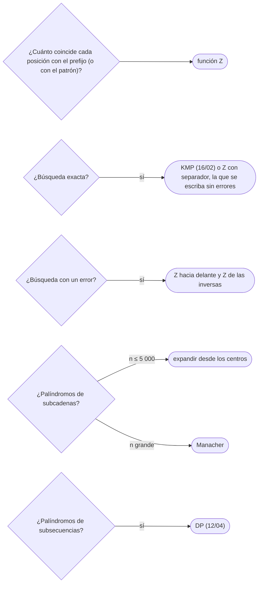

# 03 — Función Z y Manacher

> Dos algoritmos lineales con la misma idea —una «caja» ya conocida que permite no volver a comparar lo que
> ya se comparó—: la función Z, que da para cada posición cuánto coincide con el prefijo, y el algoritmo de
> Manacher, que da para cada centro el palíndromo más largo. Con el truco del separador, la relación entre Z
> y la función de prefijo, y por qué el palíndromo más largo no exige `n²`.
>
> **Niveles:** función Z [B] · Manacher [B].
>
> **📚 Lectura troncal:** Gusfield, *Algorithms on Strings, Trees and Sequences* (Cambridge, 1997), cap. 1
> (la función Z); cp-algorithms, [*Manacher's Algorithm*](https://cp-algorithms.com/string/manacher.html).
>
> **Asume leído:** [`16/02` — KMP y la función de prefijo](02-kmp.md).
>
> **Vigencia:** 2026-10-04.

**Salto rápido:** [1](#1--el-problema) · [2](#2--la-teoría) · [3](#3--función-z) · [4](#4--manacher) · [5](#5-️-la-tabla-de-costes) · [6](#6--cómo-se-elige) · [7](#7--señales-del-enunciado) · [🧠](#-preguntas) · [🧩](#-problemas-propios)

---

## 1. 🎯 El problema

Dos preguntas sobre una cadena de `10⁶` caracteres. La primera: ¿en qué posiciones aparece un patrón con
**como mucho un error**? KMP busca coincidencias exactas; lo que hace falta es saber, en cada posición,
cuánto coincide desde el principio y cuánto desde el final. La segunda: ¿cuál es su subcadena palindrómica
más larga? Expandir desde cada uno de los `2n − 1` centros es `Θ(n²)`: `10¹²` en el peor caso (una cadena de
una sola letra).

Los dos algoritmos de este capítulo resuelven cada pregunta en `Θ(n)` con el mismo truco: mantener el
intervalo más a la derecha ya verificado y, dentro de él, copiar la respuesta de una posición simétrica en
lugar de recalcularla.

> 🧠 **Modelo mental.** Una caja de cristal que ya has comprobado: lo que hay dentro es una copia de algo
> que ya conoces (el prefijo, en Z; la mitad simétrica del palíndromo, en Manacher). Solo hay que comparar
> lo que asoma por fuera de la caja.

Los ejemplos usan la cadena de juguete `"abracadabra"` y el patrón `"abra"`.

---

## 2. 📐 La teoría

**Función Z.** `Z[i]` es la longitud del prefijo común más largo entre `s` y `s[i..]`. Por convenio,
`Z[0] = 0` (o `n`). Para `abracadabra`:

```text
i:  0 1 2 3 4 5 6 7 8 9 10
s:  a b r a c a d a b r a
Z:  0 0 0 1 0 1 0 4 0 0 1        Z[7] = 4: «abra» empieza en 7
```

**La caja `[l, r)`.** El segmento más a la derecha hallado hasta ahora que coincide con un prefijo:
`s[l..r) = s[0..r−l)`. Para `i < r`, `s[i..r)` es copia de `s[i−l..r−l)`, así que `Z[i] ≥ min(r − i, Z[i − l])`;
solo hace falta comparar a partir de `r`. Cada comparación con éxito empuja `r` hacia la derecha, y `r` no
retrocede: `Θ(n)` en total.

**Z y la función de prefijo.** Llevan la misma información: una se convierte en la otra en lineal. `π`
mira hacia atrás (el borde que **termina** en `i`); `Z`, hacia delante (lo que **empieza** en `i`).

**Búsqueda con separador.** `Z` de `p + '#' + t`: las posiciones de `t` con `Z = |p|` son apariciones.
Con la `Z` de las inversas se obtiene también cuánto coincide **hacia atrás**: es la base de las
coincidencias con errores.

**Manacher.** Para cada centro, el radio del palíndromo más largo. Con el truco de intercalar un separador
(`#a#b#r#a#…#`), los palíndromos pares e impares se tratan igual. La caja es el palíndromo conocido que
llega más a la derecha, `[l, r]`: para `i` dentro de ella, su simétrico `l + r − i` ya tiene radio
calculado, y el de `i` es al menos `min(radio simétrico, r − i + 1)`. Solo se expande fuera de la caja, y
`r` solo avanza: `Θ(n)`.

---

## 3. 🧱 Función Z

**Qué es.** El arreglo `Z` con la caja `[l, r)`.

**Por qué es correcto.** Dentro de la caja, `s[i..r)` es copia de `s[i−l..r−l)`, y `Z[i − l]` dice cuánto de
eso coincide con el prefijo; solo lo que pasa de `r` está por comprobar. Lineal porque `r` solo avanza.

**Cómo va**, en `abracadabra`, la posición interesante:

```text
i=7: fuera de la caja → compara desde 0: a=a, b=b, r=r, a=a, fin → Z[7]=4, caja [7, 11)
i=10: dentro de la caja; simétrico 10−7=3 con Z[3]=1, r−i=1 → Z[10] ≥ 1; no hay más texto → Z[10]=1
```

**Cuánto.** `Θ(n)` tiempo y memoria.

**La plantilla:**

```cpp
#include <algorithm>
#include <string>
#include <vector>

// z[i] = prefijo común más largo de s y s[i..]; z[0] = 0 por convenio.
std::vector<int> zFunction(const std::string& s) {
    int n = s.size();
    std::vector<int> z(n, 0);
    for (int i = 1, l = 0, r = 0; i < n; i++) {
        if (i < r) z[i] = std::min(r - i, z[i - l]);        // copia desde la caja
        while (i + z[i] < n && s[z[i]] == s[i + z[i]]) z[i]++;
        if (i + z[i] > r) { l = i; r = i + z[i]; }          // la caja avanza
    }
    return z;
}
```

```java
static int[] zFunction(String s) {
    int n = s.length();
    int[] z = new int[n];
    for (int i = 1, l = 0, r = 0; i < n; i++) {
        if (i < r) z[i] = Math.min(r - i, z[i - l]);
        while (i + z[i] < n && s.charAt(z[i]) == s.charAt(i + z[i])) z[i]++;
        if (i + z[i] > r) { l = i; r = i + z[i]; }
    }
    return z;
}
```

```python
def z_function(s):
    """z[i] = prefijo común más largo de s y s[i:]; z[0] = 0."""
    n = len(s)
    z = [0] * n
    l = r = 0
    for i in range(1, n):
        if i < r:
            z[i] = min(r - i, z[i - l])
        while i + z[i] < n and s[z[i]] == s[i + z[i]]:
            z[i] += 1
        if i + z[i] > r:
            l, r = i, i + z[i]
    return z
```

- **El separador** tiene que estar fuera del alfabeto; con enteros, un valor imposible (`−1`).
- **`Z[0]`**: depende del uso; para sumar «puntuaciones» de sufijos se toma `n`.
- **Coincidencia con `k` errores**: `Z` hacia delante desde `i` y `Z` de las inversas hacia atrás desde
  `i + m − 1`; con un error, basta que sumen `≥ m − 1`.

**Cuándo sí:** apariciones, «cuánto coincide con el prefijo desde cada posición», coincidencias con un
error, bordes y periodos (equivale a `π`). **Cuándo no:** si lo natural es el estado que avanza por el texto
(autómatas, DP): KMP.

> **Veredicto:** la función Z da, en lineal, cuánto coincide cada sufijo con el prefijo; con separadores e
> inversas resuelve búsquedas exactas y con un error.

---

## 4. 🧱 Manacher

**Qué es.** Para la cadena intercalada `t = #s₀#s₁#…#`, el radio `d[i]` del palíndromo más largo centrado en
`i`. En la cadena original, el palíndromo centrado ahí mide `d[i] − 1`.

**Por qué es correcto.** Dentro del palíndromo conocido `[l, r]`, la posición `i` es reflejo de `l + r − i`,
y lo que hay alrededor de una es el espejo de lo que hay alrededor de la otra: el radio de `i` es al menos el
del simétrico, recortado a la caja. Solo se compara fuera.

**Cómo va**, en `abracadabra` (`t = #a#b#r#a#c#a#d#a#b#r#a#`):

```text
centro en la «c» (posición 4 de s): t[…#a#c#a#…] → radio 4 en t → «aca», longitud 3
centro en la «d» (posición 6 de s): «ada», longitud 3
los demás centros: palíndromos de longitud 1 (las letras) o 0 (entre letras distintas)
palíndromo más largo: 3; número de subcadenas palindrómicas: 11 letras + «aca» + «ada» = 13
```

**Cuánto.** `Θ(n)` tiempo y memoria.

**La plantilla:**

```cpp
#include <algorithm>
#include <string>
#include <vector>

// len[i] (para i en la cadena intercalada de tamaño 2n + 1) = longitud del palíndromo más largo
// de s centrado ahí. Las posiciones pares son huecos entre letras; las impares, letras.
std::vector<int> manacher(const std::string& s) {
    std::string t = "#";
    for (char c : s) { t += c; t += '#'; }
    int n = t.size();
    std::vector<int> d(n, 0);
    for (int i = 0, l = 0, r = -1; i < n; i++) {
        int k = (i > r) ? 1 : std::min(d[l + r - i], r - i + 1);   // radio heredado del simétrico
        while (i - k >= 0 && i + k < n && t[i - k] == t[i + k]) k++;
        d[i] = k;
        if (i + k - 1 > r) { l = i - k + 1; r = i + k - 1; }
    }
    for (int& x : d) x--;                               // radio en t → longitud en s
    return d;
}
```

```java
static int[] manacher(String s) {
    StringBuilder sb = new StringBuilder("#");
    for (char c : s.toCharArray()) sb.append(c).append('#');
    char[] t = sb.toString().toCharArray();
    int n = t.length;
    int[] d = new int[n];
    for (int i = 0, l = 0, r = -1; i < n; i++) {
        int k = (i > r) ? 1 : Math.min(d[l + r - i], r - i + 1);
        while (i - k >= 0 && i + k < n && t[i - k] == t[i + k]) k++;
        d[i] = k;
        if (i + k - 1 > r) { l = i - k + 1; r = i + k - 1; }
    }
    for (int i = 0; i < n; i++) d[i]--;
    return d;
}
```

- **El separador** unifica pares e impares; tiene que ser un carácter que no aparezca en `s`.
- **Recuperar el palíndromo**: si `len[i]` es el máximo, empieza en `(i − len[i]) / 2` de `s`.
- **Contar todos**: cada centro aporta `⌈len[i] / 2⌉` palíndromos (los de longitud `len[i]`, `len[i] − 2`,
  …): la suma, en 64 bits.
- **Python** cabe, pero con `10⁶` caracteres la cadena intercalada son `2·10⁶` y el bucle tarda segundos en
  CPython.

**Cuándo sí:** el palíndromo más largo, contar subcadenas palindrómicas, «¿es palíndromo `s[l..r]`?» para
muchas consultas (con `len` del centro, `O(1)`). **Cuándo no:** palíndromos como **subsecuencia** (DP,
`12/04`); palíndromos con cambios de letras.

> **Veredicto:** Manacher da todos los palíndromos maximales en lineal, con el separador que unifica pares
> e impares y la caja que hereda radios del simétrico.

---

## 5. ⏱️ La tabla de costes

| Técnica | Tiempo | Memoria | Lo que la tabla no dice |
|---|---|---|---|
| Función Z | `Θ(n)` | `Θ(n)` | Equivale a la función de prefijo |
| Búsqueda por Z con separador | `Θ(n + m)` | `Θ(n + m)` | Más corta de escribir que KMP |
| Coincidencia con un error | `Θ(n + m)` | `Θ(n + m)` | Z hacia delante y Z de las inversas |
| Manacher | `Θ(n)` | `Θ(n)` | Cadena intercalada de `2n + 1` |
| Expandir desde los centros | `Θ(n²)` peor caso | `Θ(1)` | Bien con `n ≤ 5 000` |

---

## 6. 🧭 Cómo se elige



> **Regla de entrevista:** para el palíndromo más largo, escribe primero la expansión desde los centros
> (`Θ(n²)`, diez líneas) y menciona Manacher como la mejora a lineal; casi nunca piden escribirlo.

---

## 7. 🔎 Señales del enunciado

| Señal | Técnica | Por qué |
|---|---|---|
| «Prefijo común con cada sufijo», «puntuación de cada sufijo» | Función Z | Es la definición |
| «Aparece con como mucho un carácter distinto» | Z en los dos sentidos | Prefijo + sufijo coincidentes |
| «Subcadena palindrómica más larga», `n ≥ 10⁵` | Manacher | Lineal |
| «Cuántas subcadenas son palíndromos», `n` grande | Manacher y suma | Cada centro cuenta los suyos |

---

## ⚠️ Errores frecuentes

| Se dice | Lo preciso |
|---|---|
| «El palíndromo más largo es `O(n²)` sí o sí» | Manacher lo hace en `Θ(n)` |
| «Z y la función de prefijo son lo mismo» | Llevan la misma información, pero miran en sentidos opuestos |
| «El separador puede ser cualquier carácter» | Tiene que estar fuera del alfabeto de la cadena |
| «Manacher necesita dos pasadas, pares e impares» | Con la cadena intercalada basta una |
| «Contar palíndromos cabe en `int`» | Con `n = 10⁶` pueden ser `5·10¹¹`: 64 bits |

---

## 📚 Para profundizar

- **Libro** — Gusfield, *Algorithms on Strings, Trees and Sequences* (Cambridge, 1997), cap. 1: el
  preprocesado Z y la búsqueda exacta. *Lectura troncal.*
- **Referencia** — cp-algorithms, [*Manacher's Algorithm - Finding all sub-palindromes in O(N)*](https://cp-algorithms.com/string/manacher.html).
  *Lectura troncal.*
- **Referencia** — cp-algorithms, [*Z-function and its calculation*](https://cp-algorithms.com/string/z-function.html).

---

## 🧠 Preguntas

1. ¿Qué guarda `Z[i]`? 🟢
2. ¿Qué es la caja `[l, r)` de la función Z? 🟢
3. ¿Cómo buscas un patrón con la función Z? 🟢
4. ¿Por qué la función Z es lineal? 🟡
5. ¿Qué diferencia hay entre lo que dicen `π[i]` y `Z[i]`? 🟡
6. ¿Para qué sirve intercalar `#` en Manacher? 🟡
7. ¿Cómo recuperas el palíndromo más largo a partir del arreglo de Manacher? 🟡
8. ¿Por qué Manacher es lineal? 🟠
9. ¿Cómo cuentas todas las subcadenas palindrómicas con Manacher, y de qué tipo es el resultado? 🟠
10. ¿Cómo encuentras las apariciones de un patrón con como mucho un error en lineal? 🟠
11. ¿Cuándo prefieres expandir desde los centros a Manacher? 🟠
12. ¿Cómo respondes `q` consultas «¿es `s[l..r]` palíndromo?» en `O(1)` cada una? 🔴
13. ¿Cómo calculas, en lineal, el prefijo palindrómico más largo de una cadena con la función Z? 🔴

---

## 🧩 Problemas propios

### Todos los palíndromos

**Nivel:** 🟡 · **Formato:** programa completo.

¿Cuántas subcadenas de `s` (contadas por posición) son palíndromos?

- **Entrada.** Una línea con `s`.
- **Salida.** Un entero.
- **Restricciones.** `1 ≤ |s| ≤ 10⁶`; minúsculas.

```text
Entrada         Salida
abracadabra     13

Entrada         Salida
aaa             6
```

**Pista 1:** si conoces el palíndromo más largo de cada centro, ¿cuántos palíndromos más cortos tiene ese
centro?

### Con un error

**Nivel:** 🟠 · **Formato:** programa completo.

¿En cuántas posiciones `i` la subcadena `t[i..i + |p| − 1]` difiere de `p` en como mucho un carácter?

- **Entrada.** Una línea con `t` y otra con `p`.
- **Salida.** Un entero.
- **Restricciones.** `1 ≤ |p| ≤ |t| ≤ 10⁶`; minúsculas.

```text
Entrada         Salida
abracadabra     2
abca

Entrada         Salida
aaaa            3
ab
```

**Pista 1:** si coinciden los `x` primeros caracteres y los `y` últimos, ¿cuándo hay como mucho un error?

---

## 🧩 Práctica externa

> 💡 **Truco.** Antes de pedir ayuda con Manacher, compara su salida con la expansión desde los centros en
> cadenas aleatorias cortas: es el *stress test* natural. Si una IA te ayuda, que sea a encontrar la cadena
> que falla ([`01/05`](../01-oficio-del-competidor/05-probar-sin-ide-y-stress-test.md)).

### Núcleo

| ✔ | Problema | Plataforma | Nivel | Patrón | Pista 1 |
|---|---|---|---|---|---|
| [ ] | [Longest Palindromic Substring](https://leetcode.com/problems/longest-palindromic-substring/) | LeetCode | 🟡 | Centros o Manacher | Con `n ≤ 1 000`, ¿cuántos centros hay? |
| [ ] | [Longest Palindrome](https://cses.fi/problemset/task/1111) | CSES | 🟡 | Manacher | Con `10⁶`, ¿cabe expandir desde cada centro? |
| [ ] | [Shortest String That Contains Three Strings](https://leetcode.com/problems/shortest-string-that-contains-three-strings/) | LeetCode | 🟡 | Solapes entre cadenas | ¿Cuánto se solapa el final de una con el principio de otra? |
| [ ] | [Prefixes and Suffixes](https://codeforces.com/problemset/problem/432/D) | Codeforces | 🟠 | Z (o prefijo) y conteo | ¿Qué valores de `Z` delatan un prefijo que es sufijo? |
| [ ] | [Prefix-Suffix Palindrome (Hard version)](https://codeforces.com/problemset/problem/1326/D2) | Codeforces | 🟠 | Palíndromo prefijo con Z | Tras quitar los extremos simétricos, ¿qué palíndromo buscas en lo que queda? |

### Ampliación

| ✔ | Problema | Plataforma | Nivel | Patrón | Pista 1 |
|---|---|---|---|---|---|
| [ ] | [Sum of Scores of Built Strings](https://leetcode.com/problems/sum-of-scores-of-built-strings/) | LeetCode | 🔴 | Suma de `Z` | ¿Qué es la puntuación de cada cadena construida en términos de `Z`? |
| [ ] | [Maximum Product of the Length of Two Palindromic Substrings](https://leetcode.com/problems/maximum-product-of-the-length-of-two-palindromic-substrings/) | LeetCode | 🔴 | Manacher y prefijos máximos | Para cada corte, ¿qué palíndromo impar más largo hay a cada lado? |
| [ ] | [Find Beautiful Indices in the Given Array II](https://leetcode.com/problems/find-beautiful-indices-in-the-given-array-ii/) | LeetCode | 🔴 | Apariciones con Z y dos punteros | Si tienes todas las apariciones de `a` y de `b` ordenadas, ¿cómo compruebas la distancia `≤ k`? |

---

## ✅ Criterio de dominio

- Escribir la función Z con la plantilla delante y explicar la caja.
- Escribir Manacher con el separador y obtener el más largo y el número de palíndromos.
- Resolver coincidencias con un error con Z en los dos sentidos.
- Resolver Longest Palindrome (CSES) y Prefixes and Suffixes sin pista 2.

---

**Anterior:** [`16/02` — KMP y la función de prefijo](02-kmp.md) · **Siguiente:** [`16/04` — *Hashing* de cadenas aplicado](04-hashing-de-cadenas.md) ·
**Relacionado:** [`12/04` — DP sobre cadenas](../12-dp-clasica/04-dp-sobre-cadenas.md).
