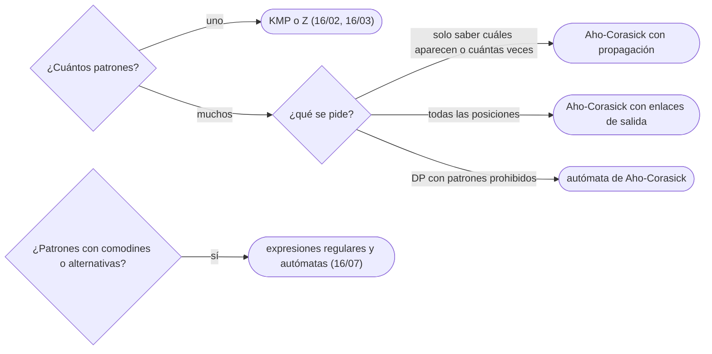

# 05 — Aho-Corasick

> Buscar muchos patrones a la vez en una sola pasada por el texto: un trie con los patrones y, en cada nodo,
> un enlace de fallo que dice a dónde ir cuando el siguiente carácter no continúa —la función de prefijo de
> KMP llevada a un árbol—. Con los enlaces de salida que reportan todos los patrones que terminan en cada
> posición, el autómata completo y la DP sobre él.
>
> **Niveles:** Aho-Corasick [B].
>
> **📚 Lectura troncal:** Aho y Corasick, «Efficient String Matching: An Aid to Bibliographic Search»,
> *Communications of the ACM* 18(6), 1975; cp-algorithms, [*Aho-Corasick algorithm*](https://cp-algorithms.com/string/aho_corasick.html).
>
> **Asume leído:** [`07/04` — *Tries*](../07-arboles/04-tries.md); [`16/02` — KMP y la función de prefijo](02-kmp.md).
>
> **Vigencia:** 2026-10-04.

**Salto rápido:** [1](#1--el-problema) · [2](#2--la-teoría) · [3](#3--aho-corasick) · [4](#4-️-la-tabla-de-costes) · [5](#5--cómo-se-elige) · [6](#6--señales-del-enunciado) · [7](#7--dónde-aparece-de-verdad) · [🧠](#-preguntas) · [🧩](#-problemas-propios)

---

## 1. 🎯 El problema

Un filtro de contenidos tiene `10⁴` palabras prohibidas y revisa mensajes de `10⁶` caracteres. Con KMP
patrón a patrón, son `10⁴` pasadas por el texto: `10¹⁰` pasos. Con un trie de los patrones y, en cada
posición del texto, bajar por el trie, se ahorra el `k` pero vuelve el problema de la búsqueda ingenua:
tras un fallo, empezar otra vez desde la raíz pierde lo leído.

Aho-Corasick combina las dos ideas: el trie para los patrones y, en cada nodo, el **enlace de fallo** —el
sufijo más largo de lo leído que también es un prefijo de algún patrón—. El texto se recorre una vez, sin
retroceder, y en cada posición se reportan todas las apariciones que terminan ahí.

> 🧠 **Modelo mental.** KMP para un diccionario: en lugar de un patrón en línea, los patrones en un árbol;
> y en lugar de «el borde más largo», «el sufijo más largo que el árbol reconoce».

Los ejemplos usan el texto `"abracadabra"` y los patrones `a`, `ab`, `bra` y `cad`, que aparecen 5, 2, 2 y
1 veces.

---

## 2. 📐 La teoría

**El trie** (`07/04`). Un nodo por cada prefijo de algún patrón; un nodo es **terminal** si es un patrón
completo.

**Enlace de fallo.** Para el nodo de la cadena `u`, `fail(u)` es el nodo del **sufijo propio más largo** de
`u` que está en el trie. Es la función de prefijo de KMP generalizada: con un solo patrón, el trie es una
línea y `fail` es `π`.

**Cálculo por BFS.** Los nodos de profundidad 1 fallan a la raíz. Para el hijo `v = u + c`, se sigue la
cadena de fallos de `u` hasta un nodo que tenga hijo por `c`: `fail(v)` es ese hijo (o la raíz). Por niveles,
porque `fail(u)` es menos profundo que `u` y ya está calculado.

**Enlace de salida (diccionario).** Los patrones que terminan en una posición son el nodo actual y todos los
de su cadena de fallos que sean terminales. El enlace de salida de `u` apunta al terminal más cercano en esa
cadena, para no recorrer nodos que no aportan.

**El autómata.** Precalculando `go(u, c)` —si `u` tiene hijo por `c`, ese hijo; si no, `go(fail(u), c)`—
se obtiene un autómata con transición `O(1)`, como el de KMP (`16/02`). Construirlo cuesta
`Θ(L · σ)` con `L` la suma de longitudes de los patrones.

**Coste.** Construcción `Θ(L · σ)` (o `Θ(L)` con mapas en los nodos); recorrido del texto `Θ(n)`; reportar
las apariciones `Θ(z)` con `z` el número de apariciones (que puede ser `n · √L`). Para **contar** sin
enumerar, se acumulan las visitas por nodo y se propagan por el árbol de fallos al final: `Θ(n + L)`.

---

## 3. 🧱 Aho-Corasick

**Qué es.** Trie de los patrones con enlaces de fallo calculados por BFS; recorrer el texto con
`u = go(u, c)` y contar o reportar.

**Por qué es correcto.** El estado `u` tras leer `t[0..i]` es el sufijo más largo de lo leído que está en
el trie (invariante, como el de KMP); los patrones que terminan en `i` son sufijos de lo leído en el trie, y
están todos en la cadena de fallos de `u`.

**Cómo va**, con los patrones `a`, `ab`, `bra`, `cad`:

```text
trie: a, ab · b, br, bra · c, ca, cad
fallos no triviales: ab → b · bra → a · ca → a       (los demás, a la raíz)

texto   a  b   r   a     c  a   d    a  b   r   a
estado  a  ab  br  bra   c  ca  cad  a  ab  br  bra
reporta a  ab      bra,a    a   cad  a  ab      bra,a     (bra → su fallo «a» también termina ahí)
totales: a 5, ab 2, bra 2, cad 1
```

**Cuánto.** `Θ(L · σ + n)` construir y recorrer; más `Θ(z)` si se enumeran las apariciones.

**La plantilla**, con el autómata completo sobre minúsculas y conteo por propagación:

```cpp
#include <array>
#include <queue>
#include <string>
#include <vector>

struct AhoCorasick {
    std::vector<std::array<int, 26>> go;               // autómata completo tras build()
    std::vector<int> fail, order;                      // order: nodos en BFS
    std::vector<int> endOf;                            // nodo terminal de cada patrón
    AhoCorasick() { newNode(); }
    int newNode() { go.push_back({}); go.back().fill(-1); fail.push_back(0); return go.size() - 1; }
    void add(const std::string& p) {
        int u = 0;
        for (char ch : p) {
            int c = ch - 'a';
            if (go[u][c] == -1) { int v = newNode(); go[u][c] = v; }
            u = go[u][c];
        }
        endOf.push_back(u);
    }
    void build() {
        std::queue<int> q;
        for (int c = 0; c < 26; c++)
            if (go[0][c] == -1) go[0][c] = 0;
            else { fail[go[0][c]] = 0; q.push(go[0][c]); }
        while (!q.empty()) {
            int u = q.front(); q.pop(); order.push_back(u);
            for (int c = 0; c < 26; c++) {
                int v = go[u][c];
                if (v == -1) go[u][c] = go[fail[u]][c];   // transición heredada del fallo
                else { fail[v] = go[fail[u]][c]; q.push(v); }
            }
        }
    }
    // Apariciones de cada patrón en t: visitas por nodo, propagadas de hijo a fallo en BFS inverso.
    std::vector<long long> count(const std::string& t) {
        std::vector<long long> visits(go.size(), 0);
        int u = 0;
        for (char ch : t) { u = go[u][ch - 'a']; visits[u]++; }
        for (int i = (int)order.size() - 1; i >= 0; i--) visits[fail[order[i]]] += visits[order[i]];
        std::vector<long long> res;
        for (int node : endOf) res.push_back(visits[node]);
        return res;
    }
};
```

```java
// Misma estructura con arreglos que crecen: go[nodo * 26 + c].
static int[] go = new int[26], fail = new int[1];
static int nodes = 1;
static int[] order;
static java.util.List<Integer> endOf = new java.util.ArrayList<>();
static { java.util.Arrays.fill(go, -1); }               // la raíz empieza sin hijos

static int newNode() {
    if ((nodes + 1) * 26 > go.length) { go = java.util.Arrays.copyOf(go, go.length * 2); fail = java.util.Arrays.copyOf(fail, fail.length * 2); }
    java.util.Arrays.fill(go, nodes * 26, nodes * 26 + 26, -1);
    return nodes++;
}

static void add(String p) {
    int u = 0;
    for (int i = 0; i < p.length(); i++) {
        int c = p.charAt(i) - 'a';
        if (go[u * 26 + c] == -1) { int v = newNode(); go[u * 26 + c] = v; }
        u = go[u * 26 + c];
    }
    endOf.add(u);
}

static void build() {
    order = new int[nodes];
    int qh = 0, qt = 0;
    for (int c = 0; c < 26; c++)
        if (go[c] == -1) go[c] = 0;
        else { fail[go[c]] = 0; order[qt++] = go[c]; }
    while (qh < qt) {
        int u = order[qh++];
        for (int c = 0; c < 26; c++) {
            int v = go[u * 26 + c];
            if (v == -1) go[u * 26 + c] = go[fail[u] * 26 + c];
            else { fail[v] = go[fail[u] * 26 + c]; order[qt++] = v; }
        }
    }
    order = java.util.Arrays.copyOf(order, qt);
}

static long[] count(String t) {
    long[] visits = new long[nodes];
    int u = 0;
    for (int i = 0; i < t.length(); i++) { u = go[u * 26 + t.charAt(i) - 'a']; visits[u]++; }
    for (int i = order.length - 1; i >= 0; i--) visits[fail[order[i]]] += visits[order[i]];
    long[] res = new long[endOf.size()];
    for (int i = 0; i < res.length; i++) res[i] = visits[endOf.get(i)];
    return res;
}
```

- **Contar sin enumerar**: cada visita a un nodo cuenta para todos los patrones de su cadena de fallos;
  acumular en BFS inverso (de los profundos a la raíz) lo hace en `Θ(nodos)`.
- **Enumerar posiciones**: en cada posición, seguir los **enlaces de salida** (al terminal más cercano en la
  cadena de fallos); el coste es el número de apariciones.
- **Patrones repetidos** comparten nodo terminal: `endOf` guarda el nodo de cada uno.
- **Alfabeto grande**: mapas por nodo en lugar de 26 transiciones, y el `go` calculado al vuelo con la
  cadena de fallos (amortizado, como KMP).
- **La DP sobre el autómata**: «cadenas de longitud `n` que evitan todos los patrones» es una DP sobre
  `(posición, nodo)` prohibiendo los nodos cuya cadena de fallos contiene un terminal.

**Cuándo sí:** muchos patrones sobre uno o varios textos; filtros de palabras; DP sobre cadenas con varios
patrones prohibidos u obligatorios. **Cuándo no:** un solo patrón (KMP); patrones con comodines o
expresiones regulares ([`16/07`](07-automatas-y-expresiones-regulares.md)); si los patrones cambian en línea.

> **Veredicto:** Aho-Corasick es un trie con la función de prefijo en cada nodo: una pasada por el texto
> para todos los patrones, y la propagación por el árbol de fallos para contar.

---

## 4. ⏱️ La tabla de costes

| Técnica | Preproceso | Búsqueda | Lo que la tabla no dice |
|---|---|---|---|
| `k` veces KMP | `Θ(L)` | `Θ(k · n)` | Con `k = 10⁴`, inviable |
| Trie y bajar desde cada posición | `Θ(L)` | `Θ(n · máx \|p\|)` | Pierde lo leído tras cada fallo |
| Aho-Corasick (contar) | `Θ(L · σ)` | `Θ(n)` | Propagación por el árbol de fallos |
| Aho-Corasick (enumerar) | `Θ(L · σ)` | `Θ(n + z)` | `z` puede ser grande |
| *Hashing* por longitudes | `Θ(L)` | `Θ(n · √L)` | Alternativa sin autómata (`16/04`) |

---

## 5. 🧭 Cómo se elige



> **Regla de entrevista:** si te dan una lista de palabras y un texto, di «un trie de las palabras y
> enlaces de fallo, como KMP pero en un árbol»; con eso basta para plantearlo.

---

## 6. 🔎 Señales del enunciado

| Señal | Técnica | Por qué |
|---|---|---|
| «Diccionario de palabras», «lista de patrones», un texto grande | Aho-Corasick | Una pasada para todos |
| «Palabras prohibidas», «censurar» | Aho-Corasick con marcas | Cada aparición marca un tramo |
| «Cuántas cadenas de longitud `n` no contienen ninguno» | DP sobre el autómata | Estado = nodo |
| «Caracteres que llegan de uno en uno», consultas en línea | Autómata y estado actual | Transición `O(1)` |

---

## 7. 🔭 Dónde aparece de verdad

- **`fgrep` y la búsqueda de muchas cadenas fijas** en herramientas de texto usan Aho-Corasick o variantes
  (Commentz-Walter); el artículo original nació para buscar en bibliografías.
- **Los sistemas de detección de intrusiones** y los antivirus comparan el tráfico o los ficheros con miles
  de firmas a la vez con autómatas de este tipo.

---

## ⚠️ Errores frecuentes

| Se dice | Lo preciso |
|---|---|
| «Para `k` patrones, `k` veces KMP» | `Θ(k · n)`; Aho-Corasick es `Θ(n + L)` más las apariciones |
| «En cada posición basta mirar el nodo actual» | También terminan patrones en su cadena de fallos (`a` dentro de `bra`) |
| «Los enlaces de fallo se calculan en DFS» | Por BFS: el fallo de un nodo es menos profundo y tiene que estar ya calculado |
| «Enumerar las apariciones es `Θ(n)`» | Es `Θ(n + z)`, y `z` puede ser `Θ(n √L)` |
| «El autómata completo siempre cabe» | Con alfabetos grandes, `L · σ` no cabe: mapas y fallos al vuelo |

---

## 📚 Para profundizar

- **Artículo** — Aho y Corasick, «Efficient String Matching: An Aid to Bibliographic Search»,
  *Communications of the ACM* 18(6), 1975. *Lectura troncal.*
- **Referencia** — cp-algorithms, [*Aho-Corasick algorithm*](https://cp-algorithms.com/string/aho_corasick.html).
  *Lectura troncal.*

---

## 🧠 Preguntas

1. ¿Qué es el enlace de fallo de un nodo del trie? 🟢
2. ¿Cuánto cuesta buscar `k` patrones con KMP uno a uno, y cuánto con Aho-Corasick? 🟢
3. ¿Por qué los enlaces de fallo se calculan por BFS? 🟢
4. ¿Qué relación hay entre Aho-Corasick con un patrón y KMP? 🟡
5. ¿Qué es el enlace de salida y para qué sirve? 🟡
6. ¿Cómo cuentas las apariciones de cada patrón sin enumerarlas? 🟡
7. ¿Qué cambia en la implementación con un alfabeto grande? 🟡
8. Explica por qué el estado tras leer `t[0..i]` es el sufijo más largo de lo leído que está en el trie. 🟠
9. ¿Cuántas apariciones puede haber en total, y por qué enumerarlas puede ser caro? 🟠
10. ¿Cómo cuentas las cadenas de longitud `n` que no contienen ninguno de `k` patrones? 🟠
11. ¿Qué alternativa con *hashing* hay para muchos patrones, y cuánto cuesta? 🔴
12. ¿Cómo marcas (censuras) todas las posiciones del texto cubiertas por alguna aparición, en lineal? 🔴

---

## 🧩 Problemas propios

### Censura

**Nivel:** 🟡 · **Formato:** programa completo.

Sustituye por `*` cada carácter del texto que esté dentro de alguna aparición de alguna palabra prohibida.

- **Entrada.** Una línea con el texto. Una línea con `k`. Después, `k` líneas con una palabra prohibida.
- **Salida.** El texto censurado.
- **Restricciones.** `1 ≤ |texto| ≤ 10⁶`; `1 ≤ k ≤ 10⁴`; la suma de longitudes de las palabras es `≤ 10⁵`;
  minúsculas.

```text
Entrada         Salida
abracadabra     a******a***
2
cad
bra

Entrada         Salida
ab              ab
1
abc
```

Con el texto `aaaa` y la palabra `aa`, la salida es `****`.

**Pista 1:** si sabes en cada posición la palabra prohibida **más larga** que termina ahí, ¿qué tramo
tienes que tapar?

### Sin palabras prohibidas

**Nivel:** 🟠 · **Formato:** programa completo.

¿Cuántas cadenas de longitud `n` sobre las `a` primeras letras del alfabeto no contienen ninguna de las `k`
palabras prohibidas? Módulo `10⁹ + 7`.

- **Entrada.** Una línea con `n`, `a` y `k`. Después, `k` líneas con una palabra.
- **Salida.** Un entero.
- **Restricciones.** `1 ≤ n ≤ 1 000`; `1 ≤ a ≤ 26`; la suma de longitudes de las palabras es `≤ 100`.

```text
Entrada     Salida
3 2 2       2
aa
bb

Entrada     Salida
4 3 2       37
ab
ca
```

**Pista 1:** si el estado de la DP es el nodo del autómata, ¿qué nodos están prohibidos?

---

## 🧩 Práctica externa

> 💡 **Truco.** Antes de pedir ayuda, comprueba el trie y los fallos con dos patrones donde uno es sufijo
> del otro (`a` y `bra`): si `bra` no reporta también `a`, falta la cadena de fallos. Si una IA te ayuda, que
> sea a revisar eso ([`01/06`](../01-oficio-del-competidor/06-protocolo-de-resolucion.md)). SPOJ tiene
> clásicos de Aho-Corasick, pero no se enlaza (`403`).

### Núcleo

| ✔ | Problema | Plataforma | Nivel | Patrón | Pista 1 |
|---|---|---|---|---|---|
| [ ] | [String Multimatching](https://open.kattis.com/problems/stringmultimatching) | Kattis | 🟡 | Todas las posiciones | ¿Cómo reportas todas las apariciones que terminan en una posición? |
| [ ] | [Counting Patterns](https://cses.fi/problemset/task/2103) | CSES | 🟠 | Contar con propagación | ¿Cuántas veces visitas cada nodo, y quién más lo hereda? |
| [ ] | [Pattern Positions](https://cses.fi/problemset/task/2104) | CSES | 🟠 | Primera aparición | Si un nodo se visita en la posición `i`, ¿qué sabes de sus fallos? |
| [ ] | [Stream of Characters](https://leetcode.com/problems/stream-of-characters/) | LeetCode | 🔴 | Autómata en línea | ¿Qué estado mantienes entre consulta y consulta? |
| [ ] | [Determining DNA Health](https://www.hackerrank.com/challenges/determining-dna-health/problem) | HackerRank | 🔴 | Aho-Corasick con rangos de genes | Para un rango de genes, ¿cómo sumas las saludes de los que aparecen? |

### Ampliación

| ✔ | Problema | Plataforma | Nivel | Patrón | Pista 1 |
|---|---|---|---|---|---|
| [ ] | [Construct String with Minimum Cost](https://leetcode.com/problems/construct-string-with-minimum-cost/) | LeetCode | 🔴 | DP con apariciones | ¿Qué palabras pueden terminar en cada posición del objetivo? |
| [ ] | [You Are Given Some Strings...](https://codeforces.com/problemset/problem/1202/E) | Codeforces | 🔴 | Aho-Corasick en los dos sentidos | Si cuentas cuántos patrones terminan y cuántos empiezan en cada posición, ¿cómo los combinas? |
| [ ] | [Frequency of String](https://codeforces.com/problemset/problem/963/D) | Codeforces | 🔴 | Apariciones acotadas | ¿Cuántas longitudes distintas pueden tener los patrones si su suma es `L`? |

---

## ✅ Criterio de dominio

- Construir Aho-Corasick con la plantilla delante, con fallos por BFS y el autómata completo.
- Contar apariciones con la propagación por el árbol de fallos y enumerarlas con enlaces de salida.
- Plantear la DP sobre el autómata con patrones prohibidos.
- Resolver Counting Patterns y Stream of Characters sin pista 2.

---

**Anterior:** [`16/04` — *Hashing* de cadenas aplicado](04-hashing-de-cadenas.md) · **Siguiente:** [`16/06` — *Suffix array*, LCP y *suffix automaton*](06-suffix-array-y-automaton.md) ·
**Relacionado:** [`07/04` — *Tries*](../07-arboles/04-tries.md).
