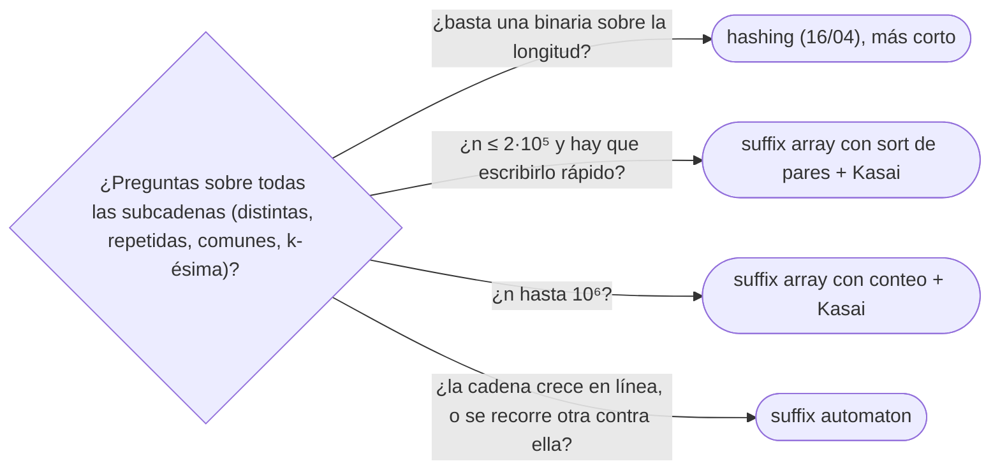

# 06 — *Suffix array*, LCP y *suffix automaton*

> Ordenar todos los sufijos de una cadena en `Θ(n log n)` duplicando la longitud de los prefijos que se
> comparan, el arreglo LCP con el algoritmo de Kasai —lineal porque el prefijo común baja como mucho uno de
> un sufijo al siguiente— y lo que se deduce de los dos: subcadenas distintas, la repetida más larga, la
> común a dos cadenas. Y en ficha, el *suffix automaton*, que responde lo mismo con otro enfoque.
>
> **Niveles:** *suffix array* `O(n log n)` [B] · LCP de Kasai [B] · *suffix automaton* [C].
>
> **📚 Lectura troncal:** Sedgewick y Wayne, *Algorithms*, 4.ª ed. (Addison-Wesley, 2011), cap. 6
> (*suffix arrays*); Gusfield, *Algorithms on Strings, Trees and Sequences* (Cambridge, 1997), cap. 7;
> cp-algorithms, [*Suffix Array*](https://cp-algorithms.com/string/suffix-array.html).
>
> **Asume leído:** [`16/04` — *Hashing* de cadenas aplicado](04-hashing-de-cadenas.md).
>
> **Vigencia:** 2026-10-04.

**Salto rápido:** [1](#1--el-problema) · [2](#2--la-teoría) · [3](#3--suffix-array-en-on-log-n) · [4](#4--lcp-de-kasai) · [5](#5--suffix-automaton) · [6](#6-️-la-tabla-de-costes) · [7](#7--cómo-se-elige) · [8](#8--señales-del-enunciado) · [🧠](#-preguntas) · [🧩](#-problemas-propios)

---

## 1. 🎯 El problema

¿Cuántas subcadenas **distintas** tiene un texto de `10⁵` caracteres? Hay `n(n + 1)/2 = 5·10⁹` subcadenas
contando repeticiones; meterlas en un conjunto es imposible. La observación que lo resuelve: toda subcadena
es prefijo de algún sufijo, y si los sufijos están **ordenados**, las repeticiones están entre sufijos
vecinos y se miden con el prefijo común más largo (LCP) de cada par adyacente.

Ordenar los `n` sufijos con un `sort` que compare cadenas cuesta `Θ(n² log n)` en el peor caso (cada
comparación es `Θ(n)`). El *suffix array* por duplicación lo hace en `Θ(n log n)`, y Kasai calcula los LCP en
`Θ(n)`. Con los dos, el número de subcadenas distintas es `n(n + 1)/2 − Σ LCP`.

> 🧠 **Modelo mental.** Un diccionario de todos los sufijos: en orden alfabético, los que empiezan igual
> quedan juntos, y lo que comparten con el de al lado es exactamente lo que se repite.

Los ejemplos usan la cadena de juguete `"abracadabra"`.

---

## 2. 📐 La teoría

**Suffix array.** `SA[k]` es la posición de inicio del `k`-ésimo sufijo en orden lexicográfico. Para
`abracadabra`:

```text
k   SA  LCP  sufijo
0   10  0    a
1   7   1    abra
2   0   4    abracadabra
3   3   1    acadabra
4   5   1    adabra
5   8   0    bra
6   1   3    bracadabra
7   4   0    cadabra
8   6   0    dabra
9   9   0    ra
10  2   2    racadabra
```

`LCP[k]` es el prefijo común de los sufijos `SA[k − 1]` y `SA[k]`.

**Duplicación.** Ordenar los sufijos por sus primeros `2^j` caracteres: si ya se tiene el rango de cada
sufijo por sus primeros `2^(j−1)`, el orden por `2^j` es el orden del **par** (rango de `i`, rango de
`i + 2^(j−1)`). Ordenar pares de enteros con dos pasadas de ordenación por conteo es `Θ(n)`; hay `log n`
rondas: `Θ(n log n)`. Con un `sort` de comparación, `Θ(n log² n)`.

**Kasai.** Con el rango `rank[i]` de cada sufijo, se recorren los sufijos en orden de **posición** (`0, 1,
…`), no de rango. Si el sufijo `i` comparte `h` caracteres con su predecesor en el orden, el sufijo `i + 1`
comparte al menos `h − 1` con el suyo: quitar la primera letra a los dos conserva el orden y el resto del
prefijo común. Así que `h` baja como mucho 1 por paso y sube en total como mucho `n`: `Θ(n)`.

**Lo que se deduce.**

- **Subcadenas distintas**: `n(n + 1)/2 − Σ LCP[k]`. En `abracadabra`, `66 − 12 = 54`.
- **Subcadena repetida más larga**: `max LCP`. En `abracadabra`, 4 (`abra`).
- **LCP de dos sufijos cualesquiera**: el mínimo de `LCP` entre sus rangos (RMQ con tabla dispersa,
  [`09/01`](../09-consultas-sobre-rangos/01-sparse-table.md)), `O(1)` por consulta.
- **Subcadena común a dos cadenas**: el *suffix array* de `a + '#' + b` y el mayor `LCP` entre vecinos que
  vienen de cadenas distintas.

---

## 3. 🧱 *Suffix array* en `O(n log n)`

**Qué es.** El arreglo `SA` calculado por duplicación, con ordenación por conteo de los pares de rangos.

**Por qué es correcto.** Comparar los primeros `2^j` caracteres de dos sufijos equivale a comparar el par
de rangos de sus dos mitades de `2^(j−1)`; tras `⌈log₂ n⌉` rondas, `2^j ≥ n` y el orden es el de los
sufijos completos. Con un separador menor que todo carácter (o tratando la cadena como cíclica con `$`),
ningún sufijo es comparado más allá de su final.

**Cómo va**, en `abracadabra`, las rondas:

```text
sobre «abracadabra$» (12 sufijos cíclicos):
1 carácter:    6 clases ($ a b c d r)
2 caracteres:  9 clases   — «ab» (0 y 7), «br» (1 y 8), «ra» (2 y 9) siguen empatados
4 caracteres:  11 clases  — solo «abra» (0 y 7) sigue empatado
8 caracteres:  12 clases  — «abra$abr» < «abracada»: todos distintos
SA (sin el $) = 10 7 0 3 5 8 1 4 6 9 2
```

**Cuánto.** `Θ(n log n)` con ordenación por conteo; `Θ(n log² n)` con `sort` de pares (más corto de
escribir y suele bastar con `n ≤ 2·10⁵`).

**La plantilla**, con la cadena cíclica `s + '$'`:

```cpp
#include <algorithm>
#include <string>
#include <vector>

// Suffix array por duplicación con ordenación por conteo. Devuelve los n sufijos de s (sin el '$').
std::vector<int> suffixArray(std::string s) {
    s += '$';                                            // menor que cualquier letra
    int n = s.size(), classes = 256;
    std::vector<int> p(n), c(n), cnt(std::max(classes, n), 0);
    for (char ch : s) cnt[(unsigned char)ch]++;
    for (int i = 1; i < classes; i++) cnt[i] += cnt[i - 1];
    for (int i = n - 1; i >= 0; i--) p[--cnt[(unsigned char)s[i]]] = i;
    c[p[0]] = 0; classes = 1;
    for (int i = 1; i < n; i++) { if (s[p[i]] != s[p[i - 1]]) classes++; c[p[i]] = classes - 1; }
    std::vector<int> pn(n), cn(n);
    for (int h = 0; (1 << h) < n; h++) {
        for (int i = 0; i < n; i++) { pn[i] = p[i] - (1 << h); if (pn[i] < 0) pn[i] += n; }   // ya ordenados por la 2.ª mitad
        std::fill(cnt.begin(), cnt.begin() + classes, 0);
        for (int i = 0; i < n; i++) cnt[c[pn[i]]]++;
        for (int i = 1; i < classes; i++) cnt[i] += cnt[i - 1];
        for (int i = n - 1; i >= 0; i--) p[--cnt[c[pn[i]]]] = pn[i];                         // estable por la 1.ª
        cn[p[0]] = 0; classes = 1;
        for (int i = 1; i < n; i++) {
            int cur1 = c[p[i]], prev1 = c[p[i - 1]];
            int cur2 = c[(p[i] + (1 << h)) % n], prev2 = c[(p[i - 1] + (1 << h)) % n];
            if (cur1 != prev1 || cur2 != prev2) classes++;
            cn[p[i]] = classes - 1;
        }
        c.swap(cn);
    }
    p.erase(p.begin());                                  // el primero es el sufijo «$»
    return p;
}
```

```java
// Versión n log² n con sort de pares: más corta y suficiente con n ≤ 2·10⁵.
static int[] suffixArray(String s) {
    int n = s.length();
    Integer[] sa = new Integer[n];
    int[] rank = new int[n], tmp = new int[n];
    for (int i = 0; i < n; i++) { sa[i] = i; rank[i] = s.charAt(i); }
    for (int k = 1; ; k <<= 1) {
        final int kk = k;
        final int[] r = rank;
        java.util.Comparator<Integer> cmp = (a, b) -> {
            if (r[a] != r[b]) return Integer.compare(r[a], r[b]);
            int ra = a + kk < n ? r[a + kk] : -1, rb = b + kk < n ? r[b + kk] : -1;
            return Integer.compare(ra, rb);
        };
        java.util.Arrays.sort(sa, cmp);
        tmp[sa[0]] = 0;
        for (int i = 1; i < n; i++) tmp[sa[i]] = tmp[sa[i - 1]] + (cmp.compare(sa[i - 1], sa[i]) < 0 ? 1 : 0);
        System.arraycopy(tmp, 0, rank, 0, n);
        if (rank[sa[n - 1]] == n - 1) break;             // todos los rangos distintos
    }
    int[] res = new int[n];
    for (int i = 0; i < n; i++) res[i] = sa[i];
    return res;
}
```

- **El `$`** hace la cadena cíclica sin que un sufijo «dé la vuelta» y se compare con el principio: al ser
  el menor, termina las comparaciones.
- **La versión `n log² n`** (Java) usa `Integer[]` con un comparador: boxeo y `log` extra, pero cabe con
  `2·10⁵`. La de conteo (C++) es la buena para `10⁶`.
- **Alfabetos grandes o enteros**: comprimir primero los valores a rangos ([`04/04`](../04-secuencias/04-compresion-y-barrido.md)).

**Cuándo sí:** subcadenas distintas, repetidas más largas, comunes a varias cadenas, `k`-ésima subcadena en
orden, LCP de pares arbitrarios. **Cuándo no:** si un *hash* con binaria basta y es más corto (`16/04`), o si
las cadenas cambian.

> **Veredicto:** el *suffix array* ordena los sufijos por duplicación en `Θ(n log n)`; es la estructura de
> sufijos que se escribe en un concurso.

---

## 4. 🧱 LCP de Kasai

**Qué es.** El arreglo `LCP[k]` (prefijo común de `SA[k − 1]` y `SA[k]`), calculado recorriendo los sufijos
por posición y reutilizando el valor anterior menos uno.

**Por qué es correcto.** Si el sufijo `i` tiene LCP `h > 0` con su predecesor `j`, los sufijos `i + 1` y
`j + 1` comparten `h − 1` y `j + 1` va antes que `i + 1`; el predecesor de `i + 1` en el orden está entre
ellos y comparte al menos `h − 1`. Así que se empieza a comparar desde `h − 1`.

**Cómo va**, en `abracadabra`, por posición:

```text
i=0 (abracadabra, rango 2): predecesor «abra» → h = 4
i=1 (bracadabra,  rango 6): empieza en h = 3 → predecesor «bra» → 3
i=2 (racadabra,   rango 10): empieza en 2 → predecesor «ra» → 2
i=3 (acadabra,    rango 3): empieza en 1 → predecesor «abracadabra» → 1
…
```

**Cuánto.** `Θ(n)`.

**La plantilla:**

```cpp
#include <string>
#include <vector>

// lcp[k] = prefijo común de los sufijos sa[k − 1] y sa[k]; lcp[0] = 0.
std::vector<int> kasai(const std::string& s, const std::vector<int>& sa) {
    int n = s.size(), h = 0;
    std::vector<int> rank(n), lcp(n, 0);
    for (int k = 0; k < n; k++) rank[sa[k]] = k;
    for (int i = 0; i < n; i++) {
        if (rank[i] == 0) { h = 0; continue; }
        int j = sa[rank[i] - 1];                         // el predecesor en el orden
        while (i + h < n && j + h < n && s[i + h] == s[j + h]) h++;
        lcp[rank[i]] = h;
        if (h > 0) h--;                                  // baja como mucho uno
    }
    return lcp;
}
```

```java
static int[] kasai(String s, int[] sa) {
    int n = s.length(), h = 0;
    int[] rank = new int[n], lcp = new int[n];
    for (int k = 0; k < n; k++) rank[sa[k]] = k;
    for (int i = 0; i < n; i++) {
        if (rank[i] == 0) { h = 0; continue; }
        int j = sa[rank[i] - 1];
        while (i + h < n && j + h < n && s.charAt(i + h) == s.charAt(j + h)) h++;
        lcp[rank[i]] = h;
        if (h > 0) h--;
    }
    return lcp;
}
```

- **Subcadenas distintas**: `n(n + 1)/2 − Σ lcp`, en 64 bits.
- **Subcadena que aparece al menos `k` veces, la más larga**: el máximo, sobre ventanas de `k − 1` valores
  consecutivos de `lcp`, de su mínimo (cola monótona, [`06/01`](../06-lineales-y-hashing/01-pilas-colas-y-monotonas.md)).
- **LCP de dos sufijos cualesquiera**: tabla dispersa sobre `lcp` y el mínimo del tramo entre sus rangos.

**Cuándo sí:** siempre que se use el *suffix array* para repeticiones o subcadenas distintas. **Cuándo no:**
si solo hace falta el orden de los sufijos.

> **Veredicto:** Kasai obtiene todos los LCP de vecinos en lineal porque el prefijo común baja como mucho
> uno de una posición a la siguiente.

---

## 5. 🧱 *Suffix automaton*

**Qué resuelve.** El autómata mínimo que reconoce todos los sufijos (y por tanto todas las subcadenas) de
`s`. Responde «¿es `t` subcadena?» en `O(|t|)`, cuenta subcadenas distintas, apariciones de cada una, la
subcadena común más larga con otra cadena, y se construye **en línea**, carácter a carácter.

**Qué garantiza.** Como mucho `2n − 1` estados y `3n − 4` transiciones; construcción en `Θ(n)` (con
transiciones en mapas, `Θ(n log σ)`). Cada estado agrupa subcadenas con el mismo conjunto de posiciones de
final (*endpos*); los enlaces de sufijo forman un árbol.

**Cuánto.** `Θ(n)` construcción y memoria lineal (con `σ` constante).

**Cómo reconocerlo.** Las mismas preguntas que el *suffix array*, cuando la cadena crece por la derecha o
hay que procesar otra cadena contra ella carácter a carácter.

**Si no te la sabes.** *Suffix array* + LCP (lo mismo fuera de línea) o *hashing* con binaria.

**Dónde está entera.** cp-algorithms, [*Suffix Automaton*](https://cp-algorithms.com/string/suffix-automaton.html);
Blumer y otros, «The smallest automaton recognizing the subwords of a text» (1985).

---

## 6. ⏱️ La tabla de costes

| Estructura | Construcción | Consultas típicas | Lo que la tabla no dice |
|---|---|---|---|
| Ordenar sufijos con `sort` de cadenas | `Θ(n² log n)` peor caso | — | Lo que desmonta el capítulo |
| *Suffix array* (`sort` de pares) | `Θ(n log² n)` | — | Corto de escribir |
| *Suffix array* (conteo) | `Θ(n log n)` | — | El de `10⁶` |
| LCP de Kasai | `Θ(n)` | Distintas, repetidas, comunes | Con RMQ, LCP de pares en `O(1)` |
| *Suffix automaton* | `Θ(n)` | ¿Es subcadena?: `O(\|t\|)` | En línea; más difícil de escribir |

---

## 7. 🧭 Cómo se elige



> **Regla de entrevista:** si sale «subcadenas distintas», nombra el *suffix array* y la fórmula
> `n(n + 1)/2 − Σ LCP`; casi nunca piden escribirlo, pero sí razonar por qué es correcta.

---

## 8. 🔎 Señales del enunciado

| Señal | Técnica | Por qué |
|---|---|---|
| «Número de subcadenas distintas» | *Suffix array* + LCP | `n(n+1)/2 − Σ LCP` |
| «Subcadena más larga que aparece al menos `k` veces» | LCP y mínimo en ventana | Los `k` sufijos están juntos en el orden |
| «La `k`-ésima subcadena en orden alfabético» | *Suffix array* y conteo por sufijo | Cada sufijo aporta `n − SA − LCP` nuevas |
| «Subcadena común más larga de dos cadenas» | `a + '#' + b` y LCP entre orígenes distintos | Vecinos de cadenas distintas |

---

## ⚠️ Errores frecuentes

| Se dice | Lo preciso |
|---|---|
| «Ordenar los sufijos es `O(n² log n)`» | Por duplicación es `Θ(n log n)` (o `n log² n` con `sort`) |
| «El *suffix array* y el árbol de sufijos son lo mismo» | El árbol ([`16/08`](08-eertree-y-ukkonen.md)) es otra estructura; el *suffix array* + LCP la simula en muchos usos |
| «Kasai recorre los sufijos en el orden del *suffix array*» | En orden de **posición**: ahí es donde `h` baja como mucho uno |
| «Sin el `$` funciona igual» | En la versión cíclica, un sufijo daría la vuelta y se compararía con el principio |
| «Subcadenas distintas caben en `int`» | Con `n = 10⁵`, `5·10⁹`: 64 bits |

---

## 📚 Para profundizar

- **Libro** — Sedgewick y Wayne, *Algorithms*, 4.ª ed. (Addison-Wesley, 2011), cap. 6: *suffix arrays* y la
  subcadena repetida más larga. *Lectura troncal.*
- **Libro** — Gusfield, *Algorithms on Strings, Trees and Sequences* (Cambridge, 1997), cap. 7: aplicaciones
  de las estructuras de sufijos. *Lectura troncal.*
- **Referencia** — cp-algorithms, [*Suffix Array*](https://cp-algorithms.com/string/suffix-array.html).
  *Lectura troncal.*
- **Referencia** — cp-algorithms, [*Suffix Automaton*](https://cp-algorithms.com/string/suffix-automaton.html).
- **Referencia** — Sedgewick y Wayne, [código de `SuffixArray.java`](https://algs4.cs.princeton.edu/63suffix/SuffixArray.java.html).

---

## 🧠 Preguntas

1. ¿Qué guarda el *suffix array* y qué guarda el arreglo LCP? 🟢
2. ¿Cuántas subcadenas distintas tiene una cadena, en términos del LCP? 🟢
3. ¿Cuál es la subcadena repetida más larga, en términos del LCP? 🟢
4. ¿Por qué ordenar los sufijos con `sort` de cadenas es caro? 🟢
5. Explica la duplicación: ¿qué par se ordena en cada ronda? 🟡
6. ¿Para qué sirve el `$` al final? 🟡
7. ¿Cómo calculas el LCP de dos sufijos cualesquiera en `O(1)`? 🟡
8. Demuestra que en Kasai el LCP baja como mucho uno de la posición `i` a la `i + 1`. 🟠
9. ¿Cómo encuentras la subcadena común más larga de dos cadenas con un *suffix array*? 🟠
10. ¿Cómo encuentras la subcadena más larga que aparece al menos `k` veces? 🟠
11. ¿Qué ofrece el *suffix automaton* que no ofrece el *suffix array*? 🟠
12. ¿Cómo encuentras la `k`-ésima subcadena distinta en orden lexicográfico? 🔴
13. Justifica la fórmula de las subcadenas distintas: ¿por qué cada sufijo aporta exactamente `n − SA[k] − LCP[k]`? 🔴

---

## 🧩 Problemas propios

### Distintas en un rango de longitudes

**Nivel:** 🟡 · **Formato:** programa completo.

¿Cuántas subcadenas distintas de `s` tienen longitud entre `L` y `R`?

- **Entrada.** Una línea con `s`. Una línea con `L` y `R`.
- **Salida.** Un entero.
- **Restricciones.** `1 ≤ |s| ≤ 2·10⁵`; `1 ≤ L ≤ R ≤ |s|`; minúsculas.

```text
Entrada         Salida
abracadabra     14
2 3

Entrada         Salida
aaaa            4
1 4
```

**Pista 1:** en el orden del *suffix array*, ¿de qué longitudes son las subcadenas nuevas que aporta cada sufijo?

### Al menos `k` veces

**Nivel:** 🟠 · **Formato:** programa completo.

Imprime la longitud de la subcadena más larga que aparece al menos `k` veces en `s` (apariciones
solapadas valen), o 0 si ninguna.

- **Entrada.** Una línea con `s`. Una línea con `k`.
- **Salida.** Un entero.
- **Restricciones.** `1 ≤ |s| ≤ 2·10⁵`; `2 ≤ k ≤ |s|`; minúsculas.

```text
Entrada         Salida
abracadabra     4
2

Entrada         Salida
aaaa            3
2
```

**Pista 1:** si una subcadena aparece `k` veces, ¿cómo están colocados en el *suffix array* los `k` sufijos
que la empiezan?

---

## 🧩 Práctica externa

> 💡 **Truco.** Antes de pedir ayuda con un *suffix array*, compáralo con `sorted(range(n), key=lambda i:
> s[i:])` en cadenas aleatorias cortas: es la fuerza bruta perfecta. Si una IA te ayuda, que sea a encontrar
> la cadena que falla ([`01/05`](../01-oficio-del-competidor/05-probar-sin-ide-y-stress-test.md)). SPOJ tiene
> clásicos de sufijos, pero no se enlaza (`403`).

### Núcleo

| ✔ | Problema | Plataforma | Nivel | Patrón | Pista 1 |
|---|---|---|---|---|---|
| [ ] | [Suffix Array](https://judge.yosupo.jp/problem/suffixarray) | Library Checker | 🟡 | Construcción | Con `5·10⁵`, ¿te basta `n log² n`? |
| [ ] | [Number of Substrings](https://judge.yosupo.jp/problem/number_of_substrings) | Library Checker | 🟡 | Distintas con LCP | ¿Qué restas al total de subcadenas? |
| [ ] | [Suffix Sorting](https://open.kattis.com/problems/suffixsorting) | Kattis | 🟡 | Construcción y consultas | ¿Cuántas cadenas hay por entrada? |
| [ ] | [Distinct Substrings](https://cses.fi/problemset/task/2105) | CSES | 🟡 | Distintas con LCP | ¿Qué tipo necesita el resultado? |
| [ ] | [Repeating Substring](https://cses.fi/problemset/task/2106) | CSES | 🟡 | Máximo LCP | ¿Qué vecinos del orden comparten la subcadena más larga? |
| [ ] | [Substring Order I](https://cses.fi/problemset/task/2108) | CSES | 🟠 | `k`-ésima distinta | ¿Cuántas subcadenas nuevas aporta cada sufijo en orden? |

### Ampliación

| ✔ | Problema | Plataforma | Nivel | Patrón | Pista 1 |
|---|---|---|---|---|---|
| [ ] | [Substring Order II](https://cses.fi/problemset/task/2109) | CSES | 🔴 | `k`-ésima con repeticiones | Si cuentas las apariciones, ¿cuántas veces cuenta cada prefijo de un sufijo? |
| [ ] | [Substring Distribution](https://cses.fi/problemset/task/2110) | CSES | 🔴 | Distintas por longitud | ¿Qué intervalo de longitudes nuevas aporta cada sufijo? |
| [ ] | [Longest Common Substring](https://judge.yosupo.jp/problem/longest_common_substring) | Library Checker | 🔴 | Dos cadenas con separador | ¿Qué vecinos del orden vienen de cadenas distintas? |

---

## ✅ Criterio de dominio

- Construir el *suffix array* y el LCP con la plantilla delante, y comprobarlos contra la fuerza bruta.
- Demostrar el paso de Kasai y la fórmula de las subcadenas distintas.
- Resolver con LCP la repetida más larga, la común a dos cadenas y la que aparece `k` veces.
- Resolver Distinct Substrings y Substring Order I sin pista 2.

---

**Anterior:** [`16/05` — Aho-Corasick](05-aho-corasick.md) · **Siguiente:** [`16/07` — Autómatas y expresiones regulares](07-automatas-y-expresiones-regulares.md) ·
**Relacionado:** [`16/08` — Árbol de palíndromos y árbol de sufijos](08-eertree-y-ukkonen.md).
