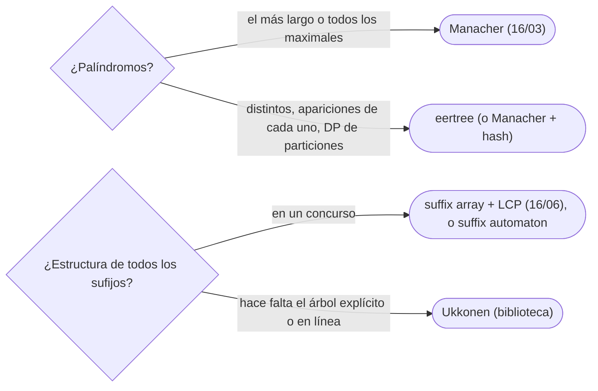

# 08 — Árbol de palíndromos y árbol de sufijos

> Dos estructuras que se reconocen y se nombran, pero no se escriben en una entrevista: el árbol de
> palíndromos (*eertree*), con un nodo por cada palíndromo distinto de la cadena —que nunca son más de
> `n`—, y el árbol de sufijos de Ukkonen, construido en tiempo lineal. Para cada una, qué resuelve, qué
> garantiza, cuánto cuesta, cómo se reconoce y qué escribir si no se sabe.
>
> **Niveles:** *eertree* [C] · Ukkonen [C].
>
> **📚 Lectura troncal:** Gusfield, *Algorithms on Strings, Trees and Sequences* (Cambridge, 1997), cap. 6
> (Ukkonen); cp-algorithms, [*Suffix Tree. Ukkonen's Algorithm*](https://cp-algorithms.com/string/suffix-tree-ukkonen.html).
> cp-algorithms no tiene página del *eertree*: para él, el artículo de Rubinchik y Shur (§📚).
>
> **Asume leído:** [`16/06` — *Suffix array*, LCP y *suffix automaton*](06-suffix-array-y-automaton.md).
>
> **Vigencia:** 2026-10-04.

**Salto rápido:** [1](#1--el-problema) · [2](#2--la-teoría) · [3](#3--eertree) · [4](#4--ukkonen) · [5](#5--cómo-se-elige) · [6](#6--señales-del-enunciado) · [🧠](#-preguntas) · [🧩](#-problemas-propios)

---

## 1. 🎯 El problema

Dos preguntas que Manacher y el *suffix array* responden a medias. La primera: ¿cuántos palíndromos
**distintos** tiene una cadena, y cuántas veces aparece cada uno? Manacher da los palíndromos maximales por
centro, pero no los agrupa por contenido. La segunda: una estructura sobre la que buscar cualquier patrón
en `O(|p|)`, recorrer las subcadenas como un árbol y responder preguntas sobre todos los sufijos a la vez. El
*suffix array* lo simula con binarias y LCP; el árbol de sufijos lo hace directamente.

Las dos estructuras existen, son lineales, y aparecen sobre todo en concursos de nivel alto y en
bioinformática. Lo que se espera es saber que existen, qué garantizan y cuándo una alternativa más corta
basta.

> 🧠 **Modelo mental.** El *eertree* es un trie de los palíndromos, donde «hijo por `c`» significa «poner `c`
> a los dos lados». El árbol de sufijos es el trie de todos los sufijos con las cadenas de un solo hijo
> comprimidas en una arista.

Los ejemplos usan `"abracadabra"`: sus palíndromos distintos son `a`, `b`, `c`, `d`, `r`, `aca` y `ada`.

---

## 2. 📐 La teoría

**Como mucho `n` palíndromos distintos.** Al añadir un carácter al final de la cadena, aparece **como mucho
un** palíndromo nuevo: el sufijo palindrómico más largo de la nueva cadena. Cualquier sufijo palindrómico
más corto es también prefijo (por simetría) de ese palíndromo, y por tanto ya apareció antes. Con `n`
caracteres, como mucho `n` palíndromos distintos no vacíos.

**El *eertree*.** Un nodo por palíndromo distinto, más dos raíces (longitud `−1` y `0`, para los impares y
los pares). La arista `u —c→ v` significa `v = c u c`. El **enlace de sufijo** de un nodo apunta a su sufijo
palindrómico propio más largo. Al añadir un carácter, se baja por los enlaces de sufijo desde el palíndromo
más largo actual hasta encontrar uno que se pueda extender: como en KMP, el total es lineal.

**El árbol de sufijos.** El trie compacto de los sufijos de `s$`: `n` hojas, como mucho `n − 1` nodos
internos, y cada arista etiquetada con un tramo `[i, j)` de `s` (no con la cadena, para que la memoria sea
lineal). Ukkonen lo construye en línea, carácter a carácter, en `Θ(n)` con tres trucos: hojas «abiertas»
que crecen solas, enlaces de sufijo entre nodos internos y el punto activo que evita volver a recorrer.

**Relación con el *suffix array*.** El recorrido en profundidad del árbol de sufijos, con los hijos en orden
alfabético, visita las hojas en el orden del *suffix array*; la profundidad del LCA de dos hojas es su LCP.
El *suffix array* + LCP es el árbol de sufijos «aplanado».

---

## 3. 🧱 *Eertree*

**Qué resuelve.** Todos los palíndromos distintos de una cadena, cuántas veces aparece cada uno, cuántos
palíndromos terminan en cada posición, y en línea (al añadir caracteres al final).

**Qué garantiza.** Como mucho `n + 2` nodos; construcción en `Θ(n)` (con `σ` constante o mapas); el número
de apariciones de cada palíndromo, sumando por los enlaces de sufijo al final, como en Aho-Corasick.

**Cuánto.** `Θ(n)` tiempo y memoria (`Θ(n · σ)` con transiciones en arreglos).

**Cómo reconocerlo.** «Palíndromos distintos», «cuántas veces aparece cada palíndromo», «dividir en
palíndromos con DP» (las «series» de enlaces de sufijo dan `O(n log n)`), palíndromos con la cadena
creciendo.

**Si no te la sabes.** Manacher (`16/03`) más *hashing* ([`16/04`](04-hashing-de-cadenas.md)): cada palíndromo nuevo es el más largo de
un centro recortado; meter sus *hashes* en un conjunto da los distintos en `O(n log n)`. Con `n ≤ 3 000`,
todas las subcadenas palindrómicas en un conjunto de *hashes*.

**Dónde está entera.** Rubinchik y Shur, «EERTREE: An efficient data structure for processing palindromes
in strings», *European Journal of Combinatorics* 68 (2018).

---

## 4. 🧱 Ukkonen

**Qué resuelve.** El árbol de sufijos de una cadena en tiempo lineal y en línea.

**Qué garantiza.** `Θ(n)` construcción con alfabeto constante (`Θ(n log σ)` con mapas); `Θ(n)` nodos;
búsqueda de un patrón en `O(|p|)`; subcadenas distintas, repetida más larga, común más larga
(árbol generalizado de varias cadenas), todo con recorridos del árbol.

**Cuánto.** Lineal, pero con una constante de memoria alta (decenas de bytes por carácter).

**Cómo reconocerlo.** Las mismas preguntas que el *suffix array* (`16/06`), cuando hace falta la estructura
de árbol (contar apariciones por subárbol, recorrer subcadenas en orden con su número de apariciones) o la
construcción en línea.

**Si no te la sabes.** *Suffix array* + LCP, o el *suffix automaton* (su árbol de enlaces de sufijo, sobre la
cadena invertida, **es** el árbol de sufijos).

**Dónde está entera.** Gusfield, cap. 6; Ukkonen, «On-line construction of suffix trees», *Algorithmica*
14(3), 1995.

---

## 5. 🧭 Cómo se elige



> **Regla de entrevista:** si aparecen, nómbralas con su garantía («como mucho `n` palíndromos distintos»,
> «árbol de sufijos en lineal») y ofrece la alternativa que sí escribirías.

---

## 6. 🔎 Señales del enunciado

| Señal | Técnica | Por qué |
|---|---|---|
| «Número de palíndromos distintos» | *Eertree* | Un nodo por palíndromo |
| «Partir en el mínimo de palíndromos», `n = 10⁵` | *Eertree* con series | `O(n log n)` |
| «Buscar muchos patrones en el mismo texto», sin preproceso de los patrones | Árbol de sufijos (o *suffix array*) | `O(\|p\|)` por patrón |
| «Subcadena común más larga de varias cadenas» | Árbol de sufijos generalizado | Nodos con hojas de todas |

---

## ⚠️ Errores frecuentes

| Se dice | Lo preciso |
|---|---|
| «El árbol de sufijos es el *suffix array*» | El *suffix array* es el orden de sus hojas; el árbol tiene además la estructura de LCA y los nodos internos |
| «Una cadena puede tener `n²` palíndromos distintos» | Como mucho `n`: cada carácter añade como mucho uno nuevo |
| «El árbol de sufijos guarda las cadenas en las aristas» | Guarda tramos `[i, j)`: si no, la memoria sería cuadrática |
| «Ukkonen es la opción natural en concursos» | Es largo y delicado; el *suffix array* o el automaton casi siempre bastan |
| «El *eertree* necesita Manacher para arrancar» | Se construye solo, carácter a carácter, con sus dos raíces de longitud `−1` y `0` |

---

## 📚 Para profundizar

- **Libro** — Gusfield, *Algorithms on Strings, Trees and Sequences* (Cambridge, 1997), cap. 6: Ukkonen paso
  a paso. *Lectura troncal.*
- **Referencia** — cp-algorithms, [*Suffix Tree. Ukkonen's Algorithm*](https://cp-algorithms.com/string/suffix-tree-ukkonen.html).
  *Lectura troncal.*
- **Artículo** — Rubinchik y Shur, «EERTREE: An efficient data structure for processing palindromes in
  strings», *European Journal of Combinatorics* 68 (2018).

---

## 🧠 Preguntas

1. ¿Qué guarda cada nodo de un *eertree*? 🟢
2. ¿Cuántos palíndromos distintos puede tener, como mucho, una cadena de longitud `n`? 🟢
3. ¿Qué es un árbol de sufijos y cuántos nodos tiene? 🟢
4. ¿Por qué cada carácter añadido crea como mucho un palíndromo nuevo? 🟡
5. ¿Por qué las aristas del árbol de sufijos se etiquetan con tramos y no con cadenas? 🟡
6. ¿Qué relación hay entre el árbol de sufijos y el *suffix array* con LCP? 🟡
7. ¿Para qué sirven los enlaces de sufijo del *eertree*? 🟠
8. ¿Qué alternativa escribirías para contar palíndromos distintos sin *eertree*? 🟠
9. ¿Qué tres ideas hacen lineal a Ukkonen? 🟠
10. ¿Cómo buscas un patrón en `O(|p|)` con un árbol de sufijos? 🔴
11. ¿Cómo encuentras la subcadena común más larga de tres cadenas con un árbol de sufijos generalizado? 🔴

---

## 🧩 Problemas propios

### Palíndromos distintos

**Nivel:** 🟡 · **Formato:** programa completo.

¿Cuántas cadenas palindrómicas **distintas** aparecen como subcadena de `s`?

- **Entrada.** Una línea con `s`.
- **Salida.** Un entero.
- **Restricciones.** `1 ≤ |s| ≤ 3 000`; minúsculas.

```text
Entrada         Salida
abracadabra     7

Entrada         Salida
aaaa            4
```

**Pista 1:** con `n ≤ 3 000`, ¿cuántas subcadenas palindrómicas puede haber contándolas por posición, y
cómo eliminas las repetidas?

### ¿Está dentro?

**Nivel:** 🟠 · **Formato:** programa completo.

Para cada patrón, imprime `YES` si es subcadena de `s` y `NO` si no.

- **Entrada.** Una línea con `s`. Una línea con `q`. Después, `q` líneas con un patrón.
- **Salida.** `q` líneas.
- **Restricciones.** `1 ≤ |s| ≤ 2·10⁵`; `1 ≤ q ≤ 2·10⁵`; la suma de longitudes de los patrones es `≤ 2·10⁵`.

```text
Entrada         Salida
abracadabra     YES
4               YES
cad             NO
abrac           YES
bc
ra

Entrada         Salida
a               YES
2               NO
a
aa
```

**Pista 1:** si los sufijos están ordenados, ¿dónde estarían los que empiezan por el patrón?

---

## 🧩 Práctica externa

> 💡 **Truco.** Antes de lanzarte a una de estas estructuras, comprueba si la alternativa (Manacher con
> *hash*, *suffix array* con binaria) entra en el tiempo. Una IA puede ayudarte a hacer esa cuenta; pídele
> eso, no la estructura ([`01/06`](../01-oficio-del-competidor/06-protocolo-de-resolucion.md)). SPOJ no se
> enlaza (`403`).

Las bases no tienen problemas de estas estructuras; todo es 💀, por curiosidad.

### Por curiosidad

| ✔ | Problema | Plataforma | Nivel | Patrón | Pista 1 |
|---|---|---|---|---|---|
| [ ] | 💀 [Eertree](https://judge.yosupo.jp/problem/eertree) | Library Checker | 🔴 | Construcción | ¿Qué imprime el problema por cada nodo, y en qué orden se crean? |
| [ ] | 💀 [Enumerate Palindromes](https://judge.yosupo.jp/problem/enumerate_palindromes) | Library Checker | 🔴 | Manacher en salida | ¿Qué valor pide para cada centro, letras y huecos? |
| [ ] | 💀 [Palindrome Partition](https://codeforces.com/problemset/problem/932/G) | Codeforces | 🔴 | *Eertree* con series | Si `s` se reordena entrelazando con su inversa, ¿qué partición buscas? |
| [ ] | 💀 [String](https://codeforces.com/problemset/problem/128/B) | Codeforces | 🔴 | `k`-ésima subcadena con repeticiones | Con `k ≤ 10⁵`, ¿te basta una cola de prioridad de subcadenas? |

---

## ✅ Criterio de dominio

- Explicar la cota de `n` palíndromos distintos y qué guarda el *eertree*.
- Explicar qué es el árbol de sufijos, su relación con el *suffix array* y qué hace lineal a Ukkonen.
- Resolver Palíndromos distintos y ¿Está dentro? con las alternativas que sí se escriben.

---

**Anterior:** [`16/07` — Autómatas y expresiones regulares](07-automatas-y-expresiones-regulares.md) ·
**Siguiente:** [`16/09` — Simulación](09-simulacion.md) · **Relacionado:** [`16/03` — Función Z y Manacher](03-funcion-z-y-manacher.md).
