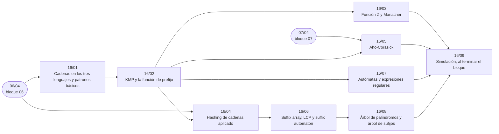

# Bloque 16 — Cadenas

> Las cadenas, de los tres lenguajes a los árboles de sufijos: inmutabilidad y patrones básicos, la función de
> prefijo y KMP, la función Z y Manacher, el *hashing* de cadenas aplicado, Aho-Corasick, el *suffix array* con su LCP,
> los autómatas y las expresiones regulares (con ReDoS), y como fichas el árbol de palíndromos y Ukkonen.
>
> Las respuestas de las preguntas y las pistas 2 y 3 de los problemas, en [`10` — Respuestas](10-respuestas.md).
>
> **Vigencia:** 2026-10-04.

---

## 🧭 Índice

| Capítulo | Niveles | Ruta corta |
|---|---|---|
| [`16/01` — Cadenas en los tres lenguajes y patrones básicos](01-cadenas-y-patrones-basicos.md) | inmutabilidad y concatenación [A] · frecuencias y anagramas [A] · palíndromos con dos punteros [A] |  |
| [`16/02` — KMP y la función de prefijo](02-kmp.md) | función de prefijo [A] · KMP [A] · autómata de KMP [B] |  |
| [`16/03` — Función Z y Manacher](03-funcion-z-y-manacher.md) | función Z [B] · Manacher [B] |  |
| [`16/04` — *Hashing* de cadenas aplicado](04-hashing-de-cadenas.md) | comparar subcadenas [B] · binaria + *hash* [B] |  |
| [`16/05` — Aho-Corasick](05-aho-corasick.md) | Aho-Corasick [B] |  |
| [`16/06` — *Suffix array*, LCP y *suffix automaton*](06-suffix-array-y-automaton.md) | *suffix array* `O(n log n)` [B] · LCP de Kasai [B] · *suffix automaton* [C] |  |
| [`16/07` — Autómatas y expresiones regulares](07-automatas-y-expresiones-regulares.md) | DFA y NFA [B] · Thompson [B] · subconjuntos [B] · *backtracking* y ReDoS [B] |  |
| [`16/08` — Árbol de palíndromos y árbol de sufijos](08-eertree-y-ukkonen.md) | *eertree* [C] · Ukkonen [C] |  |
| [`16/09` — Simulación](09-simulacion.md) | El examen del bloque: preguntas transversales y problemas cronometrados | |
| [`16/10` — Respuestas](10-respuestas.md) | Las preguntas en tres capas y las pistas 2 y 3 | |

---

## 🧭 Orden de lectura

- `16/01` → `16/02` es la base; `16/03`–`16/05` dependen de KMP; `16/06` del *hashing* de `16/04`; `16/08` del *suffix array*.

---

## 🔎 Mapa de señales del bloque

| Señal | Técnica | Capítulo |
|---|---|---|
| «Construye la cadena», salida de `10⁵` líneas | Búfer y un solo `print` | [`16/01`](01-cadenas-y-patrones-basicos.md) |
| «Anagrama», «reordenando las letras» | Frecuencias o firma | [`16/01`](01-cadenas-y-patrones-basicos.md) |
| «Todas las apariciones», `n, m ≤ 10⁶` | KMP | [`16/02`](02-kmp.md) |
| «Prefijo que también es sufijo» | Función de prefijo | [`16/02`](02-kmp.md) |
| «Prefijo común con cada sufijo», «puntuación de cada sufijo» | Función Z | [`16/03`](03-funcion-z-y-manacher.md) |
| «Aparece con como mucho un carácter distinto» | Z en los dos sentidos | [`16/03`](03-funcion-z-y-manacher.md) |
| «La subcadena más larga que se repite / que comparten» | Binaria + *hash* | [`16/04`](04-hashing-de-cadenas.md) |
| «Compara estas dos subcadenas» muchas veces | Prefijos de *hash* y LCP | [`16/04`](04-hashing-de-cadenas.md) |
| «Diccionario de palabras», «lista de patrones», un texto grande | Aho-Corasick | [`16/05`](05-aho-corasick.md) |
| «Palabras prohibidas», «censurar» | Aho-Corasick con marcas | [`16/05`](05-aho-corasick.md) |
| «Número de subcadenas distintas» | *Suffix array* + LCP | [`16/06`](06-suffix-array-y-automaton.md) |
| «Subcadena más larga que aparece al menos `k` veces» | LCP y mínimo en ventana | [`16/06`](06-suffix-array-y-automaton.md) |
| «¿Es un número válido / una IP / un identificador?» | DFA | [`16/07`](07-automatas-y-expresiones-regulares.md) |
| «Cuántas cadenas de longitud `n` cumplen…» (propiedad regular) | DP sobre el DFA | [`16/07`](07-automatas-y-expresiones-regulares.md) |
| «Número de palíndromos distintos» | *Eertree* | [`16/08`](08-eertree-y-ukkonen.md) |
| «Partir en el mínimo de palíndromos», `n = 10⁵` | *Eertree* con series | [`16/08`](08-eertree-y-ukkonen.md) |

---

## 📚 Lectura troncal del bloque

La de cada capítulo, que es también la primera entrada de su «Para profundizar»:

- **`16/01`** — Sedgewick y Wayne, *Algorithms*, 4.ª ed. (Addison-Wesley, 2011), introducción al cap. 5; la documentación de [`std::basic_string`](https://en.cppreference.com/cpp/string/basic_string), [`StringBuilder`](https://docs.oracle.com/en/java/javase/21/docs/api/java.base/java/lang/StringBuilder.html) y [`str`](https://docs.python.org/3/builtins/stdtypes.html#text-sequence-type-str).
- **`16/02`** — Cormen, Leiserson, Rivest y Stein, *Introduction to Algorithms*, 3.ª ed. (MIT Press, 2009), §32.3 y §32.4; Sedgewick y Wayne, *Algorithms*, 4.ª ed. (Addison-Wesley, 2011), §5.3.
- **`16/03`** — Gusfield, *Algorithms on Strings, Trees and Sequences* (Cambridge, 1997), cap. 1 (la función Z); cp-algorithms, [*Manacher's Algorithm*](https://cp-algorithms.com/string/manacher.html).
- **`16/04`** — Cormen, Leiserson, Rivest y Stein, *Introduction to Algorithms*, 3.ª ed. (MIT Press, 2009), §32.2 (Rabin-Karp); [`06/04` — *Hashing* de secuencias](../06-lineales-y-hashing/04-hashing-de-secuencias.md), que es el dueño del *hash* polinomial.
- **`16/05`** — Aho y Corasick, «Efficient String Matching: An Aid to Bibliographic Search», *Communications of the ACM* 18(6), 1975; cp-algorithms, [*Aho-Corasick algorithm*](https://cp-algorithms.com/string/aho_corasick.html).
- **`16/06`** — Sedgewick y Wayne, *Algorithms*, 4.ª ed. (Addison-Wesley, 2011), cap. 6 (*suffix arrays*); Gusfield, *Algorithms on Strings, Trees and Sequences* (Cambridge, 1997), cap. 7; cp-algorithms, [*Suffix Array*](https://cp-algorithms.com/string/suffix-array.html).
- **`16/07`** — Hopcroft, Motwani y Ullman, *Introducción a la teoría de autómatas, lenguajes y computación*, 3.ª ed. (Pearson, 2007), caps. 2–4; Sedgewick y Wayne, *Algorithms*, 4.ª ed. (Addison-Wesley, 2011), §5.4.
- **`16/08`** — Gusfield, *Algorithms on Strings, Trees and Sequences* (Cambridge, 1997), cap. 6 (Ukkonen); cp-algorithms, [*Suffix Tree. Ukkonen's Algorithm*](https://cp-algorithms.com/string/suffix-tree-ukkonen.html). cp-algorithms no tiene página del *eertree*: para él, el artículo de Rubinchik y Shur (§📚).

---

## 🧭 Qué NO está aquí

- **El *hashing* de secuencias en general**: en [`06/04` — *Hashing* de secuencias](../06-lineales-y-hashing/04-hashing-de-secuencias.md).
- **Los *tries***: en [`07/04` — *Tries*](../07-arboles/04-tries.md).
- **La DP sobre cadenas** (LCS, edición): en [`12/04` — DP sobre cadenas](../12-dp-clasica/04-dp-sobre-cadenas.md).
- **Lenguajes y gramáticas más allá de lo regular**: en el bloque opcional [`22`](../22-teoria-de-la-computacion/README.md).

---

**Anterior:** [Bloque 15 — Grafos con pesos y flujos](../15-grafos-pesos-y-flujos/README.md) ·
**Siguiente:** [Bloque 17 — Matemática](../17-matematica/README.md) ·
**Inicio:** [README del corpus](../README.md)
