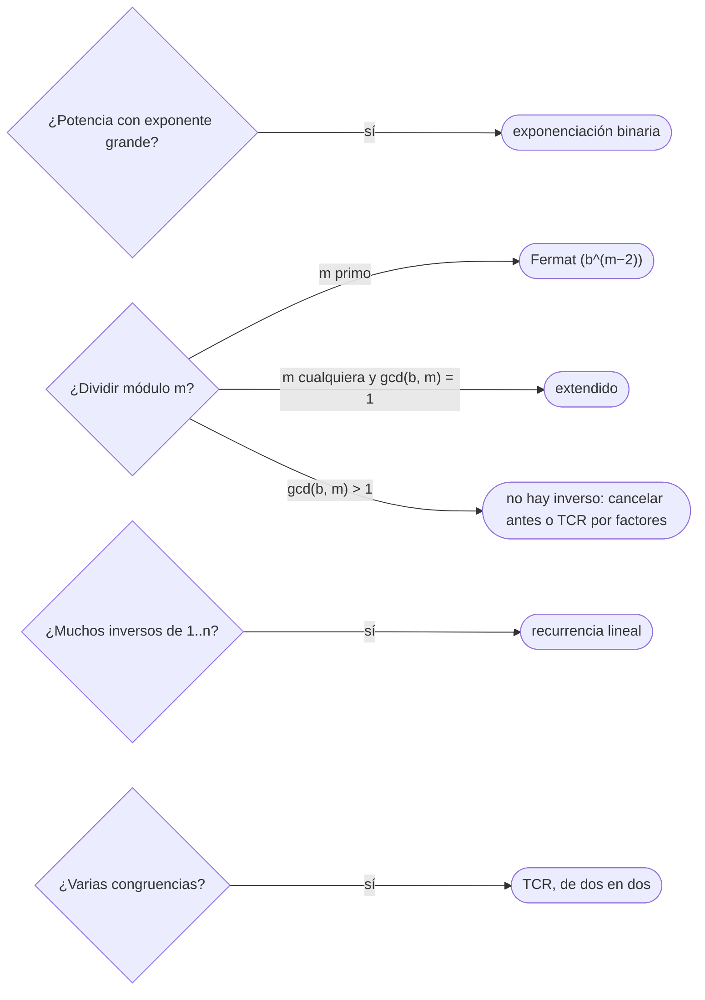

# 03 — Aritmética modular

> Calcular con restos: la exponenciación rápida, que eleva a `10¹⁸` en 60 multiplicaciones; el inverso
> modular por el pequeño teorema de Fermat o por Euclides extendido, que es lo que permite «dividir» módulo
> `p`; los inversos de `1..n` en tiempo lineal; y el teorema chino del resto, que combina congruencias. Es el
> dueño de la teoría modular; [`01/04`](../01-oficio-del-competidor/04-tipos-desbordamiento-y-modulo.md) dio
> lo básico de operar módulo `10⁹ + 7`.
>
> **Niveles:** exponenciación modular [A] · inverso por Fermat y por extendido [A] · teorema chino del
> resto [B].
>
> **📚 Lectura troncal:** Cormen, Leiserson, Rivest y Stein, *Introduction to Algorithms*, 3.ª ed. (MIT
> Press, 2009), §31.3–31.6; Graham, Knuth y Patashnik, *Concrete Mathematics*, 2.ª ed. (Addison-Wesley,
> 1994), cap. 4.
>
> **Asume leído:** [`17/02` — Divisibilidad](02-divisibilidad.md).
>
> **Vigencia:** 2026-10-04.

**Salto rápido:** [1](#1--el-problema) · [2](#2--la-teoría) · [3](#3--exponenciación-modular) · [4](#4--inverso-modular) · [5](#5--teorema-chino-del-resto) · [6](#6-️-la-tabla-de-costes) · [7](#7--cómo-se-elige) · [8](#8--señales-del-enunciado) · [🧠](#-preguntas) · [🧩](#-problemas-propios)

---

## 1. 🎯 El problema

Un problema pide «la probabilidad, como fracción `P/Q`, módulo `10⁹ + 7`». La tentación es calcular `P` y
`Q` módulo `10⁹ + 7` y dividirlos: da basura, porque la división entera no respeta los restos (`10/5 = 2`,
pero `(10 mod 7) / (5 mod 7) = 3/5`). Lo que existe es el **inverso**: un número `Q⁻¹` con `Q · Q⁻¹ ≡ 1`, y
«dividir» es multiplicar por él. Para un primo `p`, Fermat da `Q⁻¹ = Q^(p−2) mod p`, que exige elevar a una
potencia de `10⁹`, y eso pide exponenciación rápida.

Este capítulo construye las tres herramientas: potencia en `O(log e)`, inverso en `O(log p)` y la
combinación de congruencias con módulos distintos.

> 🧠 **Modelo mental.** Módulo `m`, los enteros viven en un reloj de `m` horas. Sumar, restar y multiplicar
> se hacen en el reloj sin problema; dividir solo se puede por las horas que tienen «vuelta atrás», y cuando
> `m` es primo, son todas menos el 0.

Los ejemplos usan el módulo `13`: `7⁻¹ ≡ 2` porque `7 · 2 = 14 ≡ 1`.

---

## 2. 📐 La teoría

**Congruencias.** `a ≡ b (mod m)` si `m | a − b`. Suma, resta y producto respetan las congruencias: se puede
reducir módulo `m` en cualquier momento. La división no.

**Inverso.** `a` tiene inverso módulo `m` si y solo si `gcd(a, m) = 1`. Si lo tiene, es único módulo `m`.

*Prueba.* `a x ≡ 1 (mod m)` es `a x + m y = 1`, que tiene solución si y solo si `gcd(a, m) = 1` (Bézout,
`17/02`). Si `x` y `x′` son inversos, `a(x − x′) ≡ 0` y, multiplicando por un inverso, `x ≡ x′`.

**Pequeño teorema de Fermat.** Si `p` es primo y `p ∤ a`, `a^(p−1) ≡ 1 (mod p)`. Por tanto
`a⁻¹ ≡ a^(p−2) (mod p)`.

*Prueba.* Los productos `a · 1, a · 2, …, a · (p − 1)` son distintos módulo `p` (si `ai ≡ aj`, multiplicando
por el inverso, `i ≡ j`) y ninguno es 0: son una permutación de `1, …, p − 1`. Multiplicándolos todos,
`a^(p−1) (p − 1)! ≡ (p − 1)!`, y `(p − 1)!` es invertible.

**Teorema de Euler.** Si `gcd(a, m) = 1`, `a^φ(m) ≡ 1 (mod m)`, con `φ` la función de Euler ([`17/04`](04-primos.md)). Fermat
es el caso `m = p`, `φ(p) = p − 1`.

**Exponenciación binaria.** `a^e = (a^(e/2))²` si `e` es par, y `a · a^(e−1)` si es impar. Con los bits de `e`:
`O(log e)` multiplicaciones.

**Teorema chino del resto (TCR).** Si `m₁, …, m_k` son coprimos dos a dos, el sistema `x ≡ aᵢ (mod mᵢ)`
tiene una única solución módulo `M = Π mᵢ`. Con módulos no coprimos, dos congruencias son compatibles si y
solo si `a₁ ≡ a₂ (mod gcd(m₁, m₂))`, y la solución es única módulo `mcm(m₁, m₂)`.

**Inversos de `1..n` en lineal.** Para `p` primo e `i < p`: escribiendo `p = q·i + r`, se tiene
`0 ≡ q·i + r`, así que `i⁻¹ ≡ −q · r⁻¹ (mod p)` con `r < i`, ya calculado.

---

## 3. 🧱 Exponenciación modular

**Qué es.** Calcular `a^e mod m` recorriendo los bits de `e`: se va elevando `a` al cuadrado y se multiplica
al resultado cuando el bit es 1.

**Por qué es correcto.** `a^e = Π a^(2^i)` sobre los bits `i` encendidos de `e`, y cada `a^(2^i)` es el
cuadrado del anterior; reducir módulo `m` en cada paso respeta la congruencia.

**Cómo va**, `7^11 mod 13` (`11 = 1011₂`):

```text
bit   base (a^(2^i) mod 13)   resultado
1     7                        7
1     49 mod 13 = 10           7 · 10 = 70 mod 13 = 5
0     100 mod 13 = 9           5
1     81 mod 13 = 3            5 · 3 = 15 mod 13 = 2      → 7^11 ≡ 2 = 7⁻¹ (Fermat: 11 = 13 − 2)
```

**Cuánto.** `O(log e)` multiplicaciones modulares.

**La plantilla:**

```cpp
#include <cstdint>

// a^e mod m, con m hasta ~3·10⁹ (el producto cabe en 64 bits sin signo). Para m hasta 10¹⁸, __int128.
long long powMod(long long a, long long e, long long m) {
    long long result = 1 % m;
    a %= m;
    if (a < 0) a += m;
    while (e > 0) {
        if (e & 1) result = (__int128)result * a % m;
        a = (__int128)a * a % m;
        e >>= 1;
    }
    return result;
}
```

```java
// a^e mod m con m < 2^31: los productos de dos restos caben en long.
static long powMod(long a, long e, long m) {
    long result = 1 % m;
    a %= m;
    if (a < 0) a += m;
    while (e > 0) {
        if ((e & 1) == 1) result = result * a % m;
        a = a * a % m;
        e >>= 1;
    }
    return result;
}
// Con m hasta 10¹⁸: BigInteger.modPow, o multiplicar con Math.multiplyHigh.
```

```python
# Python ya lo trae: pow(a, e, m), con enteros sin límite; pow(a, -1, m) es el inverso (3.8+).
def pow_mod(a, e, m):
    result, a = 1 % m, a % m
    while e > 0:
        if e & 1:
            result = result * a % m
        a = a * a % m
        e >>= 1
    return result
```

- **`1 % m`** como valor inicial cubre `m = 1` (todo es 0).
- **El producto de dos restos** de `10⁹` cabe en 64 bits; de `10¹⁸`, no: `__int128` en C++, `BigInteger` o
  `Math.multiplyHigh` en Java, nada en Python.
- **Exponentes enormes** (`a^(b^c)`): por Fermat, el exponente se reduce módulo `p − 1` (si `p ∤ a`).
- **La misma idea** eleva matrices ([`13/06`](../13-dp-avanzada/06-recurrencias-lineales-y-matrices.md)) y compone funciones: cualquier operación asociativa.

### De la versión ingenua a la buena

**El problema.** Las tres últimas cifras de `3^(10¹⁸)`.

**La versión ingenua:**

```java
// Correcta: multiplicar e veces reduciendo módulo m. Θ(e): con e = 10¹⁸, no termina.
static long powNaive(long a, long e, long m) {
    long r = 1 % m;
    for (long i = 0; i < e; i++) r = r * a % m;
    return r;
}
```

> «`a^e` es el producto de los `a^(2^i)` de los bits encendidos de `e`, y cada uno es el cuadrado del
> anterior: 60 cuadrados y como mucho 60 productos para `e = 10¹⁸`.»

**El camino a la buena.** Exponenciación binaria: `O(log e)`. La respuesta es `001` (el orden de 3 módulo
1 000 divide a 100, y `10¹⁸` es múltiplo de 100).

**Cuándo sí:** potencias con exponentes grandes, inversos por Fermat, potencias de matrices, tests de
primalidad (`17/04`). **Cuándo no:** si se necesitan todas las potencias `a⁰, …, aⁿ`: se precalculan con un
producto cada una.

> **Veredicto:** la exponenciación binaria eleva en `O(log e)`; el valor inicial `1 % m` y el producto en
> el tipo adecuado son los dos detalles.

---

## 4. 🧱 Inverso modular

**Qué es.** El `x` con `a x ≡ 1 (mod m)`. Con `m` primo: `a^(m−2)` (Fermat). Con cualquier `m` y
`gcd(a, m) = 1`: el coeficiente de Euclides extendido. Para todos los de `1..n` con `p` primo: la recurrencia
lineal.

**Por qué es correcto.** Fermat y Bézout (§2). La recurrencia lineal, por `p = q·i + r`.

**Cómo va**, módulo 13:

```text
Fermat:      7^(13−2) = 7^11 ≡ 2                     comprobación: 7 · 2 = 14 ≡ 1
extendido:   7·x + 13·y = 1 → x = 2, y = −1
lineal:      inv[1..12] = 1 7 9 10 8 11 2 5 3 4 6 12
dividir:     10 / 5 módulo 7 = 10 · 5⁻¹ = 3 · 3 = 9 ≡ 2  ✓   (y no (10 mod 7) / (5 mod 7) = 3/5)
```

**Cuánto.** `O(log p)` por inverso; `Θ(n)` los de `1..n`.

**La plantilla:**

```cpp
#include <vector>

long long powMod(long long a, long long e, long long m);        // la de §3
long long extGcd(long long a, long long b, long long& x, long long& y);   // la de 17/02

long long invFermat(long long a, long long p) { return powMod(a, p - 2, p); }   // p primo, p ∤ a

long long invExt(long long a, long long m) {                    // gcd(a, m) = 1; −1 si no existe
    long long x, y;
    if (extGcd(((a % m) + m) % m, m, x, y) != 1) return -1;
    return ((x % m) + m) % m;
}

std::vector<long long> inversesUpTo(int n, long long p) {       // inv[i] para 1 ≤ i ≤ n < p, p primo
    std::vector<long long> inv(n + 1);
    inv[1] = 1;
    for (int i = 2; i <= n; i++) inv[i] = (p - (p / i) * inv[p % i] % p) % p;
    return inv;
}
```

```java
static long invFermat(long a, long p) { return powMod(a, p - 2, p); }

static long invExt(long a, long m) {                             // usa extGcd de 17/02
    long[] e = extGcd(((a % m) + m) % m, m);
    if (e[0] != 1) return -1;
    return ((e[1] % m) + m) % m;
}

static long[] inversesUpTo(int n, long p) {
    long[] inv = new long[n + 1];
    inv[1] = 1;
    for (int i = 2; i <= n; i++) inv[i] = (p - (p / i) * inv[(int) (p % i)] % p) % p;
    return inv;
}
```

```python
def inv_fermat(a, p):
    return pow(a, p - 2, p)

def inv_ext(a, m):
    return pow(a, -1, m)                                 # 3.8+: lanza ValueError si no existe

def inverses_up_to(n, p):
    inv = [0, 1] + [0] * (n - 1)
    for i in range(2, n + 1):
        inv[i] = (p - (p // i) * inv[p % i] % p) % p
    return inv
```

- **Fermat exige `p` primo** y `a` no múltiplo de `p`; con `a ≡ 0`, `powMod` devuelve 0, que no es un
  inverso: hay que comprobarlo antes.
- **El extendido** vale con cualquier módulo y dice si el inverso existe.
- **Inversos de factoriales** (para `nCr`, [`17/05`](05-combinatoria.md)): el del mayor con Fermat y los demás hacia atrás,
  `invFact[i − 1] = invFact[i] · i`.
- **Restos negativos**: `((x % m) + m) % m` en C++ y Java; en Python `%` ya es no negativo.

### De la versión ingenua a la buena

**El problema.** Imprimir la fracción `a/b` módulo `p = 10⁹ + 7` para `10⁵` pares `(a, b)`. `7/3` es
`7 · 3⁻¹ = 7 · 333 333 336 ≡ 333 333 338`.

**La versión ingenua:** buscar `x` de 0 a `p − 1` con `b · x ≡ a (mod p)`. Correcta, `Θ(p)` por par.

> «`b · x ≡ a` es `x ≡ a · b⁻¹`, y como `p` es primo, `b⁻¹ = b^(p−2)`: una potencia rápida de 30 pasos por
> par.»

**El camino a la buena.** `a · powMod(b, p − 2, p) % p`: `O(log p)` por par.

**Cuándo sí:** fracciones módulo `p` (probabilidades, esperanzas), combinatoria con divisiones (`17/05`),
resolver `a x ≡ b`. **Cuándo no:** si el módulo no es primo y `gcd(b, m) ≠ 1`: no hay inverso, y hay que
cancelar factores comunes antes o cambiar de enfoque.

> **Veredicto:** dividir módulo `p` es multiplicar por el inverso: `b^(p−2)` si `p` es primo, el extendido
> si no; los de `1..n`, en lineal.

---

## 5. 🧱 Teorema chino del resto

**Qué es.** Combinar `x ≡ a₁ (mod m₁)` y `x ≡ a₂ (mod m₂)` en una sola congruencia `x ≡ a (mod mcm(m₁, m₂))`,
y repetir con las demás.

**Por qué es correcto.** De la primera, `x = a₁ + m₁ t`; en la segunda, `m₁ t ≡ a₂ − a₁ (mod m₂)`: una
diofántica que tiene solución si y solo si `g = gcd(m₁, m₂)` divide a `a₂ − a₁`, y entonces `t` es único
módulo `m₂ / g`.

**Cómo va**, el problema de Sunzi: `x ≡ 2 (mod 3)`, `x ≡ 3 (mod 5)`, `x ≡ 2 (mod 7)`:

```text
x = 2 + 3t;  3t ≡ 1 (mod 5) → t ≡ 2 → x ≡ 8 (mod 15)
x = 8 + 15t; 15t ≡ −6 (mod 7) → t ≡ 1 → x ≡ 23 (mod 105)
con módulos no coprimos: x ≡ 1 (mod 4), x ≡ 3 (mod 6) → gcd 2 divide a 2 → x ≡ 9 (mod 12)
x ≡ 0 (mod 4), x ≡ 1 (mod 6) → gcd 2 no divide a 1 → sin solución
```

**Cuánto.** `O(k log M)` para `k` congruencias, con `M` el mcm final.

**La plantilla**, módulos arbitrarios (no necesariamente coprimos):

```cpp
long long extGcd(long long a, long long b, long long& x, long long& y);   // 17/02

// Combina x ≡ a1 (mod m1) y x ≡ a2 (mod m2). Devuelve false si son incompatibles.
// Resultado en a1, m1 (m1 pasa a ser el mcm). Supone que el mcm cabe en 64 bits.
bool crtMerge(long long& a1, long long& m1, long long a2, long long m2) {
    long long p, q, g = extGcd(m1, m2, p, q);            // m1·p + m2·q = g
    long long diff = a2 - a1;
    if (diff % g != 0) return false;
    long long m2g = m2 / g;
    long long t = (__int128)(diff / g) % m2g * (p % m2g) % m2g;   // t ≡ (diff/g)·p (mod m2/g)
    if (t < 0) t += m2g;
    long long lcm = m1 / g * m2;
    a1 = ((__int128)m1 * t + a1) % lcm;
    if (a1 < 0) a1 += lcm;
    m1 = lcm;
    return true;
}
```

```java
// Con BigInteger para no preocuparse del mcm; long[] r = {a, m}.
static boolean crtMerge(java.math.BigInteger[] r, long a2, long m2) {
    java.math.BigInteger a1 = r[0], m1 = r[1], A2 = java.math.BigInteger.valueOf(a2), M2 = java.math.BigInteger.valueOf(m2);
    java.math.BigInteger g = m1.gcd(M2), diff = A2.subtract(a1);
    if (diff.mod(g).signum() != 0) return false;
    java.math.BigInteger m2g = M2.divide(g);
    java.math.BigInteger t = diff.divide(g).multiply(m1.divide(g).modInverse(m2g)).mod(m2g);
    r[0] = a1.add(m1.multiply(t));
    r[1] = m1.multiply(m2g);
    r[0] = r[0].mod(r[1]);
    return true;
}
```

- **Empezar con `x ≡ 0 (mod 1)`** y combinar las congruencias de una en una.
- **El mcm puede crecer**: si pasa de `10¹⁸`, `__int128` o `BigInteger`; si el enunciado lo acota, basta 64
  bits con productos en 128.
- **Uso clásico**: calcular algo módulo un número compuesto `m = Π pᵢ^kᵢ` calculándolo módulo cada factor y
  combinando (Lucas generalizado, `17/05`).

**Cuándo sí:** sistemas de congruencias, ciclos con periodos distintos que tienen que coincidir, reconstruir
un número a partir de sus restos. **Cuándo no:** si los módulos son pequeños y pocos, una búsqueda directa en
`[0, mcm)` es más simple.

> **Veredicto:** el TCR combina congruencias de dos en dos con una diofántica; con módulos no coprimos,
> hay solución si las diferencias son múltiplos del gcd.

---

## 6. ⏱️ La tabla de costes

| Operación | Coste | Lo que la tabla no dice |
|---|---|---|
| `a^e mod m` | `O(log e)` | `1 % m` al empezar; productos en 64 o 128 bits |
| Inverso por Fermat | `O(log p)` | Solo con `p` primo y `p ∤ a` |
| Inverso por extendido | `O(log m)` | Dice si existe |
| Inversos de `1..n` | `Θ(n)` | `p` primo, `n < p` |
| Combinar dos congruencias | `O(log)` | El mcm puede desbordar |

---

## 7. 🧭 Cómo se elige



> **Regla de entrevista:** cuando el enunciado diga «módulo `10⁹ + 7`» y haya una división, di «multiplico
> por el inverso, que existe porque el módulo es primo» antes de escribirlo.

---

## 8. 🔎 Señales del enunciado

| Señal | Técnica | Por qué |
|---|---|---|
| «Módulo `10⁹ + 7`» y una fracción o un cociente | Inverso por Fermat | El módulo es primo |
| Exponentes de `10¹⁸`, «`a^(b^c)`» | Exponenciación binaria (y Fermat en el exponente) | `O(log)` |
| «Restos de `x` al dividir entre…» | TCR | Reconstruir `x` |
| «Después de cuántos pasos coinciden» ciclos con fases | TCR con módulos no coprimos | Congruencias simultáneas |

---

## ⚠️ Errores frecuentes

| Se dice | Lo preciso |
|---|---|
| «Dividir módulo `p` es dividir y aplicar módulo» | `(10 mod 7) / (5 mod 7)` no es `(10/5) mod 7`; se multiplica por el inverso |
| «Todo número tiene inverso módulo `m`» | Solo si `gcd(a, m) = 1`; módulo primo, todos menos los múltiplos de `p` |
| «Fermat vale con cualquier módulo» | Exige `p` primo; con compuestos, Euler (`φ`) o el extendido |
| «`a^(b^c)` se reduce con el exponente módulo `p`» | Módulo `p − 1` (Fermat), y solo si `p ∤ a` |
| «El producto de dos restos cabe en `long`» | Con módulos de `10¹⁸`, no: 128 bits |
| «`%` da siempre un resto no negativo» | En C++ y Java, con negativos da negativos |

---

## 📚 Para profundizar

- **Libro** — Cormen, Leiserson, Rivest y Stein, *Introduction to Algorithms*, 3.ª ed. (MIT Press, 2009),
  §31.3–31.6: aritmética modular, ecuaciones lineales, TCR y potencias. *Lectura troncal.*
- **Libro** — Graham, Knuth y Patashnik, *Concrete Mathematics*, 2.ª ed. (Addison-Wesley, 1994), cap. 4:
  congruencias, Fermat y Euler. *Lectura troncal.*
- **Referencia** — cp-algorithms, [*Binary Exponentiation*](https://cp-algorithms.com/algebra/binary-exp.html).
- **Referencia** — cp-algorithms, [*Modular Multiplicative Inverse*](https://cp-algorithms.com/algebra/module-inverse.html).
- **Referencia** — cp-algorithms, [*Chinese Remainder Theorem*](https://cp-algorithms.com/algebra/chinese-remainder-theorem.html).

---

## 🧠 Preguntas

1. ¿Cómo calculas `a^e mod m` en `O(log e)`? 🟢
2. ¿Cuándo tiene inverso `a` módulo `m`? 🟢
3. ¿Cómo calculas el inverso módulo un primo? 🟢
4. ¿Por qué no se puede dividir y luego aplicar el módulo? Da un ejemplo. 🟢
5. ¿Qué tipos usas para multiplicar dos restos en C++, Java y Python según el tamaño del módulo? 🟡
6. ¿Cómo calculas los inversos de `1..n` módulo `p` en lineal? 🟡
7. ¿Cómo reduces el exponente de `a^(b^c) mod p`? 🟡
8. Demuestra el pequeño teorema de Fermat. 🟠
9. ¿Qué dice el teorema chino del resto con módulos coprimos, y qué cambia si no lo son? 🟠
10. Deduce la recurrencia `inv[i] = −⌊p/i⌋ · inv[p mod i]`. 🟠
11. ¿Cómo calculas los inversos de todos los factoriales hasta `n` con una sola exponenciación? 🟠
12. ¿Qué haces si tienes que dividir módulo un número compuesto y el divisor no es coprimo con él? 🔴
13. ¿Cómo calcularías `n! mod m` para `m` compuesto pequeño y `n` enorme, combinando resultados? 🔴

---

## 🧩 Problemas propios

### Las últimas cifras

**Nivel:** 🟢 · **Formato:** programa completo.

Imprime las `k` últimas cifras de `aᵉ`, con ceros a la izquierda si hace falta.

- **Entrada.** Una línea con `a`, `e` y `k`.
- **Salida.** Una cadena de `k` cifras.
- **Restricciones.** `1 ≤ a ≤ 10⁹`; `0 ≤ e ≤ 10¹⁸`; `1 ≤ k ≤ 9`.

```text
Entrada                     Salida
3 1000000000000000000 3     001

Entrada                     Salida
2 10 3                      024
```

**Pista 1:** ¿qué módulo da las `k` últimas cifras?

### Todos los inversos

**Nivel:** 🟡 · **Formato:** programa completo.

Imprime los inversos de `1, 2, …, n` módulo el primo `p`.

- **Entrada.** Una línea con `n` y `p`.
- **Salida.** `n` enteros separados por espacios.
- **Restricciones.** `1 ≤ n < p ≤ 10⁹ + 7`; `n ≤ 10⁶`; `p` primo.

```text
Entrada       Salida
12 13         1 7 9 10 8 11 2 5 3 4 6 12

Entrada       Salida
2 1000000007  1 500000004
```

**Pista 1:** con `10⁶` inversos, ¿te cabe una exponenciación por cada uno, o hay algo mejor?

### Congruencias

**Nivel:** 🟠 · **Formato:** programa completo.

Imprime el menor `x ≥ 0` que cumple las `k` congruencias `x ≡ aᵢ (mod mᵢ)`, o `-1` si no existe.

- **Entrada.** Una línea con `k`. Después, `k` líneas con `aᵢ mᵢ`.
- **Salida.** Un entero.
- **Restricciones.** `1 ≤ k ≤ 10⁴`; `1 ≤ mᵢ ≤ 10⁹`; `0 ≤ aᵢ < mᵢ`; el mcm de todos los módulos es `≤ 10¹⁸`.

```text
Entrada     Salida
3           23
2 3
3 5
2 7

Entrada     Salida
2           -1
0 4
1 6
```

**Pista 1:** si combinas dos congruencias en una, ¿cuántas veces tienes que hacerlo?

🔥 **Para el geek — en JavaScript:** el producto de dos restos de `10⁹` llega a `10¹⁸`, que no es exacto en
un `Number` (53 bits de mantisa): `a * b % p` da un resultado erróneo sin avisar. Hay que usar `BigInt` o
partir un factor en mitades de 16 bits.

---

## 🧩 Práctica externa

> 💡 **Truco.** Antes de pedir ayuda con una fracción módulo `p` que no cuadra, comprueba `b · b⁻¹ % p == 1`
> en tu propio código: si falla, el error está en el inverso, no en la fórmula. Si una IA te ayuda, que sea
> a revisar eso ([`01/06`](../01-oficio-del-competidor/06-protocolo-de-resolucion.md)). Las potencias
> básicas de CSES (*Exponentiation* y *Exponentiation II*) ya están en [`02/02`](../02-analisis/02-recurrencias-y-teorema-maestro.md) y [`03/06`](../03-biblioteca-estandar/06-sin-arsenal-go-y-javascript.md).

### Núcleo

| ✔ | Problema | Plataforma | Nivel | Patrón | Pista 1 |
|---|---|---|---|---|---|
| [ ] | [Modular Arithmetic](https://open.kattis.com/problems/modulararithmetic) | Kattis | 🟡 | Las cuatro operaciones módulo `n` | ¿Qué devuelves si el divisor no tiene inverso? |
| [ ] | [Count Collisions of Monkeys on a Polygon](https://leetcode.com/problems/count-collisions-of-monkeys-on-a-polygon/) | LeetCode | 🟡 | Potencia modular | ¿Cuántos movimientos no producen colisión? |
| [ ] | [Power of large numbers](https://www.hackerrank.com/challenges/power-of-large-numbers/problem) | HackerRank | 🟡 | Reducir base y exponente | ¿Módulo qué reduces el exponente? |
| [ ] | [Chinese Remainder](https://open.kattis.com/problems/chineseremainder) | Kattis | 🟡 | TCR con coprimos | ¿Caben los productos en 64 bits? |
| [ ] | [Chinese Remainder Theorem (non-relatively prime moduli)](https://open.kattis.com/problems/generalchineseremainder) | Kattis | 🟠 | TCR general | ¿Cuándo son incompatibles dos congruencias? |

### Ampliación

| ✔ | Problema | Plataforma | Nivel | Patrón | Pista 1 |
|---|---|---|---|---|---|
| [ ] | [Divisor Analysis](https://cses.fi/problemset/task/2182) | CSES | 🟠 | Fermat en el exponente | El producto de los divisores es `n^(d/2)`: ¿cómo lo calculas si `d` es impar? |
| [ ] | [Remainders Game](https://codeforces.com/problemset/problem/687/B) | Codeforces | 🟠 | TCR y mcm | ¿Qué tiene que dividir al mcm de los `cᵢ` para conocer `x mod k`? |
| [ ] | [Discrete Logarithm](https://judge.yosupo.jp/problem/discrete_logarithm_mod) | Library Checker | 🔴 | Paso de bebé, paso de gigante | Si escribes `x = i·s − j`, ¿qué tabla precalculas para no probar todos los `x`? |
| [ ] | [Tetration Mod](https://judge.yosupo.jp/problem/tetration_mod) | Library Checker | 🔴 | Euler generalizado en el exponente | ¿Qué pasa con `φ` aplicada una y otra vez, y cuándo puedes reducir el exponente? |

---

## ✅ Criterio de dominio

- Escribir la potencia modular y los dos inversos en los tres lenguajes sin mirar.
- Demostrar Fermat y la existencia del inverso.
- Calcular los inversos de `1..n` y de los factoriales en lineal.
- Combinar congruencias con módulos no coprimos con la plantilla delante.
- Resolver Chinese Remainder (general) y Divisor Analysis sin pista 2.

---

**Anterior:** [`17/02` — Divisibilidad](02-divisibilidad.md) · **Siguiente:** [`17/04` — Primos](04-primos.md) ·
**Relacionado:** [`01/04` — Tipos, desbordamiento y módulo](../01-oficio-del-competidor/04-tipos-desbordamiento-y-modulo.md).
