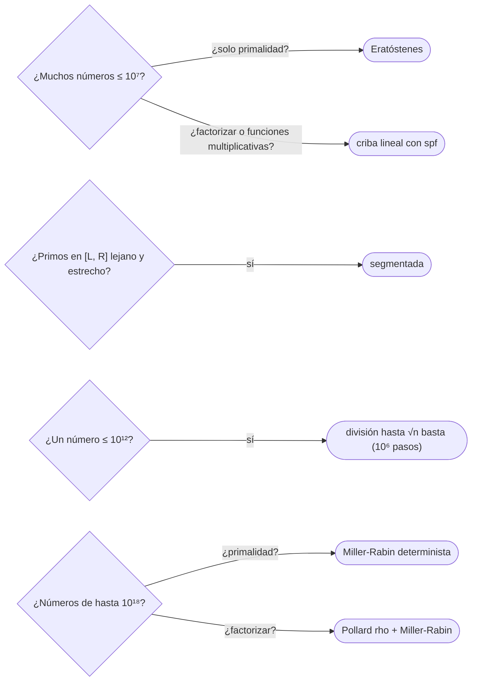

# 04 — Primos

> Generar primos y factorizar: la criba de Eratóstenes en `O(n log log n)`, la criba lineal que además da
> el menor factor primo de cada número —y con él, factorizaciones en `O(log n)`—, la criba segmentada para
> rangos lejanos, la función `φ` de Euler, el test de Miller-Rabin determinista para 64 bits y, en ficha,
> la factorización de Pollard rho. Con la cuenta que desmonta «comprobar hasta `√n` basta».
>
> **Niveles:** criba de Eratóstenes [A] · criba lineal y menor factor primo [A] · criba segmentada [B] · φ
> [B] · Miller-Rabin [B] · Pollard rho [C].
>
> **📚 Lectura troncal:** Cormen, Leiserson, Rivest y Stein, *Introduction to Algorithms*, 3.ª ed. (MIT
> Press, 2009), §31.8–31.9; Crandall y Pomerance, *Prime Numbers: A Computational Perspective*, 2.ª ed.
> (Springer, 2005).
>
> **Asume leído:** [`17/03` — Aritmética modular](03-aritmetica-modular.md).
>
> **Vigencia:** 2026-10-04.

**Salto rápido:** [1](#1--el-problema) · [2](#2--la-teoría) · [3](#3--criba-de-eratóstenes) · [4](#4--criba-lineal-y-menor-factor-primo) · [5](#5--criba-segmentada) · [6](#6--la-función-φ) · [7](#7--miller-rabin) · [8](#8--pollard-rho) · [9](#9-️-la-tabla-de-costes) · [10](#10--cómo-se-elige) · [11](#11--señales-del-enunciado) · [🧠](#-preguntas) · [🧩](#-problemas-propios)

---

## 1. 🎯 El problema

¿Es primo `10¹⁸ + 9`? La división por todos los candidatos hasta `√n` son `10⁹` divisiones: un segundo por
número, y el enunciado trae `10⁵` números. ¿Cuántos primos hay hasta `10⁷`? Comprobar cada uno por
divisiones es `n √n`, `3·10¹⁰`. Y factorizar `10⁵` números de hasta `10⁶` por divisiones son `10⁸`.

Cada pregunta tiene su herramienta. Para muchos números pequeños, una criba los procesa a todos juntos en
casi lineal. Para factorizar muchos, el menor factor primo precalculado da cada factorización en
`O(log n)`. Para un número enorme, Miller-Rabin decide la primalidad con una docena de exponenciaciones, y
Pollard rho lo factoriza en `O(n^(1/4))`.

> 🧠 **Modelo mental.** La criba no pregunta «¿es primo este número?»; tacha, para cada primo, todos sus
> múltiplos. Lo que queda sin tachar es primo. Trabajar por múltiplos en lugar de por divisores es lo que la
> hace rápida.

Los ejemplos usan `n = 30` (primos `2 3 5 7 11 13 17 19 23 29`) y `360 = 2³ · 3² · 5`.

---

## 2. 📐 La teoría

**Infinitos primos y su densidad.** Hay infinitos (Euclides), y hasta `n` hay unos `n / ln n` (teorema de
los números primos): `78 498` hasta `10⁶`, `664 579` hasta `10⁷`. La distancia entre primos consecutivos
hasta `10¹⁸` no pasa de unos 1 500.

**Divisores hasta `√n`.** Un compuesto `n` tiene un divisor primo `≤ √n`. De ahí la división por tentativa
en `O(√n)` y que la criba empiece a tachar en `p²`.

**Coste de la criba.** Tachar los múltiplos de cada primo `p ≤ n` cuesta `n/p`; la suma sobre primos es
`n · Σ 1/p = Θ(n log log n)` (Mertens). Prácticamente lineal.

**Criba lineal.** Cada compuesto `x` se tacha **una sola vez**, por su menor factor primo: para cada `i`, se
tachan `i · p` para los primos `p ≤ spf(i)`. `Θ(n)` exacto, y deja `spf[x]` (el menor factor primo).

**Divisores desde la factorización.** Si `n = Π pᵢ^eᵢ`, el número de divisores es `Π (eᵢ + 1)`, la suma
`Π (pᵢ^(eᵢ+1) − 1)/(pᵢ − 1)` y `φ(n) = n Π (1 − 1/pᵢ)`. Para `360`: 24 divisores, suma 1 170, `φ = 96`.

**Miller-Rabin.** Si `p` es primo impar y `p − 1 = d · 2^s` con `d` impar, para cualquier `a` no múltiplo
de `p` se cumple `a^d ≡ 1` o `a^(d·2^r) ≡ −1` para algún `r < s` (los únicos `x` con `x² ≡ 1` son `±1`). Si
una base `a` incumple eso, `n` es compuesto con certeza. Con las bases `2, 3, 5, 7, 11, 13, 17, 19, 23, 29,
31, 37`, el test es **determinista** para todo `n < 3,3·10²⁴`, que cubre 64 bits.

**Fermat no basta.** Los números de Carmichael (`561 = 3 · 11 · 17`) cumplen `a^(n−1) ≡ 1` para toda base
coprima: el test de Fermat los toma por primos. Miller-Rabin no: con `a = 2`, la cadena `2^35, 2^70, 2^140,
2^280` módulo 561 es `263, 166, 67, 1`, y llega a 1 sin pasar por `−1`.

---

## 3. 🧱 Criba de Eratóstenes

**Qué es.** Un arreglo booleano de `0..n`; para cada `p` de 2 a `√n` que siga marcado, tachar `p², p² + p,
…`.

**Por qué es correcto.** Un compuesto tiene un factor primo `≤ √n` y es múltiplo de él: lo tacha ese primo.
Un primo nunca es múltiplo propio de otro número. Se empieza en `p²` porque los múltiplos menores ya los
tachó un primo más pequeño.

**Cómo va**, hasta 30:

```text
p = 2: tacha 4 6 8 … 30        p = 3: tacha 9 15 21 27 (los pares ya estaban)
p = 5: tacha 25 (y 30, ya tachado)       √30 < 6: fin
quedan: 2 3 5 7 11 13 17 19 23 29
```

**Cuánto.** `Θ(n log log n)` tiempo y `Θ(n)` bits.

**La plantilla:**

```cpp
#include <vector>

// isPrime[i] para 0 ≤ i ≤ n. vector<char> es más rápido que vector<bool> para escribir.
std::vector<char> sieve(int n) {
    std::vector<char> isPrime(n + 1, 1);
    isPrime[0] = 0;
    if (n >= 1) isPrime[1] = 0;
    for (long long p = 2; p * p <= n; p++)
        if (isPrime[p])
            for (long long q = p * p; q <= n; q += p) isPrime[q] = 0;
    return isPrime;
}
```

```java
static boolean[] sieve(int n) {
    boolean[] isPrime = new boolean[n + 1];
    java.util.Arrays.fill(isPrime, true);
    isPrime[0] = false;
    if (n >= 1) isPrime[1] = false;
    for (long p = 2; p * p <= n; p++)
        if (isPrime[(int) p])
            for (long q = p * p; q <= n; q += p) isPrime[(int) q] = false;
    return isPrime;
}
```

```python
def sieve(n):
    """bytearray: is_prime[i] es 1 si i es primo."""
    is_prime = bytearray([1]) * (n + 1)
    is_prime[0:2] = b'\x00\x00'[: n + 1]
    for p in range(2, int(n ** 0.5) + 1):
        if is_prime[p]:
            is_prime[p * p :: p] = bytes(len(range(p * p, n + 1, p)))   # tachar con un corte
    return is_prime
```

- **`p * p` en 64 bits** para que no desborde en la condición del bucle.
- **En Python**, tachar con asignación por cortes (`is_prime[p*p::p] = …`) en lugar de un bucle interior: con
  `n = 10⁷`, de minutos a menos de un segundo.
- **Solo impares** divide entre 2 la memoria y el tiempo; un `bitset` ([`17/01`](01-bits.md)), entre 8 la memoria.

### De la versión ingenua a la buena

**El problema.** ¿Cuántos primos hay hasta `n = 10⁷`?

**La versión ingenua:**

```java
// Correcta: división por tentativa hasta √x para cada x. Θ(n √n): unos 2·10¹⁰ con n = 10⁷.
static int countNaive(int n) {
    int count = 0;
    for (int x = 2; x <= n; x++) {
        boolean prime = true;
        for (int d = 2; (long) d * d <= x && prime; d++) if (x % d == 0) prime = false;
        if (prime) count++;
    }
    return count;
}
```

> «Pregunto por cada número si tiene divisores, y la mayoría de las preguntas se repiten. Al revés: por cada
> primo, tacho sus múltiplos. Cada número se tacha una vez por factor primo pequeño: `n log log n`.»

**El camino a la buena.** Criba de Eratóstenes y contar: `Θ(n log log n)`, del orden de `3·10⁷` operaciones.

**Cuándo sí:** todos los primos hasta `n ≤ 10⁸` (con bits), tablas de primalidad para muchas consultas.
**Cuándo no:** un único número grande (Miller-Rabin); primos en un rango lejano `[L, R]` (segmentada).

> **Veredicto:** la criba tacha múltiplos en lugar de probar divisores: `Θ(n log log n)` y una tabla para
> todas las consultas.

---

## 4. 🧱 Criba lineal y menor factor primo

**Qué es.** Una criba que tacha cada compuesto exactamente una vez, por su menor factor primo, y guarda
`spf[x]`. Con `spf`, factorizar `x` es dividir por `spf[x]` hasta llegar a 1.

**Por qué es correcto.** Todo compuesto `x = p · i` con `p = spf(x)` y `spf(i) ≥ p` se genera una sola vez:
cuando el bucle exterior está en `i` y el interior en `p`. Parar cuando `p > spf(i)` evita generarlo con otro
primo.

**Cómo va**, `spf` de 2 a 30:

```text
x:    2 3 4 5 6 7 8 9 10 11 12 13 14 15 16 17 18 19 20 21 22 23 24 25 26 27 28 29 30
spf:  2 3 2 5 2 7 2 3 2  11 2  13 2  3  2  17 2  19 2  3  2  23 2  5  2  3  2  29 2
factorizar 30: spf 2 → 15: spf 3 → 5: spf 5 → 1     30 = 2 · 3 · 5
```

**Cuánto.** `Θ(n)` la criba; `O(log x)` cada factorización (cada división al menos lo divide entre 2).

**La plantilla:**

```cpp
#include <utility>
#include <vector>

// spf[x] = menor factor primo de x (2 ≤ x ≤ n); primes = los primos hasta n.
void linearSieve(int n, std::vector<int>& spf, std::vector<int>& primes) {
    spf.assign(n + 1, 0);
    for (int i = 2; i <= n; i++) {
        if (spf[i] == 0) { spf[i] = i; primes.push_back(i); }
        for (int p : primes) {
            if (p > spf[i] || (long long)i * p > n) break;
            spf[i * p] = p;
        }
    }
}

// Factorización con spf: pares (primo, exponente).
std::vector<std::pair<int, int>> factorize(int x, const std::vector<int>& spf) {
    std::vector<std::pair<int, int>> f;
    while (x > 1) {
        int p = spf[x], e = 0;
        while (x % p == 0) { x /= p; e++; }
        f.push_back({p, e});
    }
    return f;
}
```

```java
static int[] spf;
static int[] primes;
static int primeCount;

static void linearSieve(int n) {
    spf = new int[n + 1];
    primes = new int[n + 1];
    primeCount = 0;
    for (int i = 2; i <= n; i++) {
        if (spf[i] == 0) { spf[i] = i; primes[primeCount++] = i; }
        for (int k = 0; k < primeCount; k++) {
            int p = primes[k];
            if (p > spf[i] || (long) i * p > n) break;
            spf[i * p] = p;
        }
    }
}

static java.util.List<int[]> factorize(int x) {             // {primo, exponente}
    java.util.List<int[]> f = new java.util.ArrayList<>();
    while (x > 1) {
        int p = spf[x], e = 0;
        while (x % p == 0) { x /= p; e++; }
        f.add(new int[]{p, e});
    }
    return f;
}
```

```python
def linear_sieve(n):
    """spf[x] = menor factor primo; primes = primos hasta n."""
    spf = [0] * (n + 1)
    primes = []
    for i in range(2, n + 1):
        if spf[i] == 0:
            spf[i] = i
            primes.append(i)
        for p in primes:
            if p > spf[i] or i * p > n:
                break
            spf[i * p] = p
    return spf, primes

def factorize(x, spf):
    f = []
    while x > 1:
        p, e = spf[x], 0
        while x % p == 0:
            x //= p
            e += 1
        f.append((p, e))
    return f
```

- **Memoria**: `spf` de `10⁷` enteros son 40 MB en C++ y Java; con `10⁸`, no cabe: criba de bits.
- **En Python**, la criba lineal hasta `10⁷` es lenta (minutos); se usa Eratóstenes con cortes para `spf`
  (`spf[p*p::p]` con el mínimo) o se reduce `n`.
- **Funciones multiplicativas** (`φ`, número de divisores, Möbius) salen de la criba lineal en `Θ(n)` con la
  misma estructura.

### De la versión ingenua a la buena

**El problema.** Factorizar `10⁵` números de hasta `10⁶`. `360 = 2³ · 3² · 5`.

**La versión ingenua:** división por tentativa hasta `√x` para cada uno. Correcta, `Θ(q √V)`: `10⁸`.

> «Si ya sé, para cada número hasta `10⁶`, cuál es su menor primo, factorizar es dividir por él una y otra
> vez: como mucho 20 divisiones por número.»

**El camino a la buena.** Criba lineal con `spf` (`Θ(V)`) y `O(log x)` por número.

**Cuándo sí:** muchas factorizaciones de números acotados; funciones multiplicativas para todos los
`x ≤ n`. **Cuándo no:** números de `10¹²` o más: división hasta `√x` (uno) o Pollard rho (muchos).

> **Veredicto:** la criba lineal da el menor factor primo de todo `x ≤ n` en `Θ(n)`; con él, cada
> factorización cuesta `O(log x)`.

---

## 5. 🧱 Criba segmentada

**Qué es.** Primos en `[L, R]` con `R` hasta `10¹²` y `R − L` hasta `10⁶`: se criban los primos hasta `√R`
y con ellos se tachan sus múltiplos dentro del intervalo.

**Por qué es correcto.** Todo compuesto de `[L, R]` tiene un factor primo `≤ √R`; el primer múltiplo de `p`
en el intervalo es `max(p², ⌈L/p⌉ · p)`.

**Cómo va.** En `[10⁹, 10⁹ + 100]`, los primos hasta `√(10⁹ + 100) ≈ 31 624` (3 401 primos) tachan sus
múltiplos; quedan 7 primos.

**Cuánto.** `Θ(√R log log √R + (R − L) log log R)` y `Θ(√R + (R − L))` de memoria.

**La plantilla:**

```cpp
#include <algorithm>
#include <vector>

// Marca de primalidad para [L, R] (R − L pequeño, R hasta ~10¹²). basePrimes: primos hasta √R.
std::vector<char> segmentedSieve(long long L, long long R, const std::vector<int>& basePrimes) {
    std::vector<char> isPrime(R - L + 1, 1);
    for (long long p : basePrimes) {
        if (p * p > R) break;
        long long start = std::max(p * p, (L + p - 1) / p * p);
        for (long long q = start; q <= R; q += p) isPrime[q - L] = 0;
    }
    if (L <= 1) for (long long x = L; x <= std::min(R, 1LL); x++) isPrime[x - L] = 0;
    return isPrime;
}
```

```java
static boolean[] segmentedSieve(long L, long R, int[] basePrimes, int count) {
    boolean[] isPrime = new boolean[(int) (R - L + 1)];
    java.util.Arrays.fill(isPrime, true);
    for (int k = 0; k < count; k++) {
        long p = basePrimes[k];
        if (p * p > R) break;
        long start = Math.max(p * p, (L + p - 1) / p * p);
        for (long q = start; q <= R; q += p) isPrime[(int) (q - L)] = false;
    }
    for (long x = L; x <= Math.min(R, 1); x++) isPrime[(int) (x - L)] = false;
    return isPrime;
}
```

**Cuándo sí:** primos en rangos lejanos; también, contar primos hasta `10⁹` o `10¹⁰` por bloques sin memoria
lineal. **Cuándo no:** si `R − L` es enorme: contar primos hasta `10¹¹` pide otros métodos (Lucy, Meissel).

> **Veredicto:** la segmentada criba un intervalo lejano con los primos hasta `√R`; memoria del tamaño del
> intervalo.

---

## 6. 🧱 La función φ

**Qué es.** `φ(n)` = cuántos `k` en `[1, n]` son coprimos con `n`. Se calcula desde la factorización:
`φ(n) = n Π (1 − 1/p)`; para todos los `n ≤ N`, con una criba.

**Por qué es correcto.** Es multiplicativa (`φ(ab) = φ(a)φ(b)` si son coprimos, por el TCR) y
`φ(p^e) = p^e − p^(e−1)` (los no coprimos con `p^e` son los múltiplos de `p`).

**Cómo va.** `φ(360) = 360 · (1/2) · (2/3) · (4/5) = 96`; `φ(13) = 12`; `φ(1) = 1`.

**Cuánto.** `O(√n)` para uno por división; `Θ(N log log N)` para todos con la criba.

**La plantilla:**

```cpp
#include <vector>

long long phi(long long n) {                             // O(√n)
    long long result = n;
    for (long long p = 2; p * p <= n; p++)
        if (n % p == 0) { while (n % p == 0) n /= p; result -= result / p; }
    if (n > 1) result -= result / n;
    return result;
}

std::vector<int> phiUpTo(int N) {                        // criba: φ de 0..N
    std::vector<int> ph(N + 1);
    for (int i = 0; i <= N; i++) ph[i] = i;
    for (int p = 2; p <= N; p++)
        if (ph[p] == p) for (int q = p; q <= N; q += p) ph[q] -= ph[q] / p;
    return ph;
}
```

En Java es la misma función con `long`; no se repite.

**Cuándo sí:** el teorema de Euler (`17/03`), contar fracciones irreducibles, pares coprimos, órdenes
multiplicativos. **Cuándo no:** si se necesita la lista de coprimos, no su número.

> **Veredicto:** `φ` sale de la factorización, `n Π (1 − 1/p)`, y para todos los `n` con una criba.

---

## 7. 🧱 Miller-Rabin

**Qué es.** Test de primalidad: escribir `n − 1 = d · 2^s` y comprobar, para cada base, que `a^d ≡ 1` o que
algún `a^(d·2^r) ≡ −1`. Con las 12 primeras bases primas es determinista en 64 bits.

**Por qué es correcto.** Si `n` es primo, `x² ≡ 1` solo tiene las raíces `±1`, y la cadena de cuadrados
desde `a^d` hasta `a^(n−1) ≡ 1` (Fermat) pasa por `−1` o empieza en 1. Una base que lo incumple es testigo
de que `n` es compuesto. La lista de bases se ha verificado por cómputo para todos los `n < 3,3·10²⁴`.

**Cómo va.** `n = 561`: `560 = 35 · 2⁴`; con `a = 2`, `263 → 166 → 67 → 1` sin pasar por 560: compuesto
(aunque `2^560 ≡ 1`, que engaña a Fermat).

**Cuánto.** `O(k log³ n)` con `k = 12` bases (cada exponenciación, `log n` productos de 128 bits).

**La plantilla:**

```cpp
#include <cstdint>
#include <initializer_list>


uint64_t mulMod(uint64_t a, uint64_t b, uint64_t m) { return (unsigned __int128)a * b % m; }
uint64_t powMod64(uint64_t a, uint64_t e, uint64_t m) {
    uint64_t r = 1; a %= m;
    while (e) { if (e & 1) r = mulMod(r, a, m); a = mulMod(a, a, m); e >>= 1; }
    return r;
}

bool isPrime64(uint64_t n) {
    if (n < 2) return false;
    for (uint64_t p : {2, 3, 5, 7, 11, 13, 17, 19, 23, 29, 31, 37}) if (n % p == 0) return n == p;
    uint64_t d = n - 1; int s = 0;
    while ((d & 1) == 0) { d >>= 1; s++; }
    for (uint64_t a : {2, 3, 5, 7, 11, 13, 17, 19, 23, 29, 31, 37}) {
        uint64_t x = powMod64(a, d, n);
        if (x == 1 || x == n - 1) continue;
        bool composite = true;
        for (int r = 1; r < s; r++) {
            x = mulMod(x, x, n);
            if (x == n - 1) { composite = false; break; }
        }
        if (composite) return false;                     // a es testigo
    }
    return true;
}
```

```java
// BigInteger para el producto de 128 bits; BigInteger.isProbablePrime también existe (probabilístico).
static boolean isPrime64(long n) {
    if (n < 2) return false;
    long[] bases = {2, 3, 5, 7, 11, 13, 17, 19, 23, 29, 31, 37};
    for (long p : bases) if (n % p == 0) return n == p;
    java.math.BigInteger N = java.math.BigInteger.valueOf(n), N1 = N.subtract(java.math.BigInteger.ONE);
    long d = n - 1; int s = 0;
    while ((d & 1) == 0) { d >>= 1; s++; }
    java.math.BigInteger D = java.math.BigInteger.valueOf(d);
    for (long a : bases) {
        java.math.BigInteger x = java.math.BigInteger.valueOf(a).modPow(D, N);
        if (x.equals(java.math.BigInteger.ONE) || x.equals(N1)) continue;
        boolean composite = true;
        for (int r = 1; r < s && composite; r++) { x = x.multiply(x).mod(N); if (x.equals(N1)) composite = false; }
        if (composite) return false;
    }
    return true;
}
```

**Cuándo sí:** primalidad de números de hasta `10¹⁸` (o `2⁶⁴`), muchas consultas. **Cuándo no:** números
pequeños con muchas consultas: la criba.

> **Veredicto:** Miller-Rabin con las 12 primeras bases primas es exacto en 64 bits: una docena de
> exponenciaciones con productos de 128 bits.

---

## 8. 🧱 Pollard rho

**Qué resuelve.** Factorizar un número de hasta `10¹⁸` cuando la división por tentativa (`10⁹` pasos) no
cabe.

**Qué garantiza.** Encuentra un factor `p` de `n` en `O(√p) = O(n^(1/4))` pasos esperados (heurístico): la
sucesión `x ← x² + c mod n` entra en un ciclo módulo `p` en unos `√p` pasos (cumpleaños), y
`gcd(|x − y|, n)` lo detecta con la liebre y la tortuga de Floyd ([`06/06`](../06-lineales-y-hashing/06-respuestas.md)). Combinado con Miller-Rabin
(primo: parar; compuesto: partir y recurrir), factoriza por completo.

**Cuánto.** Unos `10⁴`–`10⁵` pasos para `n ≈ 10¹⁸`; con la variante de Brent y productos acumulados antes
del `gcd`, bastante menos.

**Cómo reconocerlo.** «Factoriza `n ≤ 10¹⁸`», «número de divisores de `n ≤ 10¹⁸`», varias consultas así.
En el ejemplo clásico, `8051` con `c = 1` da el factor 97 en tres pasos.

**Si no te la sabes.** División por tentativa hasta `n^(1/3)` y Miller-Rabin para decidir qué queda (primo,
cuadrado de primo o producto de dos primos): sirve para contar divisores sin factorizar del todo.

**Dónde está entera.** CLRS, §31.9; cp-algorithms, [*Integer factorization*](https://cp-algorithms.com/algebra/factorization.html).

---

## 9. ⏱️ La tabla de costes

| Técnica | Coste | Lo que la tabla no dice |
|---|---|---|
| División por tentativa | `O(√n)` | `10⁹` para `10¹⁸`: inviable con muchos números |
| Eratóstenes | `Θ(n log log n)` | En Python, tachar con cortes |
| Criba lineal + `spf` | `Θ(n)` y `O(log x)` por factorización | 4 bytes por número |
| Segmentada | `Θ(√R + (R − L) log log R)` | Memoria del intervalo |
| `φ` de todos | `Θ(N log log N)` | Con la criba |
| Miller-Rabin determinista | `O(12 log n)` productos de 128 bits | Bases fijas para 64 bits |
| Pollard rho | `O(n^(1/4))` esperado | Con Miller-Rabin, factorización completa |

---

## 10. 🧭 Cómo se elige



> **Regla de entrevista:** antes de elegir, haz la cuenta en voz alta: «`√10¹⁸ = 10⁹` divisiones por número;
> no cabe». La herramienta sale de esa cuenta.

---

## 11. 🔎 Señales del enunciado

| Señal | Técnica | Por qué |
|---|---|---|
| «Primos hasta `n`», `n ≤ 10⁷` | Criba | Todos a la vez |
| «Factoriza cada uno de `q` números `≤ 10⁶`» | `spf` | `O(log x)` por número |
| «Primos entre `L` y `R`», `R ≤ 10¹²` | Segmentada | Primos hasta `√R` |
| «¿Es primo `n ≤ 10¹⁸`?» | Miller-Rabin | Determinista en 64 bits |
| «Número de divisores / suma de divisores» | Factorización y fórmulas | `Π (e + 1)` |

---

## ⚠️ Errores frecuentes

| Se dice | Lo preciso |
|---|---|
| «Comprobar hasta `√n` es rápido para `10¹⁸`» | Son `10⁹` divisiones por número: Miller-Rabin |
| «El test de Fermat basta» | Los números de Carmichael (561) lo engañan para toda base coprima |
| «La criba es `Θ(n log n)`» | Es `Θ(n log log n)`; la lineal, `Θ(n)` |
| «En la criba se empieza a tachar en `2p`» | Se puede empezar en `p²`: lo anterior ya está tachado |
| «`p * p <= n` con `int`» | Desborda con `n` cerca de `2³¹`: `long` |
| «1 es primo» | No: hay que marcarlo a mano en la criba |

---

## 📚 Para profundizar

- **Libro** — Cormen, Leiserson, Rivest y Stein, *Introduction to Algorithms*, 3.ª ed. (MIT Press, 2009),
  §31.8 (Miller-Rabin) y §31.9 (Pollard rho). *Lectura troncal.*
- **Libro** — Crandall y Pomerance, *Prime Numbers: A Computational Perspective*, 2.ª ed. (Springer, 2005):
  cribas, tests y factorización. *Lectura troncal.*
- **Referencia** — cp-algorithms, [*Sieve of Eratosthenes*](https://cp-algorithms.com/algebra/sieve-of-eratosthenes.html).
- **Referencia** — cp-algorithms, [*Linear Sieve*](https://cp-algorithms.com/algebra/prime-sieve-linear.html).
- **Referencia** — cp-algorithms, [*Primality tests*](https://cp-algorithms.com/algebra/primality_tests.html).
- **Referencia** — cp-algorithms, [*Euler's totient function*](https://cp-algorithms.com/algebra/phi-function.html).

---

## 🧠 Preguntas

1. ¿Por qué basta probar divisores hasta `√n`? 🟢
2. ¿Por qué la criba empieza a tachar en `p²`? 🟢
3. ¿Cómo factorizas un número con el arreglo `spf`? 🟢
4. ¿Cuántos divisores tiene `360`, y cómo se calcula desde la factorización? 🟢
5. ¿Cuánto cuesta la criba de Eratóstenes y de dónde sale el `log log n`? 🟡
6. ¿Qué hace la criba lineal para tachar cada compuesto una sola vez? 🟡
7. ¿Cómo criba Python hasta `10⁷` en menos de un segundo? 🟡
8. ¿Cómo encuentras los primos de `[10¹², 10¹² + 10⁶]`? 🟡
9. ¿Por qué el test de Fermat no basta, y qué añade Miller-Rabin? 🟠
10. ¿Por qué Miller-Rabin con las 12 primeras bases primas es determinista en 64 bits? 🟠
11. Calcula `φ(360)` y explica la fórmula. 🟠
12. ¿Cómo factorizarías `q = 100` números de hasta `10¹⁸`? 🔴
13. ¿Cómo cuentas los divisores de un `n ≤ 10¹⁸` sin factorizarlo del todo? 🔴

---

## 🧩 Problemas propios

### Primos gemelos

**Nivel:** 🟢 · **Formato:** programa completo.

¿Cuántos pares de primos `(p, p + 2)` cumplen `p + 2 ≤ n`?

- **Entrada.** Una línea con `n`.
- **Salida.** Un entero.
- **Restricciones.** `1 ≤ n ≤ 10⁷`.

```text
Entrada     Salida
30          4

Entrada     Salida
100         8
```

**Pista 1:** ¿qué tabla te deja comprobar en `O(1)` si `p` y `p + 2` son primos?

### Divisores de muchos

**Nivel:** 🟡 · **Formato:** programa completo.

Para cada uno de `q` números, imprime cuántos divisores tiene y cuánto suman.

- **Entrada.** Una línea con `q`. Una línea con los `q` números.
- **Salida.** `q` líneas con dos enteros.
- **Restricciones.** `1 ≤ q ≤ 10⁵`; `1 ≤ x ≤ 10⁶`.

```text
Entrada         Salida
4               1 1
1 12 360 97     6 28
                24 1170
                2 98

Entrada         Salida
2               49 2480437
1000000 999983  2 999984
```

**Pista 1:** si conoces la factorización, ¿qué fórmulas dan el número y la suma de divisores?

### Primos en una ventana

**Nivel:** 🟠 · **Formato:** programa completo.

¿Cuántos primos hay en `[L, R]`?

- **Entrada.** Una línea con `L` y `R`.
- **Salida.** Un entero.
- **Restricciones.** `1 ≤ L ≤ R ≤ 10¹²`; `R − L ≤ 10⁶`.

```text
Entrada                     Salida
1 30                        10

Entrada                     Salida
1000000000 1000000100       7
```

**Pista 1:** ¿qué primos hacen falta para tachar todos los compuestos del intervalo?

---

## 🧩 Práctica externa

> 💡 **Truco.** Antes de pedir ayuda con una criba que da WA, imprime los primeros 20 primos y el `spf` de
> los primeros 30 números, y compáralos con los de este capítulo. Si una IA te ayuda, que sea a revisar los
> bordes (0, 1, `p * p`) ([`01/06`](../01-oficio-del-competidor/06-protocolo-de-resolucion.md)).

### Núcleo

| ✔ | Problema | Plataforma | Nivel | Patrón | Pista 1 |
|---|---|---|---|---|---|
| [ ] | [CountFactors](https://app.codility.com/programmers/lessons/10-prime_and_composite_numbers/count_factors/) | Codility | 🟢 | Divisores hasta `√n` | ¿Cuántos divisores aporta cada `d ≤ √n`? |
| [ ] | [MinPerimeterRectangle](https://app.codility.com/programmers/lessons/10-prime_and_composite_numbers/min_perimeter_rectangle/) | Codility | 🟢 | Divisores hasta `√n` | ¿Qué divisor da el rectángulo más cuadrado? |
| [ ] | [Largest Prime Factor](https://projecteuler.net/problem=3) | Project Euler | 🟢 | División por tentativa | ¿Hasta dónde divides, y qué queda al final? |
| [ ] | [CountSemiprimes](https://app.codility.com/programmers/lessons/11-sieve_of_eratosthenes/count_semiprimes/) | Codility | 🟡 | `spf` y prefijos | ¿Qué condición sobre `spf` cumple un semiprimo? |
| [ ] | [CountNonDivisible](https://app.codility.com/programmers/lessons/11-sieve_of_eratosthenes/count_non_divisible/) | Codility | 🟡 | Contar por múltiplos | Para cada valor, ¿cuántos elementos son divisores suyos? |
| [ ] | [Closest Prime Numbers in Range](https://leetcode.com/problems/closest-prime-numbers-in-range/) | LeetCode | 🟡 | Criba y vecinos | Con la lista de primos del rango, ¿qué pares compruebas? |
| [ ] | [Peaks](https://app.codility.com/programmers/lessons/10-prime_and_composite_numbers/peaks/) | Codility | 🟠 | Divisores como tamaños de bloque | ¿Qué tamaños de bloque dividen a `N`? |

### Ampliación

| ✔ | Problema | Plataforma | Nivel | Patrón | Pista 1 |
|---|---|---|---|---|---|
| [ ] | [Two Divisors](https://codeforces.com/problemset/problem/1366/D) | Codeforces | 🟠 | `spf` y coprimos | Si `p = spf(a)`, ¿qué dos divisores de `a` son coprimos entre sí y con `a`? |
| [ ] | [Primality Test](https://judge.yosupo.jp/problem/primality_test) | Library Checker | 🟠 | Miller-Rabin | ¿Qué bases hacen el test determinista en 64 bits? |
| [ ] | [Sum of Divisors](https://cses.fi/problemset/task/1082) | CSES | 🔴 | Agrupar cocientes | ¿Cuántos valores distintos toma `⌊n/i⌋`? |
| [ ] | [Factorize](https://judge.yosupo.jp/problem/factorize) | Library Checker | 🔴 | Pollard rho | ¿Qué haces cuando Miller-Rabin dice que el factor es compuesto? |

---

## ✅ Criterio de dominio

- Escribir Eratóstenes y la criba lineal con `spf` en los tres lenguajes sin mirar.
- Factorizar, contar y sumar divisores, y calcular `φ` desde la factorización.
- Explicar por qué Fermat falla y Miller-Rabin no, y escribirlo con la plantilla delante.
- Resolver CountSemiprimes y Primos en una ventana sin pista 2.

---

**Anterior:** [`17/03` — Aritmética modular](03-aritmetica-modular.md) · **Siguiente:** [`17/05` — Combinatoria](05-combinatoria.md) ·
**Relacionado:** [`19/01` — Las Vegas y Monte Carlo](../19-aleatorizados-y-probabilisticos/01-las-vegas-y-monte-carlo.md).
