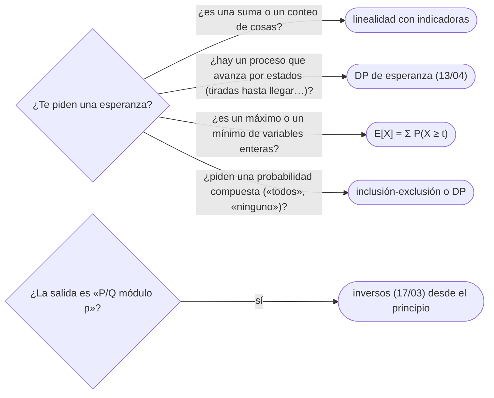

# 06 — Probabilidad y esperanza

> Calcular esperanzas sin listar el espacio de resultados: la linealidad de la esperanza, que vale aunque
> las variables dependan unas de otras, y las variables indicadoras, que convierten «¿cuántos cumplen…?» en
> una suma de probabilidades. Con el coleccionista de cupones, las inversiones de una permutación al azar y
> la forma de imprimir una fracción módulo `p`. Es el dueño de la linealidad; [`13/04`](../13-dp-avanzada/04-probabilidad-y-esperanza.md)
> la resume para las DP de esperanza.
>
> **Niveles:** linealidad de la esperanza [B] · indicadoras [B].
>
> **📚 Lectura troncal:** Mitzenmacher y Upfal, *Probability and Computing*, 2.ª ed. (Cambridge, 2017), caps.
> 1–2; Graham, Knuth y Patashnik, *Concrete Mathematics*, 2.ª ed. (Addison-Wesley, 1994), cap. 8.
>
> **Asume leído:** [`17/03` — Aritmética modular](03-aritmetica-modular.md).
>
> **Vigencia:** 2026-10-04.

**Salto rápido:** [1](#1--el-problema) · [2](#2--la-teoría) · [3](#3--linealidad-de-la-esperanza) · [4](#4--indicadoras) · [5](#5-️-la-tabla-de-costes) · [6](#6--cómo-se-elige) · [7](#7--señales-del-enunciado) · [🧠](#-preguntas) · [🧩](#-problemas-propios)

---

## 1. 🎯 El problema

Se baraja al azar el arreglo `[5, 2, 9, 1, 5, 6]`. ¿Cuántas inversiones (pares fuera de orden) tiene en
promedio? Recorrer las `720` permutaciones y contar es posible con 6 elementos; con `10⁵`, el espacio tiene
`10⁵!` resultados. La respuesta, 7, sale sin mirar ninguna permutación: cada par de valores distintos está
invertido con probabilidad `1/2`, hay 14 pares de valores distintos, y la esperanza de una suma es la suma de
las esperanzas, **aunque los pares no sean independientes**.

Esa es la herramienta del capítulo: descomponer una cantidad aleatoria complicada en una suma de piezas
simples —casi siempre indicadoras de «este par», «esta posición», «este valor»— y sumar sus probabilidades.

> 🧠 **Modelo mental.** Para contar en promedio, no cuentes resultados: pregunta, pieza a pieza, «¿con qué
> probabilidad contribuye esta pieza?», y suma las respuestas.

Los ejemplos usan el arreglo de juguete `[5, 2, 9, 1, 5, 6]` y un dado de 6 caras.

---

## 2. 📐 La teoría

**Esperanza.** Para una variable `X` con valores `xᵢ` y probabilidades `pᵢ`, `E[X] = Σ xᵢ pᵢ`.

**Linealidad.** Para cualesquiera variables `X`, `Y` (independientes o no) y constantes `a`, `b`:
`E[aX + bY] = a E[X] + b E[Y]`.

*Prueba.* `E[X + Y] = Σ_ω (X(ω) + Y(ω)) P(ω) = Σ_ω X(ω) P(ω) + Σ_ω Y(ω) P(ω)`: es la distributividad de la
suma sobre los resultados `ω`. No aparece la independencia en ningún paso.

**Lo que no es lineal.** `E[XY] = E[X] E[Y]` exige independencia; `E[max(X, Y)]`, `E[X²]` o `E[1/X]` no se
descomponen así.

**Indicadoras.** `𝟙_A` vale 1 si ocurre `A` y 0 si no; `E[𝟙_A] = P(A)`. Si `X` cuenta cuántos de los
sucesos `A₁, …, A_m` ocurren, `X = Σ 𝟙_{Aᵢ}` y `E[X] = Σ P(Aᵢ)`.

**Ejemplos clásicos.**

- **Puntos fijos** de una permutación al azar de `n`: cada posición es fija con probabilidad `1/n`; la
  esperanza es `n · 1/n = 1`, para todo `n`.
- **Inversiones** de una permutación al azar de valores distintos: cada uno de los `C(n, 2)` pares está
  invertido con probabilidad `1/2`: `n(n − 1)/4`. Con valores repetidos, solo cuentan los pares distintos.
- **Récords** (máximos de prefijo): el elemento `i` es récord con probabilidad `1/i`; la esperanza es
  `H(n) = 1 + 1/2 + … + 1/n`.
- **Coleccionista de cupones**: con `n` cupones equiprobables, cuando se tienen `i` distintos, el siguiente
  nuevo tarda en promedio `n/(n − i)` (geométrica); la esperanza total es `n H(n)`. Con `n = 6`, `14,7`.

**Fracciones módulo `p`.** Si la respuesta es `P/Q`, se imprime `P · Q⁻¹ mod p` (`17/03`). Como la
linealidad suma fracciones, se trabaja módulo `p` desde el principio con los inversos de los denominadores.

---

## 3. 🧱 Linealidad de la esperanza

**Qué es.** Escribir la cantidad pedida como suma de variables cuyas esperanzas se calculan por separado, y
sumar.

**Por qué es correcto.** La linealidad de §2, que no necesita independencia.

**Cómo va.** La suma de dos dados: `E = 3,5 + 3,5 = 7`, sin las 36 combinaciones. El número esperado de
caras distintas en 3 tiradas de un dado: cada cara aparece al menos una vez con probabilidad
`1 − (5/6)³`, así que la esperanza es `6 (1 − 125/216) = 91/36 ≈ 2,53`.

**Cuánto.** Lo que cueste cada pieza: `O(n)` piezas de `O(1)` es lo habitual.

**La plantilla**, una esperanza como suma de fracciones módulo `p`:

```cpp
#include <vector>

const long long MOD = 1'000'000'007;
long long powMod(long long a, long long e, long long m);        // 17/03

// Número esperado de caras distintas en k tiradas de un dado justo de n caras, módulo MOD:
// n · (1 − ((n − 1)/n)^k), con las fracciones como productos por inversos. n no múltiplo de MOD.
long long expectedDistinct(long long n, long long k) {
    long long invN = powMod(n % MOD, MOD - 2, MOD);
    long long q = (n - 1) % MOD * invN % MOD;                    // probabilidad de no salir una cara
    long long notSeen = powMod(q, k, MOD);                       // … en k tiradas
    return n % MOD * ((1 - notSeen + MOD) % MOD) % MOD;          // linealidad sobre las n caras
}
```

```java
static final long MOD = 1_000_000_007L;                   // powMod de 17/03

static long expectedDistinct(long n, long k) {
    long invN = powMod(n % MOD, MOD - 2, MOD);
    long q = (n - 1) % MOD * invN % MOD;
    long notSeen = powMod(q, k, MOD);
    return n % MOD * ((1 - notSeen + MOD) % MOD) % MOD;
}
```

- **Restas módulo `p`**: `(a − b + MOD) % MOD` para no quedar negativo.
- **En `double`** para respuestas con decimales: la linealidad se suma igual, cuidando la precisión
  (sumas largas, de menor a mayor).
- **La esperanza de un máximo** no es el máximo de las esperanzas: se usa `E[X] = Σ_{t ≥ 1} P(X ≥ t)` para
  variables enteras no negativas.

**Cuándo sí:** sumas de cantidades, conteos de cosas que ocurren, «número esperado de…».
**Cuándo no:** productos, máximos, cocientes de variables dependientes; esperanzas condicionadas por un
proceso con estado (DP de esperanza, `13/04`).

> **Veredicto:** la esperanza de una suma es la suma de las esperanzas, siempre; descomponer bien es todo
> el trabajo.

---

## 4. 🧱 Indicadoras

**Qué es.** Expresar un conteo aleatorio como suma de indicadoras de sucesos simples (este par, esta
posición, este valor) y sumar sus probabilidades.

**Por qué es correcto.** `E[𝟙_A] = P(A)` y la linealidad.

**Cómo va.** Inversiones esperadas al barajar `[5, 2, 9, 1, 5, 6]`:

```text
pares de posiciones: C(6, 2) = 15;  pares con valores iguales: uno (los dos 5)
cada par de valores distintos está invertido con probabilidad 1/2
E[inversiones] = 14 · 1/2 = 7       (comprobado sobre las 720 permutaciones: 7)
```

Y el coleccionista con 6 cupones: `6 (1 + 1/2 + 1/3 + 1/4 + 1/5 + 1/6) = 6 · 49/20 = 147/10`.

**Cuánto.** Una probabilidad por indicadora: `O(n²)` si son pares, `O(n)` si son posiciones; a menudo se
agrupan (todas las del mismo tipo tienen la misma probabilidad).

**La plantilla**, inversiones esperadas de un multiconjunto barajado, módulo `p`:

```cpp
#include <map>
#include <vector>

// Pares de valores distintos / 2: C(n, 2) menos los pares iguales, por el inverso de 2.
long long expectedInversions(const std::vector<long long>& a) {
    long long n = a.size();
    std::map<long long, long long> freq;
    for (long long v : a) freq[v]++;
    long long pairs = n * (n - 1) / 2 % MOD;
    for (auto& [v, c] : freq) pairs = (pairs - c * (c - 1) / 2 % MOD + MOD) % MOD;
    return pairs * ((MOD + 1) / 2) % MOD;                         // (MOD + 1)/2 es el inverso de 2
}
```

```java
static long expectedInversions(long[] a) {
    long n = a.length;
    java.util.Map<Long, Long> freq = new java.util.HashMap<>();
    for (long v : a) freq.merge(v, 1L, Long::sum);
    long pairs = n * (n - 1) / 2 % MOD;
    for (long c : freq.values()) pairs = (pairs - c * (c - 1) / 2 % MOD + MOD) % MOD;
    return pairs * ((MOD + 1) / 2) % MOD;
}
```

- **Simetría**: muchas indicadoras tienen la misma probabilidad por simetría (cualquier par está invertido
  con `1/2`; cualquier posición es récord con `1/i`); se cuentan en grupo.
- **Pares con rangos** (cada elemento elegido de un intervalo): la probabilidad de inversión de cada par se
  calcula aparte y se suma (Inversion Probability, `13/04`).
- **`(MOD + 1)/2`** es el inverso de 2 módulo un primo impar.

**Cuándo sí:** «número esperado de pares que…», «de posiciones que…», «de valores distintos», cualquier
conteo de sucesos. **Cuándo no:** si la pregunta es una probabilidad de un suceso compuesto (que ocurran
todos, que no ocurra ninguno): ahí la linealidad no basta; inclusión-exclusión (`17/05`) o DP.

> **Veredicto:** cuenta con indicadoras: cada suceso pequeño aporta su probabilidad, y la simetría suele dar
> esa probabilidad sin cálculo.

---

## 5. ⏱️ La tabla de costes

| Técnica | Coste típico | Lo que la tabla no dice |
|---|---|---|
| Linealidad sobre `n` piezas | `O(n)` | No necesita independencia |
| Indicadoras sobre pares | `O(n²)`, o `O(n)` agrupando por simetría | Pares iguales aparte |
| Coleccionista | `O(n)` (o `O(1)` con armónicos precalculados) | `n H(n)` |
| Fracción módulo `p` | `O(log p)` por inverso | Inversos de `1..n` en lineal |
| DP de esperanza (comparación) | Según los estados | Cuando hay un proceso con estado (`13/04`) |

---

## 6. 🧭 Cómo se elige



> **Regla de entrevista:** di «linealidad de la esperanza; no hace falta independencia» antes de
> descomponer. Es la frase que el entrevistador está esperando.

---

## 7. 🔎 Señales del enunciado

| Señal | Técnica | Por qué |
|---|---|---|
| «Número esperado de…» | Indicadoras | Suma de probabilidades |
| «Al azar», «uniformemente», «barajado» | Simetría | Probabilidades iguales por pieza |
| «Hasta tener todos los tipos» | Coleccionista | Suma de geométricas |
| «Imprime la respuesta módulo `998 244 353`» con una esperanza | Fracciones con inversos | `P · Q⁻¹` |

---

## ⚠️ Errores frecuentes

| Se dice | Lo preciso |
|---|---|
| «Para la esperanza hace falta independencia» | La linealidad vale siempre; la independencia solo hace falta para `E[XY] = E[X]E[Y]` |
| «`E[max(X, Y)] = max(E[X], E[Y])`» | Falso en general; se usa `Σ P(X ≥ t)` o la distribución |
| «La esperanza se imprime como `(P mod p)/(Q mod p)`» | Se imprime `P · Q⁻¹ mod p` |
| «Los pares iguales también se invierten con 1/2» | Un par de valores iguales nunca es inversión |
| «El número esperado de puntos fijos depende de `n`» | Es 1 para todo `n ≥ 1` |

---

## 📚 Para profundizar

- **Libro** — Mitzenmacher y Upfal, *Probability and Computing*, 2.ª ed. (Cambridge, 2017), caps. 1–2:
  linealidad, indicadoras y el coleccionista. *Lectura troncal.*
- **Libro** — Graham, Knuth y Patashnik, *Concrete Mathematics*, 2.ª ed. (Addison-Wesley, 1994), cap. 8:
  probabilidad discreta. *Lectura troncal.*

---

## 🧠 Preguntas

1. ¿Qué dice la linealidad de la esperanza? 🟢
2. ¿Qué es una variable indicadora y cuál es su esperanza? 🟢
3. ¿Cuántos puntos fijos tiene en promedio una permutación al azar? 🟢
4. ¿Cómo imprimes una esperanza `P/Q` módulo `p`? 🟡
5. ¿Cuántas inversiones tiene en promedio una permutación al azar de `n` valores distintos? ¿Y con repetidos? 🟡
6. ¿Cuál es el número esperado de récords en una permutación al azar? 🟡
7. ¿Cuántas tiradas hacen falta en promedio para ver todas las caras de un dado de `n` caras? 🟡
8. Demuestra la linealidad de la esperanza y señala por qué no hace falta independencia. 🟠
9. ¿Cuántas caras distintas se ven en promedio en `k` tiradas de un dado de `n` caras? 🟠
10. ¿Por qué `E[XY] ≠ E[X]E[Y]` en general? Da un ejemplo. 🟠
11. ¿Cómo calculas la esperanza de un máximo de variables enteras? 🔴
12. ¿Cuándo la linealidad no basta y hace falta una DP de esperanza? 🔴

---

## 🧩 Problemas propios

### Inversiones esperadas

**Nivel:** 🟡 · **Formato:** programa completo.

Se baraja al azar (todas las permutaciones equiprobables) un arreglo de `n` valores, quizá repetidos. Imprime
el número esperado de inversiones módulo `10⁹ + 7`.

- **Entrada.** Una línea con `n`. Una línea con los valores.
- **Salida.** Un entero.
- **Restricciones.** `1 ≤ n ≤ 2·10⁵`; `1 ≤ aᵢ ≤ 10⁹`.

```text
Entrada         Salida
6               7
5 2 9 1 5 6

Entrada         Salida
3               500000005
3 1 2
```

**Pista 1:** ¿con qué probabilidad está invertido un par de posiciones, según sus valores sean iguales o
distintos?

### Caras distintas

**Nivel:** 🟠 · **Formato:** programa completo.

Se tira `k` veces un dado justo de `n` caras. Imprime el número esperado de caras distintas que salen, módulo
`10⁹ + 7`.

- **Entrada.** Una línea con `n` y `k`.
- **Salida.** Un entero.
- **Restricciones.** `1 ≤ n ≤ 10⁹`; `0 ≤ k ≤ 10¹⁸`.

```text
Entrada     Salida
6 3         527777784

Entrada     Salida
2 1         1
```

**Pista 1:** para una cara concreta, ¿cuál es la probabilidad de que no salga en ninguna tirada?

---

## 🧩 Práctica externa

> 💡 **Truco.** Antes de pedir ayuda con una esperanza, simúlala: 10⁶ experimentos al azar dan tres cifras
> correctas, suficientes para saber si tu fórmula va bien. Si una IA te ayuda, que sea a encontrar la
> descomposición ([`01/06`](../01-oficio-del-competidor/06-protocolo-de-resolucion.md)). Los problemas de
> CSES de probabilidad y los de esperanza de la *DP Contest* están en [`13/04`](../13-dp-avanzada/04-probabilidad-y-esperanza.md).

### Núcleo

| ✔ | Problema | Plataforma | Nivel | Patrón | Pista 1 |
|---|---|---|---|---|---|
| [ ] | [Airplane Seat Assignment Probability](https://leetcode.com/problems/airplane-seat-assignment-probability/) | LeetCode | 🟡 | Simetría | Cuando alguien se sienta al azar, ¿qué dos asientos son simétricos? |
| [ ] | [Journey](https://atcoder.jp/contests/abc194/tasks/abc194_d) | AtCoder | 🟡 | Coleccionista | Con `i` vértices visitados, ¿cuánto tardas en promedio en visitar uno nuevo? |
| [ ] | [increment of coins](https://atcoder.jp/contests/abc184/tasks/abc184_d) | AtCoder | 🟡 | Esperanza hacia atrás | Desde un estado, ¿cuántas operaciones esperas, en función de los estados siguientes? |
| [ ] | [Throwing the Die](https://atcoder.jp/contests/abc266/tasks/abc266_e) | AtCoder | 🟡 | Parar o seguir | Con `k` tiradas restantes, ¿cuándo te conviene quedarte con lo que salió? |
| [ ] | [Critical Hit](https://atcoder.jp/contests/abc280/tasks/abc280_e) | AtCoder | 🟡 | Esperanza módulo `p` | ¿Cómo escribes una probabilidad `P/100` módulo `998 244 353`? |

### Ampliación

| ✔ | Problema | Plataforma | Nivel | Patrón | Pista 1 |
|---|---|---|---|---|---|
| [ ] | [Sugoroku 3](https://atcoder.jp/contests/abc263/tasks/abc263_e) | AtCoder | 🟠 | Esperanza con autolazo | Si el dado puede dejarte donde estás, ¿cómo despejas la ecuación? |
| [ ] | [Sugoroku 4](https://atcoder.jp/contests/abc275/tasks/abc275_e) | AtCoder | 🟠 | Probabilidad por DP y módulo | ¿Qué estado necesitas para saber si terminas en `k` tiradas? |
| [ ] | [Sugoroku2](https://atcoder.jp/contests/abc189/tasks/abc189_f) | AtCoder | 🔴 | Esperanza con reinicios | Si `E[0]` aparece en las ecuaciones, ¿puedes escribir cada `E[i]` como `a + b · E[0]`? |

---

## ✅ Criterio de dominio

- Descomponer una esperanza en indicadoras y justificar la linealidad sin independencia.
- Calcular los clásicos (puntos fijos, inversiones, récords, coleccionista) de memoria.
- Imprimir esperanzas como fracciones módulo `p`.
- Resolver Journey y Critical Hit sin pista 2.

---

**Anterior:** [`17/05` — Combinatoria](05-combinatoria.md) · **Siguiente:** [`17/07` — Matrices y eliminación de Gauss](07-matrices-y-gauss.md) ·
**Relacionado:** [`13/04` — DP de probabilidad y esperanza](../13-dp-avanzada/04-probabilidad-y-esperanza.md).
