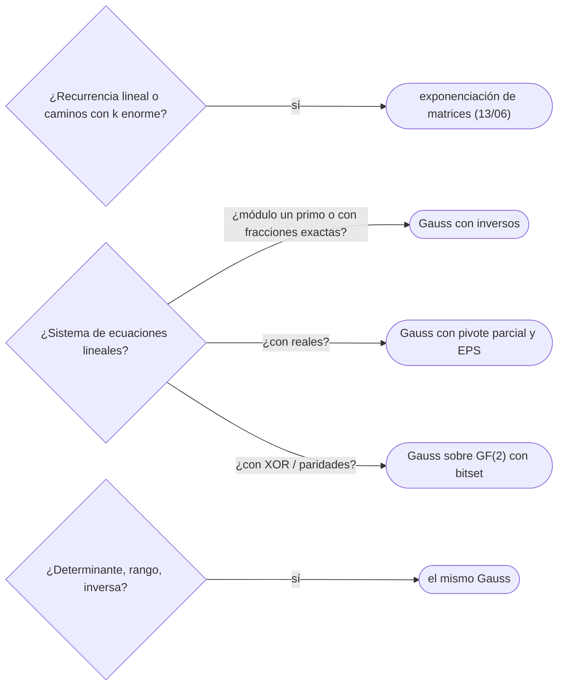

# 07 — Matrices y eliminación de Gauss

> Las matrices como herramienta de cálculo: el producto y la exponenciación (que [`13/06`](../13-dp-avanzada/06-recurrencias-lineales-y-matrices.md)
> usa para las recurrencias), la eliminación de Gauss que resuelve sistemas, calcula determinantes, rangos e
> inversas en `O(n³)`, y su versión sobre `GF(2)`, donde las operaciones son XOR y los `bitset` dividen el
> coste entre 64. Con el pivote parcial, que es lo que separa un resultado correcto de basura numérica.
>
> **Niveles:** exponenciación [B] · Gauss [B] · sobre GF(2) [B].
>
> **📚 Lectura troncal:** Cormen, Leiserson, Rivest y Stein, *Introduction to Algorithms*, 3.ª ed. (MIT
> Press, 2009), cap. 28; Strang, *Introduction to Linear Algebra*, 6.ª ed. (Wellesley-Cambridge, 2023),
> caps. 2–3.
>
> **Asume leído:** [`17/03` — Aritmética modular](03-aritmetica-modular.md).
>
> **Vigencia:** 2026-10-04.

**Salto rápido:** [1](#1--el-problema) · [2](#2--la-teoría) · [3](#3--exponenciación) · [4](#4--gauss) · [5](#5--sobre-gf2) · [6](#6-️-la-tabla-de-costes) · [7](#7--cómo-se-elige) · [8](#8--señales-del-enunciado) · [🧠](#-preguntas) · [🧩](#-problemas-propios)

---

## 1. 🎯 El problema

Tres preguntas que son la misma. Un circuito de resistencias con `n = 100` nudos: ¿qué tensión tiene cada
uno? Las leyes de Kirchhoff dan 100 ecuaciones lineales. Un paseo aleatorio por un grafo con ciclos: ¿cuántos
pasos espera hasta la salida? La esperanza de cada vértice depende de la de sus vecinos, en ciclo: otro
sistema lineal ([`13/04`](../13-dp-avanzada/04-probabilidad-y-esperanza.md)). Y un tablero de luces donde cada interruptor conmuta varias: ¿se pueden apagar
todas? Un sistema lineal sobre `GF(2)`.

Probar valores no sirve; despejar a mano, tampoco con 100 incógnitas. La eliminación de Gauss lo resuelve en
`O(n³)`: un millón de operaciones con `n = 100`. Lo delicado no es el algoritmo, sino sus bordes: sistemas
sin solución, con infinitas, y la precisión de los `double`.

> 🧠 **Modelo mental.** Gauss es lo que se hace a mano en el colegio —usar una ecuación para eliminar una
> incógnita de las demás—, en orden y sin saltarse pasos. La matriz es solo la tabla de coeficientes.

Los ejemplos usan el sistema `2x + y − z = 8`, `−3x − y + 2z = −11`, `−2x + y + 2z = −3`, con solución
`(2, 3, −1)`.

---

## 2. 📐 La teoría

**Producto de matrices.** `(AB)ᵢⱼ = Σₖ Aᵢₖ Bₖⱼ`: `Θ(n³)` con tres bucles (Strassen baja a `O(n^2,81)`, sin
interés práctico en concursos). El producto es asociativo, lo que permite la exponenciación binaria
(`17/03`): `Aᵏ` en `O(n³ log k)`.

**Operaciones elementales de fila.** Intercambiar dos filas, multiplicar una fila por un escalar no nulo y
sumar a una fila un múltiplo de otra no cambian el conjunto de soluciones de `Ax = b`.

**Eliminación de Gauss.** Columna a columna: elegir un **pivote** no nulo, intercambiarlo a su sitio y anular
con él la columna en las demás filas. Al final, la matriz está escalonada. Coste `Θ(n³)` (`n` columnas, `n`
filas, `n` elementos por fila).

**Lo que se lee al final.**

- **Rango**: el número de pivotes. **Variables libres**: las columnas sin pivote.
- **Sin solución**: una fila `0 … 0 | c` con `c ≠ 0`.
- **Infinitas soluciones**: compatible y con variables libres (en un cuerpo finito, `|K|^libres`).
- **Determinante**: el producto de los pivotes, con signo por cada intercambio de filas.

**Pivote parcial.** Con `double`, dividir por un pivote pequeño amplifica los errores de redondeo. En
`[[10⁻²⁰, 1], [1, 1]] x = [1, 2]`, sin intercambiar filas se obtiene `x₁ = 0` (la solución es `x₁ ≈ x₂ ≈ 1`);
eligiendo como pivote el de mayor valor absoluto de la columna, sale bien. Con aritmética modular o
racional el problema no existe: basta un pivote no nulo.

**Sobre `GF(2)`.** El cuerpo de dos elementos: suma es XOR, producto es AND, y el único escalar no nulo es 1.
Gauss es el mismo, y una fila entera cabe en un `bitset`: anular una fila con otra es un XOR de palabras,
`Θ(n³ / 64)`.

---

## 3. 🧱 Exponenciación

**Qué es.** `Aᵏ` por cuadrados sucesivos, con el producto de matrices módulo `p`.

**Por qué es correcto.** El producto es asociativo, como el de números; la exponenciación binaria de `17/03`
vale tal cual.

**Cómo va.** Las recurrencias lineales y el número de caminos de longitud `k` en un grafo (la entrada `(i, j)`
de `Aᵏ`) están desarrollados con sus trazas en [`13/06`](../13-dp-avanzada/06-recurrencias-lineales-y-matrices.md),
que es su dueño; aquí se fija la plantilla.

**Cuánto.** `Θ(n³ log k)`.

**La plantilla:**

```cpp
#include <vector>

using Matrix = std::vector<std::vector<long long>>;
const long long MOD = 1'000'000'007;

Matrix multiply(const Matrix& A, const Matrix& B) {
    int n = A.size(), m = B[0].size(), inner = B.size();
    Matrix C(n, std::vector<long long>(m, 0));
    for (int i = 0; i < n; i++)
        for (int k = 0; k < inner; k++) {                  // orden i-k-j: mejor localidad
            long long a = A[i][k];
            if (a == 0) continue;
            for (int j = 0; j < m; j++) C[i][j] = (C[i][j] + a * B[k][j]) % MOD;
        }
    return C;
}

Matrix matPow(Matrix A, long long k) {
    int n = A.size();
    Matrix R(n, std::vector<long long>(n, 0));
    for (int i = 0; i < n; i++) R[i][i] = 1;
    while (k > 0) {
        if (k & 1) R = multiply(R, A);
        A = multiply(A, A);
        k >>= 1;
    }
    return R;
}
```

```java
static final long MOD = 1_000_000_007L;

static long[][] multiply(long[][] A, long[][] B) {
    int n = A.length, m = B[0].length, inner = B.length;
    long[][] C = new long[n][m];
    for (int i = 0; i < n; i++)
        for (int k = 0; k < inner; k++) {
            long a = A[i][k];
            if (a == 0) continue;
            for (int j = 0; j < m; j++) C[i][j] = (C[i][j] + a * B[k][j]) % MOD;
        }
    return C;
}

static long[][] matPow(long[][] A, long k) {
    int n = A.length;
    long[][] R = new long[n][n];
    for (int i = 0; i < n; i++) R[i][i] = 1;
    for (; k > 0; k >>= 1) {
        if ((k & 1) == 1) R = multiply(R, A);
        A = multiply(A, A);
    }
    return R;
}
```

- **Orden `i-k-j`** de los bucles: recorre filas contiguas de `B` y es varias veces más rápido que `i-j-k`.
- **Reducir módulo `p` menos a menudo**: acumular en `unsigned long long` varios productos antes del `%`, si
  caben.

**Cuándo sí:** recurrencias lineales con `n` enorme, caminos de longitud fija en grafos pequeños.
**Cuándo no:** si la matriz es grande (`n ≥ 500`) y `k` pequeño: multiplicar vectores en lugar de matrices.

> **Veredicto:** la exponenciación de matrices es la binaria de `17/03` con el producto de matrices;
> `Θ(n³ log k)`.

---

## 4. 🧱 Gauss

**Qué es.** Eliminación de Gauss-Jordan sobre la matriz ampliada `[A | b]`: para cada columna, elegir el
pivote, normalizar su fila y anular la columna en todas las demás. Con `double` y pivote parcial, o módulo
un primo con inversos.

**Por qué es correcto.** Las operaciones elementales conservan las soluciones; al final, cada pivote
despeja su variable y las columnas sin pivote son libres.

**Cómo va**, el sistema de §1, con pivote parcial:

```text
[ 2   1  −1 |   8 ]      pivote columna 1: fila 2 (|−3| es el mayor) → intercambio
[−3  −1   2 | −11 ]      … tras anular columnas 1, 2 y 3:
[−2   1   2 |  −3 ]      x = 2, y = 3, z = −1
determinante: −1 (producto de pivotes con el signo de los intercambios)
```

**Cuánto.** `Θ(n² m)` para `n` ecuaciones y `m` incógnitas; `Θ(n³)` cuadrado.

**La plantilla**, módulo un primo (exacta):

```cpp
#include <algorithm>
#include <vector>

long long powMod(long long a, long long e, long long m);   // 17/03

// Resuelve A x = b (mod MOD). a = matriz ampliada n × (m + 1). Devuelve 0 si no hay solución,
// 1 si es única y 2 si hay infinitas; en x, una solución (libres a 0).
int gaussMod(std::vector<std::vector<long long>> a, int m, std::vector<long long>& x) {
    int n = a.size(), row = 0;
    std::vector<int> where(m, -1);
    for (int col = 0; col < m && row < n; col++) {
        int sel = row;
        while (sel < n && a[sel][col] == 0) sel++;
        if (sel == n) continue;                                  // columna sin pivote: variable libre
        std::swap(a[sel], a[row]);
        where[col] = row;
        long long inv = powMod(a[row][col], MOD - 2, MOD);
        for (int j = col; j <= m; j++) a[row][j] = a[row][j] * inv % MOD;
        for (int i = 0; i < n; i++)
            if (i != row && a[i][col] != 0) {
                long long f = a[i][col];
                for (int j = col; j <= m; j++) a[i][j] = (a[i][j] - f * a[row][j] % MOD + MOD) % MOD;
            }
        row++;
    }
    x.assign(m, 0);
    for (int j = 0; j < m; j++) if (where[j] != -1) x[j] = a[where[j]][m];
    for (int i = row; i < n; i++) if (a[i][m] != 0) return 0;     // fila 0 … 0 | c ≠ 0
    for (int j = 0; j < m; j++) if (where[j] == -1) return 2;
    return 1;
}
```

```java
// Con double y pivote parcial; EPS para decidir si un valor es cero. Devuelve 0, 1 o 2 como la de C++.
static int gaussDouble(double[][] a, int m, double[] x) {
    final double EPS = 1e-9;
    int n = a.length, row = 0;
    int[] where = new int[m];
    java.util.Arrays.fill(where, -1);
    for (int col = 0; col < m && row < n; col++) {
        int sel = row;
        for (int i = row; i < n; i++) if (Math.abs(a[i][col]) > Math.abs(a[sel][col])) sel = i;   // pivote parcial
        if (Math.abs(a[sel][col]) < EPS) continue;
        double[] t = a[sel]; a[sel] = a[row]; a[row] = t;
        where[col] = row;
        for (int i = 0; i < n; i++)
            if (i != row) {
                double f = a[i][col] / a[row][col];
                for (int j = col; j <= m; j++) a[i][j] -= f * a[row][j];
            }
        row++;
    }
    for (int j = 0; j < m; j++) x[j] = where[j] == -1 ? 0 : a[where[j]][m] / a[where[j]][j];
    for (int i = 0; i < n; i++) {                                // comprobar la solución
        double s = 0;
        for (int j = 0; j < m; j++) s += a[i][j] * x[j];
        if (Math.abs(s - a[i][m]) > EPS) return 0;
    }
    for (int j = 0; j < m; j++) if (where[j] == -1) return 2;
    return 1;
}
```

- **Módulo primo**: cualquier pivote no nulo vale; los inversos con Fermat. Es exacto.
- **Con `double`**: pivote parcial siempre, y comparar con `EPS`, nunca con `== 0`.
- **Determinante**: el mismo recorrido sin la columna `b`, multiplicando los pivotes y cambiando el signo en
  cada intercambio.
- **Inversa**: Gauss-Jordan sobre `[A | I]`; si no hay `n` pivotes, `A` no es invertible.

**Cuándo sí:** sistemas lineales de hasta unos cientos de incógnitas, determinantes, rangos, inversas,
esperanzas en grafos con ciclos. **Cuándo no:** sistemas de `10⁵` incógnitas dispersos (métodos iterativos o
estructura especial); si el sistema es triangular, sustitución directa en `O(n²)`.

> **Veredicto:** Gauss es `Θ(n³)`: exacto módulo un primo; con `double`, solo con pivote parcial y `EPS`.

---

## 5. 🧱 Sobre GF(2)

**Qué es.** Gauss con las filas como `bitset`: el pivote es cualquier fila con un 1 en la columna, y anular
es un XOR de filas.

**Por qué es correcto.** `GF(2)` es un cuerpo: las operaciones elementales conservan las soluciones, y el
único escalar no nulo es 1, así que no hay divisiones. Las soluciones, si existen, son `2^libres`.

**Cómo va.** Tres luces, tres interruptores: el 1 conmuta las luces 1 y 2, el 2 las 2 y 3, el 3 las 1 y 3.
Con las luces `1 0 1` encendidas, el sistema `s₁ ⊕ s₃ = 1`, `s₁ ⊕ s₂ = 0`, `s₂ ⊕ s₃ = 1` tiene rango 2 y es
compatible: 2 formas de apagarlas. Con `1 0 0`, incompatible: ninguna.

**Cuánto.** `Θ(n² m / 64)` con `bitset`.

**La plantilla:**

```cpp
#include <bitset>
#include <vector>

const int MAXV = 1024;                                   // columnas + 1 (la de términos independientes)

// Filas como bitset: bits 0..m−1 coeficientes, bit m término independiente.
// Devuelve el rango, o −1 si el sistema es incompatible.
int gaussGF2(std::vector<std::bitset<MAXV>> a, int m) {
    int n = a.size(), row = 0;
    for (int col = 0; col < m && row < n; col++) {
        int sel = row;
        while (sel < n && !a[sel][col]) sel++;
        if (sel == n) continue;
        std::swap(a[sel], a[row]);
        for (int i = 0; i < n; i++) if (i != row && a[i][col]) a[i] ^= a[row];   // XOR de la fila entera
        row++;
    }
    for (int i = row; i < n; i++) if (a[i][m]) return -1;   // 0 … 0 | 1
    return row;                                          // soluciones: 2^(m − rango)
}
```

```java
// Filas como long[] de (m + 1 + 63) / 64 palabras; mismo algoritmo.
static int gaussGF2(long[][] a, int m) {
    int n = a.length, row = 0, words = a[0].length;
    for (int col = 0; col < m && row < n; col++) {
        int w = col >> 6; long bit = 1L << (col & 63);
        int sel = row;
        while (sel < n && (a[sel][w] & bit) == 0) sel++;
        if (sel == n) continue;
        long[] t = a[sel]; a[sel] = a[row]; a[row] = t;
        for (int i = 0; i < n; i++)
            if (i != row && (a[i][w] & bit) != 0)
                for (int k = 0; k < words; k++) a[i][k] ^= a[row][k];
        row++;
    }
    int wb = m >> 6; long bb = 1L << (m & 63);
    for (int i = row; i < n; i++) if ((a[i][wb] & bb) != 0) return -1;
    return row;
}
```

- **La base XOR** de [`17/01`](01-bits.md) es este mismo algoritmo, sobre vectores que llegan de uno en uno.
- **Número de soluciones**: `2^(m − rango)`; módulo `p`, con exponenciación.
- **Tamaño de `bitset`** fijo en C++: `MAXV` en compilación.

**Cuándo sí:** luces e interruptores, paridades, XOR de subconjuntos con objetivo, códigos lineales.
**Cuándo no:** si las operaciones no son XOR (sumas con acarreo).

> **Veredicto:** sobre `GF(2)`, Gauss es XOR de filas en `bitset`: `n³/64`, y `2^libres` soluciones si es
> compatible.

---

## 6. ⏱️ La tabla de costes

| Operación | Coste | Lo que la tabla no dice |
|---|---|---|
| Producto de matrices `n × n` | `Θ(n³)` | Orden `i-k-j` |
| `Aᵏ` | `Θ(n³ log k)` | El dueño es `13/06` |
| Gauss (sistema, rango, determinante) | `Θ(n³)` | Pivote parcial con `double` |
| Inversa | `Θ(n³)` | Gauss-Jordan sobre `[A \| I]` |
| Gauss sobre `GF(2)` | `Θ(n³ / 64)` | `bitset` |

---

## 7. 🧭 Cómo se elige



> **Regla de entrevista:** si mencionas Gauss con `double`, añade «con pivote parcial y una tolerancia»;
> sin eso, la respuesta es incompleta.

---

## 8. 🔎 Señales del enunciado

| Señal | Técnica | Por qué |
|---|---|---|
| «Cada valor es la media / combinación de sus vecinos» | Sistema lineal | Ecuaciones acopladas |
| «Esperanza en un grafo con ciclos» | Gauss sobre las esperanzas | Despejar no basta (`13/04`) |
| «Interruptores que conmutan varias luces» | Gauss sobre `GF(2)` | XOR |
| «Determinante», «¿es invertible?», «rango» | Gauss | Producto de pivotes, número de pivotes |
| `n ≤ 500` con ecuaciones lineales | `Θ(n³)` | `1,25·10⁸` |

---

## ⚠️ Errores frecuentes

| Se dice | Lo preciso |
|---|---|
| «Gauss con `double` es exacto» | Acumula error; sin pivote parcial puede dar basura (`x₁ = 0` donde es 1) |
| «Si `a[i][j] == 0.0`, la columna no tiene pivote» | Con `double`, se compara con una tolerancia |
| «Un sistema cuadrado tiene una única solución» | Solo si el rango es `n`; puede no tener ninguna o tener infinitas |
| «El determinante es el producto de la diagonal tras eliminar» | Con el signo de cada intercambio de filas |
| «Gauss sobre `GF(2)` necesita divisiones» | El único escalar no nulo es 1: solo XOR |

---

## 📚 Para profundizar

- **Libro** — Cormen, Leiserson, Rivest y Stein, *Introduction to Algorithms*, 3.ª ed. (MIT Press, 2009),
  cap. 28: descomposición LUP, sistemas e inversas. *Lectura troncal.*
- **Libro** — Strang, *Introduction to Linear Algebra*, 6.ª ed. (Wellesley-Cambridge, 2023), caps. 2–3:
  eliminación, rango y soluciones. *Lectura troncal.*
- **Referencia** — cp-algorithms, [*Gauss method for solving system of linear equations*](https://cp-algorithms.com/linear_algebra/linear-system-gauss.html).
- **Referencia** — cp-algorithms, [*Calculating the determinant of a matrix by Gauss*](https://cp-algorithms.com/linear_algebra/determinant-gauss.html).

---

## 🧠 Preguntas

1. ¿Cuánto cuesta multiplicar dos matrices `n × n` y elevar una a la `k`? 🟢
2. ¿Qué operaciones de fila no cambian las soluciones de un sistema? 🟢
3. ¿Cómo sabes, al terminar Gauss, si el sistema no tiene solución? 🟢
4. ¿Qué es el pivote parcial y por qué hace falta con `double`? 🟡
5. ¿Cómo calculas el determinante con Gauss? 🟡
6. ¿Cuántas soluciones tiene un sistema compatible sobre `GF(2)` con `m` incógnitas y rango `r`? 🟡
7. ¿Por qué el orden `i-k-j` de los bucles es más rápido? 🟡
8. Da un sistema de 2 × 2 donde Gauss sin pivote parcial falla con `double`. 🟠
9. ¿Cómo calculas la inversa de una matriz? 🟠
10. ¿Cómo se usa Gauss para la esperanza de pasos en un paseo aleatorio con ciclos? 🟠
11. ¿Qué relación hay entre Gauss sobre `GF(2)` y la base XOR de `17/01`? 🔴
12. ¿Cómo resolverías un sistema módulo un número compuesto? 🔴

---

## 🧩 Problemas propios

### Sistema módulo p

**Nivel:** 🟡 · **Formato:** programa completo.

Resuelve `A x = b` módulo `p = 10⁹ + 7`. Imprime la solución si es única, `MANY` si hay infinitas y `NONE` si
no hay ninguna.

- **Entrada.** Una línea con `n`. Después, `n` líneas con `n + 1` enteros: la fila de `A` y el término de `b`.
- **Salida.** `n` enteros entre 0 y `p − 1`, o `MANY`, o `NONE`.
- **Restricciones.** `1 ≤ n ≤ 300`; `|coeficientes| ≤ 10⁹`.

```text
Entrada         Salida
3               2 3 1000000006
2 1 -1 8
-3 -1 2 -11
-2 1 2 -3

Entrada         Salida
2               MANY
1 2 3
2 4 6
```

**Pista 1:** módulo un primo, ¿qué pivote te sirve, y cómo divides por él?

### Apagar las luces

**Nivel:** 🟠 · **Formato:** programa completo.

Hay `n` luces y `m` interruptores; cada interruptor conmuta un conjunto de luces. Con el estado inicial dado,
¿de cuántas formas (subconjuntos de interruptores pulsados una vez) se pueden apagar todas? Módulo
`10⁹ + 7`.

- **Entrada.** Una línea con `n` y `m`. Una línea con el estado inicial (`n` ceros y unos). Después, `m`
  líneas: la `j`-ésima con `k` y las `k` luces (desde 1) que conmuta el interruptor `j`.
- **Salida.** Un entero.
- **Restricciones.** `1 ≤ n, m ≤ 1 000`.

```text
Entrada     Salida
3 3         2
1 0 1
2 1 2
2 2 3
2 1 3

Entrada     Salida
2 1         1
0 0
1 1
```

Con el mismo tablero y el estado inicial `1 0 0`, la salida es 0.

**Pista 1:** si `sⱼ` dice si pulsas el interruptor `j`, ¿qué ecuación da cada luz?

---

## 🧩 Práctica externa

> 💡 **Truco.** Antes de pedir ayuda con un Gauss que falla, sustituye la solución en las ecuaciones
> originales: si no las cumple, el error está en la eliminación; si las cumple pero el juez la rechaza, en la
> salida o en los casos sin solución. Si una IA te ayuda, que sea a revisar eso ([`01/06`](../01-oficio-del-competidor/06-protocolo-de-resolucion.md)).
> Los problemas de exponenciación de matrices (CSES Fibonacci Numbers, Graph Paths I y II) están en `13/06`.

### Núcleo

| ✔ | Problema | Plataforma | Nivel | Patrón | Pista 1 |
|---|---|---|---|---|---|
| [ ] | [Matrix Product](https://judge.yosupo.jp/problem/matrix_product) | Library Checker | 🟢 | Producto | ¿Qué orden de bucles va más rápido? |
| [ ] | [Pow of Matrix](https://judge.yosupo.jp/problem/pow_of_matrix) | Library Checker | 🟡 | Exponenciación | Con `n = 200` y `k` hasta `10¹⁸`, ¿cuántos productos haces? |
| [ ] | [Linear Equation Solver](https://open.kattis.com/problems/equationsolver) | Kattis | 🟡 | Gauss con `double` | ¿Qué imprimes con infinitas soluciones y qué sin ninguna? |
| [ ] | [Determinant of Matrix](https://judge.yosupo.jp/problem/matrix_det) | Library Checker | 🟠 | Determinante módulo `p` | ¿Qué le pasa al signo al intercambiar filas? |
| [ ] | [Rank of Matrix](https://judge.yosupo.jp/problem/matrix_rank) | Library Checker | 🟠 | Rango | ¿Qué cuentas al terminar la eliminación? |
| [ ] | [System of Linear Equations](https://judge.yosupo.jp/problem/system_of_linear_equations) | Library Checker | 🟠 | Solución y base del núcleo | Las columnas libres, ¿qué vectores del núcleo generan? |

### Ampliación

| ✔ | Problema | Plataforma | Nivel | Patrón | Pista 1 |
|---|---|---|---|---|---|
| [ ] | [Partial Linear Equation Solver](https://open.kattis.com/problems/equationsolverplus) | Kattis | 🟠 | Variables determinadas | ¿Qué variables quedan fijadas aunque haya infinitas soluciones? |
| [ ] | [Inverse Matrix](https://judge.yosupo.jp/problem/inverse_matrix) | Library Checker | 🟠 | Gauss-Jordan | ¿Qué matriz pones a la derecha de `A`? |
| [ ] | [System of Linear Equations (Mod 2)](https://judge.yosupo.jp/problem/system_of_linear_equations_mod_2) | Library Checker | 🔴 | Gauss sobre `GF(2)` | ¿Cómo representas una fila para que anularla sea un XOR? |

---

## ✅ Criterio de dominio

- Escribir Gauss módulo un primo y con `double` y pivote parcial, con la plantilla delante.
- Distinguir sistema sin solución, con una y con infinitas, y obtener el rango y el determinante.
- Resolver sistemas sobre `GF(2)` con `bitset`.
- Resolver Linear Equation Solver y Determinant of Matrix sin pista 2.

---

**Anterior:** [`17/06` — Probabilidad y esperanza](06-probabilidad-y-esperanza.md) · **Siguiente:** [`17/08` — Teoría de juegos](08-teoria-de-juegos.md) ·
**Relacionado:** [`13/06` — Recurrencias lineales y exponenciación de matrices](../13-dp-avanzada/06-recurrencias-lineales-y-matrices.md).
